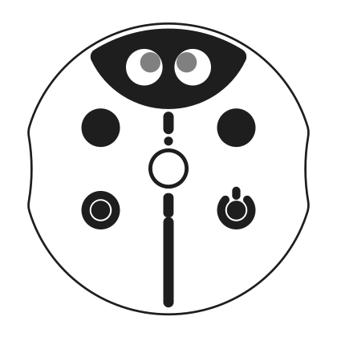
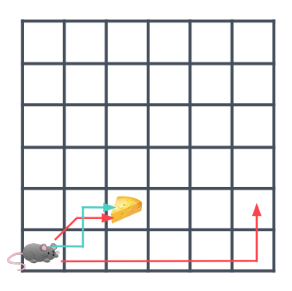
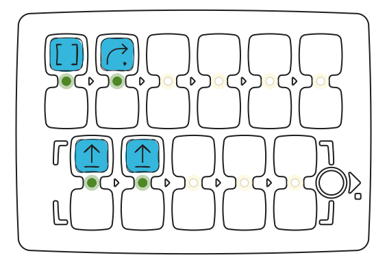
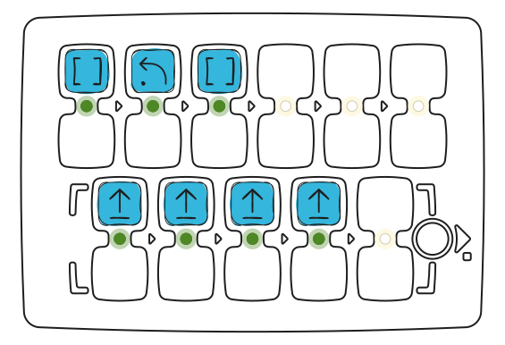
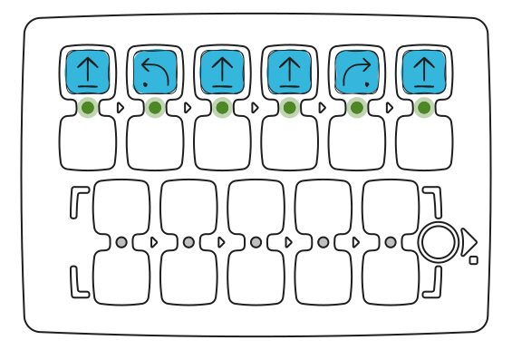
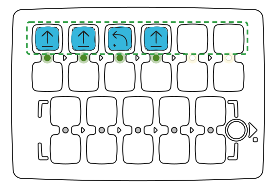
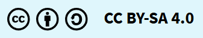

## Leitfaden für den Unterricht mit Kindern ab 4 Jahren

PrimaSTEM hilft Kindern Schritt für Schritt, logisches Denken, die Grundlagen der Programmierung und Mathematik zu meistern. Dieser Leitfaden hilft Ihnen bei der Durchführung von Unterrichtsstunden mit Kindern ab 4 Jahren.

### So funktioniert es

Die Kinder programmieren die Bewegungen eines kleinen Marienkäfer-Roboters. Dazu legen sie Befehls-Tokens auf das Steuerboard.

- **„Vorwärts“**: Der Roboter fährt geradeaus.
- **„Links“**: Der Roboter dreht sich nach links.
- **„Rechts“**: Der Roboter dreht sich nach rechts.
- **„Funktion“** (Token „[ ]“): ersetzt eine Folge von Befehlen.
- **„Wiederholung“**: wiederholt einen Befehl oder eine Funktion mehrmals.

Sie legen die Tokens auf das Steuerboard und erstellen so das Programm für den Roboter. Wenn das Programm fertig ist, drücken Sie die Taste, und der Roboter führt die Befehle aus.

### Inhalt des Leitfadens

- Warum Unterricht in Robotik und Programmierung durchführen
- Wie Sie den Unterricht unter verschiedenen Bedingungen organisieren
- Aktivitäten und Lernziele
- Detaillierte Gebrauchsanweisung
- Beschreibung der Aktivitäten
- Anhänge
- Über das Projekt und die Autoren

### Was PrimaSTEM vermittelt

- Programmieren mit den Händen, ohne Bildschirm
- Verstehen, dass Maschinen nach Algorithmen arbeiten
- Handlungen im Voraus planen
- Logisch denken
- Befehlsfolgen und Funktionen aufbauen
- Verstehen, was ein „Bug“ ist (ein Fehler im Code), und Fehler finden
- Zahlen, Arithmetik und Geometrie anschaulich lernen

## Woraus besteht PrimaSTEM

### Was ist in der Box

- Marienkäfer-Roboter
- Steuerboard
- Befehls-Tokens *
- Leitfaden für Aktivitäten *

(*) Der Inhalt hängt von der Ausstattung ab.

## Warum Unterricht in Programmierung und Mathematik durchführen

Code, Programmierung und Automatisierung sind Teil unseres täglichen Lebens geworden.

In den letzten Jahren haben die Menschen gelernt, Maschinen zu bauen, die Dinge können, die Maschinen früher nicht konnten: verstehen, sprechen, hören, sehen, antworten, schreiben.

Beispiele gibt es viele: selbstfahrende Autos, Roboterassistenten für ältere Menschen, Lieferroboter und andere.

### Warum Programmieren und Robotik lernen

Wenn ein Kind programmieren lernt, lernt es, die Maschinen um uns herum zu verstehen. Es lernt, kleine und mutige Ideen in echte Projekte zu verwandeln. Es zerlegt eine schwierige Aufgabe in einfache Schritte. Es arbeitet mit anderen zusammen und löst gemeinsame Aufgaben.

### Digital Natives

Es kann scheinen, dass Kinder und Jugendliche sich gut mit Technologie auskennen. Sie nutzen ja viel digitale Unterhaltung.

Aber können sie mit diesen Werkzeugen etwas Eigenes schaffen und sich ausdrücken? Was tun sie, wenn sie auf ein technisches Problem stoßen?

## So organisieren Sie den Unterricht

Die Aktivitäten passen zu verschiedenen Zielen und Bildungssituationen. Alle Aktivitäten im Leitfaden sind nummeriert. Unten steht, welche Aktivitäten zu Ihrer Situation passen.

### Für wen

- Kinder von 4 bis 8 Jahren.
- Ältere und Vorschulgruppen im Kindergarten, 1. und 2. Klasse der Grundschule.

### Aktivitäten für die außerschulische Arbeit

Aktivitäten 1, 2, 4, 5, 6, 7, 8, 9, 10.

### Aktivitäten für die Schule

Aktivitäten 2, 3, 4, 5, 6, 7, 8, 9, 11, 12.

### Außerschulische Arbeit

In einer Gruppe sind höchstens 12 Kinder am besten, damit jedes Kind aktiv teilnehmen kann.

Wir empfehlen ein Gerät für 2–3 Schüler. So lernen die Kinder, im Team zu arbeiten und miteinander zu sprechen.

### Arbeit in der Schule

Im Unterricht arbeiten Sie am besten in kleinen Gruppen von 4–6 Kindern mit einem Lehrer an PrimaSTEM.
Die anderen Schüler bearbeiten in dieser Zeit eine andere Aufgabe mit einem Erziehungsassistenten. Schüler der 1. und 2. Klasse können zum Beispiel üben, den Weg des Roboters nach dem Programm zu zeichnen.
In beiden Fällen arbeiten Sie am besten in einem Mehrzweckraum, direkt auf dem Boden. Sie können auch Tische und Stühle zusammenschieben, um Platz zu schaffen.

**Achtung.** Laden Sie die Akkus des Steuerboards und des Roboters im Voraus auf.

## Aktivitäten und Lernziele

| Aktivität | Algorithmus und Programm | Route in Etappen | Bewegung vorhersagen | Problem lösen, Fehler finden | Teamarbeit |
| --- | :---: | :---: | :---: | :---: | :---: |
| 1 |   | X |   | X |   |
| 2 |   |   | X |   | X |
| 3 | X | X |   |   |   |
| 4 | X | X | X |   |   |
| 5 | X | X | X |   | X |
| 6 | X | X | X | X | X |
| 7 | X | X | X | X | X |
| 8 | X |   | X | X |   |
| 9 | X | X | X | X | X |
| 10 | X |   | X | X |   |
| 11 | X | X | X | X | X |
| 12 | X | X | X | X | X |

## Gebrauchsanweisung

### Inhalt der Anweisung

- Kennenlernen der Materialien
- Programmierung einer Funktion
- Karten
- Technische Erläuterungen

## Kennenlernen der Materialien

### Roboter

Ein kleiner Marienkäfer-Roboter aus Holz mit zwei Augen.

Er hat drei Stützpunkte: zwei Räder und eine Stütze hinten. Darauf hält er das Gleichgewicht.

### Grundbefehle

| Befehl | Zeichnung                           | Beschreibung                                                                                     |
| ------- | ----------------------------------- | -------------------------------------------------------------------------------------------- |
| Vorwärts |   | Der Roboter fährt ein Feld weiter. Das ist ein logischer Schritt, standardmäßig 15 cm. |
| Links |      | Der Roboter dreht sich um 90° nach links                                                           |
| Rechts |     | Der Roboter dreht sich um 90° nach rechts                                                          |
| Rückwärts |      | Der Roboter fährt ein Feld zurück, also einen logischen Standardschritt                                |
| Funktion |  | Der Roboter führt die Befehle aus der Funktionsreihe aus                    |
| Wiederholen N |   | Der Roboter wiederholt den Befehl aus demselben Paar N-mal |

### Steuerboard

Auf dem Steuerboard steuern Sie den Roboter: Sie legen Befehls-Tokens in die freien Zellen (D).

Die obere Reihe (A) aus 6 Zellenpaaren, verbunden durch eine Ausführungslinie (E), ist das Hauptprogramm. Das Programm beginnt in der linken Zelle (D) und endet über der **▶ Start**-Taste (B). Diese Taste sendet die Befehle an den Roboter und startet das Programm.

Die untere Reihe (C) aus 5 Zellenpaaren legt die Bewegungen für das Token „Funktion“ („[ ]“) fest. Jedes Paar hat eine LED (F). Sie leuchtet auf, wenn Sie ein Token einlegen, und blinkt, wenn der Roboter diesen Befehl ausführt.

#### LED-Farben

Liegt ein Token richtig in einer Zelle, leuchtet die LED grün.
Legen Sie in das Paar mit einem Bewegungsbefehl eine Wiederholung, leuchtet die LED blau.
Liegen die Tokens falsch, zum Beispiel zwei Bewegungsbefehle in einem Paar, leuchtet die LED rot. Der Roboter überspringt diesen Befehl.

### Akku und Ein-/Ausschalter

Der Roboter und das Steuerboard laufen mit eingebauten Akkus. Sie laden die Akkus über einen USB-C-Anschluss. Der Ein-/Ausschalter (ON/OFF) sitzt oben auf dem Roboter und vorn links am Steuerboard.

Wenn der Roboter oder das Steuerboard sich einschaltet, ertönt ein kurzes Signal.
Beim eingeschalteten Steuerboard leuchtet die LED an der Vorderseite grün. Beim eingeschalteten Roboter leuchtet die LED am USB-C-Anschluss grün.

### Drahtlose Verbindung

Roboter und Steuerboard sind über Bluetooth verbunden, die Reichweite beträgt etwa 5 m. Nachdem sich der Roboter zum ersten Mal mit dem Steuerboard verbunden hat, funktioniert die Verbindung von selbst. Sie müssen nichts einstellen.

> Sie können das Steuerboard mit einem anderen Roboter koppeln (Pairing).
> 1. Schalten Sie einen Roboter ein, der noch nicht mit dem Steuerboard gekoppelt ist.
> 2. Schalten Sie das Steuerboard ein.
> 3. Halten Sie die **▶ Start**-Taste auf dem Steuerboard 10 Sekunden lang gedrückt, bis ein akustisches und optisches Signal kommt.

### So erstellen und starten Sie ein Programm

Das Programm (die „Bewegungssequenz“) beginnt links auf dem Steuerboard. Es folgt den eingravierten Pfeilen „>“. Das ist die Ausführungslinie, sie verbindet die Zellenpaare horizontal.

Liegt vor einem Token eine leere Zelle, überspringt der Roboter die leere Zelle und führt den Befehl dieses Tokens aus.

Liegt ein Token falsch, leuchtet die LED rot, und der Roboter überspringt diesen Teil des Programms. Das passiert zum Beispiel, wenn „Wiederholung“ in einem Paar ohne Befehl liegt oder zwei Befehls-Tokens in einem Paar liegen.

Wenn das Programm fertig ist, drücken Sie die **▶ Start**-Taste.

Während der Roboter das Programm ausführt, erlöschen die LEDs auf dem Steuerboard nacheinander. Die LED des aktuellen Befehls blinkt.

## Programmierung einer Funktion

### So erstellen Sie eine Funktion

Das Token „Funktion“ („[ ]“) ersetzt eine Folge von Befehlen.

Damit können Sie längere Programme bauen und schwierigere Aufgaben lösen. Um eine Funktion zu erstellen, legen Sie die Bewegungen in die untere Reihe des Steuerboards: das sind 5 Zellenpaare. Der Roboter führt diese Reihe von links nach rechts aus, jedes Mal wenn er im Hauptprogramm (oben) ein Token „Funktion“ findet.

Im folgenden Beispiel besteht die Funktion aus einer Bewegung geradeaus und einer Drehung nach rechts. Das Hauptprogramm ruft die Funktion 2-mal auf. Dann wiederholt das Token „Wiederholen 2“ die Funktion noch 2-mal.

[Im Simulator starten](https://simulator.primastem.com/#top=cfun,cfun,cfun.r002&fn=cfor,crig&s=l1144602&r=225-675-0&run)

Das Ergebnis:

## Karten

### Welche Karten passen

In den ersten Aktivitäten lernen die Kinder Algorithmen, Programmierung und Zahlen. Dafür fährt der Roboter auf einer Karte mit Raster. Am besten nehmen Sie eine Karte mit Feldern von 15 cm: So weit fährt der Roboter standardmäßig in einem Schritt.

Karten für andere Roboter gehen auch, wenn die Feldgröße zu diesem Roboter passt.

> Sie können den Standardschritt von 15 cm auf die Feldgröße Ihrer Karte ändern, zum Beispiel auf 10 cm, 12,5 cm oder 20 cm. Legen Sie dazu das Service-Token „Standardschritt“ mit einer Zahl in Millimetern ein: 100 für 10 cm, 125 für 12,5 cm, 200 für 20 cm.

Wenn Sie keine Karte haben, machen Sie selbst eine. Kleben Sie schmales Malerkrepp auf einen ebenen Tisch oder Boden. Sie können auch ein Blatt Zeichenpapier (oder festes Bannermaterial) und einen Marker nehmen.

Eine Schachbrettkarte oder eine leere Karte mit Feldern dient dazu, die Fahrt von einem Punkt zum anderen zu üben. Farben lenken dabei nicht ab.

Eine farbige Karte hilft, kurze Geschichten über die Reisen des Roboters zu erzählen. Zum Beispiel: „Der Marienkäfer verlässt das Haus und geht durch den Wald in die Berge.“ Die Klasse kann eine neue Karte machen und neue Geschichten über die Reisen des Marienkäfers erfinden.

#### Beispiele für Karten

Schachbrettkarte

Farbige Karte

## Technische Erläuterungen

### So ist es aufgebaut

Im Steuerboard und im Roboter sitzen Mikrocontroller und Li-Ion-Akkus. Die Geräte sind über Funk mit dem Standardprotokoll Bluetooth verbunden.

Die Leiterplatte des Roboters steuert sein gesamtes Verhalten. Sie steuert zwei 5V DC-Motoren und zwei mehrfarbige LEDs, gibt Töne wieder, kommuniziert mit dem Steuerboard usw.

Die Leiterplatte des Steuerboards erkennt die Tokens in den Zellen, gibt Töne wieder und steuert 11 mehrfarbige LEDs, eine für jedes Zellenpaar.

In jedem Token steckt ein NFC-Sticker mit dem Code eines Befehls. Das Steuerboard liest diesen Code, wenn Sie das Token in eine Zelle legen.

Hat das Steuerboard die Tokens erkannt und Sie starten das Programm, sendet das Steuerboard die Befehle drahtlos an den Roboter.

### Eigene Befehls-Tokens

Sie können zusätzliche Befehls-Tokens herstellen, zum Beispiel „Wiederholen 12“ oder weitere Bewegungs-Tokens. Dafür brauchen Sie „leere“ Tokens mit NFC-Stickern und ein Telefon mit NFC. Die meisten Sticker-Typen mit einer Frequenz von 13,56 MHz funktionieren.

Ein Video-Tutorial gibt es auf unserem YouTube-Kanal: https://www.youtube.com/@primastem

---

## Aktivitäten

### Detaillierte Beschreibung der Aktivitäten

- **Aktivität 1**: Weg über das Schachbrett von Punkt A nach Punkt B
- **Aktivität 2**: Kennenlernen von PrimaSTEM
- **Aktivität 3**: ein Kind spielt den Roboter, Orientierung und Algorithmus
- **Aktivität 4**: den Weg des Roboters nach dem Programm vorhersagen
- **Aktivität 5**: Befehlsfolgen in einem zufälligen Programm
- **Aktivität 6**: den Roboter mit dem Steuerboard in die Berge führen
- **Aktivität 7**: Kennenlernen des Tokens „Funktion“
- **Aktivität 8**: Weg zum Ziel mit einer Funktion
- **Aktivität 9**: Fehlersuche in einem Programm mit einem Fehler
- **Aktivität 10**: einen Fehler im Programm auf Papier finden
- **Aktivitäten 11 und 12**: die Bewegungen des Roboters vorhersagen (in Aktivität 12 mit dem Token „Funktion“)

---

## Aktivität 1. Weg über das Schachbrett von Punkt A nach Punkt B

- **individuell**
- **15 Min.**
- **auf Papier**
- **Druckunterlagen**

### Ziel

- Den Weg über die Felder von Punkt A nach Punkt B auf der Karte planen.

Die Übung dauert 10 Minuten, einschließlich der Zusammenfassung.

### Zum Ausdrucken

Drucken Sie für jeden Schüler das Blatt „[Anhang 1. Bewegung auf der Karte](/de/book-1/attachment-1)“ aus.

### Übung

Die Kinder zeichnen auf dem Raster den Weg ein, auf dem die Maus zum Käse kommt. Beginnen Sie mit der linken Übung, sie ist einfacher. Gehen Sie dann zur rechten über.

#### Bewegung über die Felder

Die Maus geht über die Felder des Rasters. Diagonal darf sie nicht gehen. Die Kinder sollen verstehen, dass der Weg der Maus in Etappen unterteilt ist: Sie geht jeweils ein Feld weit. So bewegt man sich schrittweise.

Im obigen Beispiel ist nur der blaue Weg richtig. Der kurze rote Weg ist falsch, weil er diagonal verläuft. Der lange rote Weg ist falsch, weil er nicht zum gewünschten Punkt führt.

### Diskussion in der Gruppe

Im obigen Beispiel sind alle Wege richtig: Auf jedem kommt die Maus zum Käse.

Zeigen Sie den Kindern, dass jedes Kind sich einen anderen Weg ausdenken konnte und dass es mehrere richtige Wege gibt.

#### Einige Wege sind länger als andere

Zählen Sie, wie viele Felder die Maus bis zum Käsefeld geht:
- 3 Felder auf der grünen Route
- 3 Felder auf der grauen Route
- 3 Felder auf der blauen Route
- 13 Felder auf der gelben Route

#### Der kürzeste Weg

Alle diese Wege sind richtig, aber die Maus wählt den kürzesten.

Fragen Sie die Kinder: „Warum hat die Maus den kürzesten Weg gewählt?“

Die Antworten können verschieden sein. Die Maus will Kraft sparen: Sie ist sehr müde und will so wenig wie möglich laufen. Oder die Maus hat es eilig: Sie ist sehr hungrig und will schnell zum Käse.

**Hinweis für den Leiter.** Bei Robotern ist es genauso. Wir wählen immer den kürzesten Weg, weil er effizienter ist.

#### Mehrere Wege sind möglich

Wenn die Übung zu Ende ist, bitten Sie die Schüler, ihre Wege zu zeigen. Es gibt immer mehrere Wege, deshalb schlagen die Schüler wahrscheinlich verschiedene Antworten vor, und alle sind richtig.

---

## Aktivität 2. Kennenlernen von PrimaSTEM

- **15 Min.**
- **in der Gruppe**
- **Demonstration**
- **Praxis**

### Ziele

- Verstehen, wie sich der Roboter bewegen kann.
- Erfahren, dass das Steuerboard den Roboter steuert.
- Verstehen, was die Befehls-Tokens tun.

Teilen Sie die Schüler in kleine Gruppen. Setzen Sie sich an einen niedrigen Tisch oder auf den Boden. Holen Sie die Rasterkarte, das Steuerboard, den Roboter und die Tokens heraus. Stellen Sie PrimaSTEM allen Schülern vor, Gruppe für Gruppe.

### Präsentation

Zeigen Sie jeden Gegenstand auf dem Tisch und nennen Sie die Wörter, die die Kinder brauchen.

Zuerst die **Karte**. Sie ist dasselbe Raster wie in Aktivität 1, nur größer.

Dann der **Marienkäfer-Roboter**. Er kann rollen.

Den Roboter steuert das **Steuerboard**. Der Roboter tut, was die Tokens in den Zellen des Steuerboards vorgeben.

**Tokens** geben Befehle: geradeaus fahren, nach links oder nach rechts abbiegen.

### 1. Etappe: Demonstration

Wenn die Kinder die Wörter kennen, zeigen Sie alles selbst. Legen Sie ein Token auf das Steuerboard, und die Kinder sehen, was passiert.

| Bild                                               | Beschreibung                                                                    |
| -------------------------------------------------- | --------------------------------------------------------------------------- |
|  | Das Token **„Vorwärts“** fährt den Roboter ein Feld weiter |

Stellen Sie den Roboter auf ein beliebiges Feld der Karte. Legen Sie ein Token in die erste Zelle des Programms, wie im Diagramm unten. Drücken Sie dann die weiße Taste **▶ Start**.

Der Roboter fährt ein Feld vorwärts.

### 2. Etappe: Übergeben Sie das Steuerboard

| Bild                                            | Beschreibung                                                                                                                                                                                |
| ----------------------------------------------- | --------------------------------------------------------------------------------------------------------------------------------------------------------------------------------------- |
|  | Das Token **„Links“** mit einem Pfeil im Bogen dreht den Roboter nach links, gegen den Uhrzeigersinn. Standardmäßig beträgt die Drehung 90 Grad. |

Nehmen Sie das Token „Vorwärts“ vom Steuerboard und geben Sie dem Kind das Token „Links“. Das Kind legt es selbst in die erste Zelle des Programms und drückt die weiße Taste **▶ Start**. Der Roboter bleibt an Ort und Stelle und macht eine Vierteldrehung nach links.

| Bild                                             | Beschreibung                                                     |
| ------------------------------------------------ | ------------------------------------------------------------ |
|  | Das Token **„Rechts“** dreht den Roboter nach rechts. |

Bitten Sie ein anderes Kind, das Token „Links“ durch das Token „Rechts“ zu ersetzen und die weiße Taste **▶ Start** zu drücken. Der Roboter bleibt an Ort und Stelle und macht eine Vierteldrehung nach rechts.

Danach arbeiten die Kinder abwechselnd am Steuerboard. Geben Sie ihnen nur 3 Tokens: **„Vorwärts“**, **„Links“** und **„Rechts“**.

Wenn der Roboter fertig ist, können die Kinder noch einmal **▶ Start** drücken und ihr Programm wiederholen.

Lassen Sie die Kinder selbst sehen, dass sie Tokens in beliebige Zellen legen können, außer zwei Befehle in ein Paar. Der Roboter führt sie nacheinander aus, von links nach rechts.

> Um das Programm zu stoppen, drücken Sie noch einmal **▶ Start / Stopp**, während der Roboter fährt.

---

## Aktivität 3. Das Kind spielt den Roboter: Orientierung und Algorithmus

- **45 Min.**
- **in der Gruppe**
- **Spiel**
- **Karte**

### Ziele

- Berücksichtigen, wohin der Roboter am Anfang des Programms schaut.
- Die Bewegungen des Roboters nach dem Programm vorhersagen.

### Zum Ausdrucken

Drucken Sie für jeden Schüler die Karten „[Anhang 2. Missionskarten](/de/book-1/attachment-2)“ aus.

### Spielprinzip

Das ist ein Rollenspiel auf freier Fläche. Die Kinder stellen den Roboter auf einem schwarz-weißen Feld dar.

### Spielregeln

Ein Schüler spielt den Roboter auf der Karte. Statt der Karte genügt ein Boden mit quadratischem Muster: eine Zeichnung, Fliesen oder Quadrate aus schmalem Klebeband. Die anderen Schüler programmieren ihn mit Aufgabenkarten.

Den Kindern wird nicht gesagt, wohin das Roboter-Kind schaut.
Sie bestimmen selbst, wohin der Roboter schauen muss, um die Mission zu erfüllen.

1. Das Roboter-Kind steht auf dem roten Feld 1. Es muss zum grünen Feld 2 kommen.
2. Das Roboter-Kind steht auf dem roten Feld 1. Es muss zum lila Feld 3 kommen.
3. Das Roboter-Kind steht auf dem roten Feld 1. Es muss zum blauen Feld 4 kommen.

> Damit die Karte länger hält, bitten Sie das Kind, die Schuhe auszuziehen.

### Ende des Spiels

Jetzt versteht das Kind: Wenn man eine Bewegung programmiert, muss man beachten, wo der Roboter steht und wohin er schaut.

Der Roboter führt einen Befehl aus, je nachdem, wohin er gedreht ist. Er fährt geradeaus, biegt nach links oder nach rechts ab, **aber immer von seiner Anfangsrichtung aus.**

---

## Aktivität 4. Den Weg des Roboters nach dem Programm vorhersagen

- **45 Min.**
- **individuell**
- **auf Papier**
- **Druckunterlagen**

### Ziele

- Berücksichtigen, wohin der Roboter am Anfang schaut.
- Die Befehle des Programms verstehen.
- Die Bewegungen des Roboters nach dem Programm vorhersagen.

### Zum Ausdrucken

Drucken Sie für jeden Schüler die Karten „[Anhang 3. Zeichne den Weg nach dem Programm](/de/book-1/attachment-3)“ aus.

Die Kinder bekommen ein Blatt mit einem Programm aus mehreren Befehlen. Sie zeichnen den Weg ein, den der Roboter mit diesem Programm fährt.

Mit diesem Programm fährt der Roboter dreimal vorwärts:

<Columns cols={2}>
  <Frame>
    
  </Frame>
  <Frame>
    
  </Frame>
</Columns>

[Im Simulator starten](https://simulator.primastem.com/#top=cfor,cfor,cfor&s=l1144602&r=75-825-0&m=02&run)

Hier ist das gleiche Programm, und der Roboter fährt ebenfalls dreimal vorwärts.
Aber am Anfang schaut er nach rechts. Deshalb fährt er drei Felder nach rechts:

<Columns cols={2}>
  <Frame>
    
  </Frame>
  <Frame>
    
  </Frame>
</Columns>

[Im Simulator starten](https://simulator.primastem.com/#top=cfor,cfor,cfor&s=l1144602&r=75-825-90&m=35&run)

In diesem Programm dreht sich der Roboter. Zuerst dreht er sich nach rechts, dann fährt er zwei Felder:

<Columns cols={2}>
  <Frame>
    
  </Frame>
  <Frame>
    
  </Frame>
</Columns>

[Im Simulator starten](https://simulator.primastem.com/#top=crig,cfor,cfor&s=l1144602&r=75-825-0&m=25&run)

Die letzte Übung ist schwieriger: Der Roboter ändert zweimal die Richtung. Er fährt ein Feld geradeaus, dreht sich nach rechts und fährt ein Feld. Dann dreht er sich nach links und fährt zwei Felder:

<Columns cols={2}>
  <Frame>
    
  </Frame>
  <Frame>
    
  </Frame>
</Columns>

[Im Simulator starten](https://simulator.primastem.com/#top=cfor,crig,cfor,clef,cfor,cfor&s=l1144602&r=75-825-0&m=12&run)

### Hinweis für den Leiter

Diese Übung auf Papier kann schwierig sein.
Wenn ein Kind die Drehungen des Roboters und die Reihenfolge der Bewegungen schwer versteht, nehmen Sie das PrimaSTEM-Set. Bitten Sie das Kind, die Programme von den Blättern auf dem Steuerboard nachzubauen.
Wenn Kinder anfassen und zusehen, verstehen sie besser.

---

## Aktivität 5. Befehlsfolgen in einem zufälligen Programm

- **45 Min.**
- **in der Gruppe**
- **Spiel**

### Ziele

- Befehle mit den Bewegungen des Roboters verbinden.
- Die Grenzen der Karte sehen.
- Lernen, Befehle auf das Steuerboard zu übertragen.

### Durchführung des Spiels

1. Stellen Sie den Roboter auf ein beliebiges Feld der Karte, am besten am Rand. Die Richtung wählen Sie frei.
2. Würfeln Sie. Bewegen Sie den Roboter mit der Hand und notieren Sie das Programm auf Papier oder auf einer Tafel: Zeichnen Sie einen Pfeil für den Befehl „Vorwärts“. Wenn der Roboter über den Kartenrand fährt, würfeln Sie noch einmal.

3. Wiederholen Sie das, bis 2 Programme hintereinander entstehen. Der Roboter darf die Karte nicht verlassen, deshalb würfeln Sie bei Bedarf noch einmal.

Am Ende stehen auf dem Blatt 2 Programme aus „Vorwärts“-Befehlen. Führt man sie nacheinander aus, fährt der Roboter die nötige Zahl von Feldern zum Rand der Karte.

Beispiel:

<Columns cols={2}>
  <Frame>
    
  </Frame>
  <Frame>
    

      
      
    

  </Frame>
</Columns>

**Führen Sie die notierten Programme mit dem echten PrimaSTEM aus.**

---

## Aktivität 6. Den Roboter mit dem Steuerboard in die Berge führen

- **45 Min.**
- **in der Gruppe**
- **Praxis**

### Ziele

- Die Route in Etappen unterteilen.
- Ein Programm für ein bestimmtes Ziel erstellen.

Für diese Aktivität brauchen Sie:
- ein Steuerboard;
- Bewegungs-Tokens: 4 „Vorwärts“, 4 „Links“ und 4 „Rechts“ pro Gruppe, die übrigen Tokens legen Sie weg;
- eine Karte und einen Roboter.

Teilen Sie die Kinder in Gruppen von 3 oder 4 Kindern. Geben Sie jeder Gruppe ein Steuerboard und einen Satz Tokens.

### 1. Etappe: Nachdenken

Der Marienkäfer-Roboter ist zu Hause, und wir wollen ihn in die Berge führen. Schreiben Sie ein Programm an die Tafel, mit dem er dorthin kommt.

> Wenn Sie nicht die passende Karte haben, zeichnen Sie die Orte auf Papier, eventuell zusammen mit den Kindern. Befestigen Sie sie mit Klebeband auf der Karte.

Fragen Sie die Kinder zuerst, über welche Felder sie den Roboter zum Berg führen wollen. Es gibt wieder viele Möglichkeiten. Wir wählen die kürzesten Routen, um Energie und Zeit zu sparen.

Wenn der Weg feststeht, gehen Sie mit den Kindern die Bewegungen des Roboters Feld für Feld durch.

Soll er geradeaus fahren, nach links abbiegen oder nach rechts abbiegen?
Bewegen Sie den Roboter mit der Hand über die Karte und zeigen Sie, wie ihn jeder Befehl bewegt.

### 2. Etappe: Programmieren

Bitten Sie die Kinder, die Bewegungen des Roboters der Reihe nach mit Tokens auf dem Steuerboard auszulegen. Dieses Programm soll den Roboter zum Ziel bringen.

**Erwartetes Programm:**

### 3. Etappe: Überprüfung

Jeder anständige Programmierer prüft, ob sein Programm funktioniert. Bitten Sie die Kinder, ihr Programm auf dem Steuerboard auszulegen und zu starten.

<Columns cols={2}>
  <Frame>
    
  </Frame>
  <Frame>
    
  </Frame>
</Columns>

[Im Simulator starten](https://simulator.primastem.com/#top=cfor,cfor,crig,cfor&s=l1144602&r=75-825-0&m=13&run)

Ist der Roboter am Berg angekommen? Wenn nicht, warum? Lassen Sie die Kinder die Fehler im Programm selbst korrigieren, falls es welche gibt.

---

## Aktivität 7. Kennenlernen des Tokens „Funktion“

- **15 Min.**
- **in der Gruppe**
- **Demonstration**

### Ziele

- Verstehen, dass das Token „Funktion“ andere Befehle ersetzen kann.
- Das Wiederholen einer Befehlsfolge kennenlernen.

Teilen Sie die Schüler in kleine Gruppen. Setzen Sie sich an einen niedrigen Tisch oder auf den Boden. Holen Sie die Karte, das Steuerboard, den Roboter und die Befehls-Tokens heraus. Die Gruppen lernen nacheinander das Token „Funktion“ kennen.

### 1. Etappe: Demonstration

Zeigen Sie den Kindern das Token „Funktion“.

Es ersetzt mehrere Bewegungsbefehle: „Vorwärts“, „Links“, „Rechts“ oder „Rückwärts“. Damit können Sie ein und dasselbe kurze Programmstück mehrmals wiederholen.

Zeigen Sie es zuerst selbst. Erstellen Sie ein Programm wie in der Abbildung unten.

Wenn der Roboter das Token „Funktion“ findet, führt er die Befehle im Rahmen [-----] im unteren Teil des Steuerboards aus. Das ist so, als stünden diese Befehle anstelle des Tokens „Funktion“.
In unserem Beispiel fährt der Roboter zweimal vorwärts.

### 2. Etappe: Rätsel

Fügen Sie nun am Ende des Hauptprogramms das Token „Rechts“ hinzu, wie in der Abbildung unten.

Fragen Sie die Kinder vor dem Start, was passieren wird. Das Programm arbeitet so, als stünden darin zwei rote „Vorwärts“-Tokens und ein „Rechts“-Token. Der Roboter fährt zwei Felder und dreht sich um eine Vierteldrehung nach rechts.

Zum Schluss zeigen Sie die **Schleife**.
Legen Sie ein Programm aus vier „Funktion“-Tokens aus, wie in der Abbildung unten.

[Im Simulator starten](https://simulator.primastem.com/#top=cfun,cfun,cfun,cfun&fn=cfor,crig&s=l1144602&r=225-675-0&run)

Fragen Sie die Kinder vor dem Start, was passieren wird. Starten Sie dann das Programm und prüfen Sie.

**Der Roboter führt eine Schleife aus:**

**Hinweis für den Leiter.** Wenn die Kinder die Funktion kennenlernen, hilft es, auf die LEDs zu schauen. Sie blinken, während das Programm läuft. So sieht man, welchen Befehl der Roboter ausführt und wie er dabei fährt.

---

## Aktivität 8. Weg zum Ziel mit einer Funktion

- **45 Min.**
- **in der Gruppe**
- **Praxis**

### Ziele

- Die Route in Etappen unterteilen.
- Ein Programm für ein bestimmtes Ziel erstellen.
- Das Token „Funktion“ im Programm verwenden.

Für diese Aktivität brauchen Sie:
- Tokens oder selbstgemachte Karten mit Zeichnungen der Befehle: 4 „Vorwärts“, 4 „Links“, 4 „Rechts“ und 4 „Funktion“ pro Gruppe;
- eine Karte und einen Roboter, ohne Steuerboard.

Wenn es viele Kinder sind, teilen Sie sie in Gruppen von 3 oder 4 Kindern. Geben Sie jeder Gruppe Karten mit Zeichnungen der Befehle oder Tokens aus dem Set, genau 4 von jeder Art.

### 1. Etappe: Nachdenken

> Wenn Ihre Karte andere Bilder hat oder keine, ändern Sie die Aufgabe. Markieren Sie 2 Punkte (Start und Ziel) im Abstand von 4 Feldern in einem Winkel von 90 Grad.

Der Roboter steht bei der Flagge, und wir wollen ihn zum Feld „Nacht“ mit den Wolken führen. Sie brauchen ein Programm mit dem Token „Funktion“: Legen Sie auf dem Tisch Tokens oder Zeichnungen der Befehle aus.

Fragen Sie die Kinder zuerst, über welche Felder sie den Roboter zum Berg führen wollen. Der Berg liegt etwa in der Mitte des Weges. Es gibt viele Möglichkeiten. Diesmal wählen wir Routen, auf denen sich Befehle wiederholen, damit das Token „Funktion“ nützlich wird.

Wenn der Weg feststeht, gehen Sie mit den Kindern die Bewegungen des Roboters Feld für Feld durch. Bewegen Sie den Roboter mit der Hand und prüfen Sie das Programm.

### 2. Etappe: Zu wenige Tokens

Bitten Sie die Kinder, die Bewegungen des Roboters der Reihe nach mit Karten oder Tokens auf dem Tisch auszulegen.

Achten Sie streng auf die Zahl der Tokens in jeder Gruppe: 4 „Vorwärts“, 4 „Links“, 4 „Rechts“ und 4 „Funktion“.

Oh, die Tokens reichen nicht! Es fehlen „Vorwärts“-Befehle. Digitale Panik! :)

Erinnern Sie die Kinder an das Token „Funktion“: Es ersetzt mehrere andere Tokens.

Es kann zum Beispiel mehrere „Vorwärts“-Befehle ersetzen, und der Roboter fährt mehrmals vorwärts.

Helfen Sie den Kindern, ein Programm mit dem Token „Funktion“ zu erstellen, wie in der Abbildung unten.

Beispiel einer Route und ihres Programms:

### 3. Etappe: Überprüfung

Helfen Sie den Kindern, das Programm auf dem Steuerboard auszulegen und zu prüfen, wie in der Abbildung:

[Im Simulator starten](https://simulator.primastem.com/#top=cfun,clef,cfun&fn=cfor,cfor,cfor,cfor&s=l1144602&r=825-825-0&run)

Ist der Roboter auf dem Feld „Nacht“ angekommen? Wenn nicht, warum?
Lassen Sie die Kinder die Fehler im Programm selbst korrigieren, falls es welche gibt.

---

## Aktivität 9. Fehlersuche in einem Programm mit einem Fehler

- **20 Min.**
- **in der Gruppe**
- **Praxis**

### Ziele

- Einen Fehler im Programm finden, indem man die Ausführung beobachtet.
- Den Fehler im Programm korrigieren.

Teilen Sie die Schüler in kleine Gruppen. Setzen Sie sich an einen niedrigen Tisch oder auf den Boden. Bereiten Sie die Karte mit dem Raster, das Steuerboard, den Roboter und die Tokens vor.
Die Gruppen suchen nacheinander den Fehler im Programm.

Der Roboter soll auf dem grauen Weg zum Berg fahren.

Zeigen Sie den Kindern auf dem Steuerboard ein Programm mit einem Fehler:

[Im Simulator starten](https://simulator.primastem.com/#top=cfor,clef,cfor,cfor,clef,cfor&s=l1144602&r=75-825-90&run)

Mit diesem Programm fährt der Roboter in den Wald. Die Kinder starten das Programm, suchen den Fehler und korrigieren ihn.

Beispiel des korrigierten Programms:

[Im Simulator starten](https://simulator.primastem.com/#top=cfor,clef,cfor,cfor,crig,cfor&s=l1144602&r=75-825-90&run)

---

## Aktivität 10. Einen Fehler im Programm auf Papier finden

- **20 Min.**
- **individuell**
- **auf Papier**
- **Druckunterlagen**

### Ziele

- Die Bewegungen des Roboters vorhersagen, um einen Fehler im Programm zu finden.
- Verstehen, wie man einen Fehler im Programm korrigiert.

Die Kinder bekommen ein Blatt mit einem Programm, das den Roboter von Punkt A nach Punkt B bringen soll. Im Programm steckt ein Fehler. Die Kinder suchen ihn und versuchen, ihn zu korrigieren.

### Zum Ausdrucken

Drucken Sie für jeden Schüler die Karten „[Anhang 4. Finde und korrigiere den Fehler im Programm](/de/book-1/attachment-4)“ aus.

### 1. Etappe: Das Programm lesen

Bitten Sie die Kinder zuerst, den Weg des Roboters mit diesem Programm einzuzeichnen. Auf dem Raster ist in Blau der Weg eingezeichnet, den der Roboter fahren soll, und der richtige Zielpunkt.

### 2. Etappe: Den Fehler finden

Wenn der Weg eingezeichnet ist, sieht man, dass der Roboter nicht ins Ziel (zur schwarzen Flagge) kommt. Er kommt bei der roten Flagge an.
Fragen Sie die Kinder, wo der Roboter einen Fehler gemacht hat. Sie sollen das Feld mit dem Fehler finden. In der Lösung ist es rot eingekreist.

Es gibt 3 Arten von Fehlern:
- Wir haben den falschen Befehl benutzt
- Wir haben einen Befehl vergessen
- Wir haben einen überflüssigen Befehl hinzugefügt

### 3. Etappe: Den Fehler korrigieren

Zum Schluss bitten Sie die Kinder, den Fehler zu korrigieren: ein Programm zu schreiben, das den Roboter zur schwarzen Flagge bringt.

**Hinweis.** Diese Übung auf Papier kann schwierig sein. Wenn ein Kind den Fehler schwer sieht, nehmen Sie PrimaSTEM. Bitten Sie das Kind, das Programm vom Blatt auf dem Steuerboard nachzubauen und zu starten. Die Kinder können zum Beispiel „Oh nein!“ sagen, wenn der Roboter falsch abbiegt. So fällt der Fehler leichter auf.

#### Beispiel 1

In diesem Beispiel ist der Befehl am Ende falsch.

<Columns cols={2}>
  <Frame>
    
  </Frame>
  <Frame>
    

      
      
    

  </Frame>
</Columns>

#### Beispiel 2

In diesem Beispiel steht am Anfang ein überflüssiger Befehl.

<Columns cols={2}>
  <Frame>
    
  </Frame>
  <Frame>
    

      
      
    

  </Frame>
</Columns>

#### Beispiel 3

In diesem Beispiel fehlt am Anfang ein Befehl.

<Columns cols={2}>
  <Frame>
    
  </Frame>
  <Frame>
    

      
      
    

  </Frame>
</Columns>

---

## Aktivität 11. Die Bewegungen des Roboters vorhersagen

- **45 Min.**
- **in der Gruppe**
- **Praxis**

### Ziele

- Die Bewegungen des Roboters nach einem Programm ohne Funktion vorhersagen.

Nehmen Sie das PrimaSTEM-Set ohne die „Funktion“-Tokens. Alle Kinder spielen gleichzeitig, aber nur ein Kind arbeitet am Steuerboard.

### 1. Schweigend programmieren

Die Kinder kommen nacheinander dran. Ein Kind stellt den Roboter in eine Ecke der Karte und legt auf dem Steuerboard ein Programm mit höchstens 5 Befehlen aus.

Wenn das Programm fertig ist, bitten Sie das Kind zu warten und die Taste noch nicht zu drücken.

### 2. Wetten werden angenommen

Bitten Sie die anderen Kinder zu raten, ob der Roboter über den Kartenrand fährt.

### 3. Wir überprüfen

Wenn alle gewettet haben, starten Sie das Programm und sehen Sie, was passiert.
Dann stellen Sie den Roboter wieder in die Ecke, und das nächste Kind erstellt sein Programm.

---

## Aktivität 12. Die Bewegungen des Roboters mit einer Funktion vorhersagen

### Ziele

- Die Bewegungen des Roboters nach einem Programm mit Funktion vorhersagen.

Führen Sie Aktivität 11 noch einmal durch, aber legen Sie die „Funktion“-Tokens zum Set dazu.

So programmieren die Kinder auch eine Funktion. Alle Kinder spielen gleichzeitig, aber nur ein Kind arbeitet am Steuerboard.

---

## Über das Projekt und die Autoren

### Wer wir sind

Das Unternehmen PrimaSTEM hat das gleichnamige Gerät entwickelt und stellt es her. Damit lernen Kinder ab 4 Jahren Programmieren und Mathematik ohne Bildschirm. Wir sind im Süden Frankreichs zu Hause.

Unsere Materialien sind offen. Sie helfen, die Kreativität von Kindern und den Erwachsenen zu fördern, die mit ihnen arbeiten.

Mehr über das PrimaSTEM-Gerät finden Sie auf der Dokumentationsseite in 13 Sprachen: https://docs.primastem.com

### Kontakt

Schreiben Sie uns: info@primastem.com

Unsere Website mit Informationen und Links zu sozialen Netzwerken: https://primastem.com

### Autoren

**Adaption, Text, Illustrationen:** Andrei Chanov, 2026.

**Autoren des Konzepts:** Julie Borgeot / Dorie Bruyas von Fréquence écoles

#### Lizenz dieses Leitfadens

Dieses Werk ist unter CC BY-SA 4.0 lizenziert. Um eine Kopie dieser Lizenz einzusehen, besuchen Sie https://creativecommons.org/licenses/by-sa/4.0/

**Creative Commons Attribution-ShareAlike 4.0 International**

Diese Lizenz erfordert, dass die Nutzer den Urheber nennen. Sie erlaubt es den Nutzern, das Material in jedem Medium oder Format zu verbreiten, zu vermischen, anzupassen und darauf aufzubauen, auch für kommerzielle Zwecke. Wenn andere das Material vermischen, anpassen oder darauf aufbauen, müssen sie das geänderte Material unter identischen Bedingungen lizenzieren.

---

## Anhänge

- [Anhang 1. Bewegung auf der Karte](/de/book-1/attachment-1)
- [Anhang 2. Missionskarten](/de/book-1/attachment-2)
- [Anhang 3. Zeichne den Weg nach dem Programm](/de/book-1/attachment-3)
- [Anhang 4. Finde und korrigiere den Fehler im Programm](/de/book-1/attachment-4)
