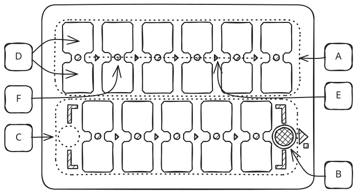
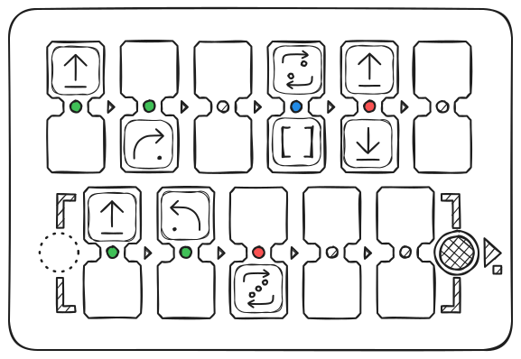
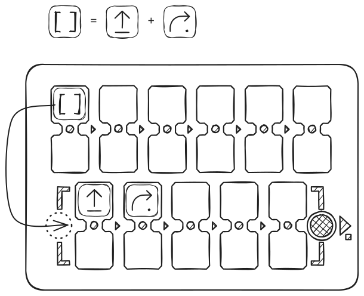
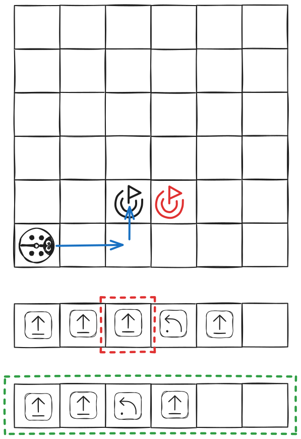
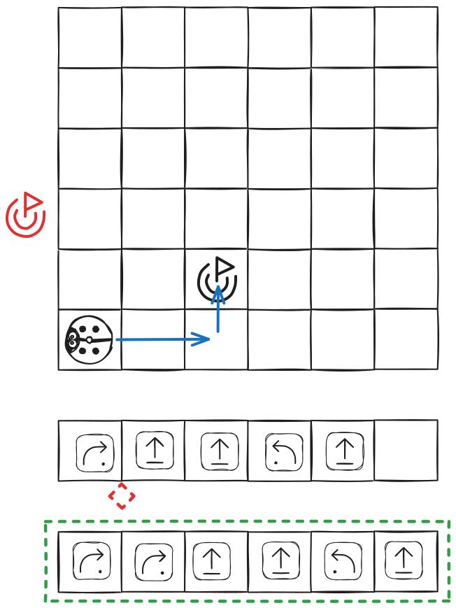

## Leitfaden für den Unterricht mit Kindern ab 4 Jahren

PrimaSTEM hilft Kindern Schritt für Schritt, logisches Denken, die Grundlagen der Programmierung und Mathematik zu meistern. Dieser Leitfaden hilft Ihnen bei der Durchführung von Unterrichtsstunden mit Kindern ab 4 Jahren.

### Wie das Gerät funktioniert

Das Ziel des Geräts ist es, die Bewegungen eines kleinen Marienkäfer-Roboters mithilfe von Befehls-Tokens zu programmieren, die auf der Steuerung platziert werden.

- Befehl **„Vorwärts“** — Bewegung geradeaus
- Befehl **„Links“** — Drehung nach links
- Befehl **„Rechts“** — Drehung nach rechts
- Token **„[ ]“ (Funktion)** — ersetzt eine Folge von Befehlen
- **„Wiederholung“** — wiederholt einen Befehl oder eine Funktion mehrmals

Sie platzieren die Befehle auf der Steuerung und erstellen so das Bewegungsprogramm des Roboters. Wenn das Programm fertig ist, drücken Sie die Taste — und der Roboter führt die Anweisungen aus!

### Inhalt des Leitfadens

- Warum Unterricht in Robotik und Programmierung durchführen?
- Tipps zur Organisation des Unterrichts unter verschiedenen Bedingungen
- Aktivitäten und Lernziele
- Detaillierte Gebrauchsanweisung
- Beschreibung der Aktivitäten
- Anhänge
- Über das Projekt und die Autoren

### Pädagogischer Wert

- Programmieren ohne Bildschirm — mit den Händen
- Verständnis dafür, dass Maschinen nach Algorithmen arbeiten
- Planung von Aktionen im Voraus
- Entwicklung des logischen Denkens
- Einführung in die sequentielle Programmierung und Funktionen
- Der Begriff „Bug“ (Fehler im Code) und Fähigkeiten zur Fehlersuche
- Anschauliches Erlernen von Zahlen, Arithmetik und Geometrie

## Woraus besteht PrimaSTEM

### Was ist in der Box:

- Marienkäfer-Roboter
- Steuerung
- Befehls-Tokens *
- Leitfaden für Aktivitäten *

(*) Der Inhalt kann je nach Ausstattung variieren

## Warum Unterricht in Programmierung und Mathematik durchführen?

Code, Programmierung und Automatisierung sind Teil unseres täglichen Lebens geworden.

In den letzten Jahren haben die Menschen gelernt, Maschinen zu bauen, die Dinge tun, zu denen sie früher nicht fähig waren: verstehen, sprechen, hören, sehen, antworten, schreiben.

Beispiele gibt es viele: selbstfahrende Autos, Roboterassistenten für ältere Menschen, Lieferroboter und andere.

### Warum Programmierung und Robotik?

Programmieren zu lernen bedeutet nicht nur, Code schreiben zu lernen. Programmieren zu lernen bedeutet, die Maschinen zu verstehen, die uns umgeben. Es ist die Fähigkeit, kleine oder mutige Ideen in reale Projekte zu verwandeln. Es bedeutet, komplexe Aufgaben in einfache Schritte zu zerlegen. Es ist Teamarbeit zur Lösung unserer Probleme.

### Digital Natives

Heute mag es so scheinen, als ob Kinder und Jugendliche sich gut mit Technologie auskennen, weil sie digitale Unterhaltung aktiv nutzen.

Aber wie sieht es damit aus, diese Werkzeuge für Kreativität oder Selbstausdruck zu nutzen? Was passiert, wenn sie auf ein technisches Problem stoßen?

## Tipps zur Verwendung je nach Kontext

Die Aktivitäten wurden für verschiedene Zwecke und Bildungskontexte entwickelt. Im Leitfaden sind nummerierte Aktivitäten aufgeführt.
Nachfolgend empfehlen wir Aktivitäten je nach Ihren Bedingungen.

### Zielgruppe

- Kinder von 4 bis 8 Jahren.
- Ältere und Vorschulgruppen im Kindergarten, 1. und 2. Klasse der Grundschule.

### Empfohlene Aktivitäten für den außerschulischen Unterricht

1-2-x-4-5-6-7-8-9-10-x-x

### Empfohlene Aktivitäten für den Schulunterricht

x-2-3-4-5-6-7-8-9-x-11-12

### Außerschulische Aktivitäten

Für die Arbeit mit PrimaSTEM ist es ratsam, eine Gruppe von nicht mehr als 12 Kindern zu bilden, damit jedes Kind aktiv teilnehmen kann.

Wir empfehlen die Verwendung eines Geräts für 2-3 Schüler, um das Lernen im Team und die Entwicklung sozialer Kompetenzen zu fördern.

### Schulische Aktivitäten

Im Unterricht ist es ideal, kleine Gruppen von 4-6 Kindern mit einem Lehrer zu bilden.
In dieser Zeit können andere Schüler an einer anderen Aufgabe mit einem Erziehungsassistenten arbeiten oder beispielsweise üben, den Weg des Roboters nach dem Programm zu zeichnen (für Schüler der 1. und 2. Klasse).
In beiden Fällen ist es vorzuziehen, Aktivitäten mit PrimaSTEM in einem Mehrzweckraum, direkt auf dem Boden oder durch Zusammenschieben von Tischen und Stühlen durchzuführen, um Platz zu schaffen.

**Achtung**: Vergessen Sie nicht, die Akkus der Steuerung und des Roboters im Voraus aufzuladen.

## Aktivitätsnummern und ihre Lernziele

| Aktivität | Verständnis der Begriffe Algorithmus und Programm | Zerlegung der Route in Etappen | Vorhersehung der Bewegung | Problemlösung, Fehlersuche (Debugging) | Teamarbeit, Zusammenarbeit |
| --- | :---: | :---: | :---: | :---: | :---: |
| 1 |   | X |   | X |   |
| 2 |   |   | X |   | X |
| 3 | X | X |   |   |   |
| 4 | X | X | X |   |   |
| 5 | X | X | X |   | X |
| 6 | X | X | X | X | X |
| 7 | X | X | X | X | X |
| 8 | X |   | X | X |   |
| 9 | X | X | X | X | X |
| 10 | X |   | X | X |   |
| 11 | X | X | X | X | X |
| 12 | X | X | X | X | X |

## Gebrauchsanweisung

### Inhalt der Anweisung

- Kennenlernen der Materialien
- Programmierung einer Funktion
- Verwendete Karten
- Technische Erläuterungen

## Kennenlernen der Materialien

### Roboter

Ein kleiner Marienkäfer-Roboter aus Holz mit zwei Augen.

Er hat drei Stützpunkte: zwei Räder und eine Stütze im hinteren Teil, die es ihm ermöglichen, das Gleichgewicht zu halten.

### Grundbefehle

| Befehl | Zeichnung                           | Beschreibung                                                                                     |
| ------- | ----------------------------------- | -------------------------------------------------------------------------------------------- |
| Geradeaus |   | Der Roboter bewegt sich um ein Feld vorwärts — ein logischer Schritt (standardmäßig 15 cm) |
| Nach links |      | Der Roboter dreht sich um 90° nach links                                                           |
| Nach rechts |     | Der Roboter dreht sich um 90° nach rechts                                                          |
| Zurück   |      | Der Roboter fährt ein Feld zurück — logischer Standardschritt                                |
| Funktion |  | Der Roboter führt die Befehlsfolge aus, die in der Funktionszeile steht                    |
| Wiederholung № |   | Der Roboter wiederholt den in der gepaarten Zelle eingestellten Befehl eine bestimmte Anzahl von Malen — № |

### Steuerung

Die Steuerung ermöglicht die Steuerung des Roboters durch Platzieren von Befehlsblöcken (Tokens) in die verfügbaren Zellen (D).

Die 6 oberen Doppelzellen (A), die durch eine Ausführungslinie (E) verbunden sind, bilden die Hauptsequenz des Programms. Das Programm beginnt in der Zelle links (D) und endet über der START-Taste (B), mit der die Anweisungen an den Roboter gesendet und das Programm gestartet werden können.

Die 5 unteren Zellen (C) ermöglichen die Programmierung einer Bewegungssequenz, die durch den Block „[ ]“ — die „Funktion“ — ausgeführt wird. Jede Doppelzelle ist mit einer LED (F) verbunden, die aufleuchtet, wenn ein Token eingesetzt wird, und blinkt, wenn die aktuelle Anweisung ausgeführt wird.

#### Erstellen einer Sequenz

Wenn Sie einen Token in eine der Zellen einsetzen und dieser richtig positioniert ist, leuchtet die LED grün.
Wenn Sie in der gepaarten Zelle einen Wiederholungsbefehl zu einem Bewegungsbefehl hinzufügen, leuchtet die LED blau.
Bei falscher Installation der Tokens (z. B. zwei Bewegungsbefehls-Tokens in einer gepaarten Zelle) leuchtet eine rote Diode. In diesem Fall wird der fehlerhafte Befehl bei der Ausführung des Programms ignoriert.

### Akku und Ein-/Ausschalter

Der Roboter und die Steuerung werden von eingebauten Akkus gespeist. Sie werden über einen USB-C-Anschluss aufgeladen. Der Ein-/Ausschalter (ON/OFF) befindet sich oben auf dem Roboter und auf der Vorderseite der Steuerung links.

Beim Einschalten des Roboters oder der Steuerung ertönt ein kurzes akustisches Signal.
Wenn die Steuerung eingeschaltet ist, leuchtet die LED an der Vorderseite grün. Wenn der Roboter eingeschaltet ist, leuchtet die LED am USB-C-Anschluss grün.

### Drahtlose Verbindung

Der Roboter und die Steuerung kommunizieren über eine drahtlose Bluetooth-Verbindung mit einer Reichweite von etwa 5 m. Das drahtlose System arbeitet im Hintergrund ohne Konfiguration nach der ersten Verbindung des Roboters mit der Steuerung.

> Die Steuerung kann für die Arbeit mit einem anderen Roboter konfiguriert werden (Pairing).
> 1. Schalten Sie den Roboter ein, der nicht mit der Steuerung gekoppelt ist.
> 2. Schalten Sie die Steuerung ein.
> 3. Halten Sie die START-Taste auf der Steuerung 10 Sekunden lang gedrückt, bis ein akustisches und optisches Signal ertönt.

### Erstellen und Ausführen eines Programms

Die Bewegungssequenz („Programm“) beginnt links auf der Steuerung und folgt der eingravierten Pfeilsequenz „>“ — der Ausführungslinie, die die horizontal gepaarten Zellen verbindet.

Wenn ein Token nach einer leeren Zelle hinzugefügt wird, wird die entsprechende Anweisung nach dem Überspringen der leeren Zelle ausgeführt.

Wenn ein falscher Token (z. B. „Wiederholung“ ohne Befehl in einer gepaarten Zelle) oder eine falsche Token-Kombination (z. B. zwei Befehls-Tokens in einer gepaarten Zelle) gesetzt wird, leuchtet die LED rot und dieser Teil des Programms wird bei der Ausführung übersprungen.

Nachdem die Sequenz festgelegt wurde, drücken Sie die „START“-Taste, um das Programm zu starten.

Während der Roboter die Anweisungen ausführt, erlöschen die LEDs auf der Steuerung nacheinander. Wenn ein Befehl ausgeführt wird, blinkt die entsprechende LED.

## Programmierung einer Funktion

### Erstellen einer Funktion

Der Block „[ ]“, auch „Funktionsblock“ genannt, wird verwendet, um eine Folge von Befehlen zu ersetzen.

Der Funktionsblock ermöglicht die Ausführung komplexerer Sequenzen und den Übergang zu anspruchsvolleren Aufgaben. Um eine Funktion zu erstellen, fügen Sie eine Bewegungssequenz in das dafür vorgesehene Feld ein — 5 Doppelzellen im unteren Teil der Steuerung. Diese Sequenz wird von links nach rechts jedes Mal ausgeführt, wenn in der Hauptsequenz (oben) ein Funktionsblock vorkommt.

Im folgenden Beispiel ersetzt der Funktionsblock die Bewegung geradeaus und dann die Drehung nach rechts. Das Hauptprogramm ruft die „Funktion“ 2 Mal auf und wiederholt die „Funktion“ dann weitere 2 Mal mit dem Token „Wiederholung 2“.

[Im Simulator starten](https://simulator.primastem.com/#top=cfun,cfun,cfun.r002&fn=cfor,crig&s=l1144602&r=225-675-0&run)

Ergebnis der Bewegung:

## Verwendete Karten

### Karten

Für die ersten Aktivitäten — das Erlernen von Algorithmen, Programmierung und Zahlen — sollte sich der Roboter auf einer Karte mit einem Raster bewegen. Es wird empfohlen, Karten mit einer Feldgröße von 15 cm zu verwenden: Dies ist die Entfernung, die der Roboter standardmäßig in einem Schritt zurücklegt.

Sie können alle Karten verwenden, die für Roboter mit einer beliebigen (für den Roboter angemessenen) Feldgröße vorgesehen sind.

> Es ist möglich, die Standard-Schrittweite von 15 cm auf einen beliebigen anderen Wert für Ihre vorhandene Karte zu ändern — 10 cm, 12,5 cm oder 20 cm. Verwenden Sie dazu den speziellen Einstellungsbefehl „Schritt“ + Zahl in mm (für 10 cm verwenden Sie 100, für 12,5 cm — 125, für 20 cm — 200).

Wenn Sie keine Karte haben, erstellen Sie selbst eine: Um eine Karte zu erstellen, können Sie schmales Malerkrepp und eine flache Tisch- oder Bodenoberfläche verwenden, ein Blatt Zeichenpapier (festes Bannermaterial) und einen Marker.

Eine Schachbrettkarte oder eine leere Karte mit Feldern wird verwendet, um die Bewegung von einem Punkt zum anderen zu üben, ohne von Farben abgelenkt zu werden.

Um kleine Geschichten über die Bewegungen des Roboters zu erzählen, kann eine farbige Karte verwendet werden. Zum Beispiel: „Der Marienkäfer verlässt das Haus und geht durch den Wald in die Berge.“ Man kann der Klasse vorschlagen, eine neue Karte zu erstellen, um neue Geschichten über die Reisen des Marienkäfers zu erzählen.

#### Beispiele für Karten:

Schachbrettkarte

Farbige Karte

## Technische Erläuterungen

### Aus technischer Sicht

Die Steuerung und der Roboter verwenden Mikrocontroller, werden mit Li-Ion-Akkus betrieben und über Funk mit einem Standard-Kommunikationsprotokoll — Bluetooth — verbunden.

Die Leiterplatte des Roboters ist für sein gesamtes Verhalten verantwortlich: Sie steuert zwei 5V DC-Motoren, zwei mehrfarbige LEDs, gibt Töne wieder, kommuniziert mit der Steuerung usw.

Die Leiterplatte der Steuerung identifiziert die in die Zellen eingesetzten Tokens, gibt Töne wieder und steuert 11 mehrfarbige LEDs, die mit jeder Doppelzelle verbunden sind.

Wenn ein Token in eine der Zellen der Steuerung eingesetzt wird, wird er mithilfe eines NFC-Sticker-Chips identifiziert. Jeder Token enthält einen Code, der dem Steuerbefehl entspricht.

Nach der Identifizierung der Tokens auf der Steuerung und dem Start des Programms werden die Befehle drahtlos an den Roboter zur Ausführung gesendet.

### Sie können Ihre eigenen Befehls-Tokens erstellen!

Sie können zusätzliche Befehls-Tokens erstellen (z. B. „Wiederholung 12“ oder zusätzliche Bewegungs-Tokens), indem Sie „leere“ Tokens mit NFC-Stickern und ein Telefon mit NFC-Unterstützung verwenden. Die meisten Typen mit einer Frequenz von 13,56 MHz werden unterstützt.

Ein Video-Tutorial ist auf unserem YouTube-Kanal verfügbar — https://www.youtube.com/@primastem

---

## Aktivitäten

### Detaillierte Beschreibung der Aktivitäten

- **Aktivität 1** — Bewegung auf dem Schachbrett von Punkt A nach Punkt B
- **Aktivität 2** — Kennenlernen von PrimaSTEM
- **Aktivität 3** — Verständnis des Konzepts der Orientierung und des Algorithmus durch Verkörperung im Roboter
- **Aktivität 4** — Vorhersehung der Bewegungen des Roboters anhand der Bewegungssequenz
- **Aktivität 5** — Verständnis der Funktionsweise von Anweisungssequenzen in einem zufälligen Programm
- **Aktivität 6** — Verwendung der Steuerung und der Bewegungsbefehle, um den Roboter in die Berge zu führen
- **Aktivität 7** — Einführung in den Befehl „Funktion“
- **Aktivität 8** — Verwendung der Funktion, um einen Weg zum Ziel zu planen
- **Aktivität 9** — Fehlersuche in einem Programm mit einem Fehler
- **Aktivität 10** — Überlegen der Fehlersuche von Sequenzen mit 1 Fehler auf Papier
- **Aktivität 11 und 12** — Vorhersehung der Bewegungen des Roboters (mit dem Block „Funktion“)

---

## Aktivität 1: Bewegung auf dem Schachbrett von Punkt A nach Punkt B

- **individuell**
- **15 Min.**
- **auf Papier**
- **Druckunterlagen**

### Ziel

> Planung der Bewegung über die Felder von Punkt A nach Punkt B auf der Karte.

Die Übung dauert 10 Minuten mit einer anschließenden Zusammenfassung.

### Zum Ausdrucken

Für diese Aktivität müssen Sie für jeden Schüler ein Exemplar des Blattes „[Anhang 1 — Bewegung auf der Karte](attachment-1)“ ausdrucken.

### ÜBUNG

Die Kinder sollen auf dem Raster den Weg einzeichnen, den die Maus gehen muss, um zum Käse zu gelangen. Sie können mit der linken, einfacheren Übung beginnen und dann mit der rechten fortfahren.

#### Bewegung über die Felder

Die Maus bewegt sich über die Felder des Rasters (Hinweis: Diagonalbewegungen sind nicht erlaubt). Hier gilt es zu verstehen, dass der Weg der Maus in Etappen unterteilt ist: Sie bewegt sich jeweils um ein Feld. Man sagt, sie bewegt sich schrittweise.

Im obigen Beispiel ist nur der blaue Weg korrekt. Der kurze rote Weg ist falsch, da er eine Diagonale enthält. Der lange rote Weg ist falsch, da er nicht zum gewünschten Punkt führt.

### Diskussion in der Gruppe...

Im obigen Beispiel sind zum Beispiel alle gezeichneten Wege korrekt, da sie es der Maus ermöglichen, zum Käse zu gelangen.

Zeigen Sie den Kindern, dass nicht jeder an denselben Weg denkt, aber mehrere Wege richtig sein können.

#### Einige Wege sind länger als andere

Wenn man die Anzahl der Felder zählt, die die Maus gehen muss, um zum Käsefeld zu gelangen, ergibt sich:
- 3 Felder für die grüne Route
- 3 Felder für die graue Route
- 3 Felder für die blaue Route
- 13 Felder für die gelbe Route

#### Der kürzeste Weg

Schließlich wird die Maus, auch wenn alle diese Wege korrekt sind, den kürzesten wählen.

Bitten Sie die Kinder, diese Frage zu beantworten: „Warum hat die Maus den kürzesten Weg gewählt?“

Mehrere Antworten sind möglich: Die Maus möchte Energie sparen, sie ist sehr müde und möchte so wenig wie möglich laufen... Oder die Maus hat es eilig, sie ist sehr hungrig und möchte so schnell wie möglich zum Käse kommen.

**Hinweis für den Leiter:** Bei Robotern ist es genauso. Wir werden aus Gründen der Effizienz immer den kürzesten Weg bevorzugen.

#### Mehrere Wege sind möglich

Bitten Sie die Schüler nach Abschluss der Übung, den von ihnen gezeichneten Weg zu zeigen. Da es immer mehrere mögliche Szenarien gibt, werden die Schüler wahrscheinlich unterschiedliche, aber alle richtige Antworten vorschlagen.

---

## Aktivität 2: Kennenlernen von PrimaSTEM

- **15 Min.**
- **in der Gruppe**
- **Demonstration**
- **Praxis**

### Ziele

> Die Bewegungsmöglichkeiten des Roboters verstehen
> Erfahren, dass die Steuerung den Roboter steuert
> Die Befehls-Tokens verstehen

Bilden Sie für diese Aktivität kleine Schülergruppen. Setzen Sie sich an einen niedrigen Tisch oder auf den Boden. Holen Sie die Rasterkarte, die Steuerung, den Roboter und die Tokens heraus. Stellen Sie PrimaSTEM nacheinander allen Schülern und Gruppen vor.

### Präsentation

Stellen Sie jedes Element auf dem Tisch vor und führen Sie das Vokabular ein, das die Kinder benötigen werden.

Zuerst die **Karte**: Sie ist wie das Raster, mit dem sie in Aktivität 1 gearbeitet haben, aber größer.

Dann der **Marienkäfer-Roboter**: Er kann rollen.

Er wird mit der **Steuerung** gesteuert, abhängig von den Tokens, die wir in die Zellen legen.

**Tokens** sind Anweisungen: Sie ermöglichen es dem Roboter zu sagen, dass er geradeaus fahren, nach links oder nach rechts abbiegen soll.

### 1. Etappe: Demonstration

Nachdem Sie das Vokabular erklärt haben, führen Sie die Manipulation selbst durch und zeigen Sie den Kindern, was passiert, wenn Sie einen Token in die Steuerung legen.

| Bild                                               | Beschreibung                                                                    |
| -------------------------------------------------- | --------------------------------------------------------------------------- |
|  | Der Befehls-Token **„Vorwärts“** lässt den Roboter ein Feld vorwärts fahren |

Platzieren Sie den Roboter auf einem der Felder der Karte. Setzen Sie den Token in die erste Zelle für das Programm ein, wie im Diagramm unten gezeigt, und drücken Sie dann die weiße Taste — START.

Der Roboter fährt ein Feld vorwärts.

### 2. Etappe: Übergeben Sie die Steuerung

| Bild                                            | Beschreibung                                                                                                                                                                                |
| ----------------------------------------------- | --------------------------------------------------------------------------------------------------------------------------------------------------------------------------------------- |
|  | Der Token mit einem Pfeil, der sich in einem Bogen um die Mitte dreht, ist **„Links“** — er lässt den Roboter nach links drehen, gegen den Uhrzeigersinn. Der Standard-Drehschritt beträgt 90 Grad. |

Entfernen Sie den Token „Vorwärts“ von der Steuerung und geben Sie den Token „Links“ weiter. Diesmal können Sie dem Kind erlauben, den Token in die erste Zelle des Programms einzusetzen und dann die weiße Taste — START zu drücken. Der Roboter bleibt an Ort und Stelle und macht eine Vierteldrehung nach links.

| Bild                                             | Beschreibung                                                     |
| ------------------------------------------------ | ------------------------------------------------------------ |
|  | Der Token **„Rechts“** lässt den Roboter nach rechts drehen. |

Bitten Sie ein anderes Kind, den Token „Links“ aus der Steuerung zu entfernen und an seine Stelle den Token „Rechts“ zu setzen und dann die weiße Taste — START zu drücken. Der Roboter bleibt an Ort und Stelle und macht eine Vierteldrehung nach rechts.

Lassen Sie die Kinder dann nacheinander manipulieren, indem Sie ihnen nur 3 Tokens geben: **„Vorwärts“**, **„Links“** und **„Rechts“**.

Sie können die Ausführung des von ihnen erstellten Programms wiederholen, indem sie nach Abschluss der Bewegung des Roboters erneut die START-Taste drücken.

Lassen Sie sie sich vergewissern, dass die Tokens überall platziert werden können (außer zwei Befehle in einer Doppelzelle) und nacheinander ausgeführt werden — von links nach rechts.

> Das Programm kann durch erneutes Drücken der START/STOP-Taste während der Ausführung durch den Roboter gestoppt werden.

---

## Aktivität 3: Verständnis des Konzepts der Orientierung und des Algorithmus durch Verkörperung im Roboter

- **45 Min.**
- **In der Gruppe**
- **Spiel**
- **Karte**

### Ziele

> Die Orientierung des Roboters zu Beginn des Programms berücksichtigen
> Die Bewegungen des Roboters abhängig vom Programm vorhersehen

### Zum Ausdrucken

Für diese Aktivität müssen Sie für jeden Schüler ein Exemplar der Karten „[Anhang 2 — Missionskarten](attachment-2)“ ausdrucken.

### Spielprinzip

Rollenspiel auf freier Fläche, bei dem die Kinder einen Roboter auf einem schwarz-weißen Feld darstellen.

### Spielregeln

Ein Schüler fungiert als Roboter auf der Karte (oder auf dem Boden mit einem quadratischen Muster — Zeichnung, Fliesen oder mit schmalem Klebeband auf den Boden geklebt), und die anderen Schüler programmieren ihn mithilfe der Aufgabenkarten.

Es werden keine Angaben dazu gemacht, in welche Richtung das Roboter-Kind schaut.
Bestimmen Sie, welche Ausrichtung des Roboters für die Erfüllung der Mission korrekt ist.

1. Das „Roboter-Kind“ stellt sich auf das rote Feld 1, es muss zum grünen Feld 2 gelangen.
2. Das „Roboter-Kind“ stellt sich auf das rote Feld 1, es muss zum lila Feld 3 gelangen.
3. Das „Roboter-Kind“ stellt sich auf das rote Feld 1, es muss zum blauen Feld 4 gelangen.

> Um die Haltbarkeit des Kartenmaterials zu gewährleisten, bitten Sie das Kind, die Schuhe auszuziehen.

### Ende des Spiels

Das Kind versteht nun, dass die Position und Orientierung des Roboters beim Programmieren der Bewegung berücksichtigt werden müssen.

Der Roboter reagiert auf den Bewegungsbefehl abhängig davon, wie er gedreht, orientiert ist. Er muss entweder geradeaus fahren, nach links abbiegen oder nach rechts abbiegen, **ABER er wird sich abhängig von seiner Anfangsorientierung bewegen.**

---

## Aktivität 4: Vorhersehung der Bewegungen des Roboters anhand der Bewegungssequenz

- **45 Min.**
- **individuell**
- **auf Papier**
- **Druckunterlagen**

### Ziele

> Die Orientierung des Roboters zu Beginn berücksichtigen
> Die Anweisungen des Programms verstehen
> Die Bewegungen des Roboters abhängig vom Programm vorhersehen

### Zum Ausdrucken

Für diese Aktivität müssen Sie für jeden Schüler ein Exemplar der Karten „[Anhang 3 — Den Weg für eine vorgegebene Sequenz zeichnen](attachment-3)“ ausdrucken.

Den Kindern wird ein Blatt mit einem Programm gegeben, das aus einer Folge von Anweisungen besteht. Die Kinder sollen den Weg einzeichnen, den der Roboter für diese Bewegungssequenz zurücklegen wird.

Mit diesem Programm fährt der Roboter dreimal geradeaus:

<Columns cols={2}>
  <Frame>
    
  </Frame>
  <Frame>
    
  </Frame>
</Columns>

[Im Simulator starten](https://simulator.primastem.com/#top=cfor,cfor,cfor&s=l1144602&r=75-825-0&m=02&run)

Hier ist das gleiche Programm, der Roboter wird ebenfalls dreimal geradeaus fahren.
Nur ist er diesmal zu Beginn nicht gleich orientiert: Er schaut nach rechts. Daher wird er dreimal nach rechts fahren:

<Columns cols={2}>
  <Frame>
    
  </Frame>
  <Frame>
    
  </Frame>
</Columns>

[Im Simulator starten](https://simulator.primastem.com/#top=cfor,cfor,cfor&s=l1144602&r=75-825-90&m=35&run)

Mit diesem Programm führen wir die Drehung des Roboters ein. Diesmal beginnt der Roboter mit einer Drehung nach rechts und fährt dann zwei Felder weit:

<Columns cols={2}>
  <Frame>
    
  </Frame>
  <Frame>
    
  </Frame>
</Columns>

[Im Simulator starten](https://simulator.primastem.com/#top=crig,cfor,cfor&s=l1144602&r=75-825-0&m=25&run)

Und schließlich eine schwierigere Übung mit zwei Richtungsänderungen für den Roboter. Er beginnt damit, ein Feld geradeaus zu fahren, dreht sich dann nach rechts, fährt ein Feld weit, dreht sich dann nach links und fährt zwei Felder weit:

<Columns cols={2}>
  <Frame>
    
  </Frame>
  <Frame>
    
  </Frame>
</Columns>

[Im Simulator starten](https://simulator.primastem.com/#top=cfor,crig,cfor,clef,cfor,cfor&s=l1144602&r=75-825-0&m=12&run)

### Hinweis für den Leiter

Diese Übung auf Papier kann schwierig sein.
Wenn einige Kinder Schwierigkeiten haben, die Drehungen des Roboters und die Bewegungssequenzen zu verstehen, nehmen Sie das PrimaSTEM-Spielset und bitten Sie sie, die Programme auf den Blättern an der Steuerung nachzubauen.
Durch Manipulieren und Beobachten versteht man besser!

---

## Aktivität 5: Verständnis der Funktionsweise von Anweisungssequenzen in einem zufälligen Programm

- **45 Min.**
- **in der Gruppe**
- **Spiel**

### Ziele

> Eine Verbindung zwischen den Anweisungen und den vom Roboter ausgeführten Bewegungen herstellen
> Die Grenzen der Karte visualisieren
> In der Lage sein, Anweisungsbefehle auf die „Steuerung“ zu übertragen

### Durchführung des Spiels

1. Platzieren Sie den Roboter zu Beginn an einer beliebigen Stelle auf der Karte (empfohlenes Feld — am Rand der Karte) in der gewünschten Richtung.
2. Würfeln Sie, um zu beginnen. Bewegen Sie den Roboter manuell und notieren (zeichnen Sie das Symbol für den Befehl „Vorwärts“ — einen Pfeil) Sie das Programm für die Bewegung auf Papier oder einem Zeichentablett. Wenn der Roboter die Karte verlässt, würfeln Sie erneut.

3. Wiederholen Sie den Vorgang, um eine Sequenz von 2 Programmen für die Bewegung zu erhalten und zu verhindern, dass der Roboter die Karte verlässt, indem Sie bei Bedarf erneut würfeln.

Am Ende: Sie sollten auf einem Blatt Papier 2 Programme aus „Vorwärts“-Befehlen haben, die den Roboter nach aufeinanderfolgender Ausführung um die erforderliche Anzahl von Feldern zum Rand der Karte bewegen.

Beispiel:

<Columns cols={2}>
  <Frame>
    
  </Frame>
  <Frame>
    

      
      
    

  </Frame>
</Columns>

**Reproduzieren Sie die aufgezeichneten Programme in der Realität mit PrimaSTEM.**

---

## Aktivität 6: Verwendung der Steuerung und der Bewegungsbefehle, um den Roboter in die Berge zu führen

- **45 Min.**
- **in der Gruppe**
- **Praxis**

### Ziele

> Die Route in Etappen unterteilen
> Ein Programm mit einem bestimmten Ziel umsetzen

Für diese Aktivität benötigen Sie:
- Steuerung
- bestimmte Bewegungsbefehls-Tokens: 4 „Vorwärts“, 4 „Links“ und 4 „Rechts“ pro Gruppe, lassen Sie die restlichen Tokens beiseite.
- Karte und Roboter

Teilen Sie die Kinder in Gruppen von 3 oder 4 Kindern auf und geben Sie ihnen eine Steuerung und einen Satz Tokens.

### 1. Etappe: Nachdenken

Der Marienkäfer-Roboter ist zu Hause und wir wollen ihn in die Berge führen. Hier muss ein Programm an die Tafel geschrieben werden, mit dem er dorthin gelangen kann.

> Wenn Sie nicht die passende Karte haben, zeichnen Sie die erforderlichen Zielpunkte schematisch auf Papier, eventuell mit den Kindern, und befestigen Sie sie mit Klebeband auf der Karte.

Fragen Sie die Kinder zunächst, durch welche Felder sie den Roboter führen wollen, um zum Berg zu gelangen. Auch hier gibt es viele Möglichkeiten, und wir werden aus Gründen der Energie- und Zeitersparnis die kürzesten Routen bevorzugen.

Nachdem der Weg festgelegt wurde, fragen Sie die Kinder nach den Bewegungen, die der Roboter Feld für Feld machen muss.

Soll er geradeaus gehen, nach links abbiegen, nach rechts abbiegen?
Zeigen Sie ihnen, welche Bewegung jeder Befehl beim Roboter auslöst, indem Sie ihn mit den Händen über die Karte bewegen.

### 2. Etappe: Programmieren

Bitten Sie die Kinder, der Reihe nach die Bewegungen (das Programm) auf die Steuerung mit den Befehls-Tokens zu schreiben, die der Roboter machen muss, um das Ziel zu erreichen.

**Hier ist das erwartete Ergebnis des Programms:**

### 3. Etappe: Überprüfung

Wie es sich für jeden anständigen Programmierer gehört, sollte überprüft werden, ob das Programm funktioniert. Bitten Sie die Kinder, ihr Programm an der Steuerung nachzubauen und zu starten.

<Columns cols={2}>
  <Frame>
    
  </Frame>
  <Frame>
    
  </Frame>
</Columns>

[Im Simulator starten](https://simulator.primastem.com/#top=cfor,cfor,crig,cfor&s=l1144602&r=75-825-0&m=13&run)

Erreicht der Roboter den Berg? Wenn nicht, warum? Lassen Sie die Kinder versuchen, ihre Fehler im Programm zu korrigieren, falls welche vorhanden sind.

---

## Aktivität 7: Einführung in den Befehl „Funktion“

- **15 Min.**
- **in der Gruppe**
- **Demonstration**

### Ziele

> Verstehen, dass der Befehl „Funktion“ andere Befehlsanweisungen ersetzen kann
> Das Konzept der Wiederholung einer Anweisungsfolge betrachten

Bilden Sie für diese Aktivität kleine Schülergruppen. Setzen Sie sich an einen niedrigen Tisch oder auf den Boden. Holen Sie das Spielfeld, die Steuerung, den Roboter und die Befehls-Tokens heraus. Die Schülergruppen lernen nacheinander den Befehlsblock „Funktion“ kennen.

### 1. Etappe: Demonstration

Zeigen Sie den Kindern den Befehls-Token „Funktion“.

Er dient dazu, mehrere Bewegungsbefehle zu ersetzen: „Vorwärts“, „Links“, „Rechts“ oder „Zurück“. Er ermöglicht es auch, ein und dasselbe kleine Programmfragment mehrmals zu wiederholen.

Beginnen Sie mit einer Demonstration. Erstellen Sie ein Programm wie in der Abbildung unten gezeigt.

Wenn der Befehl „Funktion“ verwendet wird, geschieht alles so, als ob wir an die Stelle des Tokens „Funktion“ das setzen würden, was sich innerhalb des Rahmens [-----] im unteren Teil der Steuerung befindet.
In unserem Beispiel fährt der Roboter zweimal geradeaus.

### 2. Etappe: Rätsel!

Fügen Sie nun am Ende Ihres Hauptprogramms einen Block mit dem Befehl „Rechts“ hinzu, wie in der Abbildung unten gezeigt.

Bevor Sie das Programm starten, fragen Sie die Kinder, was passieren wird. Alles geschieht so, als ob das Programm aus zwei roten „Vorwärts“-Blöcken und dann einem „Rechts“-Block bestehen würde. Der Roboter fährt zwei Felder weit und macht eine Rechtsdrehung (Vierteldrehung).

Und zum Abschluss: **Schleife**!
Reproduzieren Sie das Programm mit vier „Funktions“-Blöcken wie in der Abbildung unten gezeigt.

[Im Simulator starten](https://simulator.primastem.com/#top=cfun,cfun,cfun,cfun&fn=cfor,crig&s=l1144602&r=225-675-0&run)

Bevor Sie das Programm starten, fragen Sie die Kinder, was passieren wird, und starten Sie dann das Programm zur Überprüfung.

**Der Roboter führt eine Schleife aus**:

**Hinweis für den Leiter:** Wenn Sie beginnen, das Konzept des Funktionsblocks einzuführen, ist es sehr hilfreich, auf die LEDs zu schauen, die während der Programmausführung blinken. So kann man die ausgeführte Anweisung verfolgen und gleichzeitig sehen, wie sich der Roboter bewegt.

---

## Aktivität 8: Verwendung der Funktion, um einen Weg zum Ziel zu planen

- **45 Min.**
- **in der Gruppe**
- **Praxis**

### Ziele

> Die Route in Etappen unterteilen.
> Ein Programm mit einem bestimmten Ziel umsetzen.
> Den Block „Funktion“ im Programm verwenden.

Für diese Aktivität benötigen Sie:
- Tokens oder selbstgemachte Karten mit Zeichnungen der Befehle: 4 „Vorwärts“, 4 „Links“, 4 „Rechts“ und 4 „Funktion“ pro Gruppe.
- Karte und Roboter, ohne Steuerung.

Wenn es viele Kinder sind, teilen Sie sie in Gruppen von 3 oder 4 Kindern auf und geben Sie ihnen Karten mit Zeichnungen der Befehle oder Tokens aus dem Set (genau 4+4+4+4).

### 1. Etappe: Nachdenken

> Passen Sie die Aufgabe an, wenn Sie eine Karte mit anderen Bildern oder ohne Bilder haben — es müssen 2 Punkte (Start und Ziel) im Abstand von 4 Feldern in einem Winkel von 90 Grad markiert werden.

Der Roboter befindet sich bei der Flagge und wir wollen ihn zum Feld „Nacht“ führen, das durch Wolken dargestellt wird. Es muss ein Programm geschrieben werden (ein Algorithmus aus Tokens oder Zeichnungen der Befehle auf dem Tisch ausgelegt werden), wobei der Block „Funktion“ zu verwenden ist.

Fragen Sie die Kinder zunächst, durch welche Felder sie den Roboter führen wollen, um zum Berg zu gelangen (Feld etwa in der Mitte des Weges). Es gibt viele Möglichkeiten, und diesmal werden wir Routen bevorzugen, bei denen sich Anweisungsfolgen wiederholen, um den Befehl „Funktion“ zu verwenden.

Nachdem der Weg festgelegt wurde, fragen Sie die Kinder nach den Bewegungen, die der Roboter Feld für Feld machen muss, und simulieren Sie die Ausführung des Programms, indem Sie den Roboter mit den Händen bewegen.

### 2. Etappe: „Das funktioniert nicht! Aber wenn...“

Bitten Sie sie, die Bewegungen, die der Roboter machen muss, der Reihe nach mit Tokens auf dem Tisch auszulegen.

Seien Sie streng bei der Anzahl der Befehls-Tokens, die an jede Gruppe ausgegeben werden: 4 „Vorwärts“, 4 „Links“, 4 „Rechts“ und 4 „Funktion“.

Da haben wir's! Wir haben nicht genug Tokens, um das Programm zu schreiben! Es fehlen „Vorwärts“-Befehle! Das ist digitale Panik! :)

Erinnern Sie sie an den Nutzen des Befehls „Funktion“: Mit diesem Befehl können mehrere andere Befehls-Tokens ersetzt werden.

Zum Beispiel kann man mehrere „Vorwärts“-Befehle ersetzen, um den Roboter mehrmals vorwärts fahren zu lassen.

Leiten Sie die Kinder an, ein Programm mit einem Funktionsblock zu erstellen, wie in der Abbildung unten gezeigt.

Beispiel einer Route und ihr Programm:

### 3. Etappe: Überprüfung

Helfen Sie den Kindern, ihr Programm an der Steuerung zur Überprüfung nachzubauen, wie in der Abbildung:

[Im Simulator starten](https://simulator.primastem.com/#top=cfun,clef,cfun&fn=cfor,cfor,cfor,cfor&s=l1144602&r=825-825-0&run)

Erreicht der Roboter das Feld „Nacht“? Wenn nicht, warum?
Lassen Sie die Kinder versuchen, ihre Fehler im Programm zu korrigieren, falls welche vorhanden sind.

---

## Aktivität 9: Fehlersuche in einem Programm mit einem Fehler

- **20 Min.**
- **in der Gruppe**
- **Praxis**

### Ziele

> Einen Fehler im Programm finden, indem man dessen Ausführung beobachtet.
> Den Fehler im Programm korrigieren.

Bilden Sie für diese Aktivität kleine Schülergruppen. Setzen Sie sich an einen niedrigen Tisch oder auf den Boden. Bereiten Sie das Feld mit dem Raster, die Steuerung, den Roboter und die Tokens vor.
Bitten Sie die Schülergruppen nacheinander, ein Programm zu debuggen.

Wir möchten, dass der Roboter den Berg erreicht (grauer Weg).

Zeigen Sie den Kindern die Bewegungssequenz an der Steuerung, die einen Fehler enthält:

[Im Simulator starten](https://simulator.primastem.com/#top=cfor,clef,cfor,cfor,clef,cfor&s=l1144602&r=75-825-90&run)

Mit diesem Programm fährt der Roboter in den Wald. Beim Testen des Programms sollen die Kinder versuchen, den Fehler zu finden und zu korrigieren.

Beispiel eines korrekten, korrigierten Programms:

[Im Simulator starten](https://simulator.primastem.com/#top=cfor,clef,cfor,cfor,crig,cfor&s=l1144602&r=75-825-90&run)

---

## Aktivität 10: Überlegen der Fehlersuche einer Sequenz mit einem Fehler auf Papier

- **20 Min.**
- **individuell**
- **auf Papier**
- **Druckunterlagen**

### Ziele

> Die Bewegungen des Roboters vorhersehen, um einen Fehler im Programm zu finden.
> Verstehen, wie ein Fehler im Programm korrigiert wird.

Den Kindern wird ein Blatt mit einem Programm gegeben, das aus einer Folge von Anweisungen für den Übergang von Punkt A nach Punkt B besteht. Das Programm enthält einen Fehler, die Kinder sollen diesen Fehler finden und versuchen, ihn zu korrigieren.

### Zum Ausdrucken

Für diese Aktivität müssen Sie für jeden Schüler ein Exemplar der Karten „[Anhang 4 — Einen Fehler im Programm finden und korrigieren](attachment-4)“ ausdrucken.

### 1. Etappe: Das Programm lesen

Bitten Sie die Kinder zunächst, die Bewegung des Roboters mit diesem Programm einzuzeichnen. Auf dem Raster ist in Blau der Weg eingezeichnet, den der Roboter nehmen soll, sowie der gewünschte Zielpunkt.

### 2. Etappe: Den Fehler identifizieren

Nachdem der Weg eingezeichnet wurde, sehen wir, dass der Roboter nicht zum Ziel (Schwarz) geht! Er kommt bei der roten Flagge an.
Fragen Sie die Kinder, wo der Roboter einen Fehler gemacht hat. Hier gilt es, das Feld zu finden, das den Fehler enthält, der in der Korrektur rot eingekreist ist.

Es gibt 3 Arten von Fehlern:
- Wir haben uns bei dem Befehl geirrt
- Wir haben einen Befehl vergessen
- Wir haben einen überflüssigen Befehl hinzugefügt

### 3. Etappe: Den Fehler korrigieren

Und schließlich bitten Sie die Kinder, den Fehler zu korrigieren, indem sie das Bewegungsprogramm bis zur schwarzen Flagge schreiben.

**Hinweis:** Diese Übung auf Papier kann schwierig sein. Wenn einige Kinder Schwierigkeiten haben zu sehen, wo die Fehler liegen, nehmen Sie PrimaSTEM und bitten Sie sie, die Programme auf den Blättern nachzubauen und das Programm zu starten. Sie können sie zum Beispiel bitten, „Oh nein!“ zu sagen, wenn der Roboter auf seinem Weg einen Fehler macht, um den Fehler festzuhalten.

#### Beispiel 1
In diesem Beispiel haben wir uns bei der Anweisung am Ende geirrt.

<Columns cols={2}>
  <Frame>
    
  </Frame>
  <Frame>
    

      
      
    

  </Frame>
</Columns>

#### Beispiel 2
In diesem Beispiel haben wir am Anfang eine überflüssige Anweisung hinzugefügt.

#### Beispiel 3
In diesem Beispiel haben wir am Anfang eine Anweisung vergessen.

---

## Aktivität 11: Vorhersehung der Bewegungen von PrimaSTEM

- **45 Min.**
- **in der Gruppe**
- **Praxis**

### Ziele

> Die Bewegungen des Roboters vorhersehen, indem man auf das Programm ohne „Funktion“ schaut

Nehmen Sie für diese Aktivität das PrimaSTEM-Spielset ohne die „Funktions“-Befehle. Alle Kinder können gleichzeitig am Spiel teilnehmen, aber nur ein Kind nach dem anderen manipuliert.

### 1. Ruhe, wir programmieren...

Abwechselnd platzieren die Kinder den Roboter in einer Ecke der Karte und stellen dann ein Programm mit maximal 5 Anweisungen an der Steuerung zusammen.

Nachdem das Programm fertig ist, bitten Sie die Kinder zu warten, bevor sie die Taste drücken.

### 2. Wetten werden angenommen!

Bitten Sie die anderen Kinder zu raten, ob der Roboter die Karte verlassen wird.

### 3. Wir überprüfen

Nachdem wir unsere Wetten platziert haben, starten wir das Programm, um zu überprüfen, was passiert.
Dann stellen wir den Roboter wieder in die Ecke, und das nächste Kind beginnt sein Programm.

---

## Aktivität 12

### Ziele

> Die Bewegungen des Roboters vorhersehen, indem man auf das Programm mit „Funktion“ schaut

Wiederholen Sie Aktivität 11, indem Sie die „Funktions“-Befehle zum Set hinzufügen.

Fügen Sie diesmal Funktionsblöcke hinzu, um die Programmierung der Funktion zu integrieren. Alle Kinder können gleichzeitig am Spiel teilnehmen, aber nur ein Kind nach dem anderen manipuliert.

---

## Über das Projekt, Autoren

### Wer sind wir?

PrimaSTEM ist ein Unternehmen, das das gleichnamige originelle Gerät entwickelt hat und herstellt, um Kindern ab 4 Jahren das Programmieren und die Mathematik ohne Bildschirm beizubringen. Wir befinden uns im Süden Frankreichs.

Die erstellten Materialien sind offen und zielen darauf ab, die Kreativität von Kindern und den Erwachsenen, die sie begleiten, zu fördern.

Um mehr über das PrimaSTEM-Gerät zu erfahren, besuchen Sie die Ressourcen-Website der Dokumentation, die in 12 Sprachen verfügbar ist: https://docs.primastem.com

### Haben Sie Fragen? Kontaktieren Sie uns!

Zögern Sie nicht, uns zu kontaktieren: info@primastem.com

Unsere Website mit Informationen und Links zu sozialen Netzwerken: https://primastem.com

### Autoren

**Adaption, Text, Illustrationen:** Andrey Chanov, 2026.

**Autoren des Konzepts**: Julie Borgeot / Dorie Bruyas von Fréquence écoles

#### Lizenz dieses Leitfadens

Dieses Werk ist unter CC BY-SA 4.0 lizenziert. Um eine Kopie dieser Lizenz einzusehen, besuchen Sie https://creativecommons.org/licenses/by-sa/4.0/

**Creative Commons Attribution-ShareAlike 4.0 International**

Diese Lizenz erfordert, dass die Nutzer den Urheber nennen. Sie erlaubt es den Nutzern, das Material in jedem Medium oder Format zu verbreiten, zu vermischen, anzupassen und darauf aufzubauen, auch für kommerzielle Zwecke. Wenn andere das Material vermischen, anpassen oder darauf aufbauen, müssen sie das geänderte Material unter identischen Bedingungen lizenzieren.

---

## Anhänge

## Anhang 1 — Bewegung auf der Karte

Anhang unter dem Link — [Anhang 1 — Bewegung auf der Karte](attachment-1)

## Anhang 2 — Missionskarten

Anhang unter dem Link — [Anhang 2 — Missionskarten](attachment-2)

## Anhang 3 — Den Weg für eine vorgegebene Sequenz zeichnen

Anhang unter dem Link — [Anhang 3 — Den Weg für eine vorgegebene Sequenz zeichnen](attachment-3)

## Anhang 4 — Einen Fehler im Programm finden und korrigieren

Anhang unter dem Link — [Anhang 4 — Einen Fehler im Programm finden und korrigieren](attachment-4)

