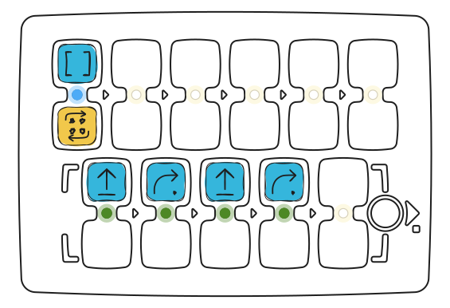

## Einführung

PrimaSTEM besteht aus einem programmierbaren Roboter, einem Steuerboard und einem Satz Befehls-Tokens. Es hilft, kognitive Beeinträchtigungen bei älteren Menschen zu verhindern und auszugleichen.

### Für wen es geeignet ist

- Ältere Menschen mit leichten kognitiven Beeinträchtigungen
- Menschen nach neurologischen Erkrankungen
- Patienten in frühen Stadien neurodegenerativer Erkrankungen

### Kontraindikationen

- Schwere Sehstörungen
- Ausgeprägte motorische Störungen der Arme
- Schwere Demenz
- Akute psychische Störungen

## Erste Übungsstunde

Dauer: etwa 35 Minuten. Lesen Sie vorher die Kontraindikationen oben. Wenn Sie das Gerät noch nicht haben, lassen sich alle Schritte im [Simulator](https://simulator.primastem.com) durchführen.

<Steps>
  <Step title="Kennenlernen, 10 Minuten">
    Zeigen Sie den Roboter, das Steuerboard und die Token „Vorwärts“, „Rechts“ und „Links“. Die Person legt einen Token „Vorwärts“ auf das Steuerboard, drückt **▶ Start** und beobachtet, wie der Roboter fährt. Wie Steuerboard und Roboter funktionieren, steht im [Schnellstart](/de/quickstart).
  </Step>
  <Step title="Erste Route, 10 Minuten">
    Markieren Sie ein Ziel zwei bis drei Felder vom Roboter entfernt. Die Person legt die Token aus, startet das Programm und prüft, ob der Roboter angekommen ist. Im Simulator gibt es dafür das [leichte Labyrinth](https://simulator.primastem.com/#s=l1144402&r=75-525-0&m=2101).
  </Step>
  <Step title="Pause, 5 Minuten">
    Nach 15–20 Minuten Arbeit braucht es eine Pause.
  </Step>
  <Step title="Eine Figur, 10 Minuten">
    Die Person stellt ein Programm zusammen, mit dem der Roboter ein Quadrat abfährt. Öffnen Sie im Simulator die [Aufgabe mit dem Quadrat](https://simulator.primastem.com/#sh=square): Der Roboter muss der gestrichelten Linie folgen.
  </Step>
</Steps>

Fragen Sie am Ende, was leicht fiel und was schwer war. Danach richtet sich, womit die nächste Stunde beginnt.

## Allgemeine Prinzipien

Mit dem Alter und bei neurodegenerativen Erkrankungen kann das Gedächtnis nachlassen. Abstraktes Denken, Lernen und Kreativität können sich verschlechtern. Übungen mit dem PrimaSTEM-Kit trainieren verschiedene kognitive Funktionen spielerisch und helfen, diese Prozesse zu verlangsamen.

### So organisieren Sie die Übungen

- Eine Übungseinheit dauert 30–45 Minuten.
- Die Übungen finden 2–3 Mal pro Woche statt.
- Sie üben einzeln oder in Kleingruppen mit 2–4 Personen.
- Nach jeweils 15–20 Minuten Arbeit folgt eine Pause von 5–10 Minuten.

### So führen Sie die Übungen durch

1. Steigern Sie die Schwierigkeit der Aufgaben schrittweise.
2. Berücksichtigen Sie die Eigenheiten und Einschränkungen jeder Person.
3. Sorgen Sie für eine freundliche Atmosphäre.
4. Wechseln Sie verschiedene Übungstypen ab.
5. Geben Sie immer Rückmeldung und loben Sie.

## Was die Übungen trainieren

### Kognitive Funktionen

- Intellektuelle Aktivität
- Räumliches Denken und Gedächtnis
- Visuelles und auditiv-verbales Gedächtnis
- Logisches Denken und Kopfrechnen
- Planen und Kontrollieren des eigenen Handelns
- Peripheres Sehen

### Kommunikation und Stimmung

- Die Übungen erhalten das persönliche Potenzial und die soziale Aktivität.
- Die Person kann sich ausdrücken.
- Der Person fällt der Austausch mit anderen leichter.
- Die Übungen heben die Stimmung.

## Training und Spiele

### 1. Erste Übungen (Eingewöhnungsphase)

- Die Befehls-Tokens kennenlernen.
- Den Roboter geradeaus fahren lassen.
- Einfache Drehungen ausführen.
- Eine kurze Befehlsfolge zusammenstellen.

**Materialien**

- [Schnellstart](/de/quickstart)
- [Buch 1](/de/book-1/book-1), Aktivität 2

### 2. Training des räumlichen Denkens

#### Route

- Den kürzesten Weg finden.
- Hindernissen ausweichen.
- Eine Route aus einer zufälligen Auswahl von Befehls-Tokens zusammenstellen.
- Einem vorgegebenen Algorithmus folgen.
- Aus mehreren Optionen die richtige Route wählen.
- Eine umgekehrte Route erstellen.

#### Schwierigkeitsgrade

1. Den Endpunkt zu einer vorgegebenen Route bestimmen.
2. Die richtige Route aus einer Liste wählen.
3. Den Startpunkt zu einem bekannten Endpunkt bestimmen.

#### Vertraute Räume

- Einen vertrauten Raum nachbauen: Zimmer oder Flure im Haus.
- Eine Route durch den Raum planen.
- Ein Labyrinth durchqueren.

**Materialien**

- Labyrinthe im Simulator: [leicht](https://simulator.primastem.com/#s=l1144402&r=75-525-0&m=2101), [mittel](https://simulator.primastem.com/#s=l1144502&r=75-675-0&m=400113232131), [schwer](https://simulator.primastem.com/#s=l1144602&r=75-825-0&m=0014243444540212223242). Der Roboter steht in einer Ecke, die Flagge markiert das Ziel.
- [Anhang 1. Bewegung auf der Karte](/de/book-1/attachment-1)
- [Anhang 2. Missionskarten](/de/book-1/attachment-2)
- [Buch 1](/de/book-1/book-1), Aktivität 4: vorhersagen, wo der Roboter anhält.
- [Anhang 3. Zeichne den Weg nach dem Programm](/de/book-1/attachment-3)

### 3. Training der Planung

- Einen Algorithmus für alltägliche Handlungen erstellen:
    - „Ich bin im Geschäft: nach Liste einkaufen“
    - „Ich will das Haus verlassen: was muss ich tun“
- Mit Karten arbeiten, auf denen Gegenstände und Handlungen abgebildet sind.

**Materialien**

- [Anhang 2. Missionskarten](/de/book-1/attachment-2)
- [Anhang 4. Finde und korrigiere den Fehler im Programm](/de/book-1/attachment-4)

### 4. Training des räumlichen Gedächtnisses

- Eine Route einprägen und wiederholen. Sie können die Route zeigen oder laut nennen.
- Mnemotechniken nutzen, zum Beispiel die Cicero-Methode.
- „MEMO“ spielen: Kartenpaare suchen und sich einprägen.

**Materialien**

- [Treppe im Simulator](https://simulator.primastem.com/#top=cfun.r004&fn=cfor,crig,cfor,clef&s=l1144502&r=75-675-0&run): Schauen Sie zu, wie der Roboter fährt, schließen Sie das Fenster und legen Sie die Route aus dem Gedächtnis auf das Steuerboard.

### 5. Mathematische Spiele

- Mathematisches Labyrinth: Der Roboter fährt über Felder mit Aufgaben.
- Arithmetische Route: In jedem Schritt dieselbe Zahl addieren oder subtrahieren.

**Materialien**

- [Lehrerhandbuch](/de/teachersguide), Abschnitt „8. Arithmetik“.
- [Zeichnungsbeispiele](/de/mathdrawings), Gruppe „Spiralen“: Jeder Schritt wächst um dieselbe Zahl.

### 6. Wortspiele

- Sprichwörter auf dem Feld finden.
- Wörter aus verstreuten Buchstaben zusammensetzen.
- Eine Route nach Bildern mit bestimmten Lauten erstellen.

**Materialien**

- [Audio-Datei-Referenz](/de/sounds_reference): Das Steuerboard spricht Token, Buchstaben und Ortsnamen in 21 Sprachen.

### 7. Stiftspiele (Zeichnen)

#### Grafische Diktate

- Einen Algorithmus nach einer Zeichnung erstellen.
- Die symmetrische Hälfte vervollständigen.
- Einen Fehler im Algorithmus finden und korrigieren.
- Eine Spiegelung zeichnen.
- Eine Figur um 90° drehen.
- Muster und Ornamente mit Schleifen zeichnen.

**Materialien**

- Eine Figur im Simulator entlang der Kontur abfahren: [Quadrat](https://simulator.primastem.com/#sh=square), [Dreieck](https://simulator.primastem.com/#sh=triangle), [Haus](https://simulator.primastem.com/#sh=house), [Stern](https://simulator.primastem.com/#sh=star).
- [Zeichnungsbeispiele](/de/mathdrawings): Jedes Programm steht neben seiner fertigen Zeichnung.

### 8. Kommunikationsspiele

#### Wettbewerbe

- Möglichst viele Bonus-Tokens sammeln
- „Monopoly“-artiges Spiel mit dem Roboter
- Wortspiel mit Buchstabensuche
- Brettspiel „Labyrinth“ für zwei Spieler

**Materialien**

- Denkaufgaben für Paare und Gruppen stehen weiter unten im Abschnitt „Denkaufgaben“.

## Denkaufgaben

Aufgaben für Paare oder kleine Gruppen am Tisch. Stellen Sie den Roboter auf ein großes Blatt Papier und stecken Sie einen Marker ein. Ein Schritt des Roboters ist 15 cm lang, eine Drehung beträgt 90°. Die Lösung ist unter jeder Aufgabe versteckt. Der Link zum Simulator ist für die Leitung gedacht, um die Aufgabe vorher zu prüfen.

### Bild raten

Die Leitung legt ein Programm auf das Steuerboard und verrät nicht, was entsteht. Der Roboter zeichnet, und die Teilnehmenden versuchen, das Bild als Erste zu erraten. Wer es errät, bekommt einen Punkt. Weitere Programme finden Sie unter [Zeichnungsbeispiele](/de/mathdrawings).

[Im Simulator starten](https://simulator.primastem.com/#top=cfor.n300,crig.n120,cfor,crig,cfor,cfun.r003&fn=clef,cfor&s=l1047602&r=338-397-30&run)

<Columns cols={2}>
  <Frame caption="Programm auf dem Steuerboard">
    
  </Frame>
</Columns>

<Accordion title="Lösung">
  Haus.

  <Columns cols={2}>
    <Frame caption="Was der Roboter zeichnet">
      
    </Frame>
  </Columns>
</Accordion>

### Einen Token tauschen

Der Roboter zeichnet eine Treppe. Tauschen Sie einen Token so, dass er ein Quadrat zeichnet.

[Im Simulator starten](https://simulator.primastem.com/#top=cfun.r004&fn=cfor,crig,cfor,clef&s=l1144502&r=75-675-0&run)

<Columns cols={2}>
  <Frame caption="Programm auf dem Steuerboard">
    
  </Frame>
  <Frame caption="Was der Roboter zeichnet">
    
  </Frame>
</Columns>

<Accordion title="Lösung">
  Ersetzen Sie in der unteren Reihe „Links“ durch „Rechts“. Der Roboter fährt das Quadrat zweimal ab.

  [Im Simulator starten](https://simulator.primastem.com/#top=cfun.r004&fn=cfor,crig,cfor,crig&s=l1144502&r=75-675-0&run)

  <Columns cols={2}>
    <Frame caption="Programm auf dem Steuerboard">
      
    </Frame>
    <Frame caption="Was der Roboter zeichnet">
      
    </Frame>
  </Columns>
</Accordion>

### Programm erraten

Die Leitung legt ein Programm so, dass die Teilnehmenden das Steuerboard nicht sehen. Der Roboter startet unten links, schaut nach oben und zeichnet ein umgedrehtes U. Die Teilnehmenden stellen ein Programm zusammen, das dieselbe Form zeichnet, und prüfen es am Roboter.

<Columns cols={2}>
  <Frame caption="Was der Roboter zeichnet">
    
  </Frame>
</Columns>

<Accordion title="Lösung">
  „Vorwärts“ ×2, „Rechts“, „Vorwärts“, „Rechts“, „Vorwärts“ ×2. Jedes Programm, das dieselbe Zeichnung ergibt, ist richtig.

  [Im Simulator starten](https://simulator.primastem.com/#top=cfor.r002,crig,cfor,crig,cfor.r002&s=l1144402&r=225-525-0&run)

  <Columns cols={2}>
    <Frame caption="Programm auf dem Steuerboard">
      
    </Frame>
  </Columns>
</Accordion>

### Gleich oder nicht

Hier sind zwei Programme. Zeichnet der Roboter mit beiden dasselbe? Zuerst diskutieren die Teilnehmenden, dann prüfen sie: Beide Programme werden vom selben Punkt aus gestartet.

<Columns cols={2}>
  <Frame caption="Programm 1">
    
  </Frame>
  <Frame caption="Programm 2">
    
  </Frame>
</Columns>

<Accordion title="Lösung">
  Ja. Drei Drehungen „Rechts“ bringen den Roboter in dieselbe Richtung wie eine Drehung „Links“.

  [Im Simulator starten: Programm 1](https://simulator.primastem.com/#top=cfor.r002,crig.r003,cfor&s=l1144402&r=375-525-0&run) · [Im Simulator starten: Programm 2](https://simulator.primastem.com/#top=cfor.r002,clef,cfor&s=l1144402&r=375-525-0&run)

  <Columns cols={2}>
    <Frame caption="Was der Roboter zeichnet">
      
    </Frame>
  </Columns>
</Accordion>

### Nach Hause

Markieren Sie den Startpunkt mit einem Bleistift. Der Roboter ist mit diesem Programm davon weggefahren. Stellen Sie ein Programm zusammen, das ihn zum Start zurückbringt.

[Im Simulator starten](https://simulator.primastem.com/#top=cfor.r002,crig,cfor&s=l1144402&r=75-525-0&run)

<Columns cols={2}>
  <Frame caption="Programm auf dem Steuerboard">
    
  </Frame>
  <Frame caption="Was der Roboter zeichnet">
    
  </Frame>
</Columns>

<Accordion title="Lösung">
  „Rechts“ ×2, „Vorwärts“, „Links“, „Vorwärts“ ×2. Eine andere Lösung: „Rückwärts“, „Rechts“, „Vorwärts“ ×2.

  [Im Simulator starten](https://simulator.primastem.com/#top=crig.r002,cfor,clef,cfor.r002&s=l1144402&r=225-225-90&m=03&run)

  <Columns cols={2}>
    <Frame caption="Programm auf dem Steuerboard">
      
    </Frame>
    <Frame caption="Was der Roboter zeichnet">
      
    </Frame>
  </Columns>
</Accordion>

## So bewerten Sie das Ergebnis

### Was Sie beobachten

- Testen Sie die kognitiven Funktionen regelmäßig.
- Beobachten Sie, wie sich die Leistung bei den Aufgaben von Einheit zu Einheit verändert.
- Fragen Sie die Teilnehmer, was ihnen gefallen hat und was nicht.
- Führen Sie ein Übungstagebuch.

### Zeichen für Erfolg

- Die Person löst die Aufgaben besser.
- Die Person schafft schwierigere Übungen.
- Die Person bewertet die Übungen positiv.
- Die Person nutzt die Fähigkeiten im Alltag.

## So passen Sie das Programm an

### Für jede Person

- Berücksichtigen Sie körperliche Einschränkungen.
- Passen Sie das Tempo der Übungen an.
- Ändern Sie die Aufgaben nach den Interessen der Person.
- Erstellen Sie einen eigenen Plan, wie die Aufgaben schrittweise schwieriger werden.

### Gruppenarbeit

- Bilden Sie Gruppen nach Fähigkeitsniveau.
- Bauen Sie Wettbewerbselemente ein.
- Fördern Sie gegenseitige Hilfe.
- Schaffen Sie ein angenehmes Umfeld für den Austausch.