Jedes Beispiel hat einen Link. Er öffnet den [Simulator](https://simulator.primastem.com) mit diesem Programm auf dem Steuerboard und startet es.

## Vielecke

### Dreieck mit einfachem Programm

Steuerboard: obere Reihe Vorwärts, Rechts 120, Vorwärts, Rechts, Vorwärts.

[Im Simulator starten](https://simulator.primastem.com/#top=cfor,crig.n120,cfor,crig,cfor&s=l1047402&r=225-365-30&run)

<Columns cols={2}>
  <Frame caption="Programm auf dem Steuerboard">
    
  </Frame>
  <Frame caption="Was der Roboter zeichnet">
    
  </Frame>
</Columns>

### Dreieck mit Funktion

Steuerboard: obere Reihe Funktion × 3. Untere Reihe: Vorwärts, Rechts 120.

[Im Simulator starten](https://simulator.primastem.com/#top=cfun.r003&fn=cfor,crig.n120&s=l1047402&r=225-365-30&run)

<Columns cols={2}>
  <Frame caption="Programm auf dem Steuerboard">
    
  </Frame>
  <Frame caption="Was der Roboter zeichnet">
    
  </Frame>
</Columns>

### Regelmäßiges Fünfeck

Steuerboard: obere Reihe Funktion × 5. Untere Reihe: Vorwärts 50, Rechts 72.

[Im Simulator starten](https://simulator.primastem.com/#top=cfun.r005&fn=cfor.n050,crig.n072&s=l1047402&r=275-262-90&run)

<Columns cols={2}>
  <Frame caption="Programm auf dem Steuerboard">
    
  </Frame>
  <Frame caption="Was der Roboter zeichnet">
    
  </Frame>
</Columns>

### Drei Dreiecke

Steuerboard: obere Reihe Funktion × 3. Untere Reihe: Vorwärts 100, Rechts 120, Vorwärts 200, Rechts, Vorwärts 300.

[Im Simulator starten](https://simulator.primastem.com/#top=cfun.r003&fn=cfor.n100,crig.n120,cfor.n200,crig,cfor.n300&s=l1047402&r=400-300-90&run)

<Columns cols={2}>
  <Frame caption="Programm auf dem Steuerboard">
    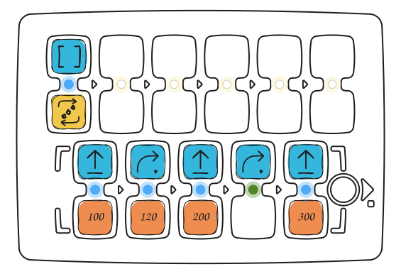
  </Frame>
  <Frame caption="Was der Roboter zeichnet">
    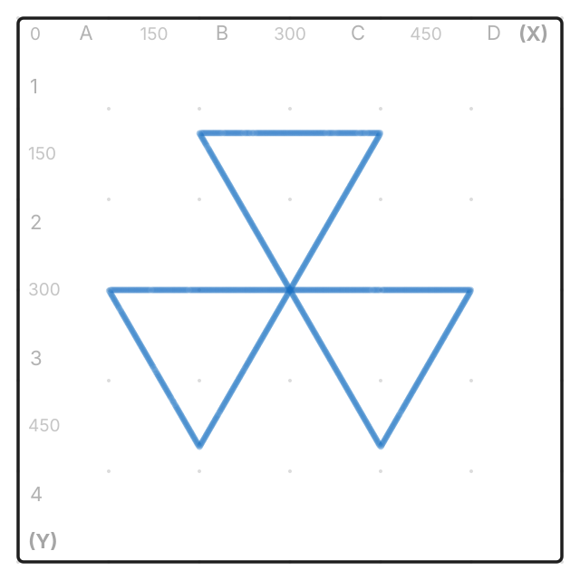
  </Frame>
</Columns>

### ~5-Minuten-Timer

Steuerboard: obere Reihe Funktion × 5, Links 360. Untere Reihe: Vorwärts, Rückwärts, Pause 60, Rechts 72.

[Im Simulator starten](https://simulator.primastem.com/#top=cfun.r005,clef.n360&fn=cfor,cbac,cwat.n060,crig.n072&s=l1041402&r=300-314-0&run)

<Columns cols={2}>
  <Frame caption="Programm auf dem Steuerboard">
    
  </Frame>
  <Frame caption="Was der Roboter zeichnet">
    
  </Frame>
</Columns>

## Gegenstände und Spiele

### Treppe

Steuerboard: obere Reihe Funktion × 4. Untere Reihe: Vorwärts, Rechts, Vorwärts, Links.

[Im Simulator starten](https://simulator.primastem.com/#top=cfun.r004&fn=cfor,crig,cfor,clef&s=l1144502&r=75-675-0&run)

<Columns cols={2}>
  <Frame caption="Programm auf dem Steuerboard">
    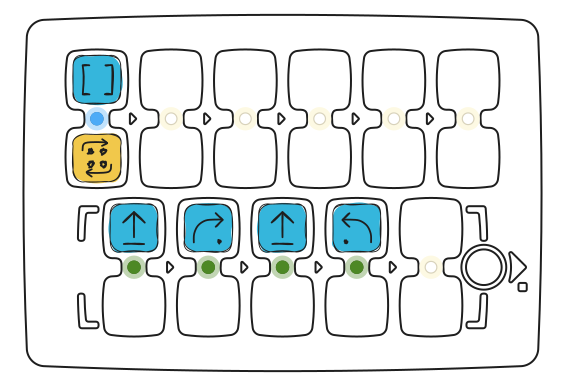
  </Frame>
  <Frame caption="Was der Roboter zeichnet">
    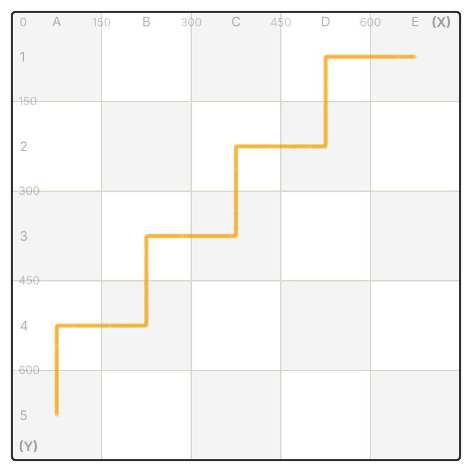
  </Frame>
</Columns>

### Haus

Steuerboard: obere Reihe Funktion × 4, Vorwärts, Rechts 30, Vorwärts, Rechts 120, Vorwärts. Untere Reihe: Vorwärts 300, Rechts.

[Im Simulator starten](https://simulator.primastem.com/#top=cfun.r004,cfor,crig.n030,cfor,crig.n120,cfor&fn=cfor.n300,crig&s=l1047502&r=225-655-0&run)

<Columns cols={2}>
  <Frame caption="Programm auf dem Steuerboard">
    
  </Frame>
  <Frame caption="Was der Roboter zeichnet">
    
  </Frame>
</Columns>

### Igel

Steuerboard: obere Reihe Funktion × 36. Untere Reihe: Vorwärts 200, Rückwärts 200, Rechts 10.

[Im Simulator starten](https://simulator.primastem.com/#top=cfun.r036&fn=cfor.n200,cbac.n200,crig.n010&s=l1047402&r=300-300-0&run)

<Columns cols={2}>
  <Frame caption="Programm auf dem Steuerboard">
    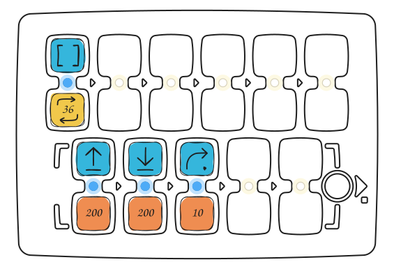
  </Frame>
  <Frame caption="Was der Roboter zeichnet">
    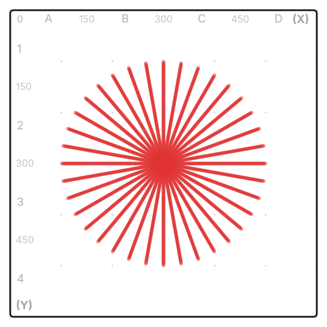
  </Frame>
</Columns>

### Fächer

Steuerboard: obere Reihe Funktion × 18. Untere Reihe: Vorwärts +15, Rückwärts +15, Rechts 10.

[Im Simulator starten](https://simulator.primastem.com/#top=cfun.r018&fn=cfor.a015,cbac.a015,crig.n010&s=l1047502&r=260-530-270&run)

<Columns cols={2}>
  <Frame caption="Programm auf dem Steuerboard">
    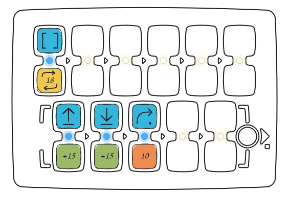
  </Frame>
  <Frame caption="Was der Roboter zeichnet">
    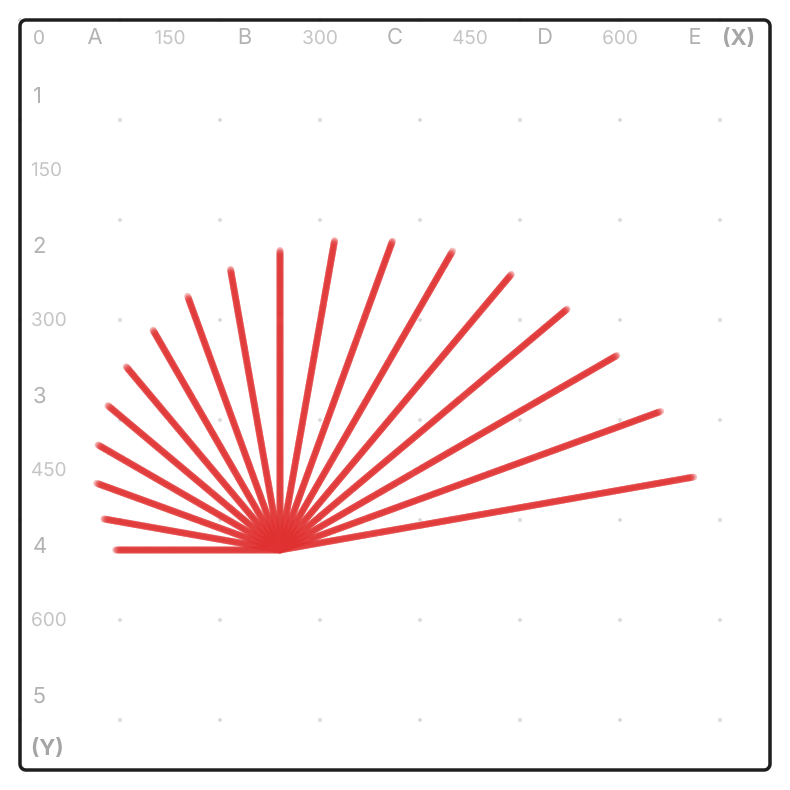
  </Frame>
</Columns>

### Spaziergang des Marienkäfers

Steuerboard: obere Reihe Zufällige Bewegung × 40.

<Note>Jeder Durchlauf zeichnet einen neuen Weg: Der Roboter wählt jeden Schritt selbst. Das Bild zeigt eine der Möglichkeiten.</Note>

[Im Simulator starten](https://simulator.primastem.com/#top=crnd.r040&s=l1144502&r=375-375-0&run)

<Columns cols={2}>
  <Frame caption="Programm auf dem Steuerboard">
    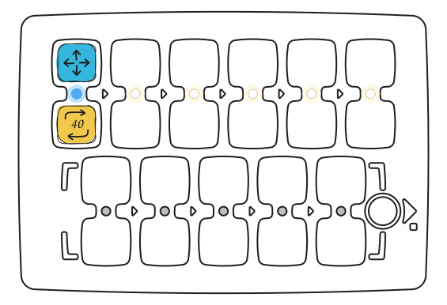
  </Frame>
  <Frame caption="Was der Roboter zeichnet">
    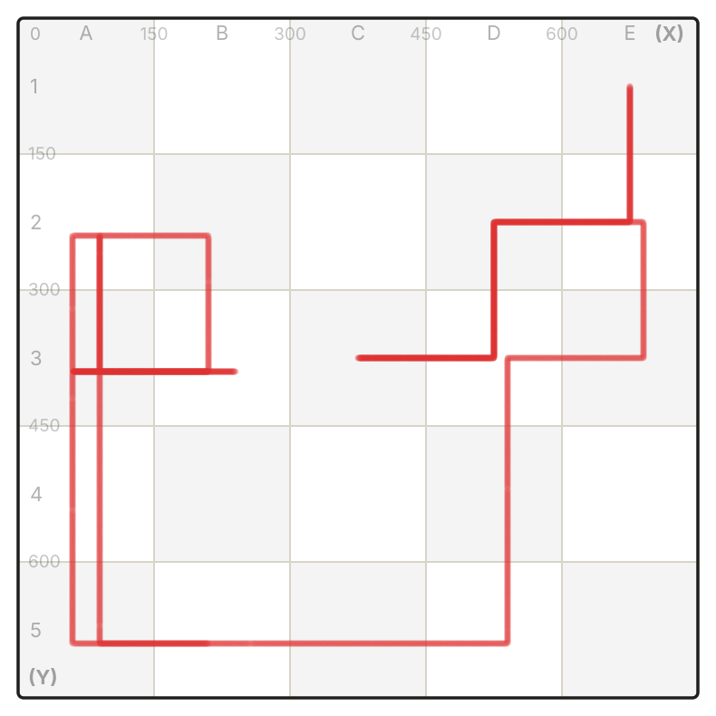
  </Frame>
</Columns>

## Sterne

### Einfacher fünfzackiger Stern

Steuerboard: obere Reihe Funktion × 5. Untere Reihe: Vorwärts, Rechts 144.

[Im Simulator starten](https://simulator.primastem.com/#top=cfun.r005&fn=cfor,crig.n144&s=l1047402&r=225-283-90&run)

<Columns cols={2}>
  <Frame caption="Programm auf dem Steuerboard">
    
  </Frame>
  <Frame caption="Was der Roboter zeichnet">
    
  </Frame>
</Columns>

### Einfacher achtzackiger Stern

Steuerboard: obere Reihe Funktion × 8. Untere Reihe: Vorwärts, Rechts 135.

[Im Simulator starten](https://simulator.primastem.com/#top=cfun.r008&fn=cfor,crig.n135&s=l1047402&r=269-375-0&run)

<Columns cols={2}>
  <Frame caption="Programm auf dem Steuerboard">
    
  </Frame>
  <Frame caption="Was der Roboter zeichnet">
    
  </Frame>
</Columns>

### Vierzackiger Stern

Steuerboard: obere Reihe Funktion × 12. Untere Reihe: Vorwärts 200, Rechts 150, Vorwärts, Rechts 120.

[Im Simulator starten](https://simulator.primastem.com/#top=cfun.r012&fn=cfor.n200,crig.n150,cfor,crig.n120&s=l1047402&r=237-263-90&run)

<Columns cols={2}>
  <Frame caption="Programm auf dem Steuerboard">
    
  </Frame>
  <Frame caption="Was der Roboter zeichnet">
    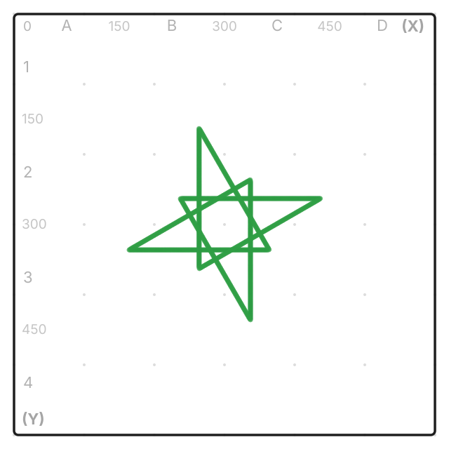
  </Frame>
</Columns>

### Sternenring

Steuerboard: obere Reihe Funktion × 18. Untere Reihe: Vorwärts 350, Rechts 100.

[Im Simulator starten](https://simulator.primastem.com/#top=cfun.r018&fn=cfor.n350,crig.n100&s=l1047502&r=200-228-90&run)

<Columns cols={2}>
  <Frame caption="Programm auf dem Steuerboard">
    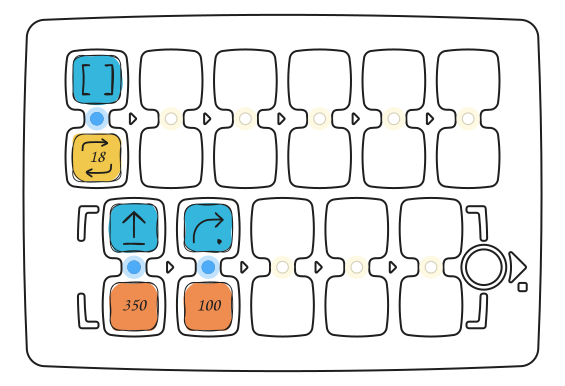
  </Frame>
  <Frame caption="Was der Roboter zeichnet">
    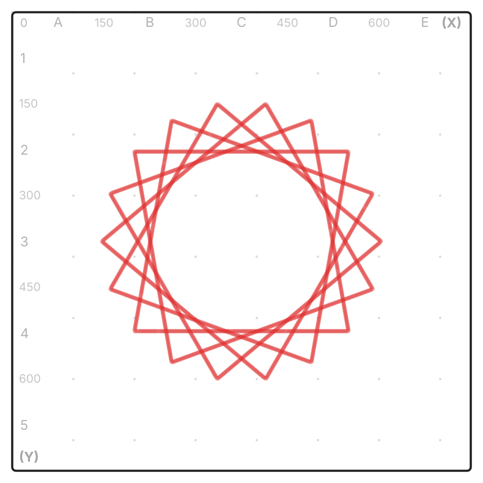
  </Frame>
</Columns>

### Sonne

Steuerboard: obere Reihe Funktion × 36. Untere Reihe: Vorwärts 400, Rechts 170.

[Im Simulator starten](https://simulator.primastem.com/#top=cfun.r036&fn=cfor.n400,crig.n170&s=l1047402&r=100-283-90&run)

<Columns cols={2}>
  <Frame caption="Programm auf dem Steuerboard">
    
  </Frame>
  <Frame caption="Was der Roboter zeichnet">
    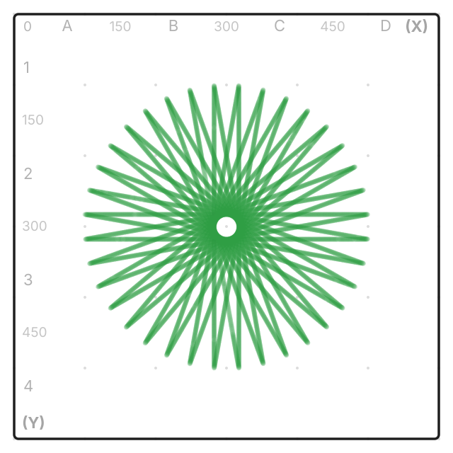
  </Frame>
</Columns>

### Windrad

Steuerboard: obere Reihe Funktion × 5. Untere Reihe: Vorwärts 300, Rechts 144, Vorwärts 100, Rechts 72.

[Im Simulator starten](https://simulator.primastem.com/#top=cfun.r005&fn=cfor.n300,crig.n144,cfor.n100,crig.n072&s=l1047402&r=165-304-90&run)

<Columns cols={2}>
  <Frame caption="Programm auf dem Steuerboard">
    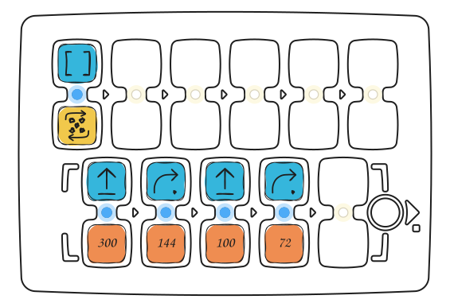
  </Frame>
  <Frame caption="Was der Roboter zeichnet">
    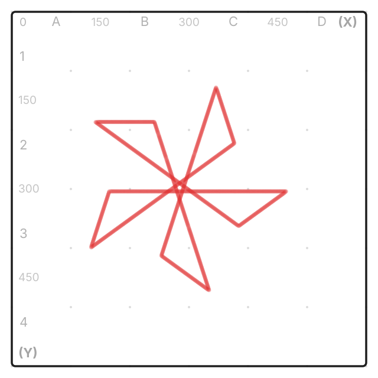
  </Frame>
</Columns>

## Spiralen

### Spirale

Steuerboard: obere Reihe Vorwärts 5, Funktion × 36. Untere Reihe: Rechts 30, Vorwärts +1.

[Im Simulator starten](https://simulator.primastem.com/#top=cfor.n005,cfun.r036&fn=crig.n030,cfor.a001&s=l1047402&r=296-293-0&run)

<Columns cols={2}>
  <Frame caption="Programm auf dem Steuerboard">
    
  </Frame>
  <Frame caption="Was der Roboter zeichnet">
    
  </Frame>
</Columns>

### Quadratspirale

Steuerboard: obere Reihe Vorwärts 10, Rechts, Vorwärts, Rechts, Funktion × 8. Untere Reihe: Vorwärts +10, Rechts, Vorwärts, Rechts.

[Im Simulator starten](https://simulator.primastem.com/#top=cfor.n010,crig,cfor,crig,cfun.r008&fn=cfor.a010,crig,cfor,crig&s=l1047402&r=295-305-0&run)

<Columns cols={2}>
  <Frame caption="Programm auf dem Steuerboard">
    
  </Frame>
  <Frame caption="Was der Roboter zeichnet">
    
  </Frame>
</Columns>

### Dreiecksspirale

Steuerboard: obere Reihe Vorwärts 10, Rechts 120, Funktion × 10. Untere Reihe: Vorwärts +10, Rechts.

[Im Simulator starten](https://simulator.primastem.com/#top=cfor.n010,crig.n120,cfun.r010&fn=cfor.a010,crig&s=l1047402&r=295-278-90&run)

<Columns cols={2}>
  <Frame caption="Programm auf dem Steuerboard">
    
  </Frame>
  <Frame caption="Was der Roboter zeichnet">
    
  </Frame>
</Columns>

### Doppelte Dreiecksspirale

Steuerboard: obere Reihe Vorwärts 20, Funktion × 20. Untere Reihe: Rechts 120, Vorwärts +20, Rechts 120, Vorwärts.

[Im Simulator starten](https://simulator.primastem.com/#p=cfor-n020-cfun-r020---------crig-n120-cfor-a020-crig-n120-cfor---&s=l1087602&r=424-475-240&run)

<Columns cols={2}>
  <Frame caption="Programm auf dem Steuerboard">
    
  </Frame>
  <Frame caption="Was der Roboter zeichnet">
    
  </Frame>
</Columns>

### Rautenspirale

Steuerboard: obere Reihe Vorwärts 40, Funktion × 14. Untere Reihe: Rechts 60, Vorwärts +18, Rechts 120, Vorwärts +7.

[Im Simulator starten](https://simulator.primastem.com/#p=cfor-n040-cfun-r014---------crig-n060-cfor-a018-crig-n120-cfor-a007--&s=l1087602&r=436-466-0&run)

<Columns cols={2}>
  <Frame caption="Programm auf dem Steuerboard">
    
  </Frame>
  <Frame caption="Was der Roboter zeichnet">
    
  </Frame>
</Columns>

### Sternspirale

Steuerboard: obere Reihe Vorwärts 10, Funktion × 30. Untere Reihe: Rechts 144, Vorwärts +12.

[Im Simulator starten](https://simulator.primastem.com/#top=cfor.n010,cfun.r030&fn=crig.n144,cfor.a012&s=l1047402&r=295-313-90&run)

<Columns cols={2}>
  <Frame caption="Programm auf dem Steuerboard">
    
  </Frame>
  <Frame caption="Was der Roboter zeichnet">
    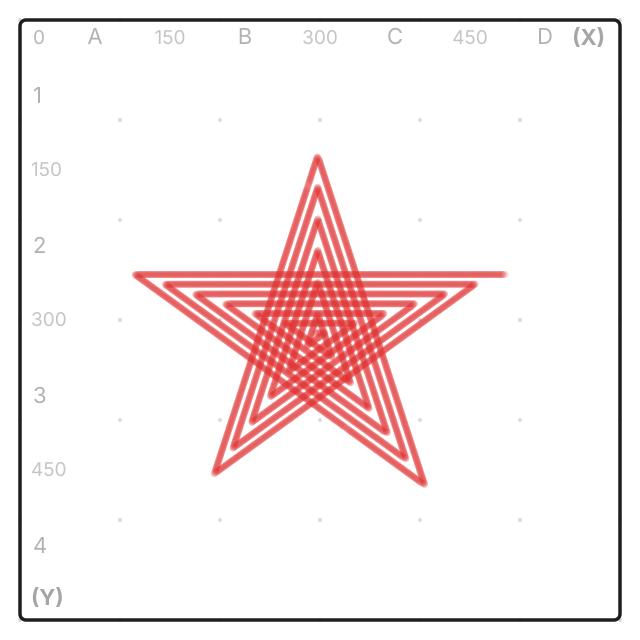
  </Frame>
</Columns>

### Stachelspirale

Steuerboard: obere Reihe Vorwärts 10, Funktion × 36. Untere Reihe: Rechts 150, Vorwärts +10.

[Im Simulator starten](https://simulator.primastem.com/#top=cfor.n010,cfun.r036&fn=crig.n150,cfor.a010&s=l1047402&r=295-301-90&run)

<Columns cols={2}>
  <Frame caption="Programm auf dem Steuerboard">
    
  </Frame>
  <Frame caption="Was der Roboter zeichnet">
    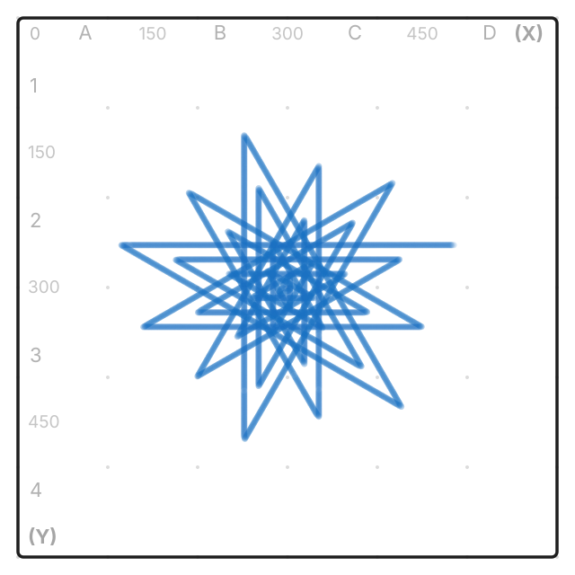
  </Frame>
</Columns>

### Wirbel

Steuerboard: obere Reihe Vorwärts 5, Funktion × 70. Untere Reihe: Rechts 117, Vorwärts +5.

[Im Simulator starten](https://simulator.primastem.com/#top=cfor.n005,cfun.r070&fn=crig.n117,cfor.a005&s=l1047402&r=277-304-90&run)

<Columns cols={2}>
  <Frame caption="Programm auf dem Steuerboard">
    
  </Frame>
  <Frame caption="Was der Roboter zeichnet">
    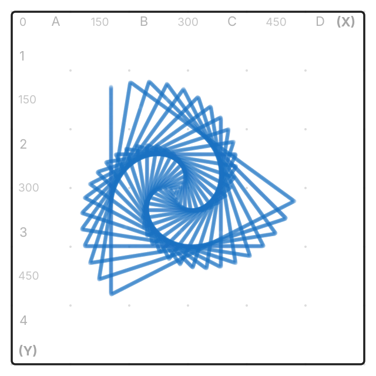
  </Frame>
</Columns>

## Verdrehte Figuren

### Verdrehtes Quadrat

Steuerboard: obere Reihe Vorwärts 400, Funktion × 70. Untere Reihe: Rechts 91, Vorwärts −5.

[Im Simulator starten](https://simulator.primastem.com/#top=cfor.n400,cfun.r070&fn=crig.n091,cfor.s005&s=l1047502&r=174-179-90&run)

<Columns cols={2}>
  <Frame caption="Programm auf dem Steuerboard">
    
  </Frame>
  <Frame caption="Was der Roboter zeichnet">
    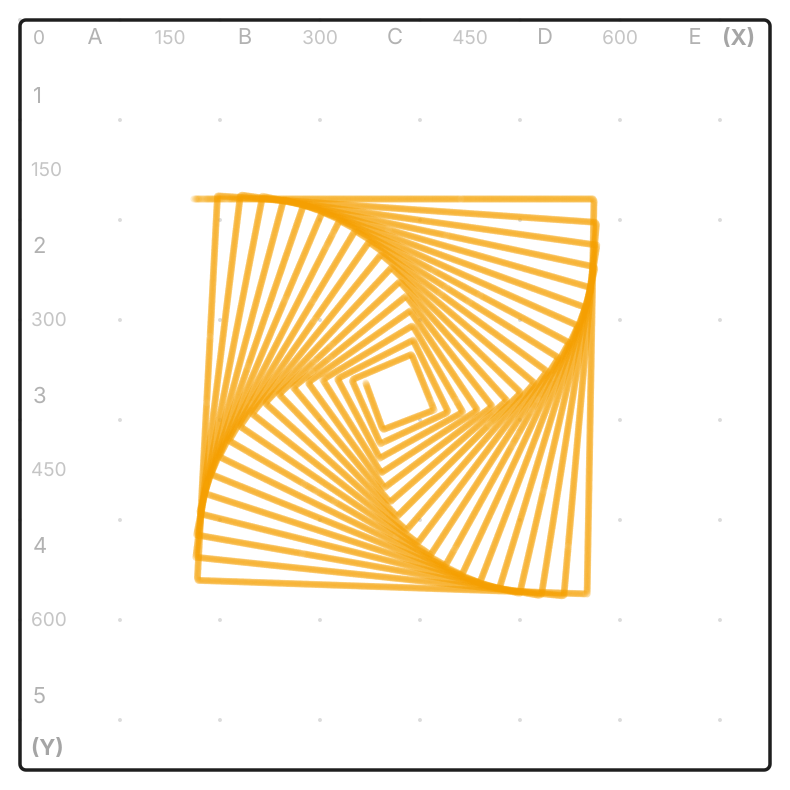
  </Frame>
</Columns>

### Verdrehtes Dreieck

Steuerboard: obere Reihe Vorwärts 400, Funktion × 70. Untere Reihe: Rechts 121, Vorwärts −5.

[Im Simulator starten](https://simulator.primastem.com/#top=cfor.n400,cfun.r070&fn=crig.n121,cfor.s005&s=l1047502&r=575-535-270&run)

<Columns cols={2}>
  <Frame caption="Programm auf dem Steuerboard">
    
  </Frame>
  <Frame caption="Was der Roboter zeichnet">
    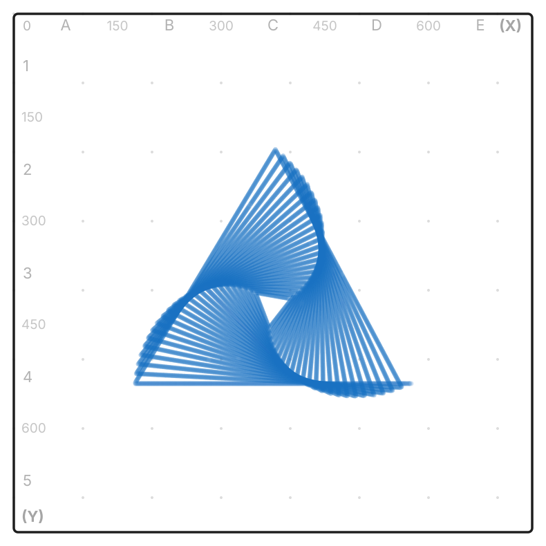
  </Frame>
</Columns>

### Verdrehtes Sechseck

Steuerboard: obere Reihe Vorwärts 200, Funktion × 60. Untere Reihe: Rechts 61, Vorwärts −3.

[Im Simulator starten](https://simulator.primastem.com/#top=cfor.n200,cfun.r060&fn=crig.n061,cfor.s003&s=l1047402&r=192-132-90&run)

<Columns cols={2}>
  <Frame caption="Programm auf dem Steuerboard">
    
  </Frame>
  <Frame caption="Was der Roboter zeichnet">
    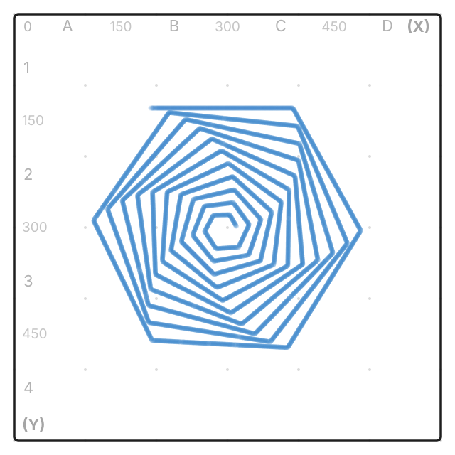
  </Frame>
</Columns>

## Rosetten

### Dreiecksrosette

Steuerboard: obere Reihe Funktion × 36. Untere Reihe: Vorwärts 300, Rechts 120, Vorwärts, Rechts 130.

[Im Simulator starten](https://simulator.primastem.com/#top=cfun.r036&fn=cfor.n300,crig.n120,cfor,crig.n130&s=l1047402&r=134-223-90&run)

<Columns cols={2}>
  <Frame caption="Programm auf dem Steuerboard">
    
  </Frame>
  <Frame caption="Was der Roboter zeichnet">
    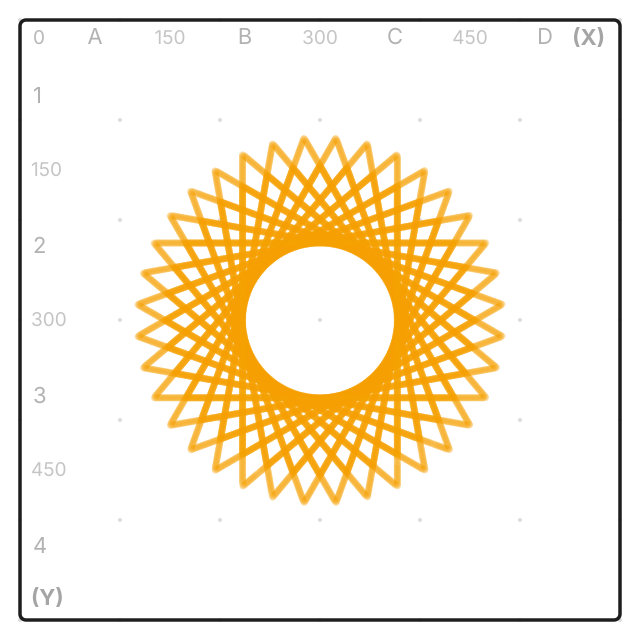
  </Frame>
</Columns>

### Quadratrosette

Steuerboard: obere Reihe Funktion × 36. Untere Reihe: Vorwärts 250, Rechts 90, Vorwärts, Rechts 100.

[Im Simulator starten](https://simulator.primastem.com/#top=cfun.r036&fn=cfor.n250,crig.n090,cfor,crig.n100&s=l1047402&r=164-186-90&run)

<Columns cols={2}>
  <Frame caption="Programm auf dem Steuerboard">
    
  </Frame>
  <Frame caption="Was der Roboter zeichnet">
    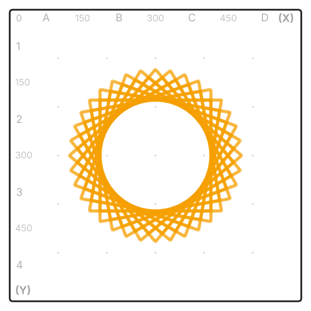
  </Frame>
</Columns>

### Sternrosette

Steuerboard: obere Reihe Funktion × 36. Untere Reihe: Vorwärts 300, Rechts 150, Vorwärts, Rechts 160.

[Im Simulator starten](https://simulator.primastem.com/#top=cfun.r036&fn=cfor.n300,crig.n150,cfor,crig.n160&s=l1047402&r=119-268-90&run)

<Columns cols={2}>
  <Frame caption="Programm auf dem Steuerboard">
    
  </Frame>
  <Frame caption="Was der Roboter zeichnet">
    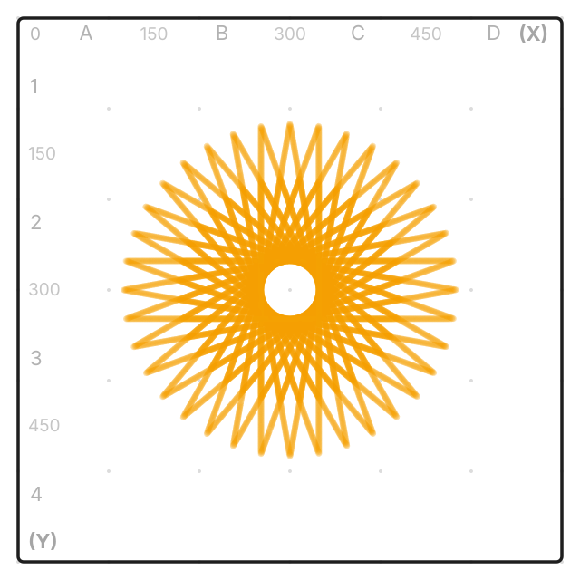
  </Frame>
</Columns>

### Sternenkranz

Steuerboard: obere Reihe Funktion × 24. Untere Reihe: Vorwärts 200, Rechts 60, Vorwärts, Rechts 130.

[Im Simulator starten](https://simulator.primastem.com/#top=cfun.r024&fn=cfor.n200,crig.n060,cfor,crig.n130&s=l1047402&r=142-227-90&run)

<Columns cols={2}>
  <Frame caption="Programm auf dem Steuerboard">
    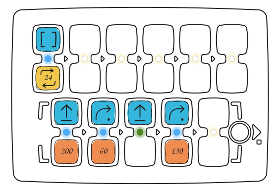
  </Frame>
  <Frame caption="Was der Roboter zeichnet">
    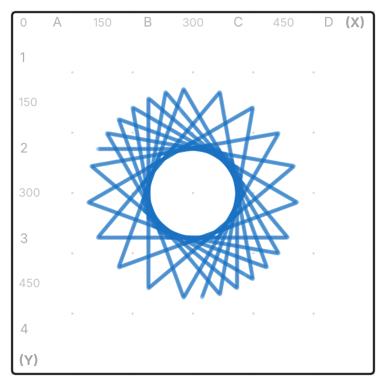
  </Frame>
</Columns>

## Kurven und Schnörkel

### Kurve mit negativen Winkeln

Steuerboard: obere Reihe Vorwärts 10, Rechts 30, Funktion × 36. Untere Reihe: Vorwärts, Rechts −2.

[Im Simulator starten](https://simulator.primastem.com/#top=cfor.n010,crig.n030,cfun.r036&fn=cfor,crig.s002&s=l1047402&r=300-238-0&run)

<Columns cols={2}>
  <Frame caption="Programm auf dem Steuerboard">
    
  </Frame>
  <Frame caption="Was der Roboter zeichnet">
    
  </Frame>
</Columns>

### Schlange

Steuerboard: obere Reihe Rechts 10, Funktion × 18, Rechts −20, Funktion × 18, Rechts +20, Funktion × 18. Untere Reihe: Vorwärts 18, Rechts.

[Im Simulator starten](https://simulator.primastem.com/#top=crig.n010,cfun.r018,crig.s020,cfun.r018,crig.a020,cfun.r018&fn=cfor.n018,crig&s=l1047602&r=141-432-0&run)

<Columns cols={2}>
  <Frame caption="Programm auf dem Steuerboard">
    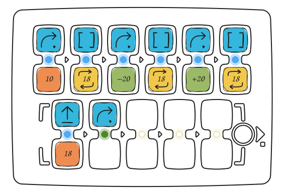
  </Frame>
  <Frame caption="Was der Roboter zeichnet">
    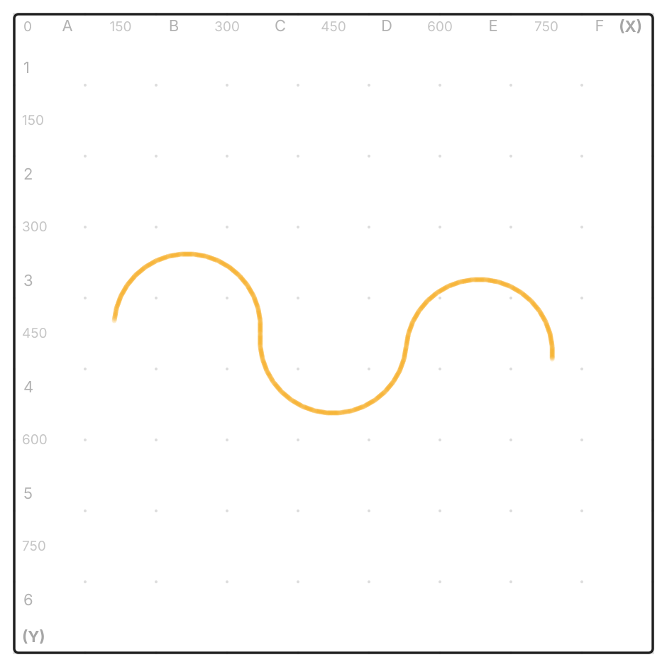
  </Frame>
</Columns>

### Doppelter Schnörkel

Steuerboard: obere Reihe Rechts 5, Funktion × 72. Untere Reihe: Vorwärts 40, Rechts +10.

[Im Simulator starten](https://simulator.primastem.com/#top=crig.n005,cfun.r072&fn=cfor.n040,crig.a010&s=l1047402&r=130-130-90&run)

<Columns cols={2}>
  <Frame caption="Programm auf dem Steuerboard">
    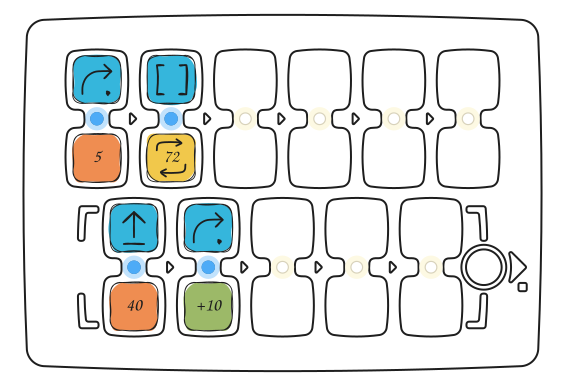
  </Frame>
  <Frame caption="Was der Roboter zeichnet">
    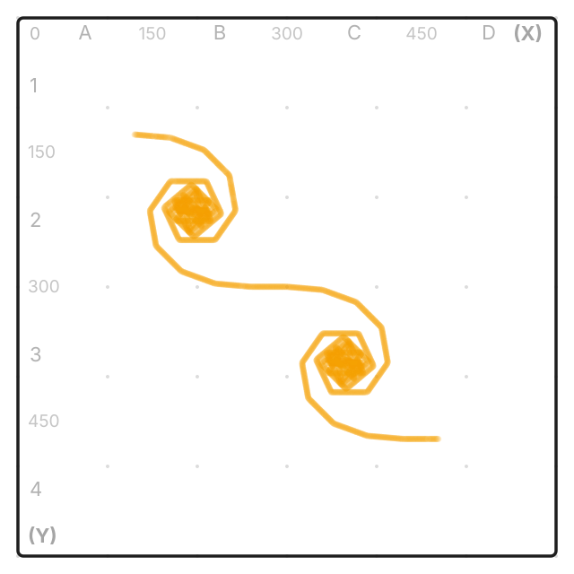
  </Frame>
</Columns>

### Schnörkel mit Sternchen

Steuerboard: obere Reihe Rechts 10, Funktion × 36. Untere Reihe: Vorwärts 60, Rechts +20.

[Im Simulator starten](https://simulator.primastem.com/#top=crig.n010,cfun.r036&fn=cfor.n060,crig.a020&s=l1047402&r=120-120-90&run)

<Columns cols={2}>
  <Frame caption="Programm auf dem Steuerboard">
    
  </Frame>
  <Frame caption="Was der Roboter zeichnet">
    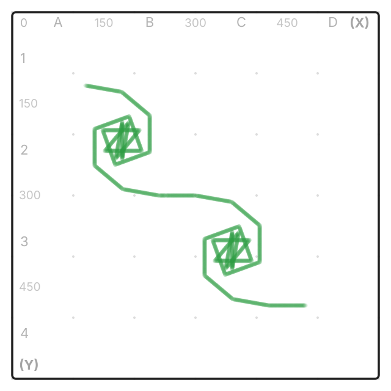
  </Frame>
</Columns>

### Stachelring

Steuerboard: obere Reihe Funktion × 24. Untere Reihe: Vorwärts 150, Rückwärts 90, Rechts 15.

[Im Simulator starten](https://simulator.primastem.com/#top=cfun.r024&fn=cfor.n150,cbac.n090,crig.n015&s=l1047502&r=345-147-90&run)

<Columns cols={2}>
  <Frame caption="Programm auf dem Steuerboard">
    
  </Frame>
  <Frame caption="Was der Roboter zeichnet">
    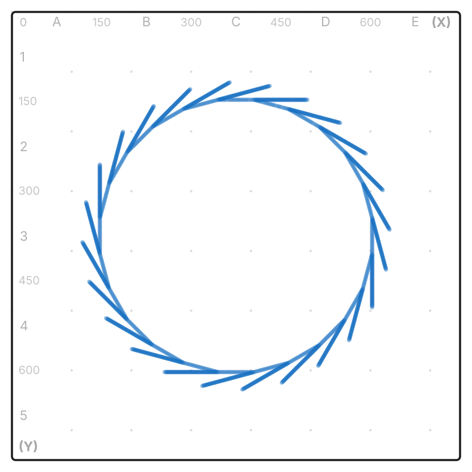
  </Frame>
</Columns>

### Mathematische Herzzeichnung

Steuerboard: obere Reihe Vorwärts 45, Vorwärts 20, Funktion × 6, Rechts 120, Funktion × 7, Vorwärts 50. Untere Reihe: Links 30, Vorwärts 15.

[Im Simulator starten](https://simulator.primastem.com/#top=cfor.n045,cfor.n020,cfun.r006,crig.n120,cfun.r007,cfor.n050&fn=clef.n030,cfor.n015&s=l1047402&r=346-340-0&run)

<Columns cols={2}>
  <Frame caption="Programm auf dem Steuerboard">
    
  </Frame>
  <Frame caption="Was der Roboter zeichnet">
    
  </Frame>
</Columns>

## Fraktale

### Fraktal: Dreieck im Dreieck

Steuerboard: obere Reihe Vorwärts 400, Funktion × 6. Untere Reihe: Rechts 120, Vorwärts, Rechts, Vorwärts ÷2, Vorwärts.

[Im Simulator starten](https://simulator.primastem.com/#top=cfor.n400,cfun.r006&fn=crig.n120,cfor,crig,cfor.d002,cfor&s=l1047402&r=500-473-270&run)

<Columns cols={2}>
  <Frame caption="Programm auf dem Steuerboard">
    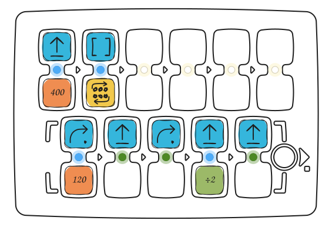
  </Frame>
  <Frame caption="Was der Roboter zeichnet">
    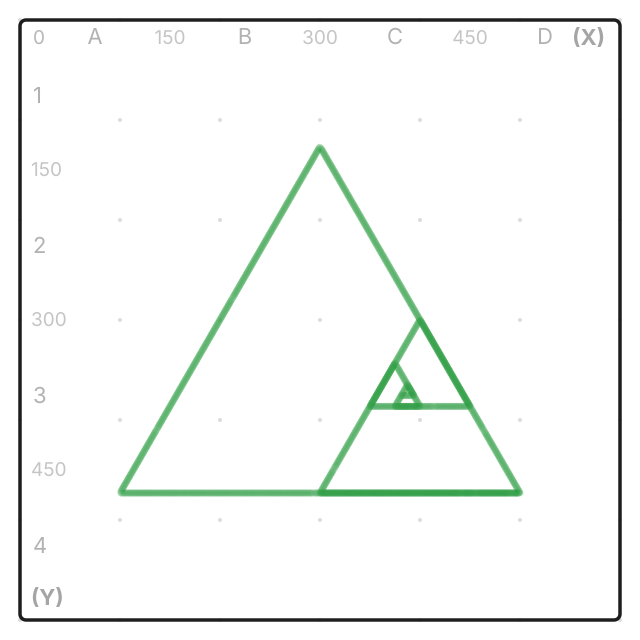
  </Frame>
</Columns>

### Fraktal: verschachtelte Dreiecke

Steuerboard: obere Reihe Funktion, Rechts, Vorwärts ÷2, Rechts 60. Untere Reihe: Vorwärts, Rechts 120, Vorwärts, Rechts, Vorwärts.

<Note>Drücken Sie **▶ Start** 4-mal hintereinander, ohne den Roboter zu bewegen. Das Steuerboard merkt sich die Schrittlänge zwischen den Durchläufen, deshalb zeichnet jeder Durchlauf ein halb so großes Dreieck. Der Link startet das Programm einmal, danach drücken Sie **▶ Start** im Simulator selbst.</Note>

[Im Simulator starten](https://simulator.primastem.com/#p=cfun--crig--cfor-d002-crig-n060-----cfor--crig-n120-cfor--crig--cfor-&s=l1047402&r=225-235-90&run)

<Columns cols={2}>
  <Frame caption="Programm auf dem Steuerboard">
    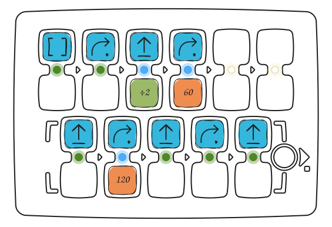
  </Frame>
  <Frame caption="Was der Roboter zeichnet">
    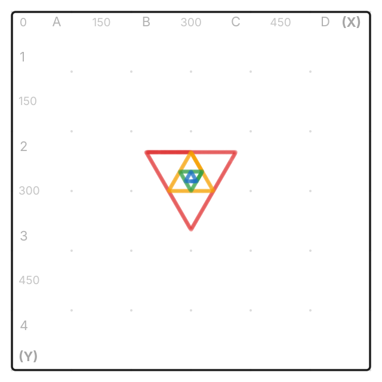
  </Frame>
</Columns>

