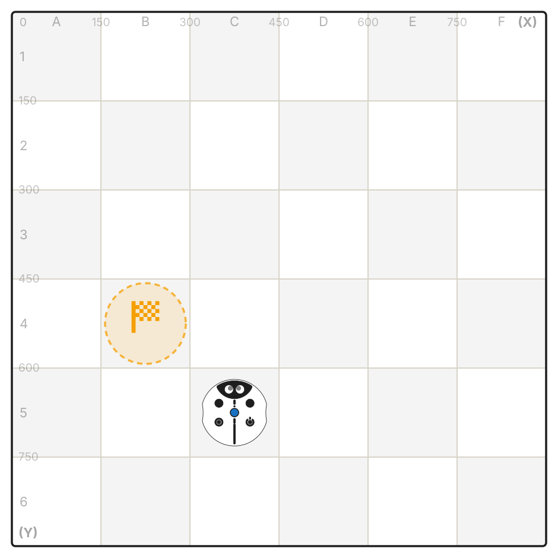

Mit PrimaSTEM lernen Kinder von 4 bis 12 Jahren programmieren, ohne Computer, Tablets oder Telefone. Das Set entwickelt Logik, Programmierfähigkeiten und Mathematik.

Mit PrimaSTEM wird Programmieren einfach und anschaulich. Selbst kleine Kinder verstehen, was passiert: Sie fassen die Tokens mit den Händen an und lernen die Grundlagen von Programmierung, Logik und Mathematik im Spiel.

Das Spielen mit PrimaSTEM fördert logisches Denken, Algorithmik, Programmierung, Mathematik und Geometrie. Es fördert auch Kreativität und sozio-emotionale Fähigkeiten. Das Set bereitet das Kind auf blockbasierte Programmiersprachen vor, zum Beispiel [Scratch](https://en.wikipedia.org/wiki/Scratch_(programming_language)) oder [LOGO](https://en.wikipedia.org/wiki/Logo_(programming_language)).

## Das Lernset kennenlernen

### Wo man PrimaSTEM einsetzen kann

PrimaSTEM eignet sich für diese Bereiche:

- Vorschulbildungszentren
- Kindergärten, die nach der Montessori-Methode arbeiten
- Grundschule
- Heimunterricht
- Spezielle Entwicklungszentren
- Hortgruppen
- Programmierclubs für Anfänger
- Kinder-Bildungscamps

### Was Sie für den Anfang wissen müssen

Lesen Sie vor der Arbeit mit dem Set die Seite [Gerät und Einrichtung](/de/usermanual) und dieses Handbuch. Programmierkenntnisse brauchen Sie nicht: Die Materialien enthalten alles, was Sie für den Anfang brauchen.

## Forschung und Wert des Sets

PrimaSTEM ist von der Programmiersprache [LOGO](https://en.wikipedia.org/wiki/Logo_(programming_language)) inspiriert, die [Seymour Papert](https://en.wikipedia.org/wiki/Seymour_Papert) entwickelt hat, und von der Montessori-Pädagogik. LOGO und der Schildkrötenroboter machten Programmieren für Kinder anschaulich und zugänglich.

Die PrimaSTEM-Befehls-Tokens setzen diesen Ansatz fort. Das Kind steuert den Roboter mit den Händen, ohne Bildschirm und Text, und sieht sofort, was es tut.

Die Kinder beobachten den Roboter, verstehen jeden Befehl und lernen Algorithmen in der Praxis.

Der Roboter hat eine wichtige Eigenschaft: Er hat eine Richtung. Das Kind kann sich leicht an die Stelle des Roboters versetzen und versteht deshalb die Logik des Programms schneller.

Alle Befehle sind einfach: Sie sagen dem Roboter, in welche Richtung er fahren soll. Wenn Kinder dem Roboter beibringen, zu "handeln" und zu "denken", denken sie über ihre eigenen Handlungen und Gedanken nach. Deshalb fällt ihnen das Programmieren leichter.

PrimaSTEM-Tokens zeigen anschaulich und vereinfacht, wie Programmiersprachen aufgebaut sind. Am Anfang gibt es keinen Text und keine Zahlen, nur grundlegende Befehle.

### Warum Holz

🌱 Das Steuerboard und der Roboter sind aus Holz (Sperrholz). Kinder spielen lieber mit Holzspielzeug. Es ist sicher und hält lange, und jedes Stück bekommt seine eigene Geschichte.

## Programmieren mit PrimaSTEM

PrimaSTEM-Tokens funktionieren wie Anweisungen in echten Programmiersprachen. An ihnen sieht man wichtige Begriffe der Programmierung.

### Algorithmen

Ein **Algorithmus** besteht aus präzisen Befehlen (Tokens), die zusammen ein Programm bilden.

### Warteschlange

Das Steuerboard führt die Befehle streng von links nach rechts aus. So sehen die Kinder, dass die Befehle der Reihe nach ausgeführt werden.

### Fehlerkorrektur (Debugging)

Ein Fehler lässt sich leicht beheben: Ersetzen Sie einfach den Token. So lernt das Kind, Fehler im Programm selbst zu finden und zu beheben.

### Funktion

Eine Funktion (Unterprogramm) besteht aus den Befehlen in der unteren Reihe des Steuerboards. Das Hauptprogramm ruft sie mit dem Token "**Funktion**" auf.

### Variable

Das Steuerboard merkt sich die letzte Zahl jedes Befehls. Vorwärts, Rückwärts, Links, Rechts und Pause speichern jeweils ihren eigenen Wert. Ein Befehl ohne Zahl nimmt den gespeicherten Wert. Das ist eine Variable: Sie hat einen Namen (den Befehl) und einen Wert (die Zahl), und der Wert lässt sich ändern.

## Anwendung in anderen Fächern

PrimaSTEM hilft auch, andere Fähigkeiten zu entwickeln:

- Kommunikation. Im Gruppenspiel lernen Kinder, zusammenzuarbeiten.
- Motorik. Das Arbeiten mit Tokens verbessert die Koordination.
- Soziale Fähigkeiten. Kinder gewinnen Selbstvertrauen und lernen, Aufgaben gemeinsam zu lösen.
- Mathematik. Kinder lernen grundlegende mathematische Begriffe.
- Logik. Kinder lernen, Sequenzen zu bauen und das Ergebnis vorherzusagen.

> Das Kind legt eine Kette aus Tokens und lernt das Programmieren mit Händen, Augen und Kopf. Es drückt **▶ Start**, der Roboter fährt, und das Kind vergleicht das Ergebnis mit seiner Erwartung. Diese Erfahrung beschleunigt das Lernen.

## Kennenlernen von Roboter und Steuerboard

### Der Roboter

Erklären Sie den Kindern, dass der Roboter ihr Freund ist und dass sie ihn programmieren können. Erklären Sie, dass er keine eigenen Gedanken hat. Er führt nur ihre Anweisungen aus, wie ein Haushaltsgerät, das man einschalten muss.

### Das Steuerboard

Erklären Sie, dass das Steuerboard die Befehle an den Roboter sendet. Zeigen Sie, wie man Befehls-Tokens einlegt und den Roboter programmiert.

> Das Hauptprogramm bauen Sie in der oberen Reihe des Steuerboards (6 Paare). Die untere Reihe (5 Paare) ist für das Unterprogramm. Der Befehl "**Funktion**" ruft es auf.

### Befehls-Tokens

Tokens geben dem Roboter Befehle. Man legt sie auf das Steuerboard. Nach dem Drücken von **▶ Start** führt der Roboter das Programm aus. Jeder Token gibt einen Befehl. So lernen Kinder rechnerisches Denken und lernen, Programme zu schreiben. Es ist wichtig, dass Kinder verstehen, was der Roboter bei jedem Befehl tut. Dann können sie das Programm planen und die Aktionen des Roboters vorhersagen. Erklären Sie den Kindern, dass Tokens nicht verloren gehen oder beschädigt werden dürfen: Ohne sie kann sich der Roboter nicht bewegen.

## 1. Erstes Programm

### Ursache und Wirkung

Das Hauptziel: Zeigen Sie den Kindern den Zusammenhang zwischen Befehl und Aktion. Lassen Sie das Kind den Token "Vorwärts" in die erste Zelle des Steuerboards legen und **▶ Start** drücken. Das Kind soll sehen, dass Token und Aktion zusammengehören.

### Eindeutige Anweisungen

Wiederholen Sie das mit jeder Richtung (**vorwärts**, drehen **links**, drehen **rechts**), bis das Kind jeden Token erkennt.

### Erste Aufgabe

Legen Sie das Spielfeld aus oder machen Sie mit Klebeband oder einem Marker ein Raster mit Feldern von 15 × 15 cm. Stellen Sie den Roboter auf das Startfeld. Bitten Sie das Kind, ein Programm zu schreiben, damit der Roboter ein Feld vorwärts fährt. Hat das Kind den falschen Token gewählt, stellen Sie den Roboter zurück und schlagen Sie vor, über eine andere Lösung nachzudenken.

## 2. Programm und Debugging

### Ereigniswarteschlange

Platzieren Sie ein Ziel zwei Felder vor dem Roboter.

Lassen Sie das Kind ein Programm aus zwei Tokens schreiben, damit der Roboter das Ziel erreicht.

### Sequenz aus drei Tokens

Jetzt liegt das Ziel ein Feld vorwärts und ein Feld rechts.

Lassen Sie das Kind die richtige Reihenfolge der Befehle selbst wählen.

Machen Sie sich keine Sorgen, wenn das Kind den falschen Token gewählt hat. Stellen Sie den Roboter an den Start zurück und bitten Sie das Kind, über seine Wahl nachzudenken und andere Lösungen auszuprobieren.

### Debugging: Fehler finden

Platzieren Sie das Ziel ein Feld vor dem Roboter und ein Feld links von ihm.

Jetzt schreiben Sie das Programm selbst und bauen absichtlich eine falsche Drehung ein.

Bitten Sie das Kind, den falschen Befehl zu finden und vorherzusagen, wohin der Roboter fährt. Dann soll das Kind **▶ Start** drücken und seine Vermutung prüfen.

Wenn das Kind sicher ist, dass das Programm falsch ist, durch Nachdenken oder durch Ausprobieren, soll es den falschen Befehl durch den richtigen ersetzen. So debuggt es das Programm.

## 3. Programm mit Funktion

### Befehl "Funktion"

Wenn die Kinder die grundlegenden Befehle kennen, zeigen Sie den Befehls-Token **Funktion**. Er ruft eine Reihe von Befehlen auf, die das Hauptprogramm wiederholen kann.

> Um zu erklären, wie das funktioniert, vergleichen Sie die Funktion mit einem Turm: Unter dem Funktions-Token sind andere Befehle übereinander gestapelt. So sehen die Kinder, dass ein Token mehrere Anweisungen enthalten kann.

Zeigen Sie ein Beispiel. Legen Sie zuerst zwei "Vorwärts"-Tokens in die oberen Zellen und starten Sie das Programm. Der Roboter fährt zwei Felder.

Legen Sie nun dieselben zwei "Vorwärts"-Tokens in die Funktion (untere Reihe) und "Funktion" in das Hauptprogramm. Das Ergebnis ist dasselbe, aber ein Teil des Programms ist jetzt in einem Unterprogramm versteckt.

Bauen Sie dann die Sequenz: **Vorwärts, Vorwärts, Rechts, Vorwärts, Vorwärts**.

Bitten Sie die Kinder, die sich wiederholenden Teile zu finden und in der Funktion zu "verstecken". Das Ergebnis: im Hauptprogramm **Funktion, Rechts, Funktion**, in der unteren Reihe **Vorwärts, Vorwärts**.

[Im Simulator starten](https://simulator.primastem.com/#top=cfun,crig,cfun&fn=cfor,cfor&s=l1144602&r=225-825-0&run)

### Aufgaben mit Funktion lösen

Geben Sie dem Kind 3 "**Vorwärts**"-Tokens und 2 "**Funktion**"-Tokens.

Die Aufgabe: 5 Felder vorwärts fahren.

Lassen Sie das Kind verstehen, dass es für diese Aufgabe eine Funktion braucht, die die Aktion wiederholt.

Ist das Programm falsch, stellen Sie den Roboter an den Start zurück. Bitten Sie das Kind, darüber nachzudenken, wie es die Aufgabe richtig löst, und andere Lösungen auszuprobieren.

[Im Simulator starten](https://simulator.primastem.com/#top=cfun,cfun,cfor&fn=cfor,cfor&s=l1144602&r=225-825-0&run)

## 4. Zufälligkeit

### Befehl "Zufällige Bewegung"

Um Zufall zu erklären, nehmen Sie 4 Richtungs-Tokens: "**Vorwärts**", "**Links**", "**Rechts**" und "**Rückwärts**". Legen Sie sie in eine undurchsichtige Box oder einen Beutel und mischen Sie sie. Die Kinder ziehen der Reihe nach blind einen Token, zeigen ihn der Gruppe und legen ihn zurück. Erklären Sie an diesem Beispiel, was eine zufällige Wahl aus vier Möglichkeiten ist.

Zeigen Sie den Kindern dann den Befehls-Token "**Zufällige Bewegung**".

Erklären Sie, dass dieser Token fast dasselbe tut wie die Kinder mit dem Beutel. Er wählt zufällig eine Richtung und bewegt den Roboter einen Schritt weit, also ein Feld. Der Roboter kann ein Feld vorwärts, nach rechts, nach links oder zurück fahren.

Legen Sie den Token "**Zufällige Bewegung**" in die obere Zelle und starten Sie das Programm mehrmals. Der Roboter fährt jedes Mal anders.

[Im Simulator starten](https://simulator.primastem.com/#top=crnd&s=l1144602&r=375-525-0&run)

Spielen Sie mit den Kindern: Lassen Sie sie vor jedem Start raten, wohin der Roboter fährt.

Betonen Sie, dass das **Zufall** ist und man die Richtung nicht jedes Mal erraten kann.

Denken Sie sich mit den Kindern ein kleines Spiel mit dem Token "**Zufällige Bewegung**" aus.

## 5. Schleifen (Befehlswiederholungen)

### Kennenlernen numerischer Schleifen

Zeigen Sie den Kindern die Wiederholungs-Tokens. Fragen Sie, ob sie Zahlen kennen, ob sie einen Spielwürfel gesehen haben und ob sie Brettspiele gespielt haben.

Legen Sie zwei "Vorwärts"-Tokens in die oberen Zellen und starten Sie das Programm. Der Roboter fährt zwei Felder.

Lassen Sie nun einen "Vorwärts"-Token liegen und legen Sie darunter den Token "Wiederholen 2". Das Ergebnis ist dasselbe: Die Aktion wird zweimal wiederholt.

Legen Sie 4 "**Vorwärts**"-Tokens und sehen Sie sich das Ergebnis an. Bitten Sie dann die Kinder, diese Bewegung um 4 Felder mit einem **Wiederholungs**-Token nachzubauen.

Die Aufgabe lässt sich auf verschiedene Arten lösen. Die einfache Lösung: "**Vorwärts**" und "Wiederholen 4". Eine andere Lösung: "**Vorwärts**" mit "Wiederholen 3" und noch ein "**Vorwärts**".

[Im Simulator starten](https://simulator.primastem.com/#top=cfor.r003,cfor&s=l1144602&r=225-825-0&run)

### Funktion wiederholen

Versuchen Sie mit den Kindern, den Befehl "Funktion" zu wiederholen. Der Roboter kann zum Beispiel im Zickzack fahren: in der oberen Reihe "Funktion" mit "Wiederholen 5", in der unteren Reihe "**Vorwärts**", "**Rechts**", "**Vorwärts**", "**Links**".

Bauen Sie zuerst in der Funktion das Programm "eine Stufe": "Vorwärts", "Rechts", "Vorwärts", "Links". Starten Sie es.

Fügen Sie dann der Funktion "Wiederholen 5" hinzu. Die Funktion wird 5-mal wiederholt, und der Roboter fährt stufenförmig nach rechts und oben.

[Im Simulator starten](https://simulator.primastem.com/#top=cfun.r005&fn=cfor,crig,cfor,clef&s=l1144602&r=75-825-0&run)

Der Roboter fährt treppenförmig diagonal nach rechts und oben und macht 5 Stufen.

## 6. Zufallszahlen

### Was eine Zufallszahl ist

Unter den Tokens gibt es "Zufällig oft wiederholen" (mit einem Würfel). Er wählt eine zufällige Zahl von 1 bis 6. Spielen Sie mit den Kindern: Lassen Sie sie Wiederholungs-Tokens aus einem Beutel ziehen.

Um eine Zufallszahl zu erklären, nehmen Sie 4 Wiederholungs-Tokens: "**2**", "**3**", "**4**" und "**5**". Legen Sie sie in eine undurchsichtige Box oder einen Beutel und mischen Sie sie. Die Kinder ziehen der Reihe nach blind einen Token, zeigen ihn, nennen die Zahl und legen ihn zurück. Spielen Sie, wer die höhere Zahl zieht. Erklären Sie an diesem Beispiel, was eine zufällige Wahl aus vier Möglichkeiten ist.

Zeigen Sie den Kindern dann den Token "**Zufällig oft wiederholen**". Erklären Sie, dass er fast dasselbe tut wie die Kinder mit dem Beutel. Wie ein Spielwürfel wählt er zufällig eine Zahl von 1 bis 6, und der Roboter wiederholt die Aktion so oft.

Legen Sie den Token "**Vorwärts**" in die obere Zelle des Steuerboards und den Token "**Zufällig oft wiederholen**" darunter. Bitten Sie die Kinder, **▶ Start** zu drücken. Stellen Sie den Roboter an seinen Platz zurück. Wiederholen Sie das mehrmals.

[Im Simulator starten](https://simulator.primastem.com/#top=cfor.rrnd&s=l1144702&r=225-975-0&run)

Spielen Sie: Wessen Roboter fährt weiter.

Machen Sie die Kinder darauf aufmerksam, dass der Roboter eine zufällige Anzahl von Feldern fährt, von 1 bis 6. Betonen Sie, dass das Zufall ist und man vorher nicht wissen kann, wie weit der Roboter fährt.

## 7. Zahlen: Entfernungen und Winkel

### Kennenlernen der Zahlen

Steht in der zweiten Zelle des Paares keine Zahl, verwendet der Roboter die Standardwerte: Er fährt 15 cm vorwärts und dreht sich um 90°. Zahlen-Tokens ändern diese Werte.

Beispiel. Fügen Sie dem Befehl "**Vorwärts**" die Zahl **200** hinzu und sehen Sie, wie weit der Roboter fährt. Fügen Sie einer Drehung die Zahl **180** hinzu und sehen Sie, was sich ändert.

[Im Simulator starten](https://simulator.primastem.com/#top=cfor.n200,crig.n180&s=l1047602&r=450-600-0&run)

> **Wichtig.** Das Steuerboard merkt sich die letzte Zahl für Bewegungs- und Drehbefehle. Steht ein Befehl ohne neue Zahl, nimmt er die gespeicherte, bis das Steuerboard ausgeschaltet wird. Eine neue Zahl ersetzt die gespeicherte. Die mit dem Token „Standardschritt“ eingestellte Schrittlänge bleibt im Speicher und gilt auch nach einem Neustart. 15 cm erhält man zurück, indem man dasselbe Token mit der Zahl 150 verwendet. Die 90°-Drehung kehrt nach einem Neustart von selbst zurück.

Mit verschiedenen Zahlen fährt der Roboter komplexere Wege. Beispiele finden Sie auf der Seite [Zeichnungsbeispiele](/de/mathdrawings).

## 8. Arithmetik

### Arithmetische Operationen

Arithmetik ändert die Zahlen im Programm für Bewegungsbefehle (Vorwärts, Rückwärts, Links, Rechts). So lässt sich der Roboter flexibler steuern.

Steht im Paar ein Arithmetik-Token, ändert das Steuerboard die gespeicherte Zahl des Befehls und sendet den neuen Wert an den Roboter.

Beispiel:

[Im Simulator starten](https://simulator.primastem.com/#top=cfor.n200,crig,cfor.a100&s=l1047602&r=300-700-0&run)

"Vorwärts 200": Der Roboter fährt 20 cm. "Vorwärts +100": Der Roboter fährt weitere 30 cm. Insgesamt 50 cm.

### Aufgabe: eine wachsende Spirale

Rechenoperationen ändern die gespeicherte Zahl, also die Variable. Bauen Sie das Programm: obere Reihe Vorwärts 30 und Funktion × 20, untere Reihe Rechts und Vorwärts +30. Bei jedem Aufruf der Funktion wird die Seite 3 cm länger.

Lassen Sie die Kinder zuerst schätzen: Wie lang wird die fünfte Seite? Dann starten Sie das Programm und prüfen nach. Antwort: 15 cm (3 + 3 + 3 + 3 + 3).

[Im Simulator starten](https://simulator.primastem.com/#top=cfor.n030,cfun.r020&fn=crig,cfor.a030&s=l1047602&r=450-465-0&run)

<Columns cols={2}>
  <Frame caption="Programm auf dem Steuerboard">
    
  </Frame>
  <Frame caption="Was der Roboter zeichnet">
    
  </Frame>
</Columns>

Dasselbe Programm in LOGO: [PrimaSTEM und LOGO](/de/logo).

Arithmetik in einer Schleife ergibt Progressionen.

> Wird die Zahl nach einer Rechenoperation negativ, macht der Roboter das Gegenteil: Er fährt rückwärts statt vorwärts und dreht nach rechts statt nach links.

Verfügbar sind Addition (+), Subtraktion (−), Multiplikation (*), Division (/), Quadratwurzel (√) und Potenzierung (^).

Musterbeispiele finden Sie auf der Seite [Zeichnungsbeispiele](/de/mathdrawings).

---

## Spielen und lernen Sie mit den Kindern

Sie kennen Ihre Schüler am besten. Mit PrimaSTEM können Sie Programmieren, Logik und andere Fächer spielerisch unterrichten. Alles hängt von Ihrer Fantasie ab.

Vielen Dank, dass Sie sich für PrimaSTEM entschieden haben. [Schreiben Sie uns](/de/contacts) über Ihre Erfahrungen und Eindrücke, wir freuen uns auf Ihr Feedback.
