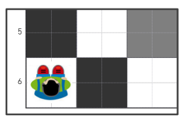
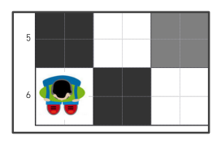
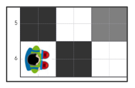

---
## Zelena misija

Dođite do zelene točke prema sljedećem programu:

---

Rješenje: zelena misija. Pogled odozgo - "dječji robot" gleda prema gore.

---
## Ljubičasta misija

Dođite do ljubičaste točke prema sljedećem programu:

---

Rješenje: ljubičasta misija. Pogled odozgo - "dječji robot" gleda prema dolje.

---
## Plava misija

Dođite do plave točke prema sljedećem programu.

---

Rješenje: plava misija. Pogled odozgo - "dječji robot" gleda udesno.

