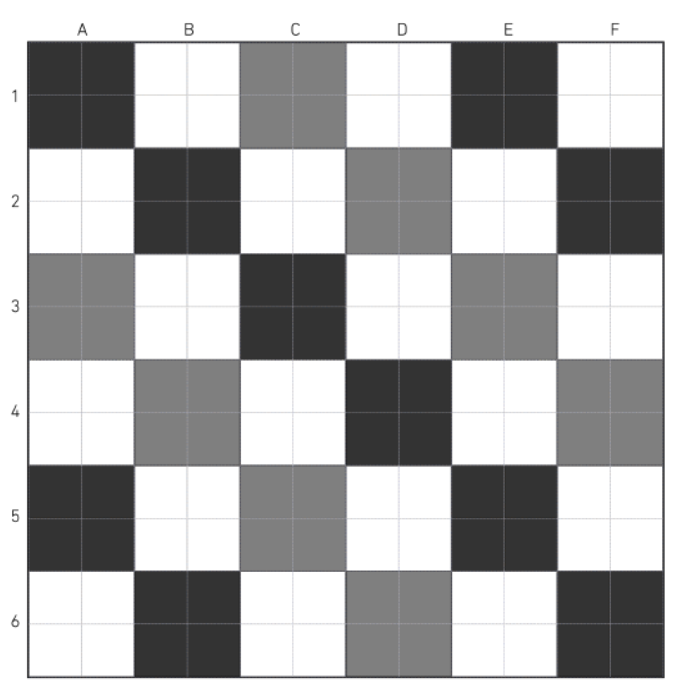

## Vodič za izvođenje nastave s djecom od 4 godine

PrimaSTEM korak po korak pomaže djeci svladati logičko razmišljanje, osnove programiranja i matematiku. Ovaj vodič pomoći će vam pri izvođenju nastave s djecom od 4 godine.

### Kako radi

Djeca programiraju kretanje malog robota bubamare. Za to stavljaju žetone naredbi na upravljačku ploču.

- **"Naprijed"**: robot vozi ravno.
- **"Lijevo"**: robot skreće ulijevo.
- **"Desno"**: robot skreće udesno.
- **"Funkcija"** (žeton "\[ \]"): zamjenjuje niz naredbi.
- **"Ponovi"**: ponavlja naredbu ili funkciju nekoliko puta.

Žetone stavljate na ploču i tako sastavljate program za kretanje robota. Kad je program gotov, pritisnite tipku i robot će izvršiti naredbe.

### Sadržaj vodiča

- Zašto održavati nastavu robotike i programiranja
- Kako organizirati nastavu u različitim uvjetima
- Aktivnosti i ciljevi učenja
- Detaljne upute za uporabu
- Opis aktivnosti
- Prilozi
- O projektu i autorima

### Čemu uči PrimaSTEM

- Programirati rukama, bez ekrana
- Razumjeti da strojevi rade prema algoritmima
- Planirati radnje unaprijed
- Logički razmišljati
- Sastavljati nizove naredbi i funkcije
- Razumjeti što je "bug" (pogreška u kodu) i pronalaziti pogreške
- Nazorno proučavati brojeve, aritmetiku i geometriju

## Što sadrži PrimaSTEM

### Što je u kutiji

- Robot bubamara
- Upravljačka ploča
- Žetoni naredbi \*
- Vodič za aktivnosti \*

(\*) Sadržaj ovisi o konfiguraciji.

## Zašto održavati nastavu programiranja i matematike

Kod, programiranje i automatizacija postali su dio našeg svakodnevnog života.

Posljednjih godina ljudi su naučili stvarati strojeve koji rade ono što prije nisu mogli: razumiju, govore, čuju, vide, odgovaraju, pišu.

Primjera je mnogo: samovozeći automobili, roboti pomoćnici za starije osobe, roboti dostavljači i drugi.

### Zašto programiranje i robotika

Kad dijete uči programirati, uči razumjeti strojeve koji nas okružuju. Uči male i odvažne ideje pretvarati u stvarne projekte. Složen zadatak rastavlja na jednostavne korake. Radi s drugima i zajedno rješava zadatke.

### Rođeni u digitalnom dobu

Može se činiti da se djeca i mladi dobro snalaze u tehnologiji. Ipak, često koriste digitalnu zabavu.

Ali mogu li pomoću tih alata stvoriti nešto svoje i izraziti se? Što rade kad naiđu na tehnički problem?

## Kako organizirati nastavu

Aktivnosti odgovaraju različitim ciljevima i uvjetima učenja. U vodiču su sve aktivnosti numerirane. U nastavku piše koje aktivnosti odgovaraju vašim uvjetima.

### Ciljana skupina

- Djeca od 4 do 8 godina.
- Starija i pripremna skupina vrtića, 1. i 2. razred osnovne škole.

### Aktivnosti za izvannastavni rad

Aktivnosti 1, 2, 4, 5, 6, 7, 8, 9, 10.

### Aktivnosti za školu

Aktivnosti 2, 3, 4, 5, 6, 7, 8, 9, 11, 12.

### Izvannastavni rad

Skupina treba imati najviše 12 djece kako bi svi mogli aktivno sudjelovati.

Preporučujemo da jedan uređaj koriste 2-3 učenika. Tako djeca uče raditi u timu i komunicirati.

### Rad u školi

Na nastavnom satu najbolje je raditi s PrimaSTEM-om u malim skupinama od 4-6 djece s jednim učiteljem.
Ostali učenici u to vrijeme rade drugi zadatak s pomoćnikom učitelja. Učenici 1.-2. razreda mogu, primjerice, vježbati crtanje robotova puta prema programu.
U oba slučaja bolje je raditi u višenamjenskoj dvorani, na podu. Možete i odmaknuti stolove i stolice kako biste oslobodili prostor.

**Pažnja**: Unaprijed napunite baterije upravljačke ploče i robota.

## Aktivnosti i ciljevi učenja

| Aktivnost | Algoritam i program | Put po fazama | Predvidjeti kretanje | Riješiti zadatak, pronaći pogrešku | Timski rad |
| --- | :---: | :---: | :---: | :---: | :---: |
| 1 |   | X |   | X |   |
| 2 |   |   | X |   | X |
| 3 | X | X |   |   |   |
| 4 | X | X | X |   |   |
| 5 | X | X | X |   | X |
| 6 | X | X | X | X | X |
| 7 | X | X | X | X | X |
| 8 | X |   | X | X |   |
| 9 | X | X | X | X | X |
| 10 | X |   | X | X |   |
| 11 | X | X | X | X | X |
| 12 | X | X | X | X | X |

## Upute za uporabu

### Sadržaj uputa

- Upoznavanje s materijalima
- Programiranje funkcije
- Karte
- Tehnička objašnjenja

## Upoznavanje s materijalima

### Robot

Mali drveni robot bubamara s dva oka.

Ima tri oslonca: dva kotača i stalak straga. Na njima održava ravnotežu.

### Osnovne naredbe

| Naredba | Ilustracija | Opis |
| --- | --- | --- |
| Naprijed |  | Robot vozi jedno polje naprijed. To je logički korak, zadano 15 cm. |
| Lijevo |  | Robot skreće za 90° ulijevo |
| Desno |  | Robot skreće za 90° udesno |
| Natrag |  | Robot vozi unatrag za jedno polje, to jest za zadani logički korak |
| Funkcija |  | Robot izvršava naredbe iz retka funkcije |
| Ponovi N |  | Robot ponavlja naredbu iz istog dvostrukog utora N puta |

### Upravljačka ploča

Na upravljačkoj ploči upravljate robotom tako da žetone naredbi stavljate u slobodne utore (D).

Gornjih 6 dvostrukih utora (A), povezanih linijom izvršavanja (E), čini glavni program. Program počinje utorom lijevo (D), a završava iznad tipke **▶ Start** (B). Ta tipka šalje naredbe robotu i pokreće program.

Donjih 5 utora (C) određuje kretnje za žeton "\[ \]" ("Funkcija"). Svaki dvostruki utor ima LED lampicu (F). Ona zasvijetli kad stavite žeton, a treperi dok robot izvršava tu naredbu.

#### Boje LED lampica

Ako je žeton ispravno postavljen u utor, LED lampica svijetli zeleno.
Ako naredbi kretanja u dvostrukom utoru dodate "Ponovi", LED lampica svijetli plavo.
Ako su žetoni pogrešno postavljeni, na primjer dvije naredbe kretanja u jednom dvostrukom utoru, svijetli crvena LED lampica. Robot će preskočiti tu naredbu.

### Baterija i tipka za uključivanje

Robot i upravljačka ploča napajaju se ugrađenim punjivim baterijama. Pune se preko USB-C priključka. Tipka za uključivanje (ON/OFF) nalazi se na vrhu robota te na prednjoj strani upravljačke ploče s lijeve strane.

Kad se robot ili upravljačka ploča uključe, oglasi se kratak zvučni signal.
Kad je upravljačka ploča uključena, LED lampica na prednjoj ploči svijetli zeleno. Kad je robot uključen, LED lampica uz USB-C priključak svijetli zeleno.

### Bežična komunikacija

Robot i upravljačka ploča komuniciraju putem Bluetootha, dometa oko 5 m. Nakon prvog povezivanja robota s upravljačkom pločom veza radi sama, ništa ne treba postavljati.

> Upravljačku ploču možete povezati s drugim robotom (uparivanje uređaja).
>
> 1. Uključite robota koji nije uparen s upravljačkom pločom.
> 2. Uključite upravljačku ploču.
> 3. Držite tipku **▶ Start** na upravljačkoj ploči 10 sekundi, dok se ne oglasi zvučni i svjetlosni signal.

### Kako sastaviti i pokrenuti program

Program ("slijed kretnji") počinje lijevo na upravljačkoj ploči. Prati urezane strelice "\>". To je linija izvršavanja, koja vodoravno povezuje dvostruke utore.

Ako se ispred žetona nalazi prazan utor, robot preskače prazan utor i izvršava naredbu tog žetona.

Ako je žeton postavljen pogrešno, LED lampica svijetli crveno, a robot preskače taj dio programa. To se događa, na primjer, kad je "Ponovi" u dvostrukom utoru bez naredbe ili kad su dva žetona naredbi u jednom dvostrukom utoru.

Kad je program gotov, pritisnite tipku **▶ Start**.

Dok robot izvršava program, LED lampice na upravljačkoj ploči redom se gase. LED lampica trenutačne naredbe treperi.

## Programiranje funkcije

### Kako izraditi funkciju

Žeton "\[ \]" ("Funkcija") zamjenjuje niz naredbi.

S njim možete sastavljati dulje programe i rješavati teže zadatke. Da biste izradili funkciju, stavite kretnje u donji red ploče: to je 5 dvostrukih utora. Robot izvršava taj red slijeva nadesno svaki put kad u glavnom programu (gore) naiđe na žeton "Funkcija".

U primjeru u nastavku funkcija se sastoji od kretanja ravno i skretanja udesno. Glavni program poziva funkciju 2 puta. Zatim je žeton "Ponovi 2" ponavlja još 2 puta.

[Pokreni u simulatoru](https://simulator.primastem.com/#top=cfun,cfun,cfun.r002&fn=cfor,crig&s=l1144602&r=225-675-0&run)

Rezultat:

## Karte

### Koje karte odgovaraju

Na prvim satima djeca uče algoritme, programiranje i brojeve. Za to se robot kreće po karti s mrežom. Najbolje je uzeti kartu s poljima od 15 cm: toliko robot prijeđe u jednom zadanom koraku.

Odgovaraju i karte izrađene za druge robote, ako veličina polja odgovara ovom robotu.

> Zadani korak možete promijeniti s 15 cm na veličinu polja vaše karte, na primjer 10 cm, 12,5 cm ili 20 cm. Za to stavite posebni žeton "Zadani korak" s brojem u milimetrima: 100 za 10 cm, 125 za 12,5 cm, 200 za 20 cm.

Ako nemate kartu, izradite je sami. Zalijepite tanku papirnatu traku za maskiranje na ravan stol ili pod. Možete uzeti i veliki arak papira (ili debelu tkaninu za transparente) i flomaster.

Karta kao šahovnica ili prazna karta s poljima služi za vježbanje kretanja iz jedne točke u drugu. Boje vas pritom ne ometaju.

Obojena karta pomaže pričati kratke priče o putovanjima robota. Na primjer: "Bubamara izlazi iz kuće i kroz šumu odlazi u planine." Razred može izraditi novu kartu i smisliti nove priče o bubamarinim putovanjima.

#### Primjeri karata

Karta kao šahovnica

Obojena karta

## Tehnička objašnjenja

### Kako je uređeno

Upravljačka ploča i robot imaju mikrokontrolere i Li-Ion baterije. Uređaji su povezani radijskom vezom putem standardnog protokola Bluetooth.

Pločica robota upravlja cjelokupnim ponašanjem robota. Upravlja dvama istosmjernim motorima od 5 V i dvjema višebojnim LED lampicama, reproducira zvukove, komunicira s upravljačkom pločom itd.

Pločica upravljačke ploče prepoznaje žetone u utorima, reproducira zvukove i upravlja s 11 višebojnih LED lampica, po jednom za svaki dvostruki utor.

U svakom žetonu nalazi se NFC naljepnica s kodom naredbe. Ploča čita taj kod kad se žeton stavi u utor.

Kad ploča prepozna žetone i vi pokrenete program, ploča šalje naredbe robotu bežičnom vezom.

### Vlastiti žetoni naredbi

Možete izraditi dodatne žetone naredbi, na primjer "Ponovi 12" ili dodatne žetone kretanja. Za to trebate "prazne" žetone s NFC naljepnicama i telefon s NFC-om. Podržana je većina tipova naljepnica od 13,56 MHz.

Video upute nalaze se na našem YouTube kanalu: [https://www.youtube.com/@primastem](https://www.youtube.com/@primastem)

---

## Aktivnosti

### Detaljan opis aktivnosti

- **Aktivnost 1**: put po šahovnici od točke A do točke B
- **Aktivnost 2**: upoznavanje s PrimaSTEM-om
- **Aktivnost 3**: dijete glumi robota, orijentacija i algoritam
- **Aktivnost 4**: predviđanje puta robota prema programu
- **Aktivnost 5**: redoslijed naredbi u nasumičnom programu
- **Aktivnost 6**: vođenje robota do planina pomoću ploče
- **Aktivnost 7**: upoznavanje sa žetonom "Funkcija"
- **Aktivnost 8**: put do cilja s funkcijom
- **Aktivnost 9**: otklanjanje pogreške u programu
- **Aktivnost 10**: pronalaženje pogreške u programu na papiru
- **Aktivnosti 11 i 12**: predviđanje kretanja robota (u aktivnosti 12 sa žetonom "Funkcija")

---

## Aktivnost 1. Put po šahovnici od točke A do točke B

- **pojedinačno**
- **15 min**
- **na papiru**
- **dokumenti za ispis**

### Cilj

- Isplanirati put po poljima od točke A do točke B na karti.

Vježba traje 10 minuta, uz završni razgovor.

### Za ispis

Ispišite za svakog učenika list "[Prilog 1. Kretanje po karti](/en-hr/book-1/attachment-1)".

### Vježba

Djeca na mreži crtaju put kojim miš dolazi do sira. Počnite s lijevom vježbom, jednostavnijom. Zatim prijeđite na desnu.

#### Kretanje po poljima

Miš se kreće po poljima mreže. Ne može ići dijagonalno. Djeca trebaju shvatiti da je mišev put podijeljen na faze: miš prelazi jedno polje odjednom. Tako se kreće korak po korak.

U gornjem primjeru ispravan je samo plavi put. Kratki crveni put nije ispravan jer ide dijagonalno. Dugi crveni put nije ispravan jer ne vodi do željene točke.

### Razgovor u skupini

U gornjem primjeru svi su putovi ispravni: svakim od njih miš stiže do sira.

Pokažite djeci da svatko može smisliti svoj put i da ispravnih putova može biti više.

#### Neki su putovi duži od drugih

Izbrojite koliko polja miš prijeđe do polja sa sirom:

- 3 polja za zeleni put
- 3 polja za sivi put
- 3 polja za plavi put
- 13 polja za žuti put

#### Najkraći put

Svi su ti putovi ispravni, ali miš će odabrati najkraći.

Pitajte djecu: "Zašto je miš odabrao najkraći put?"

Odgovori mogu biti različiti. Miš želi uštedjeti energiju: jako je umoran i želi hodati što manje. Ili miš žuri: jako je gladan i želi što prije stići do sira.

**Napomena za voditelja:** S robotima je isto. Uvijek biramo najkraći put jer je učinkovitiji.

#### Moguće je više putova

Kad vježba završi, zamolite učenike da pokažu put koji su nacrtali. Putova je uvijek više, pa će učenici vjerojatno ponuditi različite odgovore, a svi će biti ispravni.

---

## Aktivnost 2. Upoznavanje s PrimaSTEM-om

- **15 min**
- **u skupini**
- **demonstracija**
- **vježba**

### Ciljevi

- Razumjeti kako se robot može kretati.
- Saznati da robotom upravlja upravljačka ploča.
- Razumjeti što rade žetoni naredbi.

Podijelite učenike u male skupine. Sjednite za niski stol ili na pod. Izvadite kartu s mrežom, upravljačku ploču, robota i žetone. Predstavite PrimaSTEM svim učenicima, skupinu po skupinu.

### Predstavljanje

Pokažite svaki predmet na stolu i recite riječi koje će djeci trebati.

Prvo **karta**. To je ista mreža kao u aktivnosti 1, samo veća.

Zatim **robot bubamara**. Zna se voziti.

Robotom upravlja **upravljačka ploča**. Robot radi ono što zadaju žetoni u utorima ploče.

**Žetoni** zadaju naredbe: voziti ravno, skrenuti lijevo ili desno.

### 1. faza: demonstracija

Kad djeca znaju riječi, sami sve pokažite. Stavite žeton na upravljačku ploču i djeca će vidjeti što se događa.

| Slika | Opis |
| --- | --- |
|  | Žeton **"Naprijed"** pomiče robota za jedno polje |

Postavite robota na bilo koje polje karte. Stavite žeton u prvi utor programa, kao na donjoj shemi. Zatim pritisnite bijelu tipku **▶ Start**.

Robot će voziti jedno polje naprijed.

### 2. faza: predajte upravljanje

| Slika | Opis |
| --- | --- |
|  | Žeton **"Lijevo"** sa strelicom u luku okreće robota ulijevo, suprotno od smjera kazaljki na satu. Zadani okret je 90 stupnjeva. |

Uklonite s ploče žeton "Naprijed" i dajte djetetu žeton "Lijevo". Neka ga samo stavi u prvi utor programa i pritisne bijelu tipku **▶ Start**. Robot će ostati na mjestu i napraviti četvrtinu okreta ulijevo.

| Slika | Opis |
| --- | --- |
|  | Žeton **"Desno"** okreće robota udesno. |

Zamolite drugo dijete da zamijeni žeton "Lijevo" žetonom "Desno" i pritisne bijelu tipku **▶ Start**. Robot će ostati na mjestu i napraviti četvrtinu okreta udesno.

Zatim neka se djeca izmjenjuju na ploči. Dajte im samo 3 žetona: **"Naprijed"**, **"Lijevo"** i **"Desno"**.

Kad robot završi kretanje, djeca mogu ponovno pritisnuti **▶ Start** i ponoviti svoj program.

Neka se djeca uvjere da se žetoni mogu staviti u bilo koje utore, osim dviju naredbi u jednom dvostrukom utoru. Robot ih izvršava redom, slijeva nadesno.

> Da biste zaustavili program, ponovno pritisnite **▶ Start / Stop** dok se robot kreće.

---

## Aktivnost 3. Dijete glumi robota, orijentacija i algoritam

- **45 min**
- **u skupini**
- **igra**
- **karta**

### Ciljevi

- Uzeti u obzir kamo robot gleda na početku programa.
- Predvidjeti kretanje robota prema programu.

### Za ispis

Ispišite za svakog učenika kartice "[Prilog 2. Kartice misija](/en-hr/book-1/attachment-2)".

### Načelo igre

To je igra uloga na otvorenom prostoru. Djeca predstavljaju robota na crno-bijelom polju.

### Pravila igre

Jedan učenik glumi robota na karti. Umjesto karte može poslužiti pod s uzorkom kvadrata: uzorak, pločice ili polja od tanke trake za maskiranje. Ostali učenici programiraju ga pomoću kartica zadataka.

Djeci se ne kaže kamo gleda dijete-robot.
Oni sami određuju kamo mora gledati da bi izvršilo misiju.

1. Dijete-robot stoji na crvenom polju 1. Mora doći do zelenog polja 2.
2. Dijete-robot stoji na crvenom polju 1. Mora doći do ljubičastog polja 3.
3. Dijete-robot stoji na crvenom polju 1. Mora doći do plavog polja 4.

> Da karta duže traje, zamolite dijete da skine obuću.

### Kraj igre

Dijete sada razumije: kad se programira kretanje, treba uzeti u obzir gdje robot stoji i kamo gleda.

Robot izvršava naredbu ovisno o tome kamo je okrenut. Vozi ravno, skreće lijevo ili desno, **ali uvijek od svoje početne orijentacije.**

---

## Aktivnost 4. Predviđanje puta robota prema programu

- **45 min**
- **pojedinačno**
- **na papiru**
- **dokumenti za ispis**

### Ciljevi

- Uzeti u obzir kamo robot gleda na početku.
- Razumjeti naredbe programa.
- Predvidjeti kretanje robota prema programu.

### Za ispis

Ispišite za svakog učenika kartice "[Prilog 3. Nacrtaj put prema programu](/en-hr/book-1/attachment-3)".

Djeca dobivaju list s programom od nekoliko naredbi. Crtaju put kojim će robot proći prema tom programu.

Prema ovom programu robot će tri puta voziti ravno:

<Columns cols={2}>
  <Frame>
    
  </Frame>
  <Frame>
    
  </Frame>
</Columns>

[Pokreni u simulatoru](https://simulator.primastem.com/#top=cfor,cfor,cfor&s=l1144602&r=75-825-0&m=02&run)

Ovdje je isti program i robot će također tri puta voziti ravno.
Ali na početku gleda udesno. Zato će prijeći tri polja udesno:

<Columns cols={2}>
  <Frame>
    
  </Frame>
  <Frame>
    
  </Frame>
</Columns>

[Pokreni u simulatoru](https://simulator.primastem.com/#top=cfor,cfor,cfor&s=l1144602&r=75-825-90&m=35&run)

U ovom programu robot skreće. Prvo skreće udesno, a zatim prelazi dva polja:

<Columns cols={2}>
  <Frame>
    
  </Frame>
  <Frame>
    
  </Frame>
</Columns>

[Pokreni u simulatoru](https://simulator.primastem.com/#top=crig,cfor,cfor&s=l1144602&r=75-825-0&m=25&run)

Posljednja vježba je teža: robot dvaput mijenja smjer. Prijeđe jedno polje ravno, skrene udesno i prijeđe jedno polje. Zatim skrene ulijevo i prijeđe dva polja:

<Columns cols={2}>
  <Frame>
    
  </Frame>
  <Frame>
    
  </Frame>
</Columns>

[Pokreni u simulatoru](https://simulator.primastem.com/#top=cfor,crig,cfor,clef,cfor,cfor&s=l1144602&r=75-825-0&m=12&run)

### Napomena za voditelja

Ova vježba na papiru može biti teška.
Ako je djetetu teško razumjeti okrete robota i redoslijed kretnji, uzmite set PrimaSTEM. Zamolite dijete da programe s listova složi na upravljačkoj ploči.
Kad djeca diraju i gledaju, bolje razumiju.

---

## Aktivnost 5. Redoslijed naredbi u nasumičnom programu

- **45 min**
- **u skupini**
- **igra**

### Ciljevi

- Povezati naredbe s kretnjama robota.
- Vidjeti granice karte.
- Naučiti prenijeti naredbe na upravljačku ploču.

### Tijek igre

1. Postavite robota na bilo koje polje karte, najbolje uz rub. Smjer odaberite bilo koji.
2. Bacite kockicu. Pomaknite robota rukom i zapišite program na papir ili ploču: nacrtajte strelicu naredbe "Naprijed". Ako robot ode s karte, ponovno bacite kockicu.
3. Ponovite to da dobijete 2 programa zaredom. Robot ne smije otići s karte, zato po potrebi ponovno bacite kockicu.

Na kraju ćete na papiru imati 2 programa od naredbi "Naprijed". Ako ih izvršite jedan za drugim, robot će prijeći traženi broj polja prema rubu karte.

Primjer:

<Columns cols={2}>
  <Frame>
    
  </Frame>
  <Frame>
    

      
      
    

  </Frame>
</Columns>

**Zapisane programe izvedite na pravom PrimaSTEM-u.**

---

## Aktivnost 6. Vođenje robota do planina pomoću ploče

- **45 min**
- **u skupini**
- **vježba**

### Ciljevi

- Rastaviti put na faze.
- Sastaviti program za zadani cilj.

Za ovu aktivnost trebat će vam:

- upravljačka ploča;
- žetoni kretanja: po skupini 4 "Naprijed", 4 "Lijevo" i 4 "Desno", ostale žetone uklonite;
- karta i robot.

Podijelite djecu u skupine od 3 ili 4 djeteta. Svakoj skupini dajte ploču i set žetona.

### 1. faza: razmišljanje

Robot bubamara je kod kuće i želimo ga odvesti u planine. Na ploču treba napisati program po kojem će stići tamo.

> Ako nemate odgovarajuću kartu, nacrtajte mjesta na papiru, možete i zajedno s djecom. Zalijepite ih na kartu trakom.

Prvo pitajte djecu koja polja žele da robot prijeđe do planine. Opet ima mnogo mogućnosti. Biramo najkraće putove kako bismo uštedjeli energiju i vrijeme.

Kad je put odabran, s djecom prođite kretnje robota polje po polje.

Treba li ići ravno, skrenuti lijevo ili skrenuti desno?
Pomičite robota rukom po karti i pokažite kako ga pomiče svaka naredba.

### 2. faza: programiranje

Zamolite djecu da na upravljačkoj ploči žetonima redom slože kretnje robota. Taj program mora dovesti robota do cilja.

**Očekivani program:**

### 3. faza: provjera

Svaki programer koji drži do sebe provjerava radi li program. Zamolite djecu da slože program na ploči i pokrenu ga.

<Columns cols={2}>
  <Frame>
    
  </Frame>
  <Frame>
    
  </Frame>
</Columns>

[Pokreni u simulatoru](https://simulator.primastem.com/#top=cfor,cfor,crig,cfor&s=l1144602&r=75-825-0&m=13&run)

Je li robot stigao do planine? Ako nije, zašto? Pustite djecu da sama isprave pogreške u programu, ako ih ima.

---

## Aktivnost 7. Upoznavanje sa žetonom "Funkcija"

- **15 min**
- **u skupini**
- **demonstracija**

### Ciljevi

- Razumjeti da žeton "Funkcija" može zamijeniti druge naredbe.
- Upoznati ponavljanje niza naredbi.

Podijelite učenike u male skupine. Sjednite za niski stol ili na pod. Izvadite kartu, upravljačku ploču, robota i žetone naredbi. Skupine se redom upoznaju sa žetonom "Funkcija".

### 1. faza: demonstracija

Pokažite djeci žeton "Funkcija".

Zamjenjuje više naredbi kretanja: "Naprijed", "Lijevo", "Desno" ili "Natrag". S njim se isti kratki dio programa može ponoviti nekoliko puta.

Prvo sami pokažite. Sastavite program kao na donjoj slici.

Kad robot naiđe na žeton "Funkcija", izvršava naredbe iz okvira \[-----\] na dnu upravljačke ploče. To je isto kao da su te naredbe stavljene umjesto žetona "Funkcija".
U našem primjeru robot će dva puta voziti naprijed.

### 2. faza: zagonetke

Sada dodajte žeton "Desno" na kraj glavnog programa, kao na donjoj slici.

Prije pokretanja pitajte djecu što će se dogoditi. Program radi kao da u njemu stoje dva crvena žetona "Naprijed" i jedan žeton "Desno". Robot će prijeći dva polja i skrenuti udesno za četvrtinu okreta.

Na kraju pokažite **ciklus**.
Složite program od četiri žetona "Funkcija", kao na donjoj slici.

[Pokreni u simulatoru](https://simulator.primastem.com/#top=cfun,cfun,cfun,cfun&fn=cfor,crig&s=l1144602&r=225-675-0&run)

Prije pokretanja pitajte djecu što će se dogoditi. Zatim pokrenite program i provjerite.

**Robot izvodi ciklus:**

**Napomena za voditelja:** Kad djeca upoznaju funkciju, korisno je gledati LED lampice. Trepere tijekom izvršavanja programa. Tako se vidi koju naredbu robot izvršava i kako se pritom kreće.

---

## Aktivnost 8. Put do cilja s funkcijom

- **45 min**
- **u skupini**
- **vježba**

### Ciljevi

- Rastaviti put na faze.
- Sastaviti program za zadani cilj.
- Koristiti žeton "Funkcija" u programu.

Za ovu aktivnost trebat će vam:

- žetoni ili kartice izrađene kod kuće s crtežima naredbi: po skupini 4 "Naprijed", 4 "Lijevo", 4 "Desno" i 4 "Funkcija";
- karta i robot, bez upravljačke ploče.

Ako ima mnogo djece, podijelite ih u skupine od 3 ili 4 djeteta. Svakoj skupini dajte kartice s crtežima naredbi ili žetone iz seta, točno po 4 svake vrste.

### 1. faza: razmišljanje

> Ako je na vašoj karti drugačije slike ili ih nema, prilagodite zadatak. Označite 2 točke (Start i Cilj) na udaljenosti od 4 polja pod kutom od 90 stupnjeva.

Robot je kod zastavice i želimo ga odvesti na polje "Noć" s oblacima. Treba sastaviti program sa žetonom "Funkcija": složiti na stolu žetone ili crteže naredbi.

Prvo pitajte djecu koja polja žele da robot prijeđe do planine. Planina je otprilike na sredini puta. Mogućnosti je mnogo. Ovaj put biramo putove u kojima se naredbe ponavljaju, da bi se mogao koristiti žeton "Funkcija".

Kad je put odabran, s djecom prođite kretnje robota polje po polje. Pomičite robota rukom i provjerite program.

### 2. faza: nedostaje žetona

Zamolite djecu da karticama ili žetonima na stolu redom slože kretnje robota.

Strogo pazite na broj žetona u svakoj skupini: 4 "Naprijed", 4 "Lijevo", 4 "Desno" i 4 "Funkcija".

Joj, nema dovoljno žetona! Treba više naredbi "Naprijed". Digitalna panika! :)

Podsjetite djecu na žeton "Funkcija": on zamjenjuje nekoliko drugih žetona.

Na primjer, može zamijeniti nekoliko naredbi "Naprijed" pa će robot nekoliko puta voziti naprijed.

Pomozite djeci da sastave program sa žetonom "Funkcija", kao na donjoj slici.

Primjer puta i njegov program:

### 3. faza: provjera

Pomozite djeci da slože program na upravljačkoj ploči i provjere ga, kao na slici:

[Pokreni u simulatoru](https://simulator.primastem.com/#top=cfun,clef,cfun&fn=cfor,cfor,cfor,cfor&s=l1144602&r=825-825-0&run)

Je li robot stigao do polja "Noć"? Ako nije, zašto?
Pustite djecu da sama isprave pogreške u programu, ako ih ima.

---

## Aktivnost 9. Otklanjanje pogreške u programu

- **20 min**
- **u skupini**
- **vježba**

### Ciljevi

- Pronaći pogrešku u programu promatrajući njegovo izvršavanje.
- Ispraviti pogrešku u programu.

Podijelite učenike u male skupine. Sjednite za niski stol ili na pod. Pripremite kartu s mrežom, upravljačku ploču, robota i žetone.
Skupine redom otklanjaju pogrešku u programu.

Robot mora stići do planine sivim putem.

Pokažite djeci na ploči program s pogreškom:

[Pokreni u simulatoru](https://simulator.primastem.com/#top=cfor,clef,cfor,cfor,clef,cfor&s=l1144602&r=75-825-90&run)

Prema ovom programu robot ide u šumu. Djeca pokreću program, traže pogrešku i ispravljaju je.

Primjer ispravljenog programa:

[Pokreni u simulatoru](https://simulator.primastem.com/#top=cfor,clef,cfor,cfor,crig,cfor&s=l1144602&r=75-825-90&run)

---

## Aktivnost 10. Pronalaženje pogreške u programu na papiru

- **20 min**
- **pojedinačno**
- **na papiru**
- **dokumenti za ispis**

### Ciljevi

- Predvidjeti kretanje robota kako bi se pronašla pogreška u programu.
- Razumjeti kako ispraviti pogrešku u programu.

Djeca dobivaju list s programom koji bi robota trebao odvesti od točke A do točke B. U programu je pogreška. Djeca je traže i pokušavaju ispraviti.

### Za ispis

Ispišite za svakog učenika kartice "[Prilog 4. Pronađi i ispravi pogrešku u programu](/en-hr/book-1/attachment-4)".

### 1. faza: pročitajte program

Prvo zamolite djecu da nacrtaju put robota prema tom programu. Plavo je na mreži nacrtan put kojim robot treba proći i željena točka dolaska.

### 2. faza: pronađite pogrešku

Kad je put nacrtan, vidi se da robot ne stiže do cilja (crne zastavice). Stiže do crvene zastavice.
Pitajte djecu gdje je robot pogriješio. Treba pronaći polje s pogreškom. U rješenju je zaokruženo crveno.

Postoje 3 vrste pogrešaka:

- pogriješili smo s naredbom
- zaboravili smo naredbu
- dodali smo suvišnu naredbu

### 3. faza: ispravite pogrešku

Na kraju zamolite djecu da isprave pogrešku: neka napišu program koji vodi robota do crne zastavice.

**Napomena:** Ova vježba na papiru može biti teška. Ako je djetetu teško vidjeti pogrešku, uzmite PrimaSTEM. Zamolite dijete da program s lista složi na ploči i pokrene ga. Na primjer, neka djeca kažu "Joj!" kad robot skrene pogrešno. Tako je lakše uočiti pogrešku.

#### Primjer 1

U ovom primjeru naredba na kraju je pogrešna.

<Columns cols={2}>
  <Frame>
    
  </Frame>
  <Frame>
    

      
      
    

  </Frame>
</Columns>

#### Primjer 2

U ovom primjeru na početku je suvišna naredba.

<Columns cols={2}>
  <Frame>
    
  </Frame>
  <Frame>
    

      
      
    

  </Frame>
</Columns>

#### Primjer 3

U ovom primjeru na početku nedostaje naredba.

<Columns cols={2}>
  <Frame>
    
  </Frame>
  <Frame>
    

      
      
    

  </Frame>
</Columns>

---

## Aktivnost 11. Predviđanje kretanja robota

- **45 min**
- **u skupini**
- **vježba**

### Ciljevi

- Predvidjeti kretanje robota prema programu bez funkcije.

Uzmite set PrimaSTEM bez žetona "Funkcija". Sva djeca igraju istodobno, ali na ploči radi samo jedno dijete.

### 1. Programiramo u tišini

Djeca redom postavljaju robota u kut karte i slažu na ploči program od najviše 5 naredbi.

Kad je program gotov, zamolite dijete da pričeka i još ne pritišće tipku.

### 2. Kladimo se

Zamolite ostalu djecu da pogode hoće li robot otići s karte.

### 3. Provjera

Kad su svi stavili oklade, pokrenite program i vidite što se događa.
Zatim ponovno postavite robota u kut, a sljedeće dijete slaže svoj program.

---

## Aktivnost 12. Predviđanje kretanja robota s funkcijom

### Ciljevi

- Predvidjeti kretanje robota prema programu s funkcijom.

Ponovite aktivnost 11, ali dodajte u set žetone "Funkcija".

Tako će djeca programirati i funkciju. Sva djeca igraju istodobno, ali na ploči radi samo jedno dijete.

---

## O projektu i autorima

### Tko smo

PrimaSTEM je tvrtka koja je osmislila i proizvodi istoimeni uređaj. S njim djeca od 4 godine uče programiranje i matematiku bez ekrana. Smješteni smo na jugu Francuske.

Naši su materijali otvoreni. Pomažu razvijati kreativnost djece i odraslih koji s njima rade.

Više o uređaju PrimaSTEM nalazi se na stranici s dokumentacijom na 13 jezika: [https://docs.primastem.com](https://docs.primastem.com)

### Kontakt

Pišite nam: [info@primastem.com](mailto:info@primastem.com)

Naša web-stranica s informacijama i poveznicama na društvene mreže: [https://primastem.com](https://primastem.com)

### Autori

**Adaptacija, tekst, ilustracije:** Andrei Chanov, 2026.

**Autori koncepta**: Julie Borgeot / Dorie Bruyas iz Fréquence écoles

#### Licenca ovog vodiča

Ovo djelo licencirano je pod licencom CC BY-SA 4.0. Primjerak licence možete pogledati na [https://creativecommons.org/licenses/by-sa/4.0/](https://creativecommons.org/licenses/by-sa/4.0/)

**Creative Commons Attribution-ShareAlike 4.0 International**

Ova licenca zahtijeva da korisnici navedu autora. Dopušta korisnicima distribuciju, remiksiranje, prilagodbu i nadogradnju materijala u bilo kojem mediju ili formatu, čak i u komercijalne svrhe. Ako drugi remiksiraju, prilagode ili nadograde materijal, izmijenjeni materijal moraju licencirati pod istim uvjetima.

---

## Prilozi

- [Prilog 1. Kretanje po karti](/en-hr/book-1/attachment-1)
- [Prilog 2. Kartice misija](/en-hr/book-1/attachment-2)
- [Prilog 3. Nacrtaj put prema programu](/en-hr/book-1/attachment-3)
- [Prilog 4. Pronađi i ispravi pogrešku u programu](/en-hr/book-1/attachment-4)
