## Vodič za izvođenje nastave s djecom od 4 godine

PrimaSTEM korak po korak pomaže djeci svladati logičko razmišljanje, osnove programiranja i matematiku. Ovaj vodič pomoći će vam pri izvođenju nastave s djecom od 4 godine.

### Kako uređaj radi

Cilj uređaja je programirati kretanje malog robota bubamare pomoću žetona naredbi koji se postavljaju na upravljačku ploču.

- Naredba **"Naprijed"** — kretanje ravno
- Naredba **"Lijevo"** — skretanje ulijevo
- Naredba **"Desno"** — skretanje udesno
- Žeton **"\[ \]" (Funkcija)** — zamjenjuje niz naredbi
- **"Ponovi"** — ponavlja naredbu ili funkciju nekoliko puta

Naredbe postavljate na ploču i tako sastavljate program za kretanje robota. Kad je program gotov, pritisnite tipku i robot će izvršiti upute!

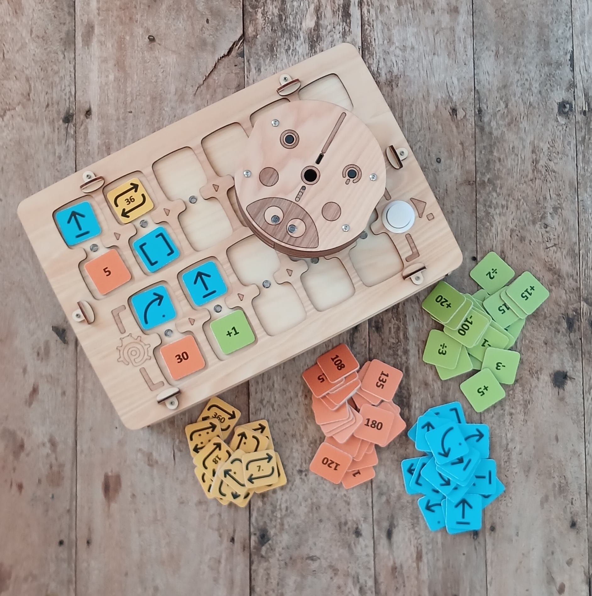

### Sadržaj vodiča

- Zašto održavati nastavu robotike i programiranja?
- Savjeti za organizaciju nastave u različitim uvjetima
- Aktivnosti i ciljevi učenja
- Detaljne upute za uporabu
- Opis aktivnosti
- Prilozi
- O projektu i autorima

### Pedagoška vrijednost

- Programiranje bez ekrana — rukama
- Razumijevanje da strojevi rade prema algoritmima
- Planiranje radnji unaprijed
- Razvoj logičkog razmišljanja
- Uvod u slijedno programiranje i funkcije
- Pojam "buga" (pogreške u kodu) i vještine otklanjanja pogrešaka
- Vizualno proučavanje brojeva, aritmetike i geometrije

## Što sadrži PrimaSTEM

### Što je u kutiji:

- Robot bubamara
- Upravljačka ploča
- Žetoni naredbi \*
- Vodič za aktivnosti \*

(\*) Sadržaj može varirati ovisno o konfiguraciji

## Zašto održavati nastavu programiranja i matematike?

Kod, programiranje i automatizacija postali su dio našeg svakodnevnog života.

Posljednjih godina ljudi su naučili stvarati strojeve koji rade ono što prije nisu mogli: razumiju, govore, čuju, vide, odgovaraju, pišu.

Primjera je mnogo: samovozeći automobili, roboti pomoćnici za starije osobe, roboti dostavljači i drugi.

### Zašto programiranje i robotika?

Učiti programirati ne znači samo učiti pisati kod. Učiti programirati znači učiti razumjeti strojeve koji nas okružuju. To je sposobnost pretvaranja malih ili odvažnih ideja u stvarne projekte. To znači rastaviti složene zadatke na jednostavne korake. To je zajednički napor u rješavanju naših problema.

### Rođeni u digitalnom dobu

Danas se može činiti da se djeca i mladi dobro snalaze u tehnologiji jer aktivno koriste digitalnu zabavu.

Ali što je s uzimanjem tih alata u ruke radi stvaranja ili izražavanja? Što se događa kad naiđu na tehnički problem?

## Savjeti za uporabu ovisno o kontekstu

Aktivnosti su razvijene za različite ciljeve i obrazovne kontekste. U vodiču su aktivnosti numerirane. U nastavku preporučujemo aktivnosti prema vašim uvjetima.

### Ciljana skupina

- Djeca od 4 do 8 godina.
- Starija i pripremna skupina vrtića, 1. i 2. razred osnovne škole.

### Preporučene aktivnosti za izvannastavno učenje

1-2-x-4-5-6-7-8-9-10-x-x

### Preporučene aktivnosti za školsko učenje

x-2-3-4-5-6-7-8-9-x-11-12

### Izvannastavna aktivnost

Za rad s PrimaSTEM-om poželjno je formirati skupinu od najviše 12 djece kako bi svi mogli aktivno sudjelovati.

Preporučujemo da jedan uređaj koriste 2-3 učenika radi timskog učenja i razvoja društvenih vještina.

### Školska aktivnost

Za nastavni sat s PrimaSTEM-om idealno je formirati male skupine od 4-6 djece s jednim učiteljem. U to vrijeme ostali učenici mogu raditi drugi zadatak s pomoćnikom učitelja ili, primjerice, vježbati crtanje robotova puta prema programu (za učenike 1.-2. razreda). U oba slučaja bolje je održavati sate s PrimaSTEM-om u višenamjenskoj dvorani, na podu ili odmicanjem stolova i stolica kako bi se oslobodio prostor.

**Pažnja**: Ne zaboravite unaprijed napuniti baterije upravljačke ploče i robota.

## Brojevi aktivnosti i njihovi ciljevi učenja

| Aktivnost | Razumijevanje pojmova algoritma i programa | Rastavljanje puta na faze | Predviđanje kretanja | Rješavanje problema, otklanjanje pogrešaka u programu | Timski rad, suradnja |
| --- | :---: | :---: | :---: | :---: | :---: |
| 1 |   | X |   | X |   |
| 2 |   |   | X |   | X |
| 3 | X | X |   |   |   |
| 4 | X | X | X |   |   |
| 5 | X | X | X |   | X |
| 6 | X | X | X | X | X |
| 7 | X | X | X | X | X |
| 8 | X |   | X | X |   |
| 9 | X | X | X | X | X |
| 10 | X |   | X | X |   |
| 11 | X | X | X | X | X |
| 12 | X | X | X | X | X |

## Upute za uporabu

### Sadržaj uputa

- Upoznavanje s materijalima
- Programiranje funkcije
- Korištene karte
- Tehnička objašnjenja

## Upoznavanje s materijalima

### Robot

Mali drveni robot bubamara s dva oka.

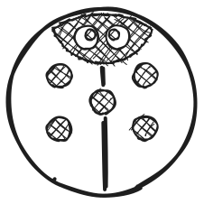

Ima tri oslonca: dva kotača i stalak straga, koji mu omogućuju održavanje ravnoteže.

### Osnovne naredbe

| Naredba | Ilustracija | Opis |
| --- | --- | --- |
| Naprijed |  | Robot napreduje za jedno polje — jedan logički korak (zadano 15 cm) |
| Lijevo |  | Robot skreće za 90° ulijevo |
| Desno |  | Robot skreće za 90° udesno |
| Natrag |  | Robot vozi unatrag za jedno polje — zadano jedan logički korak |
| Funkcija |  | Robot izvršava niz naredbi koji se nalazi u retku funkcije |
| Ponovi № | 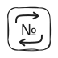 | Robot ponavlja naredbu postavljenu u dvostrukom utoru određeni broj puta — № |

### Upravljačka ploča

Upravljačka ploča omogućuje upravljanje robotom postavljanjem blokova naredbi (žetona) u slobodne utore (D).

Gornjih 6 dvostrukih utora (A), povezanih linijom izvršavanja (E), čine glavni slijed programa. Program počinje utorom lijevo (D), a završava iznad tipke START (B), kojom se upute šalju robotu i pokreće program.

Donjih 5 utora (C) omogućuje programiranje niza kretnji koje izvršava blok "\[ \]" — "funkcija". Svaki dvostruki utor povezan je s LED lampicom (F) koja svijetli kad je žeton postavljen, a treperi dok se trenutna uputa izvršava.

#### Sastavljanje niza

Kad žeton umetnete u jedan od utora i on je ispravno postavljen, LED lampica svijetli zeleno. Kad naredbi kretanja u dvostrukom utoru dodate naredbu ponavljanja, LED lampica svijetli plavo. Ako su žetoni pogrešno postavljeni (na primjer, dva žetona naredbi kretanja u dvostrukom utoru), svijetli crvena LED lampica. U tom slučaju pogrešna naredba bit će zanemarena pri izvršavanju programa.

### Baterija i tipka za uključivanje

Robot i upravljačka ploča napajaju se ugrađenim punjivim baterijama. Pune se preko USB-C priključka. Tipka za uključivanje (ON/OFF) nalazi se na vrhu robota te na prednjoj strani upravljačke ploče s lijeve strane.

Kad se robot ili upravljačka ploča uključe, oglasi se kratak zvučni signal. Kad je upravljačka ploča uključena, LED lampica na prednjoj ploči svijetli zeleno. Kad je robot uključen, LED lampica uz USB-C priključak svijetli zeleno.

### Bežična komunikacija

Robot i upravljačka ploča komuniciraju putem Bluetooth bežične veze dometa oko 5 m. Bežični sustav radi u pozadini, bez postavljanja, nakon prvog povezivanja robota s upravljačkom pločom.

> Upravljačku ploču možete podesiti za rad s drugim robotom (uparivanje uređaja).
>
> 1. Uključite robota koji nije uparen s upravljačkom pločom.
> 2. Uključite upravljačku ploču.
> 3. Držite tipku START na upravljačkoj ploči 10 sekundi, dok se ne oglasi zvučni i svjetlosni signal.

### Izrada i izvršavanje programa

Slijed kretnji ("program") počinje lijevo na upravljačkoj ploči i prati urezani niz strelica "\>" — liniju izvršavanja koja vodoravno povezuje dvostruke utore.

Ako se žeton doda iza praznog utora, njegova se naredba izvršava nakon preskakanja praznog utora.

Ako je postavljen neispravan žeton (na primjer, "Ponovi" bez naredbe u jednom dvostrukom utoru) ili kombinacija žetona kretanja u dvostrukom utoru (na primjer, dva žetona naredbi u jednom dvostrukom utoru), LED lampica zasvijetlit će crveno, a takav dio programa bit će preskočen pri izvršavanju.

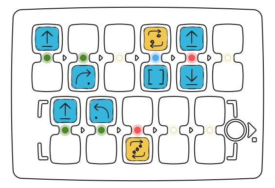

Kad je niz postavljen, pritisnite tipku "START" za pokretanje programa.

Dok robot izvršava upute, LED lampice na upravljačkoj ploči redom se gase. Dok se naredba izvršava, njezina LED lampica treperi.

## Programiranje funkcije

### Izrada funkcije

Blok "\[ \]", koji se naziva i blok "Funkcija", služi za zamjenu niza naredbi.

Blok "Funkcija" omogućuje izvođenje složenijih nizova i prelazak na teže zadatke. Da biste izradili funkciju, umetnite niz kretnji u predviđeno polje — 5 dvostrukih utora na dnu upravljačke ploče. Taj se niz izvršava slijeva nadesno svaki put kad se u glavnom nizu (gore) naiđe na blok "Funkcija".

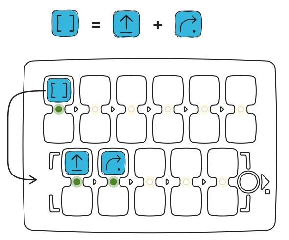

U primjeru u nastavku blok "Funkcija" zamjenjuje kretanje ravno i zatim skretanje udesno. Glavni program poziva "Funkciju" 2 puta, a zatim je ponavlja još 2 puta pomoću žetona "Ponovi 2".

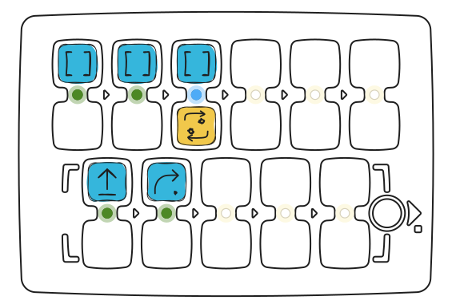

[Pokreni u simulatoru](https://simulator.primastem.com/#top=cfun,cfun,cfun.r002&fn=cfor,crig&s=l1144602&r=225-675-0&run)

Rezultat kretanja:

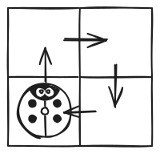

## Korištene karte

### Karte

Za prve sate — učenje algoritama, programiranja i brojeva — robot se mora kretati po karti s mrežom. Preporučuje se koristiti karte s poljima od 15 cm: toliko robot prijeđe u jednom zadanom koraku.

Možete koristiti bilo koje karte izrađene za bilo koje robote, s bilo kojom veličinom polja (prikladnom za robota).

> Zadanu udaljenost koraka moguće je promijeniti s 15 cm na drugu vrijednost prema vašoj karti — 10 cm, 12,5 cm ili 20 cm. Za to koristite posebnu naredbu za postavljanje "Korak" \+ broj u mm (za 10 cm upišite 100, za 12,5 cm — 125, za 20 cm — 200).

Ako nemate kartu, izradite je vlastitim rukama: možete upotrijebiti papirnatu traku za maskiranje i ravan stol ili pod, veliki arak papira (debelu tkaninu za transparente) i flomaster.

Karta kao šahovnica ili prazna karta s poljima koristi se za vježbanje kretanja iz jedne točke u drugu bez ometanja bojama.

Za pričanje kratkih priča o kretanju robota možete koristiti obojenu kartu. Na primjer: "Bubamara izlazi iz kuće i kroz šumu odlazi u planine." Razredu možete predložiti da izradi novu kartu kako bi ispričali nove priče o bubamarinim putovanjima.

#### Primjeri karata:

Karta kao šahovnica

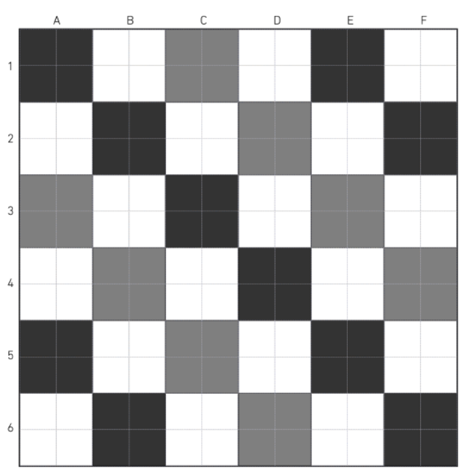

Obojena karta

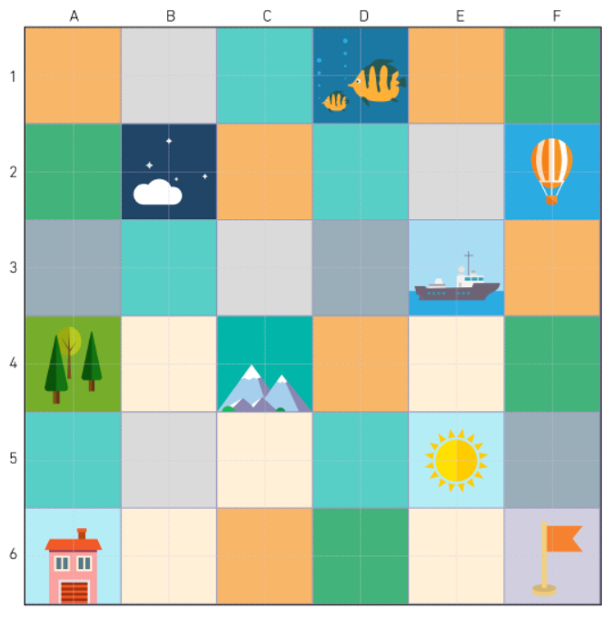

## Tehnička objašnjenja

### S tehničke strane

Upravljačka ploča i robot koriste mikrokontrolere za upravljanje, rade na Li-Ion baterije i povezuju se radijskim kanalom putem standardnog komunikacijskog protokola — Bluetootha.

Tiskana pločica robota odgovorna je za cjelokupno ponašanje: upravlja dvama istosmjernim motorima od 5 V i dvjema višebojnim LED lampicama, reproducira zvukove, komunicira s upravljačkom pločom itd.

Tiskana pločica upravljačke ploče prepoznaje žetone umetnute u utore, reproducira zvukove i upravlja s 11 višebojnih LED lampica povezanih sa svakim dvostrukim utorom.

Kad se žeton umetne u jedan od utora upravljačke ploče, prepoznaje se pomoću NFC čipa u naljepnici. Svaki žeton sadrži kod koji odgovara upravljačkoj naredbi.

Nakon što se žetoni prepoznaju na upravljačkoj ploči i program se pokrene, naredbe se bežičnom vezom šalju robotu na izvršavanje.

### Možete izraditi vlastite žetone naredbi!

Dodatne žetone naredbi (na primjer, "Ponovi 12" ili dodatne žetone kretanja) možete izraditi pomoću "praznih" žetona s NFC naljepnicama i telefona s NFC-om. Podržana je većina tipova od 13,56 MHz.

Video upute dostupne su na našem YouTube kanalu — [https://www.youtube.com/@primastem](https://www.youtube.com/@primastem)

---

## Aktivnosti

### Detaljan opis aktivnosti

- **Aktivnost 1** — Kretanje po šahovnici od točke A do točke B
- **Aktivnost 2** — Upoznavanje s PrimaSTEM-om
- **Aktivnost 3** — Razumijevanje pojma orijentacije i algoritma kroz utjelovljenje robota
- **Aktivnost 4** — Predviđanje kretanja robota prema nizu kretnji
- **Aktivnost 5** — Razumijevanje kako djeluju nizovi uputa u nasumičnom programu
- **Aktivnost 6** — Korištenje upravljačke ploče i naredbi kretanja za vođenje robota do planina
- **Aktivnost 7** — Upoznavanje s naredbom "funkcija"
- **Aktivnost 8** — Korištenje funkcije za crtanje puta do cilja
- **Aktivnost 9** — Otklanjanje pogreške u programu
- **Aktivnost 10** — Razmišljanje o otklanjanju pogrešaka u nizovima s 1 pogreškom na papiru
- **Aktivnosti 11 i 12** — Predviđanje kretanja robota (s blokom "funkcija")

---

## Aktivnost 1: Kretanje po šahovnici od točke A do točke B

- **pojedinačno**
- **15 min**
- **na papiru**
- **dokumenti za ispis**

### Cilj

> Isplanirati kretanje po poljima od točke A do točke B na karti.

Vježba traje 10 minuta, uz završni razgovor.

### Za ispis

Za ovu aktivnost ispišite po jedan primjerak lista "[Prilog 1 — Kretanje po karti](attachment-1)" za svakog učenika.

### VJEŽBA

Djeca na mreži moraju nacrtati put kojim miš mora doći do sira. Možete početi s lijevom vježbom, koja je jednostavnija, a zatim nastaviti s desnom.

#### Kretanje po poljima

Miš se kreće po poljima mreže (napomena: ne može se kretati dijagonalno). Ovdje treba shvatiti da je mišev put podijeljen na faze: kreće se jedno po jedno polje. Kaže se da se kreće korak po korak.

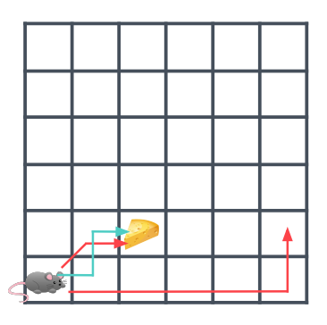

U gornjem primjeru ispravan je samo plavi put. Kratki crveni put nije ispravan jer uključuje dijagonalu. Dugi crveni put nije ispravan jer ne vodi do željene točke.

### Razgovor u skupini...

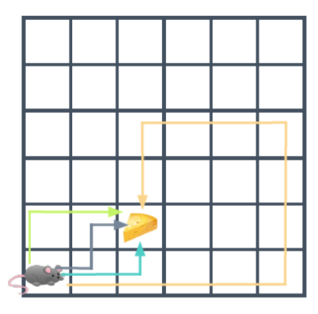

Na primjer, u gornjem primjeru svi nacrtani putovi su ispravni jer svi omogućuju mišu da stigne do sira.

Pokažite djeci da ne smišlja svatko isti put, nego da više putova može biti ispravno.

#### Neki su putovi duži od drugih

Ako izbrojite polja koja miš mora proći da bi stigao do polja sa sirom, dobivate:

- 3 polja za zeleni put
- 3 polja za sivi put
- 3 polja za plavi put
- 13 polja za žuti put

#### Najkraći put

Na kraju, čak i ako su svi ti putovi ispravni, miš će odabrati najkraći.

Zamolite djecu da odgovore na pitanje: "Zašto je miš odabrao najkraći put?"

Moguće je više odgovora: miš želi uštedjeti energiju, jako je umoran i želi hodati što manje... Ili miš žuri, jako je gladan i želi što prije stići do sira.

**Napomena za voditelja:** S robotima je isto. Zbog učinkovitosti uvijek ćemo birati najkraći put.

#### Moguće je više putova

Kad vježba završi, zamolite učenike da pokažu put koji su nacrtali. Budući da uvijek postoji više mogućih rješenja, vjerojatno će učenici ponuditi različite, ali ispravne odgovore.

---

## Aktivnost 2: Upoznavanje s PrimaSTEM-om

- **15 min**
- **u skupini**
- **demonstracija**
- **vježba**

### Ciljevi

> Razumjeti mogućnosti kretanja robota Naučiti da upravljačka ploča upravlja robotom Razumjeti žetone naredbi

Za ovu aktivnost podijelite učenike u male skupine. Sjednite za niski stol ili na pod. Izvadite kartu s mrežom, upravljačku ploču, robota i žetone. Predstavite PrimaSTEM svim učenicima i skupinama jednu po jednu.

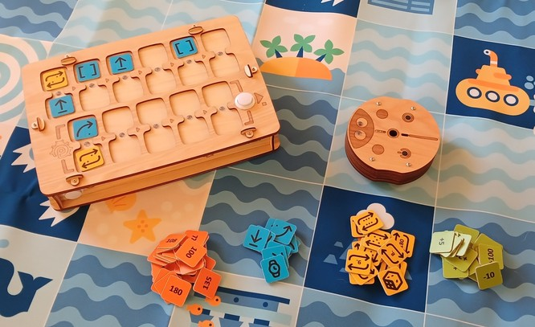

### Predstavljanje

Predstavite svaki element na stolu i uvedite rječnik koji će djeci trebati.

Prvo **karta**: ona je kao mreža s kojom su radili u aktivnosti 1, samo veća.

Zatim **robot bubamara**: može se kotrljati.

Njime se upravlja **upravljačkom pločom**, ovisno o žetonima koje stavimo u utore.

**Žetoni** su upute: pomoću njih robotu kažemo da ide naprijed, skreće lijevo ili desno.

### 1. faza: demonstracija

Kad objasnite rječnik, sami izvedite radnju i pokažite djeci što se događa kad se žeton stavi u upravljačku ploču.

| Slika | Opis |
| --- | --- |
|  | Žeton naredbe **"Naprijed"** pomiče robota za jedno polje |

Postavite robota na jedno od polja karte. Umetnite žeton u prvi utor za program, kao na donjoj shemi, a zatim pritisnite bijelu tipku — START.

Robot će napredovati jedno polje naprijed.

### 2. faza: predajte upravljanje

| Slika | Opis |
| --- | --- |
|  | Žeton sa strelicom koja zavija u luku oko središta je **"Lijevo"** — robot skreće ulijevo, suprotno od smjera kazaljki na satu. Zadani korak okretanja je 90 stupnjeva. |

Izvadite žeton "Naprijed" iz upravljačke ploče i dajte žeton "Lijevo". Ovaj put možete pustiti dijete da umetne žeton u prvi utor programa, a zatim pritisne bijelu tipku — START. Robot će ostati na mjestu i napraviti četvrtinu okreta ulijevo.

| Slika | Opis |
| --- | --- |
|  | Žeton **"Desno"** čini da robot skrene udesno. |

Zamolite drugo dijete da izvadi žeton "Lijevo" iz upravljačke ploče i na njegovo mjesto stavi žeton "Desno", a zatim pritisne bijelu tipku — START. Robot će ostati na mjestu i napraviti četvrtinu okreta udesno.

Zatim pustite djecu da se izmjenjuju u rukovanju, dajući im samo 3 žetona: **"Naprijed"**, **"Lijevo"** i **"Desno"**.

Mogu ponoviti izvršavanje programa koji su napravili ponovnim pritiskom na tipku START nakon što robot završi kretanje.

Pustite ih da sami vide da se žetoni mogu postaviti bilo gdje (osim dvije naredbe u jednom dvostrukom utoru) i da se izvršavaju redom — slijeva nadesno.

> Program se može zaustaviti ponovnim pritiskom na tipku START/STOP dok se robot kreće.

---

## Aktivnost 3: Razumijevanje pojma orijentacije i algoritma kroz utjelovljenje robota

- **45 min**
- **U skupini**
- **Igra**
- **Karta**

### Ciljevi

> Uzeti u obzir orijentaciju robota na početku programa Predvidjeti kretanje robota ovisno o programu

### Za ispis

Za ovu aktivnost ispišite po jedan primjerak kartica "[Prilog 2 — Kartice misija](attachment-2)" za svakog učenika.

### Načelo igre

Igra uloga na otvorenom prostoru u kojem djeca predstavljaju robota na crno-bijelom polju.

### Pravila igre

Jedan učenik glumi robota na karti (ili na podu s uzorkom kvadrata — uzorak, pločice ili tanka papirnata traka za maskiranje zalijepljena na pod), a ostali učenici programiraju ga pomoću kartica zadataka.

Ne daje se nikakva uputa o tome u kojem smjeru gleda dijete-robot. Odredite koji je smjer robota ispravan za izvršenje misije.

1. "Dijete-robot" stoji na crvenom polju 1, mora doći do zelenog polja 2.
2. "Dijete-robot" stoji na crvenom polju 1, mora doći do ljubičastog polja 3.
3. "Dijete-robot" stoji na crvenom polju 1, mora doći do plavog polja 4.

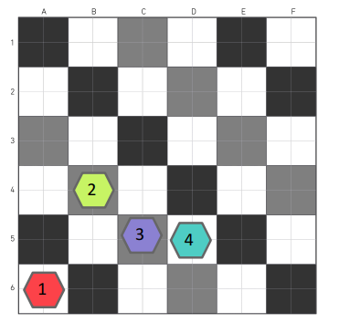

> Radi trajnosti materijala karte, zamolite dijete da skine obuću.

### Kraj igre

Dijete sada razumije da se pri programiranju kretanja moraju uzeti u obzir položaj i orijentacija robota.

Robot reagira na naredbu kretanja ovisno o tome kako je okrenut, orijentiran. Mora ići ravno, ili skrenuti lijevo, ili skrenuti desno, **ALI će se kretati ovisno o svojoj početnoj orijentaciji.**

---

## Aktivnost 4: Predviđanje kretanja robota prema nizu kretnji

- **45 min**
- **pojedinačno**
- **na papiru**
- **dokumenti za ispis**

### Ciljevi

> Uzeti u obzir početnu orijentaciju robota Razumjeti upute programa Predvidjeti kretanje robota ovisno o programu

### Za ispis

Za ovu aktivnost ispišite po jedan primjerak kartica "[Prilog 3 — Nacrtaj put za zadani niz](attachment-3)" za svakog učenika.

Djeca dobivaju list s programom koji se sastoji od niza uputa. Djeca moraju nacrtati put kojim će robot proći za taj niz kretnji.

S ovim programom robot će tri puta napredovati ravno:

<Columns cols={2}>
  <Frame>
    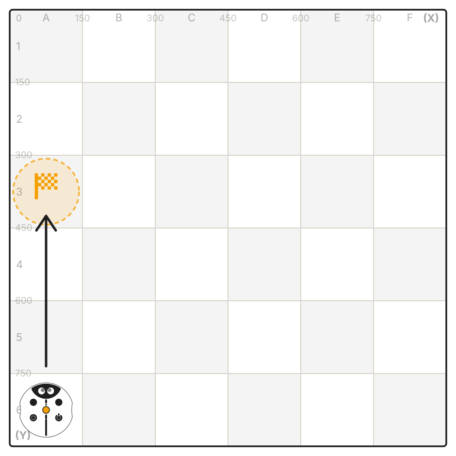
  </Frame>
  <Frame>
    
  </Frame>
</Columns>

[Pokreni u simulatoru](https://simulator.primastem.com/#top=cfor,cfor,cfor&s=l1144602&r=75-825-0&m=02&run)

Evo istog programa, robot će također tri puta napredovati ravno. Samo što ovaj put na početku nije jednako orijentiran: gleda udesno. Stoga će tri puta napredovati udesno:

<Columns cols={2}>
  <Frame>
    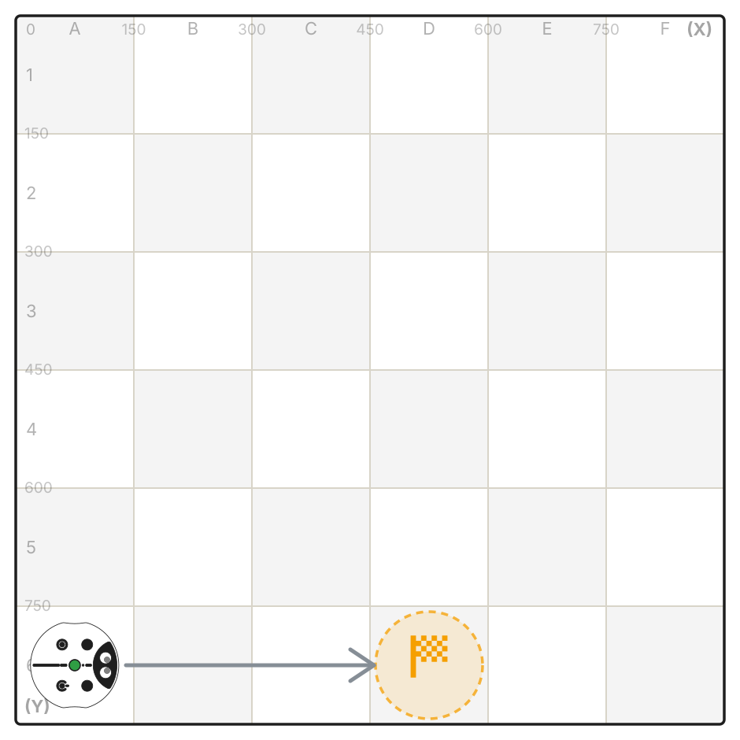
  </Frame>
  <Frame>
    
  </Frame>
</Columns>

[Pokreni u simulatoru](https://simulator.primastem.com/#top=cfor,cfor,cfor&s=l1144602&r=75-825-90&m=35&run)

S ovim programom uvodimo okretanje robota. Ovaj put robot počinje skretanjem udesno, a zatim napreduje dva polja:

<Columns cols={2}>
  <Frame>
    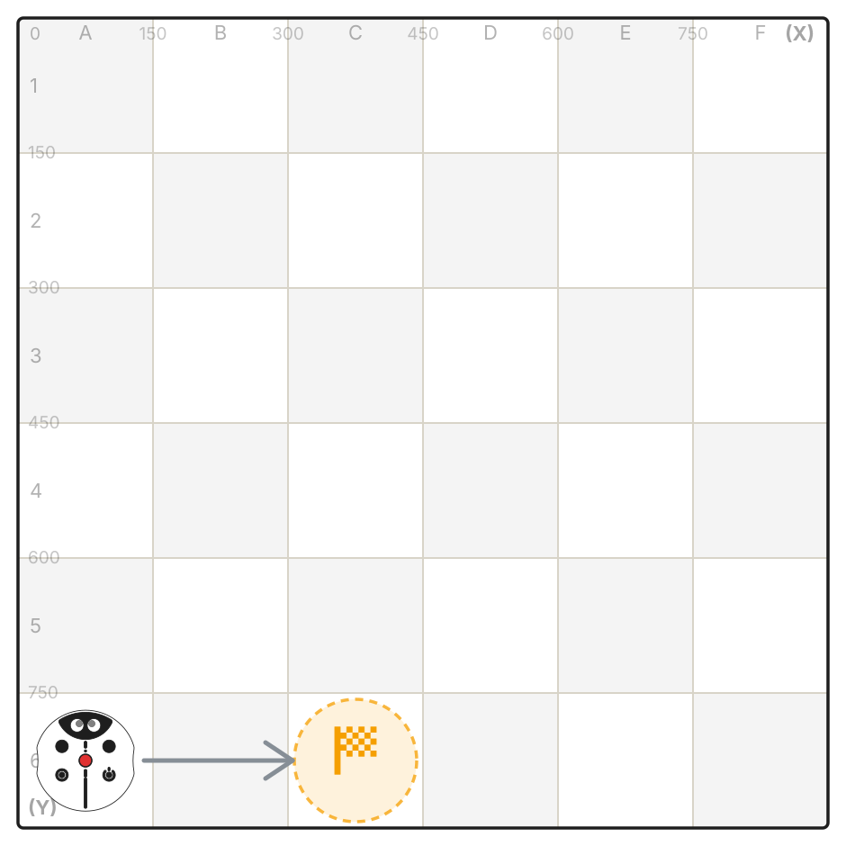
  </Frame>
  <Frame>
    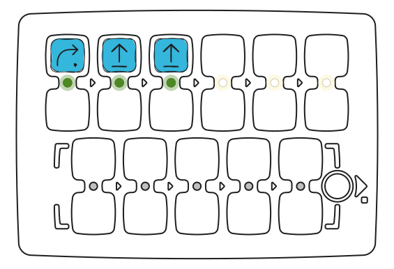
  </Frame>
</Columns>

[Pokreni u simulatoru](https://simulator.primastem.com/#top=crig,cfor,cfor&s=l1144602&r=75-825-0&m=25&run)

I na kraju, složenija vježba s dvije promjene smjera robota. Počinje napredovanjem jedno polje ravno, zatim skreće udesno, napreduje jedno polje, zatim skreće ulijevo i napreduje dva polja:

<Columns cols={2}>
  <Frame>
    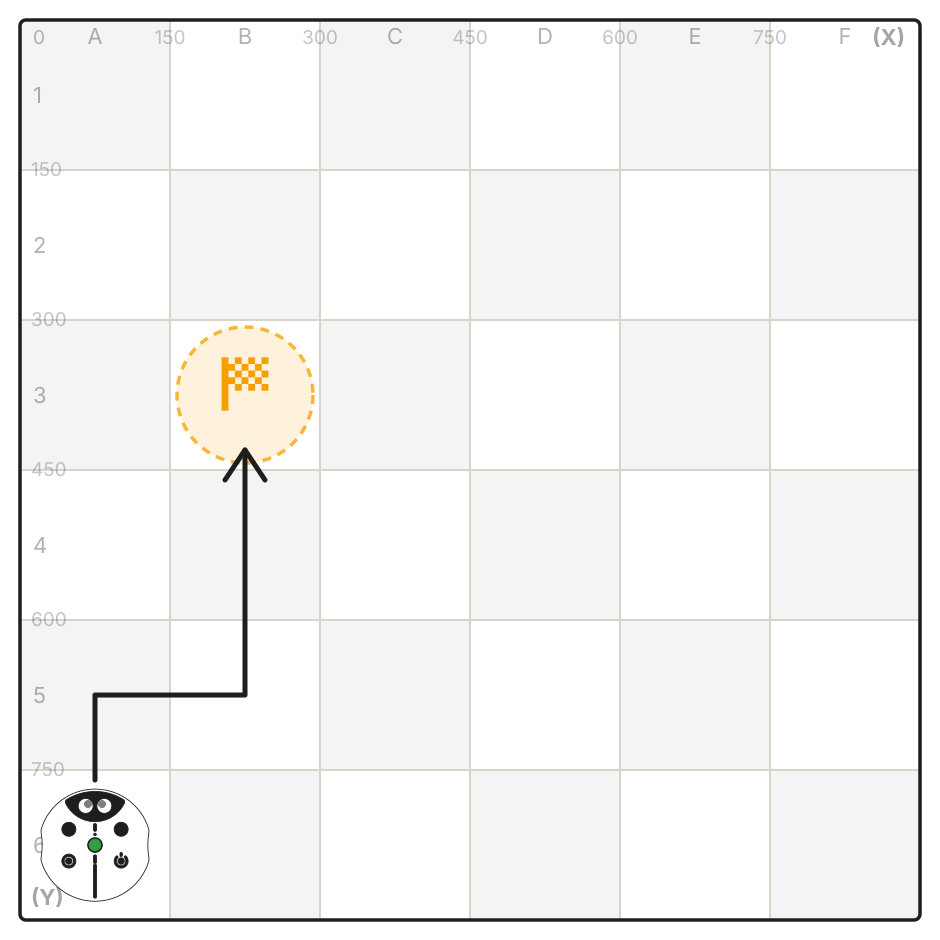
  </Frame>
  <Frame>
    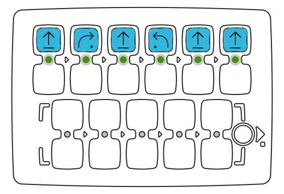
  </Frame>
</Columns>

[Pokreni u simulatoru](https://simulator.primastem.com/#top=cfor,crig,cfor,clef,cfor,cfor&s=l1144602&r=75-825-0&m=12&run)

### Napomena za voditelja

Ova vježba na papiru može biti teška. Ako neka djeca teško razumiju okretanja robota i nizove kretnji, uzmite set za igru PrimaSTEM i zamolite ih da programe s listova reproduciraju na upravljačkoj ploči. Rukovanjem i promatranjem bolje razumijemo!

---

## Aktivnost 5: Razumijevanje kako djeluju nizovi uputa u nasumičnom programu

- **45 min**
- **u skupini**
- **igra**

### Ciljevi

> Uspostaviti vezu između uputa i kretnji koje robot izvodi Predočiti si granice karte Znati prenijeti upute naredbi na "upravljačku ploču"

### Tijek igre

1. Za početak postavite robota na kartu, na bilo koje polje (preporučuje se polje na rubu karte), u željenom smjeru.
2. Bacite kockicu za početak. Pomaknite robota rukom i zabilježite (nacrtajte znakom naredbe "Naprijed" — strelicom) program kretanja na papiru ili ploči za crtanje. Ako robot ode s karte, ponovno bacite kockicu.
3. Ponovite postupak da biste dobili niz od 2 programa kretanja i spriječili da robot ode s karte, po potrebi ponovno bacajući kockicu.

Na kraju: na papiru trebate imati 2 programa naredbi "Naprijed" koji će nakon uzastopnog izvršavanja pomaknuti robota za traženi broj polja prema rubu karte.

Primjer:

<Columns cols={2}>
  <Frame>
    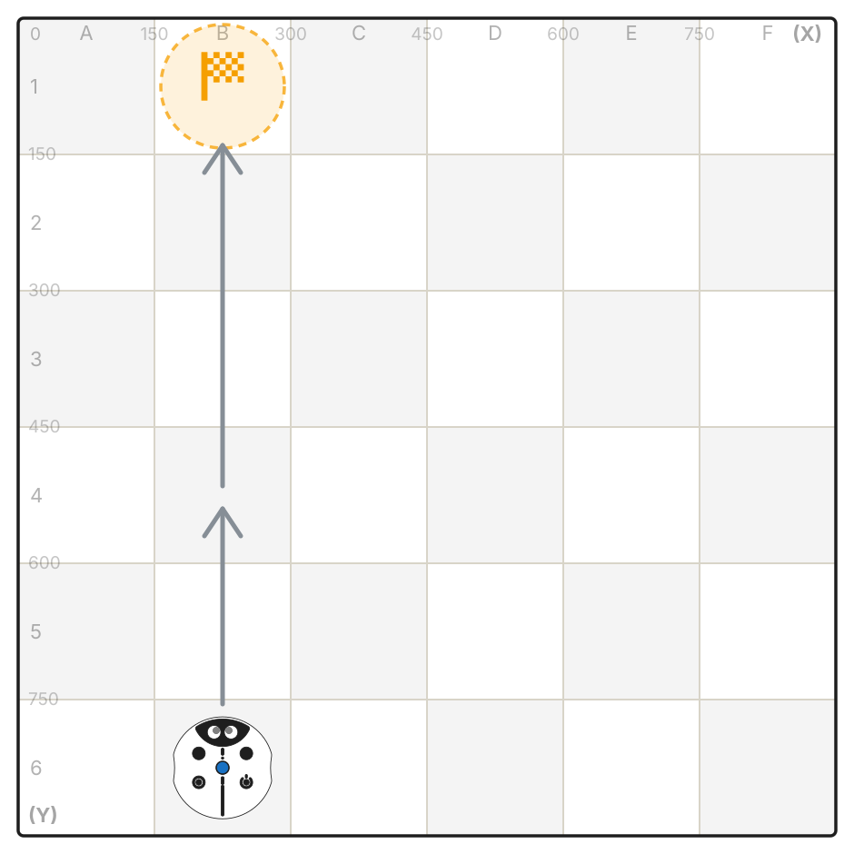
  </Frame>
  <Frame>
    

      
      
    

  </Frame>
</Columns>

**Zabilježene programe reproducirajte u stvarnosti pomoću PrimaSTEM-a.**

---

## Aktivnost 6: Korištenje upravljačke ploče i naredbi kretanja za vođenje robota do planina

- **45 min**
- **u skupini**
- **vježba**

### Ciljevi

> Rastaviti put na faze Provesti program sa zadanim ciljem

Za ovu aktivnost trebat će vam:

- upravljačka ploča
- određeni žetoni naredbi kretanja: po skupini 4 "Naprijed", 4 "Lijevo" i 4 "Desno", ostale žetone ostavite sa strane.
- karta i robot

Podijelite djecu u skupine od 3 ili 4 djeteta i dajte im upravljačku ploču i set žetona.

### 1. faza: razmišljanje

Robot bubamara je kod kuće, a mi ga želimo odvesti u planine. Ovdje trebate napisati program na ploči koji će mu omogućiti da stigne tamo.

> Ako nemate odgovarajuću kartu, shematski nacrtajte potrebna odredišta na papiru, možda zajedno s djecom, i zalijepite ih na kartu.

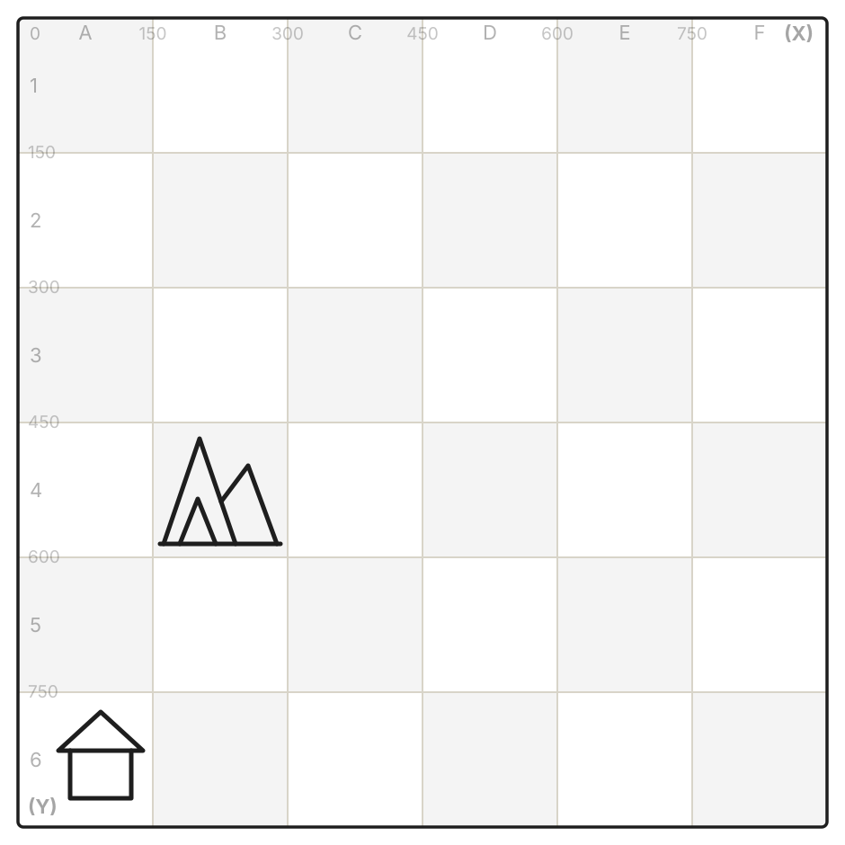

Počnite pitanjem koja polja djeca žele da robot prijeđe da bi stigao do planine. Opet postoji mnogo mogućnosti, a mi ćemo birati najkraće putove radi uštede energije i vremena.

Kad je put određen, pitajte djecu koje će kretnje robot morati izvesti, polje po polje.

Treba li ići ravno, skrenuti lijevo, skrenuti desno? Pokažite im koju će kretnju svaka naredba proizvesti na robotu, pomičući ga rukama po karti.

### 2. faza: programiranje

Zamolite djecu da na upravljačku ploču pomoću žetona naredbi redom postave kretnje (program) koje robot mora izvesti da bi stigao do cilja.

**Evo očekivanog rezultata programa:**

### 3. faza: provjera

Kao i svaki programer koji drži do sebe, treba provjeriti radi li program. Zamolite djecu da svoj program reproduciraju na upravljačkoj ploči i pokrenu ga.

<Columns cols={2}>
  <Frame>
    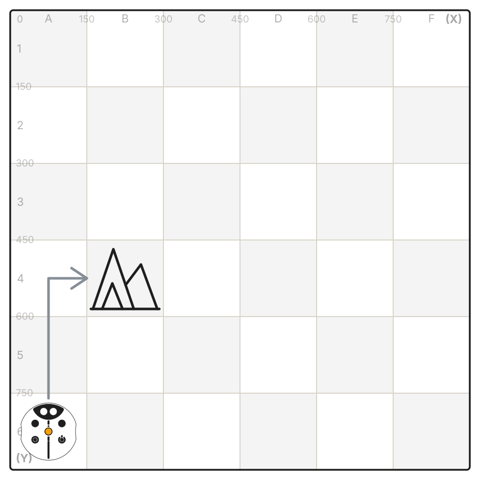
  </Frame>
  <Frame>
    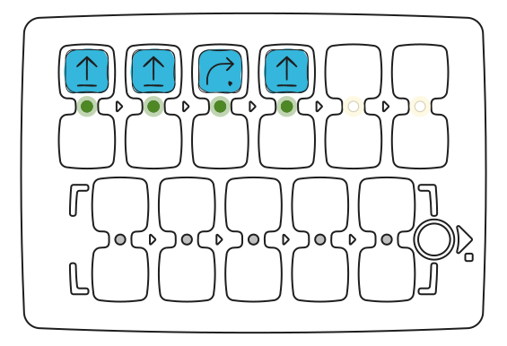
  </Frame>
</Columns>

[Pokreni u simulatoru](https://simulator.primastem.com/#top=cfor,cfor,crig,cfor&s=l1144602&r=75-825-0&m=13&run)

Stiže li robot do planine? Ako ne, zašto? Pustite djecu da pokušaju ispraviti pogreške u programu, ako ih ima.

---

## Aktivnost 7: Upoznavanje s naredbom "funkcija"

- **15 min**
- **u skupini**
- **demonstracija**

### Ciljevi

> Razumjeti da naredba "funkcija" može zamijeniti druge upute naredbi Razmotriti pojam ponavljanja niza uputa

Za ovu aktivnost podijelite učenike u male skupine. Sjednite za niski stol ili na pod. Izvadite kartu s poljima, upravljačku ploču, robota i žetone naredbi. Skupine učenika jedna po jedna upoznaju se s naredbom bloka "Funkcija".

### 1. faza: demonstracija

Pokažite djeci žeton naredbe "Funkcija".

Služi za zamjenu više naredbi kretanja: "Naprijed", "Lijevo", "Desno" ili "Natrag". Također omogućuje da se isti mali dio programa ponovi nekoliko puta.

Počnite demonstracijom. Sastavite program kao na donjoj slici.

Kad se koristi naredba "Funkcija", sve se odvija kao da smo ono što je unutar okvira \[-----\] na dnu upravljačke ploče stavili umjesto žetona "Funkcija". U našem primjeru robot će dva puta napredovati ravno.

### 2. faza: zagonetke!

Sada dodajte blok s naredbom "Desno" na kraj glavnog programa, kao na donjoj slici.

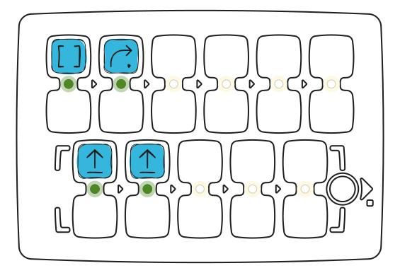

Prije pokretanja programa pitajte djecu što će se dogoditi. Sve se odvija kao da se program sastoji od dva crvena bloka "Naprijed", a zatim jednog bloka "Desno". Robot će napredovati dva polja i skrenuti udesno (četvrtina okreta).

A za kraj: **ciklus**! Reproducirajte program s četiri bloka "Funkcija", kao na donjoj slici.

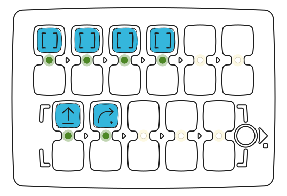

[Pokreni u simulatoru](https://simulator.primastem.com/#top=cfun,cfun,cfun,cfun&fn=cfor,crig&s=l1144602&r=225-675-0&run)

Prije pokretanja programa pitajte djecu što će se dogoditi, a zatim pokrenite program radi provjere.

**Robot izvodi ciklus**:

**Napomena za voditelja:** Kad počnete upoznavati pojam bloka "funkcija", vrlo je korisno gledati LED lampice koje trepere tijekom izvršavanja programa. Tako možete pratiti uputu koja se izvršava i istodobno vidjeti kako se robot kreće.

---

## Aktivnost 8: Korištenje funkcije za crtanje puta do cilja

- **45 min**
- **u skupini**
- **vježba**

### Ciljevi

> Rastaviti put na faze. Provesti program sa zadanim ciljem. Koristiti blok "funkcija" u programu.

Za ovu aktivnost trebat će vam:

- žetoni ili kartice izrađene kod kuće s crtežima naredbi: po skupini 4 "naprijed", 4 "lijevo", 4 "desno" i 4 "funkcija".
- karta i robot, bez upravljačke ploče.

Ako ima mnogo djece, podijelite ih u skupine od 3 ili 4 djeteta i podijelite kartice s crtežima naredbi ili žetone iz seta (točno 4\+4\+4\+4).

### 1. faza: razmišljanje

> Prilagodite zadatak ako imate kartu s drugim slikama ili bez njih — potrebno je označiti 2 točke (Start i Cilj) na udaljenosti od 4 polja pod kutom od 90 stupnjeva.

Robot je na zastavici, a mi ga želimo odvesti do noćnog polja, prikazanog oblacima. Trebat ćete napisati program (složiti algoritam od žetona ili crteža naredbi na stolu) koristeći blok "Funkcija".

Počnite pitanjem koja polja djeca žele da robot prijeđe da bi stigao do planine (polje otprilike na sredini). Mogućnosti je mnogo, a ovaj put birat ćemo putove u kojima se nizovi uputa ponavljaju kako bi se mogla koristiti naredba "Funkcija".

Kad je put određen, pitajte djecu koje će kretnje robot morati izvesti, polje po polje, i oponašajte izvršavanje programa pomičući robota rukama.

### 2. faza: "ne radi! Ali ako..."

Zamolite ih da karticama (žetonima) na stolu redom slože kretnje koje robot treba izvesti.

Budite strogi u pogledu broja žetona naredbi koji se daje svakoj skupini: 4 "naprijed", 4 "lijevo", 4 "desno" i 4 "funkcija".

To je to! Nemamo dovoljno žetona da napišemo program! Nedostaje naredbi "Naprijed"! To je digitalna panika! :)

Podsjetite ih na korisnost naredbe "Funkcija": tom naredbom možete zamijeniti nekoliko drugih žetona naredbi.

Na primjer, možete zamijeniti nekoliko naredbi "Naprijed" kako bi robot nekoliko puta napredovao.

Vodite djecu pri izradi programa s blokom "Funkcija", kao na donjoj slici.

Primjer puta i njegov program:

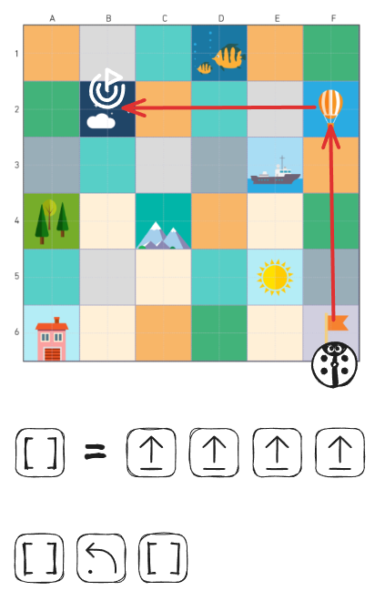

### 3. faza: provjera

Pomozite djeci da svoj program reproduciraju na upravljačkoj ploči radi provjere, kao na slici:

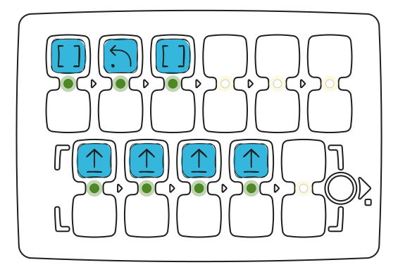

[Pokreni u simulatoru](https://simulator.primastem.com/#top=cfun,clef,cfun&fn=cfor,cfor,cfor,cfor&s=l1144602&r=825-825-0&run)

Stiže li robot do polja "Noć"? Ako ne, zašto? Pustite djecu da pokušaju ispraviti pogreške u programu, ako ih ima.

---

## Aktivnost 9: Otklanjanje pogreške u programu

- **20 min**
- **u skupini**
- **vježba**

### Ciljevi

> Pronaći pogrešku u programu promatrajući njegovo izvršavanje. Ispraviti pogrešku u programu.

Za ovu aktivnost podijelite učenike u male skupine. Sjednite za niski stol ili na pod. Pripremite kartu s mrežom, upravljačku ploču, robota i žetone. Zamolite skupine učenika da redom otklone pogrešku u programu.

Želimo da robot stigne do planine (siva staza).

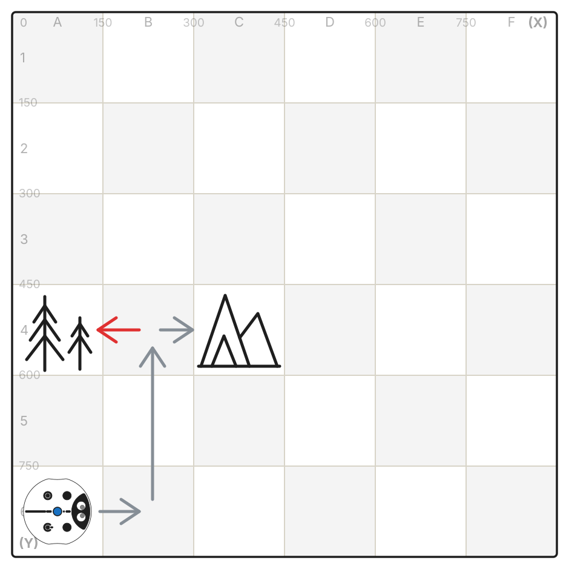

Pokažite djeci niz kretnji na upravljačkoj ploči koji sadrži pogrešku:

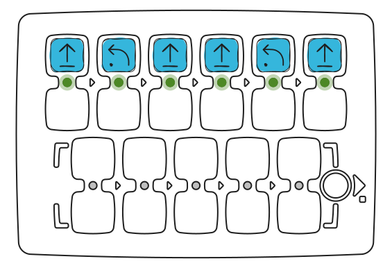

[Pokreni u simulatoru](https://simulator.primastem.com/#top=cfor,clef,cfor,cfor,clef,cfor&s=l1144602&r=75-825-90&run)

S ovim programom robot ulazi u šumu. Isprobavanjem programa djeca moraju pokušati pronaći pogrešku i ispraviti je.

Primjer ispravnog, popravljenog programa:

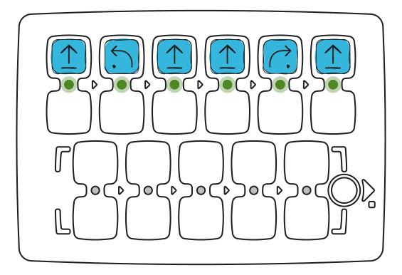

[Pokreni u simulatoru](https://simulator.primastem.com/#top=cfor,clef,cfor,cfor,crig,cfor&s=l1144602&r=75-825-90&run)

---

## Aktivnost 10: Razmišljanje o otklanjanju pogreške u nizu na papiru

- **20 min**
- **pojedinačno**
- **na papiru**
- **dokumenti za ispis**

### Ciljevi

> Predvidjeti kretanje robota kako bi se pronašla pogreška u programu. Razumjeti kako ispraviti pogrešku u programu.

Djeca dobivaju list s programom koji se sastoji od niza uputa za kretanje od točke A do točke B. Program sadrži pogrešku, djeca moraju pronaći tu pogrešku i pokušati je ispraviti.

### Za ispis

Za ovu aktivnost ispišite po jedan primjerak kartica "[Prilog 4 — Pronađi i ispravi pogrešku u programu](attachment-4)" za svakog učenika.

### 1. faza: pročitajte program

Počnite tako da zamolite djecu da nacrtaju kretanje robota prema ovom programu. Put kojim želimo da robot ide i željena točka dolaska nacrtani su plavo na mreži.

### 2. faza: pronađite pogrešku

Kad je put nacrtan, vidimo da robot ne ide do cilja (crno)! Stiže do crvene zastavice. Pitajte djecu gdje je robot pogriješio. Ovdje treba pronaći polje koje sadrži pogrešku, zaokruženo crveno u ispravku.

Postoje 3 vrste pogrešaka:

- pogriješili smo s naredbom
- zaboravili smo naredbu
- dodali smo suvišnu naredbu

### 3. faza: ispravite pogrešku

I na kraju, zamolite djecu da isprave pogrešku pisanjem programa za kretanje do crne zastavice.

**Napomena:** Ova vježba na papiru može biti teška. Ako neka djeca teško vide gdje su pogreške, uzmite PrimaSTEM i zamolite ih da programe s listova reproduciraju i pokrenu program. Možete ih, na primjer, zamoliti da kažu "Joj!" kad robot pogriješi na svom putu, kako bi se pogreška zabilježila.

#### Primjer 1

U ovom primjeru pogriješili smo s uputom na kraju.

<Columns cols={2}>
  <Frame>
    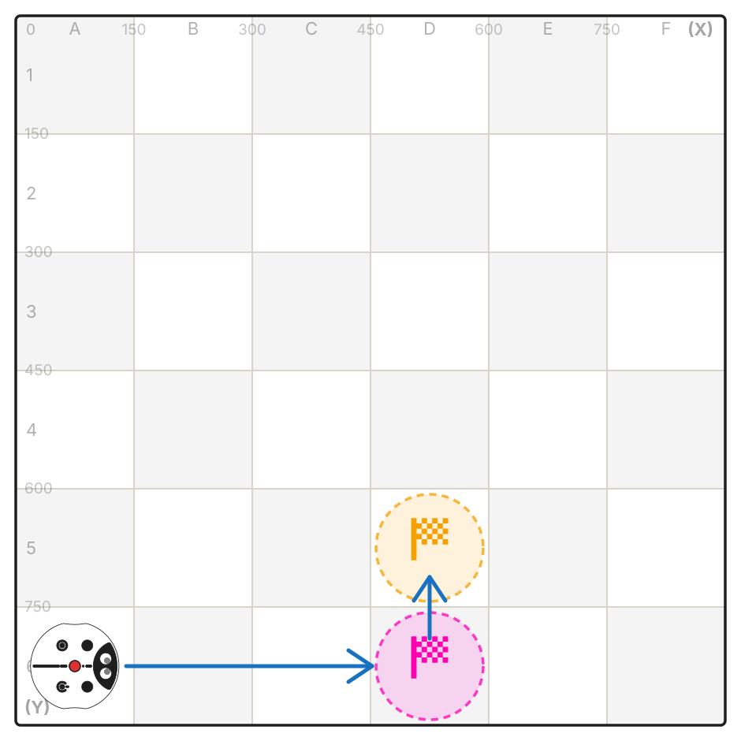
  </Frame>
  <Frame>
    

      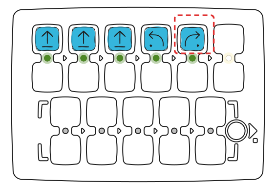
      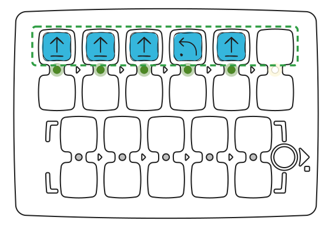
    

  </Frame>
</Columns>

#### Primjer 2

U ovom primjeru dodali smo suvišnu uputu na početku.

<Columns cols={2}>
  <Frame>
    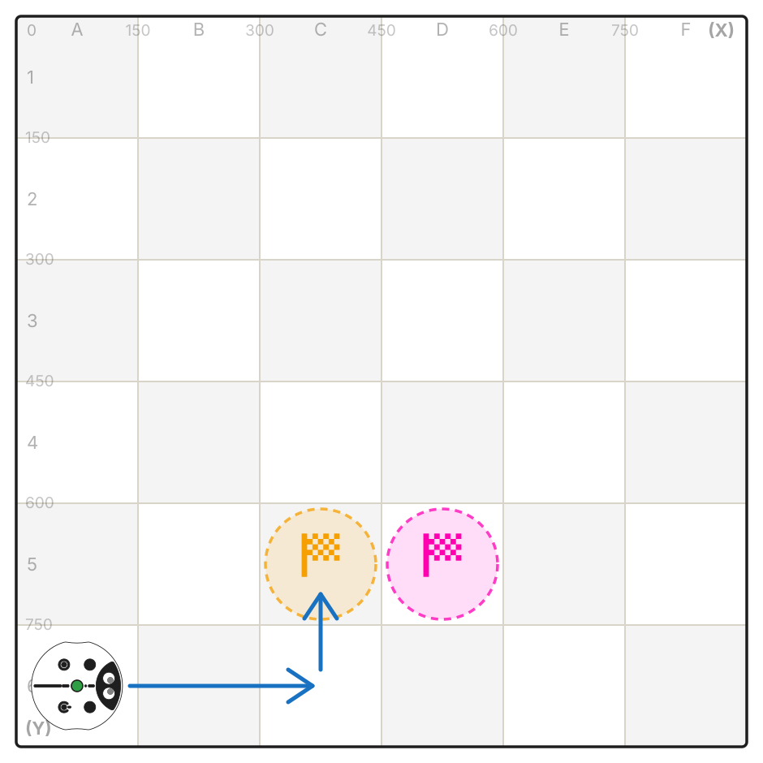
  </Frame>
  <Frame>
    

      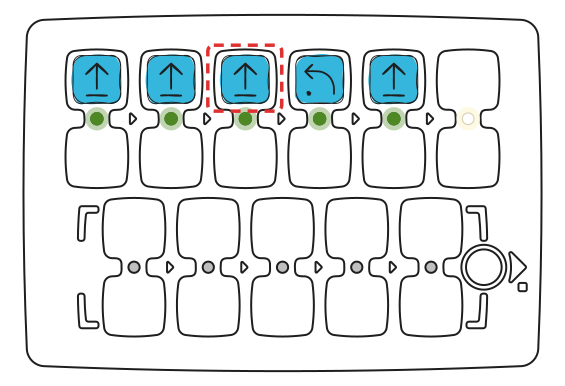
      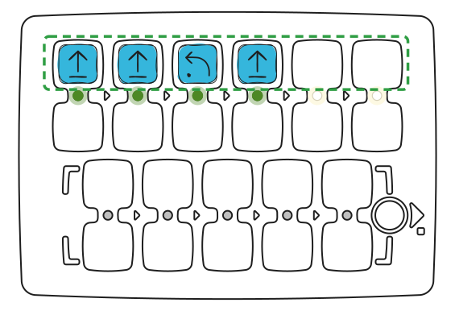
    

  </Frame>
</Columns>

#### Primjer 3

U ovom primjeru zaboravili smo uputu na početku.

<Columns cols={2}>
  <Frame>
    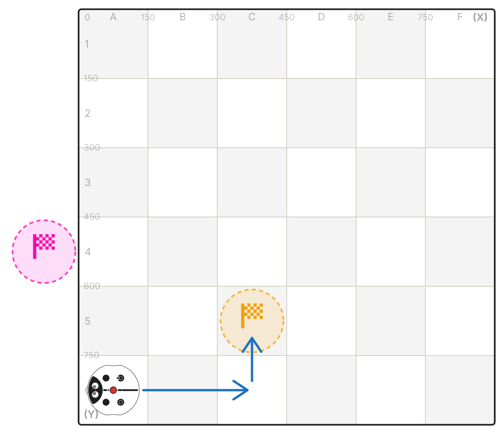
  </Frame>
  <Frame>
    

      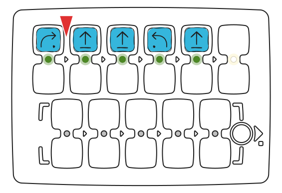
      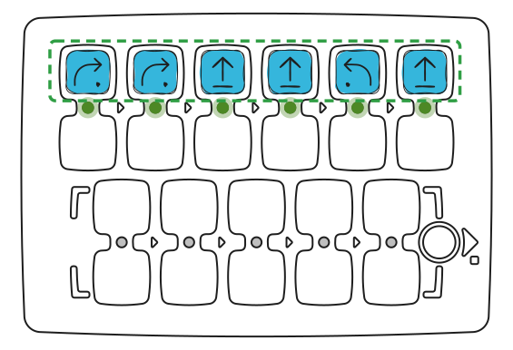
    

  </Frame>
</Columns>

---

## Aktivnost 11: Predviđanje kretanja PrimaSTEM-a

- **45 min**
- **u skupini**
- **vježba**

### Ciljevi

> Predvidjeti kretanje robota promatrajući program bez "funkcije"

Za ovu aktivnost uzmite set za igru PrimaSTEM bez naredbi "Funkcija". Sva djeca mogu istodobno sudjelovati u igri, ali samo jedno dijete u isto vrijeme rukuje.

### 1. Tišina, programiramo...

Djeca redom postavljaju robota u kut karte, a zatim na upravljačkoj ploči sastavljaju program s najviše 5 uputa.

Kad je program gotov, zamolite djecu da pričekaju prije pritiska na tipku.

### 2. Kladite se!

Zamolite ostalu djecu da pogode hoće li robot otići s karte.

### 3. Provjera

Kad smo se okladili, pokrećemo program da vidimo što se događa. Zatim robota vraćamo u kut i sljedeće dijete započinje svoj program.

---

## Aktivnost 12

### Ciljevi

> Predvidjeti kretanje robota promatrajući program s "funkcijom"

Ponovite aktivnost 11, dodavši u set naredbe "funkcija".

Ovaj put dodajte blokove "Funkcija" kako biste uključili programiranje funkcija. Sva djeca mogu istodobno sudjelovati u igri, ali samo jedno dijete u isto vrijeme rukuje.

---

## O projektu, autori

### Tko smo mi?

PrimaSTEM je tvrtka koja je osmislila i proizvodi istoimeni originalni uređaj za učenje programiranja i matematike bez ekrana za djecu od 4 godine. Smješteni smo na jugu Francuske.

Izrađeni materijali su otvorenog koda i usmjereni na razvoj kreativnosti djece i odraslih koji ih prate.

Više o uređaju PrimaSTEM saznajte na stranici s dokumentacijom, dostupnoj na 12 jezika: [https://docs.primastem.com](https://docs.primastem.com)

### Imate pitanja? Javite nam se!

Slobodno nas kontaktirajte: [info@primastem.com](mailto:info@primastem.com)

Naša web-stranica s informacijama i poveznicama na društvene mreže: [https://primastem.com](https://primastem.com)

### Autori

**Adaptacija, tekst, ilustracije:** Andrei Chanov, 2026.

**Autori koncepta**: Julie Borgeot / Dorie Bruyas iz Fréquence écoles

#### Licenca ovog vodiča

Ovo djelo licencirano je pod licencom CC BY-SA 4.0. Primjerak licence možete pogledati na [https://creativecommons.org/licenses/by-sa/4.0/](https://creativecommons.org/licenses/by-sa/4.0/)

**Creative Commons Attribution-ShareAlike 4.0 International**

Ova licenca zahtijeva da korisnici navedu autora. Dopušta korisnicima distribuciju, remiksiranje, prilagodbu i nadogradnju materijala u bilo kojem mediju ili formatu, čak i u komercijalne svrhe. Ako drugi remiksiraju, prilagode ili nadograde materijal, izmijenjeni materijal moraju licencirati pod istim uvjetima.

---

## Prilozi

## Prilog 1 — Kretanje po karti

Poveznica na prilog — [Prilog 1 — Kretanje po karti](attachment-1)

## Prilog 2 — Kartice misija

Poveznica na prilog — [Prilog 2 — Kartice misija](attachment-2)

## Prilog 3 — Nacrtaj put za zadani niz

Poveznica na prilog — [Prilog 3 — Nacrtaj put za zadani niz](attachment-3)

## Prilog 4 — Pronađi i ispravi pogrešku u programu

Poveznica na prilog — [Prilog 4 — Pronađi i ispravi pogrešku u programu](attachment-4)
