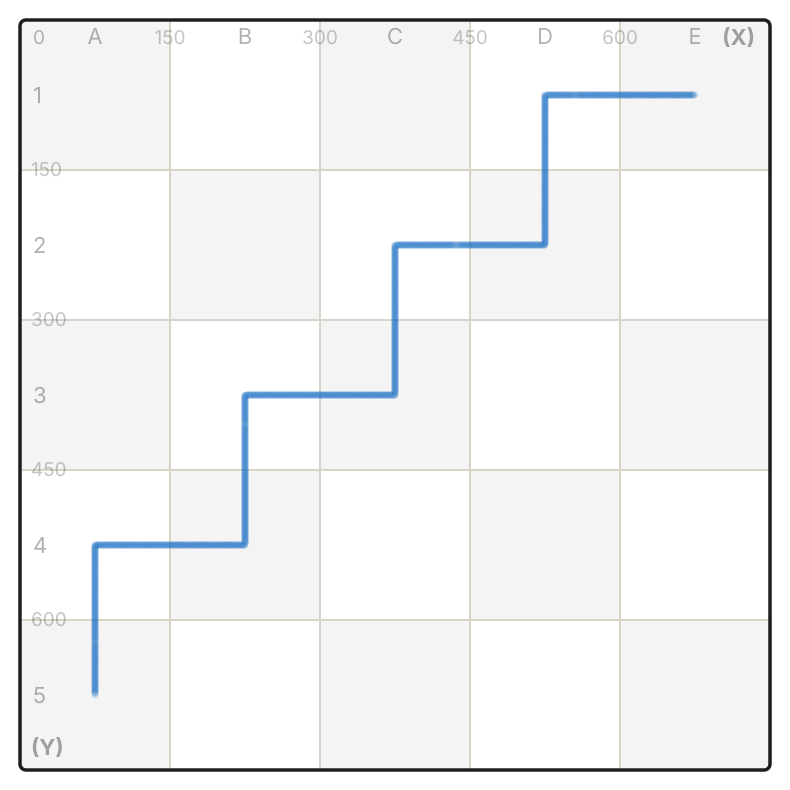
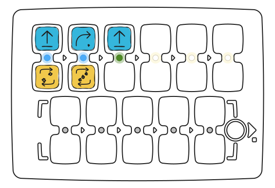
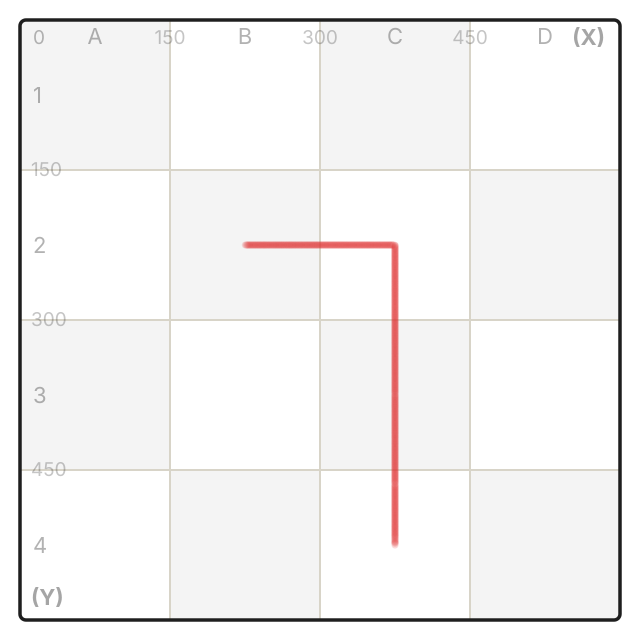
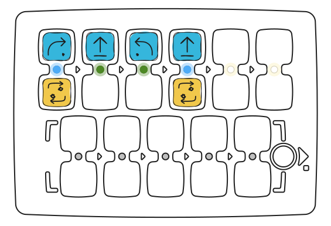

## Uvod

PrimaSTEM se sastoji od programabilnog robota, upravljačke ploče i skupa žetona naredbi. Može se koristiti za prevenciju i korekciju kognitivnih poteškoća kod starijih osoba.

### Za koga

- Starije osobe s blagim kognitivnim poteškoćama
- Osobe nakon neuroloških bolesti
- Bolesnici u ranim stadijima neurodegenerativnih bolesti

### Kontraindikacije

- Teška oštećenja vida
- Značajna motorička oštećenja ruku
- Teška demencija
- Akutni psihijatrijski poremećaji

## Prvi sat

Traje oko 35 minuta. Prije početka pročitajte kontraindikacije iznad. Ako još nemate uređaj, sve korake možete proći u [simulatoru](https://simulator.primastem.com).

<Steps>
  <Step title="Upoznavanje, 10 minuta">
    Pokažite robota, ploču i žetone „Naprijed“, „Desno“ i „Lijevo“. Sudionik stavi jedan žeton „Naprijed“ na ploču, pritisne **▶ Start** i gleda kako robot vozi. [Brzi početak](/en-hr/quickstart) objašnjava kako rade ploča i robot.
  </Step>
  <Step title="Prva ruta, 10 minuta">
    Označite cilj dva-tri polja od robota. Sudionik slaže žetone, pokreće program i provjerava je li robot stigao. U simulatoru za to postoji [lagani labirint](https://simulator.primastem.com/#s=l1144402&r=75-525-0&m=2101).
  </Step>
  <Step title="Odmor, 5 minuta">
    Nakon 15–20 minuta rada potreban je odmor.
  </Step>
  <Step title="Lik, 10 minuta">
    Sudionik slaže program po kojem robot obilazi kvadrat. U simulatoru otvorite [zadatak s kvadratom](https://simulator.primastem.com/#sh=square): robot mora pratiti iscrtkanu crtu.
  </Step>
</Steps>

Na kraju pitajte što je bilo lako, a što teško. Odgovor pokazuje odakle krenuti sljedeći put.

## Opća načela

S dobi i neurodegenerativnim bolestima pamćenje može slabiti. Teže je misliti apstraktno, učiti i stvarati. Nastava s kompletom PrimaSTEM kroz igru vježba različite kognitivne funkcije i pomaže usporiti te procese.

### Kako organizirati nastavu

- Jedan susret traje 30–45 minuta.
- Nastava se održava 2–3 puta tjedno.
- Sudionici rade pojedinačno ili u malim skupinama od 2–4 osobe.
- Nakon svakih 15–20 minuta rada treba stanka od 5–10 minuta.

### Kako voditi nastavu

1. Povećavajte težinu zadataka postupno.
2. Uvažavajte osobine i ograničenja svakog sudionika.
3. Stvarajte ugodnu atmosferu.
4. Izmjenjujte različite vrste vježbi.
5. Uvijek recite sudioniku što mu je uspjelo i pohvalite ga.

## Što vježba nastava

### Kognitivne funkcije

- Intelektualna aktivnost
- Prostorno mišljenje i pamćenje
- Vizualno i slušno-verbalno pamćenje
- Logičko mišljenje i računanje napamet
- Planiranje i kontrola vlastitih radnji
- Periferni vid

### Druženje i raspoloženje

- Nastava čuva osobne potencijale i društvenu aktivnost.
- Sudionik se može izraziti.
- Sudioniku je lakše razgovarati s drugima.
- Nastava podiže raspoloženje.

## Vježbe i igre

### 1. Prve vježbe (razdoblje privikavanja)

- Upoznati žetone naredbi.
- Provesti robota po ravnoj liniji.
- Izvesti jednostavne okrete.
- Sastaviti kratak niz naredbi.

**Materijali**

- [Brzi početak](/en-hr/quickstart)
- [Knjiga 1](/en-hr/book-1/book-1), aktivnost 2

### 2. Vježbanje prostornog mišljenja

#### Ruta

- Pronaći najkraći put.
- Zaobići prepreke.
- Složiti rutu od nasumičnog skupa žetona naredbi.
- Proći rutu prema zadanom algoritmu.
- Odabrati točnu rutu među nekoliko ponuđenih.
- Izraditi obrnutu rutu.

#### Razine težine

1. Pronaći krajnju točku prema zadanoj ruti.
2. Odabrati točnu rutu s popisa.
3. Pronaći početnu točku prema poznatoj krajnjoj točki.

#### Poznate prostorije

- Izraditi model poznate prostorije: sobe u kući ili hodnika.
- Isplanirati rutu kroz prostoriju.
- Proći labirint.

**Materijali**

- Labirinti u simulatoru: [lagani](https://simulator.primastem.com/#s=l1144402&r=75-525-0&m=2101), [srednji](https://simulator.primastem.com/#s=l1144502&r=75-675-0&m=400113232131), [teški](https://simulator.primastem.com/#s=l1144602&r=75-825-0&m=0014243444540212223242). Robot stoji u kutu, zastavica označava cilj.
- [Prilog 1. Kretanje po karti](/en-hr/book-1/attachment-1)
- [Prilog 2. Kartice misija](/en-hr/book-1/attachment-2)
- [Knjiga 1](/en-hr/book-1/book-1), aktivnost 4: predvidjeti gdje će se robot zaustaviti.
- [Prilog 3. Nacrtaj put prema programu](/en-hr/book-1/attachment-3)

### 3. Vježbanje planiranja

- Složiti algoritam svakodnevnih radnji:
  - „Sam u trgovini: kupujem prema popisu“
  - „Spremam se izaći van: što radim“
- Raditi s karticama sa slikama predmeta i radnji.

**Materijali**

- [Prilog 2. Kartice misija](/en-hr/book-1/attachment-2)
- [Prilog 4. Pronađi i ispravi pogrešku u programu](/en-hr/book-1/attachment-4)

### 4. Vježbanje prostornog pamćenja

- Zapamtiti rutu i ponoviti je. Rutu možete pokazati ili izgovoriti naglas.
- Upotrijebiti mnemotehnike, na primjer Ciceronovu metodu.
- Igrati „Memo“: pronaći i zapamtiti parove kartica.

**Materijali**

- [Stube u simulatoru](https://simulator.primastem.com/#top=cfun.r004&fn=cfor,crig,cfor,clef&s=l1144502&r=75-675-0&run): pogledajte kako robot vozi, zatvorite prozor i složite rutu na ploči po sjećanju.

### 5. Matematičke igre

- Matematički labirint: robot ide po poljima s računskim zadacima.
- Aritmetička ruta: u svakom koraku dodati ili oduzeti isti broj.

**Materijali**

- [Vodič za učitelje](/en-hr/teachersguide), odjeljak „8. Aritmetika“.
- [Primjeri crteža](/en-hr/mathdrawings), skupina „Spirale“: svaki korak raste za isti broj.

### 6. Igre riječima

- Pronaći poslovice na igraćem polju.
- Složiti riječi od raspršenih slova.
- Složiti rutu prema slikama s određenim glasovima.

**Materijali**

- [Popis zvučnih datoteka](/en-hr/sounds_reference): ploča izgovara žetone, slova i nazive mjesta na 21 jeziku.

### 7. Igre olovkom (crtanje)

#### Grafički diktati

- Složiti algoritam prema crtežu.
- Dovršiti simetričnu polovicu.
- Pronaći i ispraviti pogrešku u algoritmu.
- Nacrtati zrcalnu sliku.
- Zakrenuti lik za 90°.
- Nacrtati uzorke i ornamente pomoću petlji.

**Materijali**

- Obiđite lik po obrisu u simulatoru: [kvadrat](https://simulator.primastem.com/#sh=square), [trokut](https://simulator.primastem.com/#sh=triangle), [kućica](https://simulator.primastem.com/#sh=house), [zvijezda](https://simulator.primastem.com/#sh=star).
- [Primjeri crteža](/en-hr/mathdrawings): svaki program stoji pokraj gotovog crteža.

### 8. Komunikacijske igre

#### Natjecanja

- Skupiti što više bonus žetona.
- Igrati s robotom igru u stilu „Monopoly“.
- Igrati igru riječima s traženjem slova.
- Igrati društvenu igru „Labirint“ u dvoje.

**Materijali**

- Mozgalice za parove i skupine nalaze se niže, u odjeljku „Mozgalice”.

## Mozgalice

Zadaci za stolom, u paru ili maloj skupini. Stavite robota na veliki list papira i umetnite flomaster. Robot prelazi 15 cm po koraku i okreće se za 90°. Odgovor je skriven ispod svakog zadatka. Poveznica na simulator namijenjena je voditelju, da unaprijed provjeri zadatak.

### Pogodi crtež

Voditelj slaže program na ploču i ne kaže što će nastati. Robot crta, a sudionici pokušavaju prvi pogoditi crtež. Tko pogodi, dobiva bod. Više programa ima u [Primjeri crteža](/en-hr/mathdrawings).

[Pokreni u simulatoru](https://simulator.primastem.com/#top=cfor.n300,crig.n120,cfor,crig,cfor,cfun.r003&fn=clef,cfor&s=l1047602&r=338-397-30&run)

<Columns cols={2}>
  <Frame caption="Program na ploči">
    
  </Frame>
</Columns>

<Accordion title="Odgovor">
  Kućica.

  <Columns cols={2}>
    <Frame caption="Što će robot nacrtati">
      
    </Frame>
  </Columns>
</Accordion>

### Zamijeni jedan žeton

Robot crta stube. Zamijenite jedan žeton tako da nacrta kvadrat.

[Pokreni u simulatoru](https://simulator.primastem.com/#top=cfun.r004&fn=cfor,crig,cfor,clef&s=l1144502&r=75-675-0&run)

<Columns cols={2}>
  <Frame caption="Program na ploči">
    
  </Frame>
  <Frame caption="Što će robot nacrtati">
    
  </Frame>
</Columns>

<Accordion title="Odgovor">
  U donjem redu zamijenite „Lijevo“ sa „Desno“. Robot obiđe kvadrat dva puta.

  [Pokreni u simulatoru](https://simulator.primastem.com/#top=cfun.r004&fn=cfor,crig,cfor,crig&s=l1144502&r=75-675-0&run)

  <Columns cols={2}>
    <Frame caption="Program na ploči">
      
    </Frame>
    <Frame caption="Što će robot nacrtati">
      
    </Frame>
  </Columns>
</Accordion>

### Pogodi program

Voditelj slaže program tako da sudionici ne vide ploču. Robot kreće iz donje lijeve točke, okrenut prema gore, i crta obrnuto U. Sudionici slažu program koji crta isti oblik i provjeravaju ga na robotu.

<Columns cols={2}>
  <Frame caption="Što će robot nacrtati">
    
  </Frame>
</Columns>

<Accordion title="Odgovor">
  „Naprijed“ ×2, „Desno“, „Naprijed“, „Desno“, „Naprijed“ ×2. Dobar je svaki program koji daje isti crtež.

  [Pokreni u simulatoru](https://simulator.primastem.com/#top=cfor.r002,crig,cfor,crig,cfor.r002&s=l1144402&r=225-525-0&run)

  <Columns cols={2}>
    <Frame caption="Program na ploči">
      
    </Frame>
  </Columns>
</Accordion>

### Isto

Evo dva programa. Hoće li robot po njima nacrtati isto? Sudionici najprije raspravljaju, a onda provjeravaju: pokreću oba programa s istog mjesta.

<Columns cols={2}>
  <Frame caption="Program 1">
    
  </Frame>
  <Frame caption="Program 2">
    
  </Frame>
</Columns>

<Accordion title="Odgovor">
  Da. Tri okreta „Desno“ okrenu robota isto kao jedan okret „Lijevo“.

  [Pokreni u simulatoru: Program 1](https://simulator.primastem.com/#top=cfor.r002,crig.r003,cfor&s=l1144402&r=375-525-0&run) · [Pokreni u simulatoru: Program 2](https://simulator.primastem.com/#top=cfor.r002,clef,cfor&s=l1144402&r=375-525-0&run)

  <Columns cols={2}>
    <Frame caption="Što će robot nacrtati">
      
    </Frame>
  </Columns>
</Accordion>

### Kući

Označite olovkom početnu točku. Robot se od nje udaljio po ovom programu. Složite program koji ga vraća na početak.

[Pokreni u simulatoru](https://simulator.primastem.com/#top=cfor.r002,crig,cfor&s=l1144402&r=75-525-0&run)

<Columns cols={2}>
  <Frame caption="Program na ploči">
    
  </Frame>
  <Frame caption="Što će robot nacrtati">
    
  </Frame>
</Columns>

<Accordion title="Odgovor">
  „Desno“ ×2, „Naprijed“, „Lijevo“, „Naprijed“ ×2. Drugo rješenje: „Natrag“, „Desno“, „Naprijed“ ×2.

  [Pokreni u simulatoru](https://simulator.primastem.com/#top=crig.r002,cfor,clef,cfor.r002&s=l1144402&r=225-225-90&m=03&run)

  <Columns cols={2}>
    <Frame caption="Program na ploči">
      
    </Frame>
    <Frame caption="Što će robot nacrtati">
      
    </Frame>
  </Columns>
</Accordion>

## Kako procijeniti rezultat

### Što pratiti

- Redovito provjeravajte kognitivne funkcije testovima.
- Pratite kako sudionik rješava zadatke iz susreta u susret.
- Pitajte sudionike što im se svidjelo, a što nije.
- Vodite dnevnik susreta.

### Znakovi uspjeha

- Sudionik bolje rješava zadatke.
- Sudionik izlazi na kraj sa složenijim vježbama.
- Sudionik sam dobro ocjenjuje nastavu.
- Sudionik primjenjuje vještine u svakodnevnom životu.

## Kako prilagoditi program

### Svakom sudioniku

- Uvažavajte tjelesna ograničenja.
- Birajte tempo nastave.
- Mijenjajte zadatke prema interesima sudionika.
- Složite za sudionika vlastiti plan postupnog povećanja težine.

### Rad u skupini

- Složite skupine prema razini sposobnosti.
- Dodajte u nastavu natjecanje.
- Potičite uzajamnu pomoć.
- Stvarajte ugodnu atmosferu za razgovor.