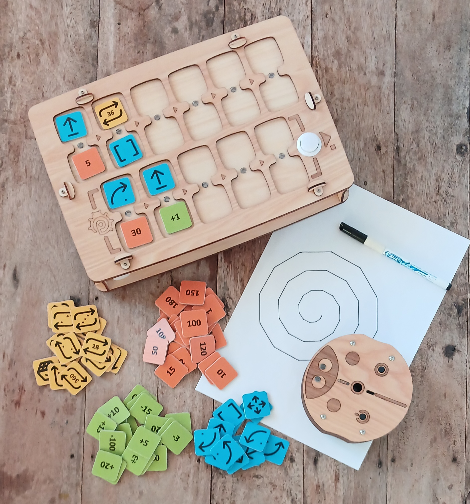

_Upravljačka ploča, žetoni naredbi, robot i crtež koji je nastao nakon izvođenja programa._

## Zašto je to važno

Djeca od rane dobi pokazuju zanimanje za videoigre i elektroničke uređaje i brzo ih svladavaju.

Roditelji znaju da su informacijske tehnologije važne za uspješan razvoj djeteta. Istodobno žele održati ravnotežu između učenja i zdravlja djece.

Istraživanja pokazuju da rano i često korištenje ekrana može smanjiti kognitivne sposobnosti i školski uspjeh.

[_Izvor: Programme for International Student Assessment (PISA), 2022 Results (Volume I)_](https://www.oecd-ilibrary.org/education/pisa-2022-results-volume-i_53f23881-en)

Kad mala djeca često koriste ekrane, to nerijetko ima ove posljedice:

- psihološke poteškoće,
- ovisnost o igrama,
- pogoršanje vida i tjelesnog zdravlja.

## Ciljevi i zadaće

S PrimaSTEM-om djeca od 4. godine uče programiranje, logiku i matematiku **bez ekrana**.

Što dijete svladava s PrimaSTEM-om:

- brojeve,
- prostornu orijentaciju,
- algoritme,
- logičko mišljenje,
- osnove programiranja,
- aritmetičke operacije i nizove,
- geometrijske pojmove.

Zašto je PrimaSTEM praktičan:

- prikladan je za različite predmete i zadatke,
- nastava je zanimljiva i zorna,
- učenje se odvija bez ekrana,
- prikladan je za djecu predškolske i rane školske dobi,
- izrađen je od prirodnih materijala.

> 🎯 **Glavni cilj.** Dijete razvija kognitivne vještine: dodiruje i vidi kako je program složen i razumije što znači rezultat njegova izvođenja.

## Kako radi

1. Uključite robota i upravljačku ploču.
2. Složite žetone naredbi u utore ploče. Tako ćete sastaviti program kretanja.
3. Pritisnite tipku **▶ Start** i robot će izvesti program.

---

**Videoprezentacija:** [youtu.be/Ztq\_I1WBiVo](https://youtu.be/Ztq_I1WBiVo)

  <iframe
    src="https://www.youtube.com/embed/Ztq_I1WBiVo?si=a54tevy8tUEQMOva"
    style={{
position: 'absolute',
top: 0,
left: 0,
width: '100%',
height: '100%',
}}
    frameBorder="0"
    allow="accelerometer; autoplay; clipboard-write; encrypted-media; gyroscope; picture-in-picture"
    allowFullScreen
  />

> 📺 Više vodiča i primjera ima na našem kanalu [YouTube PrimaSTEM](https://www.youtube.com/@primastem).

## Za koga je

PrimaSTEM je namijenjen djeci i izgleda kao igra. Odgojitelji, učitelji i roditelji mogu ga fleksibilno koristiti u radu. S njim se mogu poučavati matematika, programiranje, fizika, povijest i zemljopis. Ograničenja su samo mašta i umijeće učitelja ili roditelja.

Dijete stječe matematičku i algoritamsku osnovu. To je odlična priprema za školu i za prvo iskustvo s programskim jezicima: Scratch, Logo ili Minecraft.

_Primjer: spirala. Robot ju je nacrtao dok je program u svakom koraku petlje mijenjao varijablu._