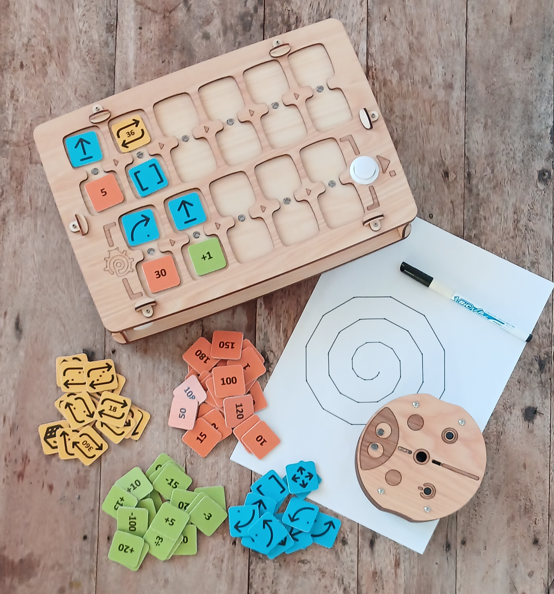
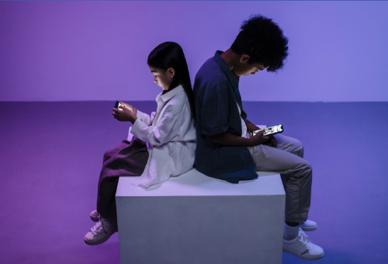
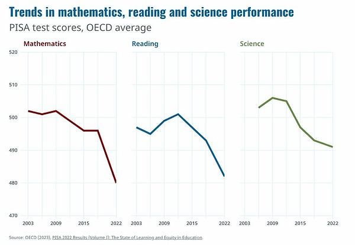

_Upravljačka ploča, programski blokovi, robot i rezultati izvođenja koda._

## Zašto je to važno

**Moderna djeca** od rane dobi pokazuju zanimanje za videoigre i elektroničke uređaje i brzo ih svladavaju.

Roditelji prepoznaju važnost informacijskih tehnologija za uspješan razvoj svojeg djeteta, a istodobno nastoje održati ravnotežu između učenja i zdravlja djece.

Istraživanja pokazuju da rano i često korištenje ekrana može smanjiti kognitivne sposobnosti i školski uspjeh.

[_Izvor: Programme for International Student Assessment (PISA), 2022 Results (Volume I)_](https://www.oecd-ilibrary.org/education/pisa-2022-results-volume-i_53f23881-en)

Korištenje ekrana kod male djece često dovodi do:

- psiholoških poteškoća,
- ovisnosti o igrama,
- pogoršanja vida i tjelesnog zdravlja.

## Ciljevi i zadaće

Ovaj edukativni **alat** pomaže djeci od 4. godine da nauče programiranje, logiku i matematiku **bez ekrana**.

S PrimaSTEM-om djeca svladavaju:

- brojeve,
- prostornu orijentaciju,
- algoritme,
- logičko mišljenje,
- osnove programiranja,
- aritmetičke operacije i nizove,
- geometrijske pojmove.

**Prednosti:**

- svestrana primjena,
- zanimljiv i očit oblik,
- učenje bez ekrana,
- prikladno za predškolsku i ranu školsku dob,
- prirodni materijali.

> 🎯 **Glavni cilj** je razvoj kognitivnih vještina kroz opipljivo i vidljivo razumijevanje osnova programiranja i značenja rezultata izvođenja programa.

## Kako radi?

1. Uključite robota i upravljačku ploču.
2. Pomoću žetona naredbi složite program kretanja tako da ih stavite u utore ploče.
3. Pritisnite tipku "Izvrši" i robot će izvesti program.

---

**Video prezentacija:** [youtu.be/Ztq\_I1WBiVo](https://youtu.be/Ztq_I1WBiVo)

  <iframe
    src="https://www.youtube.com/embed/Ztq_I1WBiVo?si=a54tevy8tUEQMOva"
    style={{
position: 'absolute',
top: 0,
left: 0,
width: '100%',
height: '100%',
}}
    frameBorder="0"
    allow="accelerometer; autoplay; clipboard-write; encrypted-media; gyroscope; picture-in-picture"
    allowFullScreen
  />

> 📺  Više vodiča i primjera na našem kanalu [YouTube PrimaSTEM](https://www.youtube.com/@primastem)

## Za koga je?

PrimaSTEM je namijenjen djeci i izgleda kao igra, ali je prilagodljiv alat za odgojitelje, učitelje i roditelje. Može se koristiti za poučavanje različitih predmeta: matematike, programiranja, fizike, povijesti, zemljopisa. Ograničenja su samo mašta i umijeće učitelja ili roditelja.

Dijete stječe matematičku i algoritamsku osnovu, koja postaje odlična priprema za školu i prvo iskustvo s programskim jezicima (Scratch, Logo ili Minecraft).

_Primjer rezultata: spirala nacrtana dinamičkom promjenom varijable u petlji._