## Jednostavna desetokraka zvijezda

| Kôd | Rezultat |
| --- | --- |
| 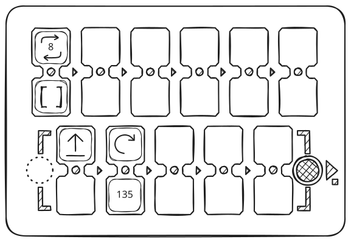 | 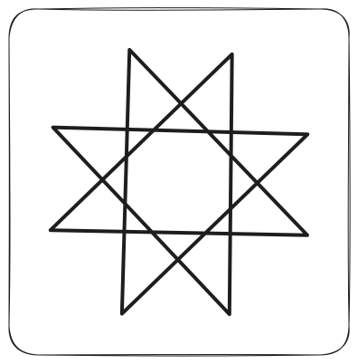 |

## Pravilni peterokut

| Kôd | Rezultat |
| --- | --- |
| 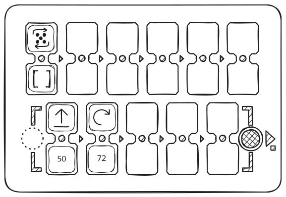 | 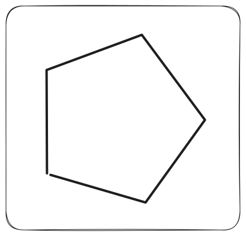 |

## Jednostavna peterokraka zvijezda

| Kôd | Rezultat |
| --- | --- |
| 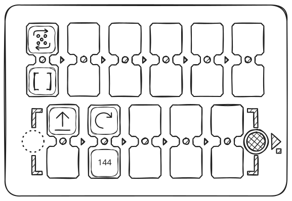 | 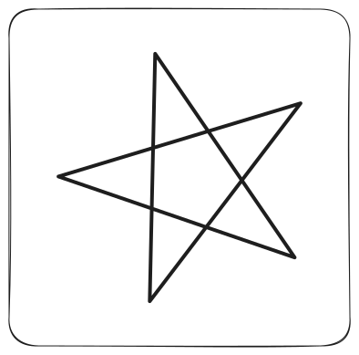 |

## Matematički crtež srca

| Kôd | Rezultat |
| --- | --- |
| 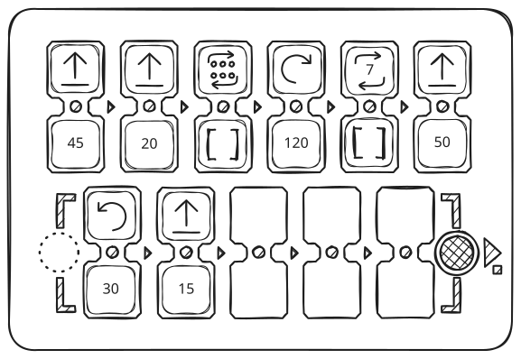 | 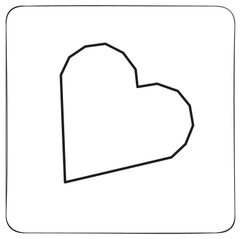 |

## Trokut s jednostavnim programom

| Kôd | Rezultat |
| --- | --- |
| 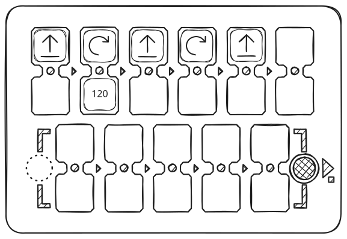 | 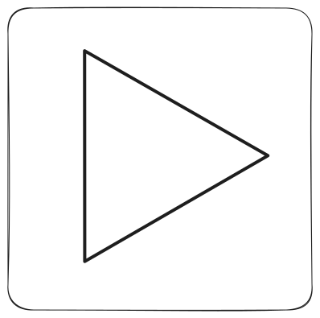 |

## Trokut pomoću funkcije

| Kôd | Rezultat |
| --- | --- |
|  |  |

## Trokutasta spirala

| Kôd | Rezultat |
| --- | --- |
| 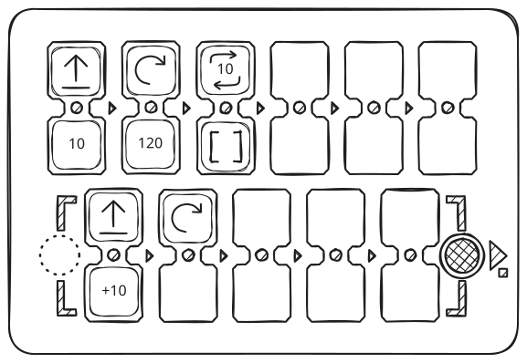 | 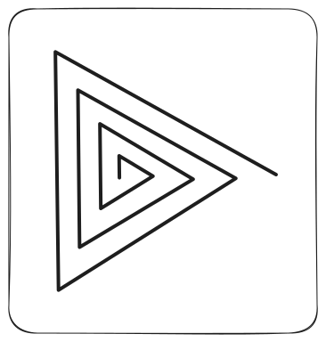 |

## Krivulja s negativnim kutovima

| Kôd | Rezultat |
| --- | --- |
| 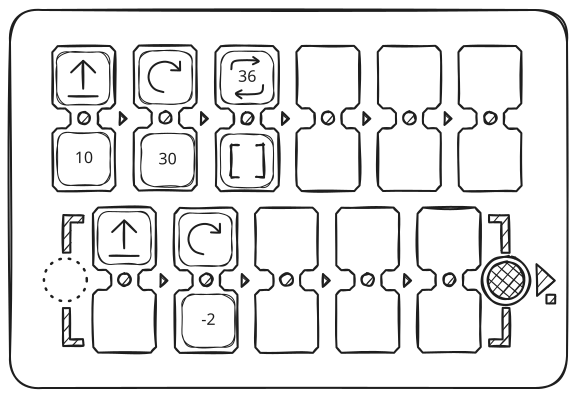 | 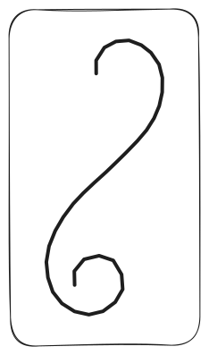 |

## Kvadratna spirala

| Kôd | Rezultat |
| --- | --- |
| 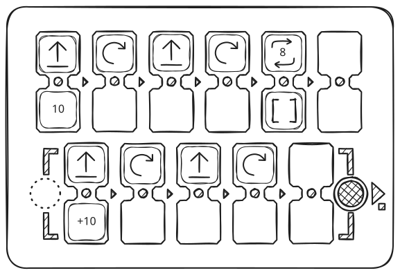 | 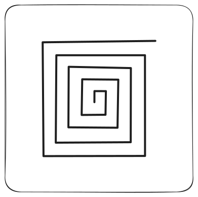 |

## Mjerač vremena od ~5 minuta

| Kôd | Rezultat |
| --- | --- |
| 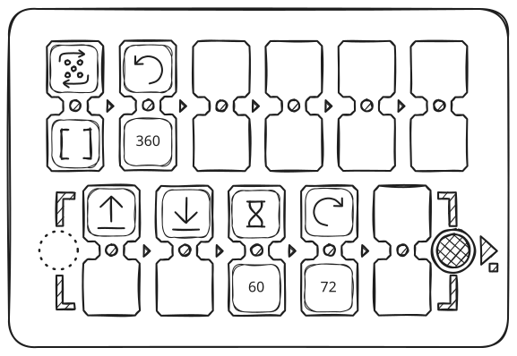 | 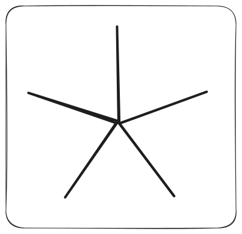 |

## Spirala

| Kôd | Rezultat |
| --- | --- |
| 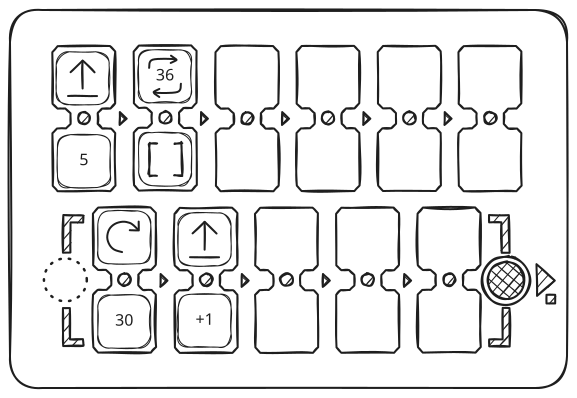 | 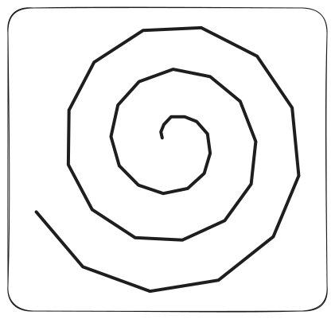 |

