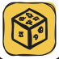

## 🧭 Kretanje

| Naredba | Žeton | NFC kod |
| --- | --- | --- |
| Naprijed |  | `cfor` |
| Lijevo |  | `clef` |
| Desno |  | `crig` |
| Natrag |  | `cbac` |
| Nasumično kretanje |  | `crnd` |

## 🔁 Ponavljanje i upravljanje

| Naredba | Žeton | NFC kod |
| --- | --- | --- |
| Ponovi 2–999 |  | `r002`–`r999` |
| Ponovi nasumičan broj puta (od 1 do 6) |  | `rrnd` |
| Funkcija |  | `cfun` |
| Pauza (1–999 s; bez broja 1 s) |  | `cwat` |

## 🔢 Brojevi

| Vrijednost | NFC kod |
| --- | --- |
| Brojevi 1–999 | `n001`–`n999` |

## 🧮 Matematičke operacije

| Operacija | NFC kod |
| --- | --- |
| Plus: +1 do +999 | `a001`–`a999` |
| Minus: −1 do −999 | `s001`–`s999` |
| Puta: ×N | `m002`–`m999` |
| Podijeljeno sa: ÷N | `d002`–`d999` |
| Na potenciju: X^N | `e002`–`e999` |
| Kvadratni korijen od X | `sqrt` |
| Faktorijel | `fact` |

Aritmetika računa do 5000 u oba smjera, a dijeljenje odbacuje decimale. Ako rezultata nema (iznad 5000, dijeljenje s 0, korijen negativnog broja, faktorijel iznad 6), polje treperi crveno, a broj ostaje isti.

## ⚙️ Postavke

| Naredba | NFC kod |
| --- | --- |
| Kalibracija (bez broja: robot podešava motore i žiroskop, oko 2 minute, prvih pola minute ga nemojte dirati; sa žetonom `+N` ili `−N`: ispravak zakreta nakon provjere sa 16 okreta; ne radi s običnim brojem, polje se zacrveni) | `ccal` |
| Korak: zadana duljina koraka za kartu (1–999 mm; bez broja vraća na 150 mm) | `clen` |

## 🔧 Napredno

| Naredba | NFC kod |
| --- | --- |
| Zvučni uzorak (vidi [Popis zvučnih datoteka](/en-hr/sounds_reference)) | `xNNN` |
| Zvučni isječak (robot reproducira zvuk broj N: `csou` + broj N) | `csou` |
| Glasnoća (ploča i robot: 0–100, iznad 100 = maksimum) | `clvl` |

## Kako zapisati podatke na NFC naljepnicu

Možete izraditi vlastiti žeton: dovoljno je zapisati tekstualni kod na NFC naljepnicu ili NFC čip. Možete koristiti bilo koje brojeve (od 0 do 999), bilo koja ponavljanja i bilo koje brojeve za aritmetičke operacije.

Za zapisivanje tekstualnih podataka na NFC naljepnicu otvorite trgovinu Google Play i na telefon instalirajte aplikaciju **RFID NFC Reader** ili **NFC Tools**.

Upute za zapisivanje NFC naljepnice nalaze se ovdje: [youtu.be/UbKaQxZs8JA](https://youtu.be/UbKaQxZs8JA)

  <iframe
    src="https://www.youtube.com/embed/UbKaQxZs8JA?si=WT8wWYBe_Ql7TovQ"
    style={{
    position: 'absolute',
    top: 0,
    left: 0,
    width: '100%',
    height: '100%',
  }}
    frameBorder="0"
    allow="accelerometer; autoplay; clipboard-write; encrypted-media; gyroscope; picture-in-picture"
    allowFullScreen
  />

