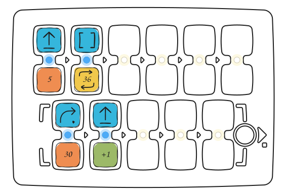
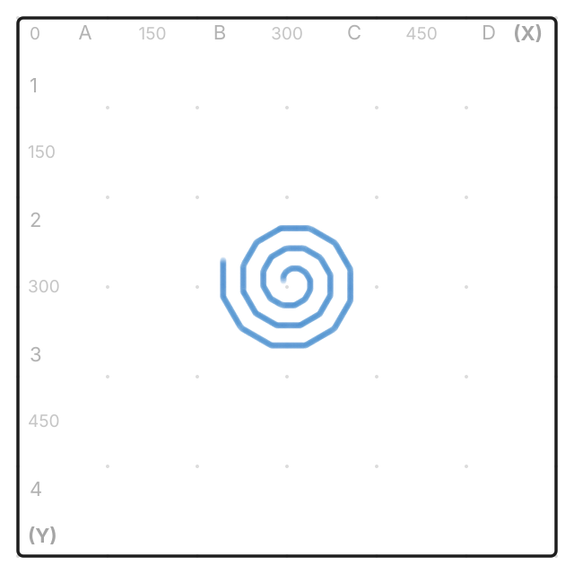

PrimaSTEM uči djecu od 4 do 10+ godina programiranju, logici i matematici bez ekrana. Ova stranica ukratko objašnjava **kako uređaj radi**.

<Note>
**Još nemate uređaj? Isprobajte ga u pregledniku.** Otvorite **[web simulator](https://simulator.primastem.com)**. To je radna kopija ploče i robota. Postavite žetone, pritisnite **▶ Start** i pratite kako robot izvodi program. To možete raditi dok čitate ovaj vodič.
</Note>

## 1. Što je u kutiji

<CardGroup cols={3}>
  <Card title="Robot" icon="bug">
    Drveni robot u obliku bubamare, na dva kotača. Na vrhu je utor za flomaster. Ima zvučnik, USB-C i Bluetooth.
  </Card>
  <Card title="Upravljačka ploča" icon="grid-3x3">
    Na ploči su dvostruki utori za program i višebojni indikatori. Ima tipku ▶ Start/Stop, zvučnik, USB-C i Bluetooth.
  </Card>
  <Card title="Žetoni naredbi" icon="square-stack">
    Kartonske pločice s NFC naljepnicama. Svaka je jedna naredba za program robota.
  </Card>
</CardGroup>

<Tip>Kad primite komplet, ažurirajte firmware robota i upravljačke ploče na najnoviju verziju: [kako ažurirati](/en-hr/update).</Tip>

## 2. Uključivanje

<Steps>
  <Step title="Uključite robota, zatim ploču" icon="power">
    Svaki uređaj ispušta kratak zvuk. Zeleni indikator napajanja znači da je uređaj uključen.
  </Step>
  <Step title="Bijelo svjetlo: veza postoji" icon="check">
    Slobodni utori na ploči svijetle **bijelo**, a oči robota trepere **bijelo**. Spremni ste.
  </Step>
  <Step title="Svijetloplavo svjetlo: nema veze" icon="bluetooth">
    Robot i upravljačka ploča svijetle svijetloplavo. Ako se veza ne uspostavi, držite **▶ Start** na ploči **dulje od 10 sekundi**. U 5. sekundi čut ćete zvučni signal, ne puštajte tipku. Uređaji će se upariti i robot će se ponovno pokrenuti.
  </Step>
</Steps>

**Prvo isprobajte ovo.** Stavite žeton **Naprijed** u prvi par, u bilo koje od dva polja. Pritisnite **▶ Start**. Robot se pomakne 15 cm naprijed i stane. *Napisali ste prvi program od jedne naredbe.*

## 3. Kako radi program

Ploča ima **dva reda dvostrukih utora**. Stavite žetone u polja koja svijetle bijelo i program je gotov. Pritisnite **▶ Start** i robot ga izvodi.

<Frame caption="Raspored ploče. Oznake A–F objašnjene su u nastavku">
  
</Frame>

| Oznaka | Što je to |
| :---: | --- |
| **A** | **Glavni program**: 6 dvostrukih utora, robot ih izvodi slijeva udesno |
| **B** | **▶ Start / Stop**: prvi pritisak pokreće program, pritisak usred programa ga zaustavlja |
| **C** | **Funkcija**: 5 dvostrukih utora, poziva ih žeton Funkcija |
| **D** | Jedno **polje** para |
| **E** | **Linija izvršavanja** koja povezuje dva polja u par |
| **F** | **Višebojni indikator** na svakom polju |

**Par čine dva povezana polja.** Gore i dolje nije bitno. Naredbu stavite u jedno polje para, a pločicu ponavljanja, broja ili aritmetike u drugo. Ako je drugo polje prazno, naredba uzima posljednji broj koji je primila od uključivanja uređaja. Dok broj nije postavljen, robot radi korak od 15 cm i zaokret od 90°. To je dovoljno za malu djecu.

Boje indikatora tijekom rada:

| ⚪ Bijela | 🟢 Zelena | 🔵 Plava | 🔴 Crvena |
| :---: | :---: | :---: | :---: |
| Utor je slobodan | U paru je naredba | Naredba s brojem, ponavljanjem ili aritmetikom | Pogreška, par se preskače |

Robot preskače prazne utore i crvene parove. Indikator trepće na polju koje robot trenutačno izvodi.

## 4. Žetoni po skupinama

| Skupina | Što žetoni rade |
| --- | --- |
| **Kretanje** | Naprijed, Natrag, Lijevo, Desno |
| **Ponavljanje** | Dvije strelice u petlji, unutra točkice od 2 do 6 (kao na kockici, za malu djecu) ili brojke. U paru s naredbom ponavlja je. |
| **Brojevi** | Od `1` do `999`. Određuju udaljenost u milimetrima ili kut zaokreta u stupnjevima. |
| **Aritmetika** | `+N` `−N` `×N` `÷N` `√` `^N`. Jedna pločica nosi operaciju i broj. Ona mijenja spremljenu vrijednost kretanja ili zaokreta. Ako je rezultat negativan, robot ide ili se okreće u suprotnom smjeru. |
| **Funkcija** | Poziva donji red kao potprogram. S pločicom ponavljanja donji red izvodi se zadani broj puta. |
| **Zadani korak** | Servisna pločica. Zajedno s brojem mijenja zadani korak. Na primjer, za mrežu od 10 cm stavite broj 100 (u milimetrima). Korak se pamti i nakon isključivanja. |

## 5. Zadane i spremljene vrijednosti

<Note>
**Naprijed prelazi 150 mm (15 cm), zaokret iznosi 90°.** Žeton **Zadani korak** mijenja korak za Naprijed i Natrag, a on ostaje i nakon isključivanja. Koristite ga za karte s mrežom za bilo kojeg robota.

Dok je ploča uključena, svaka naredba kretanja pamti **vlastitu** vrijednost:

- **broj** u paru s naredbom zamjenjuje zadnju spremljenu ili zadanu vrijednost;
- **aritmetička** pločica mijenja je (`+`, `−`, `×`, `÷`, `√`, `^`);
- **prazno** polje u paru s naredbom ostavlja zadnju spremljenu ili zadanu vrijednost.

Kad se ploča isključi, spremljene vrijednosti se brišu. Zadani korak ostaje.

**Kratki pregled:**

| Par na ploči | Rezultat | Što se dogodilo |
| --- | --- | --- |
| `Naprijed` bez broja | 150 mm (15 cm) | zadana vrijednost |
| `Naprijed` i `100` | 100 mm | broj je zamijenio vrijednost |
| `Naprijed` i `+50` | 150 mm (bilo je 100, dodano 50) | aritmetika je promijenila vrijednost |
| `Lijevo` bez broja | 90° | zadana vrijednost |
| `Lijevo` i `45` | 45° | broj je zamijenio vrijednost |
| `Lijevo` i `−10` | 35° (bilo je 45°, oduzeto 10°) | aritmetika je promijenila vrijednost |
</Note>

## 6. Robot crta ono što isprogramirate

Isprobajte ove primjere i vidjet ćete što uređaj može. Umetnite flomaster u sredinu robota i on će **crtati** dok se kreće.

<CardGroup cols={2}>
  <Card title="Zvijezda: brojevi i ponavljanje">
    <Frame>
      
    </Frame>
    <Frame>
      
    </Frame>
    [Pokreni u simulatoru](https://simulator.primastem.com/#top=cfun.r005&fn=cfor,crig.n144&s=l1047402&r=225-283-90&run)
  </Card>
  <Card title="Spirala: aritmetika u petlji">
    <Frame>
      
    </Frame>
    <Frame>
      
    </Frame>
    [Pokreni u simulatoru](https://simulator.primastem.com/#top=cfor.n005,cfun.r036&fn=crig.n030,cfor.a001&s=l1047402&r=296-293-0&run)
  </Card>
</CardGroup>

Više primjera nalazi se na stranici [Primjeri crteža](/en-hr/mathdrawings).

## 7. Kako poučavati s PrimaSTEM-om

<Tip>
**Uvodite žetone naredbi jedan po jedan, ovim redom:**

1. Naprijed
2. Zaokreti
3. Ponavljanje
4. Funkcija
5. Brojevi
6. Aritmetika

Prijeđite na sljedeći žeton kad dijete sigurno usvoji prethodni. Cijeli plan od 12 lekcija za malu djecu, s uzrastom, trajanjem i materijalima, nalazi se u [Knjizi 1](/en-hr/book-1/book-1).

**Rad u skupini.** Preporučujemo jedan komplet na **2–3 djeteta**.

**Karte.** Radit će bilo koja karta s mrežom izrađena za bilo kojeg edukativnog robota. Veličinu polja postavlja žeton **Zadani korak** s brojem, na primjer 100, 120, 150 ili 200 mm.

**Kako dobiti 10 koraka umjesto 6.** Stavite žeton **Funkcija [ ]** u zadnji (6.) par gornjeg reda i učvrstite ga ljepljivom trakom. Sada se program izvodi kao jedan lanac: 5 koraka gore i 5 dolje, **10 koraka zaredom**. To je korisno za malu djecu kojima treba dulji program, ali je još rano uvoditi pojam funkcije.
</Tip>

## 8. Dodatne mogućnosti

<CardGroup cols={2}>
  <Card title="Flomaster i crtanje" icon="pen-line">
    Umetnite flomaster u robota i on će **nacrtati** svoj put na papiru. Nastaju jednostavne linije, mnogokuti, zvijezde, spirale i fraktali.
  </Card>
  <Card title="Glasovna povratna informacija" icon="volume-2">
    Ploča naglas čita svaki žeton. Glas radi **na 21 jeziku**, među njima arapski, finski, hrvatski i litavski. Drugi jezik dodat ćemo na zahtjev. Glas pomaže maloj djeci i djeci koja još ne čitaju. Uključena su i slova abecede i mjesta: Kuća, Škola, Trgovina, Šuma i drugo.
  </Card>
  <Card title="NFC zvučne naljepnice i karte" icon="map">
    Zalijepite NFC naljepnice na kartu i s telefona zapišite na njih bilo koji dostupni zvuk. Robot ima antenu na donjoj strani. Kad robot stane na naljepnicu, reproducira snimljeni zvuk.
  </Card>
  <Card title="Otvorena NFC platforma" icon="nfc">
    Napravite vlastite žetone. Treba vam bilo koja NFC oznaka od 13,56 MHz (jeftina, prodaje se u svim web-trgovinama) i tekstualni kôd iz naše dokumentacije. Zapis traje 10 sekundi u besplatnoj aplikaciji NFC Tools na telefonu.
  </Card>
</CardGroup>

## Što čitati dalje

<CardGroup cols={2}>
  <Card title="Uređaj i postavke" icon="book-open" href="/en-hr/usermanual">
    Tehničke specifikacije, uparivanje, kalibracija, sigurnost.
  </Card>
  <Card title="Vodič za učitelje" icon="book" href="/en-hr/teachersguide">
    Pedagogija, rad u razredu, osnove programiranja kroz igru.
  </Card>
  <Card title="Knjiga 1: Lekcije" icon="graduation-cap" href="/en-hr/book-1/book-1">
    12 gotovih lekcija za malu djecu, s uzrastom, trajanjem i materijalima za ispis.
  </Card>
  <Card title="Žetoni naredbi" icon="nfc" href="/en-hr/nfc">
    Svi NFC kodovi za pisanje vlastitih žetona telefonom.
  </Card>
  <Card title="Primjeri crteža" icon="pen-line" href="/en-hr/mathdrawings">
    Geometrijski likovi, fraktali, spirale: programi i rezultati.
  </Card>
  <Card title="Popis zvučnih datoteka" icon="volume-2" href="/en-hr/sounds_reference">
    Riječi (mjesta i pojmovi), abeceda, glazbene note, sustavni zvukovi. Potreban je za zapisivanje vlastitih žetona i zvukova.
  </Card>
</CardGroup>
