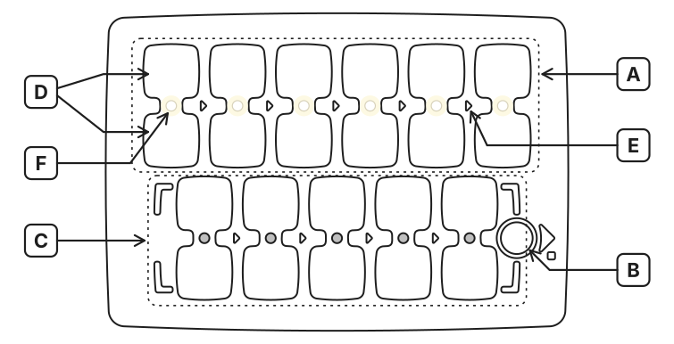

PrimaSTEM je edukativni komplet bez ekrana za programiranje, logiku i matematiku, namijenjen djeci od 4 do 10+ godina. Ova stranica ukratko objašnjava **kako uređaj radi**.

<Note>
**Još nemate uređaj? Isprobajte ga u pregledniku.** Otvorite **[web simulator](https://simulator.primastem.com)**, radnu kopiju ploče i robota. Postavite žetone, pritisnite **▶ Start** i pratite kako robot izvodi program dok čitate ovaj vodič.
</Note>

## 1. Što je u kutiji

<CardGroup cols={3}>
  <Card title="Robot" icon="bug">
    Drveni robot bubamara na dva kotača. Na vrhu je utor za flomaster. Zvučnik, USB-C, Bluetooth.
  </Card>
  <Card title="Upravljačka ploča" icon="grid-3x3">
    Ploča s dvostrukim utorima za program. Višebojni indikatori, tipka ▶ Start/Stop, zvučnik, USB-C, Bluetooth.
  </Card>
  <Card title="Žetoni naredbi" icon="square-stack">
    Kartonske pločice s NFC naljepnicama. Svaka je jedna naredba za program robota.
  </Card>
</CardGroup>

## 2. Uključivanje

<Steps>
  <Step title="Uključite robota, zatim ploču" icon="power">
    Svaki uređaj ispušta kratak zvuk; zeleni indikator napajanja na svakom znači da je uređaj uključen.
  </Step>
  <Step title="Povezano = bijelo" icon="check">
    Slobodni utori na ploči svijetle **bijelo**, a oči robota trepere **bijelo**. Spremni ste.
  </Step>
  <Step title="Svijetloplavo = nema veze" icon="bluetooth">
    Robot i upravljačka ploča svijetle svijetloplavo. Ako se veza i dalje ne uspostavi, držite **▶ Start** na ploči **dulje od 10 sekundi**. U 5. sekundi čut ćete zvučni signal, nastavite držati: uređaji će se upariti i robot će se ponovno pokrenuti.
  </Step>
</Steps>

**Prvo isprobajte ovo:** stavite žeton **Naprijed** u utor 1 (u bilo koje polje para). Pritisnite **▶ Start**. Robot se pomakne 15 cm naprijed i stane. *To je program od jedne naredbe.*

## 3. Kako radi program

Ploča ima **dva reda dvostrukih utora**. Stavite žetone u polja koja svijetle bijelo, to je vaš program. Pritisnite **▶ Start** i robot ga izvodi.

<Frame caption="Raspored ploče: oznake A–F objašnjene su u nastavku">
  
</Frame>

| Oznaka | Što je to |
| :---: | --- |
| **A** | **Glavni program**: 6 dvostrukih utora, izvodi se slijeva udesno |
| **B** | **▶ Start / Stop**: pritisnite za pokretanje; pritisnite ponovno usred programa za zaustavljanje |
| **C** | **Funkcija**: 5 dvostrukih utora, poziva ih žeton Funkcija |
| **D** | Jedno **polje** para |
| **E** | **Linija izvršavanja** koja povezuje polja para |
| **F** | **Višebojni LED indikator** na svakom polju |

**Par su dva logički povezana polja.** Redoslijed gore/dolje nije bitan: naredbu stavite u jedno polje para, a pločicu ponavljanja, broja ili aritmetike u drugo. Ako je drugo polje prazno, koriste se zadane vrijednosti: korak od 15 cm i zaokret od 90°, što je dovoljno za malu djecu.

Boje LED-ova tijekom izvršavanja:

| ⚪ Bijela | 🟢 Zelena | 🔵 Plava | 🔴 Crvena |
| :---: | :---: | :---: | :---: |
| Mirovanje (utor slobodan) | Naredba postavljena | Naredba + broj / ponavljanje / aritmetika | Pogreška, preskače se |

Prazni utori i crveni parovi preskaču se pri izvođenju programa. LED-ovi trepere na polju koje se trenutačno izvršava.

## 4. Žetoni po skupinama

| Skupina | Što žetoni rade |
| --- | --- |
| **Kretanje** | Naprijed · Natrag · Lijevo · Desno |
| **Ponavljanje** | Dvije strelice u petlji + unutra točkice 2–6 (kao na kockici, za malu djecu) ili brojke. U paru s naredbom ponavlja je. |
| **Brojevi** | `1`–`999`. Određuju udaljenost kretanja u mm ili kut zaokreta u stupnjevima. |
| **Aritmetika** | `+N` `−N` `×N` `÷N` `√` `^N`: jedna pločica po operaciji + broju. Mijenja spremljenu vrijednost kretanja ili zaokreta. Negativan rezultat obrće smjer! |
| **Funkcija** | Poziva donji red kao potprogram. S pločicom ponavljanja izvodi se toliko puta. |
| **Korak** | Servisna pločica + broj = mijenja zadani korak (npr. broj 100, u milimetrima, za mrežu od 10 cm). Pamti se i nakon isključivanja. |

## 5. Zadane i spremljene vrijednosti

<Note>
**Naprijed = 150 mm (15 cm), zaokret = 90°.** Žeton **Korak** mijenja "zadanu" udaljenost, a ona ostaje i nakon isključivanja. Koristite ga za karte s mrežom za bilo kojeg robota.

Tijekom jedne sesije svaka naredba kretanja pamti **vlastitu** spremljenu vrijednost:

- **broj** u paru s naredbom → zamjenjuje zadnju spremljenu ili zadanu vrijednost
- **aritmetička** pločica → mijenja je (`+`, `−`, `×`, `÷`, `√`, `^`)
- **prazno** u paru s naredbom → koristi zadnju spremljenu ili zadanu vrijednost

Spremljene vrijednosti brišu se kad se ploča isključi; zadana vrijednost (Korak) ostaje.

**Kratki pregled:**

- `Naprijed` samo        → 150 mm (15 cm), zadano
- `Naprijed` + `100`      → 100 mm, zamjenjuje prethodnu
- `Naprijed` + `+50`      → 150 mm  (prethodnih 100 + 50), mijenja
- `Lijevo` samo           → 90°, zadano
- `Lijevo` + `45`          → 45°, zamjenjuje prethodnu
- `Lijevo` + `−10`         → 35°  (prethodnih 45° − 10°), mijenja
</Note>

## 6. Robot crta ono što isprogramirate

Isprobajte ove primjere i vidjet ćete što uređaj može. Umetnite flomaster u sredinu robota, on **crta** dok se kreće.

<CardGroup cols={2}>
  <Card title="Zvijezda: brojevi + ponavljanje">
    <Frame>
      
    </Frame>
    <Frame>
      
    </Frame>
    [Pokreni u simulatoru](https://simulator.primastem.com/#top=cfun.r005&fn=cfor,crig.n144&s=l1047402&r=225-283-90&run)
  </Card>
  <Card title="Spirala: aritmetika u petlji">
    <Frame>
      
    </Frame>
    <Frame>
      
    </Frame>
    [Pokreni u simulatoru](https://simulator.primastem.com/#top=cfor.n005,cfun.r036&fn=crig.n030,cfor.a001&s=l1047402&r=296-293-0&run)
  </Card>
</CardGroup>

Više primjera u [Primjerima crteža](mathdrawings).

## 7. Kako poučavati s PrimaSTEM-om

<Tip>
**Uvodite žetone naredbi jedan po jedan, ovim redom:**

**Naprijed → Zaokreti → Ponavljanje → Funkcija → Brojevi → Aritmetika.**

Dodajte svaki sljedeći tek kad je prethodni sigurno usvojen. Cijeli plan od 12 lekcija s uzrastom, trajanjem i materijalima za malu djecu nalazi se u [Knjizi 1](book-1/book-1).

**Rad u skupini:** preporučujemo jedan komplet na **2–3 djece**.

**Karte:** radit će bilo koja karta s mrežom izrađena za bilo kojeg edukativnog robota. Veličinu polja postavite žetonom **Korak** i brojem (npr. 100, 120, 150, 200 mm).

**Trik za 10 koraka umjesto 6.** Stavite žeton **Funkcija [ ]** u zadnji (6.) utor gornjeg reda i učvrstite ga ljepljivom trakom. Program se tada izvodi kao jedan dugi lanac: 5 gornjih koraka + 5 donjih = **10 koraka zaredom**. Korisno za malu djecu kojima treba dulji program prije nego što budu spremna shvatiti pojam funkcije.
</Tip>

## 8. Dodatne mogućnosti

<CardGroup cols={2}>
  <Card title="Flomaster i crtanje" icon="pen-line">
    Umetnite flomaster u robota, on **crta** svoj put na papiru: od jednostavne putanje do mnogokuta, zvijezda, spirala i fraktala.
  </Card>
  <Card title="Glasovna povratna informacija" icon="volume-2">
    Ploča naglas čita svaki žeton, glasom na **bilo kojem lokalnom jeziku**; trenutačno je **20 podržanih** (uključujući arapski, finski i hrvatski), a dodat ćemo bilo koji na zahtjev. Pomaže maloj djeci i djeci koja još ne čitaju. Uključuje slova abecede i mjesta (Kuća, Škola, Trgovina, Šuma itd.)
  </Card>
  <Card title="NFC zvučne naljepnice i karte" icon="map">
    Zalijepite NFC naljepnice na kartu i s telefona programirajte bilo koji dostupni zvuk. Robot ima antenu na donjoj strani: kad stane na naljepnicu, reproducira snimljeni zvuk.
  </Card>
  <Card title="Otvorena NFC platforma" icon="nfc">
    Napišite vlastite žetone: bilo koja NFC oznaka od 13,56 MHz (jeftina, prodaje se na svim tržnicama) + tekstualni kôd iz naše dokumentacije. Cijeli postupak traje 10 sekundi. Besplatna aplikacija za telefon (NFC Tools).
  </Card>
</CardGroup>

## Što čitati dalje

<CardGroup cols={2}>
  <Card title="Uređaj i postavke" icon="book-open" href="usermanual">
    Potpune tehničke specifikacije, uparivanje, kalibracija, sigurnost.
  </Card>
  <Card title="Vodič za učitelje" icon="book" href="teachersguide">
    Pedagogija, korištenje u razredu, pojmovi programiranja kroz igru.
  </Card>
  <Card title="Knjiga 1: Lekcije" icon="graduation-cap" href="book-1/book-1">
    12 gotovih lekcija za malu djecu, s uzrastom, trajanjem i materijalima za ispis.
  </Card>
  <Card title="Žetoni naredbi" icon="nfc" href="nfc">
    Svi NFC kodovi, za pisanje vlastitih žetona telefonom.
  </Card>
  <Card title="Primjeri crteža" icon="pen-line" href="mathdrawings">
    Geometrijski likovi, fraktali, spirale: programi i rezultati.
  </Card>
  <Card title="Zvučni rječnik" icon="volume-2" href="sounds_reference">
    Riječi: mjesta i pojmovi, abeceda, glazbene note, sustavni zvukovi. Za snimanje vlastitih žetona i reprodukciju.
  </Card>
</CardGroup>
