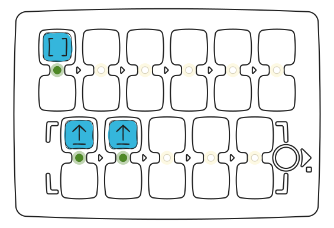
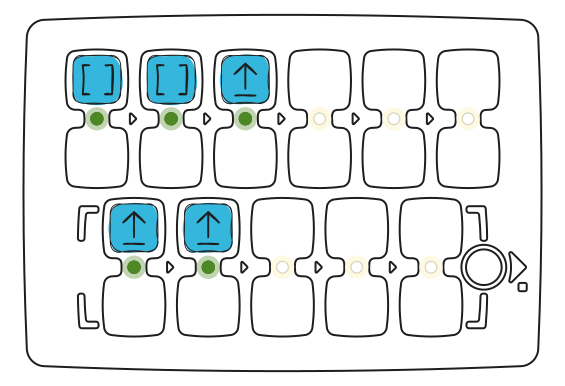

PrimaSTEM uči djecu od 4 do 12 godina programiranju bez računala, tableta i telefona. Komplet razvija logiku, programerske vještine i matematiku.

S PrimaSTEM-om programiranje postaje jednostavno i očito. Čak i najmlađi razumiju što se događa: diraju žetone rukama i kroz igru svladavaju osnove programiranja, logike i matematike.

Igra s PrimaSTEM-om razvija logičko mišljenje, algoritamsko razmišljanje, programiranje, matematiku i geometriju. Razvija i kreativnost i socio-emocionalne vještine. Komplet priprema dijete za blokovske programske jezike, na primjer [Scratch](https://en.wikipedia.org/wiki/Scratch_\(programming_language\)) ili [LOGO](https://en.wikipedia.org/wiki/Logo_\(programming_language\)).

## Upoznavanje s obrazovnim kompletom

### Gdje se PrimaSTEM može koristiti

PrimaSTEM je prikladan za ovakve programe:

- predškolski odgojni centri;
- dječji vrtići koji rade po Montessori metodi;
- osnovna škola;
- školovanje kod kuće;
- posebni razvojni centri;
- produženi boravak i izvannastavne skupine;
- klubovi programiranja za početnike;
- dječji edukativni kampovi.

### Što trebate znati za početak

Prije rada s kompletom pročitajte stranicu [Uređaj i postavke](/en-hr/usermanual) i ovaj vodič. Programerska znanja nisu potrebna: u materijalima je sve što trebate za početak.

## Istraživanja i vrijednost kompleta

PrimaSTEM je nadahnut programskim jezikom [LOGO](https://en.wikipedia.org/wiki/Logo_\(programming_language\)), koji je stvorio [Seymour Papert](https://en.wikipedia.org/wiki/Seymour_Papert), i Montessori pedagogijom. LOGO i robot kornjača učinili su programiranje vidljivim i dostupnim djeci.

Žetoni naredbi PrimaSTEM-a nastavljaju taj pristup. Dijete upravlja robotom rukama, bez ekrana i teksta, i odmah razumije što radi.

Djeca promatraju robota, razumiju svaku naredbu i svladavaju algoritme u praksi.

Robot ima važno svojstvo: ima smjer. Dijete se lako stavi na mjesto robota i zato brže shvati logiku programa.

Sve su naredbe jednostavne: govore u kojem smjeru robot treba ići. Kad dijete uči robota "djelovati" i "razmišljati", počinje razmišljati o vlastitim postupcima i mislima. Zato mu programiranje ide lakše.

Žetoni PrimaSTEM-a jednostavno i vidljivo pokazuju kako su građeni programski jezici. Na početku učenja nema teksta ni brojeva, samo osnovne naredbe.

### Zašto drvo

🌱 Ploča i robot izrađeni su od drva (šperploče). Djeca se radije igraju drvenim igračkama. Sigurne su, dugo traju i svaka dobije svoju priču.

## Programiranje s PrimaSTEM-om

Žetoni PrimaSTEM-a rade kao naredbe u pravim programskim jezicima. Na njima se vide važni pojmovi programiranja.

### Algoritmi

**Algoritam** se sastoji od preciznih naredbi (žetona) koje zajedno čine program.

### Red izvršavanja

Ploča izvršava naredbe strogo slijeva nadesno. Tako djeca vide da se naredbe izvršavaju redom.

### Ispravljanje pogrešaka (otklanjanje grešaka)

Pogrešku je lako ispraviti: dovoljno je zamijeniti žeton. Tako dijete uči samo pronaći i ispraviti greške u programu.

### Funkcija

Funkcija (potprogram) sastoji se od naredbi u donjem redu ploče. Glavni program poziva je žetonom "**Funkcija**".

### Varijabla

Upravljačka ploča pamti zadnji broj svake naredbe. Naprijed, Natrag, Lijevo, Desno i Pauza čuvaju svaka svoju vrijednost. Naredba bez broja uzima spremljenu vrijednost. To je varijabla: ima ime (naredbu) i vrijednost (broj), a vrijednost se može mijenjati.

## Primjena u drugim predmetima

PrimaSTEM pomaže razvijati i druge vještine:

- Komunikacija. U igri u skupini djeca uče surađivati.
- Motorika. Rad sa žetonima poboljšava koordinaciju.
- Socijalne vještine. Djeca stječu samopouzdanje i uče zajedno rješavati probleme.
- Matematika. Djeca svladavaju osnovne matematičke pojmove.
- Logika. Djeca uče graditi nizove i predviđati ishod.

> Dijete slaže lanac žetona i svladava programiranje rukama, očima i glavom. Pritisne **▶ Start**, robot krene, a dijete usporedi rezultat sa svojim očekivanjem. Takvo iskustvo ubrzava učenje.

## Upoznavanje s robotom i upravljačkom pločom

### Robot

Recite djeci da je robot njihov prijatelj i da ga mogu programirati. Objasnite da robot nema vlastitih misli. Izvršava samo njihove upute, kao kućanski aparat koji treba uključiti.

### Upravljačka ploča

Objasnite da ploča prenosi naredbe robotu. Pokažite kako se slažu žetoni naredbi i kako se programira robot.

> Glavni program slaže se u gornjem redu ploče (6 parova). Donji red (5 parova) služi za potprogram, koji poziva naredba "**Funkcija**".

### Žetoni naredbi

Žetoni su naredbe za robota, a stavljaju se na ploču. Nakon pritiska na **▶ Start** robot izvodi program. Svaki žeton je jedna naredba. Tako djeca uče računalno razmišljanje i uče sastavljati programe. Važno je da djeca razumiju što će robot napraviti za svaku naredbu. Tada mogu planirati program i predvidjeti radnje robota. Objasnite djeci da žetone ne smiju izgubiti ni oštetiti: bez njih se robot ne može kretati.

## 1. Prvi program

### Uzrok i posljedica

Glavni cilj: pokazati djeci vezu između naredbe i radnje. Neka dijete stavi žeton "Naprijed" u prvo polje ploče i pritisne **▶ Start**. Dijete treba vidjeti da su žeton i radnja povezani.

### Nedvosmislene upute

Ponovite to sa svakim smjerom (**naprijed**, okret **lijevo**, okret **desno**) dok dijete ne prepozna svaki žeton.

### Prvi zadatak

Rasprostrite podlogu za igru ili napravite mrežu s poljima od 15 × 15 cm trakom ili flomasterom. Stavite robota na početno polje. Zamolite dijete da sastavi program kojim robot prijeđe jedno polje naprijed. Ako je dijete odabralo pogrešan žeton, vratite robota i predložite da promisli o drugoj mogućnosti.

## 2. Program i otklanjanje grešaka

### Red događaja

Postavite cilj dva polja ispred robota.

Neka dijete sastavi program od dva žetona kojim robot dođe do cilja.

### Niz od tri žetona

Sada je cilj jedno polje naprijed i jedno polje udesno.

Neka dijete samo odabere točan redoslijed naredbi.

Ne brinite ako je dijete odabralo pogrešan žeton. Vratite robota na početak i zamolite dijete da promisli o svom izboru i isproba druge mogućnosti.

### Otklanjanje grešaka: pronalaženje pogreške

Postavite cilj jedno polje ispred robota i jedno polje ulijevo od njega.

Sada program sastavite vi i u njega namjerno stavite pogrešan okret.

Zamolite dijete da pronađe pogrešnu naredbu i predvidi kamo će robot stići. Zatim neka dijete pritisne **▶ Start** i provjeri svoju pretpostavku.

Kad se dijete uvjeri, razmišljanjem ili provjerom, da je program pogrešan, neka pogrešnu naredbu zamijeni točnom. Tako otklanja grešku u programu.

## 3. Program s funkcijom

### Naredba "Funkcija"

Kad djeca svladaju osnovne naredbe, pokažite im žeton **Funkcija**. On poziva skup naredbi koji glavni program može ponavljati.

> Da biste objasnili kako to radi, usporedite funkciju s tornjem: ispod žetona funkcije složene su druge naredbe jedna za drugom. Tako djeca vide da u jedan žeton stane više uputa.

Pokažite primjer. Najprije stavite dva žetona "Naprijed" u gornja polja i pokrenite program. Robot će prijeći dva polja.

Sada stavite ista dva žetona "Naprijed" u funkciju (donji red), a u glavni program stavite "Funkciju". Rezultat je isti, ali je dio programa sada skriven u potprogramu.

Zatim složite niz: **Naprijed, Naprijed, Desno, Naprijed, Naprijed**.

Zamolite djecu da pronađu dijelove koji se ponavljaju i "sakriju" ih u funkciju. Treba ispasti ovako: u glavnom programu **Funkcija, Desno, Funkcija**, u donjem redu **Naprijed, Naprijed**.

[Pokreni u simulatoru](https://simulator.primastem.com/#top=cfun,crig,cfun&fn=cfor,cfor&s=l1144602&r=225-825-0&run)

### Rješavanje zadataka s funkcijom

Dajte djetetu 3 žetona "**Naprijed**" i 2 žetona "**Funkcija**".

Zadatak: pomaknuti se naprijed za 5 polja.

Neka dijete shvati da za ovaj zadatak treba funkcija koja ponavlja radnju.

Ako je program pogrešan, vratite robota na početak. Zamolite dijete da promisli kako točno riješiti zadatak i isproba druge mogućnosti.

[Pokreni u simulatoru](https://simulator.primastem.com/#top=cfun,cfun,cfor&fn=cfor,cfor&s=l1144602&r=225-825-0&run)

## 4. Nasumičnost

### Naredba "Nasumično kretanje"

Da biste objasnili nasumičnost, uzmite 4 žetona smjera: "**Naprijed**", "**Lijevo**", "**Desno**" i "**Natrag**". Stavite ih u neprozirnu kutiju ili vrećicu i promiješajte. Neka djeca redom, ne gledajući, izvuku jedan žeton, pokažu ga skupini i vrate ga. Na tom primjeru objasnite što je nasumičan izbor između četiri mogućnosti.

Zatim djeci pokažite žeton naredbe "**Nasumično kretanje**".

Objasnite da taj žeton radi gotovo isto što su djeca radila s vrećicom. Nasumično odabire smjer i pomiče robota za jedan korak, odnosno jedno polje. Robot se može pomaknuti za jedno polje naprijed, udesno, ulijevo ili natrag.

Stavite žeton "**Nasumično kretanje**" u gornje polje i pokrenite program nekoliko puta. Robot će se svaki put kretati drukčije.

[Pokreni u simulatoru](https://simulator.primastem.com/#top=crnd&s=l1144602&r=375-525-0&run)

Igrajte se s djecom: neka prije svakog pokretanja pogađaju kamo će robot ići.

Naglasite da je to **nasumičnost** i da se smjer ne može svaki put pogoditi.

Osmislite s djecom malu igru sa žetonom "**Nasumično kretanje**".

## 5. Petlje (ponavljanje naredbi)

### Upoznavanje s brojčanim petljama

Pokažite djeci žetone ponavljanja. Pitajte znaju li brojeve, jesu li vidjela kocku za igru i jesu li igrala društvene igre.

Stavite dva žetona "Naprijed" u gornja polja i pokrenite program. Robot će prijeći dva polja.

Sada ostavite jedan "Naprijed" i ispod njega stavite žeton "Ponovi 2". Rezultat je isti: radnja će se ponoviti dvaput.

Stavite 4 žetona "**Naprijed**" i pogledajte rezultat. Zatim zamolite djecu da ponove to kretanje za 4 polja pomoću žetona **ponavljanja**.

Zadatak se može riješiti na više načina. Jednostavan način: "**Naprijed**" i "Ponovi 4". Drugi način: "**Naprijed**" s "Ponovi 3" i još jedan "**Naprijed**".

[Pokreni u simulatoru](https://simulator.primastem.com/#top=cfor.r003,cfor&s=l1144602&r=225-825-0&run)

### Ponavljanje funkcije

Pokušajte s djecom dodati ponavljanje naredbi "Funkcija". Na primjer, robot može ići cik-cak: u gornjem redu "Funkcija" s "Ponovi 5", u donjem redu "**Naprijed**", "**Desno**", "**Naprijed**", "**Lijevo**".

Najprije u funkciji složite program "stepenica": "Naprijed", "Desno", "Naprijed", "Lijevo". Pokrenite ga.

Zatim funkciji dodajte "Ponovi 5". Funkcija će se ponoviti 5 puta i robot će ići stepenicama udesno i prema gore.

[Pokreni u simulatoru](https://simulator.primastem.com/#top=cfun.r005&fn=cfor,crig,cfor,clef&s=l1144602&r=75-825-0&run)

Robot će ići stepenicama dijagonalno udesno i prema gore i napraviti 5 stepenica.

## 6. Nasumični brojevi

### Što je nasumičan broj

Među žetonima je i "Ponovi nasumičan broj puta" (s kockom). On odabire nasumičan broj od 1 do 6. Igrajte se s djecom: neka izvlače žetone ponavljanja iz vrećice.

Da biste objasnili nasumičan broj, uzmite 4 žetona ponavljanja: "**2**", "**3**", "**4**" i "**5**". Stavite ih u neprozirnu kutiju ili vrećicu i promiješajte. Neka djeca redom, ne gledajući, izvuku jedan žeton, pokažu ga, kažu broj i vrate ga. Igrajte se: tko izvuče veći broj. Na tom primjeru objasnite što je nasumičan izbor između četiri mogućnosti.

Zatim djeci pokažite žeton "**Ponovi nasumičan broj puta**". Objasnite da on radi gotovo isto što su djeca radila s vrećicom. Kao kocka za igru, nasumično odabire jedan broj od 1 do 6, a robot ponovi radnju toliko puta.

Stavite žeton "**Naprijed**" u gornje polje ploče, a ispod njega žeton "**Ponovi nasumičan broj puta**". Zamolite djecu da pritisnu **▶ Start**. Vratite robota na mjesto. Ponovite nekoliko puta.

[Pokreni u simulatoru](https://simulator.primastem.com/#top=cfor.rrnd&s=l1144702&r=225-975-0&run)

Igrajte se: čiji će robot otići dalje.

Skrenite djeci pozornost na to da robot prijeđe nasumičan broj polja, od 1 do 6. Naglasite da je to nasumičnost i da se unaprijed ne može znati koliko će daleko robot otići.

## 7. Brojevi: udaljenosti i kutovi

### Upoznavanje s brojevima

Ako u drugom polju para nema broja, robot koristi zadane vrijednosti: ide naprijed 15 cm i okreće se za 90°. Te vrijednosti mijenjaju žetoni brojeva.

Primjer. Dodajte broj **200** naredbi "**Naprijed**" i pogledajte koliko daleko robot ide. Dodajte broj **180** okretu i pogledajte što se mijenja.

[Pokreni u simulatoru](https://simulator.primastem.com/#top=cfor.n200,crig.n180&s=l1047602&r=450-600-0&run)

> **Važno.** Ploča pamti zadnji broj za naredbe kretanja i okreta. Ako naredba stoji bez novog broja, uzima spremljeni broj dok se ploča ne isključi. Novi broj zamjenjuje spremljeni. Duljinu koraka postavljenu žetonom "Zadani korak" ploča pamti i nakon ponovnog pokretanja. Za povratak na 15 cm upotrijebite žeton "Zadani korak" s brojem 150. Okret od 90° nakon ponovnog pokretanja vraća se sam.

S različitim brojevima robot prolazi složenije putanje. Primjere pogledajte na stranici [Primjeri crteža](/en-hr/mathdrawings).

## 8. Aritmetika

### Aritmetičke operacije

Aritmetika mijenja brojeve u programu za naredbe kretanja (Naprijed, Natrag, Lijevo, Desno). Tako se robotom može upravljati fleksibilnije.

Kad u paru stoji žeton operacije, ploča mijenja spremljeni broj naredbe i šalje robotu novu vrijednost.

Primjer:

[Pokreni u simulatoru](https://simulator.primastem.com/#top=cfor.n200,crig,cfor.a100&s=l1047602&r=300-700-0&run)

"Naprijed 200": robot prijeđe 20 cm. "Naprijed \+100": robot prijeđe još 30 cm. Ukupno 50 cm.

### Zadatak: spirala koja raste

Aritmetika mijenja spremljeni broj, odnosno varijablu. Složite program: u gornjem redu Naprijed 30 i Funkcija × 20, u donjem Desno i Naprijed +30. Pri svakom pozivu funkcije stranica postaje 3 cm dulja.

Neka djeca najprije pogode: koliko će biti duga peta stranica? Zatim pokrenite program i provjerite. Odgovor: 15 cm (3 + 3 + 3 + 3 + 3).

[Pokreni u simulatoru](https://simulator.primastem.com/#top=cfor.n030,cfun.r020&fn=crig,cfor.a030&s=l1047602&r=450-465-0&run)

<Columns cols={2}>
  <Frame caption="Program na ploči">
    
  </Frame>
  <Frame caption="Što će robot nacrtati">
    
  </Frame>
</Columns>

Isti program u jeziku LOGO: [PrimaSTEM i LOGO](/en-hr/logo).

Aritmetika u petlji daje progresije.

> Ako broj nakon aritmetike postane negativan, robot napravi suprotnu radnju: ide natrag umjesto naprijed i okreće se udesno umjesto ulijevo.

Dostupni su zbrajanje (\+), oduzimanje (−), množenje (\*), dijeljenje (/), drugi korijen (√) i potenciranje (^).

Primjeri uzoraka nalaze se na stranici [Primjeri crteža](/en-hr/mathdrawings).

---

## Igrajte se i učite s djecom

Svoje učenike poznajete najbolje. S PrimaSTEM-om kroz igru možete poučavati programiranje, logiku i druge predmete. Sve ovisi o vašoj mašti.

Hvala vam što ste odabrali PrimaSTEM. [Pišite nam](/en-hr/contacts) o svom iskustvu i dojmovima, čekamo vaše povratne informacije.
