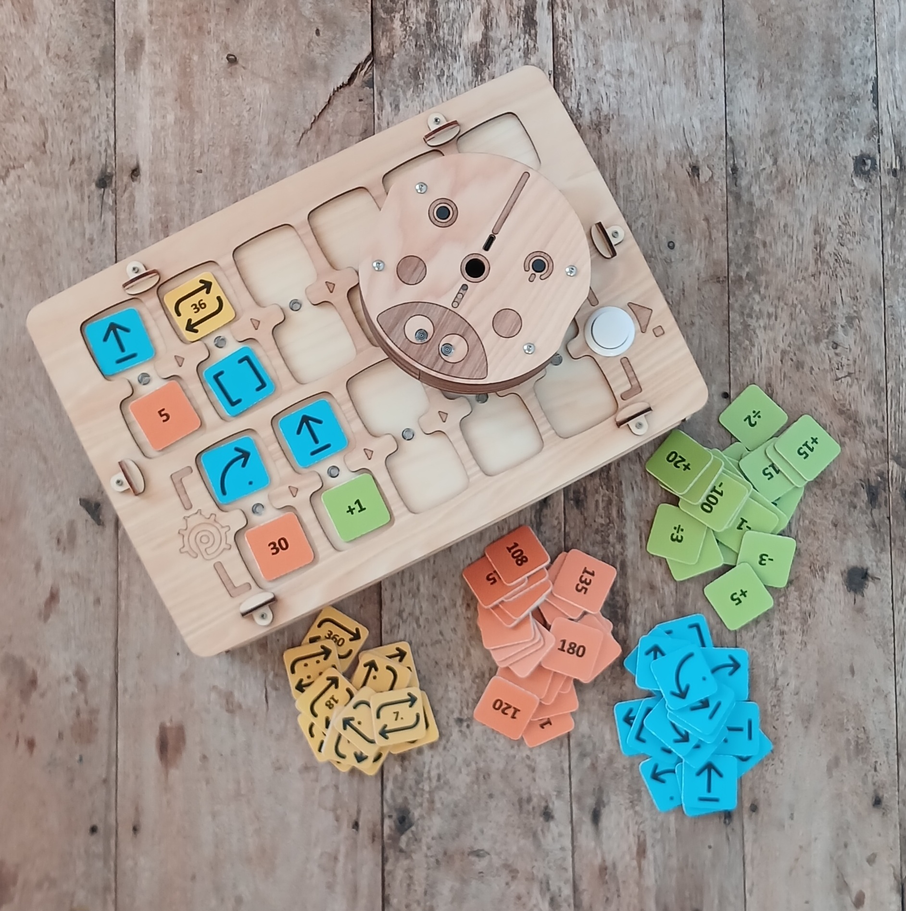

## Tehničke specifikacije i sadržaj kompleta

- Robot za igru
- Upravljačka ploča robota
- Žetoni naredbi, vrijednosti i aritmetičkih operacija od kojih se slaže program

> Sadržaj kompleta i izgled mogu se malo razlikovati. Provjerite pri kupnji.

### Robot za igru

Dimenzije: promjer 120 mm, visina 44 mm.

Robot ima tipku za uključivanje, LED diode, zvučnik, funkcijsku tipku i USB-C priključak za punjenje baterije.

U sredinu robota može se staviti marker promjera do 10 mm. Tada robot pri kretanju crta jednostavne oblike.

Izgled se može malo razlikovati ovisno o izvedbi. Funkcije ostaju iste.

### Upravljačka ploča

Dimenzije: duljina 317 mm, širina 217 mm, visina 62 mm.

Upravljačka ploča ima 11 dvostrukih utora za žetone naredbi i vrijednosti. 6 parova gore služi za glavni program, 5 parova dolje za potprogram.

Ploča ima dvije tipke. Lijeva uključuje ploču. Desna, **▶ Start / Stop**, pokreće i zaustavlja program.

Stavite žetone naredbi i vrijednosti u utore i pritisnite **▶ Start**. Robot će izvršiti program. LED diode između utora pokazuju koja se naredba izvršava.

Ako je žeton pogrešno postavljen, na primjer žeton vrijednosti bez naredbe, uz polje se upali crvena LED dioda. Program se pritom nastavlja.

Ploča ima USB-C priključak za punjenje i zvučnik.

### Žetoni

Dimenzije: 33 × 33 mm.

Komplet sadrži žetone od kojih se slaže program. Svaki žeton zadaje jednu naredbu jasnog značenja. Redoslijed žetona određuje što će robot napraviti.

Žetoni su tri vrste: **naredbe**, **vrijednosti** i **aritmetika**.

#### Žetoni naredbi

Od ovih žetona slaže se program:

- **Naprijed**: robot ide naprijed (zadano 15 cm).
- **Desno**: robot se okreće za 90° u smjeru kazaljke na satu.
- **Lijevo**: robot se okreće za 90° suprotno od smjera kazaljke na satu.
- **Natrag**: robot ide unatrag (zadano 15 cm).
- **Funkcija**: robot izvršava potprogram iz donjeg reda ploče.
- **Nasumično kretanje**: robot napravi jedan korak naprijed ili natrag ili se okrene za 90° ulijevo ili udesno i odmah napravi korak naprijed. Duljina koraka jednaka je zadanom koraku. Okreta na mjestu bez koraka nema.
- **Pauza**: robot stoji N sekundi (1–999 s; bez broja 1 s).
- **Žetoni ponavljanja (petlje)**: na njima su točkice od 2 do 6 ili znak ponavljanja s brojem unutra. Žeton s kockicom zadaje nasumičan broj ponavljanja od 1 do 6.

> Žetoni brojeva i aritmetike proširuju program. S njima možete ponoviti naredbu ili promijeniti kut i udaljenost.

#### Žetoni vrijednosti

Postoje žetoni kuta i udaljenosti: 30°, 36°, 45° te njihovi višekratnici (60°, 72° itd.). Kutovi se zadaju u stupnjevima, udaljenosti u milimetrima. Zadano se robot okreće za 90° i ide 150 mm (15 cm).

#### Žetoni aritmetičkih operacija

Mijenjaju vrijednosti naredbi kretanja:

- Plus (\+)
- Minus (−)
- Puta (\*)
- Podijeljeno sa (/)
- Kvadratni korijen (√)
- Na potenciju (^)
- Faktorijel (!)

Aritmetika radi u rasponu od −5000 do 5000. U ovim slučajevima polje treperi crveno, a broj ostaje isti:
- rezultat je iznad 5000 ili ispod −5000;
- dijeljenje s 0;
- korijen negativnog broja;
- faktorijel broja većeg od 6.

Dijeljenje i korijen zaokružuju se na najbliži cijeli broj. Na primjer, 150 ÷ 4 daje 37,5, robot uzima 38. 20 ÷ 3 daje 6,67, robot uzima 7. √50 daje 7,07, robot uzima 7. Točna polovina zaokružuje se dalje od nule: 37,5 na 38, −2,5 na −3.

## Povezivanje ploče i robota

Prvo uključite robota, zatim ploču.

Prije povezivanja stavite robota na ravnu podlogu. Dok veze nema, robot i ploča svijetle svijetloplavo. Kad se veza uspostavi, LED diode svijetle bijelo.

Provjerite vezu: stavite žeton "Naprijed" i pritisnite **▶ Start**.

Ako veze nema, ponovno pokrenite oba uređaja ili ih napunite. U blizini jakih izvora elektromagnetskog polja (mobitel, Wi-Fi pristupna točka) veza se može nakratko prekinuti.

> **Nakon ažuriranja firmwarea** uređaje ćete možda morati ponovno spariti. Uključite robota, zatim ploču. Držite tipku **▶ Start** na ploči dulje od 10 sekundi. U 5. sekundi čut ćete kratki zvučni signal: nemojte pustiti tipku. Sparivanje počinje u 10. sekundi.

### Upravljanje robotom naginjanjem upravljačke ploče

Kad se upravljačka ploča poveže s robotom, robotom možete upravljati bez žetona: samo naginjite upravljačku ploču. To radi dok u utorima nema žetona i dok još niste pritisnuli **▶ Start**.

- Najprije položite upravljačku ploču ravno na jednu sekundu. Do tada robot ne reagira na naginjanje.
- Nagnite je od sebe i robot prijeđe 15 cm naprijed. Prema sebi: 15 cm natrag.
- Nagnite je ulijevo ili udesno i robot se okrene za 90° na istu stranu.
- Pri svakom koraku upravljačka ploča kratko zapišti.
- Dok je upravljačka ploča nagnuta, robot radi korak za korakom. Kad je vratite u vodoravan položaj, robot završi trenutni korak i zaustavi se.
- Naginjite jasno, više od 20°. Ako vam ruka malo drhti, robot se neće pokrenuti.

Upravljanje naginjanjem isključuje se čim stavite žeton u utor ili pritisnete **▶ Start**. Ponovno se uključuje kad se upravljačka ploča opet poveže s robotom, na primjer nakon što isključite i uključite robota.

## Kako to radi

Da biste programirali kretanje, stavite žetone naredbi u utore ploče, na primjer "Naprijed", "Lijevo", "Funkcija". Naredbama možete dodati broj ponavljanja, kutove, udaljenosti i aritmetičke operacije.

Polja su povezana u parove "mostovima" s indikatorima. U jedno polje para stavlja se naredba, u drugo vrijednost ili ponavljanje.

_U nastavku je primjer programa s petljom: ona ponavlja isti dio programa. Robot vozi po kvadratu:_

<Columns cols={2}>
  <Frame>
    
  </Frame>
  <Frame>
    
  </Frame>
</Columns>

[Pokreni u simulatoru](https://simulator.primastem.com/#top=cfor,crig,cfun.r003&fn=cfor,crig&s=l1144402&r=225-525-0&run)

Naredbe se prvo stavljaju u gornji red ploče (6 parova). Robot ih izvršava slijeva nadesno. Prazne utore i pogreške robot preskače. Pogreška je, na primjer, dvije naredbe u jednom paru ili vrijednost bez naredbe.

Redoslijed žetona određuje kako će se robot kretati.

Pritisnite **▶ Start** da pokrenete program.

Zadano:

- "Naprijed" prelazi 15 cm.
- "Lijevo" i "Desno" okreću za 90°.
- Petlje (ponavljanja) ponavljaju naredbu više puta.
- "Funkcija" poziva potprogram iz donjeg reda ploče (5 parova).
- Potprogram možete pozvati više puta: stavite žeton ponavljanja u par s "Funkcijom" (primjer je gore).

### Važne funkcije

- Program možete **zaustaviti** ako ponovno pritisnete **▶ Start** tijekom kretanja.
- Ploča pamti posljednju **zadanu vrijednost** (udaljenost ili kut) za svaku naredbu kretanja dok je ne isključite. Na primjer, ako je "Naprijed" dobio 200, i sve sljedeće naredbe "Naprijed" prijeći će 200 mm.
- Vrijednosti nakon aritmetičkih operacija također se pamte.
- **Zadani korak** mijenja servisni žeton "Zadani korak". On mijenja korak za "Naprijed" i "Natrag". Na primjer, za 12,5 cm stavite ga s brojem 125. Vrijednost se pamti i nakon isključivanja. Rade brojevi od 1 do 999. Žeton bez broja vraća korak na 150 mm. Uz aritmetiku ili nulu polje treperi crveno, a korak ostaje isti.
- Ploča i robot **isključuju se sami** ako se 15 minuta ništa ne događa.
- Dok robot čeka naredbu, trepće očima. Tako se vidi da je uključen i spreman.
- **Kratko pritisnite tipku robota** i on će očitati žeton ispod sebe i izgovoriti što je to.
- **Svi zvukovi robota** isključuju se i uključuju ako držite tipku robota 5 sekundi. Pričekajte kratki zvučni signal i otpustite. Robot treperi crveno ako je zvuk sada isključen, a zeleno ako je uključen.
- **Zvuk ploče** isključuje se i uključuje ako držite **▶ Start** 5 sekundi. Pričekajte kratki zvučni signal i otpustite. To ne radi dok se program izvršava.
- **Nakon ažuriranja firmwarea** robotu može trebati kalibracija kretanja.
- **Vraćanje postavki robota na tvorničke**: držite tipku robota 10 sekundi (pojedinosti su u dijelu "Kalibracija robota" u nastavku).
- **Sparivanje ploče i robota** može biti potrebno nakon ažuriranja firmwarea. Držite **▶ Start** na ploči dulje od 10 sekundi. Zvučni signal u 5. sekundi znači da treba nastaviti držati.

### Kalibracija robota

- Prije kalibracije ažurirajte robota i upravljačku ploču na najnoviji stabilni firmware na [update.primastem.com](https://update.primastem.com) ([kako ažurirati](/en-hr/update)). Kalibracija napravljena na starom firmwareu može biti netočna.
- Prvo pokrenite žeton "Kalibracija" bez broja. Robot provjerava polaritet motora, uklanja zazor i podešava pravocrtno kretanje. To traje do 2 minute. Prvih pola minute robot mora mirovati, nemojte ga dirati. Tipka robota u to vrijeme ne radi.
- Zatim kalibrirajte kutove okreta. Označite točnu orijentaciju robota na podlozi. Potrebna su 32 okreta od 90° u smjeru kazaljke na satu: sastavite program od žetona "Ponovi 8" i "Desno" i pokrenite ga četiri puta. Robot treba napraviti osam punih krugova (90 × 32 = 2880°) i vratiti se u početnu orijentaciju.
- Procijenite odstupanje od oznake i primijenite ispravak žetonom "Kalibracija" s brojem. Ako se robot zaustavi prije oznake, dodajte "+", na primjer "Kalibracija" i "+5". Ako je prijeđe, dodajte "−", na primjer "Kalibracija" i "−5". Zatim pritisnite **▶ Start**. Broj je ukupno odstupanje u stupnjevima kroz sva 32 okreta zajedno. Robot prihvaća brojeve do 180. Ako je broj veći ili robot ne može spremiti ispravak, polje treperi crveno. Običan broj bez "+" ili "−" uz "Kalibraciju" ne radi: polje treperi crveno.
- Ponavljajte dok se robot ne vrati točno u početnu orijentaciju.
- Kalibracija se pamti i nakon isključivanja.
- Pozor! Poništavanje kalibracije: držite tipku robota 10 sekundi, svjetla trepere crveno, zeleno, plavo i bijelo. Poništavanje briše sve kalibracije, glasnoću i isključeni zvuk. Nakon poništavanja isključite i uključite robota, pa kalibraciju ponovite od početka.

<Accordion title="Kalibracija prve verzije uređaja (MVP) s robotom promjera 10 cm" icon="rectangle-terminal">
  Ova metoda vrijedi samo za prvu verziju (MVP). Na novom firmwareu "Kalibracija" s običnim brojem ne radi: polje treperi crveno.

  1. Za kalibraciju žiroskopa stavite robota na vodoravnu podlogu, stavite žeton "Kalibracija" u ploču i pritisnite **▶ Start**.
  2. Za kalibraciju udaljenosti izmjerite koliko je robot stvarno prešao naredbom "Naprijed". Stavite "Kalibraciju" i žeton s traženom vrijednošću, zatim pritisnite **▶ Start**. Vrijednost možete zapisati na bilo koji NFC čip mobitelom s NFC-om: kao tekst u obliku nXXX (na primjer, n095 za 95 mm). Nakon toga robot će prelaziti točnu udaljenost.
</Accordion>

### Programiranje NFC žetona

Možete izmijeniti žetone ili **izraditi vlastite**: naredbe, brojeve ili aritmetičke operacije. Trebate telefon s NFC-om i program za čitanje i pisanje NFC oznaka, na primjer "NFC Tools". Kod se zapisuje na prazni NFC čip kao običan tekst od 4 znaka.

## Važno

Sva sigurnosna upozorenja i regulatorne informacije nalaze se na stranici [Upute za uporabu](/en-hr/safety).

> Komplet **nije namijenjen djeci mlađoj od 4 godine**. Sadrži sitne dijelove: **opasnost od gušenja**! Koristite **samo uz nadzor odrasle osobe**!

U uređajima su litij-ionske baterije. **Punite ih samo uz nadzor odrasle osobe**, standardnim USB 5 V punjačem i USB-C kabelom.

Punjenje ploče i robota od 1 sata dovoljno je za 1–2 lekcije. Potpuno punjenje (2–3 sata) dovoljno je za 3 lekcije od 30–45 minuta. S vremenom se kapacitet baterija može smanjiti. Možete ih zamijeniti novim litij-ionskim baterijama 16340.

Ako se komplet dulje ne koristi, napunite baterije **jednom u 2–3 mjeseca**. Nakon dubokog pražnjenja baterije mogu otkazati i morat ćete ih zamijeniti.

**Ne otvarajte uređaj** sami. Ako se pokvari ili treba zamijeniti baterije, obratite se prodavaču ili servisu za elektroniku.

Komplet čuvajte, koristite i punite u suhoj prostoriji pri temperaturi od \+5 do \+35 °C. Čuvajte ga od izravnog sunca, tekućina, prašine i naglih promjena temperature ili vlage: one uzrokuju kondenzaciju.

Čuvajte uređaj od udaraca i vibracija. Prevozite ga i čuvajte u originalnoj ambalaži pri temperaturi od \+5 do \+35 °C, zaštićen od oštećenja i vlage.

Više o radu s PrimaSTEM-om pročitajte u [Vodiču za učitelje](/en-hr/teachersguide).
