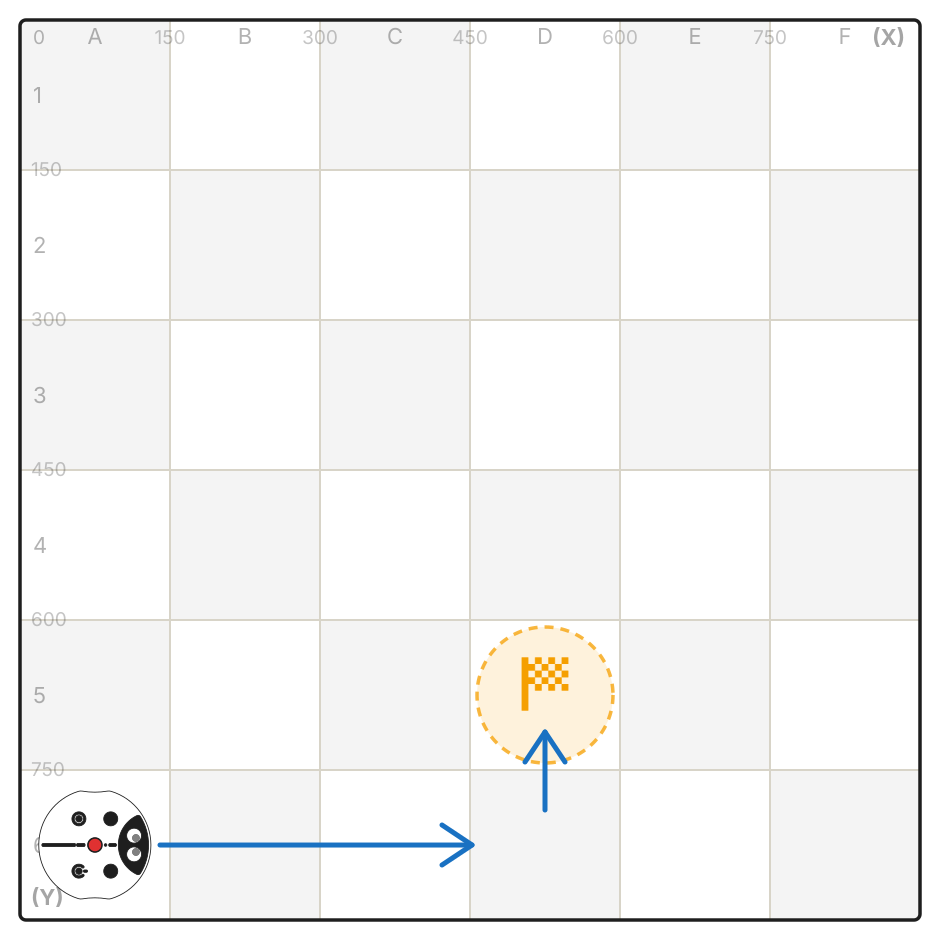
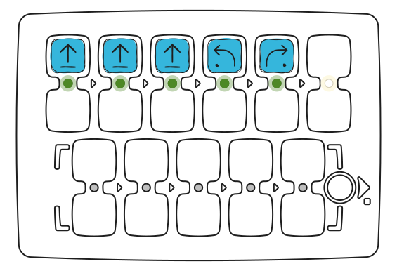
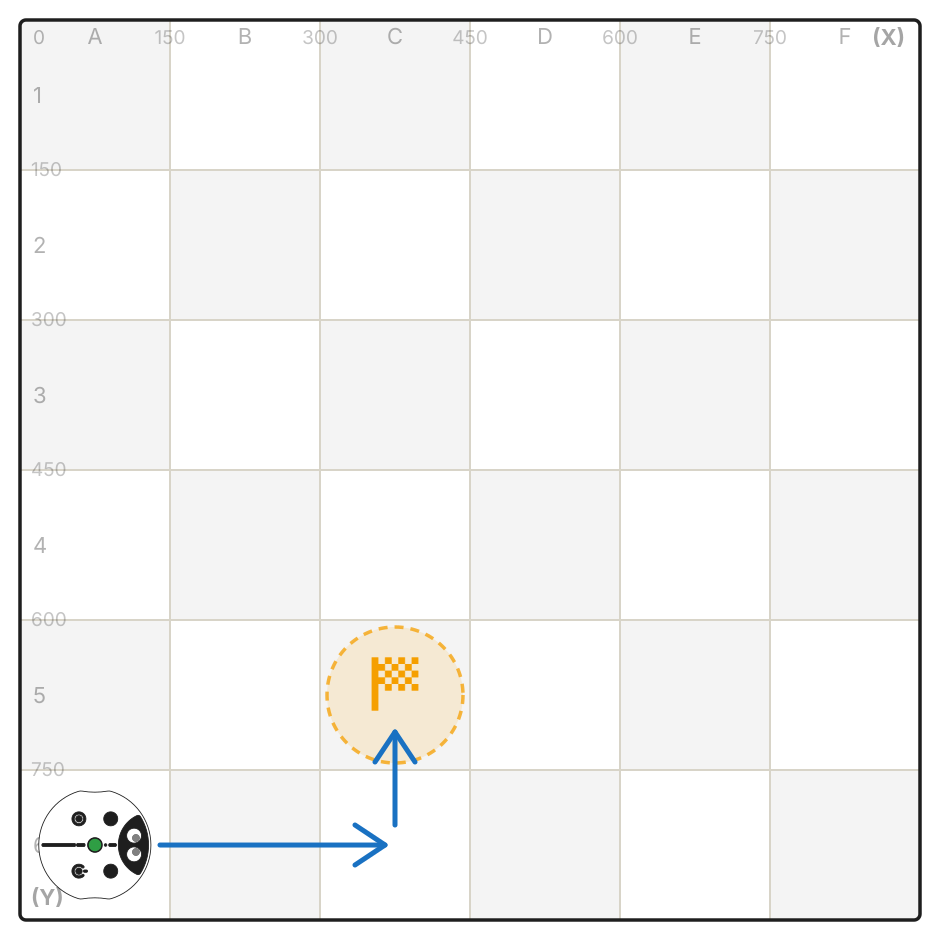
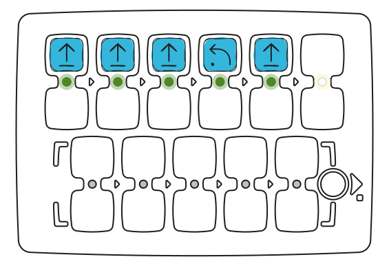
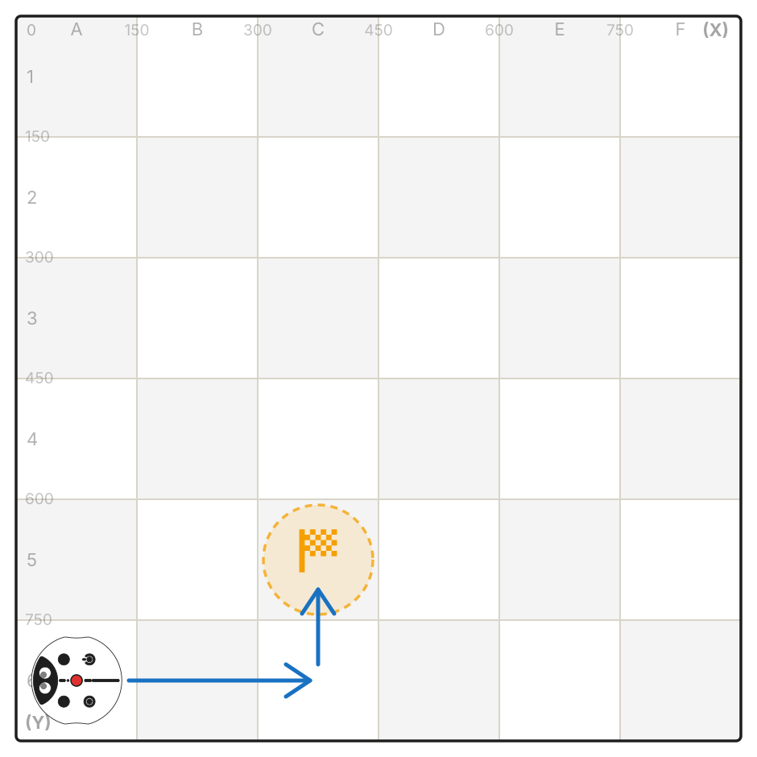
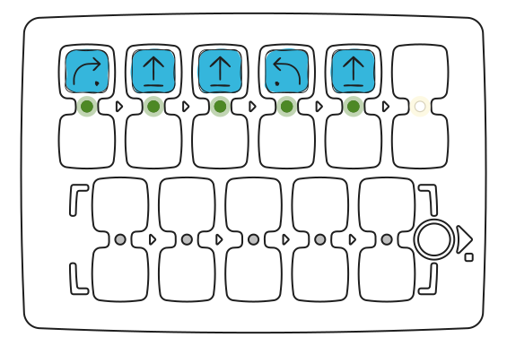

Kiekvienoje programoje yra klaida. Pabandyk ją rasti ir ištaisyti.

---
## 1 programa

<Columns cols={2}>
  <Frame>
    
  </Frame>
  <Frame>
    

      
      
    

  </Frame>
</Columns>

---
## 2 programa

<Columns cols={2}>
  <Frame>
    
  </Frame>
  <Frame>
    

      
      
    

  </Frame>
</Columns>

---
## 3 programa

<Columns cols={2}>
  <Frame>
    
  </Frame>
  <Frame>
    

      
      
    

  </Frame>
</Columns>

