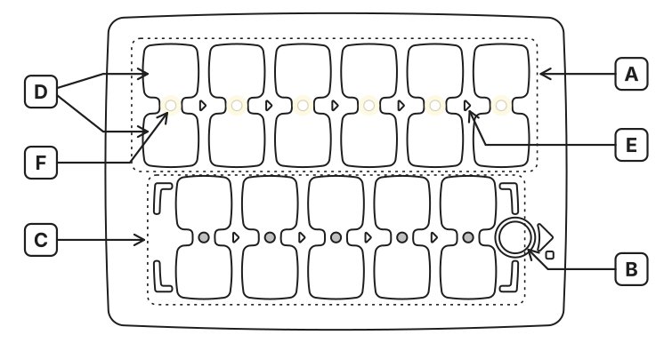
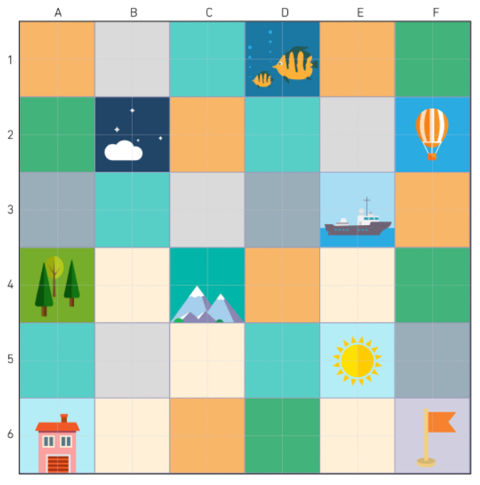

## Užsiėmimų su vaikais nuo 4 metų vadovas

PrimaSTEM padeda vaikams žingsnis po žingsnio išmokti loginio mąstymo, programavimo ir matematikos pagrindų. Šis vadovas padės Jums vesti užsiėmimus su vaikais nuo 4 metų.

### Kaip veikia

Vaikai programuoja mažo roboto boružės judesius. Tam jie deda komandų žetonus ant valdymo pulto.

- **„Pirmyn“**: robotas važiuoja tiesiai.
- **„Kairėn“**: robotas pasisuka į kairę.
- **„Dešinėn“**: robotas pasisuka į dešinę.
- **„Funkcija“** (žetonas „\[ \]“): pakeičia komandų seką.
- **„Kartojimas“**: pakartoja komandą ar funkciją kelis kartus.

Dėdami žetonus ant pulto, sudarote roboto judėjimo programą. Kai programa paruošta, paspauskite mygtuką, ir robotas įvykdys komandas.

### Vadovo turinys

- Kodėl verta vesti robotikos ir programavimo užsiėmimus
- Kaip organizuoti užsiėmimus skirtingomis sąlygomis
- Užsiėmimai ir mokymosi tikslai
- Išsami naudojimo instrukcija
- Užsiėmimų aprašymas
- Priedai
- Apie projektą ir autorius

### Ko moko PrimaSTEM

- Programuoti rankomis, be ekrano
- Suprasti, kad mašinos veikia pagal algoritmus
- Iš anksto planuoti veiksmus
- Mąstyti logiškai
- Sudaryti komandų sekas ir funkcijas
- Suprasti, kas yra „klaida“ (angl. bug, klaida kode), ir ją rasti
- Vaizdžiai mokytis skaičių, aritmetikos ir geometrijos

## Iš ko sudarytas PrimaSTEM

### Kas yra dėžutėje

- Robotas boružė
- Valdymo pultas
- Komandų žetonai \*
- Užsiėmimų vadovas \*

(\*) Sudėtis priklauso nuo komplektacijos.

## Kodėl verta vesti programavimo ir matematikos užsiėmimus

Kodas, programavimas ir automatizavimas tapo mūsų kasdienio gyvenimo dalimi.

Per pastaruosius metus žmonės išmoko kurti mašinas, kurios daro tai, ko anksčiau negalėjo: supranta, kalba, girdi, mato, atsako, rašo.

Pavyzdžių daug: savaeigiai automobiliai, robotai pagalbininkai senyviems žmonėms, pristatymo robotai ir kiti.

### Kodėl programavimas ir robotika

Kai vaikas mokosi programuoti, jis mokosi suprasti mus supančias mašinas. Jis mokosi paversti mažas ir drąsias idėjas tikrais projektais. Sudėtingą užduotį jis išskaido į paprastus žingsnius. Jis dirba su kitais ir kartu sprendžia bendras užduotis.

### Gimę skaitmeniniame amžiuje

Gali atrodyti, kad vaikai ir jaunimas gerai išmano technologijas. Juk jie daug naudojasi skaitmeninėmis pramogomis.

Bet ar jie moka tomis priemonėmis sukurti ką nors savo ir išreikšti save? Ką jie daro, kai susiduria su technine problema?

## Kaip organizuoti užsiėmimus

Užsiėmimai sukurti įvairiems tikslams ir ugdymo aplinkoms. Vadove visi užsiėmimai sunumeruoti. Toliau nurodyta, kurie užsiėmimai tinka Jūsų sąlygoms.

### Kam skirta

- Vaikai nuo 4 iki 8 metų.
- Vyresniųjų ir priešmokyklinių darželio grupių vaikai, pradinės mokyklos 1 ir 2 klasių mokiniai.

### Užsiėmimai neformaliajam ugdymui

Užsiėmimai 1, 2, 4, 5, 6, 7, 8, 9, 10.

### Užsiėmimai mokyklai

Užsiėmimai 2, 3, 4, 5, 6, 7, 8, 9, 11, 12.

### Neformalusis darbas

Geriausia sudaryti ne didesnę kaip 12 vaikų grupę, kad visi galėtų aktyviai dalyvauti.

Rekomenduojame vienu prietaisu naudotis 2-3 mokiniams. Taip vaikai mokosi dirbti komandoje ir bendrauti.

### Darbas mokykloje

Pamokoje su PrimaSTEM geriausia dirbti mažomis 4-6 vaikų grupėmis su vienu mokytoju.
Kiti mokiniai tuo metu atlieka kitą užduotį su mokytojo padėjėju. 1-2 klasių mokiniai gali, pavyzdžiui, mokytis braižyti roboto kelią pagal programą.
Abiem atvejais geriau užsiimti universalioje salėje ant grindų. Galite ir pastumti stalus bei kėdes, kad atsirastų vietos.

**Dėmesio**: iš anksto įkraukite valdymo pulto ir roboto akumuliatorius.

## Užsiėmimai ir mokymosi tikslai

| Užsiėmimas | Algoritmas ir programa | Maršrutas etapais | Judesio numatymas | Problemos sprendimas, klaidos paieška | Komandinis darbas |
| --- | :---: | :---: | :---: | :---: | :---: |
| 1 |   | X |   | X |   |
| 2 |   |   | X |   | X |
| 3 | X | X |   |   |   |
| 4 | X | X | X |   |   |
| 5 | X | X | X |   | X |
| 6 | X | X | X | X | X |
| 7 | X | X | X | X | X |
| 8 | X |   | X | X |   |
| 9 | X | X | X | X | X |
| 10 | X |   | X | X |   |
| 11 | X | X | X | X | X |
| 12 | X | X | X | X | X |

## Naudojimo instrukcija

### Instrukcijos turinys

- Pažintis su priemonėmis
- Funkcijos programavimas
- Žemėlapiai
- Techniniai paaiškinimai

## Pažintis su priemonėmis

### Robotas

Mažas medinis robotas boružė su dviem akimis.

Jis turi tris atramos taškus: du ratukus ir atramą gale. Jais jis išlaiko pusiausvyrą.

### Pagrindinės komandos

| Komanda | Iliustracija | Aprašymas |
| --- | --- | --- |
| Pirmyn |  | Robotas pavažiuoja vienu langeliu pirmyn. Tai loginis žingsnis, numatytasis 15 cm. |
| Kairėn |  | Robotas pasisuka 90° į kairę |
| Dešinėn |  | Robotas pasisuka 90° į dešinę |
| Atgal |  | Robotas pavažiuoja atgal vienu langeliu, tai yra numatytuoju loginiu žingsniu |
| Funkcija |  | Robotas vykdo komandas iš funkcijos eilės |
| Kartojimas N |  | Robotas N kartų pakartoja tos pačios lizdų poros komandą |

### Valdymo pultas

Valdymo pultu robotą valdote, dėdami komandų žetonus į laisvus lizdus (D).

6 viršutinės lizdų poros (A), sujungtos vykdymo linija (E), sudaro pagrindinę programą. Programa prasideda kairiajame lizde (D) ir baigiasi virš mygtuko **▶ Start** (B). Šis mygtukas siunčia komandas robotui ir paleidžia programą.

5 apatinės lizdų poros (C) nustato judesius žetonui „\[ \]“ („Funkcija“). Kiekviena lizdų pora turi LED lemputę (F). Ji užsidega, kai įdedate žetoną, ir mirksi, kai robotas vykdo tą komandą.

#### LED lempučių spalvos

Jei žetonas lizde įdėtas teisingai, LED lemputė šviečia žaliai.
Jei prie judėjimo komandos lizdų poroje pridedate kartojimą, LED lemputė šviečia mėlynai.
Jei žetonai įdėti neteisingai, pavyzdžiui, du judėjimo komandų žetonai vienoje lizdų poroje, šviečia raudona LED lemputė. Robotas šią komandą praleis.

### Akumuliatorius ir įjungimo mygtukas

Robotas ir valdymo pultas maitinami įmontuotais įkraunamais akumuliatoriais. Jie įkraunami per USB-C jungtį. Įjungimo mygtukas (ON/OFF) yra roboto viršuje ir valdymo pulto priekyje kairėje.

Įjungus robotą ar valdymo pultą, pasigirsta trumpas garso signalas.
Kai valdymo pultas įjungtas, LED lemputė priekiniame skydelyje šviečia žaliai. Kai robotas įjungtas, LED lemputė prie USB-C jungties šviečia žaliai.

### Belaidis ryšys

Robotas ir valdymo pultas ryšį palaiko per Bluetooth, veikimo nuotolis apie 5 m. Po pirmojo roboto susiejimo su valdymo pultu ryšys veikia pats, nieko nustatinėti nereikia.

> Valdymo pultą galite susieti su kitu robotu (prietaisų susiejimas).
>
> 1. Įjunkite robotą, kuris nesusietas su valdymo pultu.
> 2. Įjunkite valdymo pultą.
> 3. Laikykite nuspaudę valdymo pulto mygtuką **▶ Start** 10 sekundžių, kol pasigirs garso ir užsidegs šviesos signalas.

### Kaip sudaryti ir paleisti programą

Programa („judesių seka“) prasideda pulto kairėje. Ji eina išgraviruotomis rodyklėmis „\>“. Tai vykdymo linija, kuri horizontaliai jungia lizdų poras.

Jei prieš žetoną yra tuščias lizdas, robotas praleidžia tuščią lizdą ir įvykdo to žetono komandą.

Jei žetonas įdėtas neteisingai, LED lemputė šviečia raudonai, o robotas praleidžia šią programos dalį. Taip nutinka, pavyzdžiui, kai „Kartojimas“ yra lizdų poroje be komandos arba kai vienoje lizdų poroje du komandų žetonai.

Kai programa paruošta, paspauskite mygtuką **▶ Start**.

Kol robotas vykdo programą, valdymo pulto LED lemputės paeiliui užgęsta. Vykdomos komandos LED lemputė mirksi.

## Funkcijos programavimas

### Kaip sukurti funkciją

Žetonas „\[ \]“ („Funkcija“) pakeičia komandų seką.

Su juo galite sudaryti ilgesnes programas ir spręsti sunkesnes užduotis. Norėdami sukurti funkciją, sudėkite judesius į apatinę pulto eilę: tai 5 lizdų poros. Robotas vykdo šią eilę iš kairės į dešinę kiekvieną kartą, kai pagrindinėje programoje (viršuje) pasitaiko žetonas „Funkcija“.

Toliau pateiktame pavyzdyje funkciją sudaro judėjimas tiesiai ir posūkis į dešinę. Pagrindinė programa iškviečia funkciją 2 kartus. Tada žetonas „Kartojimas 2“ pakartoja funkciją dar 2 kartus.

[Paleisti simuliatoriuje](https://simulator.primastem.com/#top=cfun,cfun,cfun.r002&fn=cfor,crig&s=l1144602&r=225-675-0&run)

Rezultatas:

## Žemėlapiai

### Tinkami žemėlapiai

Per pirmuosius užsiėmimus vaikai mokosi algoritmų, programavimo ir skaičių. Tam robotas juda žemėlapiu su tinkleliu. Geriausia naudoti žemėlapį su 15 cm langeliais: tiek robotas nuvažiuoja vienu numatytuoju žingsniu.

Tinka ir kitiems robotams skirti žemėlapiai, jei langelių dydis tinka šiam robotui.

> Numatytąjį žingsnį galima pakeisti iš 15 cm į Jūsų žemėlapio langelio dydį, pavyzdžiui, 10 cm, 12,5 cm ar 20 cm. Tam įdėkite specialų žetoną „Numatytasis žingsnis“ su skaičiumi milimetrais: 100 reiškia 10 cm, 125 reiškia 12,5 cm, 200 reiškia 20 cm.

Jei neturite žemėlapio, pasidarykite jį patys. Priklijuokite plonos dažymo juostos ant lygaus stalo ar grindų. Galite paimti ir didelį popieriaus lapą (ar storą reklaminio plakato audinį) bei flomasterį.

Šachmatų lentos žemėlapis arba tuščias langelių žemėlapis skirtas mokytis judėti iš vieno taško į kitą. Spalvos nenublaško dėmesio.

Spalvotas žemėlapis padeda pasakoti trumpas istorijas apie roboto keliones. Pavyzdžiui: „Boružė išeina iš namų ir per mišką keliauja į kalnus.“ Klasė gali sukurti naują žemėlapį ir sugalvoti naujų istorijų apie boružės keliones.

#### Žemėlapių pavyzdžiai

Šachmatų lentos žemėlapis

Spalvotas žemėlapis

## Techniniai paaiškinimai

### Sandara

Valdymo pulte ir robote yra mikrovaldikliai ir Li-Ion akumuliatoriai. Prietaisai jungiasi radijo ryšiu standartiniu protokolu Bluetooth.

Roboto plokštė valdo visą roboto elgseną. Ji valdo du 5 V nuolatinės srovės variklius ir dvi įvairiaspalves LED lemputes, groja garsus, bendrauja su valdymo pultu ir t. t.

Valdymo pulto plokštė atpažįsta lizduose esančius žetonus, groja garsus ir valdo 11 įvairiaspalvių LED lempučių, po vieną kiekvienai lizdų porai.

Kiekviename žetone yra NFC lipdukas su komandos kodu. Pultas nuskaito šį kodą, kai žetonas įdedamas į lizdą.

Kai pultas atpažįsta žetonus ir Jūs paleidžiate programą, pultas belaidžiu ryšiu siunčia komandas robotui.

### Savi komandų žetonai

Galite pasidaryti papildomų komandų žetonų, pavyzdžiui, „Kartojimas 12“ ar papildomų judėjimo žetonų. Tam reikia „tuščių“ žetonų su NFC lipdukais ir telefono su NFC. Palaikoma dauguma 13,56 MHz lipdukų tipų.

Vaizdo instrukciją rasite mūsų YouTube kanale: [https://www.youtube.com/@primastem](https://www.youtube.com/@primastem)

---

## Užsiėmimai

### Išsamus užsiėmimų aprašymas

- **1 užsiėmimas**: kelias šachmatų lenta iš taško A į tašką B
- **2 užsiėmimas**: pažintis su PrimaSTEM
- **3 užsiėmimas**: vaikas robotas, kryptis ir algoritmas
- **4 užsiėmimas**: roboto kelio numatymas pagal programą
- **5 užsiėmimas**: komandų seka atsitiktinėje programoje
- **6 užsiėmimas**: robotas į kalnus su valdymo pultu
- **7 užsiėmimas**: pažintis su žetonu „Funkcija“
- **8 užsiėmimas**: kelias iki tikslo su funkcija
- **9 užsiėmimas**: programos klaidos taisymas
- **10 užsiėmimas**: klaidos paieška programoje popieriuje
- **11 ir 12 užsiėmimai**: roboto judesių numatymas (12 užsiėmime su žetonu „Funkcija“)

---

## 1 užsiėmimas. Kelias šachmatų lenta iš taško A į tašką B

- **individualiai**
- **15 min**
- **popieriuje**
- **spausdinami dokumentai**

### Tikslas

- Suplanuoti kelią langeliais iš taško A į tašką B žemėlapyje.

Pratimas kartu su aptarimu trunka 10 minučių.

### Spausdinti

Kiekvienam mokiniui atspausdinkite lapą „[1 priedas. Judėjimas žemėlapyje](/en-lt/book-1/attachment-1)“.

### Pratimas

Vaikai tinklelyje brėžia kelią, kuriuo pelytė nueis iki sūrio. Pradėkite nuo kairiojo pratimo, jis lengvesnis. Tada pereikite prie dešiniojo.

#### Judėjimas langeliais

Pelytė juda tinklelio langeliais. Įstrižai judėti negalima. Vaikai turi suprasti, kad pelytės kelias skirstomas į etapus: ji praeina po vieną langelį. Taip judama žingsnis po žingsnio.

Pavyzdyje viršuje teisingas tik mėlynas kelias. Trumpasis raudonas kelias neteisingas, nes eina įstrižai. Ilgasis raudonas kelias neteisingas, nes neveda į reikiamą tašką.

### Aptarimas grupėje

Pavyzdyje viršuje visi keliai teisingi: kiekvienu iš jų pelytė pasiekia sūrį.

Parodykite vaikams, kad kiekvienas gali sugalvoti savo kelią ir kad teisingų kelių gali būti keli.

#### Vieni keliai ilgesni už kitus

Suskaičiuokite, kiek langelių pelytė praeina iki langelio su sūriu:

- 3 langelius žaliuoju maršrutu
- 3 langelius pilkuoju maršrutu
- 3 langelius mėlynuoju maršrutu
- 13 langelių geltonuoju maršrutu

#### Trumpiausias kelias

Visi šie keliai teisingi, bet pelytė pasirinks trumpiausią.

Paklauskite vaikų: „Kodėl pelytė pasirinko trumpiausią kelią?“

Atsakymai gali būti skirtingi. Pelytė nori taupyti jėgas: ji labai pavargusi ir nori nueiti kuo mažiau. Arba pelytė skuba: ji labai alkana ir nori kuo greičiau pasiekti sūrį.

**Pastaba vedančiajam:** Su robotais taip pat. Visada renkamės trumpiausią kelią, nes jis efektyvesnis.

#### Galimi keli keliai

Baigę pratimą, paprašykite mokinių parodyti savo nubrėžtus kelius. Kelių visada yra keli, todėl mokiniai greičiausiai pateiks skirtingus atsakymus, ir visi jie bus teisingi.

---

## 2 užsiėmimas. Pažintis su PrimaSTEM

- **15 min**
- **grupėje**
- **demonstravimas**
- **praktika**

### Tikslai

- Suprasti, kaip gali judėti robotas.
- Sužinoti, kad robotą valdo valdymo pultas.
- Suprasti, ką daro komandų žetonai.

Sudarykite mažas mokinių grupes. Susėskite prie žemo stalo arba ant grindų. Išimkite žemėlapį su tinkleliu, valdymo pultą, robotą ir žetonus. Pristatykite PrimaSTEM visiems mokiniams, grupė po grupės.

### Pristatymas

Parodykite kiekvieną daiktą ant stalo ir pasakykite žodžius, kurių vaikams prireiks.

Pirmiausia **žemėlapis**. Tai toks pat tinklelis kaip 1 užsiėmime, tik didesnis.

Tada **robotas boružė**. Jis moka važiuoti.

Robotą valdo **valdymo pultas**. Robotas daro tai, ką nurodo žetonai pulto lizduose.

**Žetonai** nurodo komandas: važiuoti tiesiai, pasisukti į kairę ar į dešinę.

### 1 etapas: demonstravimas

Kai vaikai žino žodžius, patys viską parodykite. Padėkite žetoną ant valdymo pulto, ir vaikai pamatys, kas vyksta.

| Paveikslėlis | Aprašymas |
| --- | --- |
|  | Komandos **„Pirmyn“** žetonas paslenka robotą vienu langeliu |

Padėkite robotą ant bet kurio žemėlapio langelio. Įdėkite žetoną į pirmąjį programos lizdą, kaip parodyta schemoje žemiau. Tada paspauskite baltą mygtuką **▶ Start**.

Robotas pavažiuos vienu langeliu pirmyn.

### 2 etapas: perduokite valdymą

| Paveikslėlis | Aprašymas |
| --- | --- |
|  | Žetonas **„Kairėn“** su rodykle lanku aplink centrą pasuka robotą į kairę, prieš laikrodžio rodyklę. Numatytasis posūkis yra 90 laipsnių. |

Išimkite iš pulto žetoną „Pirmyn“ ir paduokite vaikui žetoną „Kairėn“. Tegul vaikas pats įdeda jį į pirmąjį programos lizdą ir paspaudžia baltą mygtuką **▶ Start**. Robotas liks vietoje ir pasisuks ketvirtadaliu apsisukimo į kairę.

| Paveikslėlis | Aprašymas |
| --- | --- |
|  | Žetonas **„Dešinėn“** pasuka robotą į dešinę. |

Paprašykite kito vaiko pakeisti žetoną „Kairėn“ žetonu „Dešinėn“ ir paspausti baltą mygtuką **▶ Start**. Robotas liks vietoje ir pasisuks ketvirtadaliu apsisukimo į dešinę.

Tada leiskite vaikams paeiliui valdyti pultą. Duokite jiems tik 3 žetonus: **„Pirmyn“**, **„Kairėn“** ir **„Dešinėn“**.

Kai robotas baigia judėti, vaikai gali dar kartą paspausti **▶ Start** ir pakartoti savo programą.

Tegul vaikai patys įsitikina, kad žetonus galima dėti į bet kuriuos lizdus, išskyrus dvi komandas vienoje lizdų poroje. Robotas jas vykdo paeiliui, iš kairės į dešinę.

> Norėdami sustabdyti programą, kai robotas juda, dar kartą paspauskite **▶ Start / Stop**.

---

## 3 užsiėmimas. Vaikas robotas, kryptis ir algoritmas

- **45 min**
- **grupėje**
- **žaidimas**
- **žemėlapis**

### Tikslai

- Atsižvelgti į tai, į kurią pusę robotas žiūri programos pradžioje.
- Numatyti roboto judesius pagal programą.

### Spausdinti

Kiekvienam mokiniui atspausdinkite korteles „[2 priedas. Misijų kortelės](/en-lt/book-1/attachment-2)“.

### Žaidimo principas

Tai vaidmenų žaidimas atviroje erdvėje. Vaikai vaizduoja robotą juodai baltame lauke.

### Žaidimo taisyklės

Vienas mokinys atlieka roboto vaidmenį žemėlapyje. Vietoj žemėlapio tinka grindys su langelių raštu: raštas, plytelės ar langeliai iš plonos dažymo juostos. Kiti mokiniai jį programuoja pagal užduočių korteles.

Vaikui robotui nesakoma, į kurią pusę jis žiūri.
Mokiniai patys nustato, į kurią pusę jis turi žiūrėti, kad įvykdytų misiją.

1. Vaikas robotas stovi raudoname langelyje 1. Jis turi pasiekti žalią langelį 2.
2. Vaikas robotas stovi raudoname langelyje 1. Jis turi pasiekti violetinį langelį 3.
3. Vaikas robotas stovi raudoname langelyje 1. Jis turi pasiekti mėlyną langelį 4.

> Kad žemėlapis ilgiau tarnautų, paprašykite vaiko nusiauti batus.

### Žaidimo pabaiga

Dabar vaikas supranta: programuojant judesį reikia atsižvelgti, kur robotas stovi ir į kurią pusę žiūri.

Robotas komandą vykdo pagal tai, kaip jis pasisukęs. Jis važiuoja tiesiai, pasisuka į kairę ar į dešinę, **bet visada nuo savo pradinės krypties.**

---

## 4 užsiėmimas. Roboto kelio numatymas pagal programą

- **45 min**
- **individualiai**
- **popieriuje**
- **spausdinami dokumentai**

### Tikslai

- Atsižvelgti, į kurią pusę robotas žiūri pradžioje.
- Suprasti programos komandas.
- Numatyti roboto judesius pagal programą.

### Spausdinti

Kiekvienam mokiniui atspausdinkite korteles „[3 priedas. Nubrėžk kelią pagal programą](/en-lt/book-1/attachment-3)“.

Vaikai gauna lapą su programa iš kelių komandų. Jie braižo kelią, kuriuo robotas važiuos pagal šią programą.

Pagal šią programą robotas tris kartus pavažiuos tiesiai:

<Columns cols={2}>
  <Frame>
    
  </Frame>
  <Frame>
    
  </Frame>
</Columns>

[Paleisti simuliatoriuje](https://simulator.primastem.com/#top=cfor,cfor,cfor&s=l1144602&r=75-825-0&m=02&run)

Čia ta pati programa, ir robotas taip pat tris kartus pavažiuos tiesiai.
Bet pradžioje jis žiūri į dešinę. Todėl jis pravažiuos tris langelius į dešinę:

<Columns cols={2}>
  <Frame>
    
  </Frame>
  <Frame>
    
  </Frame>
</Columns>

[Paleisti simuliatoriuje](https://simulator.primastem.com/#top=cfor,cfor,cfor&s=l1144602&r=75-825-90&m=35&run)

Šioje programoje robotas sukasi. Pirmiausia jis pasisuka į dešinę, o tada pravažiuoja du langelius:

<Columns cols={2}>
  <Frame>
    
  </Frame>
  <Frame>
    
  </Frame>
</Columns>

[Paleisti simuliatoriuje](https://simulator.primastem.com/#top=crig,cfor,cfor&s=l1144602&r=75-825-0&m=25&run)

Paskutinis pratimas sunkesnis: robotas du kartus keičia kryptį. Jis pravažiuoja vieną langelį tiesiai, pasisuka į dešinę ir pravažiuoja vieną langelį. Tada pasisuka į kairę ir pravažiuoja du langelius:

<Columns cols={2}>
  <Frame>
    
  </Frame>
  <Frame>
    
  </Frame>
</Columns>

[Paleisti simuliatoriuje](https://simulator.primastem.com/#top=cfor,crig,cfor,clef,cfor,cfor&s=l1144602&r=75-825-0&m=12&run)

### Pastaba vedančiajam

Šis pratimas popieriuje gali būti sunkus.
Jei vaikui sunku suprasti roboto posūkius ir judesių eilę, paimkite PrimaSTEM rinkinį. Paprašykite vaiko ant valdymo pulto sudėti programas iš lapų.
Kai vaikai liečia ir stebi, jie supranta geriau.

---

## 5 užsiėmimas. Komandų seka atsitiktinėje programoje

- **45 min**
- **grupėje**
- **žaidimas**

### Tikslai

- Susieti komandas su roboto judesiais.
- Pamatyti žemėlapio ribas.
- Išmokti perkelti komandas į valdymo pultą.

### Žaidimo eiga

1. Padėkite robotą ant bet kurio žemėlapio langelio, geriausia prie krašto. Kryptį pasirinkite bet kokią.
2. Meskite kauliuką. Perkelkite robotą ranka ir užrašykite programą ant popieriaus ar lentos: nupieškite komandos „Pirmyn“ rodyklę. Jei robotas išvažiuoja iš žemėlapio, meskite kauliuką dar kartą.
3. Pakartokite tai, kad gautumėte 2 programas iš eilės. Robotas neturi išvažiuoti iš žemėlapio, todėl prireikus meskite kauliuką iš naujo.

Pabaigoje ant popieriaus turėsite 2 programas iš komandų „Pirmyn“. Jei jas įvykdysite viena po kitos, robotas pravažiuos reikiamą langelių skaičių link žemėlapio krašto.

Pavyzdys:

<Columns cols={2}>
  <Frame>
    
  </Frame>
  <Frame>
    

      
      
    

  </Frame>
</Columns>

**Užrašytas programas įvykdykite su tikru PrimaSTEM.**

---

## 6 užsiėmimas. Robotas į kalnus su valdymo pultu

- **45 min**
- **grupėje**
- **praktika**

### Tikslai

- Išskaidyti maršrutą į etapus.
- Sudaryti programą konkrečiam tikslui.

Šiam užsiėmimui Jums reikės:

- valdymo pulto;
- judėjimo žetonų: kiekvienai grupei po 4 „Pirmyn“, 4 „Kairėn“ ir 4 „Dešinėn“, kitus žetonus nuimkite;
- žemėlapio ir roboto.

Padalykite vaikus į grupes po 3 ar 4. Kiekvienai grupei duokite valdymo pultą ir žetonų rinkinį.

### 1 etapas: apmąstymas

Robotas boružė yra namuose, o mes norime nuvesti jį į kalnus. Ant lentos reikia užrašyti programą, pagal kurią jis ten nukeliaus.

> Jei neturite tinkamo žemėlapio, nupieškite reikiamas vietas ant popieriaus, galite kartu su vaikais. Priklijuokite jas prie žemėlapio juosta.

Pirmiausia paklauskite vaikų, kuriais langeliais jie nori nuvesti robotą iki kalno. Galimybių vėl daug. Renkamės trumpiausius maršrutus, kad sutaupytume energijos ir laiko.

Kai kelias pasirinktas, kartu su vaikais peržiūrėkite roboto judesius langelis po langelio.

Ar robotas turi važiuoti tiesiai, pasisukti į kairę ar į dešinę?
Vedžiokite robotą ranka žemėlapiu ir rodykite, kaip jį judina kiekviena komanda.

### 2 etapas: programavimas

Paprašykite vaikų ant valdymo pulto žetonais iš eilės sudėti roboto judesius. Ši programa turi nuvesti robotą iki tikslo.

**Laukiama programa:**

### 3 etapas: patikrinimas

Kiekvienas save gerbiantis programuotojas tikrina, ar programa veikia. Paprašykite vaikų sudėti programą ant valdymo pulto ir ją paleisti.

<Columns cols={2}>
  <Frame>
    
  </Frame>
  <Frame>
    
  </Frame>
</Columns>

[Paleisti simuliatoriuje](https://simulator.primastem.com/#top=cfor,cfor,crig,cfor&s=l1144602&r=75-825-0&m=13&run)

Ar robotas pasiekė kalną? Jei ne, kodėl? Leiskite vaikams patiems ištaisyti programos klaidas, jei jų yra.

---

## 7 užsiėmimas. Pažintis su žetonu „Funkcija“

- **15 min**
- **grupėje**
- **demonstravimas**

### Tikslai

- Suprasti, kad žetonas „Funkcija“ gali pakeisti kitas komandas.
- Susipažinti su komandų sekos kartojimu.

Sudarykite mažas mokinių grupes. Susėskite prie žemo stalo arba ant grindų. Išimkite žemėlapį, valdymo pultą, robotą ir komandų žetonus. Grupės paeiliui susipažįsta su žetonu „Funkcija“.

### 1 etapas: demonstravimas

Parodykite vaikams žetoną „Funkcija“.

Jis pakeičia kelias judėjimo komandas: „Pirmyn“, „Kairėn“, „Dešinėn“ ar „Atgal“. Su juo tą pačią trumpą programos dalį galima pakartoti kelis kartus.

Pirmiausia parodykite patys. Sudarykite programą, kaip paveikslėlyje žemiau.

Kai robotas pasiekia žetoną „Funkcija“, jis vykdo komandas iš rėmelio \[-----\] pulto apačioje. Tai tas pats, lyg vietoj žetono „Funkcija“ būtų tos komandos.
Mūsų pavyzdyje robotas du kartus pavažiuos pirmyn.

### 2 etapas: mįslės

Dabar pagrindinės programos gale pridėkite žetoną „Dešinėn“, kaip paveikslėlyje žemiau.

Prieš paleisdami paklauskite vaikų, kas nutiks. Programa veikia taip, lyg joje būtų du raudoni žetonai „Pirmyn“ ir vienas žetonas „Dešinėn“. Robotas pravažiuos du langelius ir pasisuks į dešinę ketvirtadaliu apsisukimo.

Pabaigai parodykite **ciklą**.
Sudėkite programą iš keturių žetonų „Funkcija“, kaip paveikslėlyje žemiau.

[Paleisti simuliatoriuje](https://simulator.primastem.com/#top=cfun,cfun,cfun,cfun&fn=cfor,crig&s=l1144602&r=225-675-0&run)

Prieš paleisdami paklauskite vaikų, kas nutiks. Tada paleiskite programą ir patikrinkite.

**Robotas atlieka ciklą:**

**Pastaba vedančiajam:** Kai vaikai susipažįsta su funkcija, naudinga žiūrėti į LED lemputes. Jos mirksi vykdant programą. Taip matyti, kurią komandą robotas vykdo ir kaip jis tuo metu juda.

---

## 8 užsiėmimas. Kelias iki tikslo su funkcija

- **45 min**
- **grupėje**
- **praktika**

### Tikslai

- Išskaidyti maršrutą į etapus.
- Sudaryti programą konkrečiam tikslui.
- Programoje naudoti žetoną „Funkcija“.

Šiam užsiėmimui Jums reikės:

- žetonų arba pačių pasidarytų kortelių su nupieštomis komandomis: kiekvienai grupei po 4 „Pirmyn“, 4 „Kairėn“, 4 „Dešinėn“ ir 4 „Funkcija“;
- žemėlapio ir roboto, be valdymo pulto.

Jei vaikų daug, padalykite juos į grupes po 3 ar 4. Kiekvienai grupei duokite korteles su nupieštomis komandomis arba rinkinio žetonus, lygiai po 4 kiekvienos rūšies.

### 1 etapas: apmąstymas

> Pritaikykite užduotį, jei Jūsų žemėlapyje yra kitų paveikslėlių arba jų nėra. Pažymėkite 2 taškus („Startas“ ir „Finišas“) 4 langelių atstumu, 90 laipsnių kampu.

Robotas stovi prie vėliavėlės ir mes norime nuvesti jį į langelį „Naktis“ su debesimis. Reikia sudaryti programą su žetonu „Funkcija“: ant stalo išdėlioti žetonus ar komandų piešinius.

Pirmiausia paklauskite vaikų, kuriais langeliais jie nori nuvesti robotą iki kalno. Kalnas yra maždaug pusiaukelėje. Galimybių daug. Šį kartą renkamės maršrutus, kuriuose komandos kartojasi, kad galėtume panaudoti žetoną „Funkcija“.

Kai kelias pasirinktas, kartu su vaikais peržiūrėkite roboto judesius langelis po langelio. Vedžiokite robotą ranka ir patikrinkite programą.

### 2 etapas: trūksta žetonų

Paprašykite vaikų kortelėmis ar žetonais ant stalo iš eilės išdėlioti roboto judesius.

Griežtai stebėkite žetonų skaičių kiekvienoje grupėje: 4 „Pirmyn“, 4 „Kairėn“, 4 „Dešinėn“ ir 4 „Funkcija“.

Oi, žetonų neužtenka! Reikia daugiau komandų „Pirmyn“. Skaitmeninė panika! :)

Priminkite vaikams apie žetoną „Funkcija“: jis pakeičia kelis kitus žetonus.

Pavyzdžiui, jis gali pakeisti kelias komandas „Pirmyn“, ir robotas kelis kartus pavažiuos pirmyn.

Padėkite vaikams sudaryti programą su žetonu „Funkcija“, kaip paveikslėlyje žemiau.

Maršruto ir jo programos pavyzdys:

### 3 etapas: patikrinimas

Padėkite vaikams sudėti programą ant valdymo pulto ir ją patikrinti, kaip paveikslėlyje:

[Paleisti simuliatoriuje](https://simulator.primastem.com/#top=cfun,clef,cfun&fn=cfor,cfor,cfor,cfor&s=l1144602&r=825-825-0&run)

Ar robotas pasiekė langelį „Naktis“? Jei ne, kodėl?
Leiskite vaikams patiems ištaisyti programos klaidas, jei jų yra.

---

## 9 užsiėmimas. Programos klaidos taisymas

- **20 min**
- **grupėje**
- **praktika**

### Tikslai

- Rasti programos klaidą stebint, kaip ji vykdoma.
- Ištaisyti programos klaidą.

Sudarykite mažas mokinių grupes. Susėskite prie žemo stalo arba ant grindų. Paruoškite žemėlapį su tinkleliu, valdymo pultą, robotą ir žetonus.
Grupės paeiliui taiso programos klaidą.

Robotas turi pasiekti kalną pilku keliu.

Parodykite vaikams ant pulto programą su klaida:

[Paleisti simuliatoriuje](https://simulator.primastem.com/#top=cfor,clef,cfor,cfor,clef,cfor&s=l1144602&r=75-825-90&run)

Pagal šią programą robotas nuvažiuoja į mišką. Vaikai paleidžia programą, ieško klaidos ir ją taiso.

Ištaisytos programos pavyzdys:

[Paleisti simuliatoriuje](https://simulator.primastem.com/#top=cfor,clef,cfor,cfor,crig,cfor&s=l1144602&r=75-825-90&run)

---

## 10 užsiėmimas. Klaidos paieška programoje popieriuje

- **20 min**
- **individualiai**
- **popieriuje**
- **spausdinami dokumentai**

### Tikslai

- Numatyti roboto judesius, kad rastumėte programos klaidą.
- Suprasti, kaip ištaisyti programos klaidą.

Vaikai gauna lapą su programa, kuri turėtų nuvesti robotą iš taško A į tašką B. Programoje yra klaida. Vaikai ją ieško ir bando ištaisyti.

### Spausdinti

Kiekvienam mokiniui atspausdinkite korteles „[4 priedas. Rask ir ištaisyk klaidą programoje](/en-lt/book-1/attachment-4)“.

### 1 etapas: perskaitykite programą

Pirmiausia paprašykite vaikų nubrėžti roboto kelią pagal šią programą. Mėlynai tinklelyje nubrėžtas kelias, kuriuo robotas turi važiuoti, ir norimas atvykimo taškas.

### 2 etapas: raskite klaidą

Nubrėžus kelią matyti, kad robotas nenuvažiuoja iki finišo (juodos vėliavėlės). Jis atvažiuoja prie raudonos vėliavėlės.
Paklauskite vaikų, kur robotas suklydo. Reikia rasti langelį su klaida. Sprendime jis apvestas raudonai.

Yra 3 klaidų tipai:

- suklydome dėl komandos
- pamiršome komandą
- pridėjome nereikalingą komandą

### 3 etapas: ištaisykite klaidą

Galiausiai paprašykite vaikų ištaisyti klaidą: parašyti programą, pagal kurią robotas nuvažiuos prie juodos vėliavėlės.

**Pastaba:** Šis pratimas popieriuje gali būti sunkus. Jei vaikui sunku pamatyti klaidą, paimkite PrimaSTEM. Paprašykite vaiko sudėti programą iš lapo ant pulto ir ją paleisti. Pavyzdžiui, tegul vaikai sako „O ne!“, kai robotas pasuka ne ten. Taip klaidą lengviau pastebėti.

#### 1 pavyzdys

Šiame pavyzdyje komanda pabaigoje neteisinga.

<Columns cols={2}>
  <Frame>
    
  </Frame>
  <Frame>
    

      
      
    

  </Frame>
</Columns>

#### 2 pavyzdys

Šiame pavyzdyje pradžioje yra nereikalinga komanda.

<Columns cols={2}>
  <Frame>
    
  </Frame>
  <Frame>
    

      
      
    

  </Frame>
</Columns>

#### 3 pavyzdys

Šiame pavyzdyje pradžioje trūksta komandos.

<Columns cols={2}>
  <Frame>
    
  </Frame>
  <Frame>
    

      
      
    

  </Frame>
</Columns>

---

## 11 užsiėmimas. Roboto judesių numatymas

- **45 min**
- **grupėje**
- **praktika**

### Tikslai

- Numatyti roboto judesius pagal programą be funkcijos.

Paimkite PrimaSTEM rinkinį be žetonų „Funkcija“. Žaidžia visi vaikai kartu, bet su pultu vienu metu dirba tik vienas vaikas.

### 1. Programuojame tyliai

Vaikai paeiliui padeda robotą žemėlapio kampe ir ant valdymo pulto sudaro programą iš ne daugiau kaip 5 komandų.

Kai programa paruošta, paprašykite vaiko palaukti ir dar nespausti mygtuko.

### 2. Statome lažybas

Paprašykite kitų vaikų atspėti, ar robotas išvažiuos iš žemėlapio.

### 3. Tikriname

Kai visi pastatė lažybas, paleiskite programą ir pažiūrėkite, kas nutinka.
Tada vėl padėkite robotą kampe, o kitas vaikas sudaro savo programą.

---

## 12 užsiėmimas. Roboto judesių numatymas su funkcija

### Tikslai

- Numatyti roboto judesius pagal programą su funkcija.

Pakartokite 11 užsiėmimą, bet pridėkite į rinkinį žetonus „Funkcija“.

Taip vaikai programuos ir funkciją. Žaidžia visi vaikai kartu, bet su pultu vienu metu dirba tik vienas vaikas.

---

## Apie projektą ir autorius

### Kas mes

PrimaSTEM yra įmonė, kuri sukūrė ir gamina to paties pavadinimo prietaisą. Su juo vaikai nuo 4 metų mokosi programavimo ir matematikos be ekrano. Esame įsikūrę Prancūzijos pietuose.

Mūsų medžiaga atvira. Ji padeda lavinti vaikų ir su jais dirbančių suaugusiųjų kūrybiškumą.

Daugiau apie prietaisą PrimaSTEM rasite dokumentacijos svetainėje 13 kalbų: [https://docs.primastem.com](https://docs.primastem.com)

### Kontaktai

Rašykite mums: [info@primastem.com](mailto:info@primastem.com)

Mūsų svetainė su informacija ir nuorodomis į socialinius tinklus: [https://primastem.com](https://primastem.com)

### Autoriai

**Adaptacija, tekstas, iliustracijos:** Andrei Chanov, 2026.

**Koncepcijos autorės**: Julie Borgeot / Dorie Bruyas iš Fréquence écoles

#### Šio vadovo licencija

Šis kūrinys platinamas pagal CC BY-SA 4.0 licenciją. Licencijos kopiją rasite adresu [https://creativecommons.org/licenses/by-sa/4.0/](https://creativecommons.org/licenses/by-sa/4.0/)

**Creative Commons Attribution-ShareAlike 4.0 International**

Ši licencija reikalauja, kad pakartotinai naudojantys asmenys nurodytų kūrėją. Ji leidžia platinti, perdirbti, pritaikyti medžiagą ir ja remtis kuriant naujus kūrinius bet kokioje laikmenoje ar formatu, net komerciniais tikslais. Jei kiti perdirba, pritaiko medžiagą ar ja remiasi, pakeistą medžiagą jie turi licencijuoti tokiomis pačiomis sąlygomis.

---

## Priedai

- [1 priedas. Judėjimas žemėlapyje](/en-lt/book-1/attachment-1)
- [2 priedas. Misijų kortelės](/en-lt/book-1/attachment-2)
- [3 priedas. Nubrėžk kelią pagal programą](/en-lt/book-1/attachment-3)
- [4 priedas. Rask ir ištaisyk klaidą programoje](/en-lt/book-1/attachment-4)
