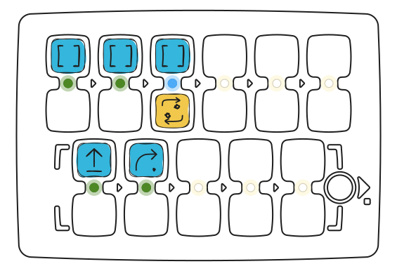
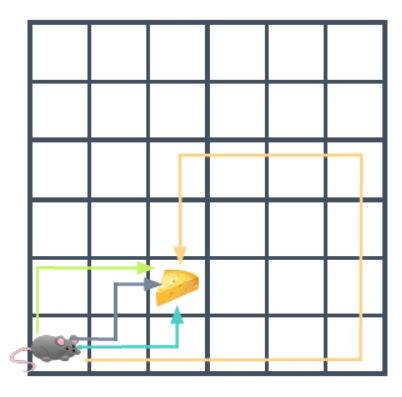
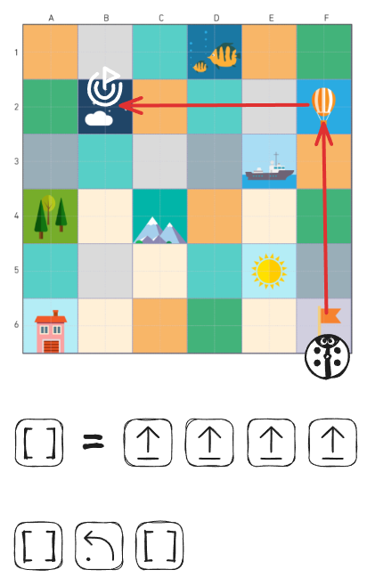
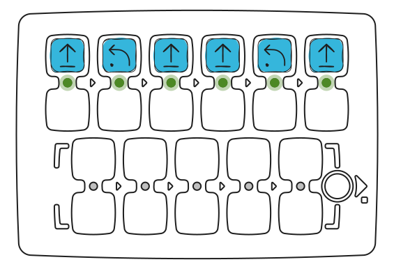
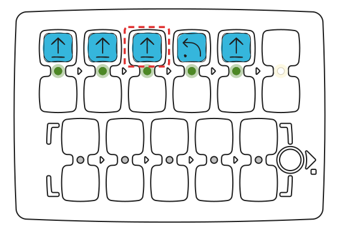

## Užsiėmimų su vaikais nuo 4 metų vadovas

PrimaSTEM padeda vaikams žingsnis po žingsnio išmokti loginio mąstymo, programavimo ir matematikos pagrindų. Šis vadovas padės Jums vesti užsiėmimus su vaikais nuo 4 metų.

### Kaip veikia prietaisas

Prietaiso tikslas yra programuoti mažo roboto boružės judesius komandų žetonais, kuriuos dedate ant valdymo pulto.

- Komanda **„Pirmyn“** — judėti tiesiai
- Komanda **„Kairėn“** — pasisukti į kairę
- Komanda **„Dešinėn“** — pasisukti į dešinę
- Žetonas **„\[ \]“ (Funkcija)** — pakeičia komandų seką
- **„Kartojimas“** — pakartoja komandą ar funkciją kelis kartus

Dėdami komandas ant pulto, sudarote roboto judėjimo programą. Kai programa paruošta, paspauskite mygtuką, ir robotas įvykdys nurodymus!

### Vadovo turinys

- Kodėl verta vesti robotikos ir programavimo užsiėmimus?
- Patarimai, kaip organizuoti užsiėmimus skirtingomis sąlygomis
- Užsiėmimai ir mokymosi tikslai
- Išsami naudojimo instrukcija
- Užsiėmimų aprašymas
- Priedai
- Apie projektą ir autorius

### Pedagoginė vertė

- Programavimas be ekrano — rankomis
- Supratimas, kad mašinos veikia pagal algoritmus
- Veiksmų planavimas iš anksto
- Loginio mąstymo lavinimas
- Pažintis su nuosekliuoju programavimu ir funkcijomis
- „Klaidos“ (angl. bug, klaida kode) sąvoka ir klaidų taisymo įgūdžiai
- Vaizdinis skaičių, aritmetikos ir geometrijos mokymasis

## Iš ko sudarytas PrimaSTEM

### Kas yra dėžutėje:

- Robotas boružė
- Valdymo pultas
- Komandų žetonai \*
- Užsiėmimų vadovas \*

(\*) Sudėtis gali skirtis priklausomai nuo komplektacijos

## Kodėl verta vesti programavimo ir matematikos užsiėmimus?

Kodas, programavimas ir automatizavimas tapo mūsų kasdienio gyvenimo dalimi.

Per pastaruosius metus žmonės išmoko kurti mašinas, kurios daro tai, ko anksčiau negalėjo: supranta, kalba, girdi, mato, atsako, rašo.

Pavyzdžių daug: savaeigiai automobiliai, robotai pagalbininkai senyviems žmonėms, pristatymo robotai ir kiti.

### Kodėl programavimas ir robotika?

Mokytis programuoti reiškia ne tik mokytis rašyti kodą. Mokytis programuoti reiškia mokytis suprasti mus supančias mašinas. Tai gebėjimas paversti mažas ar drąsias idėjas tikrais projektais. Tai gebėjimas sudėtingą užduotį išskaidyti į paprastus žingsnius. Tai bendras darbas sprendžiant mūsų problemas.

### Gimę skaitmeniniame amžiuje

Šiandien gali atrodyti, kad vaikai ir jaunimas gerai išmano technologijas, nes aktyviai naudojasi skaitmeninėmis pramogomis.

O kaip yra su šių priemonių naudojimu kūrybai ar saviraiškai? Kas nutinka, kai jie susiduria su technine problema?

## Patarimai, kaip naudoti priklausomai nuo aplinkybių

Užsiėmimai sukurti įvairiems tikslams ir ugdymo aplinkoms. Vadove užsiėmimai sunumeruoti. Toliau rekomenduojame užsiėmimus pagal Jūsų sąlygas.

### Tikslinė auditorija

- Vaikai nuo 4 iki 8 metų.
- Vyresniųjų ir priešmokyklinių darželio grupių vaikai, pradinės mokyklos 1 ir 2 klasių mokiniai.

### Rekomenduojami užsiėmimai neformaliajam ugdymui

1-2-x-4-5-6-7-8-9-10-x-x

### Rekomenduojami užsiėmimai mokykloje

x-2-3-4-5-6-7-8-9-x-11-12

### Neformalusis užsiėmimas

Dirbant su PrimaSTEM, patartina sudaryti ne didesnę kaip 12 vaikų grupę, kad visi galėtų aktyviai dalyvauti.

Rekomenduojame vienu prietaisu naudotis 2-3 mokiniams: taip jie mokosi dirbti komandoje ir lavina socialinius įgūdžius.

### Užsiėmimas mokykloje

Pamokai su PrimaSTEM geriausia sudaryti mažas 4-6 vaikų grupes su vienu mokytoju. Tuo metu kiti mokiniai gali atlikti kitą užduotį su mokytojo padėjėju arba, pavyzdžiui, mokytis braižyti roboto kelią pagal programą (1-2 klasių mokiniams). Abiem atvejais PrimaSTEM užsiėmimus geriau vesti universalioje salėje, tiesiog ant grindų arba pastūmus stalus ir kėdes, kad atsirastų vietos.

**Dėmesio**: nepamirškite iš anksto įkrauti valdymo pulto ir roboto akumuliatorių.

## Užsiėmimų numeriai ir jų mokymosi tikslai

| Užsiėmimas | Algoritmo ir programos sąvokų supratimas | Maršruto skaidymas į etapus | Judesio numatymas | Problemų sprendimas, programos klaidų taisymas | Komandinis darbas, bendradarbiavimas |
| --- | :---: | :---: | :---: | :---: | :---: |
| 1 |   | X |   | X |   |
| 2 |   |   | X |   | X |
| 3 | X | X |   |   |   |
| 4 | X | X | X |   |   |
| 5 | X | X | X |   | X |
| 6 | X | X | X | X | X |
| 7 | X | X | X | X | X |
| 8 | X |   | X | X |   |
| 9 | X | X | X | X | X |
| 10 | X |   | X | X |   |
| 11 | X | X | X | X | X |
| 12 | X | X | X | X | X |

## Naudojimo instrukcija

### Instrukcijos turinys

- Pažintis su priemonėmis
- Funkcijos programavimas
- Naudojami žemėlapiai
- Techniniai paaiškinimai

## Pažintis su priemonėmis

### Robotas

Mažas medinis robotas boružė su dviem akimis.

Jis turi tris atramos taškus: du ratukus ir atramą gale, kurie padeda jam išlaikyti pusiausvyrą.

### Pagrindinės komandos

| Komanda | Iliustracija | Aprašymas |
| --- | --- | --- |
| Pirmyn |  | Robotas pavažiuoja vienu langeliu — vienu loginiu žingsniu (numatytasis 15 cm) |
| Kairėn |  | Robotas pasisuka 90° į kairę |
| Dešinėn |  | Robotas pasisuka 90° į dešinę |
| Atgal |  | Robotas pavažiuoja atgal vienu langeliu — numatytuoju loginiu žingsniu |
| Funkcija |  | Robotas vykdo komandų seką, esančią funkcijos eilėje |
| Kartojimas № |  | Robotas pakartoja lizdų poroje esančią komandą nurodytą kartų skaičių — № |

### Valdymo pultas

Valdymo pultu robotą valdote, dėdami komandų blokus (žetonus) į laisvus lizdus (D).

6 viršutinės lizdų poros (A), sujungtos vykdymo linija (E), sudaro pagrindinę programos seką. Programa prasideda kairiajame lizde (D) ir baigiasi virš mygtuko **▶ Start** (B), kuriuo nurodymai siunčiami robotui ir programa paleidžiama.

5 apatiniuose lizduose (C) programuojate judesių seką, kurią vykdo blokas „\[ \]“ — „funkcija“. Kiekviena lizdų pora turi LED lemputę (F), kuri šviečia, kai žetonas įdėtas, ir mirksi, kai vykdomas esamas nurodymas.

#### Sekos sudarymas

Kai įdedate žetoną į vieną iš lizdų ir jis įdėtas teisingai, LED lemputė užsidega žaliai. Kai lizdų poroje prie judėjimo komandos pridedate kartojimo komandą, LED lemputė užsidega mėlynai. Jei žetonai įdėti neteisingai (pavyzdžiui, du judėjimo komandų žetonai vienoje lizdų poroje), užsidega raudona LED lemputė. Tokiu atveju vykdant programą klaidinga komanda praleidžiama.

### Akumuliatorius ir įjungimo mygtukas

Robotas ir valdymo pultas maitinami įmontuotais įkraunamais akumuliatoriais. Jie įkraunami per USB-C jungtį. Įjungimo mygtukas (ON/OFF) yra roboto viršuje ir valdymo pulto priekyje kairėje.

Įjungus robotą ar valdymo pultą, pasigirsta trumpas garso signalas. Kai valdymo pultas įjungtas, LED lemputė priekiniame skydelyje šviečia žaliai. Kai robotas įjungtas, LED lemputė prie USB-C jungties šviečia žaliai.

### Belaidis ryšys

Robotas ir valdymo pultas bendrauja belaidžiu Bluetooth ryšiu, kurio veikimo nuotolis apie 5 m. Belaidė sistema veikia fone, be jokių nustatymų, po pirmojo roboto susiejimo su valdymo pultu.

> Valdymo pultą galite nustatyti dirbti su kitu robotu (prietaisų susiejimas).
>
> 1. Įjunkite robotą, kuris nesusietas su valdymo pultu.
> 2. Įjunkite valdymo pultą.
> 3. Laikykite nuspaudę valdymo pulto mygtuką **▶ Start** 10 sekundžių, kol pasigirs garso ir užsidegs šviesos signalas.

### Programos sudarymas ir vykdymas

Judesių seka („programa“) prasideda pulto kairėje ir eina išgraviruotų rodyklių „\>“ seka — vykdymo linija, kuri horizontaliai jungia lizdų poras.

Jei žetonas įdėtas po tuščio lizdo, jo nurodymas įvykdomas, praleidus tuščią lizdą.

Jei įdėtas netinkamas žetonas (pavyzdžiui, „Kartojimas“ be komandos vienoje lizdų poroje) arba judėjimo žetonų derinys vienoje lizdų poroje (pavyzdžiui, du komandų žetonai vienoje lizdų poroje), LED lemputė užsidega raudonai, o ši programos dalis vykdant praleidžiama.

Kai seka sudėta, paspauskite mygtuką **▶ Start**, kad paleistumėte programą.

Kai robotas vykdo nurodymus, valdymo pulto LED lemputės paeiliui užgęsta. Kai komanda vykdoma, jos LED lemputė mirksi.

## Funkcijos programavimas

### Funkcijos kūrimas

Blokas „\[ \]“, dar vadinamas bloku „Funkcija“, naudojamas komandų sekai pakeisti.

Blokas „Funkcija“ leidžia vykdyti sudėtingesnes sekas ir pereiti prie sunkesnių užduočių. Norėdami sukurti funkciją, sudėkite judesių seką į tam skirtą sritį — 5 lizdų poras pulto apačioje. Ši seka vykdoma iš kairės į dešinę kiekvieną kartą, kai pagrindinėje sekoje (viršuje) pasitaiko blokas „Funkcija“.

Toliau pateiktame pavyzdyje blokas „Funkcija“ pakeičia judėjimą tiesiai ir posūkį į dešinę. Pagrindinė programa iškviečia „Funkciją“ 2 kartus, o tada žetonu „Kartojimas 2“ pakartoja „Funkciją“ dar 2 kartus.

[Paleisti simuliatoriuje](https://simulator.primastem.com/#top=cfun,cfun,cfun.r002&fn=cfor,crig&s=l1144602&r=225-675-0&run)

Judėjimo rezultatas:

## Naudojami žemėlapiai

### Žemėlapiai

Pirmiesiems užsiėmimams — algoritmų, programavimo ir skaičių mokymuisi — robotas turi judėti žemėlapiu su tinkleliu. Rekomenduojame naudoti žemėlapius su 15 cm langeliais: tokį atstumą robotas nuvažiuoja vienu numatytuoju žingsniu.

Galite naudoti bet kokius žemėlapius, sukurtus bet kokiems robotams, su bet kokio dydžio langeliais (tinkamais robotui).

> Numatytąjį žingsnio atstumą galima pakeisti iš 15 cm į kitą, tinkantį Jūsų žemėlapiui — 10 cm, 12,5 cm ar 20 cm. Tam naudokite specialią nustatymo komandą „Numatytasis žingsnis“ \+ skaičius milimetrais (10 cm — 100, 12,5 cm — 125, 20 cm — 200).

Jei neturite žemėlapio, pasidarykite jį patys: žemėlapiui sukurti galite panaudoti dažymo juostą ir lygų stalo ar grindų paviršių, didelį popieriaus lapą (storą reklaminio plakato audinį) ir flomasterį.

Šachmatų lentos žemėlapis arba tuščias langelių žemėlapis naudojamas mokytis judėti iš vieno taško į kitą, kad spalvos neblaškytų dėmesio.

Trumpoms istorijoms apie roboto judėjimą pasakoti galite naudoti spalvotą žemėlapį. Pavyzdžiui: „Boružė išeina iš namų ir per mišką keliauja į kalnus.“ Galite pasiūlyti klasei sukurti naują žemėlapį ir papasakoti naujų istorijų apie boružės keliones.

#### Žemėlapių pavyzdžiai:

Šachmatų lentos žemėlapis

Spalvotas žemėlapis

## Techniniai paaiškinimai

### Techniniu požiūriu

Valdymo pultas ir robotas valdomi mikrovaldikliais, veikia su Li-Ion akumuliatoriais ir jungiasi radijo kanalu standartiniu ryšio protokolu — Bluetooth.

Roboto spausdintinė plokštė atsako už visą jo elgseną: valdo du 5 V nuolatinės srovės variklius, dvi įvairiaspalves LED lemputes, groja garsus, bendrauja su valdymo pultu ir t. t.

Valdymo pulto spausdintinė plokštė atpažįsta į lizdus įdėtus žetonus, groja garsus ir valdo 11 įvairiaspalvių LED lempučių, priskirtų kiekvienai lizdų porai.

Kai žetonas įdedamas į vieną iš valdymo pulto lizdų, jis atpažįstamas pagal NFC lipduko lustą. Kiekviename žetone įrašytas kodas, atitinkantis valdymo komandą.

Kai žetonai valdymo pulte atpažinti ir programa paleista, komandos belaidžiu ryšiu siunčiamos robotui vykdyti.

### Galite sukurti savo komandų žetonų!

Papildomų komandų žetonų (pavyzdžiui, „Kartojimas 12“ ar papildomų judėjimo žetonų) galite pasidaryti iš „tuščių“ žetonų su NFC lipdukais ir telefono su NFC. Palaikoma dauguma 13,56 MHz tipų.

Vaizdo instrukcijas rasite mūsų YouTube kanale — [https://www.youtube.com/@primastem](https://www.youtube.com/@primastem)

---

## Užsiėmimai

### Išsamus užsiėmimų aprašymas

- **1 užsiėmimas** — Judėjimas šachmatų lenta iš taško A į tašką B
- **2 užsiėmimas** — Pažintis su PrimaSTEM
- **3 užsiėmimas** — Krypties ir algoritmo sąvokų supratimas, kai vaikas pats tampa robotu
- **4 užsiėmimas** — Roboto judesių numatymas pagal judesių seką
- **5 užsiėmimas** — Supratimas, kaip veikia nurodymų sekos atsitiktinėje programoje
- **6 užsiėmimas** — Valdymo pulto ir judėjimo komandų naudojimas, kad robotas nukeliautų į kalnus
- **7 užsiėmimas** — Pažintis su komanda „funkcija“
- **8 užsiėmimas** — Funkcijos naudojimas maršrutui iki tikslo nutiesti
- **9 užsiėmimas** — Programos klaidos taisymas
- **10 užsiėmimas** — Sekų su 1 klaida taisymo apmąstymas popieriuje
- **11 ir 12 užsiėmimai** — Roboto judesių numatymas (su bloku „funkcija“)

---

## 1 užsiėmimas: Judėjimas šachmatų lenta iš taško A į tašką B

- **individualiai**
- **15 min**
- **popieriuje**
- **spausdinami dokumentai**

### Tikslas

> Suplanuoti judėjimą langeliais iš taško A į tašką B žemėlapyje.

Pratimas kartu su aptarimu trunka 10 minučių.

### Spausdinti

Šiam užsiėmimui kiekvienam mokiniui atspausdinkite po vieną lapo „[1 priedas. Judėjimas žemėlapyje](/en-lt/book-1/attachment-1)“ egzempliorių.

### PRATIMAS

Vaikai tinklelyje turi nubrėžti kelią, kuriuo pelytė turi nueiti iki sūrio. Galite pradėti nuo kairiojo pratimo, kuris lengvesnis, o tada pereiti prie dešiniojo.

#### Judėjimas langeliais

Pelytė juda tinklelio langeliais (atkreipkite dėmesį: įstrižai judėti negalima). Čia svarbu suprasti, kad pelytės kelias padalytas į etapus: ji juda po vieną langelį. Sakoma, kad ji juda žingsnis po žingsnio.

Pavyzdyje viršuje teisingas tik mėlynas kelias. Trumpasis raudonas kelias neteisingas, nes jame yra įstrižainė. Ilgasis raudonas kelias neteisingas, nes neveda į reikiamą tašką.

### Aptarimas grupėje...

Pavyzdžiui, pavyzdyje viršuje visi nubrėžti keliai teisingi, nes visais jais pelytė pasiekia sūrį.

Parodykite vaikams, kad ne visi sugalvoja tą patį kelią, ir teisingų kelių gali būti keli.

#### Vieni keliai ilgesni už kitus

Jei suskaičiuosite, kiek langelių pelytė turi pereiti, kad pasiektų langelį su sūriu, gausite:

- 3 langelius žaliuoju maršrutu
- 3 langelius pilkuoju maršrutu
- 3 langelius mėlynuoju maršrutu
- 13 langelių geltonuoju maršrutu

#### Trumpiausias kelias

Galiausiai, nors visi šie keliai teisingi, pelytė pasirinks trumpiausią.

Paprašykite vaikų atsakyti į klausimą: „Kodėl pelytė pasirinko trumpiausią kelią?“

Galimi keli atsakymai: pelytė nori taupyti jėgas, ji labai pavargusi ir nori nueiti kuo mažiau... Arba pelytė skuba, ji labai alkana ir nori kuo greičiau pasiekti sūrį.

**Pastaba vedančiajam:** Su robotais taip pat. Dėl efektyvumo visada rinksimės trumpiausią kelią.

#### Galimi keli keliai

Baigę pratimą, paprašykite mokinių parodyti, kokį kelią jie nubrėžė. Kadangi galimų variantų visada yra keli, tikėtina, kad mokiniai pateiks skirtingus, bet visus teisingus atsakymus.

---

## 2 užsiėmimas: Pažintis su PrimaSTEM

- **15 min**
- **grupėje**
- **demonstravimas**
- **praktika**

### Tikslai

> Suprasti roboto judėjimo galimybes Sužinoti, kad valdymo pultas valdo robotą Suprasti komandų žetonus

Šiam užsiėmimui sudarykite mažas mokinių grupes. Susėskite prie žemo stalo arba ant grindų. Išimkite žemėlapį su tinkleliu, valdymo pultą, robotą ir žetonus. Pristatykite PrimaSTEM visiems mokiniams, grupėms paeiliui.

### Pristatymas

Pristatykite kiekvieną daiktą ant stalo ir supažindinkite vaikus su žodžiais, kurių jiems prireiks.

Pirmiausia **žemėlapis**: jis kaip tinklelis, su kuriuo jie dirbo per 1 užsiėmimą, tik didesnis.

Tada **robotas boružė**: jis gali važiuoti.

Jis valdomas **valdymo pultu** pagal tai, kokius žetonus įdedame į lizdus.

**Žetonai** yra nurodymai: jais galite liepti robotui važiuoti pirmyn, pasisukti į kairę ar į dešinę.

### 1 etapas: demonstravimas

Paaiškinę žodžius, patys atlikite veiksmą ir parodykite vaikams, kas nutinka, kai įdedate žetoną į valdymo pultą.

| Paveikslėlis | Aprašymas |
| --- | --- |
|  | Komandos **„Pirmyn“** žetonas paslenka robotą vienu langeliu |

Padėkite robotą į vieną iš žemėlapio langelių. Įdėkite žetoną į pirmąjį programos lizdą, kaip parodyta schemoje žemiau, ir paspauskite baltą mygtuką — **▶ Start**.

Robotas pavažiuos vienu langeliu pirmyn.

### 2 etapas: perduokite valdymą

| Paveikslėlis | Aprašymas |
| --- | --- |
|  | Žetonas su rodykle, kuri lanku sukasi aplink centrą, yra **„Kairėn“** — jis pasuka robotą į kairę, prieš laikrodžio rodyklę. Numatytasis posūkio žingsnis yra 90 laipsnių. |

Išimkite žetoną „Pirmyn“ iš valdymo pulto ir paduokite žetoną „Kairėn“. Šį kartą galite leisti vaikui įdėti žetoną į pirmąjį programos lizdą ir paspausti baltą mygtuką — **▶ Start**. Robotas liks vietoje ir pasisuks ketvirtadaliu apsisukimo į kairę.

| Paveikslėlis | Aprašymas |
| --- | --- |
|  | Žetonas **„Dešinėn“** pasuka robotą į dešinę. |

Paprašykite kito vaiko išimti žetoną „Kairėn“ iš valdymo pulto, į jo vietą įdėti žetoną „Dešinėn“ ir paspausti baltą mygtuką — **▶ Start**. Robotas liks vietoje ir pasisuks ketvirtadaliu apsisukimo į dešinę.

Tada leiskite vaikams paeiliui išbandyti patiems, duodami jiems tik 3 žetonus: **„Pirmyn“**, **„Kairėn“** ir **„Dešinėn“**.

Kai robotas baigia judėti, jie gali dar kartą paleisti savo sukurtą programą, vėl paspaudę mygtuką **▶ Start**.

Leiskite jiems patiems pamatyti, kad žetonus galima dėti bet kur (išskyrus dvi komandas vienoje lizdų poroje) ir jie vykdomi paeiliui — iš kairės į dešinę.

> Programą galima sustabdyti, kai robotas juda, dar kartą paspaudus mygtuką **▶ Start / Stop**.

---

## 3 užsiėmimas: Krypties ir algoritmo sąvokų supratimas, kai vaikas pats tampa robotu

- **45 min**
- **Grupėje**
- **Žaidimas**
- **Žemėlapis**

### Tikslai

> Atsižvelgti į roboto kryptį programos pradžioje Numatyti roboto judesius pagal programą

### Spausdinti

Šiam užsiėmimui kiekvienam mokiniui atspausdinkite po vieną kortelių „[2 priedas. Misijų kortelės](/en-lt/book-1/attachment-2)“ egzempliorių.

### Žaidimo principas

Vaidmenų žaidimas atviroje erdvėje, kurioje vaikai vaizduoja robotą juodai baltame lauke.

### Žaidimo taisyklės

Vienas mokinys žemėlapyje (arba ant grindų su langelių raštu — raštu, plytelėmis ar plona dažymo juosta, priklijuota prie grindų) atlieka roboto vaidmenį, o kiti mokiniai jį programuoja pagal užduočių korteles.

Nenurodoma, į kurią pusę žiūri vaikas robotas. Nustatykite, kuri roboto kryptis tinka misijai įvykdyti.

1. „Vaikas robotas“ stovi raudoname langelyje 1, jis turi pasiekti žalią langelį 2.
2. „Vaikas robotas“ stovi raudoname langelyje 1, jis turi pasiekti violetinį langelį 3.
3. „Vaikas robotas“ stovi raudoname langelyje 1, jis turi pasiekti mėlyną langelį 4.

> Kad žemėlapio medžiaga ilgiau tarnautų, paprašykite vaiko nusiauti batus.

### Žaidimo pabaiga

Dabar vaikas supranta, kad programuojant judesį reikia atsižvelgti į roboto padėtį ir kryptį.

Robotas į judėjimo komandą reaguoja pagal tai, kaip jis pasisukęs, į kurią pusę nukreiptas. Jis turi arba važiuoti tiesiai, arba pasisukti į kairę, arba pasisukti į dešinę, **BET jis judės pagal savo pradinę kryptį.**

---

## 4 užsiėmimas: Roboto judesių numatymas pagal judesių seką

- **45 min**
- **individualiai**
- **popieriuje**
- **spausdinami dokumentai**

### Tikslai

> Atsižvelgti į pradinę roboto kryptį Suprasti programos nurodymus Numatyti roboto judesius pagal programą

### Spausdinti

Šiam užsiėmimui kiekvienam mokiniui atspausdinkite po vieną kortelių „[3 priedas. Nubrėžk kelią pagal programą](/en-lt/book-1/attachment-3)“ egzempliorių.

Vaikai gauna lapą su programa, sudaryta iš nurodymų sekos. Vaikai turi nubrėžti kelią, kuriuo robotas važiuos pagal šią judesių seką.

Pagal šią programą robotas tris kartus pavažiuos tiesiai:

<Columns cols={2}>
  <Frame>
    
  </Frame>
  <Frame>
    
  </Frame>
</Columns>

[Paleisti simuliatoriuje](https://simulator.primastem.com/#top=cfor,cfor,cfor&s=l1144602&r=75-825-0&m=02&run)

Štai ta pati programa, robotas taip pat tris kartus pavažiuos tiesiai. Tik šį kartą pradžioje jis nukreiptas kitaip: žiūri į dešinę. Todėl jis tris kartus pavažiuos į dešinę:

<Columns cols={2}>
  <Frame>
    
  </Frame>
  <Frame>
    
  </Frame>
</Columns>

[Paleisti simuliatoriuje](https://simulator.primastem.com/#top=cfor,cfor,cfor&s=l1144602&r=75-825-90&m=35&run)

Šioje programoje atsiranda roboto posūkis. Šį kartą robotas pirmiausia pasisuka į dešinę, o tada pavažiuoja du langelius:

<Columns cols={2}>
  <Frame>
    
  </Frame>
  <Frame>
    
  </Frame>
</Columns>

[Paleisti simuliatoriuje](https://simulator.primastem.com/#top=crig,cfor,cfor&s=l1144602&r=75-825-0&m=25&run)

Ir galiausiai sudėtingesnis pratimas, kuriame robotas du kartus keičia kryptį. Jis pirmiausia pavažiuoja vieną langelį tiesiai, tada pasisuka į dešinę, pavažiuoja vieną langelį, tada pasisuka į kairę ir pavažiuoja du langelius:

<Columns cols={2}>
  <Frame>
    
  </Frame>
  <Frame>
    
  </Frame>
</Columns>

[Paleisti simuliatoriuje](https://simulator.primastem.com/#top=cfor,crig,cfor,clef,cfor,cfor&s=l1144602&r=75-825-0&m=12&run)

### Pastaba vedančiajam

Šis pratimas popieriuje gali būti sunkus. Jei kai kuriems vaikams sunku suprasti roboto posūkius ir judesių sekas, paimkite PrimaSTEM rinkinį ir paprašykite juos sudėti lapuose esančias programas ant valdymo pulto. Kai patys darome ir stebime, suprantame geriau!

---

## 5 užsiėmimas: Supratimas, kaip veikia nurodymų sekos atsitiktinėje programoje

- **45 min**
- **grupėje**
- **žaidimas**

### Tikslai

> Susieti nurodymus su roboto atliekamais judesiais Įsivaizduoti žemėlapio ribas Mokėti perkelti komandų nurodymus į „valdymo pultą“

### Žaidimo eiga

1. Pradžioje padėkite robotą žemėlapyje į bet kurį langelį (rekomenduojame langelį prie žemėlapio krašto), nukreiptą norima kryptimi.
2. Pradėdami meskite kauliuką. Perkelkite robotą rankomis ir užrašykite (nupieškite komandos „Pirmyn“ ženklu — rodykle) judėjimo programą popieriuje arba piešimo lentoje. Jei robotas išvažiuoja iš žemėlapio, meskite kauliuką dar kartą.
3. Pakartokite veiksmą, kad gautumėte 2 judėjimo programų seką ir robotas neišvažiuotų iš žemėlapio; jei reikia, meskite kauliuką iš naujo.

Pabaigoje ant popieriaus lapo turite turėti 2 komandų „Pirmyn“ programas, kurias įvykdžius paeiliui robotas pavažiuos reikiamą langelių skaičių link žemėlapio krašto.

Pavyzdys:

<Columns cols={2}>
  <Frame>
    
  </Frame>
  <Frame>
    

      
      
    

  </Frame>
</Columns>

**Užrašytas programas atkurkite tikrovėje su PrimaSTEM.**

---

## 6 užsiėmimas: Valdymo pulto ir judėjimo komandų naudojimas, kad robotas nukeliautų į kalnus

- **45 min**
- **grupėje**
- **praktika**

### Tikslai

> Išskaidyti maršrutą į etapus Sudaryti programą konkrečiam tikslui pasiekti

Šiam užsiėmimui Jums reikės:

- valdymo pulto
- tam tikrų judėjimo komandų žetonų: kiekvienai grupei po 4 „Pirmyn“, 4 „Kairėn“ ir 4 „Dešinėn“, kitus žetonus atidėkite į šalį.
- žemėlapio ir roboto

Padalykite vaikus į 3 ar 4 vaikų grupes ir duokite joms valdymo pultą bei žetonų rinkinį.

### 1 etapas: apmąstymas

Robotas boružė yra namuose, o mes norime nugabenti jį į kalnus. Čia ant valdymo pulto reikės sudaryti programą, pagal kurią jis ten nukeliautų.

> Jei neturite tinkamo žemėlapio, schematiškai nupieškite reikiamas vietas popieriuje, galbūt kartu su vaikais, ir priklijuokite jas prie žemėlapio.

Pirmiausia paklauskite vaikų, per kuriuos langelius jie nori nuvesti robotą iki kalno. Ir vėl galimybių daug, o dėl energijos ir laiko taupymo rinksimės trumpiausius maršrutus.

Kai kelias nustatytas, paklauskite vaikų, kokius judesius robotas turės atlikti, langelis po langelio.

Ar jis turi važiuoti tiesiai, pasisukti į kairę, pasisukti į dešinę? Parodykite jiems, kokį judesį robotas atliks pagal kiekvieną komandą, rankomis vedžiodami jį žemėlapiu.

### 2 etapas: programavimas

Paprašykite vaikų komandų žetonais ant valdymo pulto iš eilės sudėti judesius (programą), kuriuos robotas turi atlikti, kad pasiektų tikslą.

**Štai laukiamas programos rezultatas:**

### 3 etapas: patikrinimas

Kaip ir kiekvienas save gerbiantis programuotojas, turime patikrinti, ar programa veikia. Paprašykite vaikų sudėti savo programą ant valdymo pulto ir ją paleisti.

<Columns cols={2}>
  <Frame>
    
  </Frame>
  <Frame>
    
  </Frame>
</Columns>

[Paleisti simuliatoriuje](https://simulator.primastem.com/#top=cfor,cfor,crig,cfor&s=l1144602&r=75-825-0&m=13&run)

Ar robotas pasiekia kalną? Jei ne, kodėl? Leiskite vaikams pabandyti ištaisyti programos klaidas, jei jų yra.

---

## 7 užsiėmimas: Pažintis su komanda „funkcija“

- **15 min**
- **grupėje**
- **demonstravimas**

### Tikslai

> Suprasti, kad komanda „funkcija“ gali pakeisti kitus komandų nurodymus Susipažinti su nurodymų sekos kartojimo sąvoka

Šiam užsiėmimui sudarykite mažas mokinių grupes. Susėskite prie žemo stalo arba ant grindų. Išimkite lauką-žemėlapį, valdymo pultą, robotą ir komandų žetonus. Mokinių grupės paeiliui susipažįsta su bloko „Funkcija“ komanda.

### 1 etapas: demonstravimas

Parodykite vaikams komandos „Funkcija“ žetoną.

Jis pakeičia kelias judėjimo komandas: „Pirmyn“, „Kairėn“, „Dešinėn“ ar „Atgal“. Juo taip pat galima kelis kartus pakartoti tą pačią nedidelę programos dalį.

Pradėkite nuo demonstravimo. Sudarykite programą, kaip parodyta paveikslėlyje žemiau.

Kai naudojama komanda „Funkcija“, viskas vyksta taip, lyg vietoj žetono „Funkcija“ būtume įdėję tai, kas yra rėmelyje \[-----\] pulto apačioje. Mūsų pavyzdyje robotas du kartus pavažiuos tiesiai.

### 2 etapas: mįslės!

Dabar pagrindinės programos pabaigoje pridėkite bloką su komanda „Dešinėn“, kaip paveikslėlyje žemiau.

Prieš paleisdami programą, paklauskite vaikų, kas nutiks. Viskas vyksta taip, lyg programą sudarytų du raudoni blokai „Pirmyn“ ir tada vienas blokas „Dešinėn“. Robotas pavažiuos du langelius ir pasisuks į dešinę (ketvirtadaliu apsisukimo).

O pabaigai — **ciklas**! Sudėkite programą su keturiais blokais „Funkcija“, kaip paveikslėlyje žemiau.

[Paleisti simuliatoriuje](https://simulator.primastem.com/#top=cfun,cfun,cfun,cfun&fn=cfor,crig&s=l1144602&r=225-675-0&run)

Prieš paleisdami programą, paklauskite vaikų, kas nutiks, o tada paleiskite programą ir patikrinkite.

**Robotas atlieka ciklą**:

**Pastaba vedančiajam:** Pradedant pažintį su bloko „funkcija“ sąvoka, labai naudinga stebėti LED lemputes, kurios mirksi vykdant programą. Taip galite sekti vykdomą nurodymą ir kartu matyti, kaip juda robotas.

---

## 8 užsiėmimas: Funkcijos naudojimas maršrutui iki tikslo nutiesti

- **45 min**
- **grupėje**
- **praktika**

### Tikslai

> Išskaidyti maršrutą į etapus. Sudaryti programą konkrečiam tikslui pasiekti. Programoje naudoti bloką „funkcija“.

Šiam užsiėmimui Jums reikės:

- žetonų arba pačių pasidarytų kortelių su nupieštomis komandomis: kiekvienai grupei po 4 „pirmyn“, 4 „kairėn“, 4 „dešinėn“ ir 4 „funkcija“.
- žemėlapio ir roboto, be valdymo pulto.

Jei vaikų daug, padalykite juos į 3 ar 4 vaikų grupes ir išdalykite korteles su nupieštomis komandomis arba rinkinio žetonus (lygiai 4\+4\+4\+4).

### 1 etapas: apmąstymas

> Pritaikykite užduotį, jei Jūsų žemėlapyje yra kitų paveikslėlių arba jų visai nėra: reikia pažymėti 2 taškus („Startas“ ir „Finišas“) 4 langelių atstumu, 90 laipsnių kampu.

Robotas stovi prie vėliavėlės, o mes norime nugabenti jį į nakties langelį, pavaizduotą debesimis. Reikės sudaryti programą (ant stalo išdėlioti algoritmą iš žetonų ar komandų piešinių), naudojant bloką „Funkcija“.

Pirmiausia paklauskite vaikų, per kuriuos langelius jie nori nuvesti robotą iki kalno (langelio maždaug pusiaukelėje). Galimybių daug, o šį kartą rinksimės maršrutus, kuriuose nurodymų sekos kartojasi, kad galėtume panaudoti komandą „Funkcija“.

Kai kelias nustatytas, paklauskite vaikų, kokius judesius robotas turės atlikti, langelis po langelio, ir parodykite programos vykdymą, rankomis vedžiodami robotą.

### 2 etapas: „neveikia! O jeigu...“

Paprašykite juos kortelėmis (žetonais) ant stalo iš eilės išdėlioti judesius, kuriuos robotas turi atlikti.

Griežtai laikykitės kiekvienai grupei duotų komandų žetonų skaičiaus: 4 „pirmyn“, 4 „kairėn“, 4 „dešinėn“ ir 4 „funkcija“.

Štai ir viskas! Žetonų programai užrašyti neužtenka! Trūksta komandų „Pirmyn“! Skaitmeninė panika! :)

Priminkite jiems, kuo naudinga komanda „Funkcija“: ja galima pakeisti kelis kitus komandų žetonus.

Pavyzdžiui, galite pakeisti kelias komandas „Pirmyn“, kad robotas kelis kartus pavažiuotų pirmyn.

Padėkite vaikams sudaryti programą su bloku „Funkcija“, kaip paveikslėlyje žemiau.

Maršruto ir jo programos pavyzdys:

### 3 etapas: patikrinimas

Padėkite vaikams sudėti savo programą ant valdymo pulto ir ją patikrinti, kaip paveikslėlyje:

[Paleisti simuliatoriuje](https://simulator.primastem.com/#top=cfun,clef,cfun&fn=cfor,cfor,cfor,cfor&s=l1144602&r=825-825-0&run)

Ar robotas pasiekia langelį „Naktis“? Jei ne, kodėl? Leiskite vaikams pabandyti ištaisyti programos klaidas, jei jų yra.

---

## 9 užsiėmimas: Programos klaidos taisymas

- **20 min**
- **grupėje**
- **praktika**

### Tikslai

> Rasti programos klaidą stebint, kaip ji vykdoma. Ištaisyti programos klaidą.

Šiam užsiėmimui sudarykite mažas mokinių grupes. Susėskite prie žemo stalo arba ant grindų. Paruoškite lauką su tinkleliu, valdymo pultą, robotą ir žetonus. Paprašykite mokinių grupių paeiliui ištaisyti programos klaidą.

Norime, kad robotas pasiektų kalną (pilkas kelias).

Parodykite vaikams judesių seką ant valdymo pulto, kurioje yra klaida:

[Paleisti simuliatoriuje](https://simulator.primastem.com/#top=cfor,clef,cfor,cfor,clef,cfor&s=l1144602&r=75-825-90&run)

Pagal šią programą robotas nuvažiuoja į mišką. Išbandydami programą, vaikai turi pabandyti rasti klaidą ir ją ištaisyti.

Teisingos, ištaisytos programos pavyzdys:

[Paleisti simuliatoriuje](https://simulator.primastem.com/#top=cfor,clef,cfor,cfor,crig,cfor&s=l1144602&r=75-825-90&run)

---

## 10 užsiėmimas: Sekos su klaida taisymo apmąstymas popieriuje

- **20 min**
- **individualiai**
- **popieriuje**
- **spausdinami dokumentai**

### Tikslai

> Numatyti roboto judesius, kad rastumėte programos klaidą. Suprasti, kaip ištaisyti programos klaidą.

Vaikai gauna lapą su programa, sudaryta iš nurodymų sekos judėti iš taško A į tašką B. Programoje yra klaida, vaikai turi ją rasti ir pabandyti ištaisyti.

### Spausdinti

Šiam užsiėmimui kiekvienam mokiniui atspausdinkite po vieną kortelių „[4 priedas. Rask ir ištaisyk klaidą programoje](/en-lt/book-1/attachment-4)“ egzempliorių.

### 1 etapas: perskaitykite programą

Pirmiausia paprašykite vaikų nubrėžti, kaip robotas judės pagal šią programą. Kelias, kuriuo norime, kad robotas važiuotų, ir norimas atvykimo taškas tinklelyje nubrėžti mėlynai.

### 2 etapas: raskite klaidą

Nubrėžę kelią matome, kad robotas nevažiuoja į finišą (juodą)! Jis atvažiuoja prie raudonos vėliavėlės. Paklauskite vaikų, kur robotas suklydo. Čia reikia rasti langelį su klaida, kuris taisymo pavyzdyje apvestas raudonai.

Yra 3 klaidų tipai:

- suklydome dėl komandos
- pamiršome komandą
- pridėjome nereikalingą komandą

### 3 etapas: ištaisykite klaidą

Ir galiausiai paprašykite vaikų ištaisyti klaidą, sudarant programą, pagal kurią robotas nuvažiuotų prie juodos vėliavėlės.

**Pastaba:** Šis pratimas popieriuje gali būti sunkus. Jei kai kuriems vaikams sunku pamatyti, kur yra klaidos, paimkite PrimaSTEM ir paprašykite juos sudėti lapuose esančias programas ir jas paleisti. Pavyzdžiui, galite paprašyti juos sušukti „O ne!“, kai robotas pakeliui suklysta, kad klaida būtų pažymėta.

#### 1 pavyzdys

Šiame pavyzdyje suklydome dėl nurodymo pabaigoje.

<Columns cols={2}>
  <Frame>
    
  </Frame>
  <Frame>
    

      
      
    

  </Frame>
</Columns>

#### 2 pavyzdys

Šiame pavyzdyje pradžioje pridėjome nereikalingą nurodymą.

<Columns cols={2}>
  <Frame>
    
  </Frame>
  <Frame>
    

      
      
    

  </Frame>
</Columns>

#### 3 pavyzdys

Šiame pavyzdyje pradžioje pamiršome nurodymą.

<Columns cols={2}>
  <Frame>
    
  </Frame>
  <Frame>
    

      
      
    

  </Frame>
</Columns>

---

## 11 užsiėmimas: PrimaSTEM judesių numatymas

- **45 min**
- **grupėje**
- **praktika**

### Tikslai

> Numatyti roboto judesius, žiūrint į programą be „funkcijos“

Šiam užsiėmimui paimkite PrimaSTEM rinkinį be komandų „Funkcija“. Žaisti gali visi vaikai kartu, tačiau veiksmus vienu metu atlieka tik vienas vaikas.

### 1. Tyliai, programuojame...

Vaikai paeiliui padeda robotą žemėlapio kampe ir ant valdymo pulto sudaro programą iš ne daugiau kaip 5 nurodymų.

Kai programa baigta, paprašykite vaikų palaukti ir dar nespausti mygtuko.

### 2. Statykite!

Paprašykite kitų vaikų atspėti, ar robotas išvažiuos iš žemėlapio.

### 3. Patikrinkite

Kai visi atspėjo, paleidžiame programą ir tikriname, kas nutinka. Tada vėl padedame robotą į kampą, ir kitas vaikas paleidžia savo programą.

---

## 12 užsiėmimas

### Tikslai

> Numatyti roboto judesius, žiūrint į programą su „funkcija“

Pakartokite 11 užsiėmimą, į rinkinį pridėję komandas „funkcija“.

Šį kartą pridėkite blokus „Funkcija“, kad žaidime atsirastų funkcijų programavimas. Žaisti gali visi vaikai kartu, tačiau veiksmus vienu metu atlieka tik vienas vaikas.

---

## Apie projektą, autoriai

### Kas mes?

PrimaSTEM yra įmonė, kuri sukūrė ir gamina originalų to paties pavadinimo prietaisą, skirtą mokyti vaikus nuo 4 metų programavimo ir matematikos be ekrano. Esame įsikūrę Prancūzijos pietuose.

Sukurtos medžiagos yra atvirojo kodo ir skirtos lavinti vaikų bei juos lydinčių suaugusiųjų kūrybiškumą.

Daugiau apie prietaisą PrimaSTEM sužinosite dokumentacijos svetainėje, kuri prieinama 13 kalbų: [https://docs.primastem.com](https://docs.primastem.com)

### Turite klausimų? Susisiekite su mumis!

Drąsiai rašykite mums: [info@primastem.com](mailto:info@primastem.com)

Mūsų svetainė su informacija ir nuorodomis į socialinius tinklus: [https://primastem.com](https://primastem.com)

### Autoriai

**Adaptacija, tekstas, iliustracijos:** Andrei Chanov, 2026.

**Koncepcijos autorės**: Julie Borgeot / Dorie Bruyas iš Fréquence écoles

#### Šio vadovo licencija

Šis kūrinys platinamas pagal CC BY-SA 4.0 licenciją. Licencijos kopiją rasite adresu [https://creativecommons.org/licenses/by-sa/4.0/](https://creativecommons.org/licenses/by-sa/4.0/)

**Creative Commons Attribution-ShareAlike 4.0 International**

Ši licencija reikalauja, kad pakartotinai naudojantys asmenys nurodytų kūrėją. Ji leidžia platinti, perdirbti, pritaikyti medžiagą ir ja remtis kuriant naujus kūrinius bet kokioje laikmenoje ar formatu, net komerciniais tikslais. Jei kiti perdirba, pritaiko medžiagą ar ja remiasi, pakeistą medžiagą jie turi licencijuoti tokiomis pačiomis sąlygomis.

---

## Priedai

## 1 priedas. Judėjimas žemėlapyje

Nuoroda į priedą — [1 priedas. Judėjimas žemėlapyje](/en-lt/book-1/attachment-1)

## 2 priedas. Misijų kortelės

Nuoroda į priedą — [2 priedas. Misijų kortelės](/en-lt/book-1/attachment-2)

## 3 priedas. Nubrėžk kelią pagal programą

Nuoroda į priedą — [3 priedas. Nubrėžk kelią pagal programą](/en-lt/book-1/attachment-3)

## 4 priedas. Rask ir ištaisyk klaidą programoje

Nuoroda į priedą — [4 priedas. Rask ir ištaisyk klaidą programoje](/en-lt/book-1/attachment-4)
