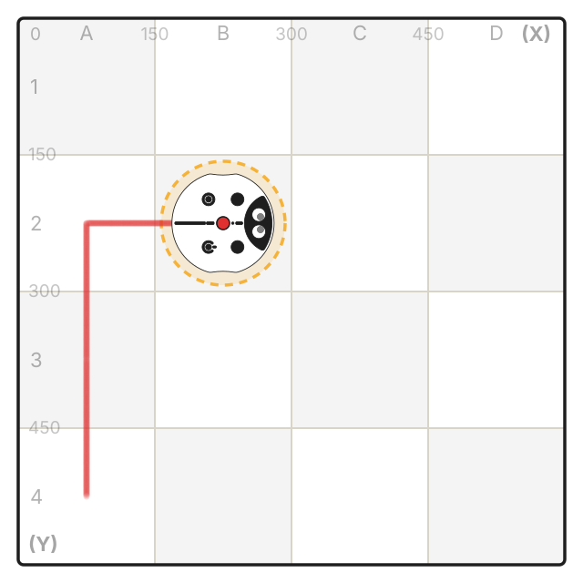

## Įvadas

PrimaSTEM sudaro programuojamas robotas, valdymo pultas ir komandų žetonų rinkinys. Jį galima naudoti vyresnio amžiaus žmonių kognityvinių sutrikimų prevencijai ir korekcijai.

### Kam skirta

- Vyresnio amžiaus žmonėms su lengvais kognityviniais sutrikimais
- Žmonėms po neurologinių ligų
- Pacientams ankstyvose neurodegeneracinių ligų stadijose

### Kontraindikacijos

- Sunkūs regos sutrikimai
- Ryškūs rankų motorikos sutrikimai
- Sunki demencija
- Ūminiai psichikos sutrikimai

## Pirmasis užsiėmimas

Jis trunka apie 35 minutes. Prieš pradėdami perskaitykite kontraindikacijas aukščiau. Jei prietaiso dar neturite, visus žingsnius galite atlikti [simuliatoriuje](https://simulator.primastem.com).

<Steps>
  <Step title="Susipažinimas su rinkiniu, 10 minučių">
    Parodykite robotą, valdymo pultą ir žetonus „Pirmyn“, „Dešinėn“ ir „Kairėn“. Dalyvis įstato vieną žetoną „Pirmyn“ į valdymo pultą, paspaudžia **▶ Start** ir stebi, kaip robotas juda. Kaip veikia valdymo pultas ir robotas, paaiškinta skyriuje [Greita pradžia](/en-lt/quickstart).
  </Step>
  <Step title="Pirmasis maršrutas, 10 minučių">
    Pažymėkite tikslą dviejų ar trijų langelių atstumu nuo roboto. Dalyvis sudėlioja žetonus, paleidžia programą ir patikrina, ar robotas pasiekė tikslą. Simuliatoriuje naudokite [lengvą labirintą](https://simulator.primastem.com/#s=l1144402&r=75-525-0&m=2101).
  </Step>
  <Step title="Pertrauka, 5 minutės">
    Pailsėkite po 15–20 minučių darbo.
  </Step>
  <Step title="Figūra, 10 minučių">
    Dalyvis sudaro programą, pagal kurią robotas nubrėžia kvadratą. Simuliatoriuje atidarykite [kvadrato užduotį](https://simulator.primastem.com/#sh=square): robotas turi važiuoti punktyriniu kontūru.
  </Step>
</Steps>

Pabaigoje paklauskite, kas buvo lengva ir kas sunku. Atsakymas parodys, nuo ko pradėti kitą kartą.

## Bendrieji principai

Su amžiumi ir dėl neurodegeneracinių ligų gali silpti atmintis. Sunkiau mąstyti abstrakčiai, mokytis ir kurti. Užsiėmimai su PrimaSTEM žaidimo forma lavina įvairias kognityvines funkcijas ir padeda sulėtinti šiuos procesus.

### Kaip organizuoti užsiėmimus

- Vienas užsiėmimas trunka 30–45 minutes.
- Užsiėmimai vyksta 2–3 kartus per savaitę.
- Dalyviai dirba po vieną arba mažomis 2–4 žmonių grupėmis.
- Po kiekvienų 15–20 minučių darbo reikia 5–10 minučių pertraukos.

### Kaip vesti užsiėmimus

1. Užduotis sunkinkite palaipsniui.
2. Atsižvelkite į kiekvieno dalyvio savybes ir apribojimus.
3. Kurkite draugišką atmosferą.
4. Keiskite skirtingų rūšių pratimus.
5. Visada pasakykite dalyviui, kas jam pavyko, ir pagirkite.

## Ką lavina užsiėmimai

### Kognityvinės funkcijos

- Intelektinė veikla
- Erdvinis mąstymas ir atmintis
- Regimoji ir girdimoji žodinė atmintis
- Loginis mąstymas ir mintinis skaičiavimas
- Savo veiksmų planavimas ir kontrolė
- Periferinis regėjimas

### Bendravimas ir nuotaika

- Užsiėmimai palaiko asmeninį potencialą ir socialinį aktyvumą.
- Dalyvis gali save išreikšti.
- Dalyviui lengviau bendrauti su kitais.
- Užsiėmimai pakelia nuotaiką.

## Treniruotės ir žaidimai

### 1. Pirmieji pratimai (pripratimo laikotarpis)

- Susipažinti su komandų žetonais.
- Nuvesti robotą tiesia linija.
- Atlikti paprastus posūkius.
- Sudaryti trumpą komandų seką.

**Medžiaga**

- [Greita pradžia](/en-lt/quickstart)
- [1 knyga](/en-lt/book-1/book-1), 2 užsiėmimas

### 2. Erdvinio mąstymo treniravimas

#### Maršrutas

- Rasti trumpiausią kelią.
- Apeiti kliūtis.
- Sudaryti maršrutą iš atsitiktinio komandų žetonų rinkinio.
- Eiti maršrutu pagal duotą algoritmą.
- Pasirinkti teisingą maršrutą iš kelių variantų.
- Sudaryti atgalinį maršrutą.

#### Sudėtingumo lygiai

1. Rasti galutinį tašką pagal duotą maršrutą.
2. Pasirinkti teisingą maršrutą iš sąrašo.
3. Rasti pradinį tašką pagal žinomą galutinį tašką.

#### Pažįstamos patalpos

- Sumodeliuoti pažįstamą patalpą: namų kambarius arba koridorius.
- Suplanuoti maršrutą patalpoje.
- Įveikti labirintą.

**Medžiaga**

- Labirintai simuliatoriuje: [lengvas](https://simulator.primastem.com/#s=l1144402&r=75-525-0&m=2101), [vidutinis](https://simulator.primastem.com/#s=l1144502&r=75-675-0&m=400113232131), [sunkus](https://simulator.primastem.com/#s=l1144602&r=75-825-0&m=0014243444540212223242). Robotas pradeda kampe, vėliavėlė žymi tikslą.
- [1 priedas. Judėjimas žemėlapyje](/en-lt/book-1/attachment-1)
- [2 priedas. Misijų kortelės](/en-lt/book-1/attachment-2)
- [1 knyga](/en-lt/book-1/book-1), 4 užsiėmimas: nuspėkite, kur robotas sustos.
- [3 priedas. Nubrėžk kelią pagal programą](/en-lt/book-1/attachment-3)

### 3. Planavimo treniravimas

- Sudaryti kasdienių veiksmų algoritmą:
  - „Esu parduotuvėje: perku pagal sąrašą“
  - „Ruošiuosi išeiti į lauką: ką darau“
- Dirbti su kortelėmis, kuriose nupiešti daiktai ir veiksmai.

**Medžiaga**

- [2 priedas. Misijų kortelės](/en-lt/book-1/attachment-2)
- [4 priedas. Rask ir ištaisyk klaidą programoje](/en-lt/book-1/attachment-4)

### 4. Erdvinės atminties treniravimas

- Įsiminti maršrutą ir jį pakartoti. Maršrutą galima parodyti arba pasakyti garsiai.
- Naudoti mnemoninius metodus, pavyzdžiui, Cicerono metodą.
- Žaisti „MEMO“: rasti ir įsiminti porines korteles.

**Medžiaga**

- [Laipteliai simuliatoriuje](https://simulator.primastem.com/#top=cfun.r004&fn=cfor,crig,cfor,clef&s=l1144502&r=75-675-0&run): stebėkite, kaip robotas važiuoja, uždarykite langą ir sudėliokite maršrutą valdymo pulte iš atminties.

### 5. Matematiniai žaidimai

- Matematinis labirintas: robotas eina langeliais su pavyzdžiais.
- Aritmetinis maršrutas: kiekvienu žingsniu pridėti arba atimti tą patį skaičių.

**Medžiaga**

- [Mokytojo vadovas](/en-lt/teachersguide), skyrius „8. Aritmetika“.
- [Piešinių pavyzdžiai](/en-lt/mathdrawings), grupė „Spiralės“: kiekvienas žingsnis padidėja tuo pačiu skaičiumi.

### 6. Žodžių žaidimai

- Rasti patarles lauke.
- Sudaryti žodžius iš išmėtytų raidžių.
- Sudaryti maršrutą pagal paveikslėlius su tam tikrais garsais.

**Medžiaga**

- [Garso failų sąrašas](/en-lt/sounds_reference): valdymo pultas įgarsina žetonus, raides ir vietovių pavadinimus 21 kalba.

### 7. Žaidimai su pieštuku (piešimas)

#### Grafiniai diktantai

- Sudaryti algoritmą pagal piešinį.
- Užbaigti simetrišką pusę.
- Rasti ir ištaisyti algoritmo klaidą.
- Nupiešti veidrodinį atspindį.
- Pasukti figūrą 90°.
- Nupiešti raštus ir ornamentus naudojant ciklus.

**Medžiaga**

- Simuliatoriuje apveskite figūrą jos kontūru: [kvadratas](https://simulator.primastem.com/#sh=square), [trikampis](https://simulator.primastem.com/#sh=triangle), [namas](https://simulator.primastem.com/#sh=house), [žvaigždė](https://simulator.primastem.com/#sh=star).
- [Piešinių pavyzdžiai](/en-lt/mathdrawings): kiekviena programa pateikta šalia jos baigto piešinio.

### 8. Bendravimo žaidimai

#### Varžybos

- Surinkti kuo daugiau premijinių žetonų.
- Žaisti su robotu „Monopolio“ tipo žaidimą.
- Žaisti žodžių žaidimą su raidžių paieška.
- Žaisti stalo žaidimą „Labirintas“ dviese.

**Medžiaga**

- Galvosūkiai poroms ir grupėms surinkti toliau, skyriuje „Galvosūkiai“.

## Galvosūkiai

Užduotys poroms arba mažoms grupėms prie stalo. Padėkite robotą ant didelio popieriaus lapo ir įstatykite flomasterį. Robotas vienu žingsniu pajuda 15 cm ir pasisuka 90°. Atsakymas paslėptas po kiekviena užduotimi. Nuoroda į simuliatorių skirta užsiėmimo vedėjui, kad jis iš anksto patikrintų užduotį.

### Atspėk piešinį

Vedėjas sudėlioja programą valdymo pulte ir nesako, ką ji nupieš. Robotas piešia, o dalyviai stengiasi pirmi atspėti, kas tai. Atspėjęs gauna tašką. Daugiau programų rasite puslapyje [Piešinių pavyzdžiai](/en-lt/mathdrawings).

[Paleisti simuliatoriuje](https://simulator.primastem.com/#top=cfor.n300,crig.n120,cfor,crig,cfor,cfun.r003&fn=clef,cfor&s=l1047602&r=338-397-30&run)

<Columns cols={2}>
  <Frame caption="Programa valdymo pulte">
    
  </Frame>
</Columns>

<Accordion title="Atsakymas">
  Namas.

  <Columns cols={2}>
    <Frame caption="Ką nupieš robotas">
      
    </Frame>
  </Columns>
</Accordion>

### Pakeisk vieną žetoną

Robotas piešia laiptelius. Pakeiskite vieną žetoną, kad jis nupieštų kvadratą.

[Paleisti simuliatoriuje](https://simulator.primastem.com/#top=cfun.r004&fn=cfor,crig,cfor,clef&s=l1144502&r=75-675-0&run)

<Columns cols={2}>
  <Frame caption="Programa valdymo pulte">
    
  </Frame>
  <Frame caption="Ką nupieš robotas">
    
  </Frame>
</Columns>

<Accordion title="Atsakymas">
  Apatinėje eilėje pakeiskite „Kairėn“ į „Dešinėn“. Robotas apvažiuos kvadratą du kartus.

  [Paleisti simuliatoriuje](https://simulator.primastem.com/#top=cfun.r004&fn=cfor,crig,cfor,crig&s=l1144502&r=75-675-0&run)

  <Columns cols={2}>
    <Frame caption="Programa valdymo pulte">
      
    </Frame>
    <Frame caption="Ką nupieš robotas">
      
    </Frame>
  </Columns>
</Accordion>

### Atspėk programą

Vedėjas sudėlioja programą taip, kad dalyviai nematytų valdymo pulto. Robotas pradeda nuo apatinio kairiojo taško, atsisukęs į viršų, ir nupiešia apverstą raidę U. Dalyviai sudaro programą, kuri nupieštų tokią pat figūrą, ir išbando ją su robotu.

<Columns cols={2}>
  <Frame caption="Ką nupieš robotas">
    
  </Frame>
</Columns>

<Accordion title="Atsakymas">
  „Pirmyn“ ×2, „Dešinėn“, „Pirmyn“, „Dešinėn“, „Pirmyn“ ×2. Teisinga bet kuri programa, kuri nupiešia tokį patį piešinį.

  [Paleisti simuliatoriuje](https://simulator.primastem.com/#top=cfor.r002,crig,cfor,crig,cfor.r002&s=l1144402&r=225-525-0&run)

  <Columns cols={2}>
    <Frame caption="Programa valdymo pulte">
      
    </Frame>
  </Columns>
</Accordion>

### Tas pats

Štai dvi programos. Ar su abiem robotas nupieš tą patį? Pirmiausia dalyviai ginčijasi, tada patikrina, paleisdami abi programas iš tos pačios vietos.

<Columns cols={2}>
  <Frame caption="1 programa">
    
  </Frame>
  <Frame caption="2 programa">
    
  </Frame>
</Columns>

<Accordion title="Atsakymas">
  Taip. Po trijų posūkių „Dešinėn“ robotas žiūri ta pačia kryptimi kaip po vieno posūkio „Kairėn“.

  [Paleisti simuliatoriuje: 1 programa](https://simulator.primastem.com/#top=cfor.r002,crig.r003,cfor&s=l1144402&r=375-525-0&run) · [Paleisti simuliatoriuje: 2 programa](https://simulator.primastem.com/#top=cfor.r002,clef,cfor&s=l1144402&r=375-525-0&run)

  <Columns cols={2}>
    <Frame caption="Ką nupieš robotas">
      
    </Frame>
  </Columns>
</Accordion>

### Atgal namo

Pieštuku pažymėkite pradinį tašką. Robotas nuvažiavo nuo jo pagal šią programą. Sudarykite programą, kuri grąžintų jį į pradžią.

[Paleisti simuliatoriuje](https://simulator.primastem.com/#top=cfor.r002,crig,cfor&s=l1144402&r=75-525-0&run)

<Columns cols={2}>
  <Frame caption="Programa valdymo pulte">
    
  </Frame>
  <Frame caption="Ką nupieš robotas">
    
  </Frame>
</Columns>

<Accordion title="Atsakymas">
  „Dešinėn“ ×2, „Pirmyn“, „Kairėn“, „Pirmyn“ ×2. Kitas sprendimas: „Atgal“, „Dešinėn“, „Pirmyn“ ×2.

  [Paleisti simuliatoriuje](https://simulator.primastem.com/#top=crig.r002,cfor,clef,cfor.r002&s=l1144402&r=225-225-90&m=03&run)

  <Columns cols={2}>
    <Frame caption="Programa valdymo pulte">
      
    </Frame>
    <Frame caption="Ką nupieš robotas">
      
    </Frame>
  </Columns>
</Accordion>

## Kaip įvertinti rezultatą

### Ką stebėti

- Reguliariai tikrinkite kognityvines funkcijas testais.
- Stebėkite, kaip dalyvis atlieka užduotis nuo užsiėmimo iki užsiėmimo.
- Klauskite dalyvių, kas jiems patiko, o kas ne.
- Pildykite užsiėmimų dienoraštį.

### Sėkmės požymiai

- Dalyvis geriau atlieka užduotis.
- Dalyvis įveikia sudėtingesnius pratimus.
- Dalyvis pats gerai vertina užsiėmimus.
- Dalyvis taiko įgūdžius kasdieniame gyvenime.

## Kaip pritaikyti programą

### Kiekvienam dalyviui

- Atsižvelkite į fizinius apribojimus.
- Parinkite užsiėmimų tempą.
- Keiskite užduotis pagal dalyvio interesus.
- Sudarykite dalyviui savo planą, kaip palaipsniui sunkinti užduotis.

### Darbas grupėje

- Sudarykite grupes pagal gebėjimų lygį.
- Įtraukite į užsiėmimus varžybų.
- Skatinkite savitarpio pagalbą.
- Kurkite jaukią bendravimo aplinką.
