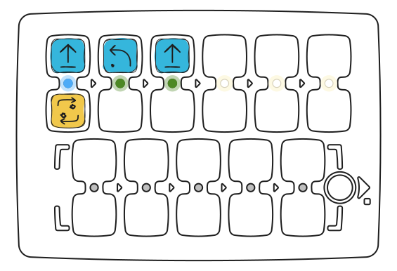

## Įvadas

PrimaSTEM yra robotikos rinkinys: programuojamas robotas ir valdymo pultas su komandų žetonais. Rinkinį galima naudoti vyresnio amžiaus žmonių kognityvinių sutrikimų prevencijai ir korekcijai.

### Kam skirta

- Vyresnio amžiaus žmonėms su lengvais kognityviniais sutrikimais
- Žmonėms po neurologinių ligų
- Pacientams ankstyvose neurodegeneracinių ligų stadijose

### Kontraindikacijos

- Sunkūs regos sutrikimai
- Ryškūs viršutinių galūnių motorikos sutrikimai
- Sunki demencija
- Ūminiai psichikos sutrikimai

## Pirmasis užsiėmimas

Jis trunka apie 35 minutes. Prieš pradėdami perskaitykite kontraindikacijas aukščiau. Jei prietaiso dar neturite, visus žingsnius galite atlikti [simuliatoriuje](https://simulator.primastem.com).

<Steps>
  <Step title="Susipažinimas su rinkiniu, 10 minučių">
    Parodykite robotą, valdymo pultą ir žetonus Pirmyn, Dešinėn ir Kairėn. Dalyvis įstato vieną žetoną Pirmyn į valdymo pultą, paspaudžia **▶ Start** ir stebi, kaip robotas juda. Kaip veikia valdymo pultas ir robotas, paaiškinta skyriuje [Greita pradžia](/en-lt/quickstart).
  </Step>
  <Step title="Pirmasis maršrutas, 10 minučių">
    Pažymėkite tikslą dviejų ar trijų langelių atstumu nuo roboto. Dalyvis sudėlioja žetonus, paleidžia programą ir patikrina, ar robotas pasiekė tikslą. Simuliatoriuje naudokite [lengvą labirintą](https://simulator.primastem.com/#s=l1144402&r=75-525-0&m=2101).
  </Step>
  <Step title="Pertrauka, 5 minutės">
    Pailsėkite po 15–20 minučių darbo.
  </Step>
  <Step title="Figūra, 10 minučių">
    Dalyvis sudaro programą, pagal kurią robotas nubrėžia kvadratą. Simuliatoriuje atidarykite [kvadrato užduotį](https://simulator.primastem.com/#sh=square): robotas turi važiuoti punktyriniu kontūru.
  </Step>
</Steps>

Pabaigoje paklauskite, kas buvo lengva ir kas sunku. Atsakymas parodys, nuo ko pradėti kitą kartą.

## Bendrieji principai

Su amžiumi ir dėl neurodegeneracinių ligų gali silpti atmintis, abstraktaus mąstymo, mokymosi ir kūrybinės raidos gebėjimai. Užsiėmimai su PrimaSTEM rinkiniu padeda sulėtinti šiuos procesus, nes žaidimo forma lavina įvairias kognityvines funkcijas.

### Užsiėmimų organizavimas

- Vieno užsiėmimo trukmė: 30–45 minutės
- Užsiėmimų dažnumas: 2–3 kartus per savaitę
- Forma: individuali arba mažomis grupėmis (2–4 žmonės)
- Būtinos pertraukos: 5–10 minučių po kiekvienų 15–20 minučių darbo

### Užsiėmimų vedimo principai

1. Laipsniškai sudėtingėjančios užduotys
2. Individualių savybių ir apribojimų paisymas
3. Teigiama emocinė atmosfera
4. Skirtingų pratimų rūšių kaitaliojimas
5. Privalomas grįžtamasis ryšys ir padrąsinimas

## Pagrindinės korekcijos kryptys

### Kognityvinės funkcijos

- Intelektinės veiklos skatinimas
- Erdvinio mąstymo ir atminties lavinimas
- Regimosios ir girdimosios žodinės atminties gerinimas
- Loginio mąstymo ir mintinio skaičiavimo lavinimas
- Veiklos planavimo ir kontrolės įgūdžių ugdymas
- Periferinio regėjimo lavinimas

### Socialiniai ir emociniai aspektai

- Asmeninio potencialo ir socialinio aktyvumo palaikymas
- Galimybės save išreikšti kūrimas
- Bendravimo barjerų įveikimas
- Teigiamo emocinio fono formavimas

## Treniruočių variantai ir žaidimų pratimai

### 1. Baziniai pratimai (adaptacijos laikotarpis)

- Susipažinimas su komandų žetonais
- Paprasti roboto judesiai tiesia linija
- Paprasčiausi posūkiai
- Paprastų komandų sekų sudarymas

**Medžiaga**

- [Greita pradžia](/en-lt/quickstart)
- [1 knyga](/en-lt/book-1/book-1), 2 užsiėmimas

### 2. Erdvinio mąstymo treniravimas

#### Maršruto sudarymas

- Trumpiausias kelias
- Su kliūtimis
- Su atsitiktiniu komandų žetonų rinkiniu
- Pagal duotą algoritmą
- Teisingo maršruto pasirinkimas iš pateiktų variantų
- Atgalinio maršruto sudarymas

#### Sudėtingumo lygiai

1. Galutinio taško nustatymas pagal duotą maršrutą
2. Teisingo maršruto pasirinkimas iš sąrašo
3. Pradinio taško nustatymas pagal žinomą galutinį tašką

#### Darbas su tikromis erdvėmis

- Pažįstamų patalpų (namų kambarių, koridorių) modeliavimas
- Maršrutų patalpose planavimas
- Labirintų įveikimas

**Medžiaga**

- Labirintai simuliatoriuje: [lengvas](https://simulator.primastem.com/#s=l1144402&r=75-525-0&m=2101), [vidutinis](https://simulator.primastem.com/#s=l1144502&r=75-675-0&m=400113232131), [sunkus](https://simulator.primastem.com/#s=l1144602&r=75-825-0&m=0014243444540212223242). Robotas pradeda kampe, vėliavėlė žymi tikslą.
- [1 priedas - Judėjimas žemėlapyje](/en-lt/book-1/attachment-1)
- [2 priedas - Misijų kortelės](/en-lt/book-1/attachment-2)
- [1 knyga](/en-lt/book-1/book-1), 4 užsiėmimas: nuspėkite, kur robotas sustos.
- [3 priedas - Nubrėžk kelią pagal duotą seką](/en-lt/book-1/attachment-3)

### 3. Planavimo įgūdžių treniravimas

- Kasdienių veiksmų algoritmų sudarymas:
  - „Esu parduotuvėje – perku pagal sąrašą“
  - „Ruošiuosi išeiti į lauką – ką darau?“
- Kortelės su daiktų ir veiksmų paveikslėliais

**Medžiaga**

- [2 priedas - Misijų kortelės](/en-lt/book-1/attachment-2)
- [4 priedas - Rask ir ištaisyk klaidą programoje](/en-lt/book-1/attachment-4)

### 4. Erdvinės atminties treniravimas

- Maršrutų įsiminimas ir atkūrimas (pagal vaizdą, iš klausos)
- Mnemoninių metodų naudojimas (Cicerono metodas)
- „MEMO“ tipo žaidimas:
  - Porinių kortelių paieška ir įsiminimas

**Medžiaga**

- [Laipteliai simuliatoriuje](https://simulator.primastem.com/#top=cfun.r004&fn=cfor,crig,cfor,clef&s=l1144502&r=75-675-0&run): stebėkite, kaip robotas važiuoja, uždarykite langą ir sudėliokite maršrutą valdymo pulte iš atminties.

### 5. Matematiniai žaidimai

- Matematiniai labirintai – judėjimas langeliais su pavyzdžiais
- Aritmetinis maršrutas – to paties skaičiaus pridėjimas ar atėmimas

**Medžiaga**

- [Mokytojo vadovas](/en-lt/teachersguide), skyrius „8 – Aritmetika“.
- [Piešinių pavyzdžiai](/en-lt/mathdrawings), grupė „Spiralės“: kiekvienas žingsnis padidėja tuo pačiu skaičiumi.

### 6. Žodžių žaidimai

- Patarlių paieška lauke
- Žodžių sudarymas iš išmėtytų raidžių
- Maršrutų sudarymas pagal paveikslėlius su tam tikrais garsais

**Medžiaga**

- [Garso failų sąrašas](/en-lt/sounds_reference): valdymo pultas įgarsina žetonus, raides ir vietovių pavadinimus 21 kalba.

### 7. Žaidimai su pieštuku (piešimas)

#### Grafiniai diktantai

- Algoritmo sudarymas pagal piešinį
- Simetriškos pusės užbaigimas
- Algoritmo klaidų taisymas
- Veidrodinio atspindžio piešimas
- Figūros pasukimas 90 laipsnių kampu
- Raštų ir ornamentų kūrimas naudojant ciklus

**Medžiaga**

- Simuliatoriuje apveskite figūrą jos kontūru: [kvadratas](https://simulator.primastem.com/#sh=square), [trikampis](https://simulator.primastem.com/#sh=triangle), [namas](https://simulator.primastem.com/#sh=house), [žvaigždė](https://simulator.primastem.com/#sh=star).
- [Piešinių pavyzdžiai](/en-lt/mathdrawings): kiekviena programa pateikta šalia jos baigto piešinio.

### 8. Bendravimo žaidimai

#### Varžybiniai pratimai

- Kuo daugiau premijinių žetonų surinkimas
- „Monopolio“ tipo žaidimas su robotu
- Žodžių žaidimas su raidžių paieška
- Stalo žaidimas „Labirintas“ dviem žaidėjams

**Medžiaga**

- Galvosūkiai poroms ir grupėms surinkti toliau, skyriuje „Galvosūkiai“.

## Galvosūkiai

Užduotys poroms arba mažoms grupėms prie stalo. Padėkite robotą ant didelio popieriaus lapo ir įstatykite flomasterį. Robotas vienu žingsniu pajuda 15 cm ir pasisuka 90°. Atsakymas paslėptas po kiekviena užduotimi. Nuoroda į simuliatorių skirta užsiėmimo vedėjui, kad jis iš anksto patikrintų užduotį.

### Atspėk piešinį

Vedėjas sudėlioja programą valdymo pulte ir nesako, ką ji nupieš. Robotas piešia, o dalyviai stengiasi pirmi atspėti, kas tai. Atspėjęs gauna tašką. Daugiau programų rasite puslapyje [Piešinių pavyzdžiai](/en-lt/mathdrawings).

[Paleisti simuliatoriuje](https://simulator.primastem.com/#top=cfor.n300,crig.n120,cfor,crig,cfor,cfun.r003&fn=clef,cfor&s=l1047602&r=338-397-30&run)

<Columns cols={2}>
  <Frame caption="Programa valdymo pulte">
    
  </Frame>
</Columns>

<Accordion title="Atsakymas">
  Namas.

  <Columns cols={2}>
    <Frame caption="Ką nupieš robotas">
      
    </Frame>
  </Columns>
</Accordion>

### Pakeisk vieną žetoną

Robotas piešia laiptelius. Pakeiskite vieną žetoną, kad jis nupieštų kvadratą.

[Paleisti simuliatoriuje](https://simulator.primastem.com/#top=cfun.r004&fn=cfor,crig,cfor,clef&s=l1144502&r=75-675-0&run)

<Columns cols={2}>
  <Frame caption="Programa valdymo pulte">
    
  </Frame>
  <Frame caption="Ką nupieš robotas">
    
  </Frame>
</Columns>

<Accordion title="Atsakymas">
  Apatinėje eilėje pakeiskite „Kairėn“ į „Dešinėn“. Robotas apvažiuos kvadratą du kartus.

  [Paleisti simuliatoriuje](https://simulator.primastem.com/#top=cfun.r004&fn=cfor,crig,cfor,crig&s=l1144502&r=75-675-0&run)

  <Columns cols={2}>
    <Frame caption="Programa valdymo pulte">
      
    </Frame>
    <Frame caption="Ką nupieš robotas">
      
    </Frame>
  </Columns>
</Accordion>

### Atspėk programą

Vedėjas sudėlioja programą taip, kad dalyviai nematytų valdymo pulto. Robotas pradeda nuo apatinio kairiojo taško, atsisukęs į viršų, ir nupiešia apverstą raidę U. Dalyviai sudaro programą, kuri nupieštų tokią pat figūrą, ir išbando ją su robotu.

<Columns cols={2}>
  <Frame caption="Ką nupieš robotas">
    
  </Frame>
</Columns>

<Accordion title="Atsakymas">
  „Pirmyn“ ×2, „Dešinėn“, „Pirmyn“, „Dešinėn“, „Pirmyn“ ×2. Teisinga bet kuri programa, kuri nupiešia tokį patį piešinį.

  [Paleisti simuliatoriuje](https://simulator.primastem.com/#top=cfor.r002,crig,cfor,crig,cfor.r002&s=l1144402&r=225-525-0&run)

  <Columns cols={2}>
    <Frame caption="Programa valdymo pulte">
      
    </Frame>
  </Columns>
</Accordion>

### Tas pats ar ne?

Štai dvi programos. Ar su abiem robotas nupieš tą patį? Pirmiausia dalyviai ginčijasi, tada patikrina, paleisdami abi programas iš tos pačios vietos.

<Columns cols={2}>
  <Frame caption="1 programa">
    
  </Frame>
  <Frame caption="2 programa">
    
  </Frame>
</Columns>

<Accordion title="Atsakymas">
  Taip. Po trijų posūkių „Dešinėn“ robotas žiūri ta pačia kryptimi kaip po vieno posūkio „Kairėn“.

  [Paleisti simuliatoriuje: 1 programa](https://simulator.primastem.com/#top=cfor.r002,crig.r003,cfor&s=l1144402&r=375-525-0&run) · [Paleisti simuliatoriuje: 2 programa](https://simulator.primastem.com/#top=cfor.r002,clef,cfor&s=l1144402&r=375-525-0&run)

  <Columns cols={2}>
    <Frame caption="Ką nupieš robotas">
      
    </Frame>
  </Columns>
</Accordion>

### Atgal namo

Pieštuku pažymėkite pradinį tašką. Robotas nuvažiavo nuo jo pagal šią programą. Sudarykite programą, kuri grąžintų jį į pradžią.

[Paleisti simuliatoriuje](https://simulator.primastem.com/#top=cfor.r002,crig,cfor&s=l1144402&r=75-525-0&run)

<Columns cols={2}>
  <Frame caption="Programa valdymo pulte">
    
  </Frame>
  <Frame caption="Ką nupieš robotas">
    
  </Frame>
</Columns>

<Accordion title="Atsakymas">
  „Dešinėn“ ×2, „Pirmyn“, „Kairėn“, „Pirmyn“ ×2. Kitas sprendimas: „Atgal“, „Dešinėn“, „Pirmyn“ ×2.

  [Paleisti simuliatoriuje](https://simulator.primastem.com/#top=crig.r002,cfor,clef,cfor.r002&s=l1144402&r=225-225-90&m=03&run)

  <Columns cols={2}>
    <Frame caption="Programa valdymo pulte">
      
    </Frame>
    <Frame caption="Ką nupieš robotas">
      
    </Frame>
  </Columns>
</Accordion>

## Veiksmingumo vertinimas

### Kontrolės metodai

- Reguliarus kognityvinių funkcijų testavimas
- Užduočių atlikimo dinamikos stebėjimas
- Dalyvių atsiliepimų rinkimas
- Užsiėmimų dienoraščio pildymas

### Sėkmės kriterijai

- Geresni užduočių atlikimo rodikliai
- Atliekamų pratimų sudėtingumo didėjimas
- Teigiamas dalyvių subjektyvus vertinimas
- Įgūdžių perkėlimas į kasdienį gyvenimą

## Programos pritaikymo rekomendacijos

### Individualizavimas

- Fizinių apribojimų paisymas
- Užsiėmimų tempo pritaikymas
- Užduočių pritaikymas pagal dalyvio interesus
- Individualaus pažangos plano sudarymas

### Darbas grupėje

- Grupių sudarymas pagal gebėjimų lygį
- Varžybų elementų įtraukimas
- Savitarpio pagalbos skatinimas
- Jaukios socialinės aplinkos kūrimas
