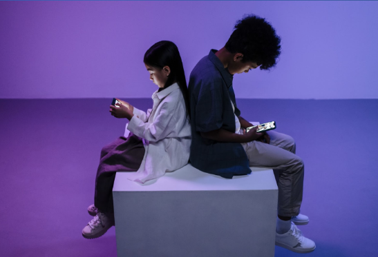
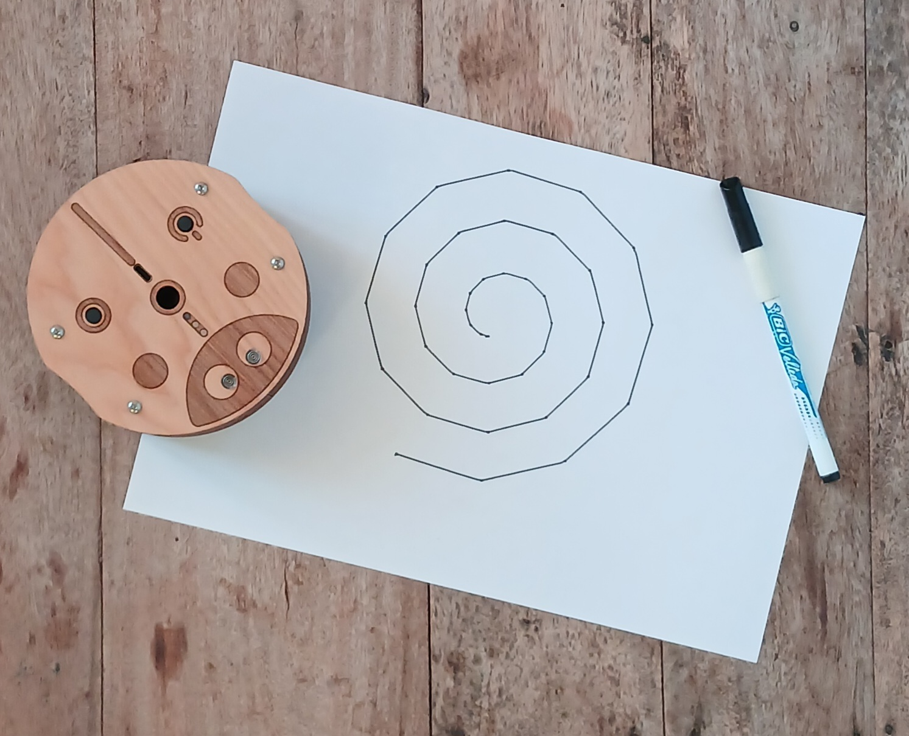

_Valdymo pultas, programavimo žetonai, robotas ir programos vykdymo rezultatai._

## Aktualumas

**Šiuolaikiniai vaikai** nuo mažens domisi vaizdo žaidimais ir elektroniniais prietaisais ir greitai juos perpranta.

Tėvai supranta, kad informacinės technologijos svarbios sėkmingam vaiko vystymuisi, bet kartu nori išlaikyti pusiausvyrą tarp mokymosi ir vaikų sveikatos.

Tyrimai rodo, kad ankstyvas ir dažnas buvimas prie ekranų gali mažinti pažintinius gebėjimus ir mokymosi rezultatus.

[_Šaltinis: Tarptautinis mokinių pasiekimų vertinimas (PISA), 2022 m. rezultatai (I tomas)_](https://www.oecd-ilibrary.org/education/pisa-2022-results-volume-i_53f23881-en)

Kai maži vaikai naudojasi prietaisais su ekranu, dažnai atsiranda:

- psichologinių sunkumų,
- priklausomybė nuo žaidimų,
- regos ir fizinės sveikatos problemų.

## Tikslai ir uždaviniai

Ši mokomoji **priemonė** padeda vaikams nuo 4 metų mokytis programavimo, logikos ir matematikos **be ekranų**.

Su PrimaSTEM vaikai išmoksta:

- skaičių,
- orientuotis erdvėje,
- algoritmų,
- loginio mąstymo,
- programavimo pagrindų,
- aritmetinių veiksmų ir progresijų,
- geometrinių sąvokų.

**Privalumai:**

- tinka įvairiai paskirčiai,
- įtraukianti ir vaizdi forma,
- mokymasis be ekranų,
- tinka ikimokyklinio ir pradinio mokyklinio amžiaus vaikams,
- natūralios medžiagos.

> 🎯 **Pagrindinis tikslas:** ugdyti pažintinius gebėjimus, kai vaikas apčiuopiamai ir vaizdžiai supranta programavimo pagrindus ir programos vykdymo rezultato prasmę.

## Kaip tai veikia?

1. Įjunkite robotą ir valdymo pultą.
2. Iš komandų žetonų sudarykite judėjimo programą: sudėkite juos į pulto lizdus.
3. Paspauskite mygtuką **▶ Start** ir robotas įvykdys programą.

---

**Vaizdo pristatymas:** [youtu.be/Ztq\_I1WBiVo](https://youtu.be/Ztq_I1WBiVo)

  <iframe
    src="https://www.youtube.com/embed/Ztq_I1WBiVo?si=a54tevy8tUEQMOva"
    style={{
position: 'absolute',
top: 0,
left: 0,
width: '100%',
height: '100%',
}}
    frameBorder="0"
    allow="accelerometer; autoplay; clipboard-write; encrypted-media; gyroscope; picture-in-picture"
    allowFullScreen
  />

> 📺  Daugiau mokomųjų vaizdo įrašų ir pavyzdžių rasite mūsų [YouTube kanale PrimaSTEM](https://www.youtube.com/@primastem)

## Kam tai skirta?

PrimaSTEM sukurtas vaikams ir atrodo kaip žaidimas, bet tai lanksti priemonė pedagogams ir tėvams. Ją galima naudoti įvairiems dalykams mokyti: matematikai, programavimui, fizikai, istorijai, geografijai. Ribas nustato tik mokytojo ar tėvų vaizduotė ir įgūdžiai.

Vaikas įgyja matematikos ir algoritmų pagrindą, kuris puikiai paruošia mokyklai ir pirmajai pažinčiai su programavimo kalbomis (Scratch, Logo ar Minecraft).

_Rezultato pavyzdys: spiralė, nupiešta cikle dinamiškai keičiant kintamąjį._
