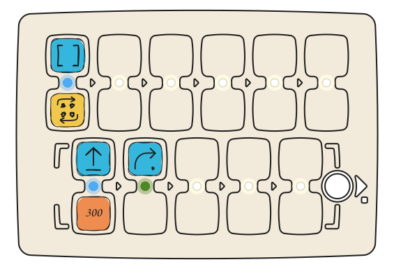
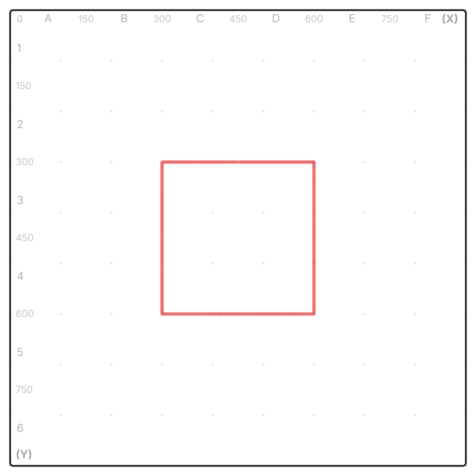
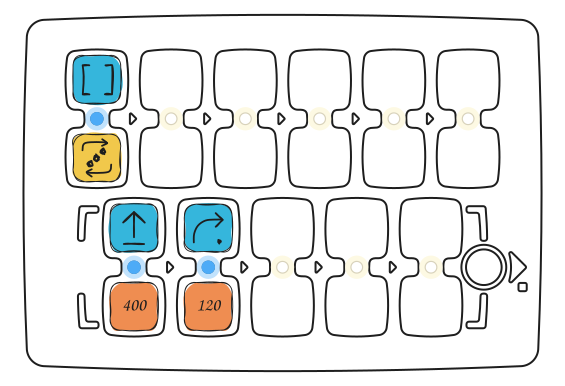
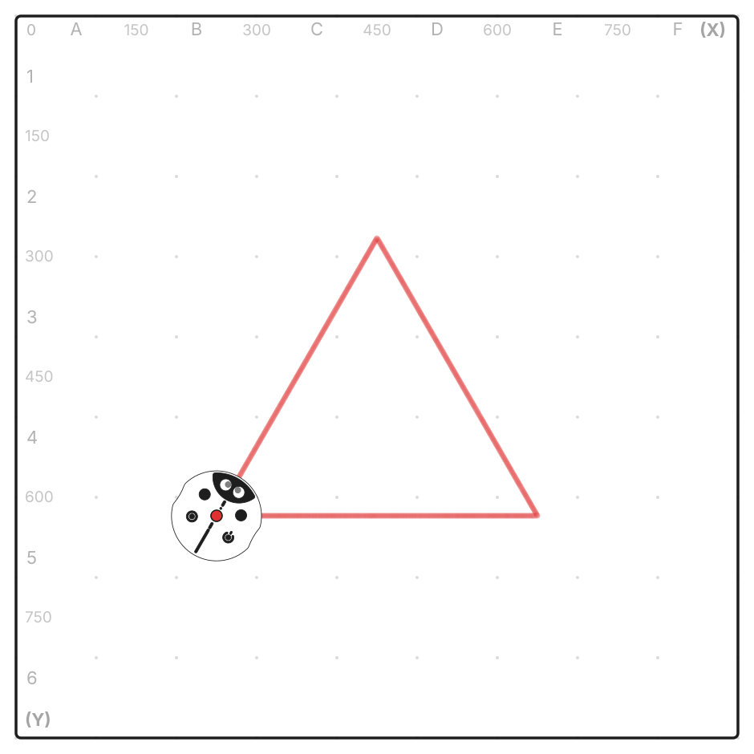
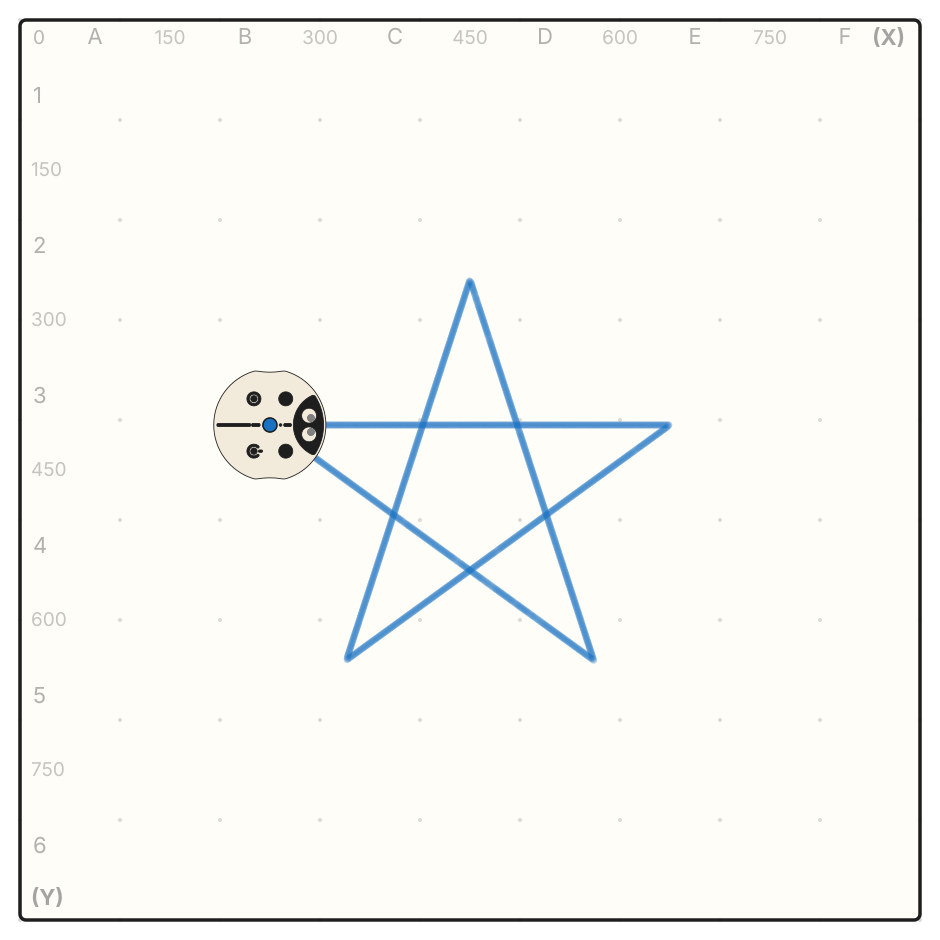
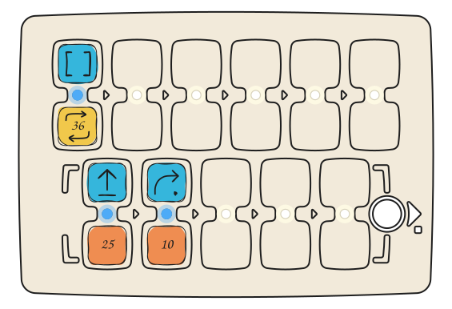
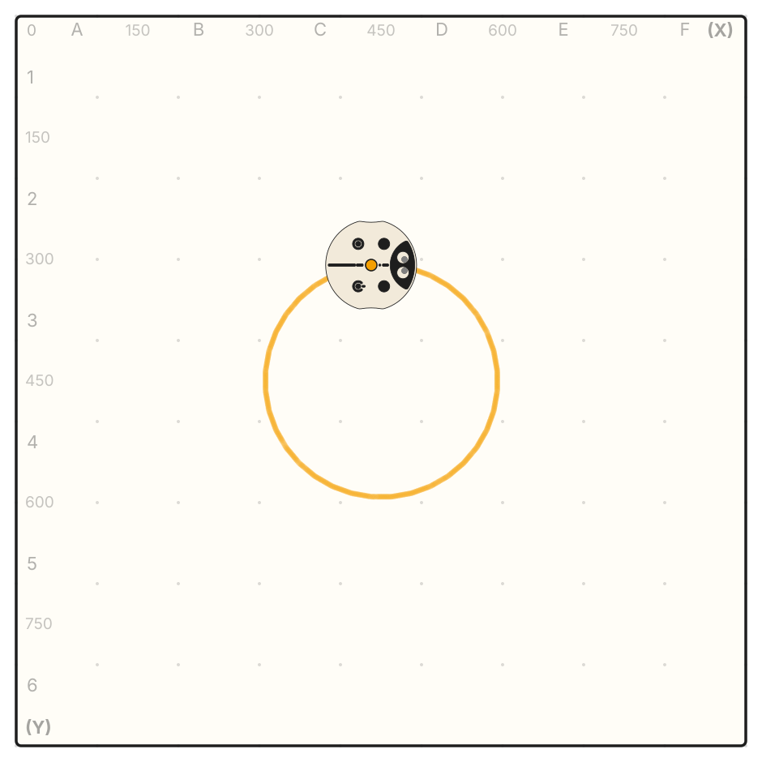
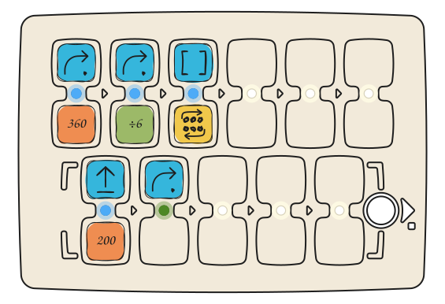
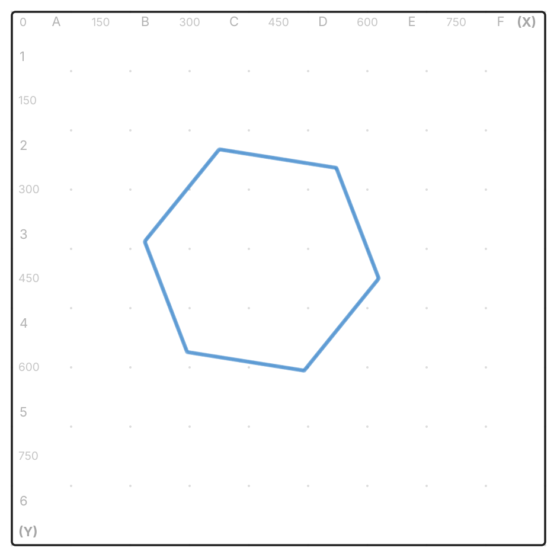

PrimaSTEM sukurtas pagal [LOGO](https://en.wikipedia.org/wiki/Logo_(programming_language)) idėją. Šią kalbą vaikams 1967 metais sukūrė Seymour Papert ir jo kolegos. LOGO kalboje vaikas įveda komandas, o vėžlys piešia ekrane. PrimaSTEM vaikas deda žetonus į valdymo pultą, o medinis robotas su flomasteriu piešia ant popieriaus. Be klaviatūros, be ekrano, be teksto.

Šis puslapis skirtas mokytojams, kurie žino LOGO ar Scratch, ir visiems, kas nori suprasti, ką iš tikrųjų daro žetonai.

## Sąvokos valdymo pulte

| Sąvoka | PrimaSTEM valdymo pulte | LOGO kalboje |
|---|---|---|
| Seka | Žetonai vykdomi iš kairės į dešinę viršutinėje eilėje. Vykdomos poros šviesos diodas mirksi, paskui užgęsta | komandos viena po kitos |
| Komanda | Pirmyn, Atgal, Kairėn, Dešinėn, Pauzė, Atsitiktinis judesys | `forward`, `back`, `left`, `right`, `wait` |
| Parametras | Skaičiaus žetonas toje pačioje poroje: Pirmyn + 200 | `forward 200` |
| Numatytoji reikšmė | Pirmyn be skaičiaus = 150 mm, Kairėn/Dešinėn be skaičiaus = 90° | |
| Ciklas | Kartojimo žetonas poroje: Pirmyn + kartojimas 4 | `repeat 4 [forward 150]` |
| Procedūra | Apatinė eilė (5 poros) yra Funkcija. Ją iškviečia žetonas „Funkcija“ | `to shape ... end`, paskui `shape` |
| Procedūra cikle | Žetonas „Funkcija“ ir kartojimo žetonas vienoje poroje: Funkcija + kartojimas 5 | `repeat 5 [shape]` |
| Reikšmės perdavimas procedūrai | Pirmyn 100 pajuda 100 mm ir išsaugo 100. Jei po to iškviečiate Funkciją, kurioje yra Pirmyn be skaičiaus, ji taip pat pajuda 100. Prieš kitą iškvietimą pakeiskite Pirmyn, ir ta pati Funkcija nupieš kito dydžio figūrą | panašiai kaip `shape 100`, `shape 50` |
| Rekursija | Žetonas „Funkcija“ apatinėje eilėje: funkcija kviečia pati save, kol dar kartą paspausite ▶ Start | procedūra, kuri kviečia pati save |
| Kintamieji | Kiekviena komanda įsimena savo paskutinę reikšmę: Pirmyn, Atgal, Kairėn, Dešinėn ir Pauzė yra penki nepriklausomi kintamieji. Pirmyn be skaičiaus pajuda tiek pat, kiek ankstesnis Pirmyn | `make "step 200`, paskui `forward :step` |
| Aritmetika su kintamuoju | Pirmyn + „+30“: pridėti 30 prie išsaugotos reikšmės ir judėti | `make "step :step + 30 forward :step` |
| Veiksmai | + − × ÷ √ ^ su išsaugota reikšme, nuo −5000 iki 5000, sveikieji skaičiai | `sum`, `difference`, `product`, `quotient`, `sqrt`, `power` |
| Neigiamos reikšmės | Neigiamas rezultatas apverčia judesį: Pirmyn −50 važiuoja 50 mm atgal, Kairėn −30 pasuka dešinėn 30° | `forward -50` |
| Atsitiktinumas | Kartojimo žetonas su kauliuku (nuo 1 iki 6 kartų) ir žetonas „Atsitiktinis judesys“ | `random 6` |
| Rašiklis | Flomasteris roboto centre | `pendown` |
| Derinimas | Stebime robotą, randame neteisingą žetoną, jį pakeičiame | pataisyti eilutę |

Kiekviena komanda turi savo išsaugotą reikšmę: pakeitus Pirmyn, Kairėn nesikeičia. Išjungus valdymo pultą, visos reikšmės grįžta į numatytąsias: 150 mm, 90°, 1 s Pauzei. Numatytąjį žingsnį visam laikui galima pakeisti tarnybiniu žetonu „Numatytasis žingsnis“ (žr. [Įrenginys ir nustatymai](/en-lt/usermanual)).

Skaičiuoja vaikas. Robotas tiksliai įvykdo programą.

## Pavyzdžiai: ta pati programa valdymo pulte ir LOGO kalba

Kiekvienas pavyzdys turi nuorodą. Ji atidaro [simuliatorių](https://simulator.primastem.com) su šia programa valdymo pulte ir ją paleidžia.

### Kvadratas

Pultas: viršutinė eilė Funkcija × 4. Apatinė eilė: Pirmyn 300, Dešinėn.

```
repeat 4 [forward 300 right 90]
```

[Paleisti simuliatoriuje](https://simulator.primastem.com/#top=cfun.r004&fn=cfor.n300,crig&s=l1047602&r=300-600-0&run)

<Columns cols={2}>
  <Frame caption="Programa valdymo pulte">
    
  </Frame>
  <Frame caption="Ką nupieš robotas">
    
  </Frame>
</Columns>

4–6 metų vaikams skaičius praleiskite: Pirmyn ir Dešinėn be skaičių nupiešia kvadratą, kurio kraštinė 15 cm.

### Lygiakraštis trikampis

Pultas: viršutinė eilė Funkcija × 3. Apatinė eilė: Pirmyn 400, Dešinėn 120.

```
repeat 3 [forward 400 right 120]
```

[Paleisti simuliatoriuje](https://simulator.primastem.com/#top=cfun.r003&fn=cfor.n400,crig.n120&s=l1047602&r=250-623-30&run)

<Columns cols={2}>
  <Frame caption="Programa valdymo pulte">
    
  </Frame>
  <Frame caption="Ką nupieš robotas">
    
  </Frame>
</Columns>

Kodėl 120, o ne 60? Robotas pasisuka išoriniu kampu. Trys posūkiai kartu turi sudaryti pilną apsisukimą: 3 × 120 = 360.

### Penkiakampė žvaigždė

Pultas: viršutinė eilė Funkcija × 5. Apatinė eilė: Pirmyn 400, Dešinėn 144.

```
repeat 5 [forward 400 right 144]
```

[Paleisti simuliatoriuje](https://simulator.primastem.com/#top=cfun.r005&fn=cfor.n400,crig.n144&s=l1047602&r=250-405-90&run)

<Columns cols={2}>
  <Frame caption="Programa valdymo pulte">
    
  </Frame>
  <Frame caption="Ką nupieš robotas">
    
  </Frame>
</Columns>

5 × 144 = 720: robotas apsisuka du kartus, ir linija užsidaro į žvaigždę.

### Apskritimas

Pultas: viršutinė eilė Funkcija × 36. Apatinė eilė: Pirmyn 25, Dešinėn 10.

```
repeat 36 [forward 25 right 10]
```

[Paleisti simuliatoriuje](https://simulator.primastem.com/#top=cfun.r036&fn=cfor.n025,crig.n010&s=l1047602&r=438-307-90&run)

<Columns cols={2}>
  <Frame caption="Programa valdymo pulte">
    
  </Frame>
  <Frame caption="Ką nupieš robotas">
    
  </Frame>
</Columns>

Apskritimas yra daugiakampis su daug trumpų kraštinių: 36 × 10° = 360°.

### Kvadratinė spiralė (kintamasis ir aritmetika)

Pultas: viršutinė eilė Pirmyn 30, Funkcija × 20. Apatinė eilė: Dešinėn, Pirmyn +30.

```
make "side 30
forward :side
repeat 20 [
  right 90
  make "side :side + 30
  forward :side
]
```

[Paleisti simuliatoriuje](https://simulator.primastem.com/#top=cfor.n030,cfun.r020&fn=crig,cfor.a030&s=l1047602&r=450-465-0&run)

<Columns cols={2}>
  <Frame caption="Programa valdymo pulte">
    
  </Frame>
  <Frame caption="Ką nupieš robotas">
    
  </Frame>
</Columns>

Pirmyn 30 nustato išsaugotą reikšmę. Kiekvieną kartą paleidus funkciją, „+30“ pailgina kraštinę 30 mm: 60, 90, 120 ir taip toliau. Pirmasis Pirmyn 30 grąžina pradinę reikšmę, todėl dar kartą paspaudę ▶ Start gausite tą pačią spiralę.

### Šešiakampis (kampas dalybos būdu)

Pultas: viršutinė eilė Dešinėn 360, Dešinėn ÷6, Funkcija × 6. Apatinė eilė: Pirmyn 200, Dešinėn.

```
make "angle 360 / 6
repeat 6 [forward 200 right :angle]
```

[Paleisti simuliatoriuje](https://simulator.primastem.com/#top=crig.n360,crig.d006,cfun.r006&fn=cfor.n200,crig&s=l1047602&r=350-232-39&run)

<Columns cols={2}>
  <Frame caption="Programa valdymo pulte">
    
  </Frame>
  <Frame caption="Ką nupieš robotas">
    
  </Frame>
</Columns>

Dešinėn 360 apsuka robotą visu ratu ir išsaugo 360. Dešinėn ÷6 padalija išsaugotą reikšmę ir pasuka 60°. Funkcijoje Dešinėn be skaičiaus vėl naudoja 60°. Du posūkiai pradžioje tik pakeičia, kur robotas žiūri prieš piešdamas; figūra lieka šešiakampis.

Valdymo pultas dalija ir suapvalina iki artimiausio sveikojo skaičiaus. Kad figūra užsidarytų, 360 dalykite iš skaičiaus, iš kurio jis dalijasi be liekanos: 3, 4, 5, 6, 8, 9, 10, 12. Pavyzdžiui, 360 ÷ 7 = 51,4 duoda 51°, ir septyniakampis neužsidaro per 3°.

Daugiau piešinių: [Piešinių pavyzdžiai](/en-lt/mathdrawings).

## Kuo PrimaSTEM skiriasi nuo LOGO

PrimaSTEM apima LOGO vėžlio grafikos pagrindus. Kai kurie dalykai veikia kitaip, ir tai sąmoningas sprendimas:

- **Viena pora, viena komanda ir viena reikšmė.** Lizdų poroje telpa komanda ir ne daugiau kaip viena reikšmė: skaičius, kartojimas arba veiksmas. Todėl programą gali perskaityti net ketverių metų vaikas.
- **Nėra sąlygų (`if`).** Programa kiekvieną kartą vykdoma vienodai. Atsitiktinumo suteikia tik kauliukas ir Atsitiktinis judesys.
- **Funkcija neturi pavadintų parametrų.** Ji iškviečiama su kartojimu ir naudoja reikšmes, nustatytas prieš iškvietimą (žr. lentelę aukščiau).
- **Programos ilgis:** 6 poros pagrindinėje eilėje, 5 Funkcijoje.
- **Flomasterį įstatote ranka**, kai vaikas nori, kad robotas pieštų.

Kai vaikas išauga valdymo pultą, tas pats robotas veikia su [Scratch](https://scratch.primastem.com).

## Ką paskaityti

- [Seymour Papert](https://en.wikipedia.org/wiki/Seymour_Papert), *Mindstorms: Children, Computers, and Powerful Ideas*, 1980.
- [Mokytojo vadovas](/en-lt/teachersguide): pamokos nuo pirmosios programos iki aritmetikos.
- [Mokymosi vadovas. 1 knyga](/en-lt/book-1/book-1): 12 pamokų vaikams nuo 4 metų.
