Kiekvienas pavyzdys turi nuorodą. Ji atidaro [simuliatorių](https://simulator.primastem.com) su šia programa pulte ir ją paleidžia.

## Daugiakampiai

### Trikampis su paprasta programa

Pultas: viršutinė eilė Pirmyn, Dešinėn 120, Pirmyn, Dešinėn, Pirmyn.

[Paleisti simuliatoriuje](https://simulator.primastem.com/#top=cfor,crig.n120,cfor,crig,cfor&s=l1047402&r=225-365-30&run)

<Columns cols={2}>
  <Frame caption="Programa pulte">
    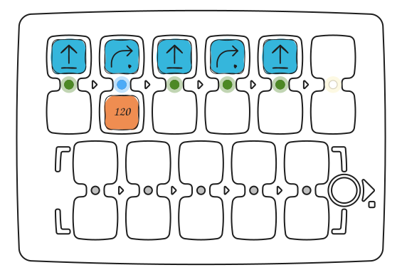
  </Frame>
  <Frame caption="Ką nupieš robotas">
    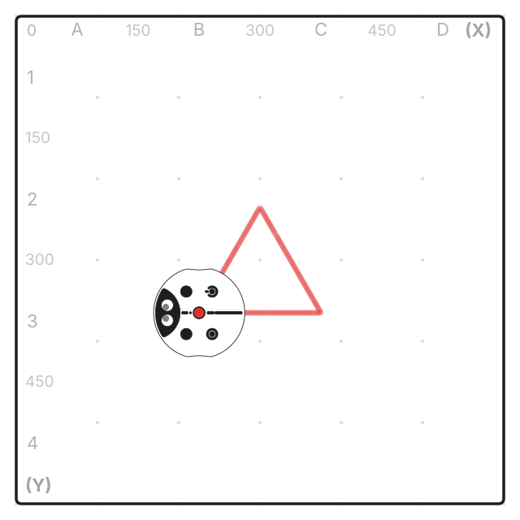
  </Frame>
</Columns>

### Trikampis su funkcija

Pultas: viršutinė eilė Funkcija × 3. Apatinė eilė: Pirmyn, Dešinėn 120.

[Paleisti simuliatoriuje](https://simulator.primastem.com/#top=cfun.r003&fn=cfor,crig.n120&s=l1047402&r=225-365-30&run)

<Columns cols={2}>
  <Frame caption="Programa pulte">
    
  </Frame>
  <Frame caption="Ką nupieš robotas">
    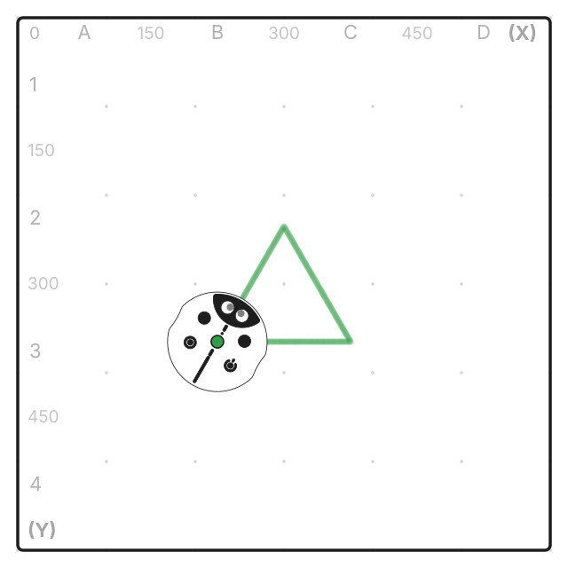
  </Frame>
</Columns>

### Taisyklingasis penkiakampis

Pultas: viršutinė eilė Funkcija × 5. Apatinė eilė: Pirmyn 50, Dešinėn 72.

[Paleisti simuliatoriuje](https://simulator.primastem.com/#top=cfun.r005&fn=cfor.n050,crig.n072&s=l1047402&r=275-262-90&run)

<Columns cols={2}>
  <Frame caption="Programa pulte">
    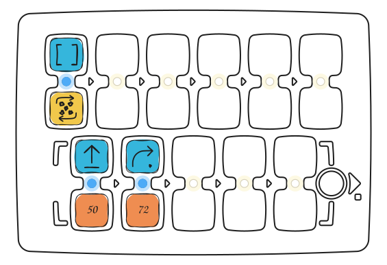
  </Frame>
  <Frame caption="Ką nupieš robotas">
    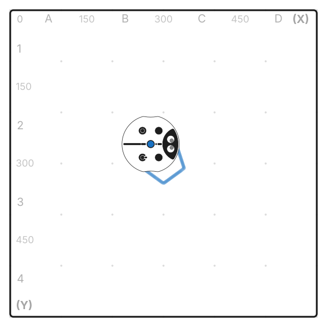
  </Frame>
</Columns>

### Trys trikampiai

Pultas: viršutinė eilė Funkcija × 3. Apatinė eilė: Pirmyn 100, Dešinėn 120, Pirmyn 200, Dešinėn, Pirmyn 300.

[Paleisti simuliatoriuje](https://simulator.primastem.com/#top=cfun.r003&fn=cfor.n100,crig.n120,cfor.n200,crig,cfor.n300&s=l1047402&r=400-300-90&run)

<Columns cols={2}>
  <Frame caption="Programa pulte">
    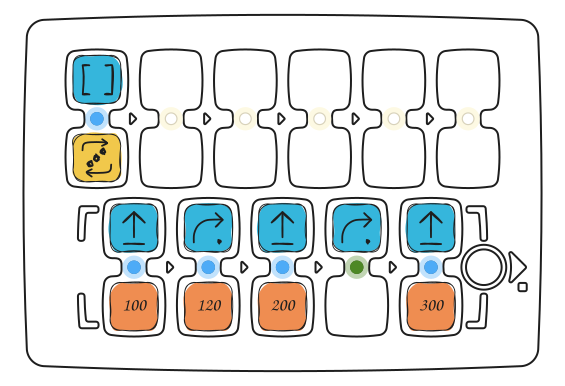
  </Frame>
  <Frame caption="Ką nupieš robotas">
    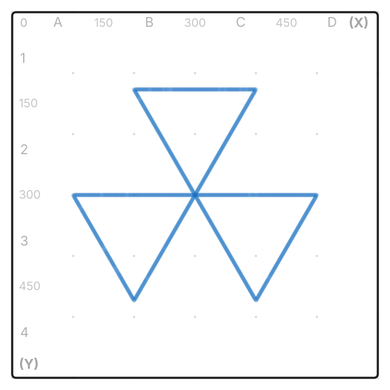
  </Frame>
</Columns>

### Korys

Pultas: viršutinė eilė Funkcija × 6, Kairėn 120, Funkcija × 6, Kairėn 120, Funkcija × 6. Apatinė eilė: Pirmyn 100, Dešinėn 60.

[Paleisti simuliatoriuje](https://simulator.primastem.com/#top=cfun.r006,clef.n120,cfun.r006,clef.n120,cfun.r006&fn=cfor.n100,crig.n060&s=l1047602&r=450-426-0&run)

<Columns cols={2}>
  <Frame caption="Programa pulte">
    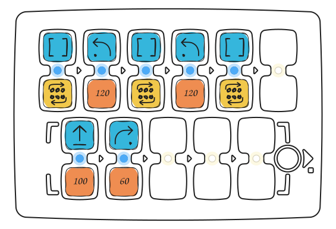
  </Frame>
  <Frame caption="Ką nupieš robotas">
    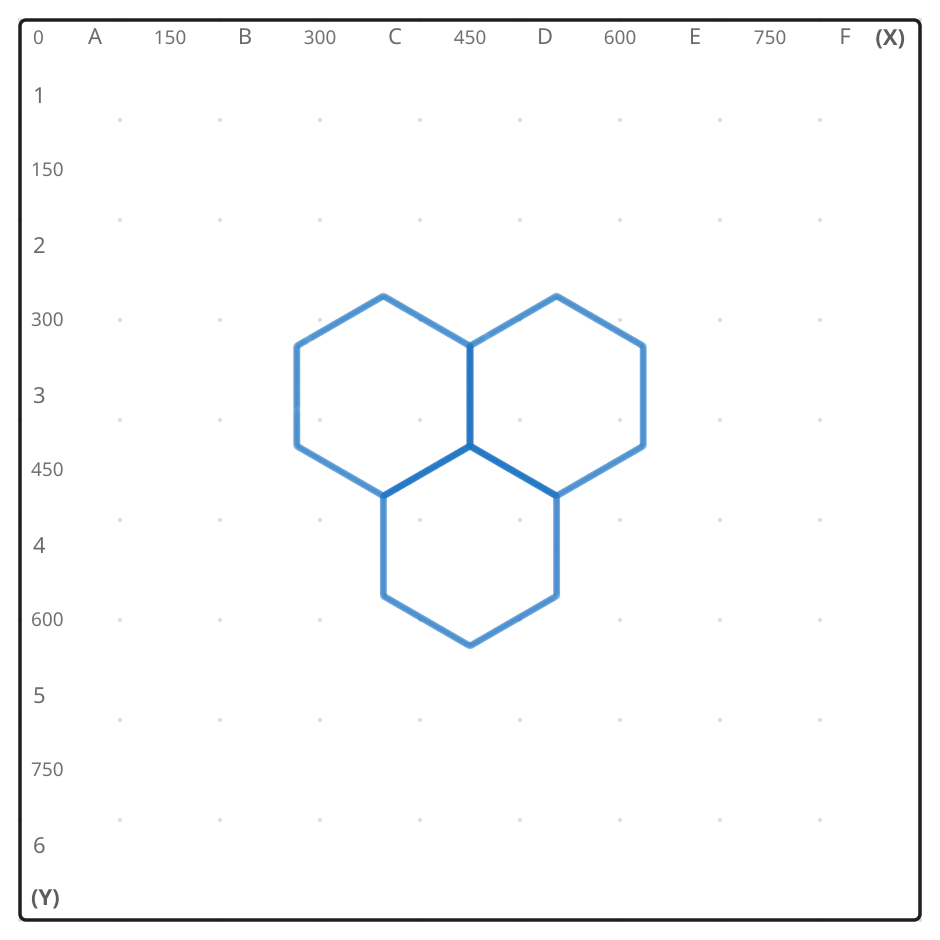
  </Frame>
</Columns>

### ~5 minučių laikmatis

Pultas: viršutinė eilė Funkcija × 5, Kairėn 360. Apatinė eilė: Pirmyn, Atgal, Pauzė 60, Dešinėn 72.

[Paleisti simuliatoriuje](https://simulator.primastem.com/#top=cfun.r005,clef.n360&fn=cfor,cbac,cwat.n060,crig.n072&s=l1041402&r=300-314-0&run)

<Columns cols={2}>
  <Frame caption="Programa pulte">
    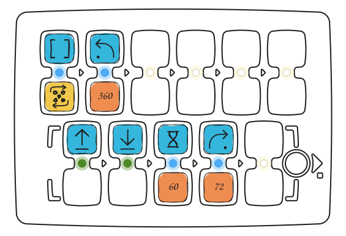
  </Frame>
  <Frame caption="Ką nupieš robotas">
    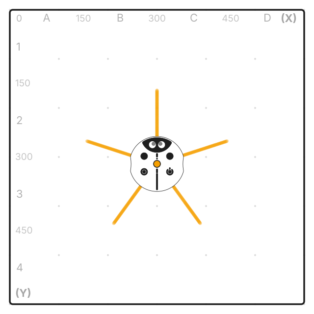
  </Frame>
</Columns>

## Daiktai ir žaidimai

### Laiptai

Pultas: viršutinė eilė Funkcija × 4. Apatinė eilė: Pirmyn, Dešinėn, Pirmyn, Kairėn.

[Paleisti simuliatoriuje](https://simulator.primastem.com/#top=cfun.r004&fn=cfor,crig,cfor,clef&s=l1144502&r=75-675-0&run)

<Columns cols={2}>
  <Frame caption="Programa pulte">
    
  </Frame>
  <Frame caption="Ką nupieš robotas">
    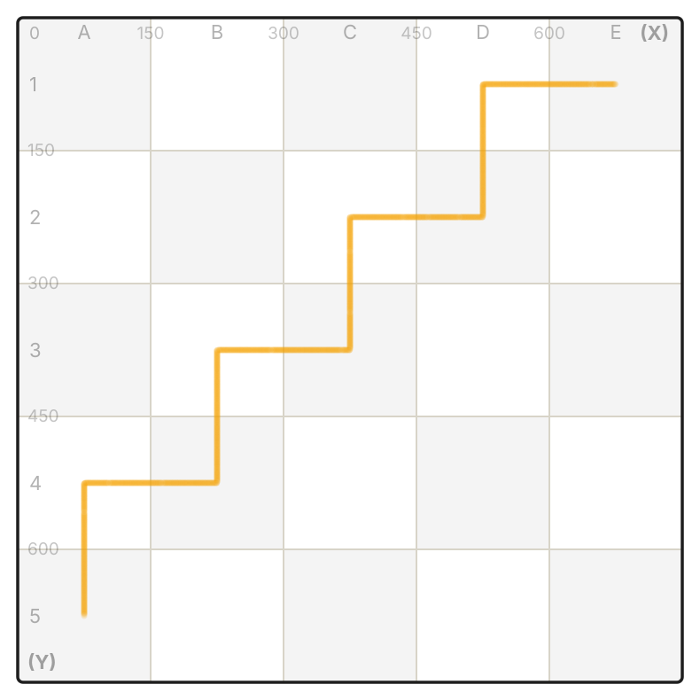
  </Frame>
</Columns>

### Namelis

Pultas: viršutinė eilė Pirmyn 300, Dešinėn 120, Pirmyn, Dešinėn, Pirmyn, Funkcija × 3. Apatinė eilė: Kairėn, Pirmyn.

[Paleisti simuliatoriuje](https://simulator.primastem.com/#top=cfor.n300,crig.n120,cfor,crig,cfor,cfun.r003&fn=clef,cfor&s=l1047602&r=338-397-30&run)

<Columns cols={2}>
  <Frame caption="Programa pulte">
    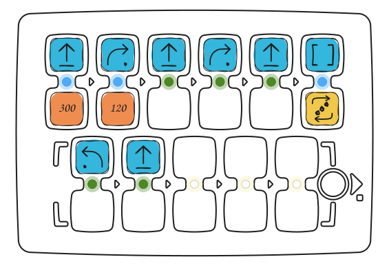
  </Frame>
  <Frame caption="Ką nupieš robotas">
    
  </Frame>
</Columns>

### Ežiukas

Pultas: viršutinė eilė Funkcija × 36. Apatinė eilė: Pirmyn 200, Atgal 200, Dešinėn 10.

[Paleisti simuliatoriuje](https://simulator.primastem.com/#top=cfun.r036&fn=cfor.n200,cbac.n200,crig.n010&s=l1047402&r=300-300-0&run)

<Columns cols={2}>
  <Frame caption="Programa pulte">
    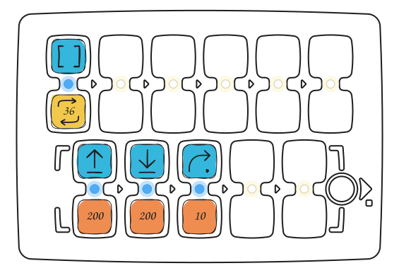
  </Frame>
  <Frame caption="Ką nupieš robotas">
    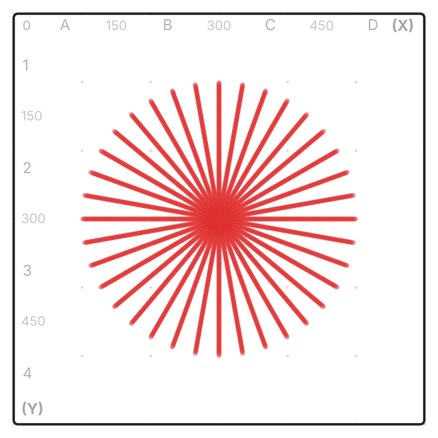
  </Frame>
</Columns>

### Vėduoklė

Pultas: viršutinė eilė Funkcija × 18. Apatinė eilė: Pirmyn +15, Atgal +15, Dešinėn 10.

[Paleisti simuliatoriuje](https://simulator.primastem.com/#top=cfun.r018&fn=cfor.a015,cbac.a015,crig.n010&s=l1047502&r=260-530-270&run)

<Columns cols={2}>
  <Frame caption="Programa pulte">
    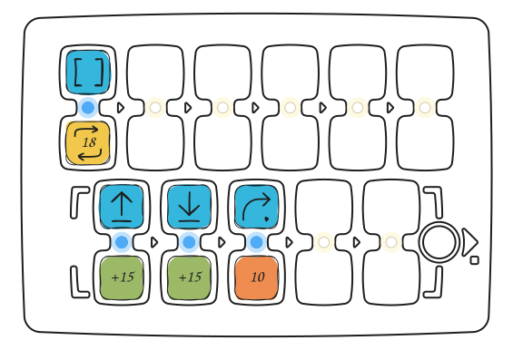
  </Frame>
  <Frame caption="Ką nupieš robotas">
    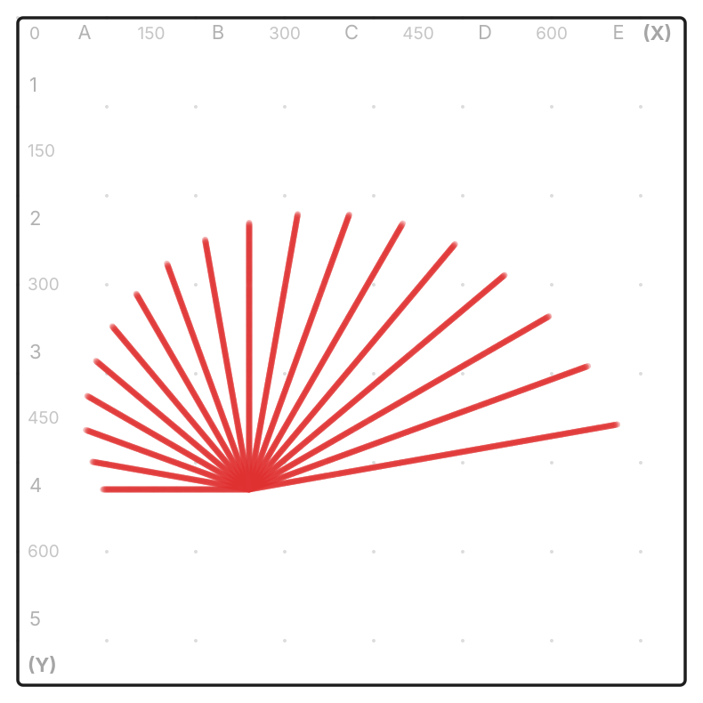
  </Frame>
</Columns>

### Boružės pasivaikščiojimas

Pultas: viršutinė eilė Atsitiktinis judesys × 40.

<Note>Kiekvieną kartą paleidus nubraižomas naujas kelias: robotas pats pasirenka kiekvieną žingsnį. Paveikslėlyje parodytas vienas iš galimų kelių.</Note>

[Paleisti simuliatoriuje](https://simulator.primastem.com/#top=crnd.r040&s=l1144502&r=375-375-0&run)

<Columns cols={2}>
  <Frame caption="Programa pulte">
    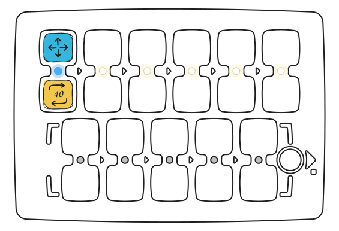
  </Frame>
  <Frame caption="Ką nupieš robotas">
    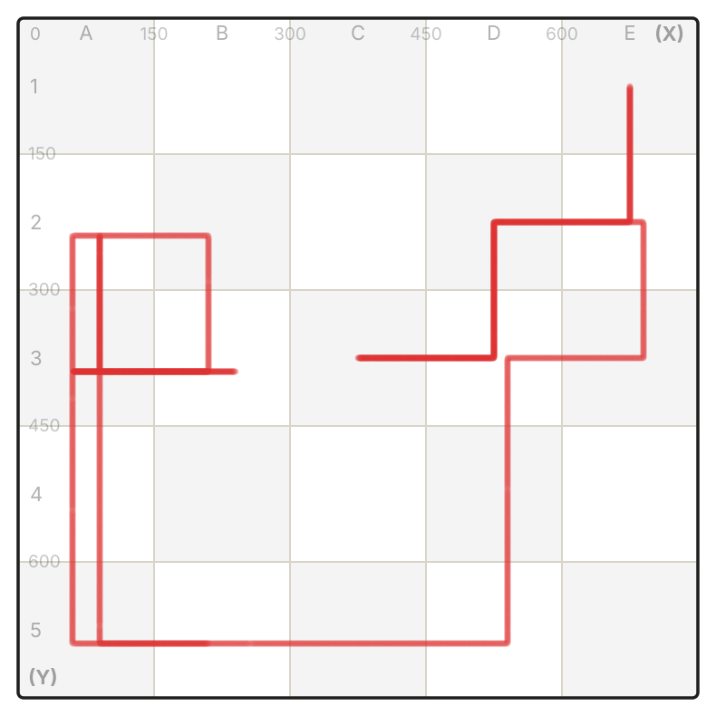
  </Frame>
</Columns>

## Žvaigždės

### Paprasta penkiakampė žvaigždė

Pultas: viršutinė eilė Funkcija × 5. Apatinė eilė: Pirmyn, Dešinėn 144.

[Paleisti simuliatoriuje](https://simulator.primastem.com/#top=cfun.r005&fn=cfor,crig.n144&s=l1047402&r=225-283-90&run)

<Columns cols={2}>
  <Frame caption="Programa pulte">
    
  </Frame>
  <Frame caption="Ką nupieš robotas">
    
  </Frame>
</Columns>

### Paprasta aštuonkampė žvaigždė

Pultas: viršutinė eilė Funkcija × 8. Apatinė eilė: Pirmyn, Dešinėn 135.

[Paleisti simuliatoriuje](https://simulator.primastem.com/#top=cfun.r008&fn=cfor,crig.n135&s=l1047402&r=269-375-0&run)

<Columns cols={2}>
  <Frame caption="Programa pulte">
    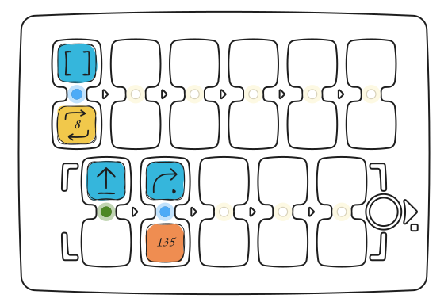
  </Frame>
  <Frame caption="Ką nupieš robotas">
    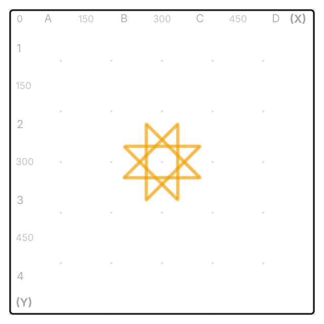
  </Frame>
</Columns>

### Keturkampė žvaigždė

Pultas: viršutinė eilė Funkcija × 12. Apatinė eilė: Pirmyn 200, Dešinėn 150, Pirmyn, Dešinėn 120.

[Paleisti simuliatoriuje](https://simulator.primastem.com/#top=cfun.r012&fn=cfor.n200,crig.n150,cfor,crig.n120&s=l1047402&r=237-263-90&run)

<Columns cols={2}>
  <Frame caption="Programa pulte">
    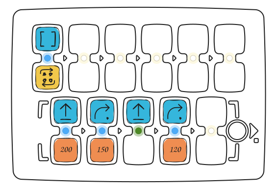
  </Frame>
  <Frame caption="Ką nupieš robotas">
    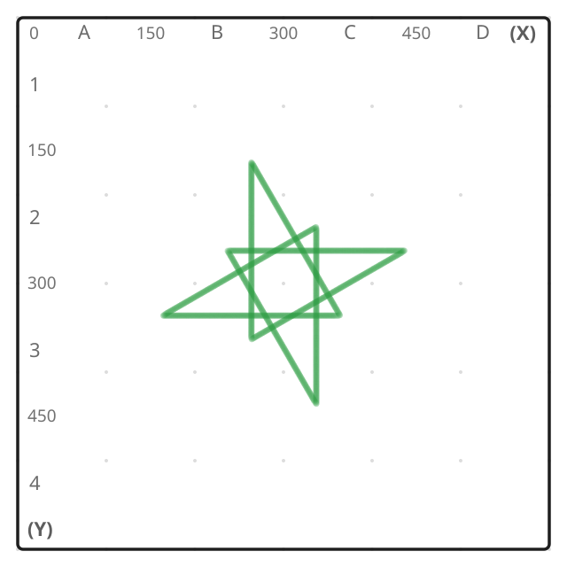
  </Frame>
</Columns>

### Žvaigždinis žiedas

Pultas: viršutinė eilė Funkcija × 18. Apatinė eilė: Pirmyn 350, Dešinėn 100.

[Paleisti simuliatoriuje](https://simulator.primastem.com/#top=cfun.r018&fn=cfor.n350,crig.n100&s=l1047502&r=200-228-90&run)

<Columns cols={2}>
  <Frame caption="Programa pulte">
    
  </Frame>
  <Frame caption="Ką nupieš robotas">
    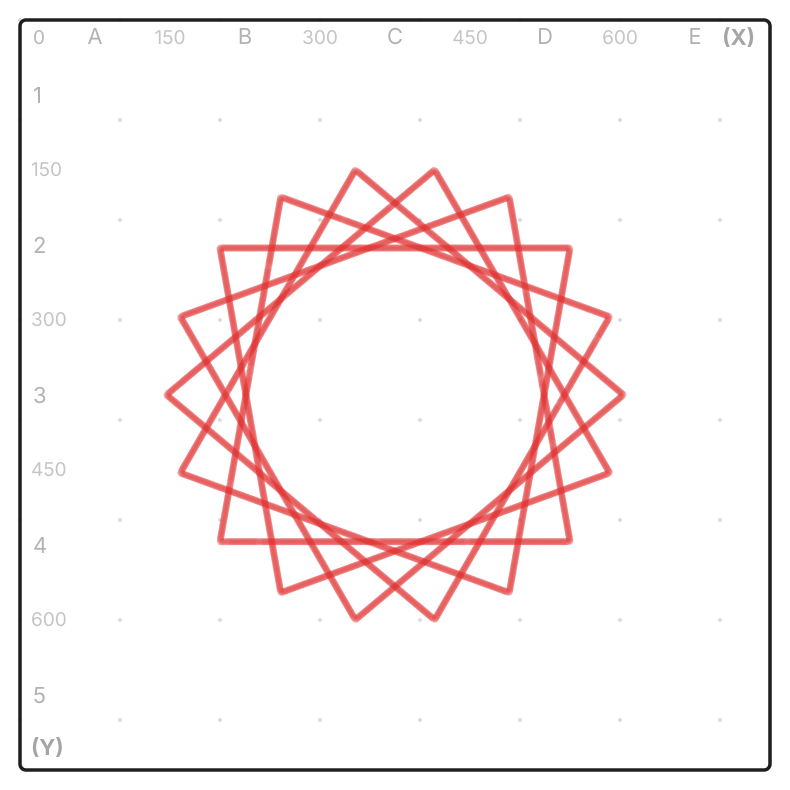
  </Frame>
</Columns>

### Saulė

Pultas: viršutinė eilė Funkcija × 36. Apatinė eilė: Pirmyn 400, Dešinėn 170.

[Paleisti simuliatoriuje](https://simulator.primastem.com/#top=cfun.r036&fn=cfor.n400,crig.n170&s=l1047402&r=100-283-90&run)

<Columns cols={2}>
  <Frame caption="Programa pulte">
    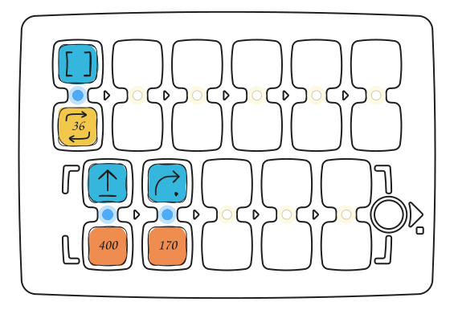
  </Frame>
  <Frame caption="Ką nupieš robotas">
    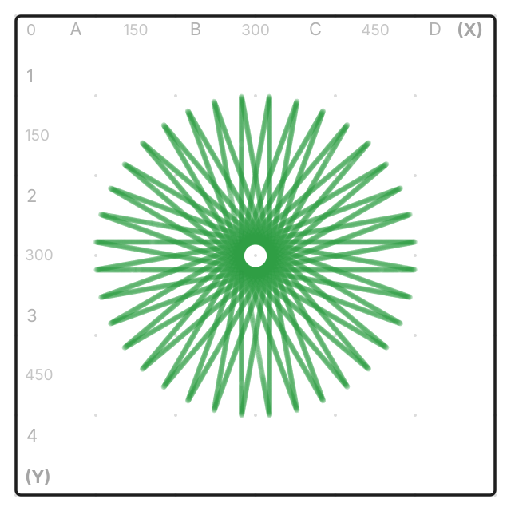
  </Frame>
</Columns>

### Vėjo malūnėlis

Pultas: viršutinė eilė Funkcija × 5. Apatinė eilė: Pirmyn 300, Dešinėn 144, Pirmyn 100, Dešinėn 72.

[Paleisti simuliatoriuje](https://simulator.primastem.com/#top=cfun.r005&fn=cfor.n300,crig.n144,cfor.n100,crig.n072&s=l1047402&r=165-304-90&run)

<Columns cols={2}>
  <Frame caption="Programa pulte">
    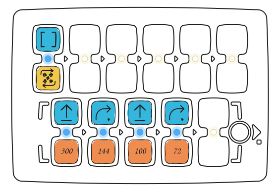
  </Frame>
  <Frame caption="Ką nupieš robotas">
    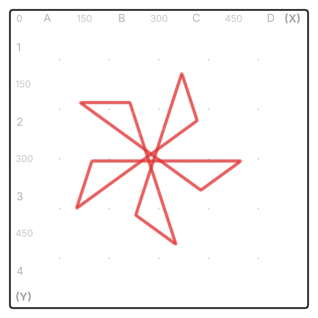
  </Frame>
</Columns>

## Spiralės

### Spiralė

Pultas: viršutinė eilė Pirmyn 5, Funkcija × 36. Apatinė eilė: Dešinėn 30, Pirmyn +1.

[Paleisti simuliatoriuje](https://simulator.primastem.com/#top=cfor.n005,cfun.r036&fn=crig.n030,cfor.a001&s=l1047402&r=296-293-0&run)

<Columns cols={2}>
  <Frame caption="Programa pulte">
    
  </Frame>
  <Frame caption="Ką nupieš robotas">
    
  </Frame>
</Columns>

### Kvadratinė spiralė

Pultas: viršutinė eilė Pirmyn 10, Dešinėn, Pirmyn, Dešinėn, Funkcija × 8. Apatinė eilė: Pirmyn +10, Dešinėn, Pirmyn, Dešinėn.

[Paleisti simuliatoriuje](https://simulator.primastem.com/#top=cfor.n010,crig,cfor,crig,cfun.r008&fn=cfor.a010,crig,cfor,crig&s=l1047402&r=295-305-0&run)

<Columns cols={2}>
  <Frame caption="Programa pulte">
    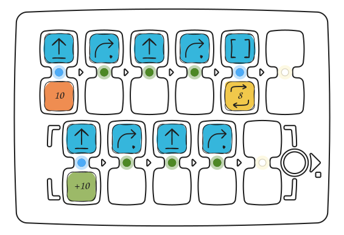
  </Frame>
  <Frame caption="Ką nupieš robotas">
    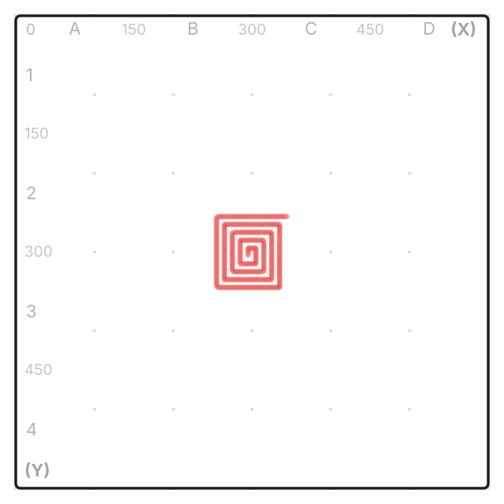
  </Frame>
</Columns>

### Trikampė spiralė

Pultas: viršutinė eilė Pirmyn 10, Dešinėn 120, Funkcija × 10. Apatinė eilė: Pirmyn +10, Dešinėn.

[Paleisti simuliatoriuje](https://simulator.primastem.com/#top=cfor.n010,crig.n120,cfun.r010&fn=cfor.a010,crig&s=l1047402&r=295-278-90&run)

<Columns cols={2}>
  <Frame caption="Programa pulte">
    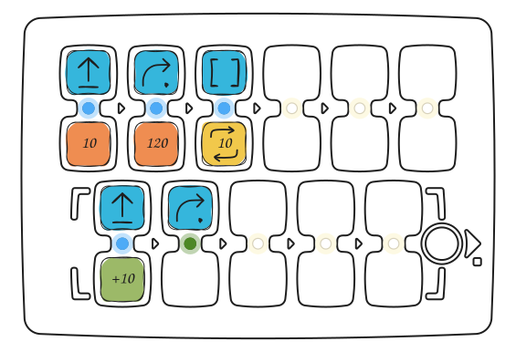
  </Frame>
  <Frame caption="Ką nupieš robotas">
    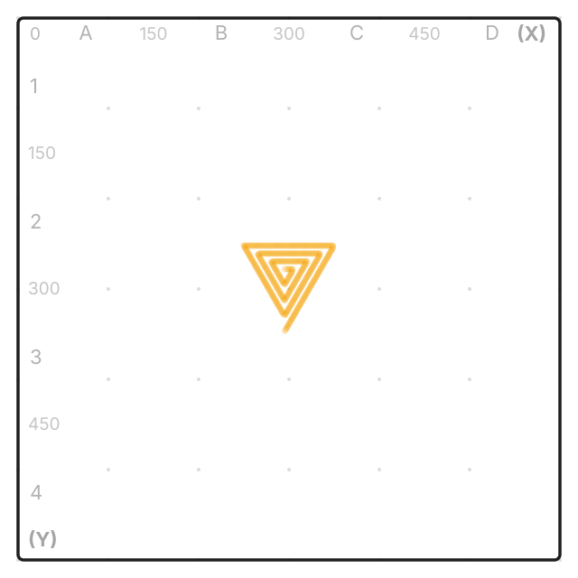
  </Frame>
</Columns>

### Dviguba trikampė spiralė

Pultas: viršutinė eilė Pirmyn 20, Funkcija × 20. Apatinė eilė: Dešinėn 120, Pirmyn +20, Dešinėn 120, Pirmyn.

[Paleisti simuliatoriuje](https://simulator.primastem.com/#p=cfor-n020-cfun-r020---------crig-n120-cfor-a020-crig-n120-cfor---&s=l1087602&r=424-475-240&run)

<Columns cols={2}>
  <Frame caption="Programa pulte">
    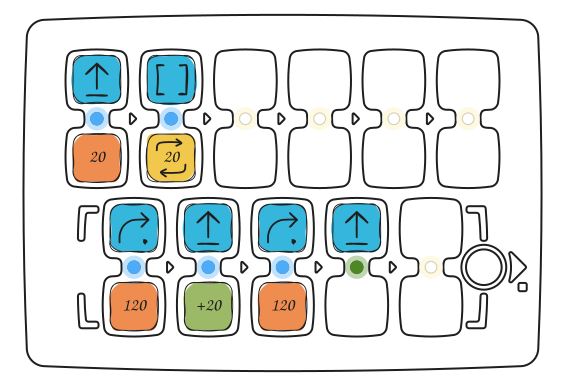
  </Frame>
  <Frame caption="Ką nupieš robotas">
    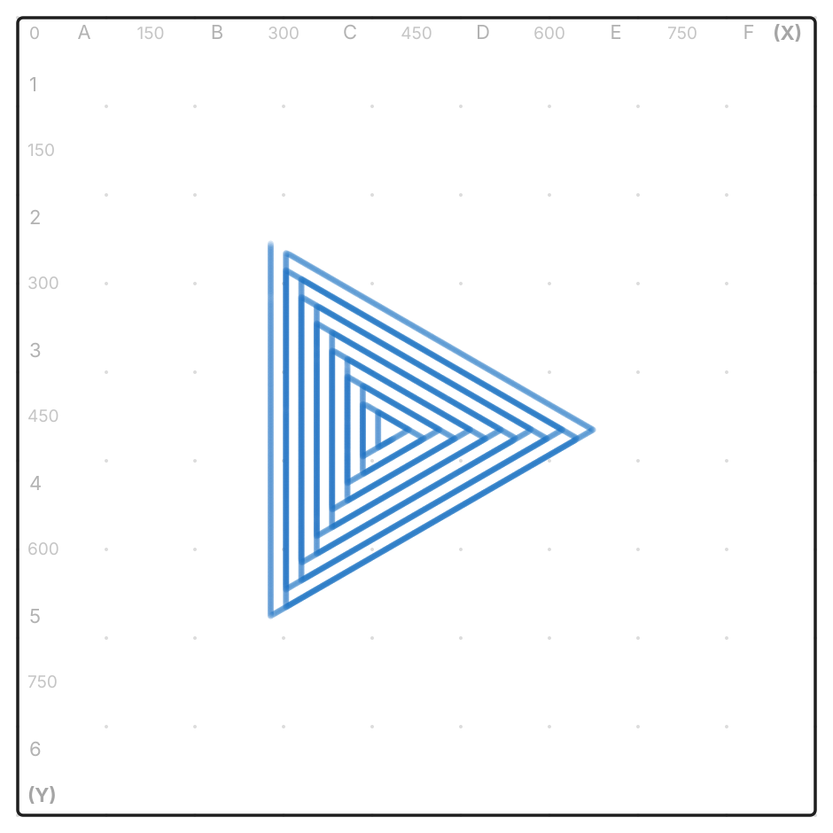
  </Frame>
</Columns>

### Rombo spiralė

Pultas: viršutinė eilė Pirmyn 40, Funkcija × 14. Apatinė eilė: Dešinėn 60, Pirmyn +18, Dešinėn 120, Pirmyn +7.

[Paleisti simuliatoriuje](https://simulator.primastem.com/#p=cfor-n040-cfun-r014---------crig-n060-cfor-a018-crig-n120-cfor-a007--&s=l1087602&r=436-466-0&run)

<Columns cols={2}>
  <Frame caption="Programa pulte">
    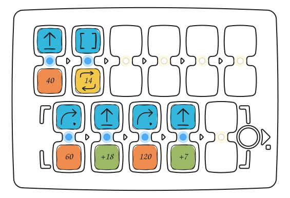
  </Frame>
  <Frame caption="Ką nupieš robotas">
    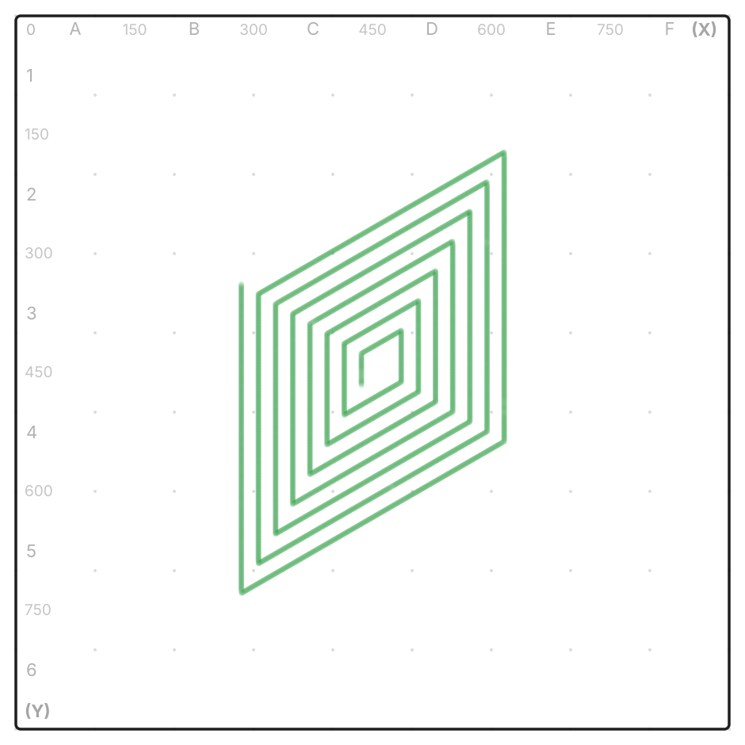
  </Frame>
</Columns>

### Žvaigždinė spiralė

Pultas: viršutinė eilė Pirmyn 10, Funkcija × 30. Apatinė eilė: Dešinėn 144, Pirmyn +12.

[Paleisti simuliatoriuje](https://simulator.primastem.com/#top=cfor.n010,cfun.r030&fn=crig.n144,cfor.a012&s=l1047402&r=295-313-90&run)

<Columns cols={2}>
  <Frame caption="Programa pulte">
    
  </Frame>
  <Frame caption="Ką nupieš robotas">
    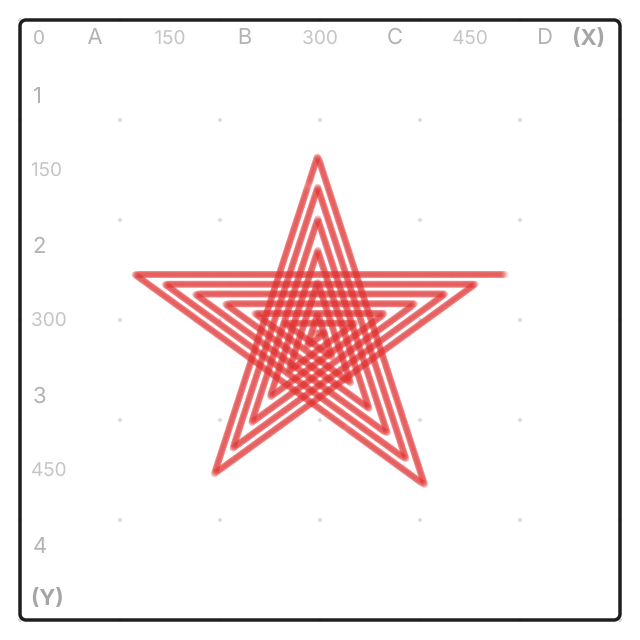
  </Frame>
</Columns>

### Dygi spiralė

Pultas: viršutinė eilė Pirmyn 10, Funkcija × 36. Apatinė eilė: Dešinėn 150, Pirmyn +10.

[Paleisti simuliatoriuje](https://simulator.primastem.com/#top=cfor.n010,cfun.r036&fn=crig.n150,cfor.a010&s=l1047402&r=295-301-90&run)

<Columns cols={2}>
  <Frame caption="Programa pulte">
    
  </Frame>
  <Frame caption="Ką nupieš robotas">
    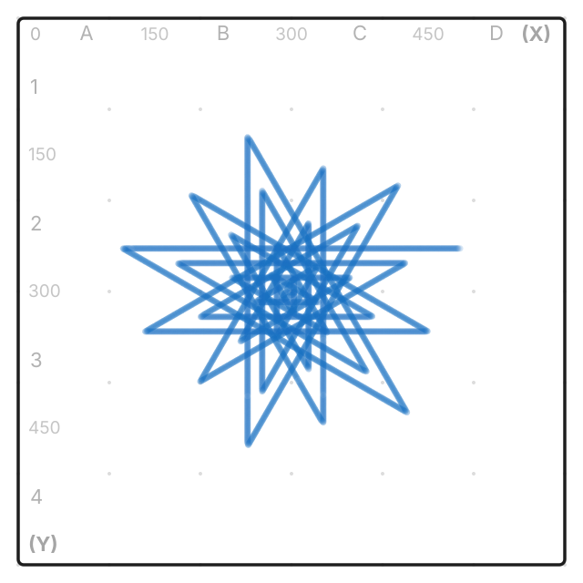
  </Frame>
</Columns>

### Sūkurys

Pultas: viršutinė eilė Pirmyn 5, Funkcija × 70. Apatinė eilė: Dešinėn 117, Pirmyn +5.

[Paleisti simuliatoriuje](https://simulator.primastem.com/#top=cfor.n005,cfun.r070&fn=crig.n117,cfor.a005&s=l1047402&r=277-304-90&run)

<Columns cols={2}>
  <Frame caption="Programa pulte">
    
  </Frame>
  <Frame caption="Ką nupieš robotas">
    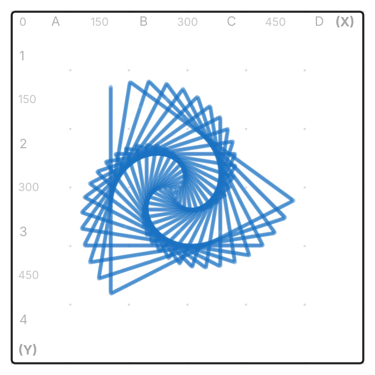
  </Frame>
</Columns>

## Susuktos figūros

### Susuktas kvadratas

Pultas: viršutinė eilė Pirmyn 400, Funkcija × 70. Apatinė eilė: Dešinėn 91, Pirmyn −5.

[Paleisti simuliatoriuje](https://simulator.primastem.com/#top=cfor.n400,cfun.r070&fn=crig.n091,cfor.s005&s=l1047502&r=174-179-90&run)

<Columns cols={2}>
  <Frame caption="Programa pulte">
    
  </Frame>
  <Frame caption="Ką nupieš robotas">
    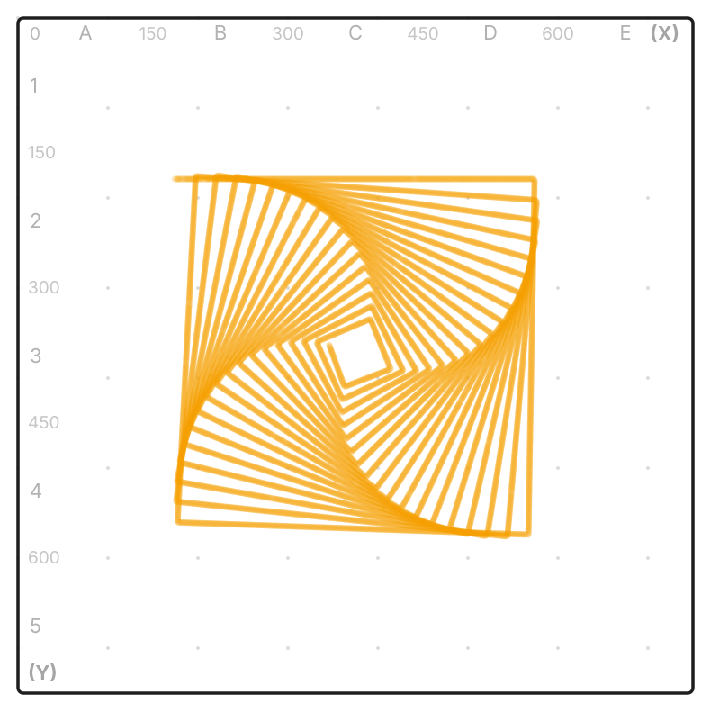
  </Frame>
</Columns>

### Susuktas trikampis

Pultas: viršutinė eilė Pirmyn 400, Funkcija × 70. Apatinė eilė: Dešinėn 121, Pirmyn −5.

[Paleisti simuliatoriuje](https://simulator.primastem.com/#top=cfor.n400,cfun.r070&fn=crig.n121,cfor.s005&s=l1047502&r=575-535-270&run)

<Columns cols={2}>
  <Frame caption="Programa pulte">
    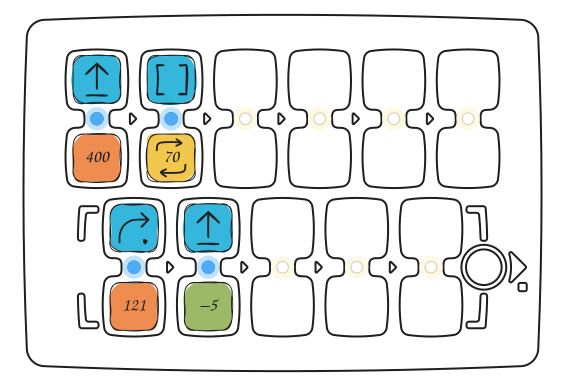
  </Frame>
  <Frame caption="Ką nupieš robotas">
    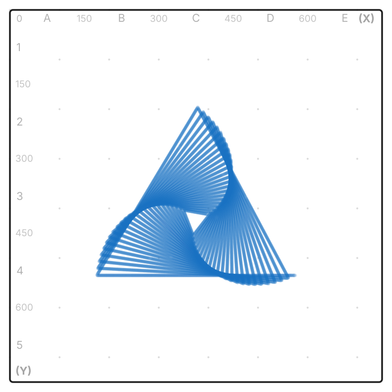
  </Frame>
</Columns>

### Susuktas šešiakampis

Pultas: viršutinė eilė Pirmyn 200, Funkcija × 60. Apatinė eilė: Dešinėn 61, Pirmyn −3.

[Paleisti simuliatoriuje](https://simulator.primastem.com/#top=cfor.n200,cfun.r060&fn=crig.n061,cfor.s003&s=l1047402&r=192-132-90&run)

<Columns cols={2}>
  <Frame caption="Programa pulte">
    
  </Frame>
  <Frame caption="Ką nupieš robotas">
    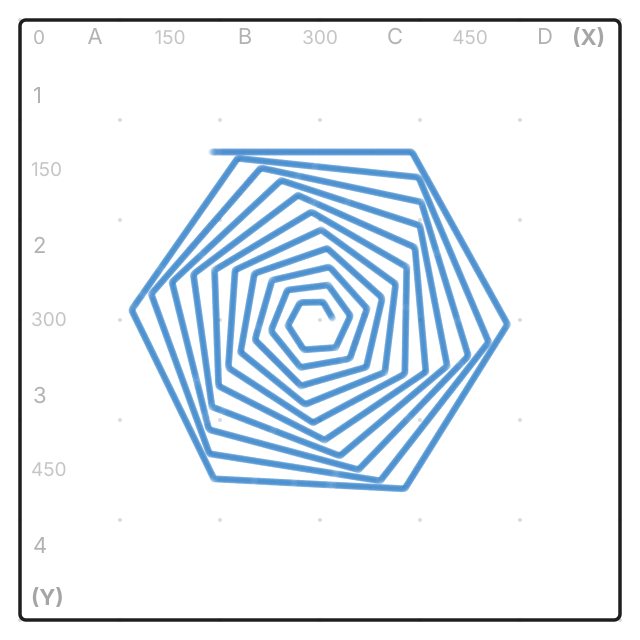
  </Frame>
</Columns>

## Rozetės

### Trikampių rozetė

Pultas: viršutinė eilė Funkcija × 36. Apatinė eilė: Pirmyn 300, Dešinėn 120, Pirmyn, Dešinėn 130.

[Paleisti simuliatoriuje](https://simulator.primastem.com/#top=cfun.r036&fn=cfor.n300,crig.n120,cfor,crig.n130&s=l1047402&r=134-223-90&run)

<Columns cols={2}>
  <Frame caption="Programa pulte">
    
  </Frame>
  <Frame caption="Ką nupieš robotas">
    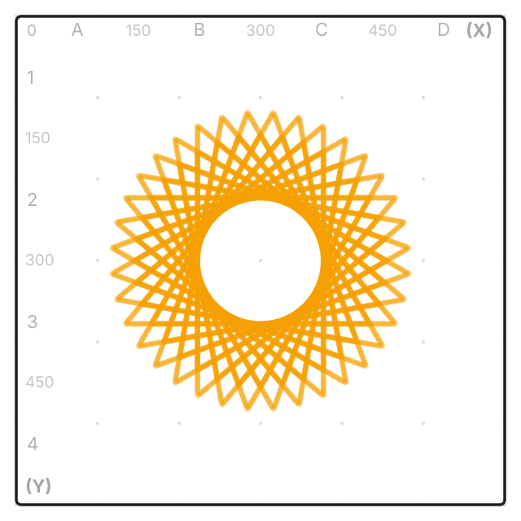
  </Frame>
</Columns>

### Kvadratų rozetė

Pultas: viršutinė eilė Funkcija × 36. Apatinė eilė: Pirmyn 250, Dešinėn 90, Pirmyn, Dešinėn 100.

[Paleisti simuliatoriuje](https://simulator.primastem.com/#top=cfun.r036&fn=cfor.n250,crig.n090,cfor,crig.n100&s=l1047402&r=164-186-90&run)

<Columns cols={2}>
  <Frame caption="Programa pulte">
    
  </Frame>
  <Frame caption="Ką nupieš robotas">
    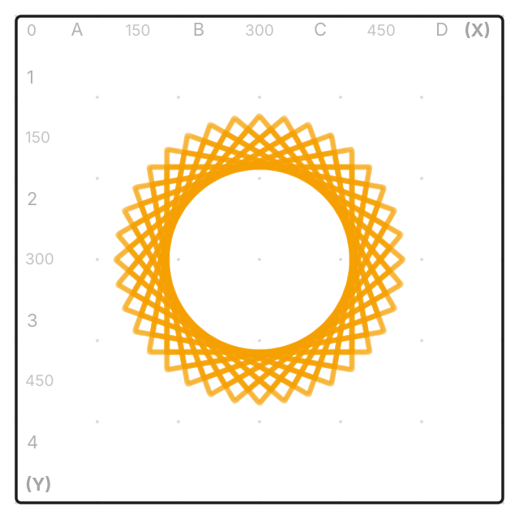
  </Frame>
</Columns>

### Žvaigždinė rozetė

Pultas: viršutinė eilė Funkcija × 36. Apatinė eilė: Pirmyn 300, Dešinėn 150, Pirmyn, Dešinėn 160.

[Paleisti simuliatoriuje](https://simulator.primastem.com/#top=cfun.r036&fn=cfor.n300,crig.n150,cfor,crig.n160&s=l1047402&r=119-268-90&run)

<Columns cols={2}>
  <Frame caption="Programa pulte">
    
  </Frame>
  <Frame caption="Ką nupieš robotas">
    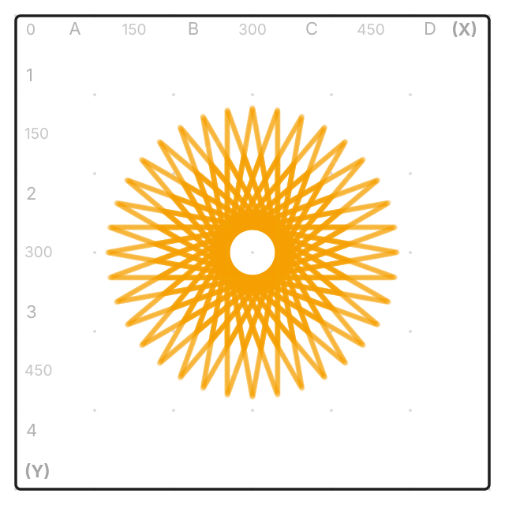
  </Frame>
</Columns>

### Žvaigždinis vainikas

Pultas: viršutinė eilė Funkcija × 24. Apatinė eilė: Pirmyn 200, Dešinėn 60, Pirmyn, Dešinėn 130.

[Paleisti simuliatoriuje](https://simulator.primastem.com/#top=cfun.r024&fn=cfor.n200,crig.n060,cfor,crig.n130&s=l1047402&r=142-227-90&run)

<Columns cols={2}>
  <Frame caption="Programa pulte">
    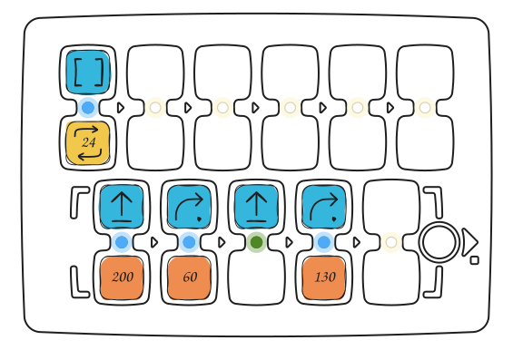
  </Frame>
  <Frame caption="Ką nupieš robotas">
    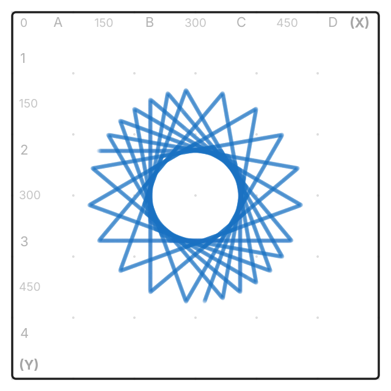
  </Frame>
</Columns>

## Kreivės ir garbanos

### Kreivė su neigiamais kampais

Pultas: viršutinė eilė Pirmyn 10, Dešinėn 30, Funkcija × 36. Apatinė eilė: Pirmyn, Dešinėn −2.

[Paleisti simuliatoriuje](https://simulator.primastem.com/#top=cfor.n010,crig.n030,cfun.r036&fn=cfor,crig.s002&s=l1047402&r=300-238-0&run)

<Columns cols={2}>
  <Frame caption="Programa pulte">
    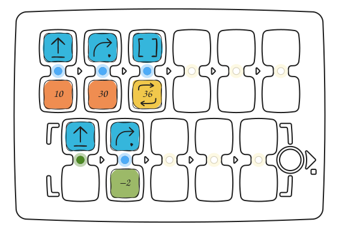
  </Frame>
  <Frame caption="Ką nupieš robotas">
    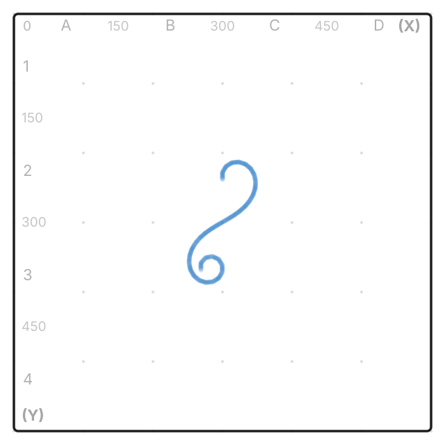
  </Frame>
</Columns>

### Gyvatė

Pultas: viršutinė eilė Dešinėn 10, Funkcija × 18, Dešinėn −20, Funkcija × 18, Dešinėn +20, Funkcija × 18. Apatinė eilė: Pirmyn 18, Dešinėn.

[Paleisti simuliatoriuje](https://simulator.primastem.com/#top=crig.n010,cfun.r018,crig.s020,cfun.r018,crig.a020,cfun.r018&fn=cfor.n018,crig&s=l1047602&r=141-432-0&run)

<Columns cols={2}>
  <Frame caption="Programa pulte">
    
  </Frame>
  <Frame caption="Ką nupieš robotas">
    
  </Frame>
</Columns>

### Dviguba garbana

Pultas: viršutinė eilė Dešinėn 5, Funkcija × 72. Apatinė eilė: Pirmyn 40, Dešinėn +10.

[Paleisti simuliatoriuje](https://simulator.primastem.com/#top=crig.n005,cfun.r072&fn=cfor.n040,crig.a010&s=l1047402&r=130-130-90&run)

<Columns cols={2}>
  <Frame caption="Programa pulte">
    
  </Frame>
  <Frame caption="Ką nupieš robotas">
    
  </Frame>
</Columns>

### Garbana su žvaigždutėmis

Pultas: viršutinė eilė Dešinėn 10, Funkcija × 36. Apatinė eilė: Pirmyn 60, Dešinėn +20.

[Paleisti simuliatoriuje](https://simulator.primastem.com/#top=crig.n010,cfun.r036&fn=cfor.n060,crig.a020&s=l1047402&r=120-120-90&run)

<Columns cols={2}>
  <Frame caption="Programa pulte">
    
  </Frame>
  <Frame caption="Ką nupieš robotas">
    
  </Frame>
</Columns>

### Dygliuotas žiedas

Pultas: viršutinė eilė Funkcija × 24. Apatinė eilė: Pirmyn 150, Atgal 90, Dešinėn 15.

[Paleisti simuliatoriuje](https://simulator.primastem.com/#top=cfun.r024&fn=cfor.n150,cbac.n090,crig.n015&s=l1047502&r=345-147-90&run)

<Columns cols={2}>
  <Frame caption="Programa pulte">
    
  </Frame>
  <Frame caption="Ką nupieš robotas">
    
  </Frame>
</Columns>

### Matematinis širdies piešinys

Pultas: viršutinė eilė Pirmyn 45, Pirmyn 20, Funkcija × 6, Dešinėn 120, Funkcija × 7, Pirmyn 50. Apatinė eilė: Kairėn 30, Pirmyn 15.

[Paleisti simuliatoriuje](https://simulator.primastem.com/#top=cfor.n045,cfor.n020,cfun.r006,crig.n120,cfun.r007,cfor.n050&fn=clef.n030,cfor.n015&s=l1047402&r=346-340-0&run)

<Columns cols={2}>
  <Frame caption="Programa pulte">
    
  </Frame>
  <Frame caption="Ką nupieš robotas">
    
  </Frame>
</Columns>

## Fraktalai

### Fraktalas: trikampis trikampyje

Pultas: viršutinė eilė Pirmyn 400, Funkcija × 6. Apatinė eilė: Dešinėn 120, Pirmyn, Dešinėn, Pirmyn ÷2, Pirmyn.

[Paleisti simuliatoriuje](https://simulator.primastem.com/#top=cfor.n400,cfun.r006&fn=crig.n120,cfor,crig,cfor.d002,cfor&s=l1047402&r=500-473-270&run)

<Columns cols={2}>
  <Frame caption="Programa pulte">
    
  </Frame>
  <Frame caption="Ką nupieš robotas">
    
  </Frame>
</Columns>

### Fraktalas: įdėtiniai trikampiai

Pultas: viršutinė eilė Funkcija, Dešinėn, Pirmyn ÷2, Dešinėn 60. Apatinė eilė: Pirmyn, Dešinėn 120, Pirmyn, Dešinėn, Pirmyn.

<Note>Paspauskite **▶ Start** 4 kartus iš eilės nejudindami roboto. Pultas tarp paleidimų įsimena žingsnio ilgį, todėl kiekvienas paleidimas nubraižo dvigubai mažesnį trikampį. Nuoroda programą paleidžia vieną kartą, toliau **▶ Start** simuliatoriuje spauskite patys.</Note>

[Paleisti simuliatoriuje](https://simulator.primastem.com/#p=cfun--crig--cfor-d002-crig-n060-----cfor--crig-n120-cfor--crig--cfor-&s=l1047402&r=225-235-90&run)

<Columns cols={2}>
  <Frame caption="Programa pulte">
    
  </Frame>
  <Frame caption="Ką nupieš robotas">
    
  </Frame>
</Columns>

