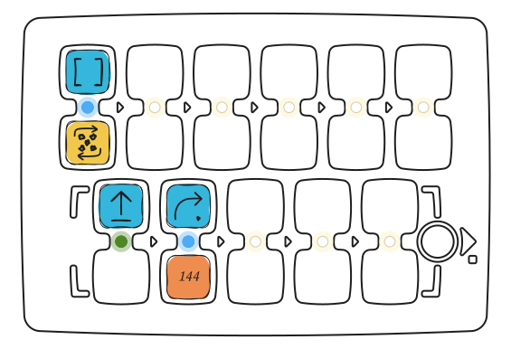

PrimaSTEM moko 4–10+ metų vaikus programavimo, logikos ir matematikos be ekrano. Šiame puslapyje trumpai paaiškinama, **kaip veikia įrenginys**.

<Note>
**Dar neturite įrenginio? Išbandykite naršyklėje.** Atidarykite **[žiniatinklio simuliatorių](https://simulator.primastem.com)**. Tai veikianti valdymo pulto ir roboto kopija. Padėkite žetonus, paspauskite **▶ Start** ir stebėkite, kaip robotas vykdo programą. Tai galite daryti skaitydami šį vadovą.
</Note>

## 1. Kas yra dėžutėje

<CardGroup cols={3}>
  <Card title="Robotas" icon="bug">
    Medinis boružės formos robotas su dviem ratukais. Viršuje yra anga flomasteriui. Robotas turi garsiakalbį, USB-C ir Bluetooth.
  </Card>
  <Card title="Valdymo pultas" icon="grid-3x3">
    Pulte yra lizdų poros programai ir įvairiaspalviai indikatoriai. Pultas turi mygtuką ▶ Start/Stop, garsiakalbį, USB-C ir Bluetooth.
  </Card>
  <Card title="Komandų žetonai" icon="square-stack">
    Kartoniniai žetonai su NFC lipdukais. Kiekvienas žetonas yra viena roboto programos komanda.
  </Card>
</CardGroup>

<Tip>Gavę rinkinį, atnaujinkite roboto ir valdymo pulto programinę įrangą į naujausią versiją: [kaip atnaujinti](/en-lt/update).</Tip>

## 2. Įjungimas

<Steps>
  <Step title="Įjunkite robotą, tada valdymo pultą" icon="power">
    Kiekvienas įrenginys pagroja trumpą garsą. Žalias maitinimo indikatorius rodo, kad įrenginys įjungtas.
  </Step>
  <Step title="Balta šviesa: ryšys yra" icon="check">
    Laisvi pulto lizdai šviečia **baltai**, roboto akys mirksi **baltai**. Galite pradėti.
  </Step>
  <Step title="Žydra šviesa: ryšio nėra" icon="bluetooth">
    Robotas ir valdymo pultas šviečia žydrai. Jei ryšys neatsiranda, laikykite nuspaudę pulto mygtuką **▶ Start** **ilgiau nei 10 sekundžių**. 5-ąją sekundę išgirsite pyptelėjimą, mygtuko neatleiskite. Įrenginiai susiporuos, o robotas pasileis iš naujo.
  </Step>
</Steps>

**Pirmiausia išbandykite tai.** Padėkite žetoną **Pirmyn** į 1-ąją porą, į bet kurį iš dviejų lizdų. Paspauskite **▶ Start**. Robotas pavažiuoja 15 cm pirmyn ir sustoja. *Jūs parašėte pirmąją programą iš vienos komandos.*

## 3. Kaip veikia programa

Valdymo pulte yra **dvi lizdų porų eilės**. Padėkite žetonus į baltai šviečiančius lizdus, ir programa paruošta. Paspauskite **▶ Start**, ir robotas ją įvykdys.

<Frame caption="Valdymo pulto schema. Raidės A–F paaiškintos žemiau">
  
</Frame>

| Raidė | Kas tai |
| :---: | --- |
| **A** | **Pagrindinė programa**: 6 lizdų poros, robotas jas vykdo iš kairės į dešinę |
| **B** | **▶ Start / Stop**: pirmas paspaudimas paleidžia programą, paspaudimas programos metu ją sustabdo |
| **C** | **Funkcija**: 5 lizdų poros, jas iškviečia žetonas Funkcija |
| **D** | Vienas poros **lizdas** |
| **E** | **Vykdymo linija**, kuri sujungia du lizdus į porą |
| **F** | **Įvairiaspalvis indikatorius** prie kiekvieno lizdo |

**Pora yra du susieti lizdai.** Viršus ir apačia nesvarbūs. Komandą dėkite į bet kurį poros lizdą, o kartojimo, skaičiaus ar aritmetikos žetoną į kitą. Jei antrasis lizdas tuščias, komanda naudoja paskutinį skaičių, kurį gavo nuo valdymo pulto įjungimo. Kol skaičius nenustatytas, robotas daro 15 cm žingsnį ir 90° posūkį. Mažiems vaikams to pakanka.

Indikatorių spalvos veikimo metu:

| ⚪ Balta | 🟢 Žalia | 🔵 Mėlyna | 🔴 Raudona |
| :---: | :---: | :---: | :---: |
| Lizdas laisvas | Poroje yra komanda | Komanda su skaičiumi, kartojimu ar aritmetika | Klaida, pora praleidžiama |

Robotas praleidžia tuščius lizdus ir raudonas poras. Indikatorius mirksi prie to lizdo, kurį robotas vykdo dabar.

## 4. Žetonai pagal grupes

| Grupė | Ką daro žetonai |
| --- | --- |
| **Judėjimas** | Pirmyn, Atgal, Kairėn, Dešinėn |
| **Kartojimas** | Dvi rodyklės ratu, viduje taškeliai nuo 2 iki 6 (kaip ant kauliuko, mažiems vaikams) arba skaitmenys. Poroje su komanda ją pakartoja. |
| **Skaičiai** | Nuo `1` iki `999`. Nustato atstumą milimetrais arba posūkio kampą laipsniais. |
| **Aritmetika** | `+N` `−N` `×N` `÷N` `√` `^N`. Vienas žetonas turi operaciją ir skaičių. Jis keičia išsaugotą judėjimo ar posūkio reikšmę. Jei rezultatas neigiamas, robotas važiuoja ar sukasi į priešingą pusę. |
| **Funkcija** | Iškviečia apatinę eilę kaip paprogramę. Su kartojimo žetonu apatinė eilė vykdoma nurodytą kartų skaičių. |
| **Numatytasis žingsnis** | Tarnybinis žetonas. Kartu su skaičiumi keičia numatytąjį žingsnį. Pavyzdžiui, 10 cm tinkleliui padėkite skaičių 100 (milimetrais). Žingsnis išlieka ir išjungus. |

## 5. Numatytosios ir išsaugotos reikšmės

<Note>
**Pirmyn nuvažiuoja 150 mm (15 cm), posūkis lygus 90°.** Žetonas **Numatytasis žingsnis** keičia numatytąjį atstumą, ir jis išlieka išjungus. Naudokite jį žemėlapiams su tinkleliu, sukurtiems bet kuriam robotui.

Kol valdymo pultas įjungtas, kiekviena judėjimo komanda turi **savo** reikšmę:

- **skaičius** poroje su komanda pakeičia paskutinę išsaugotą arba numatytąją reikšmę;
- **aritmetikos** žetonas ją keičia (`+`, `−`, `×`, `÷`, `√`, `^`);
- **tuščias** lizdas poroje su komanda palieka paskutinę išsaugotą arba numatytąją reikšmę.

Išjungus valdymo pultą, išsaugotos reikšmės išsitrina. Numatytasis žingsnis lieka.

**Trumpa atmintinė:**

| Pora pulte | Rezultatas | Kas įvyko |
| --- | --- | --- |
| `Pirmyn` be skaičiaus | 150 mm (15 cm) | numatytoji reikšmė |
| `Pirmyn` ir `100` | 100 mm | skaičius pakeitė reikšmę |
| `Pirmyn` ir `+50` | 150 mm (buvo 100, pridėta 50) | aritmetika perskaičiavo reikšmę |
| `Kairėn` be skaičiaus | 90° | numatytoji reikšmė |
| `Kairėn` ir `45` | 45° | skaičius pakeitė reikšmę |
| `Kairėn` ir `−10` | 35° (buvo 45°, atimta 10°) | aritmetika perskaičiavo reikšmę |
</Note>

## 6. Robotas piešia tai, ką užprogramuojate

Išbandykite šiuos pavyzdžius ir pamatysite, ką gali įrenginys. Įstatykite flomasterį į roboto vidurį, ir robotas **pieš** važiuodamas.

<CardGroup cols={2}>
  <Card title="Žvaigždė: skaičiai ir kartojimas">
    <Frame>
      
    </Frame>
    <Frame>
      
    </Frame>
    [Paleisti simuliatoriuje](https://simulator.primastem.com/#top=cfun.r005&fn=cfor,crig.n144&s=l1047402&r=225-283-90&run)
  </Card>
  <Card title="Spiralė: aritmetika cikle">
    <Frame>
      
    </Frame>
    <Frame>
      
    </Frame>
    [Paleisti simuliatoriuje](https://simulator.primastem.com/#top=cfor.n005,cfun.r036&fn=crig.n030,cfor.a001&s=l1047402&r=296-293-0&run)
  </Card>
</CardGroup>

Daugiau pavyzdžių rasite puslapyje [Piešinių pavyzdžiai](/en-lt/mathdrawings).

## 7. Kaip mokyti su PrimaSTEM

<Tip>
**Komandų žetonus pristatykite po vieną, tokia tvarka:**

1. Pirmyn
2. Posūkiai
3. Kartojimas
4. Funkcija
5. Skaičiai
6. Aritmetika

Prie kito žetono pereikite tada, kai vaikas gerai išmoko ankstesnį. Visas 12 pamokų planas mažiems vaikams, su amžiumi, trukme ir medžiaga, yra [1 knygoje](/en-lt/book-1/book-1).

**Darbas grupėje.** Rekomenduojame vieną rinkinį **2–3 vaikams**.

**Žemėlapiai.** Tinka bet kuris žemėlapis su tinkleliu, sukurtas bet kuriam mokomajam robotui. Langelio dydį nustato žetonas **Numatytasis žingsnis** su skaičiumi, pavyzdžiui, 100, 120, 150 arba 200 mm.

**Kaip gauti 10 žingsnių vietoj 6.** Padėkite žetoną **Funkcija [ ]** į paskutinę (6-ąją) viršutinės eilės porą ir priklijuokite jį dažymo juosta. Dabar programa vykdoma kaip viena grandinė: 5 žingsniai viršuje ir 5 apačioje, **10 žingsnių iš eilės**. Tai patogu mažiems vaikams, kuriems reikia ilgesnės programos, bet funkcijos sąvoką aiškinti dar per anksti.
</Tip>

## 8. Daugiau galimybių

<CardGroup cols={2}>
  <Card title="Flomasteris ir piešimas" icon="pen-line">
    Įstatykite flomasterį į robotą, ir jis **nupieš** savo kelią popieriuje. Išeina paprastos linijos, daugiakampiai, žvaigždės, spiralės ir fraktalai.
  </Card>
  <Card title="Balso atsakas" icon="volume-2">
    Valdymo pultas garsiai perskaito kiekvieną žetoną. Balsas veikia **21 kalba**, tarp jų arabų, suomių, kroatų ir lietuvių. Kitą kalbą pridėsime pagal pageidavimą. Balsas padeda mažiems ir dar neskaitantiems vaikams. Yra abėcėlės raidės ir vietos: Namas, Mokykla, Parduotuvė, Miškas ir kitos.
  </Card>
  <Card title="NFC garso lipdukai ir žemėlapiai" icon="map">
    Priklijuokite NFC lipdukus ant žemėlapio ir telefonu įrašykite į juos bet kurį turimą garsą. Roboto apačioje yra antena. Kai robotas sustoja ant lipduko, jis paleidžia įrašytą garsą.
  </Card>
  <Card title="Atvira NFC platforma" icon="nfc">
    Kurkite savo žetonus. Reikia bet kurios 13,56 MHz NFC žymos (pigios, parduodamos kiekvienoje internetinėje parduotuvėje) ir tekstinio kodo iš mūsų dokumentacijos. Įrašymas užtrunka 10 sekundžių nemokamoje telefono programėlėje NFC Tools.
  </Card>
</CardGroup>

## Ką skaityti toliau

<CardGroup cols={2}>
  <Card title="Įrenginys ir nustatymai" icon="book-open" href="/en-lt/usermanual">
    Techninės specifikacijos, suporavimas, kalibravimas, sauga.
  </Card>
  <Card title="Mokytojo vadovas" icon="book" href="/en-lt/teachersguide">
    Pedagogika, darbas klasėje, programavimo pagrindai per žaidimą.
  </Card>
  <Card title="1 knyga: pamokos" icon="graduation-cap" href="/en-lt/book-1/book-1">
    12 parengtų pamokų mažiems vaikams, su amžiumi, trukme ir spausdinama medžiaga.
  </Card>
  <Card title="Komandų žetonai" icon="nfc" href="/en-lt/nfc">
    Visi NFC kodai, kad galėtumėte telefonu įrašyti savo žetonus.
  </Card>
  <Card title="Piešinių pavyzdžiai" icon="pen-line" href="/en-lt/mathdrawings">
    Geometrinės figūros, fraktalai, spiralės: programos ir rezultatai.
  </Card>
  <Card title="Garso failų sąrašas" icon="volume-2" href="/en-lt/sounds_reference">
    Žodžiai (vietos ir sąvokos), abėcėlė, muzikos natos, sisteminiai garsai. Reikalingas savo žetonams ir garsams įrašyti.
  </Card>
</CardGroup>
