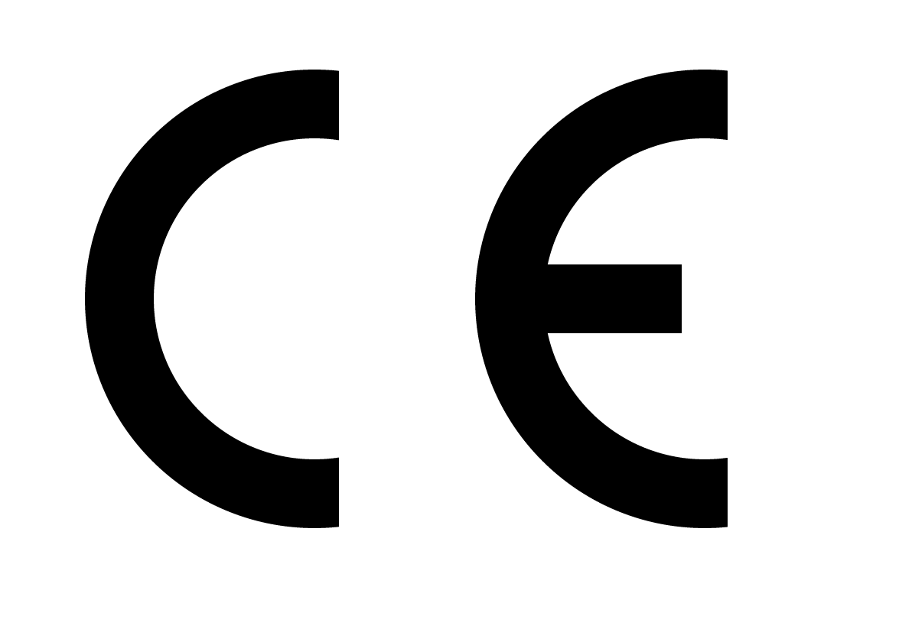

Prieš pirmą kartą naudodami perskaitykite šį vadovą ir išsaugokite jį ateičiai.

---

## 1. Identifikavimas

| | |
|---|---|
| Gaminys | PrimaSTEM |
| Modelis | **PS-2026-001** |
| Amžiaus grupė | 4+ |
| Gamintojas | PRIMASTEM SAS, 11 rue de Magdebourg, 75016 Paris, France |
| Kontaktai | info@primastem.com |
| Kilmė | Sukurta ir surinkta Prancūzijoje |

## 2. Techniniai duomenys

| | |
|---|---|
| Maitinimas | Ličio jonų (Li-ion) akumuliatorius, 3,6 V (×2: robotas ir valdymo pultas) |
| Įkrovimas | USB-C, 5 V DC |
| Belaidis ryšys | Bluetooth Low Energy, 2 400 – 2 483,5 MHz |
| NFC | 13,56 MHz (instrukcijų žetonų nuskaitymas) |

## 3. ⚠ Saugos įspėjimai

**ĮSPĖJIMAS.** Netinka vaikams iki 36 mėnesių. Smulkios dalys: galima užspringti.

**ĮSPĖJIMAS.** Įkraukite tik prižiūrint suaugusiesiems, naudodami CE sertifikuotą USB įkroviklį (5 V).

**ĮSPĖJIMAS.** Įrenginio neardykite, nespauskite, nebadykite, netrumpinkite, nedeginkite ir neatidarykite. Akumuliatoriaus naudotojas pakeisti negali.

**ĮSPĖJIMAS.** Jei įkraunamas įrenginys neįprastai įkaista, deformuojasi, iš jo teka skystis ar sklinda kvapas, nedelsdami jį atjunkite. Daugiau jo nekraukite.

**ĮSPĖJIMAS.** Saugokite nuo vandens ir drėgmės.

## 4. Informacija apie akumuliatorius

Du integruoti ličio jonų akumuliatoriai (vienas robote, kitas valdymo pulte). Cheminė sudėtis: Li-ion. Dydis: 16340. Vardinė įtampa: 3,6 V. Naudotojas jų pakeisti negali.

## 5. Informacija apie radijo ryšį (Direktyva 2014/53/ES)

| Dažnių juosta | Didžiausia spinduliuojamoji galia |
|---|---|
| 2 400 – 2 483,5 MHz (Bluetooth Low Energy) | −1 dBm (0,79 mW) EIRP |
| 13,56 MHz (NFC, indukcinis) | labai maža galia (mažesnė už vertinimo ribą) |

Įrenginį galima naudoti visose ES valstybėse narėse.

## 6. Šalinimas

Perbrauktos šiukšlių dėžės su ratukais simbolis *su brūkšniu* reiškia, kad įrenginio negalima išmesti kartu su buitinėmis atliekomis: atiduokite jį į įgaliotą elektroninių atliekų surinkimo punktą.

Perbrauktos šiukšlių dėžės su ratukais simbolis *be brūkšnio* reiškia, kad akumuliatorius reikia surinkti atskirai. Neišimkite akumuliatorių patys: atiduokite visą įrenginį.

## 7. Žymėjimas ant gaminio

Toliau nurodyti simboliai ir užrašai yra ant įrenginio, ant pakuotės arba ant instrukcijų žetonų, kaip reikalaujama taikomuose ES teisės aktuose.

| Simbolis | Reikšmė | Vieta |
|---|---|---|
|  | **CE ženklas**: deklaruoja atitiktį taikomoms ES direktyvoms. Reikalaujamas pagal Reglamentą (EB) Nr. 765/2008. | Atspausdintas šilkografijos būdu ant spausdintinės plokštės roboto apačioje; išgraviruotas lazeriu ant medinio valdymo pulto dugno; atspausdintas ant pakuotės. |
|  | **Perbraukta šiukšlių dėžė su ratukais ir brūkšniu (EEĮA).** Negalima išmesti kartu su buitinėmis atliekomis. Reikalaujama pagal Direktyvą 2012/19/ES. | Atspausdinta šilkografijos būdu ant spausdintinės plokštės roboto apačioje; valdymo pultui pateikta šiame vadove (simbolio neįmanoma įskaitomai išgraviruoti ant medžio). |
|  | **Perbraukta šiukšlių dėžė su ratukais be brūkšnio: akumuliatorius.** Atskiras surinkimas. Reikalaujama pagal Reglamentą (ES) 2023/1542. | Atspausdinta ant pakuotės (akumuliatoriai integruoti, naudotojas jų pasiekti negali). |
| **ĮSPĖJIMAS** | **Įspėjimas apie smulkias dalis.** Reikalaujamas pagal Žaislų saugos direktyvos 2009/48/EB V priedą. Tekstas: *Įspėjimas. Netinka vaikams iki 36 mėnesių. Smulkios dalys.* | Išgraviruotas lazeriu ant medinio valdymo pulto dugno; atspausdintas ant pakuotės ir ant žetonų dėžutės. |
| **PRIMASTEM SAS** + adresas | Gamintojo identifikavimas. Reikalaujama pagal Direktyvos 2009/48/EB 4 straipsnio 5 dalį ir GPSR 17 straipsnį. | Atspausdinta šilkografijos būdu ant spausdintinės plokštės roboto apačioje; išgraviruota lazeriu ant medinio valdymo pulto dugno. |
| **Input: 5V DC (USB-C)** | **Įėjimo parametrai.** „DC“ parašyta tekstu: tai maitinimo pobūdžio santrumpa, leidžiama pagal EN IEC 62115 15 skirsnį. | Viena eilutė žymėjimo teksto bloke: atspausdinta šilkografijos būdu ant spausdintinės plokštės roboto apačioje; išgraviruota lazeriu ant medinio valdymo pulto dugno. |

## 8. Supaprastinta ES atitikties deklaracija

> Aš, **PRIMASTEM SAS**, patvirtinu, kad radijo įrenginių tipas **PrimaSTEM, modelis PS-2026-001**, atitinka Direktyvą 2014/53/ES. Visas ES atitikties deklaracijos tekstas prieinamas šiuo interneto adresu: **https://cert.primastem.com**

Taikomi ES teisės aktai: 2009/48/EB (žaislų sauga), 2014/53/ES (RED), 2011/65/ES (RoHS), (ES) 2023/1542 (baterijos), (ES) 2023/988 (GPSR).

Taikyti darnieji standartai ir specifikacijos: EN 71-1, EN 71-2, EN 71-3, EN IEC 62115, EN 300 328, EN 300 330, EN 301 489-1, EN 301 489-3, EN 301 489-17, EN 50663/EN 62479, IEC 62133-2, EN IEC 63000.

---

PRIMASTEM SAS · 11 rue de Magdebourg, 75016 Paris, France · SIREN 944 985 720 · PVM FR58944985720  
info@primastem.com · primastem.com

*Versija 1.3 — 10.2026 — © PRIMASTEM SAS 2026*
