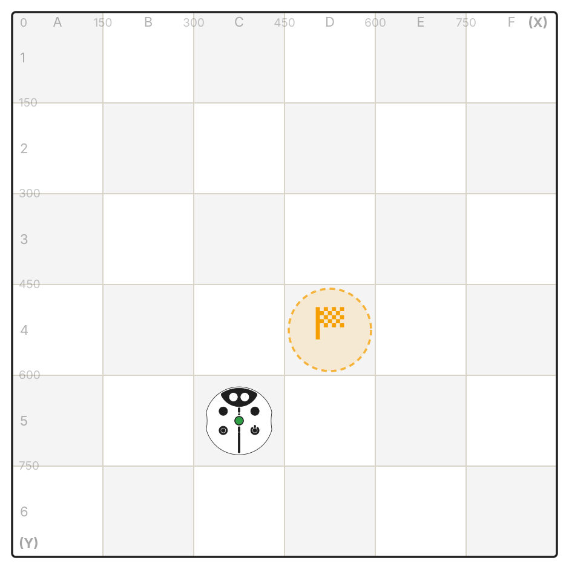

PrimaSTEM moko 4–12 metų vaikus programuoti be kompiuterio, planšetės ir telefono. Rinkinys lavina logiką, programavimo įgūdžius ir matematiką.

Su PrimaSTEM programavimas vaikams tampa paprastas ir akivaizdus. Net mažiausieji supranta, kas vyksta: jie liečia žetonus rankomis ir žaisdami išmoksta programavimo, logikos ir matematikos pagrindus.

Žaidimas su PrimaSTEM lavina loginį mąstymą, algoritminį mąstymą, programavimą, matematiką ir geometriją. Jis lavina ir kūrybiškumą, ir socialinius bei emocinius įgūdžius. Rinkinys paruošia vaiką blokinėms programavimo kalboms, pavyzdžiui, [Scratch](https://en.wikipedia.org/wiki/Scratch_\(programming_language\)) ar [LOGO](https://en.wikipedia.org/wiki/Logo_\(programming_language\)).

## Susipažinimas su mokymo rinkiniu

### Kur galima naudoti PrimaSTEM

PrimaSTEM tinka tokioms ugdymo programoms:

- ikimokyklinio ugdymo centrai;
- darželiai, dirbantys pagal Montessori metodą;
- pradinė mokykla;
- mokymasis namuose;
- specialiosios raidos centrai;
- pailgintos dienos ir popamokinės grupės;
- programavimo būreliai pradedantiesiems;
- vaikų edukacinės stovyklos.

### Ką reikia žinoti norint pradėti

Prieš pradėdami dirbti su rinkiniu, perskaitykite puslapį [Įrenginys ir nustatymai](/en-lt/usermanual) ir šį vadovą. Programavimo žinių nereikia: medžiagoje yra viskas, ko reikia pradėti.

## Tyrimai ir rinkinio vertė

PrimaSTEM įkvėpė programavimo kalba [LOGO](https://en.wikipedia.org/wiki/Logo_\(programming_language\)), kurią sukūrė [Seymour Papert](https://en.wikipedia.org/wiki/Seymour_Papert), ir Montessori pedagogika. LOGO ir robotas vėžlys padarė programavimą vaizdų ir prieinamą vaikams.

PrimaSTEM komandų žetonai tęsia šį požiūrį. Vaikas valdo robotą rankomis, be ekrano ir teksto, ir iš karto supranta, ką daro.

Vaikai stebi robotą, supranta kiekvieną komandą ir praktiškai įsisavina algoritmus.

Robotas turi svarbią savybę: jis turi kryptį. Vaikas lengvai įsivaizduoja save roboto vietoje, todėl greičiau supranta programos logiką.

Visos komandos paprastos: jos nurodo, kuria kryptimi robotas turi judėti. Kai vaikas moko robotą „veikti“ ir „galvoti“, jis pradeda apmąstyti savo veiksmus ir mintis. Todėl programuoti jam sekasi lengviau.

PrimaSTEM žetonai vaizdžiai ir paprastai parodo, kaip sudarytos programavimo kalbos. Mokymosi pradžioje nėra nei teksto, nei skaičių, tik pagrindinės komandos.

### Kodėl mediena

🌱 Valdymo pultas ir robotas pagaminti iš medžio (faneros). Vaikai mieliau žaidžia mediniais žaislais. Jie saugūs, ilgai tarnauja, ir kiekvienas turi savo istoriją.

## Programavimas su PrimaSTEM

PrimaSTEM žetonai veikia kaip tikrų programavimo kalbų instrukcijos. Juose matyti svarbios programavimo sąvokos.

### Algoritmai

**Algoritmas** susideda iš tikslių komandų (žetonų), kurios kartu sudaro programą.

### Eilė

Valdymo pultas vykdo komandas griežtai iš kairės į dešinę. Taip vaikai mato, kad komandos vykdomos iš eilės.

### Klaidų taisymas (derinimas)

Klaidą ištaisyti lengva: tereikia pakeisti žetoną. Taip vaikas mokosi pats rasti ir taisyti programos klaidas.

### Funkcija

Funkcija (paprogramė) susideda iš komandų apatinėje valdymo pulto eilėje. Pagrindinė programa ją iškviečia žetonu „**Funkcija**“.

### Kintamasis

Valdymo pultas įsimena paskutinį kiekvienos komandos skaičių. Pirmyn, Atgal, Kairėn, Dešinėn ir Pauzė saugo kiekviena savo reikšmę. Komanda be skaičiaus naudoja išsaugotą reikšmę. Tai ir yra kintamasis: jis turi vardą (komandą) ir reikšmę (skaičių), o reikšmė gali keistis.

## Taikymas kitiems dalykams

PrimaSTEM padeda lavinti ir kitus įgūdžius:

- Bendravimas. Žaisdami grupėje vaikai mokosi bendradarbiauti.
- Motorika. Darbas su žetonais gerina koordinaciją.
- Socialiniai įgūdžiai. Vaikai įgyja pasitikėjimo savimi ir mokosi kartu spręsti problemas.
- Matematika. Vaikai įsisavina pagrindines matematines sąvokas.
- Logika. Vaikai mokosi kurti sekas ir numatyti rezultatą.

> Vaikas dėlioja žetonų grandinę ir mokosi programuoti rankomis, akimis ir mintimis. Jis paspaudžia **▶ Start**, robotas važiuoja, o vaikas palygina rezultatą su tuo, ko tikėjosi. Tokia patirtis paspartina mokymąsi.

## Susipažinimas su robotu ir valdymo pultu

### Robotas

Pasakykite vaikams, kad robotas yra jų draugas ir jie gali jį programuoti. Paaiškinkite, kad robotas neturi savo minčių. Jis vykdo tik jų nurodymus, kaip buitinis prietaisas, kurį reikia įjungti.

### Valdymo pultas

Paaiškinkite, kad valdymo pultas perduoda komandas robotui. Parodykite, kaip dėlioti komandų žetonus ir programuoti robotą.

> Pagrindinė programa dėliojama viršutinėje valdymo pulto eilėje (6 lizdų poros). Apatinė eilė (5 lizdų poros) skirta paprogramei, kurią iškviečia komanda „**Funkcija**“.

### Komandų žetonai

Žetonai yra komandos robotui, jie dedami ant valdymo pulto. Paspaudus **▶ Start** robotas vykdo programą. Kiekvienas žetonas yra viena komanda. Taip vaikai mokosi kompiuterinio mąstymo ir mokosi sudaryti programas. Svarbu, kad vaikai suprastų, ką robotas padarys pagal kiekvieną komandą. Tada jie galės planuoti programą ir numatyti roboto veiksmus. Paaiškinkite vaikams, kad žetonų negalima pamesti ar sugadinti: be jų robotas negali judėti.

## 1. Pirmoji programa

### Priežastis ir pasekmė

Pagrindinis tikslas: parodyti vaikams ryšį tarp komandos ir veiksmo. Tegul vaikas padeda žetoną „Pirmyn“ į pirmą valdymo pulto lizdą ir paspaudžia **▶ Start**. Vaikas turi pamatyti, kad žetonas ir veiksmas susiję.

### Vienareikšmiai nurodymai

Pakartokite tai su kiekviena kryptimi (**pirmyn**, posūkis **kairėn**, posūkis **dešinėn**), kol vaikas atpažins kiekvieną žetoną.

### Pirmoji užduotis

Pasidėkite žaidimo lauką arba lipnia juosta ar flomasteriu nubraižykite tinklelį su 15 × 15 cm langeliais. Padėkite robotą į pradinį langelį. Paprašykite vaiko sudaryti programą, kad robotas pajudėtų vienu langeliu pirmyn. Jei vaikas pasirinko netinkamą žetoną, grąžinkite robotą ir pasiūlykite pagalvoti apie kitą variantą.

## 2. Programa ir derinimas

### Įvykių eilė

Padėkite tikslą dviem langeliais priešais robotą.

Tegul vaikas sudaro dviejų žetonų programą, kad robotas pasiektų tikslą.

### Trijų žetonų seka

Dabar tikslas yra vienu langeliu pirmyn ir vienu langeliu į dešinę.

Tegul vaikas pats pasirenka teisingą komandų tvarką.

Nesijaudinkite, jei vaikas pasirinko netinkamą žetoną. Grąžinkite robotą į pradžią ir paprašykite vaiko apmąstyti savo pasirinkimą ir išbandyti kitus variantus.

### Derinimas: klaidos paieška

Padėkite tikslą vienu langeliu priešais robotą ir vienu langeliu į kairę nuo jo.

Dabar programą sudarykite Jūs ir tyčia įdėkite į ją neteisingą posūkį.

Paprašykite vaiko rasti neteisingą komandą ir nuspėti, kur robotas nuvažiuos. Tada tegul vaikas paspaudžia **▶ Start** ir patikrina savo spėjimą.

Kai vaikas samprotaudamas arba patikrinęs įsitikins, kad programa neteisinga, tegul pakeičia neteisingą komandą teisinga. Taip jis suderina programą.

## 3. Programa su funkcija

### Komanda „Funkcija“

Kai vaikai įsisavins pagrindines komandas, parodykite jiems žetoną **Funkcija**. Jis iškviečia komandų rinkinį, kurį pagrindinė programa gali kartoti.

> Kad paaiškintumėte, kaip tai veikia, palyginkite funkciją su bokštu: po funkcijos žetonu viena po kitos sudėtos kitos komandos. Taip vaikai mato, kad viename žetone telpa keli nurodymai.

Parodykite pavyzdį. Pirmiausia padėkite du žetonus „Pirmyn“ į viršutinius lizdus ir paleiskite programą. Robotas pajudės dviem langeliais.

Dabar tuos pačius du „Pirmyn“ padėkite į funkciją (apatinę eilę), o į pagrindinę programą padėkite „Funkciją“. Rezultatas toks pat, bet dalis programos dabar paslėpta paprogramėje.

Tada sudėliokite seką: **Pirmyn, Pirmyn, Dešinėn, Pirmyn, Pirmyn**.

Paprašykite vaikų surasti pasikartojančias dalis ir „paslėpti“ jas funkcijoje. Turi išeiti taip: pagrindinėje programoje **Funkcija, Dešinėn, Funkcija**, apatinėje eilėje **Pirmyn, Pirmyn**.

[Paleisti simuliatoriuje](https://simulator.primastem.com/#top=cfun,crig,cfun&fn=cfor,cfor&s=l1144602&r=225-825-0&run)

### Užduočių sprendimas su funkcija

Duokite vaikui 3 žetonus „**Pirmyn**“ ir 2 žetonus „**Funkcija**“.

Užduotis: pajudėti 5 langeliais pirmyn.

Tegul vaikas supranta, kad šiai užduočiai reikia funkcijos, kuri kartoja veiksmą.

Jei programa neteisinga, grąžinkite robotą į pradžią. Paprašykite vaiko pagalvoti, kaip teisingai išspręsti užduotį, ir išbandyti kitus variantus.

[Paleisti simuliatoriuje](https://simulator.primastem.com/#top=cfun,cfun,cfor&fn=cfor,cfor&s=l1144602&r=225-825-0&run)

## 4. Atsitiktinumas

### Komanda „Atsitiktinis judesys“

Kad paaiškintumėte atsitiktinumą, paimkite 4 krypties žetonus: „**Pirmyn**“, „**Kairėn**“, „**Dešinėn**“ ir „**Atgal**“. Sudėkite juos į nepermatomą dėžutę ar maišelį ir sumaišykite. Tegul vaikai paeiliui nežiūrėdami ištraukia vieną žetoną, parodo jį grupei ir padeda atgal. Šiuo pavyzdžiu paaiškinkite, kas yra atsitiktinis pasirinkimas iš keturių galimybių.

Tada parodykite vaikams komandos žetoną „**Atsitiktinis judesys**“.

Paaiškinkite, kad šis žetonas daro beveik tą patį, ką vaikai darė su maišeliu. Jis atsitiktinai pasirenka kryptį ir pajudina robotą vienu žingsniu, tai yra vienu langeliu. Robotas gali pajudėti vienu langeliu pirmyn, į dešinę, į kairę arba atgal.

Padėkite žetoną „**Atsitiktinis judesys**“ į viršutinį lizdą ir kelis kartus paleiskite programą. Robotas kiekvieną kartą judės kitaip.

[Paleisti simuliatoriuje](https://simulator.primastem.com/#top=crnd&s=l1144602&r=375-525-0&run)

Pažaiskite su vaikais: tegul prieš kiekvieną paleidimą spėja, kur robotas judės.

Pabrėžkite, kad tai **atsitiktinumas** ir kryptį atspėti kiekvieną kartą neįmanoma.

Sugalvokite kartu su vaikais nedidelį žaidimą su žetonu „**Atsitiktinis judesys**“.

## 5. Ciklai (komandų kartojimas)

### Susipažinimas su skaitiniais ciklais

Parodykite vaikams kartojimo žetonus. Paklauskite, ar jie pažįsta skaičius, ar yra matę žaidimų kauliuką ir ar yra žaidę stalo žaidimus.

Padėkite du žetonus „Pirmyn“ į viršutinius lizdus ir paleiskite programą. Robotas pajudės dviem langeliais.

Dabar palikite vieną „Pirmyn“ ir po juo padėkite žetoną „Kartojimas 2“. Rezultatas toks pat: veiksmas pasikartos du kartus.

Padėkite 4 žetonus „**Pirmyn**“ ir pažiūrėkite rezultatą. Tada paprašykite vaikų pakartoti šį judėjimą 4 langeliais su **kartojimo** žetonu.

Užduotį galima išspręsti įvairiai. Paprastas variantas: „**Pirmyn**“ ir „Kartojimas 4“. Kitas variantas: „**Pirmyn**“ su „Kartojimas 3“ ir dar vienas „**Pirmyn**“.

[Paleisti simuliatoriuje](https://simulator.primastem.com/#top=cfor.r003,cfor&s=l1144602&r=225-825-0&run)

### Funkcijos kartojimas

Pabandykite su vaikais pridėti kartojimą prie komandos „Funkcija“. Pavyzdžiui, robotas gali važiuoti zigzagu: viršutinėje eilėje „Funkcija“ su „Kartojimas 5“, apatinėje eilėje „**Pirmyn**“, „**Dešinėn**“, „**Pirmyn**“, „**Kairėn**“.

Pirmiausia funkcijoje sudėliokite programą „laiptelis“: „Pirmyn“, „Dešinėn“, „Pirmyn“, „Kairėn“. Paleiskite ją.

Tada pridėkite prie funkcijos „Kartojimas 5“. Funkcija pasikartos 5 kartus, ir robotas laipteliais judės į dešinę ir aukštyn.

[Paleisti simuliatoriuje](https://simulator.primastem.com/#top=cfun.r005&fn=cfor,crig,cfor,clef&s=l1144602&r=75-825-0&run)

Robotas laipteliais judės įstrižai į dešinę ir aukštyn ir žengs 5 laiptelius.

## 6. Atsitiktiniai skaičiai

### Kas yra atsitiktinis skaičius

Tarp žetonų yra „Kartoti atsitiktinį kartų skaičių“ (su kauliuku). Jis parenka atsitiktinį skaičių nuo 1 iki 6. Pažaiskite su vaikais: tegul traukia kartojimo žetonus iš maišelio.

Kad paaiškintumėte atsitiktinį skaičių, paimkite 4 kartojimo žetonus: „**2**“, „**3**“, „**4**“ ir „**5**“. Sudėkite juos į nepermatomą dėžutę ar maišelį ir sumaišykite. Tegul vaikai paeiliui nežiūrėdami ištraukia vieną žetoną, parodo jį, pasako skaičių ir padeda atgal. Pažaiskite: kas ištrauks didesnį skaičių. Šiuo pavyzdžiu paaiškinkite, kas yra atsitiktinis pasirinkimas iš keturių galimybių.

Tada parodykite vaikams žetoną „**Kartoti atsitiktinį kartų skaičių**“. Paaiškinkite, kad jis daro beveik tą patį, ką vaikai darė su maišeliu. Kaip žaidimų kauliukas, jis atsitiktinai parenka vieną skaičių nuo 1 iki 6, ir robotas tiek kartų pakartoja veiksmą.

Padėkite žetoną „**Pirmyn**“ į viršutinį valdymo pulto lizdą, o po juo žetoną „**Kartoti atsitiktinį kartų skaičių**“. Paprašykite vaikų paspausti **▶ Start**. Grąžinkite robotą į vietą. Pakartokite kelis kartus.

[Paleisti simuliatoriuje](https://simulator.primastem.com/#top=cfor.rrnd&s=l1144702&r=225-975-0&run)

Pažaiskite: kieno robotas nuvažiuos toliau.

Atkreipkite vaikų dėmesį, kad robotas nuvažiuoja atsitiktinį langelių skaičių, nuo 1 iki 6. Pabrėžkite, kad tai atsitiktinumas ir iš anksto negalima žinoti, kaip toli robotas nuvažiuos.

## 7. Skaičiai: atstumai ir kampai

### Susipažinimas su skaičiais

Jei antrame poros lizde nėra skaičiaus, robotas naudoja numatytąsias reikšmes: važiuoja 15 cm pirmyn ir pasisuka 90°. Šias reikšmes keičia skaičių žetonai.

Pavyzdys. Pridėkite skaičių **200** prie komandos „**Pirmyn**“ ir pažiūrėkite, kaip toli robotas nuvažiuos. Pridėkite skaičių **180** prie posūkio ir pažiūrėkite, kas pasikeis.

[Paleisti simuliatoriuje](https://simulator.primastem.com/#top=cfor.n200,crig.n180&s=l1047602&r=450-600-0&run)

> **Svarbu.** Valdymo pultas įsimena paskutinį judėjimo ir posūkio komandų skaičių. Jei komanda stovi be naujo skaičiaus, ji naudoja išsaugotą skaičių, kol valdymo pultas išjungiamas. Naujas skaičius pakeičia išsaugotą. Žingsnio ilgį, nustatytą žetonu „Numatytasis žingsnis“, valdymo pultas įsimena ir po paleidimo iš naujo. Norėdami grąžinti 15 cm, panaudokite žetoną „Numatytasis žingsnis“ su skaičiumi 150. 90° posūkis po paleidimo iš naujo grįžta savaime.

Su skirtingais skaičiais robotas nuvažiuoja sudėtingesnius maršrutus. Pavyzdžių rasite puslapyje [Piešinių pavyzdžiai](/en-lt/mathdrawings).

## 8. Aritmetika

### Aritmetiniai veiksmai

Aritmetika keičia judėjimo komandų (Pirmyn, Atgal, Kairėn, Dešinėn) skaičius programoje. Taip robotą galima valdyti lanksčiau.

Kai poroje yra aritmetinio veiksmo žetonas, valdymo pultas pakeičia išsaugotą komandos skaičių ir siunčia robotui naują reikšmę.

Pavyzdys:

[Paleisti simuliatoriuje](https://simulator.primastem.com/#top=cfor.n200,crig,cfor.a100&s=l1047602&r=300-700-0&run)

„Pirmyn 200“: robotas nuvažiuoja 20 cm. „Pirmyn \+100“: robotas nuvažiuoja dar 30 cm. Iš viso 50 cm.

### Užduotis: auganti spiralė

Aritmetika keičia išsaugotą skaičių, tai yra kintamąjį. Sudėliokite programą: viršutinėje eilėje Pirmyn 30 ir Funkcija × 20, apatinėje Dešinėn ir Pirmyn +30. Kiekvieną kartą iškvietus funkciją kraštinė pailgėja 3 cm.

Pirmiausia paprašykite vaikų nuspėti: kokio ilgio bus penktoji kraštinė? Tada paleiskite ir patikrinkite. Atsakymas: 15 cm (3 + 3 + 3 + 3 + 3).

[Paleisti simuliatoriuje](https://simulator.primastem.com/#top=cfor.n030,cfun.r020&fn=crig,cfor.a030&s=l1047602&r=450-465-0&run)

<Columns cols={2}>
  <Frame caption="Programa valdymo pulte">
    
  </Frame>
  <Frame caption="Ką nupieš robotas">
    
  </Frame>
</Columns>

Ta pati programa LOGO kalba: [PrimaSTEM ir LOGO](/en-lt/logo).

Aritmetika cikle duoda progresijas.

> Jei po aritmetinio veiksmo skaičius tampa neigiamas, robotas atlieka priešingą veiksmą: važiuoja atgal vietoj pirmyn ir sukasi dešinėn vietoj kairėn.

Galimi veiksmai yra sudėtis (\+), atimtis (−), daugyba (\*), dalyba (/), kvadratinė šaknis (√) ir kėlimas laipsniu (^).

Raštų pavyzdžių rasite puslapyje [Piešinių pavyzdžiai](/en-lt/mathdrawings).

---

## Žaiskite ir mokykitės kartu su vaikais

Savo mokinius geriausiai pažįstate Jūs. Su PrimaSTEM žaisdami galite mokyti programavimo, logikos ir kitų dalykų. Viskas priklauso nuo Jūsų vaizduotės.

Dėkojame, kad pasirinkote PrimaSTEM. [Parašykite mums](/en-lt/contacts) apie savo patirtį ir įspūdžius, laukiame Jūsų atsiliepimų.
