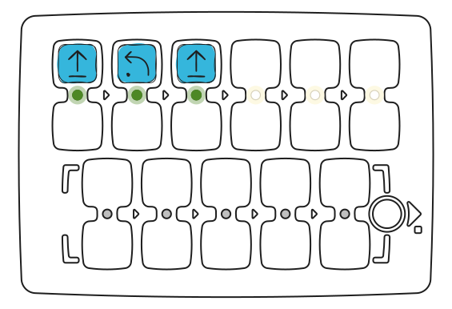
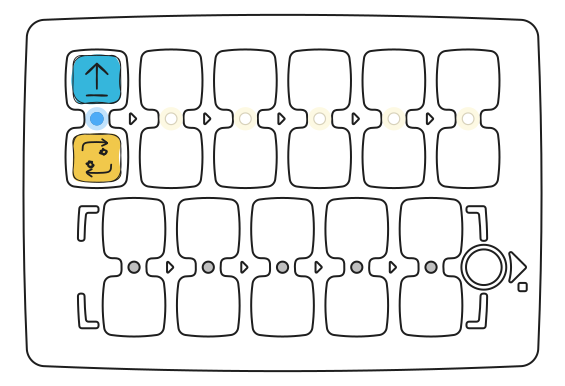

PrimaSTEM yra mokymo priemonė 4–12 metų vaikams. Ji padeda išmokti programuoti be kompiuterio, planšetės ir telefono. Priemonė lavina logiką, programavimo įgūdžius ir matematiką.

Su PrimaSTEM programavimas vaikams tampa paprastas ir akivaizdus. Net mažiausiems procesas suprantamas ir apčiuopiamas: programavimo, logikos ir matematikos pagrindus jie išmoksta žaisdami.

Žaidimas su PrimaSTEM lavina svarbiausius įgūdžius: loginį mąstymą, algoritminį mąstymą, programavimą, matematiką, geometriją, taip pat kūrybiškumą ir socialinę bei emocinę raidą. PrimaSTEM rinkinys yra parengiamasis žingsnis prieš susipažįstant su blokinėmis programavimo kalbomis, tokiomis kaip [Scratch](https://en.wikipedia.org/wiki/Scratch_\(programming_language\)) ar [LOGO](https://en.wikipedia.org/wiki/Logo_\(programming_language\)).

## Susipažinimas su mokymo rinkiniu

### Kur galima naudoti PrimaSTEM?

Rinkinį verta naudoti šiose ugdymo programose:

- Ikimokyklinio ugdymo centrai
- Darželiai, dirbantys pagal Montessori metodą
- Pradinė mokykla
- Mokymasis namuose
- Specialiosios raidos centrai
- Pailgintos dienos ir popamokinės grupės
- Programavimo būreliai pradedantiesiems
- Vaikų edukacinės stovyklos

### Ką reikia žinoti norint pradėti?

Prieš pradedant dirbti su rinkiniu mokytojams ir tėvams rekomenduojame perskaityti [naudotojo vadovą](/en-lt/usermanual) ir šį vadovą. Specialių programavimo žinių nereikia: medžiagoje yra pagrindai, kurių pakanka pradėti mokyti.

## Tyrimai ir rinkinio vertė

PrimaSTEM įkvėpė programavimo kalba [LOGO](https://en.wikipedia.org/wiki/Logo_\(programming_language\)), kurią sukūrė [Seymour Papert](https://en.wikipedia.org/wiki/Seymour_Papert), ir Montessori pedagogika. LOGO ir robotas vėžlys padarė programavimą vaizdų ir prieinamą vaikams.

PrimaSTEM komandų žetonai įgyvendina šį požiūrį. Mokymasis tampa intuityvus: robotas valdomas paprastai, liečiant žetonus, be ekranų ir teksto.

Stebėdami robotą, vaikai mokosi suprasti kiekvieną komandą ir praktiškai įsisavina algoritmus.

Robotas turi svarbią savybę: jis turi kryptį. Todėl vaikas gali susitapatinti su robotu ir lengviau suprasti pagrindinę programų veikimo logiką.

Visos komandos paprastos ir aiškios: jos nurodo, kuria tiksliai kryptimi robotas turi judėti. Mokydamas robotą „veikti“ ar „galvoti“, vaikas apmąsto ir savo paties veiksmus bei mintis, todėl programuoti išmoksta veiksmingiau.

PrimaSTEM žetonai yra vaizdus ir supaprastintas programavimo kalbų atvaizdas. Mokymosi pradžioje nėra nei teksto, nei skaičių, tik pagrindinės komandos.

### Kodėl mediena?

🌱 Valdymo pultas ir robotas pagaminti iš medžio. Patirtis parodė, kad vaikai mieliau žaidžia mediniais žaislais: jie saugūs, tvirti ir sukuria savo naudojimo istoriją.

## Programavimo samprata su PrimaSTEM

Fiziniai PrimaSTEM žetonai atitinka tikrų programavimo kalbų instrukcijas ir parodo svarbias sąvokas.

### Algoritmai

**Algoritmas** yra tikslių komandų (žetonų) seka, sudaranti programą.

### Eilė

Komandos PrimaSTEM valdymo pulte vykdomos griežtai iš kairės į dešinę. Taip vaizdžiai parodoma vykdymo eilė.

### Klaidų taisymas (derinimas)

Klaidą ištaisyti lengva: tereikia pakeisti žetoną. Taip lavinamas gebėjimas savarankiškai derinti programą.

### Funkcija

Funkcija (paprogramė) yra komandų rinkinys apatinėje valdymo pulto dalyje. Pagrindinė programa ją iškviečia žetonu „**Funkcija**“.

### Kintamasis

Valdymo pultas įsimena paskutinį kiekvienos komandos skaičių. Pirmyn, Atgal, Kairėn, Dešinėn ir Pauzė saugo kiekviena savo reikšmę. Komanda be skaičiaus naudoja išsaugotą reikšmę. Tai ir yra kintamasis: jis turi vardą (komandą) ir reikšmę (skaičių), o reikšmė gali keistis.

## Taikymas kitiems dalykams

PrimaSTEM padeda įgyti ir kitų įgūdžių:

- **Bendravimas**: žaidimas grupėje skatina bendradarbiavimą.
- **Motorika**: darbas su žetonais gerina koordinaciją.
- **Socialiniai įgūdžiai**: vaikai įgyja pasitikėjimo savimi ir mokosi kartu spręsti problemas.
- **Matematika**: įsisavinamos pagrindinės matematinės sąvokos.
- **Logika**: vaikai mokosi kurti sekas ir numatyti rezultatus.

> Dėliodamas žetonų grandinę, vaikas mokosi programuoti rankomis, akimis ir mintimis. Paspaudus mygtuką **▶ Start** robotas juda, o rezultatas palyginamas su tuo, ko vaikas tikėjosi. Tokia visapusiška patirtis paspartina mokymąsi.

## Susipažinimas su robotu ir valdymo pultu

### Robotas

Pasakykite vaikams, kad robotas yra jų draugas, kurį jie gali programuoti. Paaiškinkite: robotas neturi savo minčių ir tik vykdo jų nurodymus, kaip buitinis prietaisas, kurį reikia įjungti.

### Valdymo pultas

Paaiškinkite, kad valdymo pultas perduoda komandas robotui. Parodykite, kaip įstatyti komandų žetonus ir užprogramuoti robotą.

> Pagrindinė programa dėliojama viršutinėje valdymo pulto eilėje (6 lizdai). Apatinė eilė (5 lizdai) skirta funkcijos paprogramei ir naudojama su komanda „**Funkcija**“.

### Komandų žetonai

Žetonai yra komandos robotui, kurios įstatomos į valdymo pultą. Paspaudus **▶ Start** robotas vykdo seką. Kiekvienas žetonas yra atskira komanda. Taip vaikai mokosi kompiuterinio mąstymo ir programų kūrimo. Svarbu, kad vaikai suprastų, ką robotas daro įsijungus kiekvienai komandai. Taip jie mokosi kurti programą ir numatyti roboto veiksmus. Paaiškinkite vaikams: žetonų negalima pamesti ar sugadinti, be jų robotas negali judėti.

## 1 - Pirmoji programa

### Priežastis ir pasekmė

Pagrindinis tikslas yra parodyti vaikams ryšį tarp komandos ir veiksmo. Tegul vaikas įstato žetoną „Pirmyn“ į pirmą valdymo pulto lizdą ir paspaudžia **▶ Start**. Vaikas turi pamatyti, kad žetonas atitinka veiksmą.

### Vienareikšmiai nurodymai

Kartokite veiksmus su kiekviena kryptimi (**pirmyn**, posūkis **kairėn**, posūkis **dešinėn**), kol vaikas atpažins kiekvieną žetoną.

### Pirmoji užduotis

Pasidėkite žaidimo lauką arba lipnia juosta ar flomasteriu nubraižykite 15x15 cm langelių tinklelį. Padėkite robotą į pradinį langelį. Paprašykite vaiko sudaryti programą, kad robotas pajudėtų vienu langeliu pirmyn. Jei pasirinktas netinkamas žetonas, grąžinkite robotą atgal ir pasiūlykite vaikui pagalvoti apie kitą variantą.

## 2 - Programa ir derinimas

### Įvykių eilė

Padėkite tikslą dviem langeliais priešais robotą.

Tegul vaikas sudaro dviejų žetonų programą, kad pasiektų tikslą.

### Trijų žetonų seka

Šį kartą tikslas yra vienu langeliu pirmyn ir vienu langeliu į dešinę.

Tegul vaikas pats pasirenka teisingą komandų seką.

Nesijaudinkite, jei pasirinktas netinkamas žetonas. Tiesiog grąžinkite robotą į pradinę vietą ir paprašykite vaiko apmąstyti savo pasirinkimą ir išbandyti kitus variantus.

### Derinimas - klaidos paieška

Padėkite tikslą vienu langeliu priešais robotą ir vienu langeliu į kairę nuo jo.

Šį kartą patys sudarykite programą užduočiai išspręsti ir tyčia įterpkite į seką neteisingą posūkį.

Paprašykite vaiko nuspėti, kuri programos komanda neteisinga, ir pačiam numatyti neteisingą rezultatą. Tada leiskite jam paspausti mygtuką **▶ Start** ir patikrinti savo spėjimą.

Kai vaikas įsitikins, kad parodyta seka buvo neteisinga, samprotaudamas arba patikrinęs, leiskite jam pakeisti neteisingą komandą teisinga ir taip suderinti programą.

## 3 - Programa su funkcija

### Komanda „Funkcija“

Kai pagrindinės komandos įsisavintos, supažindinkite su žetonu **Funkcija**. Tai pakartojamas komandų rinkinys, kurį galima iškviesti iš pagrindinės programos.

> Paaiškinti, kaip tai veikia, galite bokšto palyginimu (po funkcijos žetonu viena ant kitos sudėtos kitos komandos) ir pasakyti, kad viename žetone gali tilpti daugiau nurodymų.

Parodykite pavyzdį: pirmiausia įstatykite du žetonus „Pirmyn“ į viršutinius lizdus ir paleiskite programą - robotas pajudės dviem langeliais.

Dabar tuos pačius du žetonus „Pirmyn“ įstatykite į funkciją (apatinę eilę), o pagrindinėje programoje naudokite „Funkcija“. Rezultatas bus toks pat, bet dalis programos dabar paslėpta paprogramėje.

Toliau sudarykite seką: **Pirmyn - Pirmyn - Dešinėn - Pirmyn - Pirmyn**.

Paprašykite vaikų surasti pasikartojančias dalis ir „paslėpti“ jas funkcijoje. Galutinė seka: pagrindinėje dalyje - **Funkcija - Dešinėn - Funkcija**, apačioje - **Pirmyn - Pirmyn**.

[Paleisti simuliatoriuje](https://simulator.primastem.com/#top=cfun,crig,cfun&fn=cfor,cfor&s=l1144602&r=225-825-0&run)

### Užduočių sprendimas su funkcija

Duokite vaikui 3 žetonus „**Pirmyn**“ ir 2 žetonus „**Funkcija**“.

Užduotis - pajudėti 5 langeliais pirmyn.

Tegul vaikas supranta, kad keliems veiksmams reikia panaudoti funkciją, ir išsprendžia užduotį.

Jei seka neteisinga, tiesiog grąžinkite robotą į pradinę vietą ir paprašykite vaiko pagalvoti apie teisingą užduoties sprendimą ir išbandyti kitus variantus.

[Paleisti simuliatoriuje](https://simulator.primastem.com/#top=cfun,cfun,cfor&fn=cfor,cfor&s=l1144602&r=225-825-0&run)

## 4 - Atsitiktinumas

### Komanda „Atsitiktinis judesys“

Atsitiktinumo sąvokai paaiškinti paimkite 4 krypties žetonus: „**Pirmyn**“, „**Kairėn**“, „**Dešinėn**“ ir „**Atgal**“. Sudėkite juos į nepermatomą dėžutę ar maišelį, sumaišykite ir paprašykite vaikų nežiūrint ištraukti 1 žetoną, parodyti jį grupei ir padėti atgal. Šiuo pavyzdžiu paaiškinkite vaikams, kas yra atsitiktinis pasirinkimas iš keturių galimybių.

Tada parodykite vaikams komandos žetoną „**Atsitiktinis judesys**“.

Paaiškinkite, kad šis žetonas daro beveik tą patį, ką vaikai darė traukdami atsitiktinius žetonus iš maišelio: jis atsitiktinai pasirenka kryptį, kuria robotas judės, ir pajudina jį 1 loginiu žingsniu - vienu langeliu. Taigi robotas gali pajudėti 1 langeliu pirmyn, į dešinę, į kairę arba atgal.

Įstatykite žetoną „**Atsitiktinis judesys**“ į viršutinį lizdą ir kelis kartus paleiskite programą - robotas kiekvieną kartą judės kitaip.

[Paleisti simuliatoriuje](https://simulator.primastem.com/#top=crnd&s=l1144602&r=375-525-0&run)

Pažaiskite su vaikais: tegul jie spėja, kur robotas judės, prieš įvykdant komandą.

Pabrėžkite, kad tai **atsitiktinumas** ir kryptį ne visada įmanoma atspėti.

Pabandykite kartu su vaikais sugalvoti nedidelį žaidimą su žetonu „**Atsitiktinis judesys**“.

## 5 - Ciklai (komandų kartojimas)

### Susipažinimas su skaitiniais ciklais

Parodykite vaikams reikšmių žetonus. Paklauskite, ar jie pažįsta skaičius, ar yra matę stalo žaidimų kauliuką, ar yra žaidę tokius žaidimus.

Įstatykite du žetonus „Pirmyn“ į viršutinius lizdus ir paleiskite - robotas pajudės dviem langeliais.

Dabar palikite vieną „Pirmyn“, o po juo įstatykite žetoną „kartojimas 2“. Rezultatas bus toks pat: veiksmas pasikartos du kartus.

Įstatykite 4 komandas „**Pirmyn**“, pažiūrėkite rezultatą, o tada paprašykite vaikų panaudoti reikšmių žetonus - **ciklus** - ir pakartoti roboto judėjimą 4 langeliais.

Galimas paprastas sprendimas su žetonu „**Pirmyn**“ ir ciklo reikšme 4, bet ir kiti variantai: pavyzdžiui, „**Pirmyn**“ su ciklo skaičiumi 3 ir dar viena komanda „**Pirmyn**“.

[Paleisti simuliatoriuje](https://simulator.primastem.com/#top=cfor.r003,cfor&s=l1144602&r=225-825-0&run)

### Funkcijos iškvietimo ciklas

Pabandykite su vaikais pritaikyti ciklą su reikšmėmis komandai „Funkcija“: pavyzdžiui, kad robotas eitų zigzagu, naudokite komandą „Funkcija“ su ciklo reikšme 5, o apatinėje valdymo pulto dalyje sudėkite funkcijos seką iš komandų „**Pirmyn**“, „**Dešinėn**“, „**Pirmyn**“, „**Kairėn**“.

Pirmiausia su funkcija sudarykite programą judėjimui „laipteliais“ - „pirmyn“, „dešinėn“, „pirmyn“, „kairėn“ - ir ją paleiskite.

Tada funkcijai pridėkite ciklą su skaičiumi 5 ir taip pakartokite funkciją kelis kartus: robotas laipteliais judės į dešinę ir aukštyn.

[Paleisti simuliatoriuje](https://simulator.primastem.com/#top=cfun.r005&fn=cfor,crig,cfor,clef&s=l1144602&r=75-825-0&run)

Robotas laipteliais judės įstrižai į dešinę ir aukštyn ir pakeliui žengs 5 laiptelius.

## 6 - Atsitiktiniai skaičiai

### Atsitiktinio skaičiaus sąvoka

Tarp žetonų yra „Atsitiktinai“ (su kauliuko paveikslėliu). Jis parenka atsitiktinę reikšmę nuo 1 iki 6. Pažaiskite žaidimą: traukite ciklo žetonus iš maišelio.

Atsitiktinio skaičiaus sąvokai paaiškinti paimkite 4 ciklo žetonus: „**2**“, „**3**“, „**4**“ ir „**5**“. Sudėkite juos į nepermatomą dėžutę ar maišelį, sumaišykite ir paprašykite vaikų nežiūrint ištraukti 1 žetoną, parodyti jį, pasakyti reikšmę ir padėti atgal. Pažaiskite: kas ištrauks didesnę reikšmę. Šiuo pavyzdžiu paaiškinkite vaikams, kas yra atsitiktinis pasirinkimas iš keturių galimybių.

Tada parodykite vaikams reikšmės žetoną „**Atsitiktinai**“. Paaiškinkite, kad šis žetonas daro beveik tą patį, ką vaikai darė traukdami atsitiktinius reikšmių žetonus iš maišelio: kaip kauliukas, jis atsitiktinai parenka 1 iš 6 skaičių (nuo 1 iki 6) ir perduoda jį robotui veiksmams kartoti.

Įstatykite žetoną „**Pirmyn**“ į viršutinį valdymo pulto lizdą, o po juo žetoną „**Atsitiktinai**“. Paprašykite vaikų paspausti mygtuką **▶ Start**. Grąžinkite robotą į pradinę vietą. Pakartokite užduotį kelis kartus.

[Paleisti simuliatoriuje](https://simulator.primastem.com/#top=cfor.rrnd&s=l1144702&r=225-975-0&run)

Pažaiskite: kieno robotas nuvažiuos toliau.

Atkreipkite vaikų dėmesį, kad robotas pajuda atsitiktiniu langelių skaičiumi: nuo 1 iki 6. Pabrėžkite, kad tai atsitiktinumas ir iš anksto negalima žinoti, kaip toli robotas nuvažiuos.

## 7 - Skaičiai: atstumai ir kampai

### Susipažinimas su skaičiais

Jei komandoms nenustatytos skaitinės reikšmės (virš ar po komanda dvigubame lizde), robotas naudoja numatytuosius judėjimo parametrus: be parametrų robotas pajuda 15 cm pirmyn ir pasisuka 90°. Šias reikšmes galima pakeisti reikšmių žetonais.

Pavyzdys: pridėkite reikšmę **200** komandai „**Pirmyn**“ ir pažiūrėkite, kokį atstumą robotas nuvažiuos. Pridėkite reikšmę **180** komandai „**posūkis**“ ir įvertinkite pokyčius.

[Paleisti simuliatoriuje](https://simulator.primastem.com/#top=cfor.n200,crig.n180&s=l1047602&r=450-600-0&run)

> **Svarbu:** valdymo pultas įsimena paskutinę judėjimo ir posūkio komandoms nustatytą reikšmę. Jei komanda naudojama be naujos reikšmės, galioja paskutinė išsaugota reikšmė, kol valdymo pultas išjungiamas. Nustačius naują reikšmę, pasikeičia numatytoji reikšmė. Žingsnio ilgis, nustatytas žetonu „Numatytasis žingsnis“, išsaugomas atmintyje ir išlieka po paleidimo iš naujo. Norėdami grąžinti 15 cm, panaudokite šį žetoną su skaičiumi 150. 90° posūkis po paleidimo iš naujo grįžta savaime.

Keisdami parametrus galite kurti sudėtingesnes trajektorijas ir judėjimo scenarijus. Pavyzdžių rasite [matematinių piešinių puslapyje](/en-lt/mathdrawings).

## 8 – Aritmetika

### Aritmetiniai veiksmai

Aritmetiniai veiksmai su skaičiais leidžia programoje dinamiškai keisti judėjimo komandų (Pirmyn, Atgal, Kairėn, Dešinėn) reikšmes, todėl robotą valdyti lanksčiau.

Pridėjus aritmetinį veiksmą, valdymo pultas pakeičia judėjimo komandai išsaugotą skaičių ir siunčia naują reikšmę robotui.

Pavyzdys:

[Paleisti simuliatoriuje](https://simulator.primastem.com/#top=cfor.n200,crig,cfor.a100&s=l1047602&r=300-700-0&run)

„Pirmyn 200“ — robotas nuvažiuoja 20 cm, „Pirmyn \+100“ — dar 30 cm. Bendras atstumas: 50 cm.

### Užduotis: auganti spiralė

Aritmetika keičia išsaugotą skaičių, tai yra kintamąjį. Sudėliokite programą: viršutinėje eilėje Pirmyn 30 ir Funkcija × 20, apatinėje Dešinėn ir Pirmyn +30. Kiekvieną kartą iškvietus funkciją kraštinė pailgėja 3 cm.

Pirmiausia paprašykite vaikų nuspėti: kokio ilgio bus penktoji kraštinė? Tada paleiskite ir patikrinkite. Atsakymas: 15 cm (3 + 3 + 3 + 3 + 3).

[Paleisti simuliatoriuje](https://simulator.primastem.com/#top=cfor.n030,cfun.r020&fn=crig,cfor.a030&s=l1047602&r=450-465-0&run)

<Columns cols={2}>
  <Frame caption="Programa valdymo pulte">
    
  </Frame>
  <Frame caption="Ką nupieš robotas">
    
  </Frame>
</Columns>

Ta pati programa LOGO kalba: [PrimaSTEM ir LOGO](/en-lt/logo).

Naudojant tokius veiksmus cikle, galima kurti progresijas.

> Jei aritmetinio veiksmo rezultatas tampa neigiamas, robotas atlieka priešingą veiksmą: vietoj judėjimo pirmyn važiuoja atgal, vietoj posūkio kairėn sukasi dešinėn.

Galimi veiksmai: sudėtis (\+), atimtis (−), daugyba (\*), dalyba (/), kvadratinė šaknis (√), kėlimas laipsniu (^).

Raštų pavyzdžiai pateikti [matematinių piešinių puslapyje](/en-lt/mathdrawings).

---

## Žaiskite ir mokykitės kartu su vaikais!

Savo mokinius geriausiai pažįstate Jūs. PrimaSTEM yra universali priemonė mokytis žaidžiant. Naudokite ją programavimui, logikai ir kitiems dalykams mokyti. Viskas priklauso nuo Jūsų vaizduotės!

p/s: Dėkojame, kad naudojate PrimaSTEM ir domitės! Laukiame Jūsų atsiliepimų, [parašykite mums](/en-lt/contacts) apie savo patirtį ir įspūdžius.
