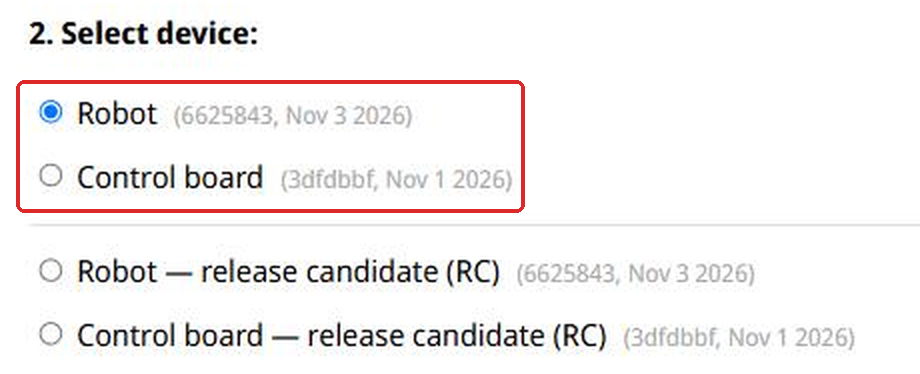
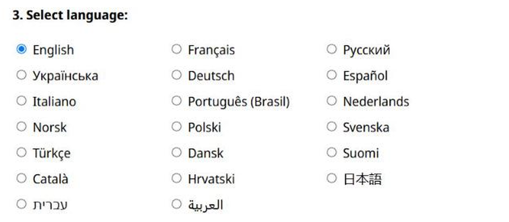
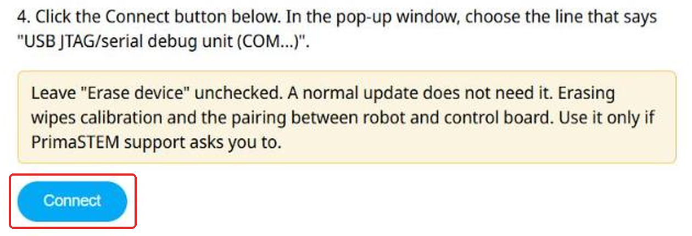
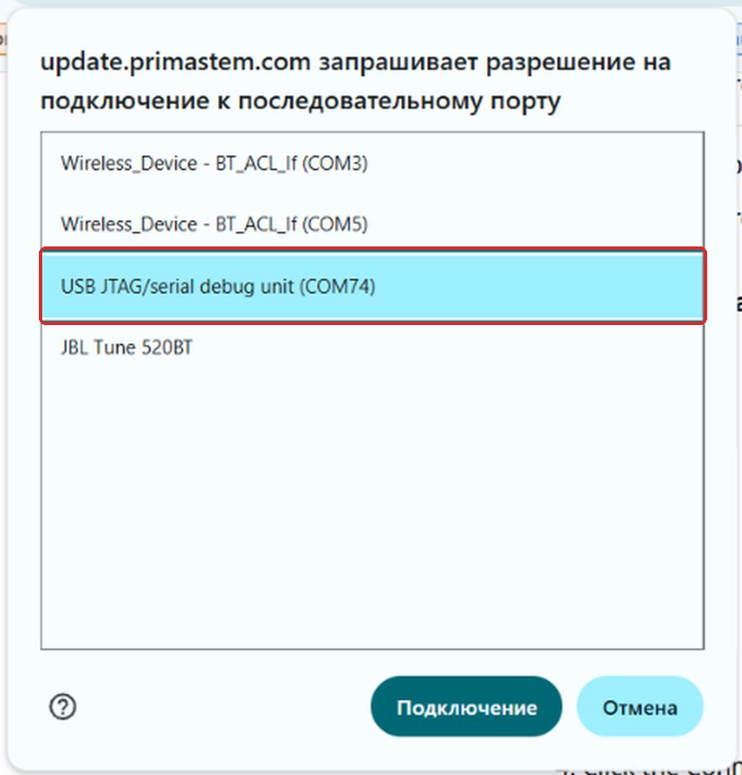
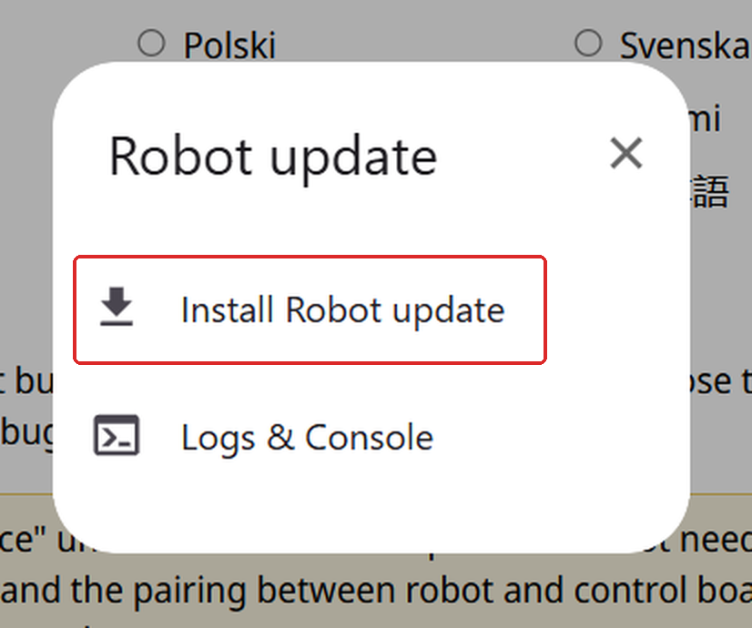
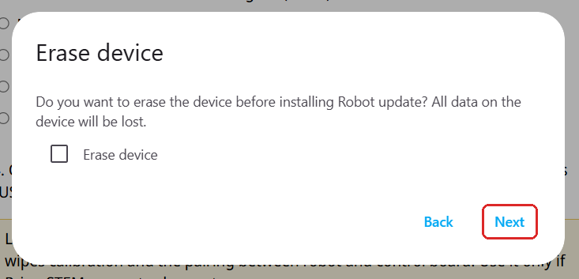
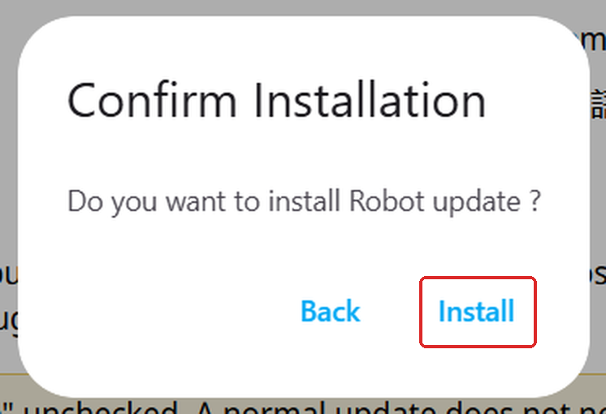
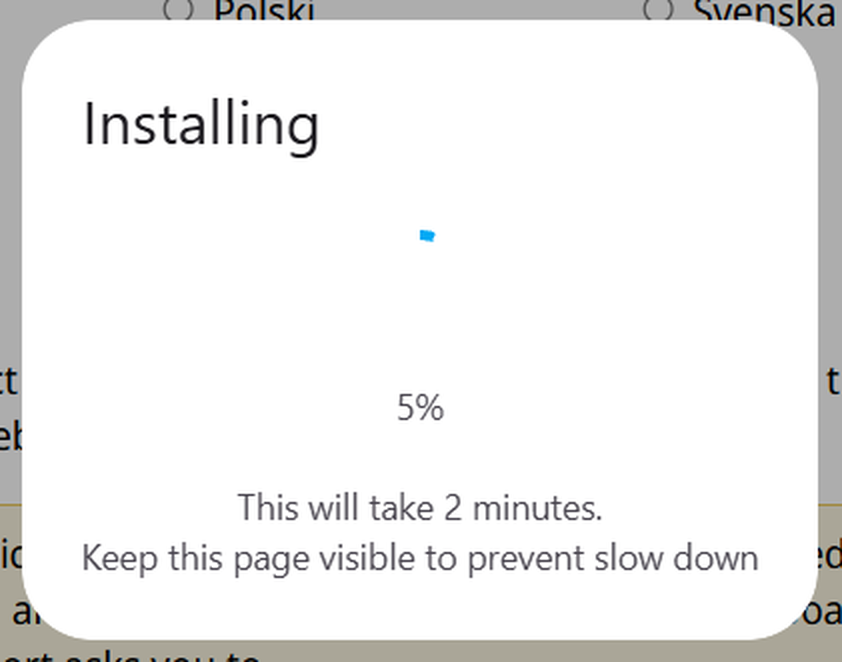
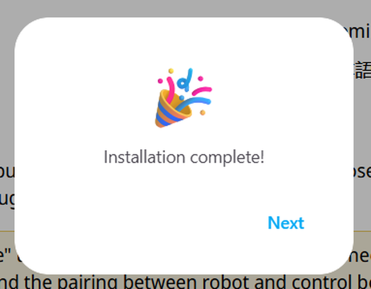
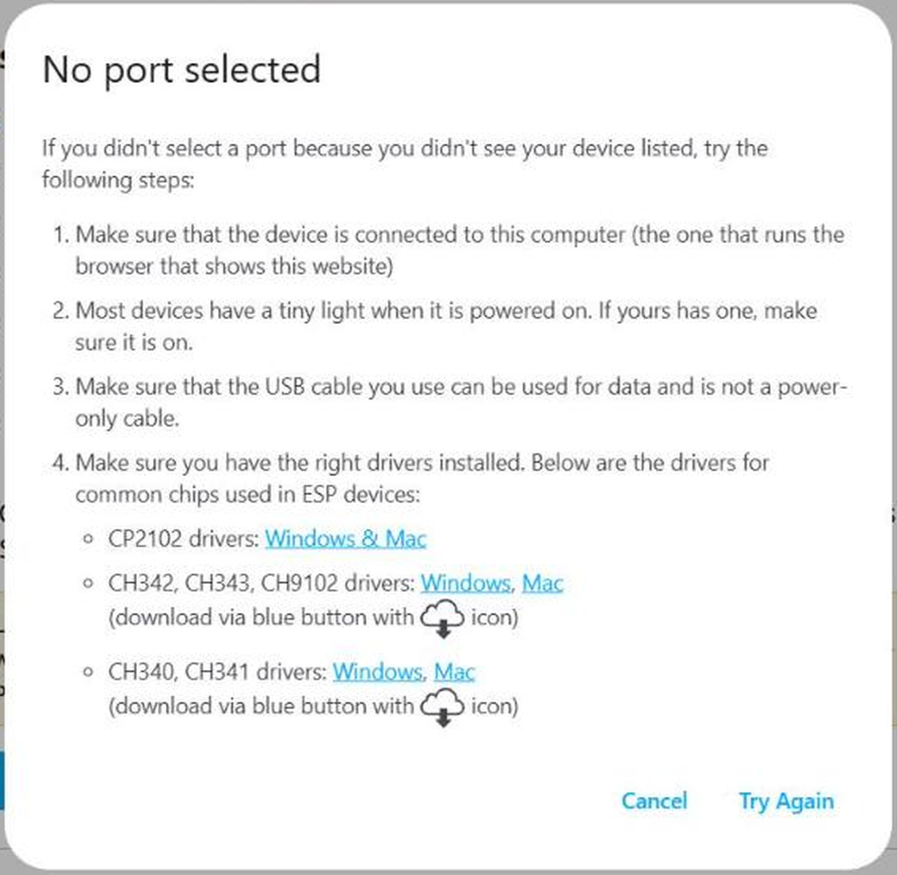

Atnaujinimas vyksta naršyklėje, svetainėje [update.primastem.com](https://update.primastem.com). Nieko diegti nereikia. Atnaujinimo svetainė yra anglų kalba, todėl ir ekrano nuotraukos yra anglų kalba.

<Info>Jums reikės kompiuterio su Chrome arba Edge ir USB-C kabelio, kuriuo perduodami duomenys. Kabelis, skirtas tik įkrauti, netiks.</Info>

<Steps>
  <Step title="Įjunkite įrenginį ir prijunkite jį">
    Įjunkite robotą arba valdymo pultą ir kabeliu prijunkite jį prie kompiuterio. Išjungto įrenginio kompiuteris nemato.
  </Step>
  <Step title="Atidarykite atnaujinimo svetainę">
    Atidarykite [update.primastem.com](https://update.primastem.com) naršyklėje Chrome arba Edge.
  </Step>
  <Step title="Pasirinkite įrenginį">
    Dviejose viršutinėse eilutėse pasirinkite **Robot** (robotas) arba **Control board** (valdymo pultas). Kitų eilučių nelieskite: tai bandomosios versijos.

    <Frame>
      
    </Frame>
  </Step>
  <Step title="Pasirinkite kalbą">
    Pasirinkite kalbą, kuria kalbės įrenginys.

    <Frame>
      
    </Frame>
  </Step>
  <Step title="Spustelėkite Connect">
    Spustelėkite mėlyną mygtuką **Connect** puslapio apačioje.

    <Frame>
      
    </Frame>
  </Step>
  <Step title="Pasirinkite prievadą">
    Atsidaro langas Jūsų naršyklės kalba. Pasirinkite eilutę **USB JTAG/serial debug unit (COM...)** ir patvirtinkite to lango prisijungimo mygtuku. Skaičius po COM skiriasi kiekviename kompiuteryje.

    <Frame>
      
    </Frame>
  </Step>
  <Step title="Pradėkite diegimą">
    Spustelėkite **Install Robot update**. Valdymo pultui ši eilutė vadinasi **Install Control update**.

    <Frame>
      
    </Frame>
  </Step>
  <Step title="Nežymėkite Erase device">
    Langelį **Erase device** palikite tuščią ir spustelėkite **Next**. Ištrynimas pašalina kalibravimą ir roboto bei valdymo pulto suporavimą. Naudokite jį tik tada, jei to paprašo PrimaSTEM pagalbos tarnyba.

    <Frame>
      
    </Frame>
  </Step>
  <Step title="Patvirtinkite">
    Spustelėkite **Install**.

    <Frame>
      
    </Frame>
  </Step>
  <Step title="Palaukite">
    Atnaujinimas trunka apie 2 minutes. Laikykite šį puslapį ekrane ir neatjunkite kabelio.

    <Frame>
      
    </Frame>
  </Step>
  <Step title="Pabaiga">
    Pamatę **Installation complete!**, spustelėkite **Next**, uždarykite langą ir atjunkite kabelį.

    <Frame>
      
    </Frame>
  </Step>
</Steps>

Kitą įrenginį atnaujinkite taip pat.

## Jei kas nors nepavyksta

- **Robotas ir valdymo pultas nesusijungia.** Suporuokite juos iš naujo, žr. [Valdymo pulto ir roboto prijungimas](/en-lt/usermanual#valdymo-pulto-ir-roboto-prijungimas).
- **Atsiranda langas No port selected.** Kompiuteris nerado įrenginio arba sąraše nebuvo pasirinkta eilutė. Patikrinkite, ar įrenginys įjungtas ir ar kabeliu perduodami duomenys, tada spustelėkite **Try Again**.

<Frame>
  
</Frame>

- **Atnaujinimas sustoja su pranešimu Installation failed.** Atjunkite kabelį, vėl jį prijunkite ir pradėkite iš naujo nuo 2 žingsnio. Jei tai nepadeda, [susisiekite su mumis](/en-lt/contacts).
