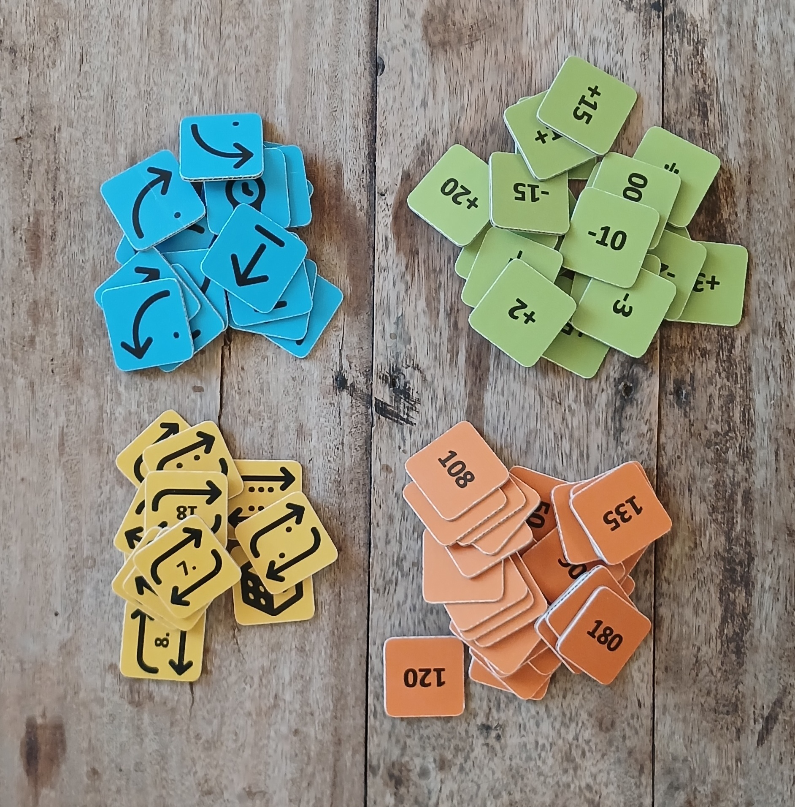

## Techninės specifikacijos ir rinkinio turinys

- Žaidimų robotas
- Roboto valdymo pultas
- Komandų, reikšmių ir aritmetinių veiksmų žetonai, iš kurių sudedamos programos

> Rinkinio turinys ir išvaizda gali šiek tiek skirtis. Pasitikrinkite pirkdami.

### Žaidimų robotas

Matmenys: D=120 mm, H=44 mm.

Robotas turi maitinimo mygtuką, šviesos diodus, garsiakalbį, funkcijų mygtuką ir USB-C jungtį akumuliatoriui įkrauti.

Į roboto vidurį galima įstatyti iki 10 mm skersmens flomasterį. Tada robotas važiuodamas piešia paprastas figūras.

Išvaizda gali šiek tiek skirtis priklausomai nuo komplektacijos. Funkcijos lieka tos pačios.

### Valdymo pultas

Matmenys: L=317 mm, W=217 mm, H=62 mm.

Valdymo pulte yra 11 lizdų porų komandų ir reikšmių žetonams. 6 poros viršuje skirtos pagrindinei programai, 5 poros apačioje paprogramei.

Pultas turi du mygtukus. Kairysis įjungia pultą. Dešinysis, **▶ Start / Stop**, paleidžia ir sustabdo programą.

Sudėkite komandų ir reikšmių žetonus į lizdus ir paspauskite **▶ Start**. Robotas įvykdys programą. Šviesos diodai tarp lizdų rodo, kuri komanda vykdoma.

Jei žetonas padėtas neteisingai, pavyzdžiui, reikšmės žetonas be komandos, prie lizdo užsidega raudonas šviesos diodas. Programa vis tiek vykdoma toliau.

Valdymo pultas turi USB-C jungtį įkrovimui ir garsiakalbį.

### Žetonai

Matmenys: 33 × 33 mm.

Rinkinyje yra žetonai, iš kurių sudedamos programos. Kiekvienas žetonas nurodo vieną aiškios prasmės komandą. Žetonų seka lemia, ką darys robotas.

Žetonai būna trijų rūšių: **komandos**, **reikšmės** ir **aritmetika**.

#### Komandų žetonai

Iš šių žetonų sudedama programa:

- **Pirmyn**: robotas važiuoja pirmyn (numatytasis atstumas 15 cm).
- **Dešinėn**: robotas pasisuka 90° pagal laikrodžio rodyklę.
- **Kairėn**: robotas pasisuka 90° prieš laikrodžio rodyklę.
- **Atgal**: robotas važiuoja atgal (numatytasis atstumas 15 cm).
- **Funkcija**: robotas vykdo paprogramę iš apatinės valdymo pulto eilės.
- **Pauzė**: robotas laukia N sekundžių (1–999 s; be skaičiaus 1 s).
- **Atsitiktinis judesys**: robotas žengia vieną žingsnį pirmyn arba atgal arba pasisuka 90° kairėn ar dešinėn ir iš karto žengia žingsnį pirmyn. Žingsnio ilgis lygus numatytajam žingsniui. Posūkio vietoje be žingsnio nėra.
- **Kartojimo žetonai (ciklai)**: ant jų yra taškeliai nuo 2 iki 6 arba kartojimo ženklas su skaičiumi viduje. Žetonas su kauliuku nustato atsitiktinį kartojimų skaičių nuo 1 iki 6.

> Skaičių ir aritmetikos žetonai praplečia programą. Su jais galima pakartoti komandą arba pakeisti kampą ir atstumą.

#### Reikšmių žetonai

Yra kampų ir atstumų žetonai: 30°, 36°, 45° ir jų kartotiniai (60°, 72° ir t. t.). Kampai nurodomi laipsniais, atstumai milimetrais. Pagal numatytuosius nustatymus robotas pasisuka 90° ir pavažiuoja 150 mm (15 cm).

#### Aritmetinių veiksmų žetonai

Keičia judėjimo komandų reikšmes:

- Sudėtis (\+)
- Atimtis (−)
- Daugyba (\*)
- Dalyba (/)
- Kvadratinė šaknis (√)
- Kėlimas laipsniu (^)
- Faktorialas (!)

Aritmetika veikia intervale nuo −5000 iki 5000. Šiais atvejais lizdas mirksi raudonai, o skaičius nesikeičia:
- atsakymas didesnis nei 5000 arba mažesnis nei −5000;
- dalyba iš 0;
- šaknis iš neigiamo skaičiaus;
- didesnio nei 6 skaičiaus faktorialas.

Dalyba ir kvadratinė šaknis apvalinamos iki artimiausio sveikojo skaičiaus. Pavyzdžiui, 150 ÷ 4 lygu 37,5, robotas ima 38. 20 ÷ 3 lygu 6,67, robotas ima 7. √50 lygu 7,07, robotas ima 7. Lygiai pusė apvalinama tolyn nuo nulio: 37,5 iki 38, −2,5 iki −3.

## Valdymo pulto ir roboto prijungimas

Pirmiausia įjunkite robotą, tada valdymo pultą.

Prieš jungdami padėkite robotą ant lygaus paviršiaus. Kol ryšio nėra, robotas ir valdymo pultas šviečia žydrai. Kai ryšys atsiranda, šviesos diodai tampa balti.

Patikrinkite ryšį: padėkite žetoną „Pirmyn“ ir paspauskite **▶ Start**.

Jei ryšio nėra, iš naujo paleiskite abu įrenginius arba juos įkraukite. Šalia stiprių elektromagnetinio lauko šaltinių (mobiliojo telefono, Wi-Fi prieigos taško) ryšys gali trumpam dingti.

> **Atnaujinus programinę įrangą**, gali tekti įrenginius suporuoti iš naujo. Įjunkite robotą, tada valdymo pultą. Paspauskite ir laikykite pulto mygtuką **▶ Start** ilgiau nei 10 sekundžių. 5-ąją sekundę išgirsite trumpą pyptelėjimą: mygtuko neatleiskite. 10-ąją sekundę prasideda suporavimas.

### Roboto valdymas pakreipiant valdymo pultą

Kai valdymo pultas prisijungia prie roboto, robotą galite valdyti be žetonų: tiesiog kreipkite pultą. Tai veikia, kol lizduose nėra žetonų ir dar nepaspaudėte **▶ Start**.

- Pirmiausia sekundei padėkite valdymo pultą lygiai. Kol to nepadarysite, robotas į pakreipimus nereaguoja.
- Pakreipkite valdymo pultą nuo savęs, ir robotas pavažiuos 15 cm pirmyn. Į save: 15 cm atgal.
- Pakreipkite jį kairėn arba dešinėn, ir robotas pasisuks 90° ta pačia kryptimi.
- Kiekvieno žingsnio metu valdymo pultas trumpai pypteli.
- Kol valdymo pultas lieka pakreiptas, robotas daro žingsnį po žingsnio. Grąžinkite pultą į lygią padėtį, ir robotas baigs esamą žingsnį ir sustos.
- Kreipkite aiškiai, daugiau nei 20°. Šiek tiek drebanti ranka roboto nepajudins.

Valdymas pakreipiant išsijungia, kai tik padedate žetoną į lizdą arba paspaudžiate **▶ Start**. Jis vėl įsijungia, kai valdymo pultas iš naujo prisijungia prie roboto, pavyzdžiui, išjungus ir vėl įjungus robotą.

## Kaip tai veikia

Norėdami užprogramuoti judėjimą, sudėkite komandų žetonus į valdymo pulto lizdus, pavyzdžiui, „Pirmyn“, „Kairėn“, „Funkcija“. Prie komandų galite pridėti kartojimų skaičių, kampus, atstumus ir aritmetinius veiksmus.

Lizdai sujungti į poras „tilteliais“ su indikatoriais. Į vieną poros lizdą dedama komanda, į kitą reikšmė arba kartojimas.

_Žemiau pateikta programa su ciklu: jis pakartoja tą pačią programos dalį. Robotas važiuoja kvadratu:_

<Columns cols={2}>
  <Frame>
    
  </Frame>
  <Frame>
    
  </Frame>
</Columns>

[Paleisti simuliatoriuje](https://simulator.primastem.com/#top=cfor,crig,cfun.r003&fn=cfor,crig&s=l1144402&r=225-525-0&run)

Komandos pirmiausia dedamos į viršutinę valdymo pulto eilę (6 poros). Robotas jas vykdo iš kairės į dešinę. Tuščius lizdus ir klaidas robotas praleidžia. Klaida yra, pavyzdžiui, dvi komandos vienoje poroje arba reikšmė be komandos.

Žetonų seka lemia, kaip važiuos robotas.

Paspauskite **▶ Start**, kad paleistumėte programą.

Numatytosios reikšmės:

- „Pirmyn“ pavažiuoja 15 cm.
- „Kairėn“ ir „Dešinėn“ pasuka 90°.
- Ciklai (kartojimai) pakartoja komandą kelis kartus.
- „Funkcija“ iškviečia paprogramę iš apatinės valdymo pulto eilės (5 poros).
- Paprogramę galite iškviesti kelis kartus: įdėkite kartojimo žetoną į porą su „Funkcija“ (pavyzdys pateiktas aukščiau).

### Svarbios funkcijos

- Programą galite **sustabdyti**, jei dar kartą paspausite **▶ Start**, kol robotas juda.
- Valdymo pultas iki išjungimo įsimena paskutinę kiekvienos judėjimo komandos **nustatytą reikšmę** (atstumą ar kampą). Pavyzdžiui, jei „Pirmyn“ gavo 200, visos kitos „Pirmyn“ komandos taip pat pavažiuos 200 mm.
- Reikšmės po aritmetinių veiksmų taip pat išsaugomos.
- **Numatytąjį žingsnį** keičia tarnybinis žetonas „Numatytasis žingsnis“. Jis keičia žingsnį komandoms „Pirmyn“ ir „Atgal“. Pavyzdžiui, 12,5 cm žingsniui padėkite jį su skaičiumi 125. Reikšmė išsaugoma ir išjungus. Tinka skaičiai nuo 1 iki 999. Žetonas be skaičiaus grąžina 150 mm žingsnį. Su aritmetika arba nuliu lizdas mirksi raudonai, o žingsnis nesikeičia.
- Valdymo pultas ir robotas **išsijungia patys**, jei 15 minučių niekas nevyksta.
- Kol robotas laukia komandos, jis mirksi akimis. Taip matyti, kad jis įjungtas ir pasiruošęs.
- **Trumpai paspauskite roboto mygtuką**, ir robotas nuskaitys po savimi esantį žetoną ir pasakys, kas tai.
- **Visus roboto garsus** galite išjungti ir įjungti, 5 sekundes laikydami nuspaudę roboto mygtuką. Palaukite trumpo pyptelėjimo ir atleiskite. Robotas sumirksi raudonai, jei garsas dabar išjungtas, ir žaliai, jei įjungtas.
- **Valdymo pulto garsą** galite išjungti ir įjungti, 5 sekundes laikydami nuspaudę **▶ Start**. Palaukite trumpo pyptelėjimo ir atleiskite. Kol vykdoma programa, tai neveikia.
- **Atnaujinus programinę įrangą**, gali reikėti iš naujo kalibruoti roboto judėjimą.
- **Roboto nustatymų atkūrimas**: 10 sekundžių laikykite nuspaudę roboto mygtuką (išsamiau žr. „Roboto kalibravimas“ žemiau).
- **Valdymo pultą ir robotą suporuoti** gali reikėti atnaujinus programinę įrangą. Laikykite nuspaudę pulto mygtuką **▶ Start** ilgiau nei 10 sekundžių. Pyptelėjimas 5-ąją sekundę reiškia, kad reikia laikyti toliau.

### Roboto kalibravimas

- Prieš kalibruodami atnaujinkite robotą ir valdymo pultą į naujausią stabilią programinę įrangą svetainėje [update.primastem.com](https://update.primastem.com) ([kaip atnaujinti](/en-lt/update)). Kalibravimas, atliktas su sena programine įranga, gali būti netikslus.
- Pirmiausia paleiskite žetoną „Kalibravimas“ be skaičiaus. Robotas patikrina variklių poliškumą, pašalina laisvumą ir nustato tiesų judėjimą. Tai trunka iki 2 minučių. Pirmąją pusę minutės robotas turi stovėti vietoje, jo nelieskite. Šiuo metu roboto mygtukas neveikia.
- Tada kalibruokite posūkių kampus. Ant stalo paviršiaus pažymėkite tikslią roboto padėtį. Reikia 32 posūkių po 90° pagal laikrodžio rodyklę: sudėkite programą iš žetonų „Kartojimas 8“ ir „Dešinėn“ ir paleiskite ją keturis kartus. Robotas turi apsisukti aštuonis kartus (90 × 32 = 2880°) ir grįžti į pradinę padėtį.
- Įvertinkite nuokrypį nuo žymos ir įveskite pataisą žetonu „Kalibravimas“ su skaičiumi. Jei robotas sustoja nepasiekęs žymos, pridėkite „+“, pavyzdžiui, „Kalibravimas“ ir „+5“. Jei pasisuka per toli, pridėkite „−“, pavyzdžiui, „Kalibravimas“ ir „−5“. Tada paspauskite **▶ Start**. Skaičius rodo, keliais laipsniais robotas suklydo per visus 32 posūkius kartu. Robotas priima skaičius iki 180. Jei skaičius didesnis arba robotas negali išsaugoti pataisos, lizdas mirksi raudonai. Paprastas skaičius be „+“ ar „−“ šalia „Kalibravimo“ neveikia: lizdas mirksi raudonai.
- Kartokite, kol robotas tiksliai grįš į pradinę padėtį.
- Kalibravimas išsaugomas ir išjungus.
- Dėmesio! Kalibravimo atkūrimas: 10 sekundžių laikykite nuspaudę roboto mygtuką, šviesos sumirksi raudonai, žaliai, mėlynai ir baltai. Atkūrimas ištrina visus kalibravimus, garsumą ir išjungtą garsą. Po atkūrimo išjunkite ir vėl įjunkite robotą, tada atlikite kalibravimą iš pradžių.

<Accordion title="Pirmosios įrenginio versijos (MVP) su 10 cm skersmens robotu kalibravimas" icon="rectangle-terminal">
  Šis būdas skirtas tik pirmajai versijai (MVP). Su nauja programine įranga „Kalibravimas“ su paprastu skaičiumi neveikia: lizdas mirksi raudonai.

  1. Norėdami kalibruoti giroskopą, padėkite robotą ant horizontalaus paviršiaus, įdėkite žetoną „Kalibravimas“ į valdymo pultą ir paspauskite **▶ Start**.
  2. Norėdami kalibruoti judėjimo atstumą, išmatuokite, kiek robotas iš tikrųjų pavažiavo su komanda „Pirmyn“. Padėkite žetoną „Kalibravimas“ ir žetoną su reikiama reikšme, tada paspauskite **▶ Start**. Reikšmę į bet kurį NFC žetoną galite įrašyti mobiliuoju telefonu su NFC: tekstu pavidalu nXXX (pavyzdžiui, n095 reiškia 95 mm). Po to robotas pavažiuos tikslų atstumą.
</Accordion>

### NFC žetonų programavimas

Galite pakeisti esamus žetonus arba **sukurti savo**: komandas, skaičius ar aritmetinius veiksmus. Tam reikia telefono su NFC ir žymų skaitymo ir įrašymo programėlės, pavyzdžiui, „NFC Tools“. Kodas įrašomas į tuščią NFC žymą paprastu 4 simbolių tekstu.

## Svarbu

Visi saugos įspėjimai ir teisinė informacija pateikti puslapyje [Naudotojo vadovas](/en-lt/safety).

> Rinkinys **neskirtas jaunesniems nei 4 metų vaikams**. Jame yra smulkių dalių, **jomis galima užspringti**! Naudokite **tik prižiūrint suaugusiesiems**!

Įrenginiuose yra ličio jonų akumuliatoriai. **Įkraukite juos tik prižiūrint suaugusiesiems**, per standartinį USB 5 V įkroviklį ir USB-C kabelį.

Valdymo pulto ir roboto įkrovimo per 1 valandą pakanka 1–2 pamokoms. Visiško įkrovimo (2–3 valandos) pakanka 3 pamokoms po 30–45 minutes. Laikui bėgant akumuliatorių talpa gali sumažėti. Juos galima pakeisti naujais 16340 ličio jonų akumuliatoriais.

Jei rinkinys ilgai nenaudojamas, akumuliatorius įkraukite **kas 2–3 mėnesius**. Visiškai išsikrovę akumuliatoriai gali sugesti, tada juos reikės pakeisti.

**Neardykite įrenginio** patys. Jei įrenginys sugedo arba reikia pakeisti akumuliatorius, kreipkitės į pardavėją arba į elektronikos remonto dirbtuves.

Rinkinį laikykite, naudokite ir kraukite sausoje patalpoje, nuo \+5 iki \+35 °C temperatūroje. Saugokite nuo tiesioginių saulės spindulių, skysčių, dulkių ir staigių temperatūros ar drėgmės pokyčių: dėl jų susidaro kondensatas.

Saugokite nuo smūgių ir vibracijos. Įrenginį gabenkite ir laikykite originalioje pakuotėje, nuo \+5 iki \+35 °C temperatūroje, saugodami nuo pažeidimų ir drėgmės.

Daugiau apie darbą su PrimaSTEM skaitykite [Mokytojo vadove](/en-lt/teachersguide).
