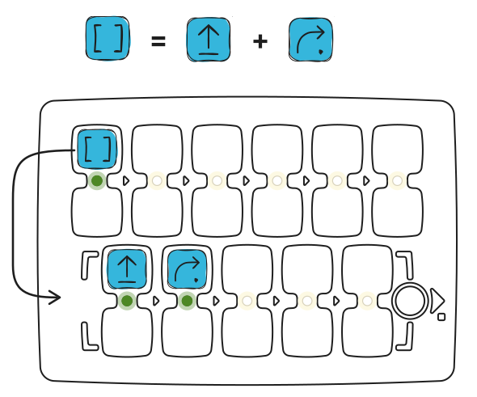
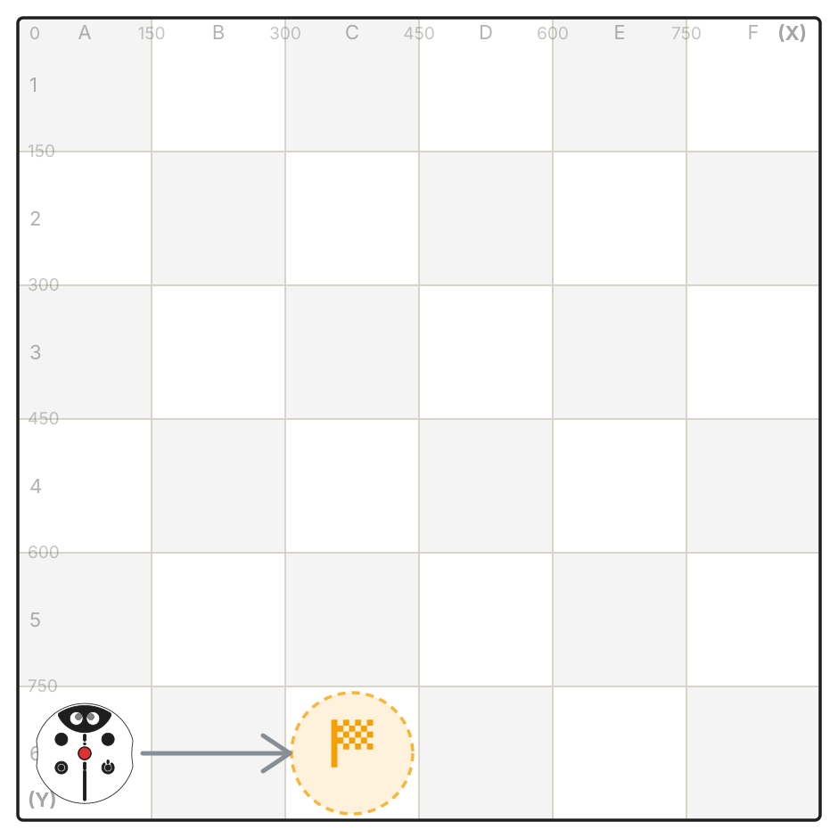
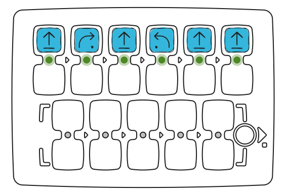
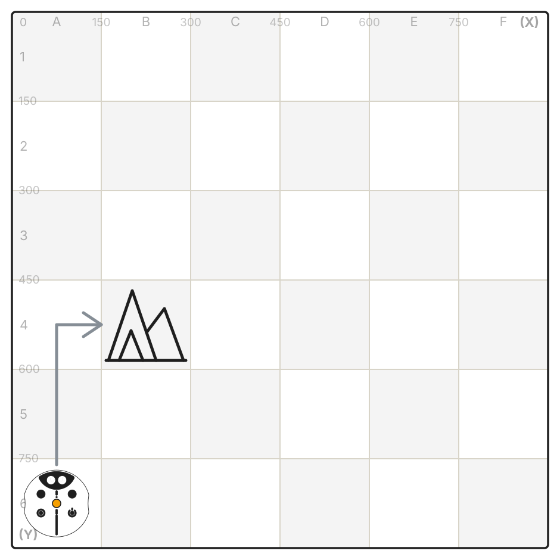
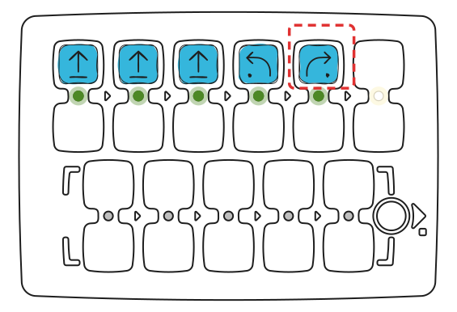

## Guide for conducting classes with children from 4 years old

PrimaSTEM helps children step by step master logical thinking, the basics of programming and mathematics. This guide will help you conduct classes with children from 4 years old.

### How it works

Children program the movements of a small ladybug robot. To do this, they place command tokens on the control board.

- **"Forward"**: the robot moves straight.
- **"Left"**: the robot turns left.
- **"Right"**: the robot turns right.
- **"Function"** (the "\[ \]" token): replaces a sequence of commands.
- **"Repeat"**: repeats a command or function several times.

You place tokens on the control board and so build a program for the robot. When the program is ready, press the button, and the robot runs the commands.

### Contents of the guide

- Why run robotics and programming classes
- How to organize classes in different conditions
- Activities and learning objectives
- Detailed instructions for use
- Description of activities
- Appendices
- About the project and authors

### What PrimaSTEM teaches

- Program with your hands, without a screen
- Understand that machines work by algorithms
- Plan actions in advance
- Think logically
- Build sequences of commands and functions
- Understand what a "bug" is (an error in the code) and find errors
- Study numbers, arithmetic, and geometry visually

## What PrimaSTEM consists of

### What's in the box

- Ladybug robot
- Control board
- Command tokens \*
- Activity guide \*

(\*) The contents depend on the configuration.

## Why run programming and math classes

Code, programming, and automation have become part of our daily lives.

In recent years, people have learned to create machines that do things machines could not do before: understand, speak, hear, see, respond, write.

There are many examples: self-driving cars, assistant robots for the elderly, delivery robots, and others.

### Why teach programming and robotics

When a child learns to program, the child learns to understand the machines around us. The child learns to turn small and bold ideas into real projects. The child breaks a complex task into simple steps. The child works with others to solve shared problems.

### Born in the digital age

It may seem that children and teenagers know technology well. They use digital entertainment a lot.

But can they use these tools to create something of their own and express themselves? What do they do when they run into a technical problem?

## How to organize classes

The activities suit different goals and educational settings. All activities in the guide are numbered. Below you can see which activities fit your setting.

### Who it is for

- Children from 4 to 8 years old.
- Senior and preparatory groups of kindergarten, 1st and 2nd grades of primary school.

### Activities for after-school work

Activities 1, 2, 4, 5, 6, 7, 8, 9, 10.

### Activities for school

Activities 2, 3, 4, 5, 6, 7, 8, 9, 11, 12.

### After-school work

In a group, it is better to have no more than 12 children, so that everyone can take an active part.

We recommend one device for 2–3 students. This way children learn to work in a team and to communicate.

### Work at school

In a lesson, it is best to work with PrimaSTEM in small groups of 4–6 children with one teacher.
The other students do a different task at the same time with a teacher's assistant. Students in grades 1–2 can, for example, practice drawing the robot's path from a program.
In both cases, it is better to work in a multipurpose hall, right on the floor. You can also push tables and chairs aside to clear space.

**Attention.** Charge the batteries of the control board and the robot in advance.

## Activities and learning objectives

| Activity | Algorithm and program | Route in stages | Predict movement | Solve a problem, find an error | Teamwork |
| --- | :---: | :---: | :---: | :---: | :---: |
| 1 |   | X |   | X |   |
| 2 |   |   | X |   | X |
| 3 | X | X |   |   |   |
| 4 | X | X | X |   |   |
| 5 | X | X | X |   | X |
| 6 | X | X | X | X | X |
| 7 | X | X | X | X | X |
| 8 | X |   | X | X |   |
| 9 | X | X | X | X | X |
| 10 | X |   | X | X |   |
| 11 | X | X | X | X | X |
| 12 | X | X | X | X | X |

## Instructions for use

### Contents of the instructions

- Introduction to materials
- Programming a function
- Maps
- Technical explanations

## Introduction to materials

### Robot

A small wooden ladybug robot with two eyes.

It has three points of support: two wheels and a stand at the back. They keep it balanced.

### Basic commands

| Command | Illustration | Description |
| --- | --- | --- |
| Forward |  | The robot moves one cell. This is a logical step, 15 cm by default. |
| Left |  | The robot turns 90° left |
| Right |  | The robot turns 90° right |
| Backward |  | The robot drives back one cell, that is, one logical step by default |
| Function |  | The robot runs the commands from the function row |
| Repeat N |  | The robot repeats the command from the same pair N times |

### Control board

On the control board, you control the robot: you place command tokens in the free cells (D).

The upper row (A) of 6 pairs of cells, linked by an execution line (E), is the main program. The program starts at the left cell (D) and ends above the **▶ Start** button (B). This button sends the commands to the robot and starts the program.

The lower row (C) of 5 pairs of cells sets the movements for the "Function" token ("\[ \]"). Each pair has an LED (F). It lights up when you place a token and flashes when the robot runs that command.

#### LED colors

If a token is placed correctly in a cell, the LED is green.
If you add a repeat to a movement command in the same pair, the LED is blue.
If tokens are placed incorrectly, for example two movement commands in one pair, the LED is red. The robot skips that command.

### Battery and power button

The robot and the control board run on built-in rechargeable batteries. You charge them through a USB-C port. The power button (ON/OFF) is on top of the robot and on the front left of the control board.

When the robot or the control board turns on, a short beep sounds.
When the control board is on, the LED on the front panel is green. When the robot is on, the LED near the USB-C connector is green.

### Wireless communication

The robot and the control board are linked by Bluetooth with a range of about 5 m. After the robot connects to the control board for the first time, the link works by itself. You do not need to set it up.

> You can pair the control board with another robot.
> 1. Turn on a robot that is not yet paired with the control board.
> 2. Turn on the control board.
> 3. Hold down the **▶ Start** button on the control board for 10 seconds, until you hear a beep and see a light signal.

### How to build and run a program

The program (the "sequence of movements") starts on the left of the control board. It follows the engraved arrows "\>". This is the execution line, and it links the pairs of cells horizontally.

If there is an empty cell before a token, the robot skips the empty cell and runs the command of that token.

If a token is placed incorrectly, the LED is red and the robot skips that part of the program. This happens, for example, when "Repeat" is in a pair without a command, or when two command tokens are in one pair.

When the program is ready, press the **▶ Start** button.

While the robot runs the program, the LEDs on the control board go out one by one. The LED of the current command flashes.

## Programming a function

### How to create a function

The "Function" token ("\[ \]") replaces a sequence of commands.

With it, you can build longer programs and solve harder tasks. To create a function, place the movements in the lower row of the control board: 5 pairs of cells. The robot runs this row from left to right every time it meets a "Function" token in the main program (the top row).

In the example below, the function is a move straight and then a turn right. The main program calls the function 2 times. Then the "Repeat 2" token repeats the function 2 more times.

[Run in the simulator](https://simulator.primastem.com/#top=cfun,cfun,cfun.r002&fn=cfor,crig&s=l1144602&r=225-675-0&run)

What you get:

## Maps

### Which maps fit

In the first activities, children learn algorithms, programming, and numbers. For this, the robot moves on a map with a grid. It is best to use a map with 15 cm cells: this is the distance the robot covers in one default step.

Maps made for other robots also work, if the cell size suits this robot.

> You can change the default step from 15 cm to the cell size of your map, for example 10 cm, 12.5 cm or 20 cm. To do this, place the service token "Default Step" with a number in millimeters: 100 for 10 cm, 125 for 12.5 cm, 200 for 20 cm.

If you don't have a map, make one yourself. Stick thin masking tape on a flat table or floor. You can also take a sheet of Whatman paper (or thick banner fabric) and a marker.

A chessboard map or a blank map with cells is for practicing moves from one point to another. The colors do not distract.

A colored map helps to tell short stories about the robot's travels. For example: "The ladybug leaves the house and goes to the mountains through the forest." The class can make a new map and invent new stories about the ladybug's travels.

#### Examples of maps

Chessboard map

Colored map

## Technical explanations

### How it is built

The control board and the robot have microcontrollers and Li-Ion batteries. The devices are linked by radio through the standard Bluetooth protocol.

The robot's circuit board controls all its behavior. It controls two 5V DC motors and two multicolor LEDs, plays sounds, communicates with the control board, etc.

The control board's circuit board recognizes the tokens in the cells, plays sounds, and controls 11 multicolor LEDs, one for each pair of cells.

Each token has an NFC sticker with a command code. The control board reads this code when you place the token in a cell.

When the control board has recognized the tokens and you start the program, the control board sends the commands to the robot by wireless communication.

### Your own command tokens

You can make additional command tokens, for example "Repeat 12" or more movement tokens. For this you need "blank" tokens with NFC stickers and an NFC-enabled phone. Most sticker types with a frequency of 13.56 MHz work.

Video instructions are available on our YouTube channel: [https://www.youtube.com/@primastem](https://www.youtube.com/@primastem)

---

## Activities

### Detailed description of activities

- **Activity 1**: a path across a chessboard from point A to point B
- **Activity 2**: introduction to PrimaSTEM
- **Activity 3**: a child plays the robot, orientation and algorithm
- **Activity 4**: predict the robot's path from a program
- **Activity 5**: command sequences in a random program
- **Activity 6**: take the robot to the mountains with the control board
- **Activity 7**: introduction to the "Function" token
- **Activity 8**: a route to the goal with a function
- **Activity 9**: debugging a program with an error
- **Activity 10**: find an error in a program on paper
- **Activities 11 and 12**: predict the robot's movements (in activity 12 with the "Function" token)

---

## Activity 1. Path across a chessboard from point A to point B

- **individually**
- **15 min**
- **on paper**
- **printable documents**

### Goal

- Plan a path across cells from point A to point B on a map.

The exercise lasts 10 minutes, including the debriefing.

### For printing

Print for each student the sheet "[Appendix 1. Moving on the map](/en/book-1/attachment-1)".

### Exercise

Children draw on the grid the path the mouse takes to reach the cheese. Start with the left exercise, which is simpler. Then move on to the right one.

#### Moving across cells

The mouse moves through the cells of the grid. It cannot move diagonally. Children need to understand that the mouse's path is divided into stages: it moves one cell at a time. This is moving step by step.

In the example above, only the blue path is correct. The short red path is incorrect because it goes along a diagonal. The long red path is incorrect because it does not lead to the right point.

### Discussion in the group

In the example above, all paths are correct: along each of them the mouse reaches the cheese.

Show the children that each of them could think of a different path, and that there can be several correct paths.

#### Some paths are longer than others

Count how many cells the mouse passes to reach the cell with the cheese:

- 3 cells on the green route
- 3 cells on the gray route
- 3 cells on the blue route
- 13 cells on the yellow route

#### The shortest path

All these paths are correct, but the mouse will choose the shortest one.

Ask the children: "Why did the mouse choose the shortest path?"

The answers can differ. The mouse wants to save energy: it is very tired and wants to walk as little as possible. Or the mouse is in a hurry: it is very hungry and wants to get to the cheese as fast as possible.

**Note for the facilitator.** It is the same with robots. We always choose the shortest path, because it is more efficient.

#### Multiple paths are possible

When the exercise is finished, ask the students to show their paths. There are always several possible paths, so the students will likely offer different answers, and all of them will be correct.

---

## Activity 2. Introduction to PrimaSTEM

- **15 min**
- **in a group**
- **demonstration**
- **practice**

### Goals

- Understand how the robot can move.
- Learn that the control board controls the robot.
- Understand what the command tokens do.

Divide the students into small groups. Sit at a low table or on the floor. Take out the grid map, the control board, the robot, and the tokens. Introduce PrimaSTEM to all students, group by group.

### Presentation

Show each item on the table and name the words the children will need.

First, the **map**. It is the same grid as in activity 1, only bigger.

Then the **ladybug robot**. It can roll.

The robot is controlled by the **control board**. The robot does what the tokens in the cells of the control board tell it.

**Tokens** give commands: go straight, turn left or right.

### 1st stage: demonstration

When the children know the words, show everything yourself. Place a token on the control board, and the children will see what happens.

| Image | Description |
| --- | --- |
|  | The **"Forward"** token moves the robot one cell |

Put the robot on any cell of the map. Place a token in the first cell of the program, as in the diagram below. Then press the white button **▶ Start**.

The robot moves one cell forward.

### 2nd stage: hand over control

| Image | Description |
| --- | --- |
|  | The **"Left"** token, with an arrow curving around the center, turns the robot left, counterclockwise. By default the turn is 90 degrees. |

Remove the "Forward" token from the control board and give the child the "Left" token. Let the child place it in the first cell of the program and press the white button **▶ Start**. The robot stays in place and makes a quarter turn to the left.

| Image | Description |
| --- | --- |
|  | The **"Right"** token turns the robot right. |

Ask another child to replace the "Left" token with the "Right" token and press the white button **▶ Start**. The robot stays in place and makes a quarter turn to the right.

Then the children take turns at the control board. Give them only 3 tokens: **"Forward"**, **"Left"**, and **"Right"**.

When the robot finishes moving, the children can press **▶ Start** again and repeat their program.

Let the children see for themselves that they can place tokens in any cells, except two commands in one pair. The robot runs them one by one, from left to right.

> To stop the program, press **▶ Start / Stop** again while the robot is moving.

---

## Activity 3. A child plays the robot: orientation and algorithm

- **45 min**
- **in a group**
- **game**
- **map**

### Goals

- Take into account which way the robot faces at the start of the program.
- Predict the robot's movements from the program.

### For printing

Print for each student the cards "[Appendix 2. Mission cards](/en/book-1/attachment-2)".

### Game principle

This is a role-playing game in an open space. The children act as the robot on a black and white field.

### Game rules

One student plays the robot on the map. Instead of a map, you can use a floor with a square pattern: a drawing, tiles, or squares of thin masking tape. The other students program the robot with task cards.

The children are not told which way the child-robot faces.
They decide for themselves which way the robot must face to complete the mission.

1. The child-robot stands on red cell 1. The child-robot must reach green cell 2.
2. The child-robot stands on red cell 1. The child-robot must reach purple cell 3.
3. The child-robot stands on red cell 1. The child-robot must reach blue cell 4.

> To make the map last longer, ask the child to take off their shoes.

### End of the game

Now the child understands: when you program a move, you must take into account where the robot stands and which way it faces.

The robot runs a command depending on which way it is turned. It moves straight, turns left, or turns right, **but always from its starting direction.**

---

## Activity 4. Predict the robot's path from a program

- **45 min**
- **individually**
- **on paper**
- **printable documents**

### Goals

- Take into account which way the robot faces at the start.
- Understand the commands of the program.
- Predict the robot's movements from the program.

### For printing

Print for each student the cards "[Appendix 3. Draw the path for a program](/en/book-1/attachment-3)".

The children get a sheet with a program of several commands. They draw the path the robot will take with this program.

With this program, the robot moves forward three times:

<Columns cols={2}>
  <Frame>
    
  </Frame>
  <Frame>
    
  </Frame>
</Columns>

[Run in the simulator](https://simulator.primastem.com/#top=cfor,cfor,cfor&s=l1144602&r=75-825-0&m=02&run)

Here is the same program, and the robot also moves forward three times.
But at the start it faces right. So it moves three cells to the right:

<Columns cols={2}>
  <Frame>
    
  </Frame>
  <Frame>
    
  </Frame>
</Columns>

[Run in the simulator](https://simulator.primastem.com/#top=cfor,cfor,cfor&s=l1144602&r=75-825-90&m=35&run)

In this program, the robot turns. First it turns right, then it moves two cells:

<Columns cols={2}>
  <Frame>
    
  </Frame>
  <Frame>
    
  </Frame>
</Columns>

[Run in the simulator](https://simulator.primastem.com/#top=crig,cfor,cfor&s=l1144602&r=75-825-0&m=25&run)

The last exercise is harder: the robot changes direction twice. It moves one cell straight and turns right and moves one cell. Then it turns left and moves two cells:

<Columns cols={2}>
  <Frame>
    
  </Frame>
  <Frame>
    
  </Frame>
</Columns>

[Run in the simulator](https://simulator.primastem.com/#top=cfor,crig,cfor,clef,cfor,cfor&s=l1144602&r=75-825-0&m=12&run)

### Note for the facilitator

This exercise on paper can be difficult.
If a child finds it hard to understand the robot's turns and the order of movements, take the PrimaSTEM set. Ask the child to lay out the programs from the sheets on the control board.
When children touch and watch, they understand better.

---

## Activity 5. Command sequences in a random program

- **45 min**
- **in a group**
- **game**

### Goals

- Connect commands to the robot's movements.
- See the boundaries of the map.
- Learn to transfer commands to the control board.

### Game process

1. Put the robot on any cell of the map, preferably at the edge. Choose any direction.
2. Roll the die. Move the robot by hand and write down the program on paper or on a board: draw an arrow for the "Forward" command. If the robot goes off the edge of the map, roll the die again.

3. Repeat this to get 2 programs in a row. The robot must not leave the map, so roll the die again if needed.

In the end, you will have 2 programs of "Forward" commands on the sheet. If you run them one after the other, the robot moves the needed number of cells toward the edge of the map.

Example:

<Columns cols={2}>
  <Frame>
    
  </Frame>
  <Frame>
    

      
      
    

  </Frame>
</Columns>

**Run the recorded programs on the real PrimaSTEM.**

---

## Activity 6. Take the robot to the mountains with the control board

- **45 min**
- **in a group**
- **practice**

### Goals

- Break a route into stages.
- Build a program for a specific goal.

For this activity you need:

- a control board;
- movement tokens: 4 "Forward", 4 "Left", and 4 "Right" per group, and put the other tokens aside;
- a map and a robot.

Divide the children into groups of 3 or 4. Give each group a control board and a set of tokens.

### 1st stage: reflection

The ladybug robot is at home, and we want to take it to the mountains. Write on the board a program that gets it there.

> If you don't have the right map, draw the places on paper, maybe together with the children. Tape them to the map.

First ask the children which cells they want to take the robot through to reach the mountain. Again, there are many options. We choose the shortest routes to save energy and time.

When the path is chosen, go through the robot's movements with the children, cell by cell.

Should it go straight, turn left, or turn right?
Move the robot across the map by hand and show how each command moves it.

### 2nd stage: programming

Ask the children to lay out the robot's movements on the control board with tokens, in order. This program must bring the robot to the goal.

**Expected program:**

### 3rd stage: verification

Every self-respecting programmer checks whether the program works. Ask the children to lay out the program on the control board and run it.

<Columns cols={2}>
  <Frame>
    
  </Frame>
  <Frame>
    
  </Frame>
</Columns>

[Run in the simulator](https://simulator.primastem.com/#top=cfor,cfor,crig,cfor&s=l1144602&r=75-825-0&m=13&run)

Did the robot reach the mountain? If not, why? Let the children fix the errors in the program themselves, if there are any.

---

## Activity 7. Introduction to the "Function" token

- **15 min**
- **in a group**
- **demonstration**

### Goals

- Understand that the "Function" token can replace other commands.
- Get to know repeating a sequence of commands.

Divide the students into small groups. Sit at a low table or on the floor. Take out the map, the control board, the robot, and the command tokens. The groups take turns getting to know the "Function" token.

### 1st stage: demonstration

Show the children the "Function" token.

It replaces several movement commands: "Forward", "Left", "Right", or "Backward". With it, you can repeat the same short piece of a program several times.

First show it yourself. Build a program as in the picture below.

When the robot meets the "Function" token, it runs the commands from the \[-----\] frame at the bottom of the control board. It is the same as if those commands stood in place of the "Function" token.
In our example, the robot moves forward twice.

### 2nd stage: riddles

Now add the "Right" token at the end of the main program, as in the picture below.

Before you start, ask the children what will happen. The program works as if it had two red "Forward" tokens and one "Right" token. The robot moves two cells and turns right by a quarter turn.

At the end, show the **loop**.
Lay out a program of four "Function" tokens, as in the picture below.

[Run in the simulator](https://simulator.primastem.com/#top=cfun,cfun,cfun,cfun&fn=cfor,crig&s=l1144602&r=225-675-0&run)

Before you start, ask the children what will happen. Then run the program and check.

**The robot runs a loop:**

**Note for the facilitator.** When children get to know the function, it helps to watch the LEDs. They flash while the program runs. This way you see which command the robot runs and how it moves at the same time.

---

## Activity 8. A route to the goal with a function

- **45 min**
- **in a group**
- **practice**

### Goals

- Break a route into stages.
- Build a program for a specific goal.
- Use the "Function" token in a program.

For this activity you need:

- tokens or homemade cards with drawings of commands: 4 "Forward", 4 "Left", 4 "Right", and 4 "Function" per group;
- a map and a robot, without a control board.

If there are many children, divide them into groups of 3 or 4. Give each group cards with drawings of commands or tokens from the set, exactly 4 of each kind.

### 1st stage: reflection

> If your map has other pictures or none, change the task. Mark 2 points (Start and Finish) 4 cells apart at an angle of 90 degrees.

The robot is at the flag, and we want to take it to the "Night" cell with clouds. You need to build a program with the "Function" token: lay out tokens or drawings of commands on the table.

First ask the children which cells they want to take the robot through to reach the mountain. The mountain is about midway. There are many options. This time we choose routes where commands repeat, so that the "Function" token is useful.

When the path is chosen, go through the robot's movements with the children, cell by cell. Move the robot by hand and check the program.

### 2nd stage: not enough tokens

Ask the children to lay out the robot's movements on the table with cards or tokens, in order.

Keep strictly to the number of tokens each group has: 4 "Forward", 4 "Left", 4 "Right", and 4 "Function".

Oh, there are not enough tokens! We need more "Forward" commands. Digital panic! :)

Remind the children of the "Function" token: it replaces several other tokens.

For example, it can replace several "Forward" commands, and the robot moves forward several times.

Help the children build a program with the "Function" token, as in the picture below.

Example route and its program:

### 3rd stage: verification

Help the children lay out the program on the control board and check it, as in the picture:

[Run in the simulator](https://simulator.primastem.com/#top=cfun,clef,cfun&fn=cfor,cfor,cfor,cfor&s=l1144602&r=825-825-0&run)

Did the robot reach the "Night" cell? If not, why?
Let the children fix the errors in the program themselves, if there are any.

---

## Activity 9. Debugging a program with an error

- **20 min**
- **in a group**
- **practice**

### Goals

- Find an error in a program by watching it run.
- Fix the error in the program.

Divide the students into small groups. Sit at a low table or on the floor. Prepare the grid map, the control board, the robot, and the tokens.
The groups take turns debugging the program.

The robot must reach the mountain along the gray path.

Show the children a program with an error on the control board:

[Run in the simulator](https://simulator.primastem.com/#top=cfor,clef,cfor,cfor,clef,cfor&s=l1144602&r=75-825-90&run)

With this program, the robot goes into the forest. The children run the program, look for the error, and fix it.

Example of the corrected program:

[Run in the simulator](https://simulator.primastem.com/#top=cfor,clef,cfor,cfor,crig,cfor&s=l1144602&r=75-825-90&run)

---

## Activity 10. Find an error in a program on paper

- **20 min**
- **individually**
- **on paper**
- **printable documents**

### Goals

- Predict the robot's movements to find an error in the program.
- Understand how to fix an error in the program.

The children get a sheet with a program that should take the robot from point A to point B. The program has an error. The children look for it and try to fix it.

### For printing

Print for each student the cards "[Appendix 4. Find and fix an error in the program](/en/book-1/attachment-4)".

### 1st stage: read the program

First ask the children to draw the robot's path for this program. On the grid, the blue line shows the path the robot should take and the right arrival point.

### 2nd stage: identify the error

When the path is drawn, you can see that the robot does not reach the finish (the black flag). It arrives at the red flag.
Ask the children where the robot went wrong. They need to find the cell with the error. In the solution it is circled in red.

There are 3 types of errors:

- we used the wrong command
- we forgot a command
- we added an extra command

### 3rd stage: fix the error

Finally, ask the children to fix the error: to write a program that takes the robot to the black flag.

**Note.** This exercise on paper can be difficult. If a child finds it hard to see the error, take PrimaSTEM. Ask the child to lay out the program from the sheet on the control board and run it. For example, the children can say "Oh no!" when the robot turns the wrong way. This makes the error easier to notice.

#### Example 1

In this example, the command at the end is wrong.

<Columns cols={2}>
  <Frame>
    
  </Frame>
  <Frame>
    

      
      
    

  </Frame>
</Columns>

#### Example 2

In this example, there is an extra command at the beginning.

<Columns cols={2}>
  <Frame>
    
  </Frame>
  <Frame>
    

      
      
    

  </Frame>
</Columns>

#### Example 3

In this example, a command is missing at the beginning.

<Columns cols={2}>
  <Frame>
    
  </Frame>
  <Frame>
    

      
      
    

  </Frame>
</Columns>

---

## Activity 11. Predict the robot's movements

- **45 min**
- **in a group**
- **practice**

### Goals

- Predict the robot's movements from a program without a function.

Take the PrimaSTEM set without the "Function" tokens. All children play at the same time, but only one child works with the control board.

### 1. Program in silence

The children take turns. A child puts the robot in a corner of the map and lays out a program of no more than 5 commands on the control board.

When the program is ready, ask the child to wait and not press the button yet.

### 2. Place your bets

Ask the other children to guess whether the robot will go off the edge of the map.

### 3. Check

When everyone has placed a bet, run the program and see what happens.
Then put the robot back in the corner, and the next child builds a program.

---

## Activity 12. Predict the robot's movements with a function

### Goals

- Predict the robot's movements from a program with a function.

Run activity 11 again, but add the "Function" tokens to the set.

This way the children also program a function. All children play at the same time, but only one child works with the control board.

---

## About the project and authors

### Who we are

The company PrimaSTEM created and produces the device of the same name. With it, children from 4 years old learn programming and mathematics without a screen. We are located in the south of France.

Our materials are open. They help develop the creativity of children and of the adults who work with them.

You can learn more about the PrimaSTEM device on the documentation site, available in 13 languages: [https://docs.primastem.com](https://docs.primastem.com)

### Contact

Write to us: [info@primastem.com](mailto:info@primastem.com)

Our website with information and links to social media: [https://primastem.com](https://primastem.com)

### Authors

**Adaptation, text, illustrations:** Andrei Chanov, 2026.

**Authors of the concept:** Julie Borgeot / Dorie Bruyas from Fréquence écoles

#### License of this guide

This work is licensed under CC BY-SA 4.0. To view a copy of this license, visit [https://creativecommons.org/licenses/by-sa/4.0/](https://creativecommons.org/licenses/by-sa/4.0/)

**Creative Commons Attribution-ShareAlike 4.0 International**

This license requires that reusers give credit to the creator. It allows reusers to distribute, remix, adapt, and build upon the material in any medium or format, even for commercial purposes. If others remix, adapt, or build upon the material, they must license the modified material under identical terms.

---

## Appendices

- [Appendix 1. Moving on the map](/en/book-1/attachment-1)
- [Appendix 2. Mission cards](/en/book-1/attachment-2)
- [Appendix 3. Draw the path for a program](/en/book-1/attachment-3)
- [Appendix 4. Find and fix an error in the program](/en/book-1/attachment-4)
