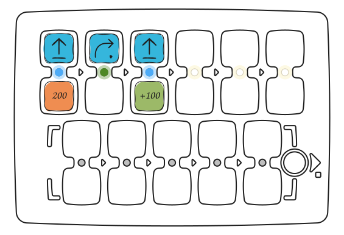

PrimaSTEM teaches children aged 4 to 12 to program without computers, tablets, or phones. The kit develops logic, programming skills, and mathematics.

With PrimaSTEM, programming becomes simple and visual. Even young children understand what happens: they touch the tokens with their hands and learn the basics of programming, logic, and mathematics through play.

Playing with PrimaSTEM develops logical thinking, algorithmics, programming, mathematics, and geometry. It also develops creativity and socio-emotional skills. The kit prepares the child for block-based programming languages, for example [Scratch](https://en.wikipedia.org/wiki/Scratch_\(programming_language\)) or [LOGO](https://en.wikipedia.org/wiki/Logo_\(programming_language\)).

## Getting to know the educational kit

### Where you can use PrimaSTEM

PrimaSTEM suits these settings:

- Preschool education centers
- Kindergartens that use the Montessori method
- Elementary school
- Homeschooling
- Special development centers
- After-school groups
- Beginner programming clubs
- Children's educational camps

### What you need to know to get started

Before you work with the kit, read the [Device & setup](/en/usermanual) page and this guide. You do not need programming skills: the materials give you everything to start.

## Research and value of the kit

PrimaSTEM is inspired by the programming language [LOGO](https://en.wikipedia.org/wiki/Logo_\(programming_language\)), created by [Seymour Papert](https://en.wikipedia.org/wiki/Seymour_Papert), and by Montessori pedagogy. LOGO and the turtle robot made programming visual and accessible for children.

PrimaSTEM command tokens continue this approach. The child controls the robot by hand, with no screen and no text, and sees right away what they do.

Children watch the robot, understand each command, and learn algorithms in practice.

The robot has an important property: it has a direction. The child can easily imagine being the robot, so they understand the logic of the program faster.

All commands are simple: they tell the robot which way to move. When children teach the robot to "act" and "think", they start to reflect on their own actions and thoughts. This makes programming easier for them.

PrimaSTEM tokens show in a simple, visual way how programming languages work. At the start, there is no text and there are no numbers, only basic commands.

### Why wood

🌱 The control board and robot are made of wood (plywood). Children enjoy wooden toys more. They are safe and last long, and each one gets its own story.

## Programming with PrimaSTEM

PrimaSTEM tokens work like instructions in real programming languages. They show important programming ideas.

### Algorithms

**An algorithm** is made of precise commands (tokens) that together make up a program.

### Queue

The control board runs the commands strictly from left to right. This way children see that the commands run one after another.

### Error correction (debugging)

An error is easy to fix: just replace the token. This way the child learns to find and fix errors in the program on their own.

### Function

A function (subroutine) is made of the commands in the bottom row of the control board. The main program calls it with the "**Function**" token.

### Variable

The control board remembers the last number of each command. Forward, Backward, Left, Right and Pause each keep their own value. A command with no number uses the saved one. This is a variable: it has a name (the command) and a value (the number), and the value can change.

## Application in other subjects

PrimaSTEM also helps develop other skills:

- Communication. In group play, children learn to work together.
- Motor skills. Working with tokens improves coordination.
- Social skills. Children gain confidence and learn to solve problems together.
- Mathematics. Children learn basic mathematical concepts.
- Logic. Children learn to build sequences and predict the result.

> The child lays out a chain of tokens and learns programming with hands, eyes, and mind. The child presses **▶ Start**, the robot moves, and the child compares the result with what they expected. This experience speeds up learning.

## Getting to know the robot and control board

### The robot

Tell children that the robot is their friend and they can program it. Explain that it has no thoughts of its own. It only follows their instructions, like a household appliance that you need to switch on.

### The control board

Explain that the control board sends commands to the robot. Show how to place command tokens and program the robot.

> You build the main program in the top row of the control board (6 pairs). The bottom row (5 pairs) is for the subroutine. The "**Function**" command calls it.

### Command tokens

Tokens give commands to the robot. You place them on the control board. After you press **▶ Start**, the robot runs the program. Each token gives one command. This way children learn computational thinking and learn to write programs. It is important that children understand what the robot does for each command. Then they can plan the program and predict what the robot does. Explain to children that tokens must not be lost or damaged: without them the robot cannot move.

## 1. First program

### Cause and effect

The main goal: show children the link between a command and an action. Let the child place the "Forward" token in the first cell of the control board and press **▶ Start**. The child should see that the token and the action are linked.

### Unambiguous instructions

Repeat this with each direction (**forward**, turn **left**, turn **right**) until the child recognizes each token.

### First task

Lay out the game board, or make a grid of 15 × 15 cm squares with tape or a marker. Put the robot on the start cell. Ask the child to write a program that moves the robot one cell forward. If the child chose the wrong token, return the robot and suggest thinking about another option.

## 2. Program and debugging

### Event queue

Place a target two cells in front of the robot.

Let the child write a program of two tokens so that the robot reaches the target.

### Sequence of three tokens

Now the target is one cell forward and one cell to the right.

Let the child choose the correct order of commands.

Don't worry if the child chose the wrong token. Return the robot to the start and ask the child to think about their choice and try other options.

### Debugging: finding the error

Place the target one cell in front of the robot and one cell to its left.

Now you write the program, and you put a wrong turn into it on purpose.

Ask the child to find the wrong command and predict where the robot will go. Then let the child press **▶ Start** and check the guess.

When the child is sure that the program is wrong, by reasoning or by testing, let them replace the wrong command with the right one. This way they debug the program.

## 3. Program with function

### "Function" command

When children know the basic commands, show the **Function** command token. It calls a set of commands that the main program can repeat.

> To explain how this works, compare the function to a tower: under the function token, other commands are stacked one after another. This way children see that one token can hold several instructions.

Show an example. First place two "Forward" tokens in the top cells and run the program. The robot moves two cells.

Now place the same two "Forward" tokens in the function (bottom row), and place "Function" in the main program. The result is the same, but part of the program is now hidden in a subroutine.

Then build the sequence: **Forward, Forward, Right, Forward, Forward**.

Ask the children to find the repeating parts and "hide" them in the function. The result should be: in the main program **Function, Right, Function**, in the bottom row **Forward, Forward**.

[Run in the simulator](https://simulator.primastem.com/#top=cfun,crig,cfun&fn=cfor,cfor&s=l1144602&r=225-825-0&run)

### Solving tasks with function

Give the child 3 "**Forward**" tokens and 2 "**Function**" tokens.

The task: move forward 5 cells.

Let the child understand that this task needs a function that repeats the action.

If the program is wrong, return the robot to the start. Ask the child to think about how to solve the task correctly and try other options.

[Run in the simulator](https://simulator.primastem.com/#top=cfun,cfun,cfor&fn=cfor,cfor&s=l1144602&r=225-825-0&run)

## 4. Randomness

### "Random Movement" command

To explain randomness, take 4 direction tokens: "**Forward**", "**Left**", "**Right**" and "**Backward**". Put them in an opaque box or bag and mix them. Let the children take turns: each child draws one token without looking, shows it to the group, and puts it back. Use this example to explain what a random choice from four options is.

Then show the children the "**Random Movement**" command token.

Explain that this token does almost the same thing the children did with the bag. It randomly chooses a direction and moves the robot one step, that is, one cell. The robot can move one cell forward, right, left, or back.

Place the "**Random Movement**" token in the top cell and run the program several times. The robot moves differently each time.

[Run in the simulator](https://simulator.primastem.com/#top=crnd&s=l1144602&r=375-525-0&run)

Play with the children: let them guess where the robot will go before each run.

Emphasize that this is **randomness** and you cannot guess the direction every time.

Make up a small game with the "**Random Movement**" token together with the children.

## 5. Loops (command repetitions)

### Getting to know numerical loops

Show the children the repeat tokens. Ask if they know numbers, if they have seen a dice, and if they have played board games.

Place two "Forward" tokens in the top cells and run the program. The robot moves two cells.

Now leave one "Forward" and place the "Repeat 2" token under it. The result is the same: the action repeats twice.

Place 4 "**Forward**" tokens and look at the result. Then ask the children to repeat this 4-cell move with a **repeat** token.

You can solve the task in different ways. The simple way: "**Forward**" and "Repeat 4". Another way: "**Forward**" with "Repeat 3" and one more "**Forward**".

[Run in the simulator](https://simulator.primastem.com/#top=cfor.r003,cfor&s=l1144602&r=225-825-0&run)

### Repeating a function

Try with the children to add a repeat to the "Function" command. For example, the robot can move in a zigzag: in the top row "Function" with "Repeat 5", in the bottom row "**Forward**", "**Right**", "**Forward**", "**Left**".

First build the "step" program in the function: "Forward", "Right", "Forward", "Left". Run it.

Then add "Repeat 5" to the function. The function repeats 5 times, and the robot moves in steps to the right and up.

[Run in the simulator](https://simulator.primastem.com/#top=cfun.r005&fn=cfor,crig,cfor,clef&s=l1144602&r=75-825-0&run)

The robot moves in a staircase diagonally to the right and up and makes 5 steps.

## 6. Random numbers

### What a random number is

Among the tokens is "Repeat a random number of times" (with a dice). It chooses a random number from 1 to 6. Play with the children: let them draw repeat tokens from a bag.

To explain a random number, take 4 repeat tokens: "**2**", "**3**", "**4**" and "**5**". Put them in an opaque box or bag and mix them. Let the children take turns: each child draws one token without looking, shows it, names the number, and puts it back. Play a game: who draws the higher number. Use this example to explain what a random choice from four options is.

Then show the children the "**Repeat a random number of times**" token. Explain that it does almost the same thing the children did with the bag. Like a dice, it randomly chooses one number from 1 to 6, and the robot repeats the action that many times.

Place the "**Forward**" token in the top cell of the control board, and the "**Repeat a random number of times**" token under it. Ask the children to press **▶ Start**. Return the robot to its place. Repeat this several times.

[Run in the simulator](https://simulator.primastem.com/#top=cfor.rrnd&s=l1144702&r=225-975-0&run)

Play: whose robot goes further.

Point out to the children that the robot moves a random number of cells, from 1 to 6. Emphasize that this is randomness and you cannot know in advance how far the robot will go.

## 7. Numbers: distances and angles

### Getting to know numbers

If the second cell of a pair has no number, the robot uses the default values: it moves forward 15 cm and turns 90°. Number tokens change these values.

Example. Add the number **200** to the "**Forward**" command and see how far the robot goes. Add the number **180** to a turn and see what changes.

[Run in the simulator](https://simulator.primastem.com/#top=cfor.n200,crig.n180&s=l1047602&r=450-600-0&run)

> **Important.** The control board remembers the last number for movement and turn commands. If a command has no new number, it uses the saved one until the control board is switched off. A new number replaces the saved one. The step length set with the Default Step token is kept in memory and stays after a restart. To get 15 cm back, use that token with the number 150. The 90° turn returns by itself after a restart.

With different numbers, the robot drives more complex routes. See examples on the [Drawing examples](/en/mathdrawings) page.

## 8. Arithmetic

### Arithmetic operations

Arithmetic changes the numbers in the program for movement commands (Forward, Backward, Left, Right). This makes robot control more flexible.

When a pair has an arithmetic token, the control board changes the saved number of the command and sends the new value to the robot.

Example:

[Run in the simulator](https://simulator.primastem.com/#top=cfor.n200,crig,cfor.a100&s=l1047602&r=300-700-0&run)

"Forward 200": the robot moves 20 cm. "Forward \+100": the robot moves another 30 cm. Total: 50 cm.

### Task: a growing spiral

Arithmetic changes the saved number, that is, the variable. Build the program: top row Forward 30 and Function × 20, bottom row Right and Forward +30. Each time the function is called, the side gets 3 cm longer.

Ask the children to predict first: how long will the fifth side be? Then run it and check. Answer: 15 cm (3 + 3 + 3 + 3 + 3).

[Run in the simulator](https://simulator.primastem.com/#top=cfor.n030,cfun.r020&fn=crig,cfor.a030&s=l1047602&r=450-465-0&run)

<Columns cols={2}>
  <Frame caption="Program on the control board">
    
  </Frame>
  <Frame caption="What the robot draws">
    
  </Frame>
</Columns>

The same program in LOGO: [PrimaSTEM and LOGO](/en/logo).

Arithmetic in a loop gives progressions.

> If the number becomes negative after arithmetic, the robot does the opposite action: it moves backward instead of forward and turns right instead of left.

Available operations: addition (\+), subtraction (−), multiplication (\*), division (/), square root (√), and exponentiation (^).

See pattern examples on the [Drawing examples](/en/mathdrawings) page.

---

## Play and learn with children

You know your students best. With PrimaSTEM, you can teach programming, logic, and other subjects through play. Everything depends on your imagination.

Thank you for choosing PrimaSTEM. [Write to us](/en/contacts) about your experience and impressions. We look forward to your feedback.
