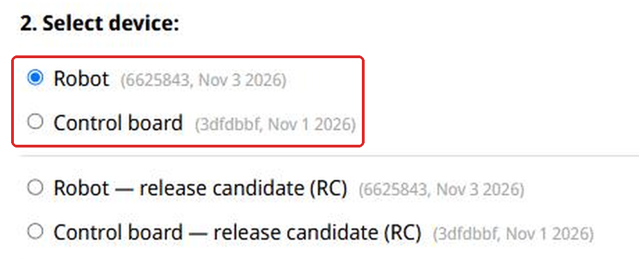
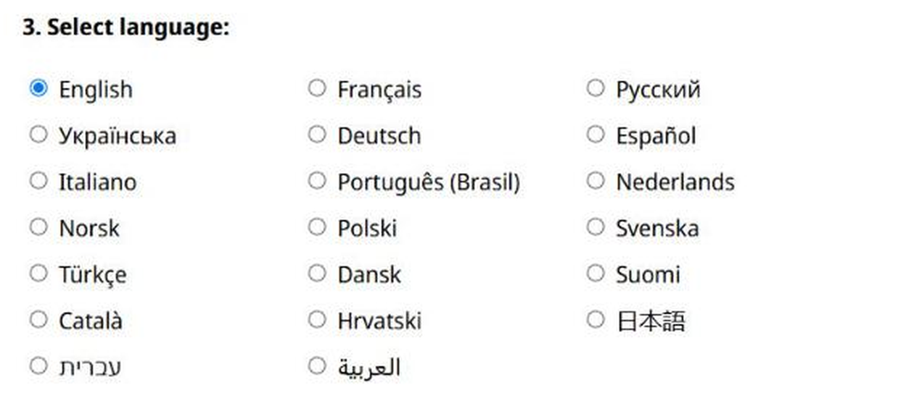
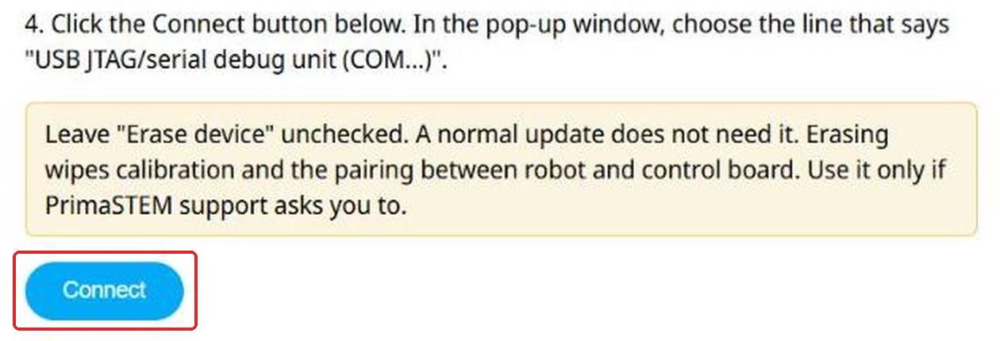
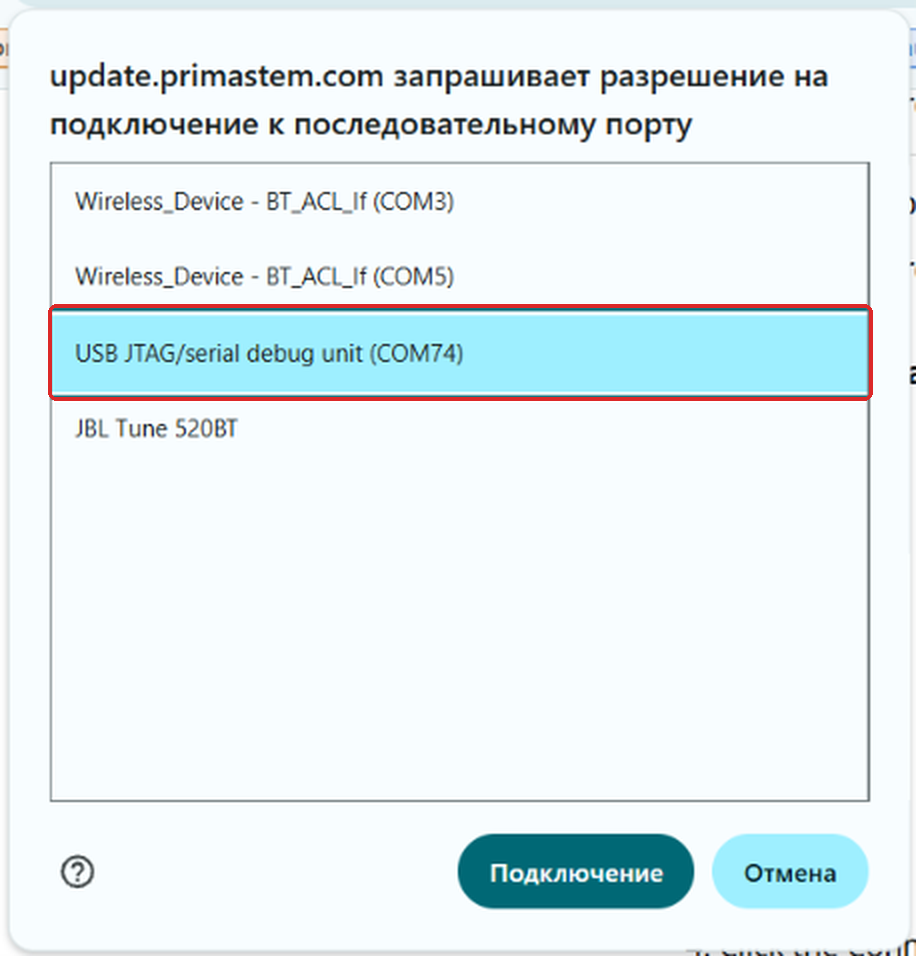
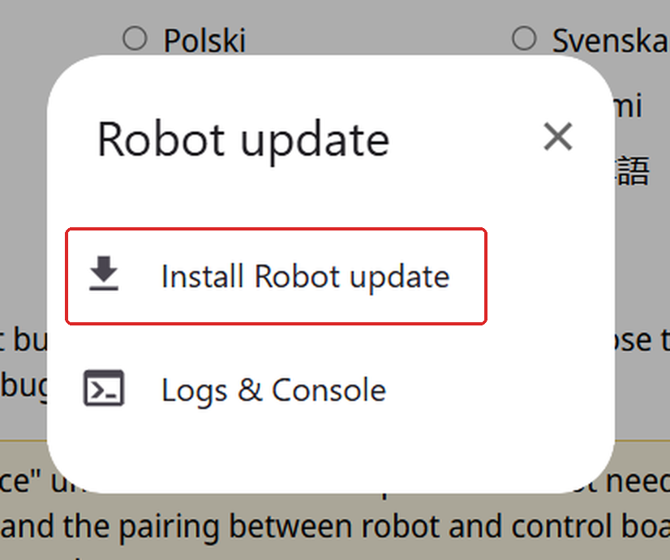
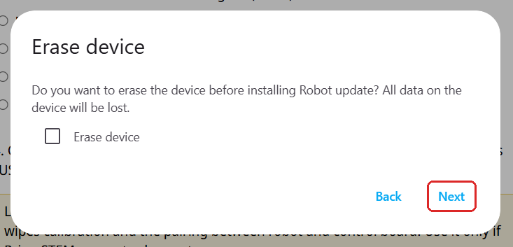
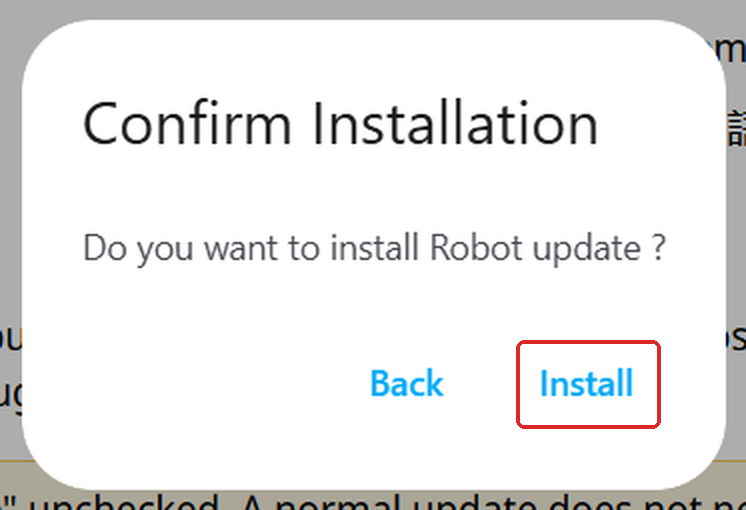
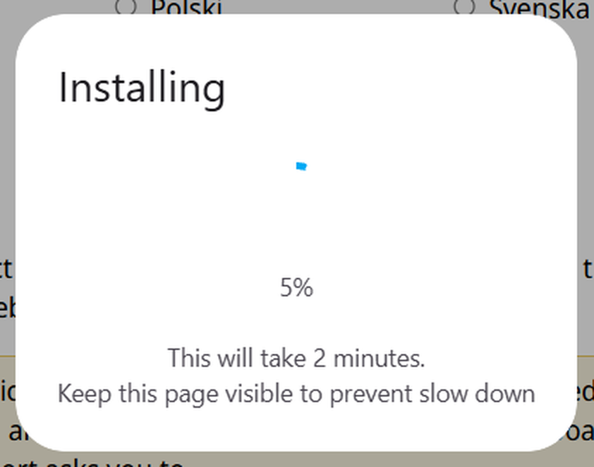
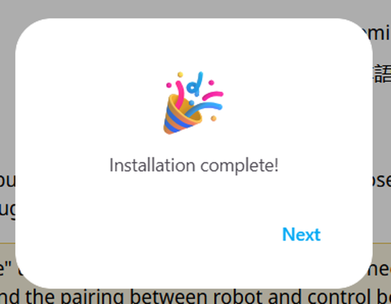
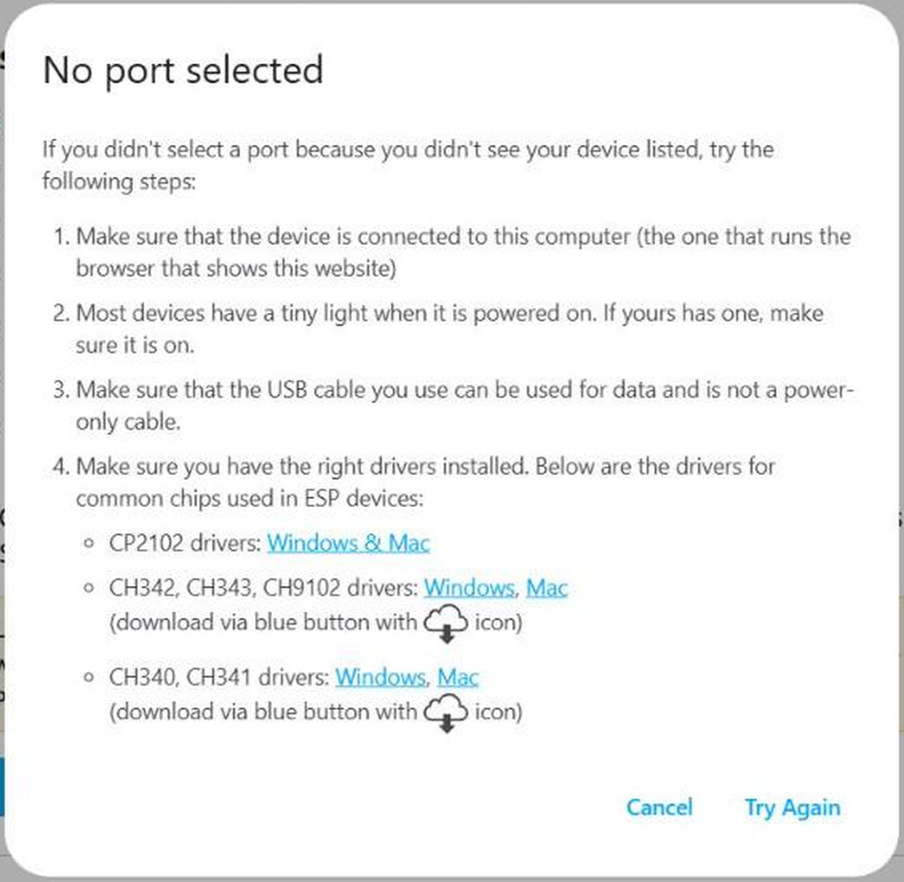

The update runs in your browser at [update.primastem.com](https://update.primastem.com). You do not need to install anything. The update site is in English, so the screenshots are in English too.

<Info>You need a computer with Chrome or Edge and a USB-C cable that transfers data. A charge-only cable will not work.</Info>

<Steps>
  <Step title="Switch on the device and connect it">
    Switch on the robot or the control board and connect it to the computer with the cable. The computer does not see a device that is switched off.
  </Step>
  <Step title="Open the update site">
    Open [update.primastem.com](https://update.primastem.com) in Chrome or Edge.
  </Step>
  <Step title="Select the device">
    Choose **Robot** or **Control board** in the top two lines. Leave the other lines alone: they are test versions.

    <Frame>
      
    </Frame>
  </Step>
  <Step title="Select the language">
    Choose the language the device will speak.

    <Frame>
      
    </Frame>
  </Step>
  <Step title="Click Connect">
    Click the blue **Connect** button at the bottom of the page.

    <Frame>
      
    </Frame>
  </Step>
  <Step title="Choose the port">
    A window opens in your browser's language. Select the line **USB JTAG/serial debug unit (COM...)** and confirm with the connect button in that window. The number after COM differs from one computer to another.

    <Frame>
      
    </Frame>
  </Step>
  <Step title="Start the installation">
    Click **Install Robot update**. For the control board this line says **Install Control update**.

    <Frame>
      
    </Frame>
  </Step>
  <Step title="Leave Erase device unchecked">
    Leave the **Erase device** box empty and click **Next**. Erasing wipes the calibration and the pairing between the robot and the control board. Use it only if PrimaSTEM support asks you to.

    <Frame>
      
    </Frame>
  </Step>
  <Step title="Confirm">
    Click **Install**.

    <Frame>
      
    </Frame>
  </Step>
  <Step title="Wait">
    The update takes about 2 minutes. Keep this page on the screen and do not unplug the cable.

    <Frame>
      
    </Frame>
  </Step>
  <Step title="Finish">
    When you see **Installation complete!**, click **Next**, close the window and unplug the cable.

    <Frame>
      
    </Frame>
  </Step>
</Steps>

Update the other device the same way.

## If something goes wrong

- **The robot and the control board do not connect.** Pair them again, see [Connecting the Board and Robot](/en/usermanual#connecting-the-board-and-robot).
- **The No port selected window appears.** The computer did not find the device, or no line was selected in the list. Check that the device is on and that the cable transfers data, then click **Try Again**.

<Frame>
  
</Frame>

- **The update stops with Installation failed.** Unplug the cable, plug it back in and start again from step 2. If this does not help, [contact us](/en/contacts).
