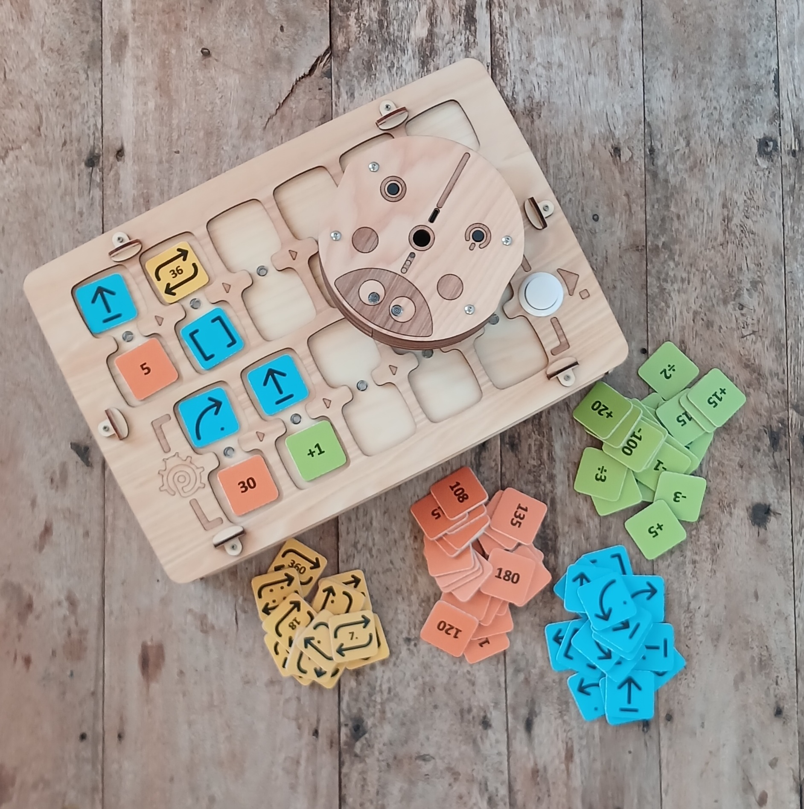
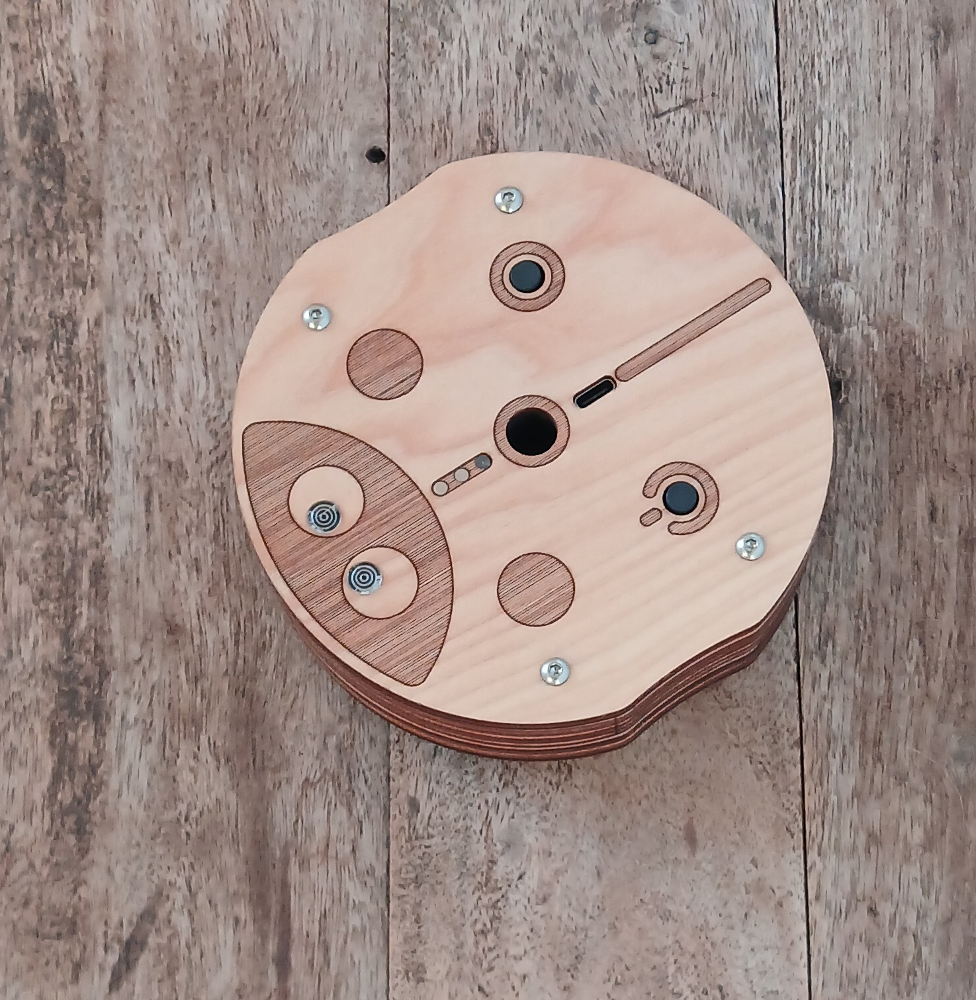
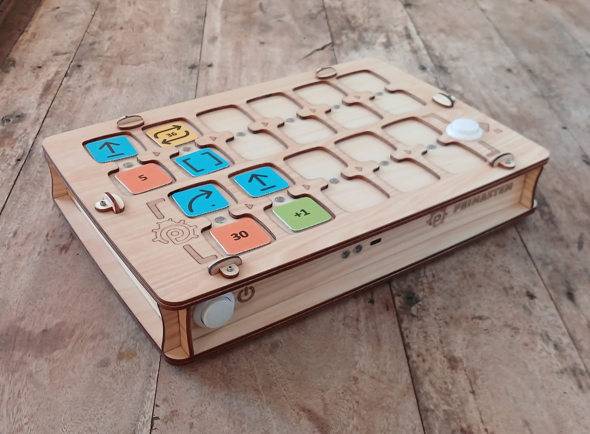
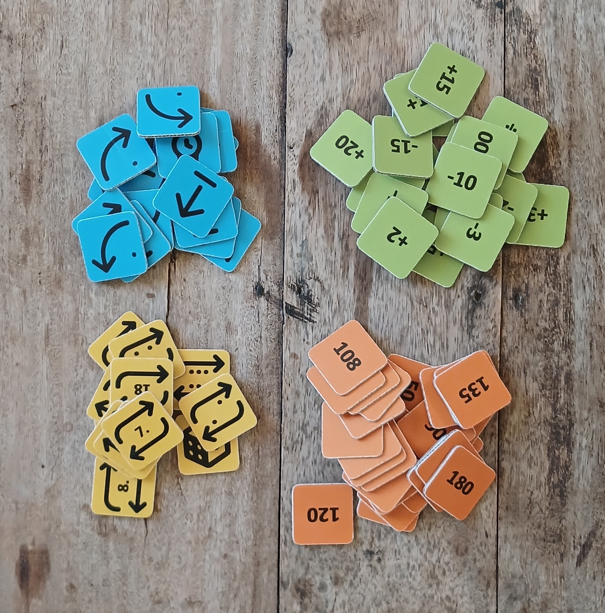
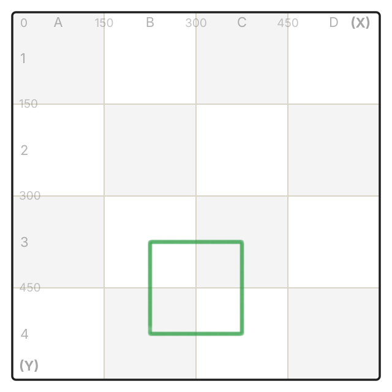
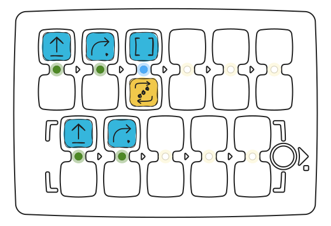

## Technical Specifications and Package Contents

- Play robot
- Robot control board
- Command, value, and arithmetic operation tokens for creating programs

> Package contents and appearance may vary slightly. Please verify at purchase.

### Play Robot

Dimensions: D=125 mm, H=44 mm.

The robot is equipped with a power button, LEDs, a speaker, a function button, and a USB-C port for charging the battery.

A marker with a diameter of up to 10 mm can be installed in the center of the robot to draw simple shapes while moving.

Appearance may vary slightly depending on the configuration, but core functionality remains the same.

### Control Board

Dimensions: L=317 mm, W=217 mm, H=62 mm.

The control board contains 11 dual slots for inserting command and value tokens: 6 for the main program (upper part), 5 for the subroutine (lower part). The board has two buttons: on the left — power, on the right — **▶ Start / Stop** for starting and stopping the program.

After placing command and value tokens in the slots, press **▶ Start**: the robot will run the program. Active commands are illuminated by LEDs between the slots.

If a token is inserted incorrectly, the board signals with a red LED, but the program continues (for example, when a value token is placed without a command).

The board is equipped with a USB-C port for charging and a speaker for sound output.

### Instruction Tokens

Dimensions: LxW=33 mm.

The set includes tokens for creating programs. Each token is a command with a clear meaning and instruction. The sequence of blocks determines the robot's behavior.

Tokens are divided into **commands**, **values**, and **arithmetic**.

#### Command Tokens

Basic blocks for composing the control program:

- **Forward** — forward movement (15 cm by default)
- **Right** — 90° clockwise turn
- **Left** — 90° counterclockwise turn
- **Backward** — backward movement (15 cm by default)
- **Function** — executes the subroutine from the lower part of the board
- **Random Movement** — one step forward or backward, or a 90° turn left or right followed at once by a step forward of the default step length (there is no turn in place without a step)
- **Repeat Tokens (Loops)** - Tokens with numbers from 2 to 6 (by number of dots) and repeat pictograms with the number inside. The token with a die means a random number of repeats from 1 to 6.

> Numerical value and arithmetic tokens are also used to expand programming capabilities: for example, repeating a command or changing the movement angle/distance.

#### Value Tokens

Angle and distance tokens: 30°, 36°, 45°, as well as multiples (60°, 72°, etc.). Angles in degrees, distances in millimeters. By default — 90° and 150 mm (15 cm).

#### Arithmetic Operation Tokens

Modify movement command parameters:

- Addition (\+)
- Subtraction (−)
- Multiplication (\*)
- Division (/)
- Square Root (√)
- Power (^)
- Factorial (!)

Arithmetic works within the range from −5000 to 5000. If the answer is above 5000 or below −5000, or you divide by 0, take the root of a negative number or the factorial of a number above 6, the cell blinks red and the number stays the same. Division and square root round to the nearest whole number: 150 ÷ 4 = 37.5 → 38, 20 ÷ 3 = 6.67 → 7, √50 = 7.07 → 7. An exact half rounds away from zero: 37.5 → 38, −2.5 → −3.

## Connecting the Board and Robot

It is recommended to turn on the robot first, then the board.

Place the robot on a flat surface before connecting: after pairing, the LEDs turn white. While there is no connection, the robot and the board glow light blue.

Check the connection: place the "Forward" token and press **▶ Start**.

If there is no connection, restart both devices or charge them. Temporary connection loss may occur near strong electromagnetic field sources (mobile phone, WiFi hotspot).

> **After updating the device software**, pairing may be required: turn on the robot, then the board, press and hold the **▶ Start** button on the board for more than 10 seconds. At the 5th second you will hear a short beep: keep holding. Pairing starts at the 10th second.

### Driving by tilting the remote

As soon as the remote connects to the robot, you can drive the robot without tokens by tilting the remote. This works while there are no tokens on the remote and you have not pressed **▶ Start** yet.

- First lay the remote flat for a second. The robot ignores tilts until you do.
- Tilt the remote away from you: the robot drives 15 cm forward. Toward you: 15 cm back.
- Tilt it left or right: the robot turns 90° the same way.
- The remote gives a short beep on every step.
- While the remote stays tilted, the robot makes one step after another. Bring the remote back level: the robot finishes the current step and stops.
- Tilt clearly, more than 20°. A slightly shaky hand will not set the robot moving.

Tilt driving switches off as soon as you put a token on the remote or press **▶ Start**. It switches back on when the remote connects to the robot again, for example after you turn the robot off and on.

## How It Works?

To program movement, place command tokens in the board slots (for example, "Forward", "Left", "Function", etc.). You can set command values and repeat counts, as well as angle, distance, and arithmetic operation values.

For joint installation of a command and value (repeat), slots are connected by "bridges" with indicators.

_Below is a program using a loop as an example to repeat a similar code section. The program creates a square movement path for the robot:_

<Columns cols={2}>
  <Frame>
    
  </Frame>
  <Frame>
    
  </Frame>
</Columns>

[Run in the simulator](https://simulator.primastem.com/#top=cfor,crig,cfun.r003&fn=cfor,crig&s=l1144402&r=225-525-0&run)

Commands are placed first in the upper part of the board (6 slots) and are executed from left to right. Empty slots or errors are ignored (for example, two commands in one block or a value without a command).

The sequence of blocks determines the robot's movement.

Press **▶ Start** to start the program.

By default:

- "Forward" — 15 cm.
- "Left/Right" — 90°.
- Loops (repeats) repeat the command multiple times.
- "Function" calls the subroutine from the lower part of the board (5 slots).
- You can call a subroutine multiple times via a loop by adding a repeat token to "Function" (example shown above).

### Important Functions:

- **Interrupt** program execution by pressing **▶ Start** again during movement.
- The board remembers the last **set value** (distance/angle) for the movement command until power-off: for example, if "Forward" = "200", all subsequent "Forward" commands are executed with this value.
- Values after arithmetic operations are also saved.
- Change the "**default distance**" using a service token: for example, for 12.5 cm, place the "Default Distance" token with value 125. The value is saved after power-off. Numbers from 1 to 999 work. The token without a number returns the step to 150 mm. With arithmetic or zero the cell blinks red and the step stays the same.
- The board and robot **automatically power off** if nothing happens for 15 minutes.
- While the robot waits for a command, it blinks its eyes to show it is on and ready.
- **Short press of the robot button**: the robot reads the token under itself and says what it is.
- **All robot sounds** can be turned off and on by holding the robot button for 5 seconds: wait for the short beep and release. The robot flashes red if the sound is now off and green if it is on.
- **Control board sound** can be turned off and on by holding the **▶ Start** button for 5 seconds: wait for the short beep and release. This does not work while a program is running.
- **After a software update**, robot movement calibration may be needed.
- **Robot settings reset**: hold the robot button for 10 seconds (details in "Robot Calibration" below).
- **Board and robot pairing** may be necessary after updating device software. Hold the **▶ Start** button on the board for more than 10 seconds: the beep at the 5th second means keep holding.

### Robot Calibration:

- Before calibrating, update the robot and the remote to the latest stable firmware at [update.primastem.com](https://update.primastem.com) ([how to update](/en/update)). Calibration made on old firmware can be inaccurate.
- First run the "Calibration" card without a number: the robot measures motor polarity, removes backlash and sets up straight-line movement. The card runs for up to 2 minutes. For the first half minute the robot must stand still, do not touch it. The robot button does not work during this time.
- Then calibrate the turn angles. Mark the exact orientation of the robot on the table surface. You need 32 turns of 90° clockwise: build the program "Repeat 8 + Right turn" and run it four times. The robot should make eight full rotations (90×32 = 2880°) and return to its original orientation.
- Assess the deviation from the mark and apply a correction with the "Calibration" card plus a number token: if the robot stops before the mark, add "+" (for example "Calibration" + "+5"); if it goes past, add "−" (for example "Calibration" + "−5"), then **▶ Start**. The number is how many degrees the robot was off over all 32 turns together. The robot accepts numbers up to 180. If the number is bigger, or the robot cannot save the correction, the cell blinks red. A plain number without "+" or "−" next to "Calibration" does not work: the cell blinks red.
- Repeat until the robot returns exactly to its original orientation.
- The calibration is saved after power-off.
- Attention! Calibration reset: hold the robot button for 10 seconds, the lights flash red, green, blue and white. The reset erases all calibrations, the volume and the muted sound. After the reset, switch the robot off and on, then redo the calibration from the start.

<Accordion title="Calibration of the first device version (MVP) with 10 cm diameter robot" icon="rectangle-terminal">
  This method is only for the first version (MVP). On new firmware, "Calibration" with a plain number does not work: the cell blinks red.

  1. To calibrate the gyroscope, place the robot on a horizontal surface, insert the "Calibration" token into the board and press **▶ Start**.
  2. To calibrate the movement distance, measure the actual path with the "Forward" command, place "Calibration" and the token with the required value, then **▶ Start**. You can write the value to any digital NFC token using a mobile phone with NFC as text in the form nXXX (for example, n095 for 95 mm). After this, the robot's movement distance will be accurate.\*
</Accordion>

### Programming NFC Tokens

You can modify or **create your own tokens** - commands, digital values, or arithmetic operations using a phone with NFC and a tag read-write program, for example "NFC Tools". You can write a value to a blank digital NFC tag using a mobile phone with NFC as simple text in the form of 4 characters.

## Important!

Full safety warnings and regulatory information are on the [User Manual](/en/safety) page.

> The kit **is not intended for children under 4 years** and contains small parts — **choking hazard**! Use **only under adult supervision**!

The device contains Li-ion batteries. **Charge only under adult supervision** using standard USB 5V and USB-C cable.

Charging the board and robot (1 hour) is enough for 1–2 lessons; a full charge (2–3 hours) — for 3 lessons of 30–45 minutes. Over time, battery capacity may decrease, replacement with new 16340 Li-ion batteries is possible.

If the set is not used for a long time, charge the batteries **once every 2-3 months**. With deep discharge, batteries may fail and require replacement.

**Do not open the device** yourself — in case of malfunction or need to replace batteries, contact the seller or specialized electronics repair centers.

Store, use and charge the set in a dry room at a temperature of \+5…\+35°C. Avoid direct sunlight, liquids, dust, and sudden changes of temperature or humidity that can cause condensation.

Avoid shocks and vibrations. Transport and store the device in its original packaging at a temperature of \+5…\+35°C, protecting from mechanical damage and moisture.

p.s.: PrimaSTEM is a practical tool for learning programming, developing creative thinking and logic. Detailed information about functionality is contained in the **Teacher's Guide**.