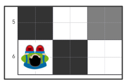

---
## Misión verde

Ve al punto verde con este programa:

---

Solución de la misión verde. En la vista superior, el niño-robot mira hacia arriba.

---
## Misión violeta

Ve al punto violeta con este programa:

---

Solución de la misión violeta. En la vista superior, el niño-robot mira hacia abajo.

---
## Misión azul

Ve al punto azul con este programa:

---

Solución de la misión azul. En la vista superior, el niño-robot mira hacia la derecha.

