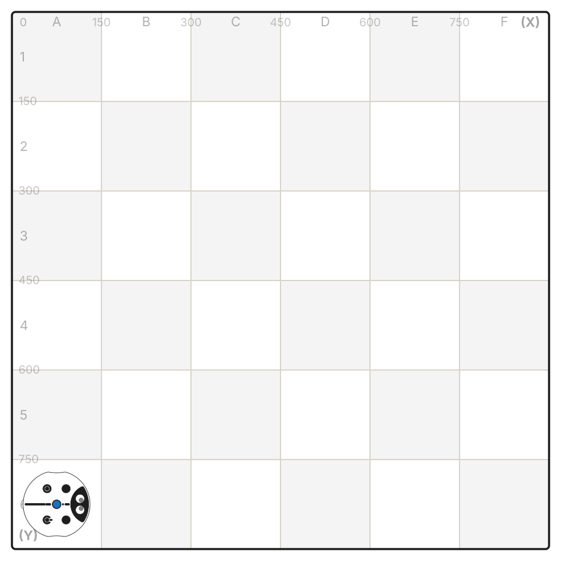

---
## Programa A

Sigue el camino que recorrerá el robot con este programa.

<Columns cols={2}>
  <Frame>
    
  </Frame>
  <Frame>
    
  </Frame>
  <Frame>
    
  </Frame>
</Columns>

---
## Programa B

Sigue el camino que recorrerá el robot con este programa.

<Columns cols={2}>
  <Frame>
    
  </Frame>
  <Frame>
    
  </Frame>
</Columns>

<Columns cols={2}>
  <Frame>
    
  </Frame>
  <Frame>
    
  </Frame>
</Columns>

