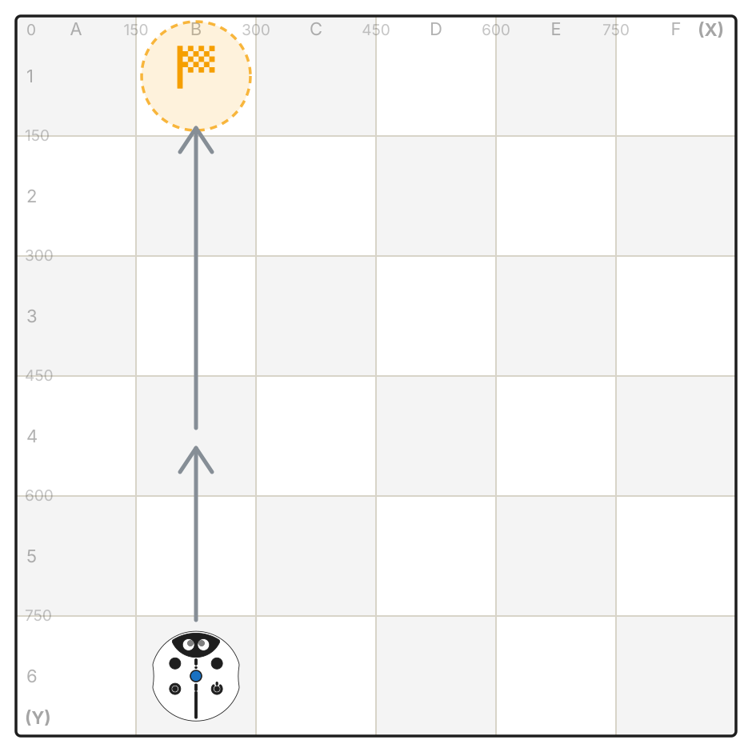

## Guía para realizar clases con niños a partir de 4 años

PrimaSTEM ayuda a los niños a dominar paso a paso el pensamiento lógico, los conceptos básicos de programación y las matemáticas. Esta guía le ayudará a realizar clases con niños a partir de 4 años.

### Cómo funciona

Los niños programan los movimientos de un pequeño robot mariquita. Para ello colocan fichas de comando en el tablero.

- **"Adelante"**: el robot avanza recto.
- **"Izquierda"**: el robot gira a la izquierda.
- **"Derecha"**: el robot gira a la derecha.
- **"Función"** (ficha "[ ]"): sustituye a una secuencia de comandos.
- **"Repetir"**: repite un comando o una función varias veces.

Usted coloca las fichas en el tablero y así crea un programa de movimiento para el robot. Cuando el programa esté listo, presione el botón y el robot ejecutará los comandos.

### Contenido de la guía

- Por qué realizar clases de robótica y programación
- Cómo organizar las clases en diferentes condiciones
- Actividades y objetivos de aprendizaje
- Instrucciones detalladas de uso
- Descripción de las actividades
- Anexos
- Sobre el proyecto y los autores

### Qué enseña PrimaSTEM

- Programar con las manos, sin pantalla
- Entender que las máquinas funcionan con algoritmos
- Planificar las acciones con antelación
- Pensar con lógica
- Crear secuencias de comandos y funciones
- Entender qué es un "bug" (error en el código) y encontrar errores
- Aprender números, aritmética y geometría de forma visual

## De qué se compone PrimaSTEM

### Qué hay en la caja

- Robot mariquita
- Tablero
- Fichas de comando *
- Guía de actividades *

(*) El contenido puede variar según la configuración.

## Por qué realizar clases de programación y matemáticas

El código, la programación y la automatización se han convertido en parte de nuestra vida cotidiana.

En los últimos años, los humanos han aprendido a crear máquinas que hacen cosas que antes no podían hacer: entender, hablar, oír, ver, responder, escribir.

Hay muchos ejemplos: coches autónomos, robots asistentes para personas mayores, robots de reparto y otros.

### Por qué enseñar programación y robótica

Cuando un niño aprende a programar, aprende a entender las máquinas que nos rodean. Aprende a convertir ideas pequeñas y audaces en proyectos reales. Divide una tarea compleja en pasos sencillos. Trabaja con otros y resuelve problemas comunes.

### Nacidos en la era digital

Puede parecer que los niños y jóvenes dominan la tecnología, porque usan mucho el entretenimiento digital.

Pero ¿saben crear algo propio con estas herramientas y expresarse con ellas? ¿Qué hacen cuando se encuentran con un problema técnico?

## Cómo organizar las clases

Las actividades sirven para distintos fines y contextos educativos. Todas las actividades de la guía están numeradas. A continuación indicamos qué actividades encajan con sus condiciones.

### Para quién

- Niños de 4 a 8 años.
- Grupos de preescolar y primaria (1º y 2º grado).

### Actividades para el trabajo extraescolar

Actividades 1, 2, 4, 5, 6, 7, 8, 9, 10.

### Actividades para la escuela

Actividades 2, 3, 4, 5, 6, 7, 8, 9, 11, 12.

### Trabajo extraescolar

Lo mejor es formar un grupo de no más de 12 niños, para que cada uno pueda participar activamente.

Recomendamos un dispositivo para 2-3 alumnos. Así los niños aprenden a trabajar en equipo y a comunicarse.

### Trabajo en la escuela

En clase, lo ideal es formar grupos pequeños de 4-6 niños con un profesor.
Mientras tanto, los otros alumnos hacen otra tarea con un asistente educativo. Los alumnos de 1º y 2º grado pueden, por ejemplo, practicar el dibujo del camino del robot según el programa.
En ambos casos, es mejor trabajar con PrimaSTEM en un aula multiusos, directamente en el suelo. También puede mover mesas y sillas para liberar espacio.

**Atención.** Cargue con antelación las baterías del tablero y del robot.

## Actividades y objetivos de aprendizaje

| Actividad | Algoritmo y programa | Ruta por etapas | Anticipar el movimiento | Resolver problemas, depurar | Trabajo en equipo |
| --- | :---: | :---: | :---: | :---: | :---: |
| 1 |   | X |   | X |   |
| 2 |   |   | X |   | X |
| 3 | X | X |   |   |   |
| 4 | X | X | X |   |   |
| 5 | X | X | X |   | X |
| 6 | X | X | X | X | X |
| 7 | X | X | X | X | X |
| 8 | X |   | X | X |   |
| 9 | X | X | X | X | X |
| 10 | X |   | X | X |   |
| 11 | X | X | X | X | X |
| 12 | X | X | X | X | X |

## Instrucciones de uso

### Contenido de las instrucciones

- Familiarización con los materiales
- Programación de funciones
- Mapas
- Explicaciones técnicas

## Familiarización con los materiales

### Robot

Un pequeño robot mariquita de madera con dos ojos.

Tiene tres puntos de apoyo: dos ruedas y un soporte en la parte trasera. Con ellos mantiene el equilibrio.

### Comandos básicos

| Comando | Dibujo                              | Descripción                                                                                     |
| ------- | ----------------------------------- | -------------------------------------------------------------------------------------------- |
| Adelante |   | El robot avanza una casilla. Es un paso lógico, por defecto de 15 cm.                       |
| Izquierda |      | El robot gira 90° a la izquierda                                                             |
| Derecha |     | El robot gira 90° a la derecha                                                               |
| Atrás   |      | El robot retrocede una casilla, es decir, un paso lógico por defecto                         |
| Función |  | El robot ejecuta los comandos de la fila de la función                     |
| Repetir N |   | El robot repite N veces el comando de la misma celda emparejada |

### Tablero

En el tablero usted controla el robot: coloca las fichas de comando en las celdas libres (D).

La fila superior (A) tiene 6 celdas dobles conectadas por una línea de ejecución (E) y es el programa principal. El programa empieza en la celda de la izquierda (D) y termina sobre el botón **▶ Inicio** (B). Este botón envía los comandos al robot e inicia el programa.

La fila inferior (C) tiene 5 celdas dobles y fija los movimientos de la ficha "Función" ("[ ]"). Cada celda doble tiene un LED (F). Se enciende al colocar una ficha y parpadea mientras el robot ejecuta ese comando.

#### Colores de los LED

Si la ficha está bien colocada en la celda, el LED se enciende en verde.
Si junto a un comando de movimiento se coloca un comando de repetición en la celda emparejada, el LED se enciende en azul.
Si las fichas están mal colocadas, por ejemplo dos comandos de movimiento en una celda emparejada, se enciende un LED rojo. El robot ignora ese comando.

### Batería y botón de encendido

El robot y el tablero funcionan con baterías integradas. Se cargan a través de un puerto USB-C. El botón de encendido (ON/OFF) está en la parte superior del robot y en el lado frontal izquierdo del tablero.

Al encender el robot o el tablero, se escucha una señal acústica corta.
Con el tablero encendido, el LED del panel frontal se ilumina en verde. Con el robot encendido, el LED junto al conector USB-C se ilumina en verde.

### Comunicación inalámbrica

El robot y el tablero se comunican por Bluetooth, con un alcance de unos 5 m. Después de la primera conexión del robot al tablero, la comunicación funciona sola y no hay que configurarla.

> El tablero se puede vincular con otro robot (vincular dispositivos).
> 1. Encienda el robot que no está vinculado al tablero.
> 2. Encienda el tablero.
> 3. Mantenga presionado el botón **▶ Inicio** en el tablero durante 10 segundos, hasta que escuche una señal acústica y vea una señal luminosa.

### Cómo crear y ejecutar un programa

El programa ("secuencia de movimientos") empieza a la izquierda del tablero. Sigue las flechas grabadas ">". Es la línea de ejecución, que conecta horizontalmente las celdas emparejadas.

Si hay una celda vacía antes de una ficha, el robot salta la celda vacía y ejecuta el comando de esa ficha.

Si una ficha está mal colocada, el LED se enciende en rojo y el robot omite esa parte del programa. Pasa, por ejemplo, cuando "Repetir" está en una celda emparejada sin comando o cuando hay dos fichas de comando en la misma celda emparejada.

Cuando el programa esté listo, presione el botón **▶ Inicio**.

Mientras el robot ejecuta el programa, los LED del tablero se apagan uno tras otro. El LED del comando actual parpadea.

## Programación de funciones

### Cómo crear una función

La ficha "Función" ("[ ]") sustituye a una secuencia de comandos.

Con ella puede crear programas más largos y resolver tareas más difíciles. Para crear una función, coloque los movimientos en la fila inferior del tablero: son 5 celdas dobles. El robot ejecuta esa fila de izquierda a derecha cada vez que encuentra una ficha "Función" en el programa principal (arriba).

En el ejemplo siguiente, la función consiste en avanzar recto y girar a la derecha. El programa principal llama a la función 2 veces. Después, la ficha "Repetir 2" repite la función otras 2 veces.

[Ejecutar en el simulador](https://simulator.primastem.com/#top=cfun,cfun,cfun.r002&fn=cfor,crig&s=l1144602&r=225-675-0&run)

Resultado del movimiento:

## Mapas

### Qué mapas sirven

En las primeras actividades los niños aprenden algoritmos, programación y números. Para ello el robot se mueve por un mapa con cuadrícula. Conviene usar un mapa con celdas de 15 cm: es lo que recorre el robot en un paso por defecto.

También sirven los mapas de otros robots, si el tamaño de la celda es adecuado para este robot.

> Puede cambiar el paso por defecto de 15 cm al tamaño de la celda de su mapa, por ejemplo 10 cm, 12,5 cm o 20 cm. Para ello coloque la ficha especial "Paso predeterminado" con un número en milímetros: 100 para 10 cm, 125 para 12,5 cm, 200 para 20 cm.

Si no tiene un mapa, fabrique uno usted mismo. Pegue cinta adhesiva de papel sobre una mesa o un suelo plano. También puede usar una cartulina (o lona de banner gruesa) y un marcador.

El mapa tipo ajedrez, o un mapa vacío con cuadrículas, sirve para practicar el desplazamiento de un punto a otro. Los colores no distraen.

El mapa en color ayuda a contar pequeñas historias sobre los viajes del robot. Por ejemplo: "La mariquita sale de casa y va a las montañas a través del bosque". La clase puede crear un mapa nuevo e inventar nuevas historias sobre los viajes de la mariquita.

#### Ejemplos de mapas

Mapa de ajedrez

Mapa en color

## Explicaciones técnicas

### Cómo está hecho

El tablero y el robot tienen microcontroladores y baterías de Li-Ion. Se comunican por radio mediante el protocolo estándar Bluetooth.

La placa del robot controla todo su comportamiento. Controla dos motores de corriente continua de 5V y dos LED multicolores, reproduce sonidos, se comunica con el tablero, etc.

La placa del tablero identifica las fichas en las celdas, reproduce sonidos y controla 11 LED multicolores, uno por cada celda doble.

Cada ficha lleva un chip NFC adhesivo con el código del comando. El tablero lee ese código cuando se coloca la ficha en una celda.

Cuando el tablero ha identificado las fichas y usted inicia el programa, el tablero envía los comandos al robot por comunicación inalámbrica.

### Fichas de comando propias

Puede crear fichas de comando adicionales, por ejemplo "Repetir 12" o más fichas de movimiento. Para ello necesita fichas "vacías" con adhesivos NFC y un teléfono con NFC. Sirven la mayoría de los tipos con frecuencia de 13,56 MHz.

Las instrucciones en vídeo están en nuestro canal de YouTube: https://www.youtube.com/@primastem

---

## Actividades

### Descripción detallada de las actividades

- **Actividad 1**: camino por el tablero de ajedrez del punto A al punto B
- **Actividad 2**: primer contacto con PrimaSTEM
- **Actividad 3**: un niño hace de robot, orientación y algoritmo
- **Actividad 4**: predecir el camino del robot según el programa
- **Actividad 5**: secuencia de comandos en un programa aleatorio
- **Actividad 6**: llevar al robot a las montañas con el tablero
- **Actividad 7**: primer contacto con la ficha "Función"
- **Actividad 8**: ruta hasta la meta con función
- **Actividad 9**: depurar un programa con error
- **Actividad 10**: encontrar el error en un programa en papel
- **Actividades 11 y 12**: predecir los movimientos del robot (en la 12, con la ficha "Función")

---

## Actividad 1. Camino por el tablero de ajedrez del punto A al punto B

- **individual**
- **15 min**
- **en papel**
- **documentos para imprimir**

### Objetivo

- Planificar el camino por las casillas del punto A al punto B en el mapa.

El ejercicio dura 10 minutos con la puesta en común final.

### Para imprimir

Imprima para cada alumno la hoja "[Anexo 1. Desplazamiento por el mapa](/es/book-1/attachment-1)".

### Ejercicio

Los niños dibujan en la cuadrícula el camino por el que el ratón llegará al queso. Empiece con el ejercicio de la izquierda, que es más sencillo. Después pase al de la derecha.

#### Desplazamiento por casillas

El ratón se desplaza por las casillas de la cuadrícula. No puede moverse en diagonal. Los niños deben entender que el camino del ratón se divide en etapas: avanza una casilla cada vez. Se dice que se mueve paso a paso.

En el ejemplo anterior, solo el camino azul es correcto. El camino rojo corto es incorrecto porque va en diagonal. El camino rojo largo es incorrecto porque no llega al punto deseado.

### Discusión en grupo

En el ejemplo anterior todos los caminos son correctos: por todos ellos el ratón llega al queso.

Muestre a los niños que cada uno puede pensar un camino distinto y que puede haber varios caminos correctos.

#### Algunos caminos son más largos que otros

Cuente cuántas casillas recorre el ratón hasta la casilla con el queso:
- 3 casillas por la ruta verde
- 3 casillas por la ruta gris
- 3 casillas por la ruta azul
- 13 casillas por la ruta amarilla

#### El camino más corto

Todos estos caminos son correctos, pero el ratón elegirá el más corto.

Pregunte a los niños: "¿Por qué el ratón eligió el camino más corto?"

Las respuestas pueden ser distintas. El ratón quiere ahorrar energía: está muy cansado y quiere caminar lo menos posible. O el ratón tiene prisa: tiene mucha hambre y quiere llegar al queso lo antes posible.

**Nota para el instructor.** Con los robots ocurre lo mismo. Siempre elegimos el camino más corto, porque es más eficiente.

#### Varios caminos son posibles

Al terminar el ejercicio, pida a los alumnos que muestren su camino. Siempre hay varios caminos posibles, así que es probable que los alumnos propongan respuestas distintas, y todas serán correctas.

---

## Actividad 2. Primer contacto con PrimaSTEM

- **15 min**
- **en grupo**
- **demostración**
- **práctica**

### Objetivos

- Comprender cómo puede moverse el robot.
- Saber que el tablero controla al robot.
- Entender qué hacen las fichas de comando.

Forme grupos pequeños de alumnos. Siéntense en una mesa baja o en el suelo. Saque el mapa con cuadrícula, el tablero, el robot y las fichas. Presente PrimaSTEM a todos los alumnos, grupo por grupo.

### Presentación

Muestre cada objeto de la mesa y nombre las palabras que los niños necesitarán.

Primero el **mapa**. Es como la cuadrícula de la actividad 1, pero más grande.

Luego el **robot mariquita**. Puede rodar.

El robot se controla con el **tablero**. Hace lo que indican las fichas colocadas en las celdas del tablero.

Las **fichas** son comandos: avanzar, girar a la izquierda o girar a la derecha.

### 1ª etapa: demostración

Cuando los niños conozcan las palabras, hágalo usted mismo. Ponga una ficha en el tablero y los niños verán qué pasa.

| Imagen                                             | Descripción                                                                    |
| -------------------------------------------------- | --------------------------------------------------------------------------- |
|  | La ficha **"Adelante"** hace que el robot avance una casilla |

Coloque el robot en cualquier casilla del mapa. Ponga la ficha en la primera celda del programa, como en el diagrama de abajo. Luego presione el botón blanco **▶ Inicio**.

El robot avanzará una casilla.

### 2ª etapa: entregue el control

| Imagen                                          | Descripción                                                                                                                                                                                |
| ----------------------------------------------- | --------------------------------------------------------------------------------------------------------------------------------------------------------------------------------------- |
|  | La ficha **"Izquierda"**, con una flecha en arco, hace que el robot gire a la izquierda, en sentido antihorario. El giro por defecto es de 90 grados. |

Quite la ficha "Adelante" del tablero y entregue la ficha "Izquierda". Deje que un niño la coloque en la primera celda del programa y presione el botón blanco **▶ Inicio**. El robot se quedará en su lugar y dará un cuarto de vuelta a la izquierda.

| Imagen                                           | Descripción                                                     |
| ------------------------------------------------ | ------------------------------------------------------------ |
|  | La ficha **"Derecha"** hace que el robot gire a la derecha. |

Pida a otro niño que cambie la ficha "Izquierda" por la ficha "Derecha" y presione el botón blanco **▶ Inicio**. El robot se quedará en su lugar y dará un cuarto de vuelta a la derecha.

Luego los niños trabajan con el tablero por turnos. Déles solo 3 fichas: **"Adelante"**, **"Izquierda"** y **"Derecha"**.

Cuando el robot termine el movimiento, los niños pueden presionar **▶ Inicio** otra vez y repetir su programa.

Deje que comprueben que las fichas se pueden colocar en cualquier celda, salvo dos comandos en una misma celda doble. El robot las ejecuta por turnos, de izquierda a derecha.

> Para detener el programa, presione de nuevo **▶ Inicio / Parada** mientras el robot se mueve.

---

## Actividad 3. Un niño hace de robot: orientación y algoritmo

- **45 min**
- **en grupo**
- **juego**
- **mapa**

### Objetivos

- Tener en cuenta hacia dónde mira el robot al inicio del programa.
- Anticipar los movimientos del robot según el programa.

### Para imprimir

Imprima para cada alumno las fichas "[Anexo 2. Tarjetas de misiones](/es/book-1/attachment-2)".

### Principio del juego

Es un juego de rol en un espacio libre. Los niños representan al robot en un campo blanco y negro.

### Reglas del juego

Un alumno hace de robot en el mapa. En lugar de un mapa sirve un suelo con un diseño cuadrado: un dibujo, baldosas o cuadros de cinta adhesiva. Los otros alumnos lo programan con las tarjetas de tareas.

No se dice hacia dónde mira el niño-robot.
Los alumnos determinan hacia dónde debe mirar para cumplir la misión.

1. El niño-robot se coloca en la casilla roja 1. Debe llegar a la casilla verde 2.
2. El niño-robot se coloca en la casilla roja 1. Debe llegar a la casilla violeta 3.
3. El niño-robot se coloca en la casilla roja 1. Debe llegar a la casilla azul 4.

> Para que el mapa dure más, pida al niño que se quite los zapatos.

### Fin del juego

Ahora el niño entiende que, al programar un desplazamiento, hay que tener en cuenta dónde está el robot y hacia dónde mira.

El robot ejecuta el comando según hacia dónde esté girado. Avanza recto, gira a la izquierda o gira a la derecha, **pero siempre a partir de su orientación inicial.**

---

## Actividad 4. Predecir el camino del robot según el programa

- **45 min**
- **individual**
- **en papel**
- **documentos para imprimir**

### Objetivos

- Tener en cuenta hacia dónde mira el robot al inicio.
- Comprender los comandos del programa.
- Anticipar los movimientos del robot según el programa.

### Para imprimir

Imprima para cada alumno las fichas "[Anexo 3. Dibuja el camino del programa](/es/book-1/attachment-3)".

Los niños reciben una hoja con un programa de varios comandos. Dibujan el camino que recorrerá el robot con ese programa.

Con este programa, el robot avanzará tres veces recto:

<Columns cols={2}>
  <Frame>
    
  </Frame>
  <Frame>
    
  </Frame>
</Columns>

[Ejecutar en el simulador](https://simulator.primastem.com/#top=cfor,cfor,cfor&s=l1144602&r=75-825-0&m=02&run)

Aquí el programa es el mismo y el robot también avanzará tres veces recto.
Pero al principio mira a la derecha. Por eso avanzará tres casillas hacia la derecha:

<Columns cols={2}>
  <Frame>
    
  </Frame>
  <Frame>
    
  </Frame>
</Columns>

[Ejecutar en el simulador](https://simulator.primastem.com/#top=cfor,cfor,cfor&s=l1144602&r=75-825-90&m=35&run)

En este programa el robot gira. Primero gira a la derecha y luego avanza dos casillas:

<Columns cols={2}>
  <Frame>
    
  </Frame>
  <Frame>
    
  </Frame>
</Columns>

[Ejecutar en el simulador](https://simulator.primastem.com/#top=crig,cfor,cfor&s=l1144602&r=75-825-0&m=25&run)

El último ejercicio es más difícil: el robot cambia dos veces de dirección. Avanza una casilla recto, gira a la derecha y avanza una casilla. Luego gira a la izquierda y avanza dos casillas:

<Columns cols={2}>
  <Frame>
    
  </Frame>
  <Frame>
    
  </Frame>
</Columns>

[Ejecutar en el simulador](https://simulator.primastem.com/#top=cfor,crig,cfor,clef,cfor,cfor&s=l1144602&r=75-825-0&m=12&run)

### Nota para el instructor

Este ejercicio en papel puede resultar difícil.
Si a un niño le cuesta entender los giros del robot y el orden de los movimientos, tome el set PrimaSTEM. Pídale que reproduzca en el tablero los programas de las hojas.
Tocando y mirando se comprende mejor.

---

## Actividad 5. Secuencia de comandos en un programa aleatorio

- **45 min**
- **en grupo**
- **juego**

### Objetivos

- Relacionar los comandos con los movimientos del robot.
- Ver los límites del mapa.
- Aprender a pasar los comandos al tablero.

### Desarrollo del juego

1. Coloque el robot en cualquier casilla del mapa, mejor cerca del borde. Elija la dirección que quiera.
2. Lance el dado. Mueva el robot con la mano y anote el programa en papel o en una pizarra: dibuje la flecha del comando "Adelante". Si el robot sale de los límites del mapa, lance el dado de nuevo.

3. Repita esto hasta tener 2 programas seguidos. El robot no debe salir de los límites del mapa, así que vuelva a lanzar el dado si hace falta.

Al final tendrá en la hoja 2 programas de comandos "Adelante". Si los ejecuta uno tras otro, el robot recorrerá el número necesario de casillas hacia el borde del mapa.

Ejemplo:

<Columns cols={2}>
  <Frame>
    
  </Frame>
  <Frame>
    

      
      
    

  </Frame>
</Columns>

**Ejecute los programas anotados en un PrimaSTEM real.**

---

## Actividad 6. Llevar al robot a las montañas con el tablero

- **45 min**
- **en grupo**
- **práctica**

### Objetivos

- Dividir la ruta en etapas.
- Crear un programa para un objetivo determinado.

Para esta actividad necesitará:
- el tablero;
- fichas de movimiento: 4 "Adelante", 4 "Izquierda" y 4 "Derecha" por grupo, deje el resto de fichas aparte;
- el mapa y el robot.

Divida a los niños en grupos de 3 o 4. Dé a cada grupo un tablero y un juego de fichas.

### 1ª etapa: reflexión

El robot mariquita está en casa y queremos llevarlo a las montañas. Hay que escribir en la pizarra un programa con el que llegue allí.

> Si no tiene el mapa adecuado, dibuje los lugares en papel, si quiere con los niños. Fíjelos al mapa con cinta adhesiva.

Primero pregunte a los niños por qué casillas quieren llevar al robot hasta la montaña. De nuevo hay muchas posibilidades. Elegimos las rutas más cortas para ahorrar energía y tiempo.

Cuando la ruta esté elegida, repase con los niños los movimientos del robot, casilla por casilla.

¿Debe ir recto, girar a la izquierda o girar a la derecha?
Mueva el robot por el mapa con las manos y muestre cómo lo desplaza cada comando.

### 2ª etapa: programación

Pida a los niños que coloquen en el tablero, por orden, las fichas con los movimientos del robot. Este programa debe llevar al robot a la meta.

**Este es el programa esperado:**

### 3ª etapa: comprobación

Todo programador que se precie comprueba si su programa funciona. Pida a los niños que coloquen su programa en el tablero y lo inicien.

<Columns cols={2}>
  <Frame>
    
  </Frame>
  <Frame>
    
  </Frame>
</Columns>

[Ejecutar en el simulador](https://simulator.primastem.com/#top=cfor,cfor,crig,cfor&s=l1144602&r=75-825-0&m=13&run)

¿Llegó el robot a la montaña? Si no, ¿por qué? Deje que los niños corrijan por sí mismos los errores del programa, si los hay.

---

## Actividad 7. Primer contacto con la ficha "Función"

- **15 min**
- **en grupo**
- **demostración**

### Objetivos

- Comprender que la ficha "Función" puede sustituir a otros comandos.
- Conocer la repetición de una secuencia de comandos.

Forme grupos pequeños de alumnos. Siéntense en una mesa baja o en el suelo. Saque el mapa, el tablero, el robot y las fichas de comando. Los grupos conocen por turnos la ficha "Función".

### 1ª etapa: demostración

Muestre a los niños la ficha "Función".

Sustituye varios comandos de movimiento: "Adelante", "Izquierda", "Derecha" o "Atrás". Con ella se puede repetir varias veces un mismo fragmento corto del programa.

Primero hágalo usted. Cree un programa como el de la imagen de abajo.

Cuando el robot encuentra la ficha "Función", ejecuta los comandos del recuadro [-----] de la parte inferior del tablero. Es lo mismo que si en lugar de la ficha "Función" estuvieran esos comandos.
En nuestro ejemplo, el robot avanzará dos veces recto.

### 2ª etapa: adivinanzas

Ahora añada la ficha "Derecha" al final del programa principal, como en la imagen de abajo.

Antes de iniciar el programa, pregunte a los niños qué sucederá. El programa funciona como si tuviera dos fichas rojas "Adelante" y una ficha "Derecha". El robot avanzará dos casillas y girará a la derecha un cuarto de vuelta.

Para terminar, muestre el **ciclo**.
Coloque un programa con cuatro fichas "Función", como en la imagen de abajo.

[Ejecutar en el simulador](https://simulator.primastem.com/#top=cfun,cfun,cfun,cfun&fn=cfor,crig&s=l1144602&r=225-675-0&run)

Antes de iniciar el programa, pregunte a los niños qué sucederá. Luego inicie el programa y compruébelo.

**El robot realiza un ciclo:**

**Nota para el instructor.** Cuando los niños conocen la función, conviene mirar los LED. Parpadean mientras se ejecuta el programa. Así se ve qué comando ejecuta el robot y cómo se mueve al mismo tiempo.

---

## Actividad 8. Ruta hasta la meta con función

- **45 min**
- **en grupo**
- **práctica**

### Objetivos

- Dividir la ruta en etapas.
- Crear un programa para un objetivo determinado.
- Usar la ficha "Función" en el programa.

Para esta actividad necesitará:
- fichas o tarjetas caseras con dibujos de comandos: 4 "Adelante", 4 "Izquierda", 4 "Derecha" y 4 "Función" por grupo;
- el mapa y el robot, sin tablero.

Si hay muchos niños, divídalos en grupos de 3 o 4. Dé a cada grupo las tarjetas con dibujos de comandos o las fichas del set, exactamente 4 de cada tipo.

### 1ª etapa: reflexión

> Si su mapa tiene otras imágenes o no tiene ninguna, cambie la tarea. Marque 2 puntos (Inicio y Fin) a una distancia de 4 casillas en un ángulo de 90 grados.

El robot está en la bandera y queremos llevarlo a la casilla "noche", con nubes. Hay que crear un programa con la ficha "Función": colocar sobre la mesa las fichas o los dibujos de comandos.

Primero pregunte a los niños por qué casillas quieren llevar al robot hasta la montaña. La montaña está más o menos a mitad de camino. Hay muchas posibilidades. Esta vez elegimos rutas donde se repitan comandos, para usar la ficha "Función".

Cuando la ruta esté elegida, repase con los niños los movimientos del robot, casilla por casilla. Mueva el robot con las manos y compruebe el programa.

### 2ª etapa: faltan fichas

Pida a los niños que coloquen sobre la mesa, por orden, las tarjetas o fichas con los movimientos del robot.

Controle con rigor el número de fichas de cada grupo: 4 "Adelante", 4 "Izquierda", 4 "Derecha" y 4 "Función".

¡Vaya, faltan fichas! Hacen falta más comandos "Adelante". ¡Pánico digital! :)

Recuerde a los niños la ficha "Función": sustituye a varias fichas.

Por ejemplo, puede sustituir varios comandos "Adelante", y el robot avanzará recto varias veces.

Ayude a los niños a crear un programa con la ficha "Función", como en la imagen de abajo.

Ejemplo de ruta y su programa:

### 3ª etapa: comprobación

Ayude a los niños a colocar su programa en el tablero y a comprobarlo, como en la imagen:

[Ejecutar en el simulador](https://simulator.primastem.com/#top=cfun,clef,cfun&fn=cfor,cfor,cfor,cfor&s=l1144602&r=825-825-0&run)

¿Llegó el robot a la casilla "Noche"? Si no, ¿por qué?
Deje que los niños corrijan por sí mismos los errores del programa, si los hay.

---

## Actividad 9. Depurar un programa con error

- **20 min**
- **en grupo**
- **práctica**

### Objetivos

- Encontrar el error en un programa observando su ejecución.
- Corregir el error en el programa.

Forme grupos pequeños de alumnos. Siéntense en una mesa baja o en el suelo. Prepare el mapa con cuadrícula, el tablero, el robot y las fichas.
Los grupos depuran el programa por turnos.

El robot debe llegar a la montaña por el camino gris.

Muestre a los niños en el tablero el programa con un error:

[Ejecutar en el simulador](https://simulator.primastem.com/#top=cfor,clef,cfor,cfor,clef,cfor&s=l1144602&r=75-825-90&run)

Con este programa, el robot va al bosque. Los niños inician el programa, buscan el error y lo corrigen.

Ejemplo de programa corregido:

[Ejecutar en el simulador](https://simulator.primastem.com/#top=cfor,clef,cfor,cfor,crig,cfor&s=l1144602&r=75-825-90&run)

---

## Actividad 10. Encontrar el error en un programa en papel

- **20 min**
- **individual**
- **en papel**
- **documentos para imprimir**

### Objetivos

- Anticipar los movimientos del robot para encontrar un error en el programa.
- Comprender cómo corregir un error en el programa.

Los niños reciben una hoja con un programa que debe llevar al robot del punto A al punto B. El programa tiene un error. Los niños lo buscan e intentan corregirlo.

### Para imprimir

Imprima para cada alumno las fichas "[Anexo 4. Encuentra y corrige un error en el programa](/es/book-1/attachment-4)".

### 1ª etapa: leer el programa

Pida primero a los niños que dibujen el camino del robot con este programa. En la cuadrícula está dibujado en azul el camino que debería recorrer el robot, con el punto de llegada deseado.

### 2ª etapa: identificar el error

Con el camino dibujado, se ve que el robot no llega a la meta (la bandera negra). Llega a la bandera roja.
Pregunte a los niños dónde se equivocó el robot. Hay que encontrar la casilla con el error. En la solución está rodeada de rojo.

Hay 3 tipos de errores:
- nos equivocamos con el comando
- olvidamos un comando
- añadimos un comando innecesario

### 3ª etapa: corregir el error

Por último, pida a los niños que corrijan el error: que escriban un programa que lleve al robot hasta la bandera negra.

**Nota.** Este ejercicio en papel puede resultar difícil. Si a un niño le cuesta ver el error, tome PrimaSTEM. Pídale que coloque el programa de la hoja en el tablero y lo inicie. Por ejemplo, los niños pueden decir "¡Oh, no!" cuando el robot gira donde no debe. Así es más fácil ver el error.

#### Ejemplo 1
En este ejemplo el comando del final es incorrecto.

<Columns cols={2}>
  <Frame>
    
  </Frame>
  <Frame>
    

      
      
    

  </Frame>
</Columns>

#### Ejemplo 2
En este ejemplo hay un comando de más al principio.

<Columns cols={2}>
  <Frame>
    
  </Frame>
  <Frame>
    

      
      
    

  </Frame>
</Columns>

#### Ejemplo 3
En este ejemplo falta un comando al principio.

<Columns cols={2}>
  <Frame>
    
  </Frame>
  <Frame>
    

      
      
    

  </Frame>
</Columns>

---

## Actividad 11. Predecir los movimientos del robot

- **45 min**
- **en grupo**
- **práctica**

### Objetivos

- Anticipar los movimientos del robot según un programa sin función.

Tome el set PrimaSTEM sin las fichas "Función". Todos los niños juegan a la vez, pero solo un niño manipula el tablero.

### 1. Programamos en silencio

Por turnos, los niños colocan el robot en una esquina del mapa y componen en el tablero un programa de 5 comandos como máximo.

Cuando el programa esté listo, pida al niño que espere y que todavía no presione el botón.

### 2. Hacemos apuestas

Pida a los demás niños que adivinen si el robot saldrá de los límites del mapa.

### 3. Comprobamos

Cuando todos hayan apostado, inicie el programa y vea qué sucede.
Después vuelva a poner el robot en la esquina, y el siguiente niño compone su programa.

---

## Actividad 12. Predecir los movimientos del robot con función

### Objetivos

- Anticipar los movimientos del robot según un programa con función.

Repita la actividad 11, pero añada al set las fichas "Función".

Así los niños programan también la función. Todos los niños juegan a la vez, pero solo un niño manipula el tablero.

---

## Sobre el proyecto y los autores

### Quiénes somos

PrimaSTEM es una empresa que creó y produce el dispositivo homónimo. Con él, los niños a partir de 4 años aprenden programación y matemáticas sin pantalla. Estamos en el sur de Francia.

Nuestros materiales son abiertos. Ayudan a desarrollar la creatividad de los niños y de los adultos que trabajan con ellos.

Puede saber más sobre el dispositivo PrimaSTEM en el sitio de documentación, disponible en 13 idiomas: https://docs.primastem.com

### Contacto

Escríbanos: info@primastem.com

Nuestro sitio con información y enlaces a redes sociales: https://primastem.com

### Autores

**Adaptación, texto, ilustraciones:** Andrei Chanov, 2026.

**Autores del concepto**: Julie Borgeot / Dorie Bruyas de Fréquence écoles

#### Licencia de esta guía

Este trabajo está bajo licencia CC BY-SA 4.0. Para ver una copia de esta licencia, visite https://creativecommons.org/licenses/by-sa/4.0/

**Creative Commons Attribution-ShareAlike 4.0 International**

Esta licencia requiere que los reutilizadores den crédito al creador. Permite a los reutilizadores distribuir, mezclar, adaptar y construir sobre el material en cualquier medio o formato, incluso con fines comerciales. Si otros mezclan, adaptan o construyen sobre el material, deben licenciar el material modificado bajo términos idénticos.

---

## Anexos

- [Anexo 1. Desplazamiento por el mapa](/es/book-1/attachment-1)
- [Anexo 2. Tarjetas de misiones](/es/book-1/attachment-2)
- [Anexo 3. Dibuja el camino del programa](/es/book-1/attachment-3)
- [Anexo 4. Encuentra y corrige un error en el programa](/es/book-1/attachment-4)
