PrimaSTEM se basa en la idea de [LOGO](https://es.wikipedia.org/wiki/Logo_(lenguaje_de_programación)). Seymour Papert y sus colegas crearon este lenguaje para niños en 1967. En LOGO el niño escribe comandos y una tortuga dibuja en la pantalla. En PrimaSTEM el niño coloca fichas en el tablero, y un robot de madera con un rotulador dibuja en el papel. Sin teclado, sin pantalla, sin texto.

Esta página es para docentes que conocen LOGO o Scratch, y para cualquiera que quiera entender qué hacen de verdad las fichas.

## Conceptos en el tablero

| Concepto | En el tablero PrimaSTEM | En LOGO |
|---|---|---|
| Secuencia | Las fichas se ejecutan de izquierda a derecha por la fila superior. El LED de la pareja que se ejecuta parpadea y luego se apaga | un comando tras otro |
| Comando | Adelante, Atrás, Izquierda, Derecha, Pausa, Movimiento aleatorio | `forward`, `back`, `left`, `right`, `wait` |
| Parámetro | Una ficha de número en la misma pareja: Adelante + 200 | `forward 200` |
| Valor por defecto | Adelante sin número = 150 mm, Izquierda/Derecha sin número = 90° | |
| Bucle | Una ficha de repetición en la pareja: Adelante + repetir 4 | `repeat 4 [forward 150]` |
| Procedimiento | La fila inferior (5 parejas) es la Función. La llama la ficha «Función» | `to shape ... end`, luego `shape` |
| Procedimiento en un bucle | La ficha «Función» y una ficha de repetición en la misma pareja: Función + repetir 5 | `repeat 5 [shape]` |
| Pasar un valor a un procedimiento | Adelante 100 avanza 100 mm y guarda 100. Si después llamas a una Función que tiene Adelante sin número, también avanza 100. Cambia Adelante antes de la siguiente llamada, y la misma Función dibuja la figura en otro tamaño | parecido a `shape 100`, `shape 50` |
| Recursión | Una ficha «Función» dentro de la fila inferior: la función se llama a sí misma hasta que vuelvas a pulsar ▶ Inicio | un procedimiento que se llama a sí mismo |
| Variables | Cada comando recuerda su último valor: Adelante, Atrás, Izquierda, Derecha y Pausa son cinco variables independientes. Adelante sin número avanza lo mismo que el último Adelante | `make "step 200`, luego `forward :step` |
| Aritmética con una variable | Adelante + «+30»: sumar 30 al valor guardado y avanzar | `make "step :step + 30 forward :step` |
| Operaciones | + − × ÷ √ ^ sobre el valor guardado, de −5000 a 5000, números enteros | `sum`, `difference`, `product`, `quotient`, `sqrt`, `power` |
| Valores negativos | Un resultado negativo invierte el movimiento: Adelante −50 retrocede 50 mm, Izquierda −30 gira 30° a la derecha | `forward -50` |
| Azar | La ficha de repetición con el dado (de 1 a 6 veces) y la ficha «Movimiento aleatorio» | `random 6` |
| Lápiz | Un rotulador en el centro del robot | `pendown` |
| Depuración | Miramos el robot, encontramos la ficha equivocada y la cambiamos | corregir la línea |

Cada comando tiene su propio valor guardado: si cambias Adelante, Izquierda no cambia. Al apagar el tablero, todos los valores vuelven a los de por defecto: 150 mm, 90°, 1 s para la Pausa. Para cambiar el paso por defecto de forma permanente, usa la ficha de servicio «Establecer longitud de paso predeterminada» (consulta [Dispositivo y configuración](usermanual)).

El niño hace las cuentas. El robot ejecuta el programa con exactitud.

## Ejemplos: el mismo programa en el tablero y en LOGO

Cada ejemplo tiene un enlace. Abre el [simulador](https://simulator.primastem.com) con este programa en el tablero y lo ejecuta.

### Cuadrado

Tablero: fila superior Función × 4. Fila inferior: Adelante 300, Derecha.

```
repeat 4 [forward 300 right 90]
```

[Ejecutar en el simulador](https://simulator.primastem.com/#top=cfun.r004&fn=cfor.n300,crig&s=l1047602&r=300-600-0&run)

<Columns cols={2}>
  <Frame caption="Programa en el tablero">
    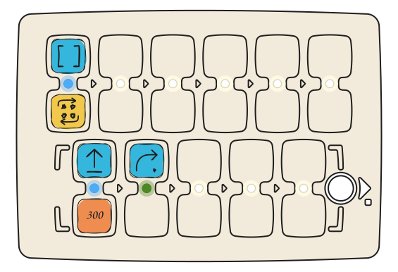
  </Frame>
  <Frame caption="Lo que dibuja el robot">
    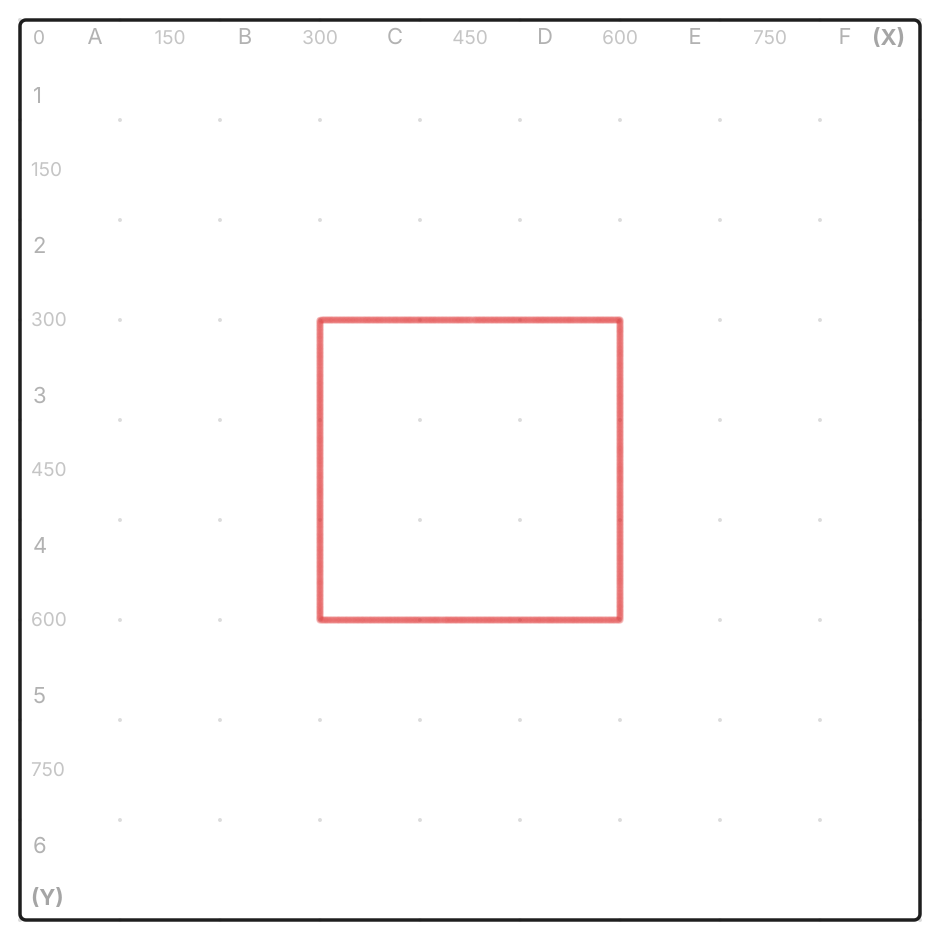
  </Frame>
</Columns>

Con niños de 4 a 6 años no hace falta poner números: Adelante y Derecha sin números dibujan un cuadrado de 15 cm de lado.

### Triángulo equilátero

Tablero: fila superior Función × 3. Fila inferior: Adelante 400, Derecha 120.

```
repeat 3 [forward 400 right 120]
```

[Ejecutar en el simulador](https://simulator.primastem.com/#top=cfun.r003&fn=cfor.n400,crig.n120&s=l1047602&r=250-623-30&run)

<Columns cols={2}>
  <Frame caption="Programa en el tablero">
    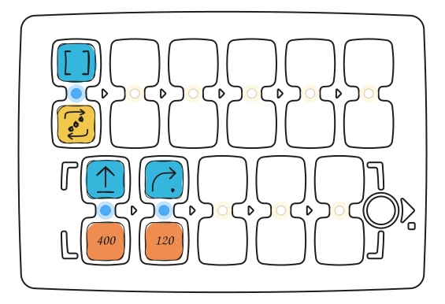
  </Frame>
  <Frame caption="Lo que dibuja el robot">
    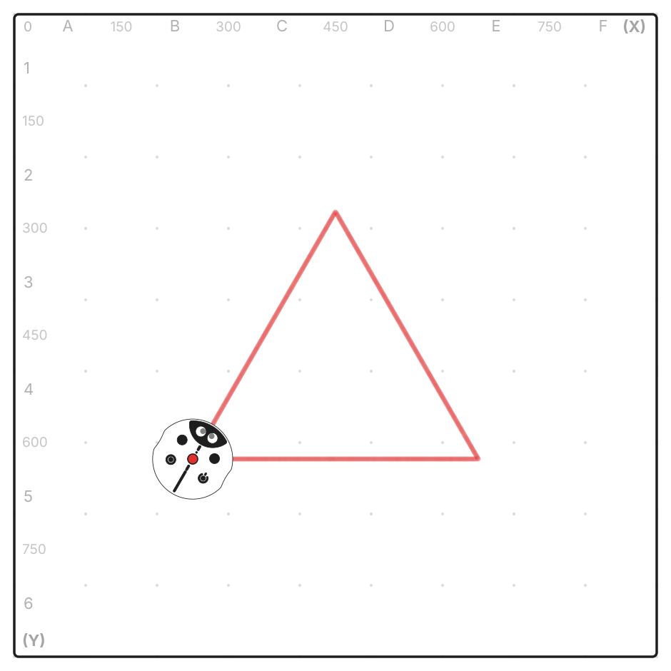
  </Frame>
</Columns>

¿Por qué 120 y no 60? El robot gira el ángulo exterior. Los tres giros juntos deben dar una vuelta completa: 3 × 120 = 360.

### Estrella de cinco puntas

Tablero: fila superior Función × 5. Fila inferior: Adelante 400, Derecha 144.

```
repeat 5 [forward 400 right 144]
```

[Ejecutar en el simulador](https://simulator.primastem.com/#top=cfun.r005&fn=cfor.n400,crig.n144&s=l1047602&r=250-405-90&run)

<Columns cols={2}>
  <Frame caption="Programa en el tablero">
    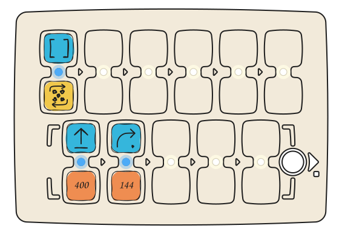
  </Frame>
  <Frame caption="Lo que dibuja el robot">
    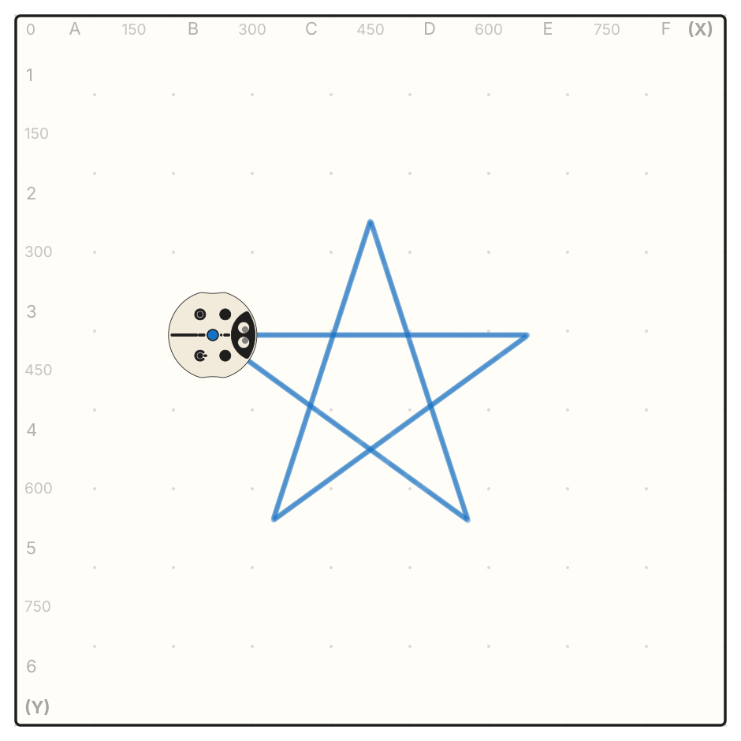
  </Frame>
</Columns>

5 × 144 = 720: el robot da dos vueltas completas, y la línea se cierra en una estrella.

### Círculo

Tablero: fila superior Función × 36. Fila inferior: Adelante 25, Derecha 10.

```
repeat 36 [forward 25 right 10]
```

[Ejecutar en el simulador](https://simulator.primastem.com/#top=cfun.r036&fn=cfor.n025,crig.n010&s=l1047602&r=438-307-90&run)

<Columns cols={2}>
  <Frame caption="Programa en el tablero">
    
  </Frame>
  <Frame caption="Lo que dibuja el robot">
    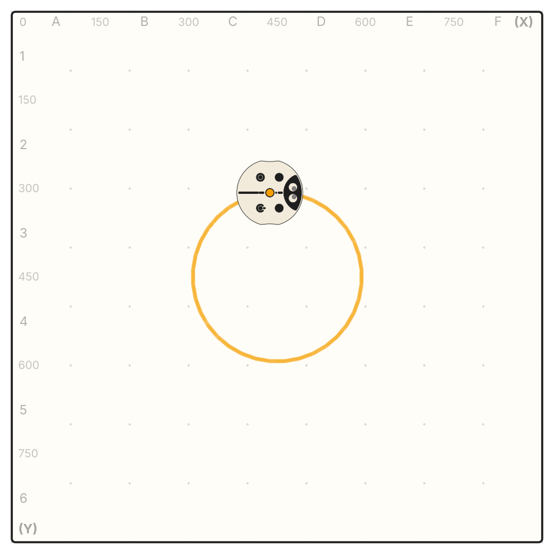
  </Frame>
</Columns>

Un círculo es un polígono con muchos lados cortos: 36 × 10° = 360°.

### Espiral cuadrada (variable y aritmética)

Tablero: fila superior Adelante 30, Función × 20. Fila inferior: Derecha, Adelante +30.

```
make "side 30
forward :side
repeat 20 [
  right 90
  make "side :side + 30
  forward :side
]
```

[Ejecutar en el simulador](https://simulator.primastem.com/#top=cfor.n030,cfun.r020&fn=crig,cfor.a030&s=l1047602&r=450-465-0&run)

<Columns cols={2}>
  <Frame caption="Programa en el tablero">
    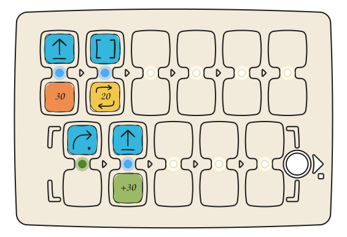
  </Frame>
  <Frame caption="Lo que dibuja el robot">
    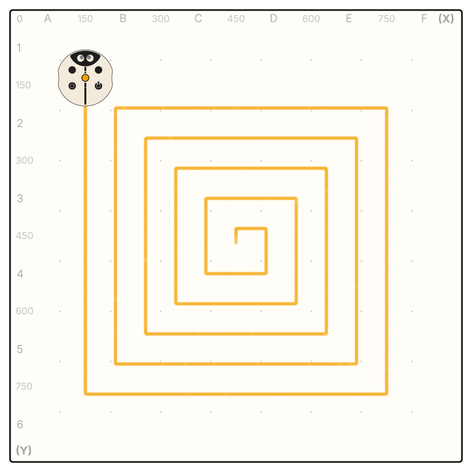
  </Frame>
</Columns>

Adelante 30 fija el valor guardado. Cada vez que se ejecuta la función, «+30» alarga el lado 30 mm: 60, 90, 120 y así sucesivamente. El primer Adelante 30 reinicia el valor, así que si vuelves a pulsar ▶ Inicio, sale la misma espiral.

### Hexágono (ángulo por división)

Tablero: fila superior Derecha 360, Derecha ÷6, Función × 6. Fila inferior: Adelante 200, Derecha.

```
make "angle 360 / 6
repeat 6 [forward 200 right :angle]
```

[Ejecutar en el simulador](https://simulator.primastem.com/#top=crig.n360,crig.d006,cfun.r006&fn=cfor.n200,crig&s=l1047602&r=350-232-39&run)

<Columns cols={2}>
  <Frame caption="Programa en el tablero">
    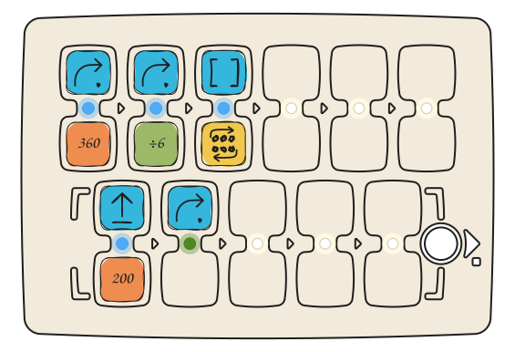
  </Frame>
  <Frame caption="Lo que dibuja el robot">
    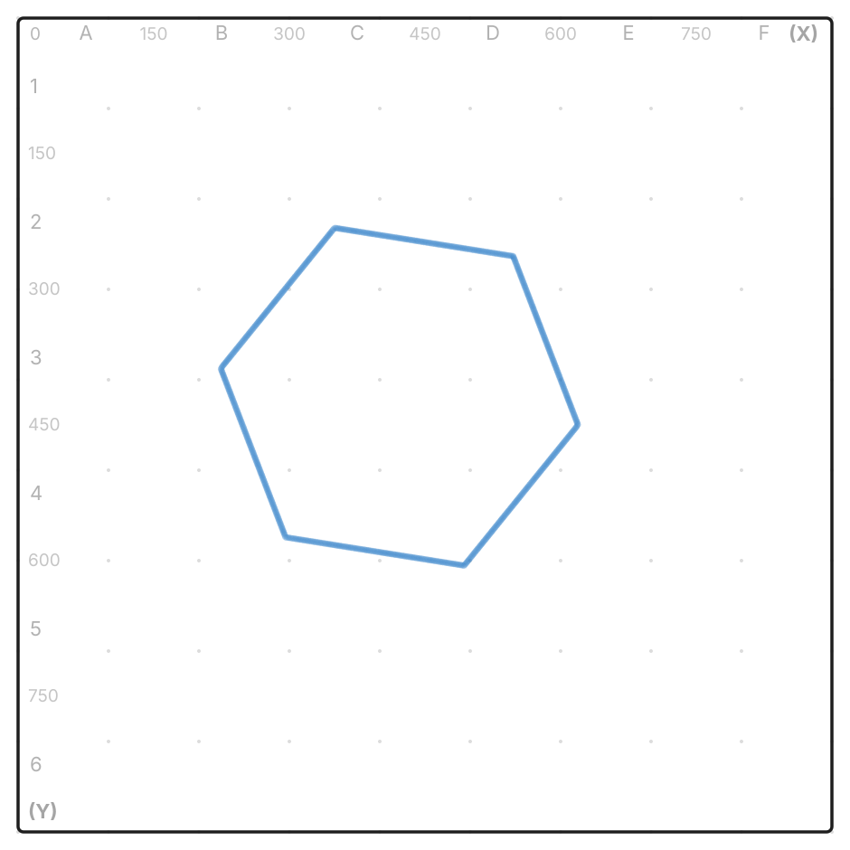
  </Frame>
</Columns>

Derecha 360 da una vuelta completa y guarda 360. Derecha ÷6 divide el valor guardado y gira 60°. En la función, Derecha sin número vuelve a tomar 60°. Los dos giros del principio solo cambian hacia dónde mira el robot antes de dibujar; la figura sigue siendo un hexágono.

El tablero hace la división entera y descarta el resto. Para que la figura se cierre, divide 360 entre un número que no deje resto: 3, 4, 5, 6, 8, 9, 10, 12. Por ejemplo, 360 ÷ 7 da 51°, y al heptágono le faltan 3° para cerrarse.

Más dibujos: [Ejemplos de dibujos](mathdrawings).

## En qué se diferencia PrimaSTEM de LOGO

PrimaSTEM cubre la base de la gráfica tortuga de LOGO. Algunas cosas funcionan de otra manera, y es a propósito:

- **Una pareja, un comando y un valor.** En una pareja de celdas va un comando y como mucho un valor: un número, una repetición o una operación. Por eso hasta un niño de cuatro años puede leer el programa.
- **No hay condiciones (`if`).** El programa se ejecuta siempre igual. Solo el dado y el Movimiento aleatorio añaden azar.
- **La Función no tiene parámetros con nombre.** Se llama con una repetición y toma los valores fijados antes de la llamada (consulta la tabla de arriba).
- **Longitud del programa:** 6 parejas en la fila principal, 5 en la Función.
- **El rotulador se pone a mano** cuando el niño quiere que el robot dibuje.

Cuando el niño se quede pequeño para el tablero, el mismo robot funciona con [Scratch](https://scratch.primastem.com).

## Para leer más

- [Seymour Papert](https://en.wikipedia.org/wiki/Seymour_Papert), *Mindstorms: Children, Computers, and Powerful Ideas*, 1980.
- [Guía del profesor](teachersguide): lecciones desde el primer programa hasta la aritmética.
- [Guía de aprendizaje. Libro 1](book-1/book-1): 12 lecciones para niños a partir de 4 años.
