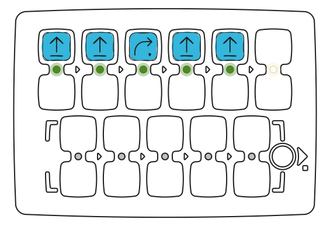

PrimaSTEM enseña a programar a niños de 4 a 12 años sin computadoras, tabletas ni teléfonos. El kit desarrolla la lógica, las habilidades de programación y las matemáticas.

Con PrimaSTEM, la programación se vuelve simple y visual. Incluso los niños pequeños entienden lo que pasa: tocan las fichas con las manos y aprenden jugando los conceptos básicos de programación, lógica y matemáticas.

Jugar con PrimaSTEM desarrolla el pensamiento lógico, la algorítmica, la programación, las matemáticas y la geometría. También desarrolla la creatividad y las habilidades socioemocionales. El kit prepara al niño para los lenguajes de programación por bloques, por ejemplo [Scratch](https://en.wikipedia.org/wiki/Scratch_\(programming_language\)) o [LOGO](https://en.wikipedia.org/wiki/Logo_\(programming_language\)).

## Conociendo el kit educativo

### Dónde se puede usar PrimaSTEM

PrimaSTEM sirve para estas actividades:

- Centros de educación preescolar
- Jardines de infantes que trabajan con el método Montessori
- Escuela primaria
- Educación en el hogar
- Centros de desarrollo especial
- Grupos de tiempo completo
- Clubes de programación para principiantes
- Campamentos educativos para niños

### Qué necesita saber para comenzar

Antes de trabajar con el kit, lea la página [Dispositivo y configuración](/es/usermanual) y esta guía. No necesita saber programar: los materiales contienen todo lo necesario para empezar.

## Investigación y valor del kit

PrimaSTEM está inspirado en el lenguaje de programación [LOGO](https://en.wikipedia.org/wiki/Logo_\(programming_language\)), creado por [Seymour Papert](https://en.wikipedia.org/wiki/Seymour_Papert), y en la pedagogía Montessori. LOGO y el robot tortuga hicieron que la programación fuera visual y accesible para los niños.

Las fichas de comando de PrimaSTEM continúan este enfoque. El niño controla el robot con las manos, sin pantalla ni texto, y ve enseguida lo que hace.

Los niños observan el robot, entienden cada comando y aprenden los algoritmos en la práctica.

El robot tiene una propiedad importante: tiene una dirección. El niño se pone fácilmente en el lugar del robot y por eso entiende más rápido la lógica del programa.

Todos los comandos son simples: le dicen al robot hacia dónde moverse. Cuando los niños enseñan al robot a "actuar" y a "pensar", empiezan a reflexionar sobre sus propias acciones y pensamientos. Por eso la programación les resulta más fácil.

Las fichas de PrimaSTEM muestran de forma visual y simplificada cómo funcionan los lenguajes de programación. Al principio no hay textos ni números, solo comandos básicos.

### Por qué madera

🌱 El tablero y el robot están hechos de madera (contrachapado). A los niños les gusta más jugar con juguetes de madera. Son seguros y duran mucho, y cada uno tiene su propia historia.

## Programar con PrimaSTEM

Las fichas de PrimaSTEM funcionan como las instrucciones de los lenguajes de programación reales. Con ellas se ven conceptos importantes de la programación.

### Algoritmos

Un **algoritmo** está formado por comandos precisos (fichas) que juntos forman un programa.

### Cola

El tablero ejecuta los comandos estrictamente de izquierda a derecha. Así los niños ven que los comandos se ejecutan uno tras otro.

### Corrección de errores (depuración)

Un error es fácil de corregir: basta con cambiar la ficha. Así el niño aprende a encontrar y corregir solo los errores del programa.

### Función

Una función (subrutina) está formada por los comandos de la fila inferior del tablero. El programa principal la llama con la ficha "**Función**".

### Variable

El tablero recuerda el último número de cada comando. Adelante, Atrás, Izquierda, Derecha y Pausa guardan cada uno su propio valor. Un comando sin número usa el valor guardado. Esto es una variable: tiene un nombre (el comando) y un valor (el número), y el valor puede cambiar.

## Aplicación en otras materias

PrimaSTEM también ayuda a desarrollar otras habilidades:

- Comunicación. En el juego en grupo, los niños aprenden a colaborar.
- Habilidades motoras. Trabajar con fichas mejora la coordinación.
- Habilidades sociales. Los niños ganan confianza y aprenden a resolver problemas juntos.
- Matemáticas. Los niños aprenden conceptos matemáticos básicos.
- Lógica. Los niños aprenden a construir secuencias y a predecir el resultado.

> El niño coloca una cadena de fichas y aprende a programar con las manos, los ojos y la cabeza. Pulsa **▶ Inicio**, el robot se mueve, y el niño compara el resultado con lo que esperaba. Esta experiencia acelera el aprendizaje.

## Conociendo el robot y el tablero

### El robot

Dígales a los niños que el robot es su amigo y que pueden programarlo. Explique que no tiene pensamientos propios. Solo ejecuta sus instrucciones, como un electrodoméstico que hay que encender.

### El tablero

Explique que el tablero envía los comandos al robot. Muestre cómo colocar las fichas de comando y programar el robot.

> El programa principal se monta en la fila superior del tablero (6 parejas). La fila inferior (5 parejas) es para la subrutina. El comando "**Función**" la llama.

### Fichas de comando

Las fichas dan comandos al robot. Se colocan en el tablero. Después de pulsar **▶ Inicio**, el robot ejecuta el programa. Cada ficha da un comando. Así los niños aprenden pensamiento computacional y aprenden a escribir programas. Es importante que los niños entiendan qué hace el robot con cada comando. Así podrán planificar el programa y predecir las acciones del robot. Explique a los niños que las fichas no deben perderse ni dañarse: sin ellas el robot no puede moverse.

## 1. Primer programa

### Causa y efecto

El objetivo principal: mostrar a los niños la relación entre un comando y una acción. Deje que el niño coloque la ficha "Adelante" en la primera celda del tablero y pulse **▶ Inicio**. El niño debe ver que la ficha y la acción están relacionadas.

### Instrucciones inequívocas

Repita esto con cada dirección (**adelante**, girar **izquierda**, girar **derecha**) hasta que el niño reconozca cada ficha.

### Primera tarea

Extienda el tablero de juego o haga una cuadrícula de casillas de 15 × 15 cm con cinta adhesiva o un marcador. Coloque el robot en la casilla de inicio. Pida al niño que escriba un programa para que el robot avance una casilla. Si el niño eligió la ficha equivocada, devuelva el robot y propóngale pensar en otra opción.

## 2. Programa y depuración

### Cola de eventos

Coloque un objetivo dos casillas delante del robot.

Deje que el niño escriba un programa de dos fichas para que el robot llegue al objetivo.

### Secuencia de tres fichas

Ahora el objetivo está una casilla adelante y una casilla a la derecha.

Deje que el niño elija por sí mismo el orden correcto de los comandos.

No se preocupe si el niño eligió la ficha equivocada. Devuelva el robot al inicio y pida al niño que piense en su elección y pruebe otras opciones.

### Depuración: encontrar el error

Coloque el objetivo una casilla delante del robot y una casilla a su izquierda.

Esta vez escriba usted el programa y ponga a propósito un giro incorrecto.

Pida al niño que encuentre el comando incorrecto y prediga adónde irá el robot. Después deje que el niño pulse **▶ Inicio** y compruebe su idea.

Cuando el niño esté seguro de que el programa está mal, por razonamiento o por prueba, deje que cambie el comando incorrecto por el correcto. Así depura el programa.

## 3. Programa con función

### Comando "Función"

Cuando los niños conozcan los comandos básicos, muestre la ficha de comando **Función**. Llama a un conjunto de comandos que el programa principal puede repetir.

> Para explicar cómo funciona, compare la función con una torre: debajo de la ficha de función hay otros comandos apilados uno tras otro. Así los niños ven que una sola ficha puede contener varias instrucciones.

Muestre un ejemplo. Primero coloque dos fichas "Adelante" en las celdas superiores y ejecute el programa. El robot avanza dos casillas.

Ahora coloque las mismas dos fichas "Adelante" en la función (fila inferior) y coloque "Función" en el programa principal. El resultado es el mismo, pero ahora parte del programa está oculta en una subrutina.

Luego monte la secuencia: **Adelante, Adelante, Derecha, Adelante, Adelante**.

Pida a los niños que encuentren las partes que se repiten y las "oculten" en la función. El resultado debe ser: en el programa principal **Función, Derecha, Función**, en la fila inferior **Adelante, Adelante**.

[Ejecutar en el simulador](https://simulator.primastem.com/#top=cfun,crig,cfun&fn=cfor,cfor&s=l1144602&r=225-825-0&run)

### Resolver tareas con función

Dé al niño 3 fichas "**Adelante**" y 2 fichas "**Función**".

La tarea: avanzar 5 casillas.

Deje que el niño entienda que para esta tarea necesita una función que repita la acción.

Si el programa está mal, devuelva el robot al inicio. Pida al niño que piense cómo resolver bien la tarea y pruebe otras opciones.

[Ejecutar en el simulador](https://simulator.primastem.com/#top=cfun,cfun,cfor&fn=cfor,cfor&s=l1144602&r=225-825-0&run)

## 4. Aleatoriedad

### Comando "Movimiento aleatorio"

Para explicar el azar, tome 4 fichas de dirección: "**Adelante**", "**Izquierda**", "**Derecha**" y "**Atrás**". Póngalas en una caja opaca o una bolsa y mézclelas. Por turnos, cada niño saca una ficha sin mirar, la muestra al grupo y la devuelve. Con este ejemplo, explique qué es una elección al azar entre cuatro opciones.

Luego muestre a los niños la ficha de comando "**Movimiento aleatorio**".

Explique que esta ficha hace casi lo mismo que los niños hicieron con la bolsa. Elige una dirección al azar y mueve el robot un paso, es decir, una casilla. El robot puede moverse una casilla hacia adelante, a la derecha, a la izquierda o hacia atrás.

Coloque la ficha "**Movimiento aleatorio**" en la celda superior y ejecute el programa varias veces. El robot se mueve de forma diferente cada vez.

[Ejecutar en el simulador](https://simulator.primastem.com/#top=crnd&s=l1144602&r=375-525-0&run)

Juegue con los niños: antes de cada ejecución, que adivinen hacia dónde irá el robot.

Subraye que esto es **aleatoriedad** y que no se puede adivinar la dirección cada vez.

Invente con los niños un pequeño juego con la ficha "**Movimiento aleatorio**".

## 5. Bucles (repeticiones de comandos)

### Conociendo los bucles numéricos

Muestre a los niños las fichas de repetición. Pregunte si conocen los números, si han visto un dado y si han jugado a juegos de mesa.

Coloque dos fichas "Adelante" en las celdas superiores y ejecute el programa. El robot avanza dos casillas.

Ahora deje una sola "Adelante" y coloque debajo la ficha "Repetir 2". El resultado es el mismo: la acción se repite dos veces.

Coloque 4 fichas "**Adelante**" y observe el resultado. Luego pida a los niños que repitan este movimiento de 4 casillas con una ficha de **repetición**.

La tarea se puede resolver de varias maneras. La forma sencilla: "**Adelante**" y "Repetir 4". Otra forma: "**Adelante**" con "Repetir 3" y otra "**Adelante**".

[Ejecutar en el simulador](https://simulator.primastem.com/#top=cfor.r003,cfor&s=l1144602&r=225-825-0&run)

### Repetir una función

Intente con los niños añadir una repetición al comando "Función". Por ejemplo, el robot puede ir en zigzag: en la fila superior "Función" con "Repetir 5", en la fila inferior "**Adelante**", "**Derecha**", "**Adelante**", "**Izquierda**".

Primero monte en la función el programa "escalón": "Adelante", "Derecha", "Adelante", "Izquierda". Ejecútelo.

Luego añada "Repetir 5" a la función. La función se repite 5 veces, y el robot avanza en escalones hacia la derecha y hacia arriba.

[Ejecutar en el simulador](https://simulator.primastem.com/#top=cfun.r005&fn=cfor,crig,cfor,clef&s=l1144602&r=75-825-0&run)

El robot sube en escalera en diagonal hacia la derecha y hacia arriba y hace 5 escalones.

## 6. Números aleatorios

### Qué es un número aleatorio

Entre las fichas está "Repetir un número aleatorio de veces" (con un dado). Elige un número al azar del 1 al 6. Juegue con los niños: que saquen fichas de repetición de una bolsa.

Para explicar el número aleatorio, tome 4 fichas de repetición: "**2**", "**3**", "**4**" y "**5**". Póngalas en una caja opaca o una bolsa y mézclelas. Por turnos, cada niño saca una ficha sin mirar, la muestra, dice el número y la devuelve. Jueguen a ver quién saca el número más alto. Con este ejemplo, explique qué es una elección al azar entre cuatro opciones.

Luego muestre a los niños la ficha "**Repetir un número aleatorio de veces**". Explique que hace casi lo mismo que los niños hicieron con la bolsa. Como un dado, elige al azar un número del 1 al 6, y el robot repite la acción ese número de veces.

Coloque la ficha "**Adelante**" en la celda superior del tablero, y la ficha "**Repetir un número aleatorio de veces**" debajo. Pida a los niños que pulsen **▶ Inicio**. Devuelva el robot a su lugar. Repita varias veces.

[Ejecutar en el simulador](https://simulator.primastem.com/#top=cfor.rrnd&s=l1144702&r=225-975-0&run)

Jueguen: qué robot llega más lejos.

Haga notar a los niños que el robot avanza un número aleatorio de casillas, del 1 al 6. Subraye que esto es azar y que no se puede saber de antemano hasta dónde llegará el robot.

## 7. Números: distancias y ángulos

### Conociendo los números

Si la segunda celda de la pareja no tiene número, el robot usa los valores predeterminados: avanza 15 cm y gira 90°. Las fichas de número cambian estos valores.

Ejemplo. Añada el número **200** al comando "**Adelante**" y observe hasta dónde llega el robot. Añada el número **180** a un giro y observe qué cambia.

[Ejecutar en el simulador](https://simulator.primastem.com/#top=cfor.n200,crig.n180&s=l1047602&r=450-600-0&run)

> **Importante.** El tablero recuerda el último número de los comandos de movimiento y giro. Si un comando no tiene un número nuevo, usa el guardado hasta que se apague el tablero. Un número nuevo sustituye al guardado. La longitud de paso fijada con la ficha «Paso predeterminado» se guarda en la memoria y se mantiene tras reiniciar. Para volver a 15 cm, use esa ficha con el número 150. El giro de 90° vuelve solo tras reiniciar.

Con distintos números, el robot hace recorridos más complejos. Vea ejemplos en la página [Ejemplos de dibujos](/es/mathdrawings).

## 8. Aritmética

### Operaciones aritméticas

La aritmética cambia los números del programa para los comandos de movimiento (Adelante, Atrás, Izquierda, Derecha). Así el robot se controla de forma más flexible.

Cuando una pareja tiene una ficha de aritmética, el tablero cambia el número guardado del comando y envía el nuevo valor al robot.

Ejemplo:

[Ejecutar en el simulador](https://simulator.primastem.com/#top=cfor.n200,crig,cfor.a100&s=l1047602&r=300-700-0&run)

"Adelante 200": el robot avanza 20 cm. "Adelante +100": el robot avanza otros 30 cm. En total, 50 cm.

### Tarea: una espiral que crece

La aritmética cambia el número guardado, es decir, la variable. Monte el programa: en la fila superior Adelante 30 y Función × 20, en la inferior Derecha y Adelante +30. Cada vez que se llama a la función, el lado crece 3 cm.

Pida a los niños que primero adivinen: ¿cuánto medirá el quinto lado? Después ejecute el programa y compruébelo. Respuesta: 15 cm (3 + 3 + 3 + 3 + 3).

[Ejecutar en el simulador](https://simulator.primastem.com/#top=cfor.n030,cfun.r020&fn=crig,cfor.a030&s=l1047602&r=450-465-0&run)

<Columns cols={2}>
  <Frame caption="Programa en el tablero">
    
  </Frame>
  <Frame caption="Lo que dibuja el robot">
    
  </Frame>
</Columns>

El mismo programa en LOGO: [PrimaSTEM y LOGO](/es/logo).

La aritmética en un bucle da progresiones.

> Si el número se vuelve negativo después de una operación, el robot hace la acción opuesta: retrocede en lugar de avanzar y gira a la derecha en lugar de a la izquierda.

Están disponibles la suma (+), la resta (−), la multiplicación (\*), la división (/), la raíz cuadrada (√) y la exponenciación (^).

Hay ejemplos de patrones en la página [Ejemplos de dibujos](/es/mathdrawings).

---

## Juega y aprende con los niños

Usted conoce a sus estudiantes mejor que nadie. Con PrimaSTEM puede enseñar programación, lógica y otras materias jugando. Todo depende de su imaginación.

Gracias por elegir PrimaSTEM. [Escríbanos](/es/contacts) sobre su experiencia e impresiones, esperamos sus comentarios.
