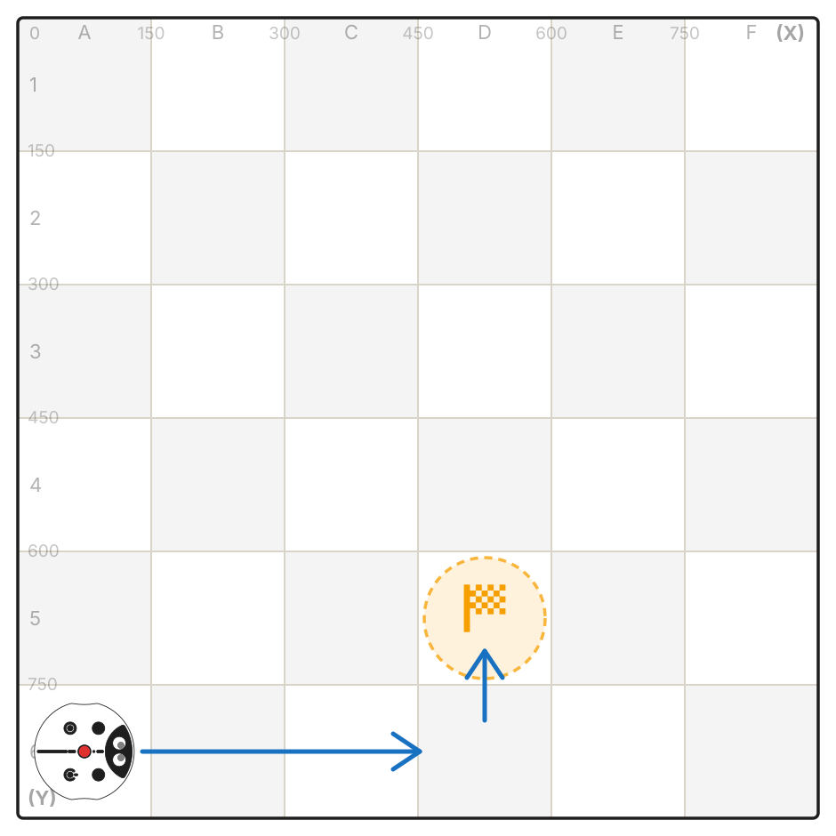
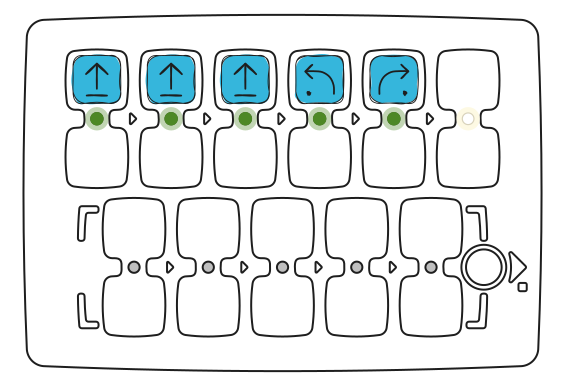
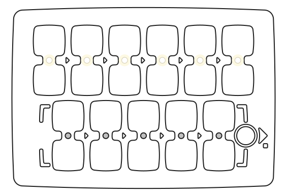
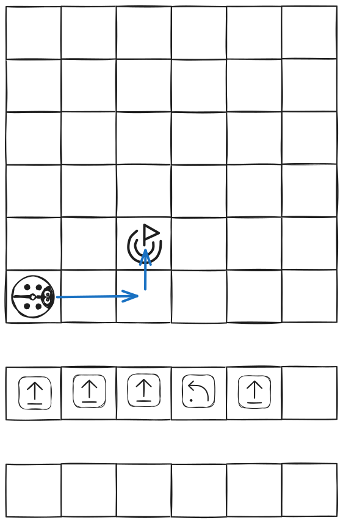
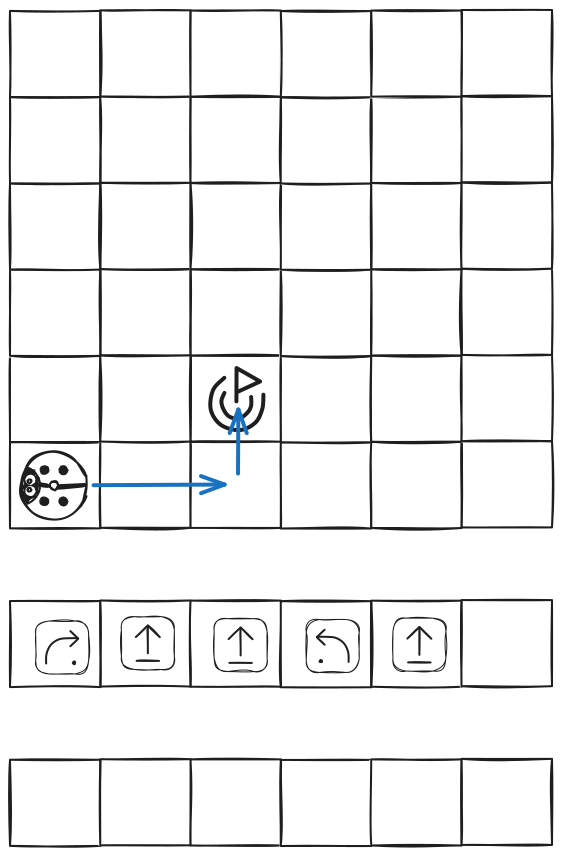

Une erreur a été commise dans chacun de ces programmes. Essayez de la trouver et de la corriger.

---
## Programme 1

<Columns cols={2}>
  <Frame>
    
  </Frame>
  <Frame>
    

      
      
    

  </Frame>
</Columns>

---
## Programme 2

---
## Programme 3

