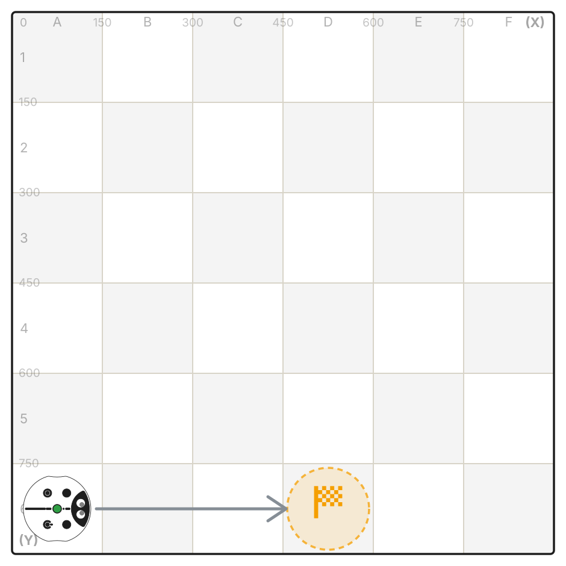
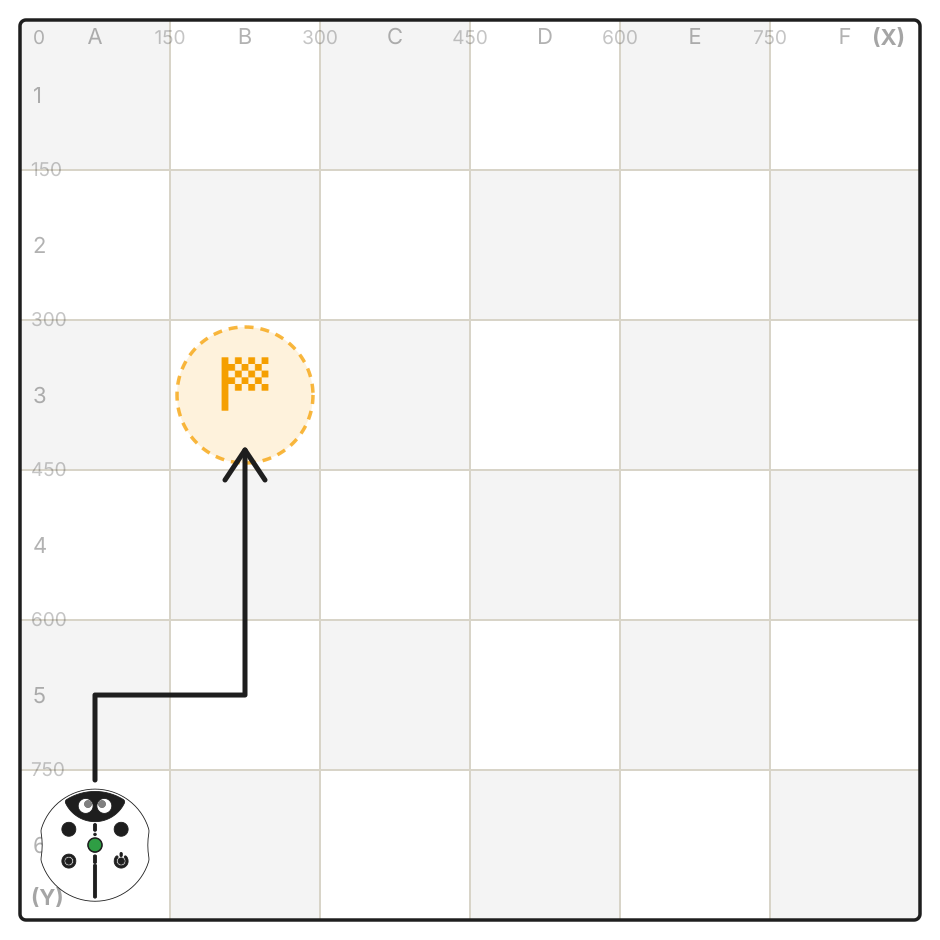

## Guide pour mener des séances avec des enfants à partir de 4 ans

PrimaSTEM aide les enfants à maîtriser étape par étape la pensée logique, les bases de la programmation et des mathématiques. Ce guide vous aidera à mener des séances avec des enfants à partir de 4 ans.

### Comment ça marche

Les enfants programment les mouvements d'un petit robot coccinelle. Pour cela, ils posent des jetons de commande sur le tableau de contrôle.

- **« Avancer »** : le robot va tout droit.
- **« Gauche »** : le robot tourne à gauche.
- **« Droite »** : le robot tourne à droite.
- **« Fonction »** (jeton « [ ] ») : remplace une séquence de commandes.
- **« Répétition »** : répète une commande ou une fonction plusieurs fois.

Vous posez les jetons sur le tableau de contrôle et vous créez ainsi le programme du robot. Quand le programme est prêt, appuyez sur le bouton, et le robot exécute les commandes.

### Sommaire du guide

- Pourquoi mener des séances de robotique et de programmation
- Comment organiser les séances dans différents contextes
- Activités et objectifs d'apprentissage
- Instructions d'utilisation détaillées
- Description des activités
- Annexes
- À propos du projet et des auteurs

### Ce que PrimaSTEM apprend

- Programmer avec les mains, sans écran
- Comprendre que les machines fonctionnent selon des algorithmes
- Planifier ses actions à l'avance
- Raisonner de façon logique
- Construire des séquences de commandes et des fonctions
- Comprendre ce qu'est un « bug » (une erreur dans le code) et trouver les erreurs
- Étudier les nombres, l'arithmétique et la géométrie de façon visuelle

## De quoi se compose PrimaSTEM

### Contenu de la boîte

- Robot coccinelle
- Tableau de contrôle
- Jetons de commande *
- Guide d'activités *

(*) La composition dépend de la configuration.

## Pourquoi mener des séances de programmation et de mathématiques

Le code, la programmation et l'automatisation font désormais partie de notre vie quotidienne.

Ces dernières années, l'homme a appris à créer des machines qui font ce que les machines ne savaient pas faire avant : comprendre, parler, entendre, voir, répondre, écrire.

Les exemples sont nombreux : voitures autonomes, robots assistants pour les personnes âgées, robots livreurs et autres.

### Pourquoi apprendre la programmation et la robotique

Quand un enfant apprend à programmer, il apprend à comprendre les machines qui nous entourent. Il apprend à transformer de petites et de grandes idées en vrais projets. Il décompose une tâche complexe en étapes simples. Il travaille avec les autres et résout des problèmes communs.

### Nés à l'ère numérique

On peut croire que les enfants et les adolescents maîtrisent bien les technologies. Ils utilisent beaucoup les loisirs numériques.

Mais savent-ils utiliser ces outils pour créer quelque chose de personnel et s'exprimer ? Que font-ils quand ils rencontrent un problème technique ?

## Comment organiser les séances

Les activités conviennent à différents objectifs et contextes éducatifs. Toutes les activités du guide sont numérotées. Ci-dessous, vous voyez quelles activités conviennent à votre contexte.

### Pour qui

- Enfants de 4 à 8 ans.
- Grandes sections de maternelle, CP et CE1 d'école primaire.

### Activités pour le périscolaire

Activités 1, 2, 4, 5, 6, 7, 8, 9, 10.

### Activités pour l'école

Activités 2, 3, 4, 5, 6, 7, 8, 9, 11, 12.

### Travail en périscolaire

Dans un groupe, il vaut mieux avoir 12 enfants au maximum, pour que chacun puisse participer activement.

Nous recommandons un appareil pour 2–3 élèves. Ainsi, les enfants apprennent à travailler en équipe et à communiquer.

### Travail à l'école

En classe, il vaut mieux travailler avec PrimaSTEM en petits groupes de 4–6 enfants avec un enseignant.
Pendant ce temps, les autres élèves font une autre tâche avec un assistant d'éducation. Les élèves de CP-CE1 peuvent, par exemple, s'entraîner à dessiner le chemin du robot selon le programme.
Dans les deux cas, il vaut mieux travailler dans une salle polyvalente, directement au sol. Vous pouvez aussi déplacer les tables et les chaises pour libérer de l'espace.

**Attention.** Chargez à l'avance les batteries du tableau de contrôle et du robot.

## Activités et objectifs d'apprentissage

| Activité | Algorithme et programme | Itinéraire par étapes | Prévoir le déplacement | Résoudre un problème, trouver une erreur | Travail en équipe |
| --- | :---: | :---: | :---: | :---: | :---: |
| 1 |   | X |   | X |   |
| 2 |   |   | X |   | X |
| 3 | X | X |   |   |   |
| 4 | X | X | X |   |   |
| 5 | X | X | X |   | X |
| 6 | X | X | X | X | X |
| 7 | X | X | X | X | X |
| 8 | X |   | X | X |   |
| 9 | X | X | X | X | X |
| 10 | X |   | X | X |   |
| 11 | X | X | X | X | X |
| 12 | X | X | X | X | X |

## Instructions d'utilisation

### Sommaire des instructions

- Découverte du matériel
- Programmation d'une fonction
- Cartes
- Explications techniques

## Découverte du matériel

### Le robot

Un petit robot coccinelle en bois avec deux yeux.

Il possède trois points d'appui : deux roues et un support à l'arrière. Ils lui permettent de garder l'équilibre.

### Commandes de base

| Commande | Dessin                              | Description                                                                                     |
| ------- | ----------------------------------- | -------------------------------------------------------------------------------------------- |
| Avancer |   | Le robot avance d'une case. C'est un pas logique, de 15 cm par défaut. |
| Gauche |      | Le robot tourne de 90° à gauche                                                           |
| Droite |     | Le robot tourne de 90° à droite                                                          |
| Reculer |      | Le robot recule d'une case, c'est-à-dire d'un pas logique par défaut                                |
| Fonction |  | Le robot exécute les commandes de la rangée de la fonction                    |
| Répéter N |   | Le robot répète N fois la commande de la même paire |

### Tableau de contrôle

Sur le tableau de contrôle, vous commandez le robot : vous posez les jetons de commande dans les cellules libres (D).

La rangée du haut (A), faite de 6 paires de cellules reliées par une ligne d'exécution (E), est le programme principal. Le programme commence à la cellule de gauche (D) et se termine au-dessus du bouton **▶ Démarrer** (B). Ce bouton envoie les commandes au robot et lance le programme.

La rangée du bas (C), faite de 5 paires de cellules, définit les mouvements du jeton « Fonction » (« [ ] »). Chaque paire a une LED (F). Elle s'allume quand vous posez un jeton et clignote quand le robot exécute cette commande.

#### Couleurs des LED

Si un jeton est bien placé dans une cellule, la LED est verte.
Si vous ajoutez une répétition à une commande de mouvement dans la même paire, la LED est bleue.
Si les jetons sont mal placés, par exemple deux commandes de mouvement dans une paire, la LED est rouge. Le robot ignore cette commande.

### Batterie et bouton de mise en marche

Le robot et le tableau de contrôle fonctionnent avec des batteries intégrées. Vous les chargez par un port USB-C. Le bouton de mise en marche (ON/OFF) se trouve sur le dessus du robot et sur le devant du tableau de contrôle, à gauche.

Quand le robot ou le tableau de contrôle s'allume, un court signal retentit.
Quand le tableau de contrôle est allumé, la LED du panneau avant est verte. Quand le robot est allumé, la LED près du connecteur USB-C est verte.

### Communication sans fil

Le robot et le tableau de contrôle sont reliés par Bluetooth, avec une portée d'environ 5 m. Après la première connexion du robot au tableau de contrôle, la liaison fonctionne toute seule. Vous n'avez rien à régler.

> Vous pouvez appairer le tableau de contrôle avec un autre robot.
> 1. Allumez un robot qui n'est pas encore appairé au tableau de contrôle.
> 2. Allumez le tableau de contrôle.
> 3. Maintenez le bouton **▶ Démarrer** du tableau de contrôle enfoncé pendant 10 secondes, jusqu'au signal sonore et lumineux.

### Comment créer et lancer un programme

Le programme (la « séquence de mouvements ») commence à gauche sur le tableau de contrôle. Il suit les flèches gravées « > ». C'est la ligne d'exécution, elle relie les paires de cellules à l'horizontale.

S'il y a une cellule vide avant un jeton, le robot saute la cellule vide et exécute la commande de ce jeton.

Si un jeton est mal placé, la LED est rouge et le robot ignore cette partie du programme. Cela arrive, par exemple, quand « Répétition » se trouve dans une paire sans commande, ou quand deux jetons de commande se trouvent dans une paire.

Quand le programme est prêt, appuyez sur le bouton **▶ Démarrer**.

Pendant que le robot exécute le programme, les LED du tableau de contrôle s'éteignent une à une. La LED de la commande en cours clignote.

## Programmation d'une fonction

### Comment créer une fonction

Le jeton « Fonction » (« [ ] ») remplace une séquence de commandes.

Avec lui, vous pouvez construire des programmes plus longs et résoudre des tâches plus difficiles. Pour créer une fonction, posez les mouvements dans la rangée du bas du tableau de contrôle : ce sont 5 paires de cellules. Le robot exécute cette rangée de gauche à droite chaque fois qu'il rencontre un jeton « Fonction » dans le programme principal (en haut).

Dans l'exemple ci-dessous, la fonction se compose d'un mouvement tout droit et d'un virage à droite. Le programme principal appelle la fonction 2 fois. Ensuite, le jeton « Répéter 2 » répète la fonction encore 2 fois.

[Lancer dans le simulateur](https://simulator.primastem.com/#top=cfun,cfun,cfun.r002&fn=cfor,crig&s=l1144602&r=225-675-0&run)

Ce que vous obtenez :

## Cartes

### Quelles cartes choisir

Pendant les premières séances, les enfants apprennent les algorithmes, la programmation et les nombres. Pour cela, le robot se déplace sur une carte quadrillée. Le mieux est de prendre une carte avec des cases de 15 cm : c'est la distance que le robot parcourt en un pas par défaut.

Les cartes faites pour d'autres robots conviennent aussi, si la taille des cases convient à ce robot.

> Vous pouvez changer le pas par défaut de 15 cm pour la taille des cases de votre carte, par exemple 10 cm, 12,5 cm ou 20 cm. Pour cela, posez le jeton de service « Pas par défaut » avec un nombre en millimètres : 100 pour 10 cm, 125 pour 12,5 cm, 200 pour 20 cm.

Si vous n'avez pas de carte, fabriquez-en une vous-même. Collez du ruban adhésif en papier fin sur une table ou un sol plat. Vous pouvez aussi prendre une feuille de papier Whatman (ou un tissu de bannière épais) et un marqueur.

Une carte en damier ou une carte vierge quadrillée sert à s'entraîner à aller d'un point à un autre. Les couleurs ne distraient pas.

Une carte en couleur aide à raconter de courtes histoires sur les voyages du robot. Par exemple : « La coccinelle sort de sa maison et va à la montagne en traversant la forêt ». La classe peut créer une nouvelle carte et inventer de nouvelles histoires sur les voyages de la coccinelle.

#### Exemples de cartes

Carte en damier

Carte en couleur

## Explications techniques

### Comment c'est fait

Le tableau de contrôle et le robot contiennent des microcontrôleurs et des batteries Li-Ion. Les appareils sont reliés par radio, avec le protocole standard Bluetooth.

La carte électronique du robot pilote tout son comportement. Elle pilote deux moteurs à courant continu 5V et deux LED multicolores, reproduit des sons, communique avec le tableau de contrôle, etc.

La carte électronique du tableau de contrôle reconnaît les jetons dans les cellules, reproduit des sons et pilote 11 LED multicolores, une pour chaque paire de cellules.

Chaque jeton contient un autocollant NFC avec le code d'une commande. Le tableau de contrôle lit ce code quand vous posez le jeton dans une cellule.

Quand le tableau de contrôle a reconnu les jetons et que vous lancez le programme, il envoie les commandes au robot par liaison sans fil.

### Vos propres jetons de commande

Vous pouvez fabriquer des jetons de commande supplémentaires, par exemple « Répéter 12 » ou d'autres jetons de mouvement. Pour cela, il faut des jetons « vierges » avec des autocollants NFC et un téléphone compatible NFC. La plupart des types d'autocollants à 13,56 MHz conviennent.

Une vidéo d'instructions est disponible sur notre chaîne YouTube : https://www.youtube.com/@primastem

---

## Activités

### Description détaillée des activités

- **Activité 1** : chemin sur un damier d'un point A à un point B
- **Activité 2** : découverte de PrimaSTEM
- **Activité 3** : un enfant joue le robot, orientation et algorithme
- **Activité 4** : prévoir le chemin du robot selon le programme
- **Activité 5** : séquences de commandes dans un programme aléatoire
- **Activité 6** : amener le robot à la montagne avec le tableau de contrôle
- **Activité 7** : découverte du jeton « Fonction »
- **Activité 8** : itinéraire vers l'objectif avec une fonction
- **Activité 9** : débogage d'un programme avec une erreur
- **Activité 10** : trouver une erreur dans un programme sur papier
- **Activités 11 et 12** : prévoir les mouvements du robot (dans l'activité 12 avec le jeton « Fonction »)

---

## Activité 1. Chemin sur un damier d'un point A à un point B

- **individuel**
- **15 min**
- **sur papier**
- **documents à imprimer**

### Objectif

- Planifier un chemin par cases d'un point A à un point B sur une carte.

L'exercice dure 10 minutes, mise en commun comprise.

### À imprimer

Imprimez pour chaque élève la fiche « [Annexe 1. Se déplacer sur la carte](/fr/book-1/attachment-1) ».

### Exercice

Les enfants tracent sur la grille le chemin par lequel la souris atteint le fromage. Commencez par l'exercice de gauche, il est plus simple. Passez ensuite à celui de droite.

#### Déplacement par cases

La souris se déplace par les cases de la grille. Elle ne peut pas aller en diagonale. Les enfants doivent comprendre que le chemin de la souris est divisé en étapes : elle avance d'une case à la fois. On avance ainsi pas à pas.

Dans l'exemple ci-dessus, seul le chemin bleu est correct. Le court chemin rouge est erroné, parce qu'il passe par une diagonale. Le long chemin rouge est erroné, parce qu'il ne mène pas au bon point.

### Discussion en groupe

Dans l'exemple ci-dessus, tous les chemins sont corrects : par chacun, la souris atteint le fromage.

Montrez aux enfants que chacun a pu imaginer un chemin différent, et qu'il existe plusieurs chemins corrects.

#### Certains chemins sont plus longs que d'autres

Comptez combien de cases la souris parcourt jusqu'à la case avec le fromage :
- 3 cases sur l'itinéraire vert
- 3 cases sur l'itinéraire gris
- 3 cases sur l'itinéraire bleu
- 13 cases sur l'itinéraire jaune

#### Le chemin le plus court

Tous ces chemins sont corrects, mais la souris choisira le plus court.

Demandez aux enfants : « Pourquoi la souris a-t-elle choisi le chemin le plus court ? »

Les réponses peuvent varier. La souris veut garder ses forces : elle est très fatiguée et veut marcher le moins possible. Ou la souris est pressée : elle a très faim et veut atteindre le fromage au plus vite.

**Note pour l'animateur.** C'est pareil avec les robots. Nous choisissons toujours le chemin le plus court, parce qu'il est plus efficace.

#### Plusieurs chemins sont possibles

Quand l'exercice est terminé, demandez aux élèves de montrer leurs chemins. Il y a toujours plusieurs chemins, donc les élèves proposeront sans doute des réponses différentes, et toutes seront correctes.

---

## Activité 2. Découverte de PrimaSTEM

- **15 min**
- **en groupe**
- **démonstration**
- **pratique**

### Objectifs

- Comprendre comment le robot peut se déplacer.
- Apprendre que le tableau de contrôle commande le robot.
- Comprendre ce que font les jetons de commande.

Répartissez les élèves en petits groupes. Asseyez-vous autour d'une table basse ou au sol. Sortez la carte quadrillée, le tableau de contrôle, le robot et les jetons. Présentez PrimaSTEM à tous les élèves, groupe après groupe.

### Présentation

Montrez chaque objet sur la table et dites les mots dont les enfants auront besoin.

D'abord la **carte**. C'est la même grille que dans l'activité 1, mais en plus grand.

Puis le **robot coccinelle**. Il sait rouler.

Le robot est commandé par le **tableau de contrôle**. Il fait ce que disent les jetons posés dans les cellules du tableau de contrôle.

Les **jetons** donnent des commandes : aller tout droit, tourner à gauche ou à droite.

### 1ère étape : démonstration

Quand les enfants connaissent les mots, montrez tout vous-même. Posez un jeton sur le tableau de contrôle, et les enfants verront ce qui se passe.

| Image                                              | Description                                                                    |
| -------------------------------------------------- | --------------------------------------------------------------------------- |
|  | Le jeton **« Avancer »** fait avancer le robot d'une case |

Posez le robot sur une case quelconque de la carte. Placez un jeton dans la première cellule du programme, comme sur le schéma ci-dessous. Puis appuyez sur le bouton blanc **▶ Démarrer**.

Le robot avance d'une case.

### 2ème étape : passez les commandes

| Image                                           | Description                                                                                                                                                                                |
| ----------------------------------------------- | --------------------------------------------------------------------------------------------------------------------------------------------------------------------------------------- |
|  | Le jeton **« Gauche »**, avec une flèche en arc de cercle, fait tourner le robot à gauche, dans le sens inverse des aiguilles d'une montre. Par défaut, la rotation est de 90 degrés. |

Retirez le jeton « Avancer » du tableau de contrôle et donnez à l'enfant le jeton « Gauche ». Qu'il le place lui-même dans la première cellule du programme et appuie sur le bouton blanc **▶ Démarrer**. Le robot reste sur place et fait un quart de tour à gauche.

| Image                                            | Description                                                     |
| ------------------------------------------------ | ------------------------------------------------------------ |
|  | Le jeton **« Droite »** fait tourner le robot à droite. |

Demandez à un autre enfant de remplacer le jeton « Gauche » par le jeton « Droite » et d'appuyer sur le bouton blanc **▶ Démarrer**. Le robot reste sur place et fait un quart de tour à droite.

Ensuite, les enfants travaillent à tour de rôle sur le tableau de contrôle. Ne leur donnez que 3 jetons : **« Avancer »**, **« Gauche »** et **« Droite »**.

Quand le robot a fini son mouvement, les enfants peuvent appuyer encore une fois sur **▶ Démarrer** et répéter leur programme.

Laissez les enfants vérifier eux-mêmes qu'ils peuvent poser les jetons dans n'importe quelles cellules, sauf deux commandes dans une paire. Le robot les exécute l'un après l'autre, de gauche à droite.

> Pour arrêter le programme, appuyez encore une fois sur **▶ Démarrer / Arrêter** pendant que le robot roule.

---

## Activité 3. L'enfant joue le robot : orientation et algorithme

- **45 min**
- **en groupe**
- **jeu**
- **carte**

### Objectifs

- Tenir compte de la direction où regarde le robot au début du programme.
- Prévoir les mouvements du robot selon le programme.

### À imprimer

Imprimez pour chaque élève les fiches « [Annexe 2. Cartes de missions](/fr/book-1/attachment-2) ».

### Principe du jeu

C'est un jeu de rôle dans un espace libre. Les enfants jouent le robot sur un terrain noir et blanc.

### Règles du jeu

Un élève joue le robot sur la carte. À la place de la carte, vous pouvez prendre un sol avec un motif carré : un dessin, du carrelage ou des carrés de ruban adhésif fin. Les autres élèves le programment avec des cartes de missions.

On ne dit pas aux enfants où regarde l'enfant-robot.
Ils déterminent eux-mêmes où il doit regarder pour accomplir la mission.

1. L'enfant-robot se place sur la case rouge 1. Il doit atteindre la case verte 2.
2. L'enfant-robot se place sur la case rouge 1. Il doit atteindre la case violette 3.
3. L'enfant-robot se place sur la case rouge 1. Il doit atteindre la case bleue 4.

> Pour que la carte dure plus longtemps, demandez à l'enfant de retirer ses chaussures.

### Fin du jeu

Maintenant l'enfant comprend : quand on programme un déplacement, il faut tenir compte de l'endroit où se trouve le robot et de la direction où il regarde.

Le robot exécute une commande selon la façon dont il est tourné. Il va tout droit, tourne à gauche ou tourne à droite, **mais toujours à partir de sa direction de départ.**

---

## Activité 4. Prévoir le chemin du robot selon le programme

- **45 min**
- **individuel**
- **sur papier**
- **documents à imprimer**

### Objectifs

- Tenir compte de la direction où regarde le robot au début.
- Comprendre les commandes du programme.
- Prévoir les mouvements du robot selon le programme.

### À imprimer

Imprimez pour chaque élève les fiches « [Annexe 3. Trace le chemin du programme](/fr/book-1/attachment-3) ».

Les enfants reçoivent une fiche avec un programme de plusieurs commandes. Ils tracent le chemin que le robot parcourra avec ce programme.

Avec ce programme, le robot avance trois fois tout droit :

<Columns cols={2}>
  <Frame>
    
  </Frame>
  <Frame>
    
  </Frame>
</Columns>

[Lancer dans le simulateur](https://simulator.primastem.com/#top=cfor,cfor,cfor&s=l1144602&r=75-825-0&m=02&run)

Ici, c'est le même programme, et le robot avance aussi trois fois tout droit.
Mais au début, il regarde vers la droite. Il avance donc de trois cases vers la droite :

<Columns cols={2}>
  <Frame>
    
  </Frame>
  <Frame>
    
  </Frame>
</Columns>

[Lancer dans le simulateur](https://simulator.primastem.com/#top=cfor,cfor,cfor&s=l1144602&r=75-825-90&m=35&run)

Dans ce programme, le robot tourne. D'abord il tourne à droite, puis il avance de deux cases :

<Columns cols={2}>
  <Frame>
    
  </Frame>
  <Frame>
    
  </Frame>
</Columns>

[Lancer dans le simulateur](https://simulator.primastem.com/#top=crig,cfor,cfor&s=l1144602&r=75-825-0&m=25&run)

Le dernier exercice est plus difficile : le robot change deux fois de direction. Il avance d'une case tout droit, tourne à droite et avance d'une case. Puis il tourne à gauche et avance de deux cases :

<Columns cols={2}>
  <Frame>
    
  </Frame>
  <Frame>
    
  </Frame>
</Columns>

[Lancer dans le simulateur](https://simulator.primastem.com/#top=cfor,crig,cfor,clef,cfor,cfor&s=l1144602&r=75-825-0&m=12&run)

### Note pour l'animateur

Cet exercice sur papier peut être difficile.
Si un enfant comprend mal les virages du robot et l'ordre des mouvements, prenez le coffret PrimaSTEM. Demandez à l'enfant de poser sur le tableau de contrôle les programmes des fiches.
Quand les enfants touchent et regardent, ils comprennent mieux.

---

## Activité 5. Séquences de commandes dans un programme aléatoire

- **45 min**
- **en groupe**
- **jeu**

### Objectifs

- Relier les commandes aux mouvements du robot.
- Voir les limites de la carte.
- Apprendre à reporter les commandes sur le tableau de contrôle.

### Déroulement du jeu

1. Posez le robot sur une case quelconque de la carte, de préférence au bord. Choisissez la direction que vous voulez.
2. Lancez le dé. Déplacez le robot à la main et notez le programme sur papier ou sur une ardoise : dessinez une flèche pour la commande « Avancer ». Si le robot sort de la carte, relancez le dé.

3. Répétez cela pour obtenir 2 programmes à la suite. Le robot ne doit pas sortir de la carte, alors relancez le dé si nécessaire.

À la fin, la feuille contient 2 programmes de commandes « Avancer ». Si vous les exécutez l'un après l'autre, le robot avance du nombre de cases nécessaire vers le bord de la carte.

Exemple :

<Columns cols={2}>
  <Frame>
    
  </Frame>
  <Frame>
    

      
      
    

  </Frame>
</Columns>

**Exécutez les programmes notés avec le vrai PrimaSTEM.**

---

## Activité 6. Amener le robot à la montagne avec le tableau de contrôle

- **45 min**
- **en groupe**
- **pratique**

### Objectifs

- Décomposer un itinéraire en étapes.
- Créer un programme pour un objectif précis.

Pour cette séance, vous aurez besoin de :
- un tableau de contrôle ;
- des jetons de mouvement : 4 « Avancer », 4 « Gauche » et 4 « Droite » par groupe, les autres jetons sont mis de côté ;
- une carte et un robot.

Répartissez les enfants en groupes de 3 ou 4. Donnez à chaque groupe un tableau de contrôle et un jeu de jetons.

### 1ère étape : réflexion

Le robot coccinelle est à la maison, et nous voulons l'amener à la montagne. Écrivez au tableau un programme qui l'y mène.

> Si vous n'avez pas la bonne carte, dessinez les lieux sur du papier, éventuellement avec les enfants. Fixez-les sur la carte avec du ruban adhésif.

Demandez d'abord aux enfants par quelles cases ils veulent faire passer le robot pour atteindre la montagne. Les possibilités sont encore nombreuses. Nous choisissons les itinéraires les plus courts pour économiser l'énergie et le temps.

Quand le chemin est choisi, passez avec les enfants en revue les mouvements du robot, case par case.

Doit-il aller tout droit, tourner à gauche ou tourner à droite ?
Déplacez le robot sur la carte à la main et montrez comment chaque commande le déplace.

### 2ème étape : programmation

Demandez aux enfants de poser sur le tableau de contrôle, avec les jetons, les mouvements du robot dans l'ordre. Ce programme doit mener le robot à l'objectif.

**Programme attendu :**

### 3ème étape : vérification

Tout programmeur qui se respecte vérifie que son programme fonctionne. Demandez aux enfants de poser leur programme sur le tableau de contrôle et de le lancer.

<Columns cols={2}>
  <Frame>
    
  </Frame>
  <Frame>
    
  </Frame>
</Columns>

[Lancer dans le simulateur](https://simulator.primastem.com/#top=cfor,cfor,crig,cfor&s=l1144602&r=75-825-0&m=13&run)

Le robot est-il arrivé à la montagne ? Sinon, pourquoi ? Laissez les enfants corriger eux-mêmes les erreurs du programme, s'il y en a.

---

## Activité 7. Découverte du jeton « Fonction »

- **15 min**
- **en groupe**
- **démonstration**

### Objectifs

- Comprendre que le jeton « Fonction » peut remplacer d'autres commandes.
- Découvrir la répétition d'une séquence de commandes.

Répartissez les élèves en petits groupes. Asseyez-vous autour d'une table basse ou au sol. Sortez la carte, le tableau de contrôle, le robot et les jetons de commande. Les groupes découvrent à tour de rôle le jeton « Fonction ».

### 1ère étape : démonstration

Montrez aux enfants le jeton « Fonction ».

Il remplace plusieurs commandes de mouvement : « Avancer », « Gauche », « Droite » ou « Reculer ». Avec lui, vous pouvez répéter plusieurs fois un même court morceau de programme.

Montrez d'abord vous-même. Créez un programme comme sur l'illustration ci-dessous.

Quand le robot rencontre le jeton « Fonction », il exécute les commandes du cadre [-----] dans la partie basse du tableau de contrôle. C'est comme si ces commandes se trouvaient à la place du jeton « Fonction ».
Dans notre exemple, le robot avance deux fois tout droit.

### 2ème étape : devinettes

Maintenant, ajoutez le jeton « Droite » à la fin du programme principal, comme sur l'illustration ci-dessous.

Avant de lancer, demandez aux enfants ce qui va se passer. Le programme fonctionne comme s'il contenait deux jetons rouges « Avancer » et un jeton « Droite ». Le robot avance de deux cases et tourne à droite d'un quart de tour.

À la fin, montrez la **boucle**.
Posez un programme de quatre jetons « Fonction », comme sur l'illustration ci-dessous.

[Lancer dans le simulateur](https://simulator.primastem.com/#top=cfun,cfun,cfun,cfun&fn=cfor,crig&s=l1144602&r=225-675-0&run)

Avant de lancer, demandez aux enfants ce qui va se passer. Puis lancez le programme et vérifiez.

**Le robot effectue une boucle :**

**Note pour l'animateur.** Quand les enfants découvrent la fonction, il est utile de regarder les LED. Elles clignotent pendant l'exécution du programme. Ainsi, on voit quelle commande le robot exécute et comment il roule en même temps.

---

## Activité 8. Itinéraire vers l'objectif avec une fonction

- **45 min**
- **en groupe**
- **pratique**

### Objectifs

- Décomposer un itinéraire en étapes.
- Créer un programme pour un objectif précis.
- Utiliser le jeton « Fonction » dans le programme.

Pour cette séance, vous aurez besoin de :
- des jetons ou des cartes faites maison avec les dessins des commandes : 4 « Avancer », 4 « Gauche », 4 « Droite » et 4 « Fonction » par groupe ;
- une carte et un robot, sans tableau de contrôle.

S'il y a beaucoup d'enfants, répartissez-les en groupes de 3 ou 4. Donnez à chaque groupe des cartes avec les dessins des commandes ou des jetons du coffret, exactement 4 de chaque sorte.

### 1ère étape : réflexion

> Si votre carte a d'autres images ou n'en a pas, changez la consigne. Marquez 2 points (Départ et Arrivée) à 4 cases de distance avec un angle de 90 degrés.

Le robot est au drapeau, et nous voulons l'amener à la case « Nuit » avec les nuages. Il faut créer un programme avec le jeton « Fonction » : posez sur la table des jetons ou des dessins de commandes.

Demandez d'abord aux enfants par quelles cases ils veulent faire passer le robot pour atteindre la montagne. La montagne est à peu près à mi-chemin. Les possibilités sont nombreuses. Cette fois, nous choisissons des itinéraires où les commandes se répètent, pour que le jeton « Fonction » serve.

Quand le chemin est choisi, passez avec les enfants en revue les mouvements du robot, case par case. Déplacez le robot à la main et vérifiez le programme.

### 2ème étape : pas assez de jetons

Demandez aux enfants de poser sur la table, avec des cartes ou des jetons, les mouvements du robot dans l'ordre.

Respectez strictement le nombre de jetons de chaque groupe : 4 « Avancer », 4 « Gauche », 4 « Droite » et 4 « Fonction ».

Oh, il n'y a pas assez de jetons ! Il manque des commandes « Avancer ». C'est la panique numérique ! :)

Rappelez aux enfants le jeton « Fonction » : il remplace plusieurs autres jetons.

Par exemple, il peut remplacer plusieurs commandes « Avancer », et le robot avance plusieurs fois.

Aidez les enfants à créer un programme avec le jeton « Fonction », comme sur l'illustration ci-dessous.

Exemple d'itinéraire et de son programme :

### 3ème étape : vérification

Aidez les enfants à poser leur programme sur le tableau de contrôle et à le vérifier, comme sur l'illustration :

[Lancer dans le simulateur](https://simulator.primastem.com/#top=cfun,clef,cfun&fn=cfor,cfor,cfor,cfor&s=l1144602&r=825-825-0&run)

Le robot est-il arrivé à la case « Nuit » ? Sinon, pourquoi ?
Laissez les enfants corriger eux-mêmes les erreurs du programme, s'il y en a.

---

## Activité 9. Débogage d'un programme avec une erreur

- **20 min**
- **en groupe**
- **pratique**

### Objectifs

- Trouver une erreur dans un programme en observant son exécution.
- Corriger l'erreur dans le programme.

Répartissez les élèves en petits groupes. Asseyez-vous autour d'une table basse ou au sol. Préparez la carte quadrillée, le tableau de contrôle, le robot et les jetons.
Les groupes déboguent le programme à tour de rôle.

Le robot doit atteindre la montagne par le chemin gris.

Montrez aux enfants sur le tableau de contrôle un programme qui contient une erreur :

[Lancer dans le simulateur](https://simulator.primastem.com/#top=cfor,clef,cfor,cfor,clef,cfor&s=l1144602&r=75-825-90&run)

Avec ce programme, le robot va dans la forêt. Les enfants lancent le programme, cherchent l'erreur et la corrigent.

Exemple de programme corrigé :

[Lancer dans le simulateur](https://simulator.primastem.com/#top=cfor,clef,cfor,cfor,crig,cfor&s=l1144602&r=75-825-90&run)

---

## Activité 10. Trouver une erreur dans un programme sur papier

- **20 min**
- **individuel**
- **sur papier**
- **documents à imprimer**

### Objectifs

- Prévoir les mouvements du robot pour trouver une erreur dans un programme.
- Comprendre comment corriger une erreur dans un programme.

Les enfants reçoivent une fiche avec un programme qui doit mener le robot d'un point A à un point B. Le programme contient une erreur. Les enfants la cherchent et essaient de la corriger.

### À imprimer

Imprimez pour chaque élève les fiches « [Annexe 4. Trouve et corrige l'erreur dans le programme](/fr/book-1/attachment-4) ».

### 1ère étape : lire le programme

Demandez d'abord aux enfants de tracer le chemin du robot avec ce programme. Sur la grille, le trait bleu montre le chemin que le robot doit suivre et le bon point d'arrivée.

### 2ème étape : trouver l'erreur

Quand le chemin est tracé, on voit que le robot n'arrive pas à l'arrivée (le drapeau noir). Il arrive au drapeau rouge.
Demandez aux enfants où le robot s'est trompé. Ils doivent trouver la case qui contient l'erreur. Dans la correction, elle est entourée en rouge.

Il existe 3 types d'erreurs :
- on s'est trompé de commande
- on a oublié une commande
- on a ajouté une commande en trop

### 3ème étape : corriger l'erreur

Enfin, demandez aux enfants de corriger l'erreur : d'écrire un programme qui mène le robot au drapeau noir.

**Remarque.** Cet exercice sur papier peut être difficile. Si un enfant a du mal à voir l'erreur, prenez PrimaSTEM. Demandez à l'enfant de poser le programme de la fiche sur le tableau de contrôle et de le lancer. Par exemple, les enfants peuvent dire « Oh non ! » quand le robot tourne du mauvais côté. L'erreur se remarque alors plus facilement.

#### Exemple 1

Dans cet exemple, la commande de la fin est fausse.

<Columns cols={2}>
  <Frame>
    
  </Frame>
  <Frame>
    

      
      
    

  </Frame>
</Columns>

#### Exemple 2

Dans cet exemple, il y a une commande en trop au début.

<Columns cols={2}>
  <Frame>
    
  </Frame>
  <Frame>
    

      
      
    

  </Frame>
</Columns>

#### Exemple 3

Dans cet exemple, il manque une commande au début.

<Columns cols={2}>
  <Frame>
    
  </Frame>
  <Frame>
    

      
      
    

  </Frame>
</Columns>

---

## Activité 11. Prévoir les mouvements du robot

- **45 min**
- **en groupe**
- **pratique**

### Objectifs

- Prévoir les mouvements du robot selon un programme sans fonction.

Prenez le coffret PrimaSTEM sans les jetons « Fonction ». Tous les enfants jouent en même temps, mais un seul enfant à la fois travaille sur le tableau de contrôle.

### 1. Programmer en silence

Les enfants passent à tour de rôle. Un enfant place le robot dans un coin de la carte et pose sur le tableau de contrôle un programme de 5 commandes au maximum.

Quand le programme est prêt, demandez à l'enfant d'attendre et de ne pas encore appuyer sur le bouton.

### 2. On fait les paris

Demandez aux autres enfants de deviner si le robot va sortir de la carte.

### 3. On vérifie

Quand tout le monde a parié, lancez le programme et regardez ce qui se passe.
Puis remettez le robot dans le coin, et l'enfant suivant crée son programme.

---

## Activité 12. Prévoir les mouvements du robot avec une fonction

### Objectifs

- Prévoir les mouvements du robot selon un programme avec fonction.

Refaites l'activité 11, mais ajoutez les jetons « Fonction » au jeu.

Ainsi, les enfants programment aussi une fonction. Tous les enfants jouent en même temps, mais un seul enfant à la fois travaille sur le tableau de contrôle.

---

## À propos du projet et des auteurs

### Qui nous sommes

L'entreprise PrimaSTEM a créé et fabrique l'appareil du même nom. Avec lui, les enfants dès 4 ans apprennent la programmation et les mathématiques sans écran. Nous sommes situés dans le sud de la France.

Nos supports sont ouverts. Ils aident à développer la créativité des enfants et des adultes qui travaillent avec eux.

Pour en savoir plus sur l'appareil PrimaSTEM, visitez le site de documentation, disponible en 13 langues : https://docs.primastem.com

### Contact

Écrivez-nous : info@primastem.com

Notre site internet avec des informations et des liens vers les réseaux sociaux : https://primastem.com

### Auteurs

**Adaptation, texte, illustrations :** Andrei Chanov, 2026.

**Auteurs du concept :** Julie Borgeot / Dorie Bruyas de Fréquence écoles

#### Licence de ce guide

Ce travail est sous licence CC BY-SA 4.0. Pour voir une copie de cette licence, visitez https://creativecommons.org/licenses/by-sa/4.0/

**Creative Commons Attribution-ShareAlike 4.0 International**

Cette licence oblige les réutilisateurs à créditer le créateur. Elle permet aux réutilisateurs de distribuer, remixer, adapter et s'appuyer sur le matériel sur n'importe quel support ou format, même à des fins commerciales. Si d'autres remixent, adaptent ou s'appuient sur le matériel, ils doivent licencier le matériel modifié selon des termes identiques.

---

## Annexes

- [Annexe 1. Se déplacer sur la carte](/fr/book-1/attachment-1)
- [Annexe 2. Cartes de missions](/fr/book-1/attachment-2)
- [Annexe 3. Trace le chemin du programme](/fr/book-1/attachment-3)
- [Annexe 4. Trouve et corrige l'erreur dans le programme](/fr/book-1/attachment-4)
