Chaque exemple a un lien. Il ouvre le [simulateur](https://simulator.primastem.com) avec ce programme sur le tableau de contrôle et le lance.

## Étoile simple à huit branches

Tableau de contrôle : rangée supérieure Fonction × 8. Rangée inférieure : Avancer, Droite 135.

[Lancer dans le simulateur](https://simulator.primastem.com/#top=cfun.r008&fn=cfor,crig.n135&s=l1047402&r=269-375-0&run)

<Columns cols={2}>
  <Frame caption="Programme sur le tableau de contrôle">
    
  </Frame>
  <Frame caption="Ce que dessine le robot">
    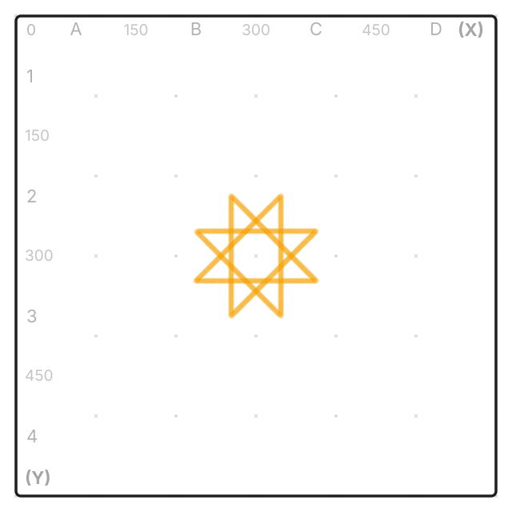
  </Frame>
</Columns>

## Pentagone régulier

Tableau de contrôle : rangée supérieure Fonction × 5. Rangée inférieure : Avancer 50, Droite 72.

[Lancer dans le simulateur](https://simulator.primastem.com/#top=cfun.r005&fn=cfor.n050,crig.n072&s=l1047402&r=275-262-90&run)

<Columns cols={2}>
  <Frame caption="Programme sur le tableau de contrôle">
    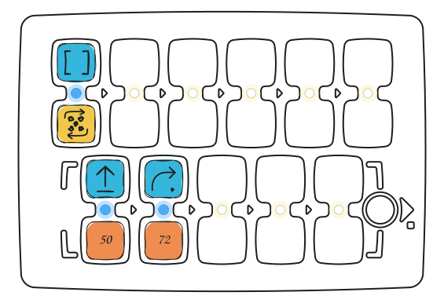
  </Frame>
  <Frame caption="Ce que dessine le robot">
    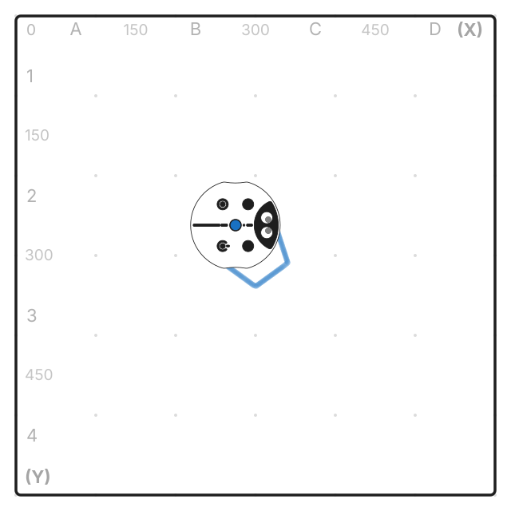
  </Frame>
</Columns>

## Étoile simple à cinq branches

Tableau de contrôle : rangée supérieure Fonction × 5. Rangée inférieure : Avancer, Droite 144.

[Lancer dans le simulateur](https://simulator.primastem.com/#top=cfun.r005&fn=cfor,crig.n144&s=l1047402&r=225-283-90&run)

<Columns cols={2}>
  <Frame caption="Programme sur le tableau de contrôle">
    
  </Frame>
  <Frame caption="Ce que dessine le robot">
    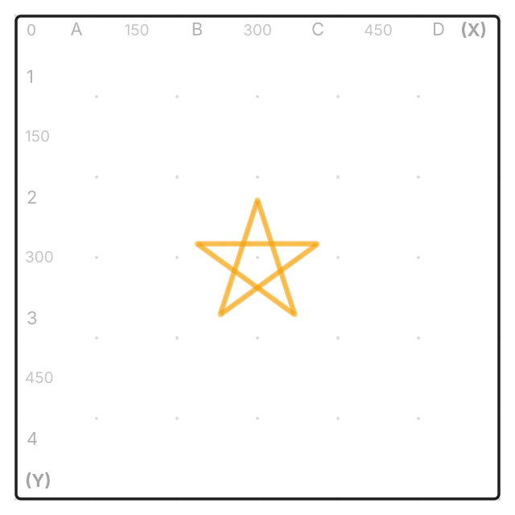
  </Frame>
</Columns>

## Dessin mathématique d'un cœur

Tableau de contrôle : rangée supérieure Avancer 45, Avancer 20, Fonction × 6, Droite 120, Fonction × 7, Avancer 50. Rangée inférieure : Gauche 30, Avancer 15.

[Lancer dans le simulateur](https://simulator.primastem.com/#top=cfor.n045,cfor.n020,cfun.r006,crig.n120,cfun.r007,cfor.n050&fn=clef.n030,cfor.n015&s=l1047402&r=346-340-0&run)

<Columns cols={2}>
  <Frame caption="Programme sur le tableau de contrôle">
    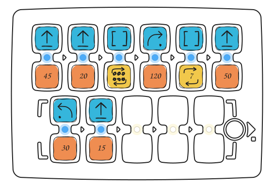
  </Frame>
  <Frame caption="Ce que dessine le robot">
    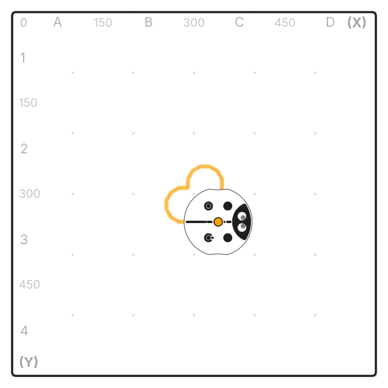
  </Frame>
</Columns>

## Triangle avec un programme simple

Tableau de contrôle : rangée supérieure Avancer, Droite 120, Avancer, Droite, Avancer.

[Lancer dans le simulateur](https://simulator.primastem.com/#top=cfor,crig.n120,cfor,crig,cfor&s=l1047402&r=225-365-30&run)

<Columns cols={2}>
  <Frame caption="Programme sur le tableau de contrôle">
    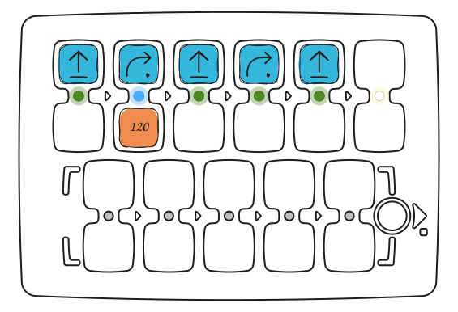
  </Frame>
  <Frame caption="Ce que dessine le robot">
    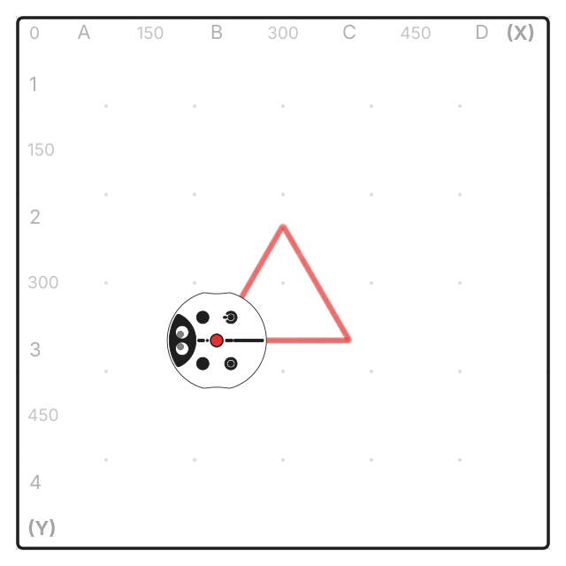
  </Frame>
</Columns>

## Triangle utilisant une fonction

Tableau de contrôle : rangée supérieure Fonction × 3. Rangée inférieure : Avancer, Droite 120.

[Lancer dans le simulateur](https://simulator.primastem.com/#top=cfun.r003&fn=cfor,crig.n120&s=l1047402&r=225-365-30&run)

<Columns cols={2}>
  <Frame caption="Programme sur le tableau de contrôle">
    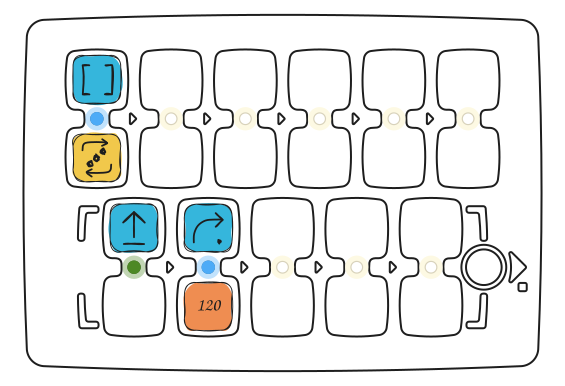
  </Frame>
  <Frame caption="Ce que dessine le robot">
    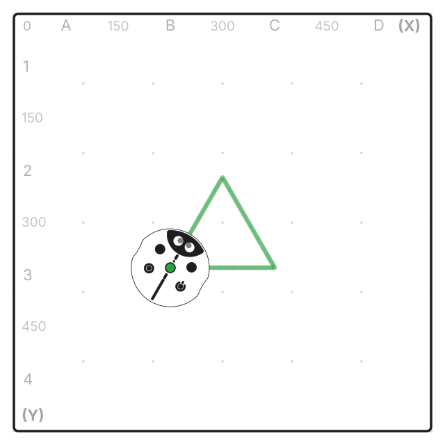
  </Frame>
</Columns>

## Spirale triangulaire

Tableau de contrôle : rangée supérieure Avancer 10, Droite 120, Fonction × 10. Rangée inférieure : Avancer +10, Droite.

[Lancer dans le simulateur](https://simulator.primastem.com/#top=cfor.n010,crig.n120,cfun.r010&fn=cfor.a010,crig&s=l1047402&r=295-278-90&run)

<Columns cols={2}>
  <Frame caption="Programme sur le tableau de contrôle">
    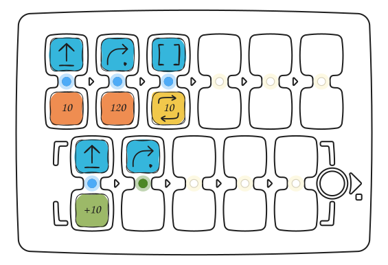
  </Frame>
  <Frame caption="Ce que dessine le robot">
    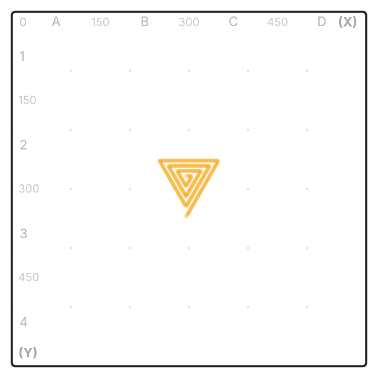
  </Frame>
</Columns>

## Double spirale triangulaire

Tableau de contrôle : rangée supérieure Avancer 20, Fonction × 20. Rangée inférieure : Droite 120, Avancer +20, Droite 120, Avancer.

[Lancer dans le simulateur](https://simulator.primastem.com/#p=cfor-n020-cfun-r020---------crig-n120-cfor-a020-crig-n120-cfor---&s=l1087602&r=424-475-240&run)

<Columns cols={2}>
  <Frame caption="Programme sur le tableau de contrôle">
    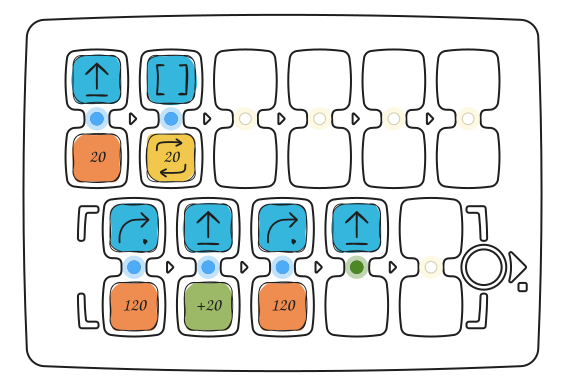
  </Frame>
  <Frame caption="Ce que dessine le robot">
    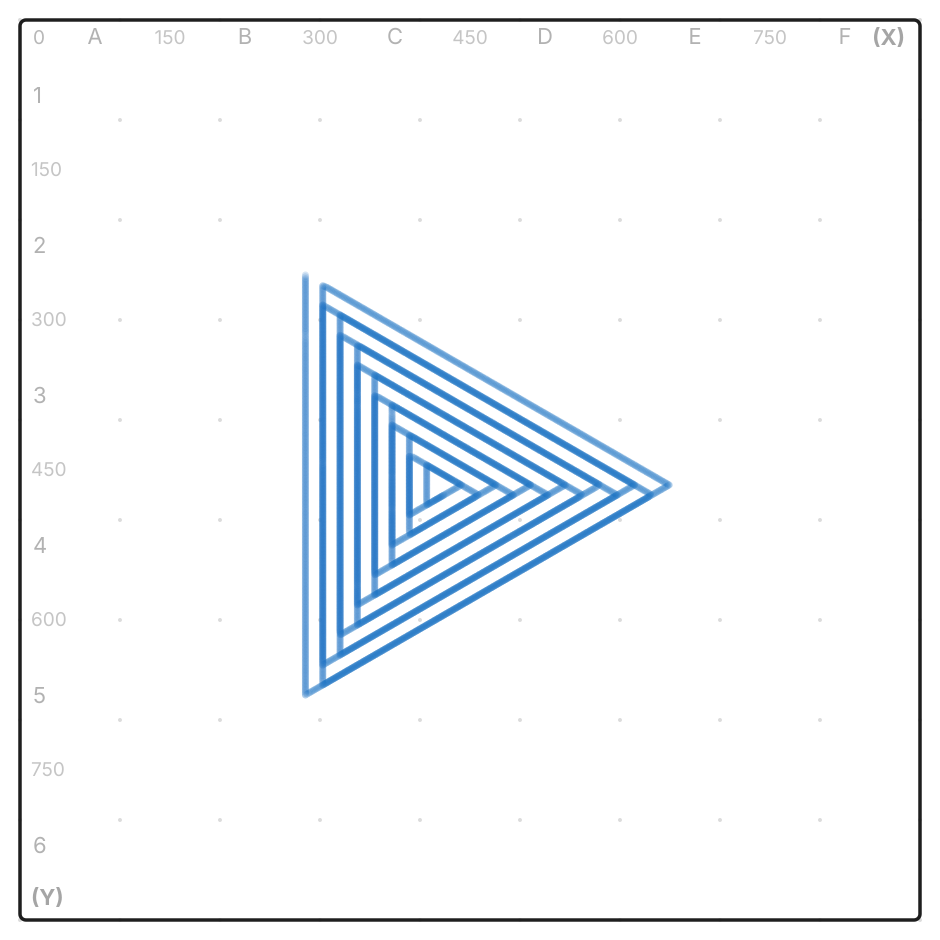
  </Frame>
</Columns>

## Courbe avec angles négatifs

Tableau de contrôle : rangée supérieure Avancer 10, Droite 30, Fonction × 36. Rangée inférieure : Avancer, Droite −2.

[Lancer dans le simulateur](https://simulator.primastem.com/#top=cfor.n010,crig.n030,cfun.r036&fn=cfor,crig.s002&s=l1047402&r=300-238-0&run)

<Columns cols={2}>
  <Frame caption="Programme sur le tableau de contrôle">
    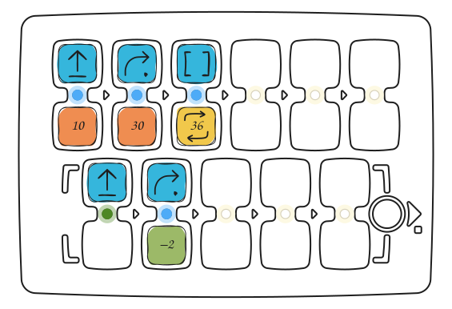
  </Frame>
  <Frame caption="Ce que dessine le robot">
    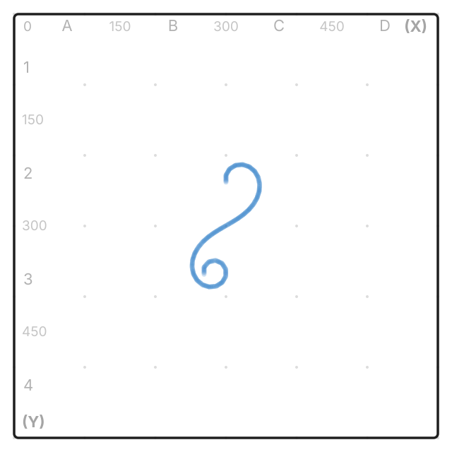
  </Frame>
</Columns>

## Spirale carrée

Tableau de contrôle : rangée supérieure Avancer 10, Droite, Avancer, Droite, Fonction × 8. Rangée inférieure : Avancer +10, Droite, Avancer, Droite.

[Lancer dans le simulateur](https://simulator.primastem.com/#top=cfor.n010,crig,cfor,crig,cfun.r008&fn=cfor.a010,crig,cfor,crig&s=l1047402&r=295-305-0&run)

<Columns cols={2}>
  <Frame caption="Programme sur le tableau de contrôle">
    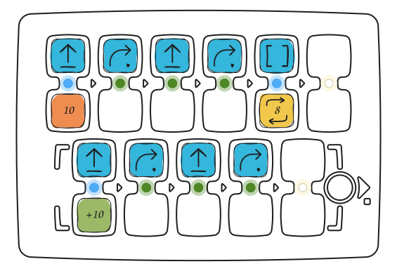
  </Frame>
  <Frame caption="Ce que dessine le robot">
    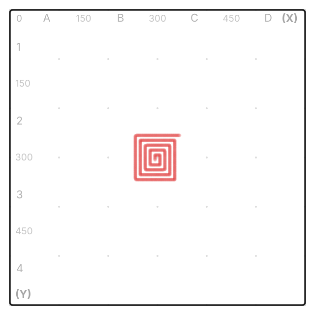
  </Frame>
</Columns>

## Spirale en losange

Tableau de contrôle : rangée supérieure Avancer 40, Fonction × 14. Rangée inférieure : Droite 60, Avancer +18, Droite 120, Avancer +7.

[Lancer dans le simulateur](https://simulator.primastem.com/#p=cfor-n040-cfun-r014---------crig-n060-cfor-a018-crig-n120-cfor-a007--&s=l1087602&r=436-466-0&run)

<Columns cols={2}>
  <Frame caption="Programme sur le tableau de contrôle">
    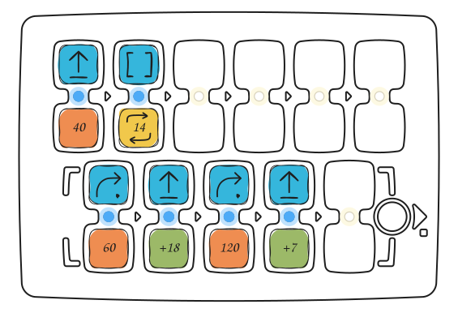
  </Frame>
  <Frame caption="Ce que dessine le robot">
    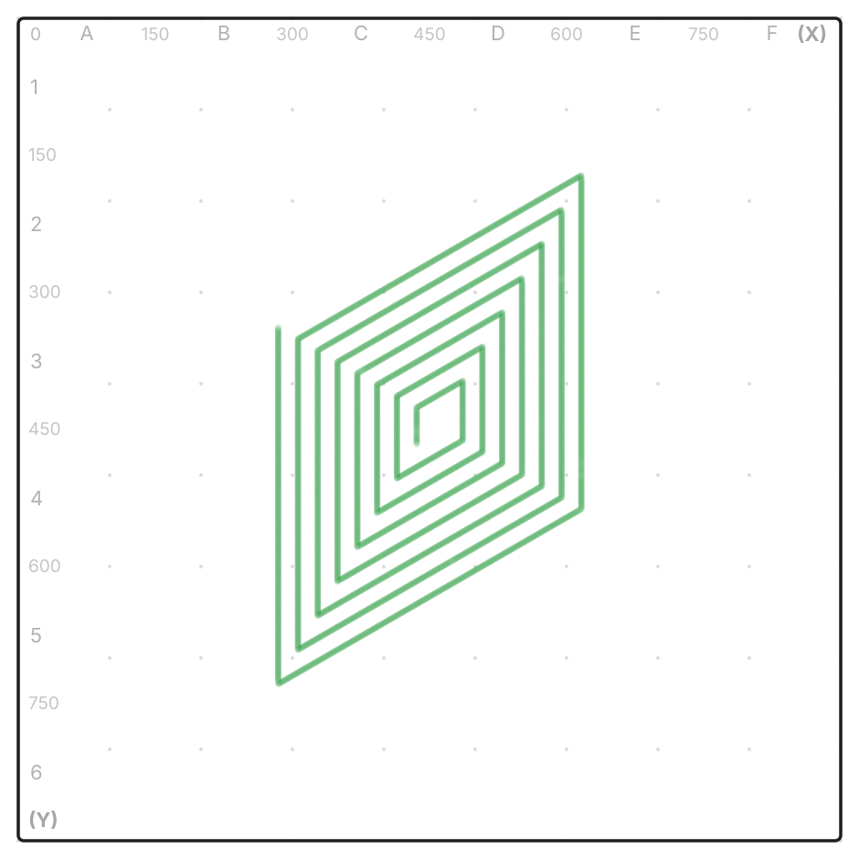
  </Frame>
</Columns>

## Minuteur ~5 minutes

Tableau de contrôle : rangée supérieure Fonction × 5, Gauche 360. Rangée inférieure : Avancer, Reculer, Pause 60, Droite 72.

[Lancer dans le simulateur](https://simulator.primastem.com/#top=cfun.r005,clef.n360&fn=cfor,cbac,cwat.n060,crig.n072&s=l1041402&r=300-314-0&run)

<Columns cols={2}>
  <Frame caption="Programme sur le tableau de contrôle">
    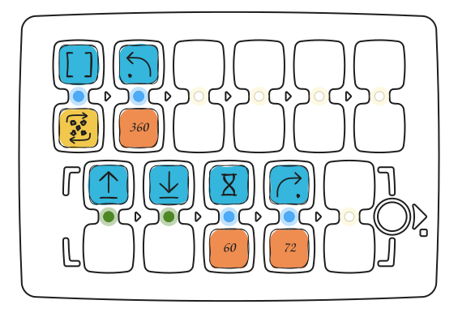
  </Frame>
  <Frame caption="Ce que dessine le robot">
    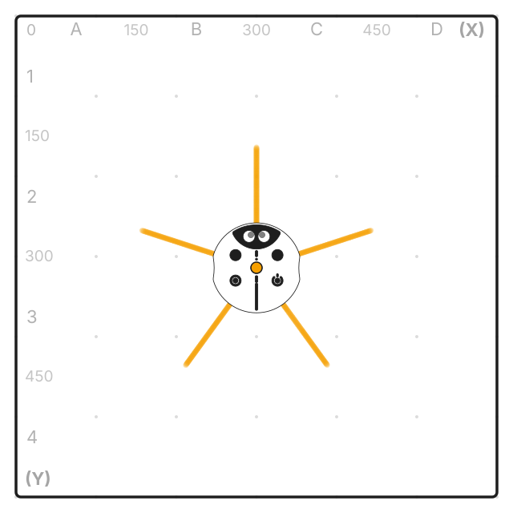
  </Frame>
</Columns>

## Spirale

Tableau de contrôle : rangée supérieure Avancer 5, Fonction × 36. Rangée inférieure : Droite 30, Avancer +1.

[Lancer dans le simulateur](https://simulator.primastem.com/#top=cfor.n005,cfun.r036&fn=crig.n030,cfor.a001&s=l1047402&r=296-293-0&run)

<Columns cols={2}>
  <Frame caption="Programme sur le tableau de contrôle">
    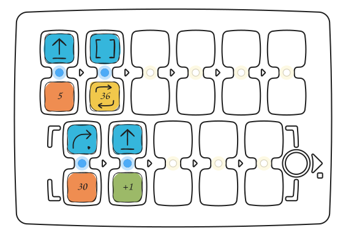
  </Frame>
  <Frame caption="Ce que dessine le robot">
    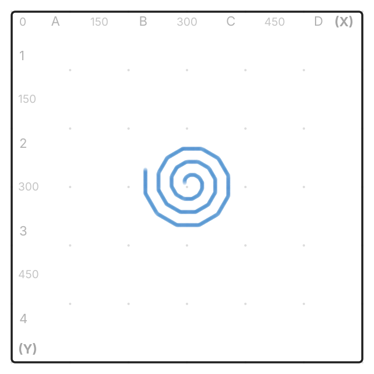
  </Frame>
</Columns>

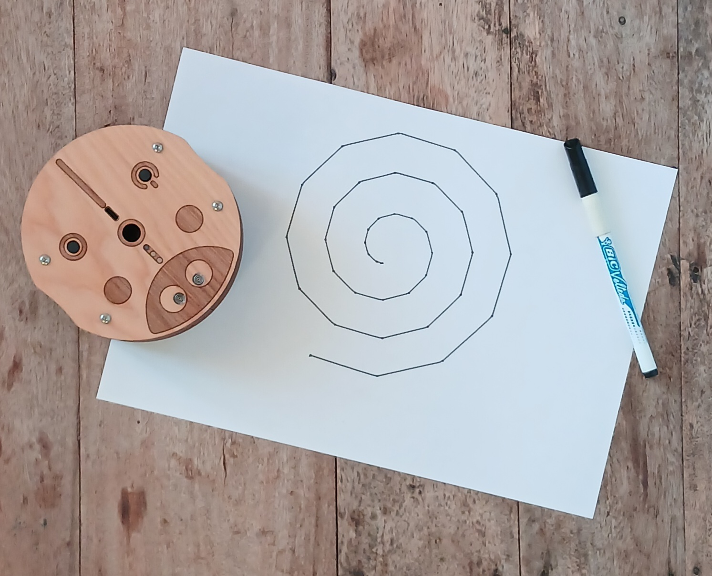
