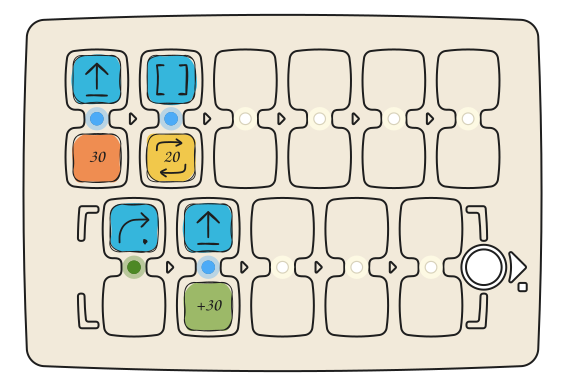
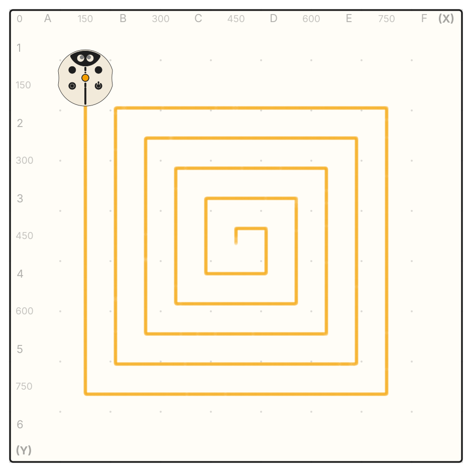

PrimaSTEM apprend aux enfants de 4 à 12 ans à programmer sans ordinateurs, tablettes ni téléphones. Le kit développe la logique, les compétences en programmation et les mathématiques.

Avec PrimaSTEM, la programmation devient simple et visuelle. Même les plus jeunes comprennent ce qui se passe : ils touchent les jetons avec les mains et apprennent en jouant les bases de la programmation, de la logique et des mathématiques.

Jouer avec PrimaSTEM développe la pensée logique, l'algorithmique, la programmation, les mathématiques et la géométrie. Le jeu développe aussi la créativité et les compétences socio-émotionnelles. Le kit prépare l'enfant aux langages de programmation par blocs, par exemple [Scratch](https://en.wikipedia.org/wiki/Scratch_(programming_language)) ou [LOGO](https://en.wikipedia.org/wiki/Logo_(programming_language)).

## Découverte du kit pédagogique

### Où utiliser PrimaSTEM

PrimaSTEM convient à ces activités :

- Centres d'éducation préscolaire
- Jardins d'enfants qui suivent la pédagogie Montessori
- École primaire
- Instruction en famille
- Centres de développement spécialisés
- Études surveillées
- Clubs de programmation débutants
- Camps éducatifs pour enfants

### Ce qu'il faut savoir pour commencer

Avant de travailler avec le kit, lisez la page [Appareil et réglages](/fr/usermanual) et ce guide. Vous n'avez pas besoin de savoir programmer : le matériel contient tout ce qu'il faut pour commencer.

## Recherche et valeur du kit

PrimaSTEM s'inspire du langage de programmation [LOGO](https://en.wikipedia.org/wiki/Logo_(programming_language)), créé par [Seymour Papert](https://en.wikipedia.org/wiki/Seymour_Papert), et de la pédagogie Montessori. LOGO et la tortue robot ont rendu la programmation visuelle et accessible aux enfants.

Les jetons-commandes PrimaSTEM prolongent cette approche. L'enfant commande le robot avec les mains, sans écran ni texte, et voit tout de suite ce qu'il fait.

Les enfants observent le robot, comprennent chaque commande et apprennent les algorithmes en pratique.

Le robot a une propriété importante : il a une direction. L'enfant se met facilement à la place du robot et comprend donc plus vite la logique du programme.

Toutes les commandes sont simples : elles disent au robot dans quelle direction aller. Quand les enfants apprennent au robot à « agir » et à « penser », ils réfléchissent à leurs propres actions et pensées. La programmation devient donc plus facile pour eux.

Les jetons PrimaSTEM montrent de façon visuelle et simplifiée comment fonctionnent les langages de programmation. Au début, il n'y a ni texte ni nombres, seulement des commandes de base.

### Pourquoi du bois

🌱 Le tableau de contrôle et le robot sont en bois (contreplaqué). Les enfants préfèrent jouer avec des jouets en bois. Ils sont sûrs et durent longtemps, et chacun a sa propre histoire.

## Programmer avec PrimaSTEM

Les jetons PrimaSTEM fonctionnent comme les instructions des vrais langages de programmation. Ils montrent des notions importantes de la programmation.

### Algorithmes

Un **algorithme** est fait de commandes précises (jetons) qui forment ensemble un programme.

### File d'attente

Le tableau de contrôle exécute les commandes strictement de gauche à droite. Les enfants voient ainsi que les commandes s'exécutent l'une après l'autre.

### Correction d'erreurs (débogage)

Une erreur est facile à corriger : il suffit de remplacer le jeton. L'enfant apprend ainsi à trouver et corriger seul les erreurs du programme.

### Fonction

Une fonction (sous-programme) est faite des commandes de la rangée inférieure du tableau de contrôle. Le programme principal l'appelle avec le jeton «**Fonction**».

### Variable

Le tableau de contrôle retient le dernier nombre de chaque commande. Avancer, Reculer, Gauche, Droite et Pause gardent chacune leur propre valeur. Une commande sans nombre prend la valeur mémorisée. C'est une variable : elle a un nom (la commande) et une valeur (le nombre), et cette valeur peut changer.

## Application dans d'autres matières

PrimaSTEM aide aussi à développer d'autres compétences :

- Communication. Dans le jeu en groupe, les enfants apprennent à coopérer.
- Motricité. Manipuler les jetons améliore la coordination.
- Compétences sociales. Les enfants prennent confiance et apprennent à résoudre des problèmes ensemble.
- Mathématiques. Les enfants découvrent les notions mathématiques de base.
- Logique. Les enfants apprennent à construire des séquences et à prévoir le résultat.

> L'enfant pose une chaîne de jetons et apprend la programmation avec les mains, les yeux et la tête. Il appuie sur **▶ Démarrer**, le robot se déplace, et l'enfant compare le résultat avec ce qu'il attendait. Cette expérience accélère l'apprentissage.

## Découverte du robot et du tableau de contrôle

### Le robot

Dites aux enfants que le robot est leur ami et qu'ils peuvent le programmer. Expliquez qu'il n'a pas de pensées à lui. Il exécute seulement leurs instructions, comme un appareil ménager qu'il faut allumer.

### Le tableau de contrôle

Expliquez que le tableau de contrôle transmet les commandes au robot. Montrez comment placer les jetons-commandes et programmer le robot.

> On construit le programme principal dans la rangée supérieure du tableau de contrôle (6 paires). La rangée inférieure (5 paires) sert au sous-programme. La commande «**Fonction**» l'appelle.

### Les jetons-commandes

Les jetons donnent des commandes au robot. On les place sur le tableau de contrôle. Après l'appui sur **▶ Démarrer**, le robot exécute le programme. Chaque jeton donne une commande. Les enfants apprennent ainsi la pensée computationnelle et apprennent à écrire des programmes. Il est important que les enfants comprennent ce que fait le robot pour chaque commande. Ils peuvent alors planifier le programme et prévoir les actions du robot. Expliquez aux enfants que les jetons ne doivent pas être perdus ou abîmés : sans eux, le robot ne peut pas se déplacer.

## 1. Premier programme

### Cause et effet

L'objectif principal : montrer aux enfants le lien entre une commande et une action. Laissez l'enfant placer le jeton «Avancer» dans la première cellule du tableau de contrôle et appuyer sur **▶ Démarrer**. L'enfant doit voir que le jeton et l'action sont liés.

### Instructions univoques

Répétez cela avec chaque direction (**Avancer**, tourner **gauche**, tourner **droite**) jusqu'à ce que l'enfant reconnaisse chaque jeton.

### Première tâche

Déployez le plateau de jeu ou faites une grille de cases de 15 × 15 cm avec du ruban adhésif ou un marqueur. Placez le robot sur la case de départ. Demandez à l'enfant d'écrire un programme pour que le robot avance d'une case. Si l'enfant a choisi le mauvais jeton, ramenez le robot et proposez-lui de réfléchir à une autre solution.

## 2. Programme et débogage

### File d'attente des événements

Placez une cible à deux cases devant le robot.

Laissez l'enfant écrire un programme de deux jetons pour que le robot atteigne la cible.

### Séquence de trois jetons

Maintenant, la cible est à une case devant et à une case à droite.

Laissez l'enfant choisir lui-même le bon ordre des commandes.

Ne vous inquiétez pas si l'enfant a choisi le mauvais jeton. Ramenez le robot au départ et demandez à l'enfant de réfléchir à son choix et d'essayer d'autres solutions.

### Débogage : trouver l'erreur

Placez la cible à une case devant le robot et à une case à sa gauche.

Cette fois, c'est vous qui écrivez le programme, et vous y mettez exprès un mauvais virage.

Demandez à l'enfant de trouver la commande incorrecte et de prévoir où ira le robot. Ensuite, laissez l'enfant appuyer sur **▶ Démarrer** et vérifier son hypothèse.

Quand l'enfant est sûr que le programme est faux, par le raisonnement ou par un essai, laissez-le remplacer la commande incorrecte par la bonne. Il débogue ainsi le programme.

## 3. Programme avec fonction

### Commande «Fonction»

Quand les enfants connaissent les commandes de base, montrez le jeton-commande **Fonction**. Il appelle un ensemble de commandes que le programme principal peut répéter.

> Pour expliquer comment cela fonctionne, comparez la fonction à une tour : sous le jeton fonction, d'autres commandes sont empilées les unes sur les autres. Les enfants voient ainsi qu'un seul jeton peut contenir plusieurs instructions.

Montrez un exemple. Placez d'abord deux jetons «Avancer» dans les cellules supérieures et lancez le programme. Le robot avance de deux cases.

Placez maintenant les mêmes deux «Avancer» dans la fonction (rangée inférieure), et placez «Fonction» dans le programme principal. Le résultat est le même, mais une partie du programme est maintenant cachée dans un sous-programme.

Ensuite, construisez la séquence : **Avancer, Avancer, Droite, Avancer, Avancer**.

Demandez aux enfants de trouver les parties qui se répètent et de les «cacher» dans la fonction. Le résultat doit être : dans le programme principal **Fonction, Droite, Fonction**, dans la rangée inférieure **Avancer, Avancer**.

[Lancer dans le simulateur](https://simulator.primastem.com/#top=cfun,crig,cfun&fn=cfor,cfor&s=l1144602&r=225-825-0&run)

### Résoudre des tâches avec fonction

Donnez à l'enfant 3 jetons «**Avancer**» et 2 jetons «**Fonction**».

La tâche : avancer de 5 cases.

Laissez l'enfant comprendre que cette tâche demande une fonction qui répète l'action.

Si le programme est faux, ramenez le robot au départ. Demandez à l'enfant de réfléchir à la bonne solution et d'essayer d'autres options.

[Lancer dans le simulateur](https://simulator.primastem.com/#top=cfun,cfun,cfor&fn=cfor,cfor&s=l1144602&r=225-825-0&run)

## 4. Aléatoire

### Commande «Mouvement aléatoire»

Pour expliquer le hasard, prenez 4 jetons de direction : «**Avancer**», «**Gauche**», «**Droite**» et «**Reculer**». Mettez-les dans une boîte opaque ou un sac et mélangez. Chaque enfant, à son tour, tire un jeton sans regarder, le montre au groupe et le remet. Avec cet exemple, expliquez ce qu'est un choix au hasard parmi quatre possibilités.

Ensuite, montrez aux enfants le jeton-commande «**Mouvement aléatoire**».

Expliquez que ce jeton fait presque la même chose que les enfants avec le sac. Il choisit une direction au hasard et déplace le robot d'un pas, c'est-à-dire d'une case. Le robot peut se déplacer d'une case en avant, à droite, à gauche ou en arrière.

Placez le jeton «**Mouvement aléatoire**» dans la cellule supérieure et lancez le programme plusieurs fois. Le robot se déplace différemment à chaque fois.

[Lancer dans le simulateur](https://simulator.primastem.com/#top=crnd&s=l1144602&r=375-525-0&run)

Jouez avec les enfants : avant chaque lancement, qu'ils devinent où ira le robot.

Soulignez qu'il s'agit d'**aléatoire** et qu'on ne peut pas deviner la direction à chaque fois.

Inventez avec les enfants un petit jeu avec le jeton «**Mouvement aléatoire**».

## 5. Boucles (répétitions de commandes)

### Découverte des boucles numériques

Montrez aux enfants les jetons de répétition. Demandez-leur s'ils connaissent les nombres, s'ils ont déjà vu un dé et s'ils ont joué à des jeux de société.

Placez deux jetons «Avancer» dans les cellules supérieures et lancez le programme. Le robot avance de deux cases.

Maintenant, laissez un seul «Avancer» et placez en dessous le jeton «Répéter 2». Le résultat est le même : l'action se répète deux fois.

Placez 4 jetons «**Avancer**» et observez le résultat. Ensuite, demandez aux enfants de refaire ce déplacement de 4 cases avec un jeton de **répétition**.

On peut résoudre la tâche de plusieurs façons. La solution simple : «**Avancer**» et «Répéter 4». Une autre solution : «**Avancer**» avec «Répéter 3» et encore un «**Avancer**».

[Lancer dans le simulateur](https://simulator.primastem.com/#top=cfor.r003,cfor&s=l1144602&r=225-825-0&run)

### Répéter une fonction

Essayez avec les enfants d'ajouter une répétition à la commande «Fonction». Par exemple, le robot peut aller en zigzag : dans la rangée supérieure «Fonction» avec «Répéter 5», dans la rangée inférieure «**Avancer**», «**Droite**», «**Avancer**», «**Gauche**».

D'abord, construisez dans la fonction le programme «marche» : «Avancer», «Droite», «Avancer», «Gauche». Lancez-le.

Ensuite, ajoutez «Répéter 5» à la fonction. La fonction se répète 5 fois, et le robot avance en marches vers la droite et vers le haut.

[Lancer dans le simulateur](https://simulator.primastem.com/#top=cfun.r005&fn=cfor,crig,cfor,clef&s=l1144602&r=75-825-0&run)

Le robot monte en escalier en diagonale vers la droite et vers le haut et fait 5 marches.

## 6. Nombres aléatoires

### Ce qu'est un nombre aléatoire

Parmi les jetons se trouve «Répéter un nombre aléatoire de fois» (avec un dé). Il choisit un nombre au hasard de 1 à 6. Jouez avec les enfants : qu'ils tirent des jetons de répétition d'un sac.

Pour expliquer le nombre aléatoire, prenez 4 jetons de répétition : «**2**», «**3**», «**4**» et «**5**». Mettez-les dans une boîte opaque ou un sac et mélangez. Chaque enfant, à son tour, tire un jeton sans regarder, le montre, dit le nombre et le remet. Jouez à qui tire le plus grand nombre. Avec cet exemple, expliquez ce qu'est un choix au hasard parmi quatre possibilités.

Ensuite, montrez aux enfants le jeton «**Répéter un nombre aléatoire de fois**». Expliquez qu'il fait presque la même chose que les enfants avec le sac. Comme un dé, il choisit au hasard un nombre de 1 à 6, et le robot répète l'action autant de fois.

Placez le jeton «**Avancer**» dans la cellule supérieure du tableau de contrôle, et le jeton «**Répéter un nombre aléatoire de fois**» en dessous. Demandez aux enfants d'appuyer sur **▶ Démarrer**. Ramenez le robot à sa place. Répétez plusieurs fois.

[Lancer dans le simulateur](https://simulator.primastem.com/#top=cfor.rrnd&s=l1144702&r=225-975-0&run)

Jouez : quel robot ira le plus loin.

Faites remarquer aux enfants que le robot avance d'un nombre aléatoire de cases, de 1 à 6. Soulignez qu'il s'agit de hasard et qu'on ne peut pas savoir à l'avance jusqu'où ira le robot.

## 7. Nombres : distances et angles

### Découverte des nombres

Si la deuxième cellule de la paire n'a pas de nombre, le robot utilise les valeurs par défaut : il avance de 15 cm et tourne de 90°. Les jetons de nombre changent ces valeurs.

Exemple. Ajoutez le nombre **200** à la commande «**Avancer**» et regardez jusqu'où va le robot. Ajoutez le nombre **180** à une rotation et regardez ce qui change.

[Lancer dans le simulateur](https://simulator.primastem.com/#top=cfor.n200,crig.n180&s=l1047602&r=450-600-0&run)

> **Important.** Le tableau de contrôle retient le dernier nombre des commandes de mouvement et de rotation. Si une commande n'a pas de nouveau nombre, elle prend le nombre mémorisé, jusqu'à ce qu'on éteigne le tableau de contrôle. Un nouveau nombre remplace le nombre mémorisé. La longueur de pas réglée avec le jeton « Pas par défaut » reste en mémoire et se conserve après un redémarrage. Pour revenir à 15 cm, utilisez ce jeton avec le nombre 150. La rotation de 90° revient d'elle-même après un redémarrage.

Avec différents nombres, le robot fait des parcours plus complexes. Voir les exemples sur la page [Exemples de dessins](/fr/mathdrawings).

## 8. Arithmétique

### Opérations arithmétiques

L'arithmétique change les nombres du programme pour les commandes de mouvement (Avancer, Reculer, Gauche, Droite). On peut ainsi commander le robot de façon plus souple.

Quand une paire contient un jeton d'arithmétique, le tableau de contrôle change le nombre mémorisé de la commande et envoie la nouvelle valeur au robot.

Exemple :

[Lancer dans le simulateur](https://simulator.primastem.com/#top=cfor.n200,crig,cfor.a100&s=l1047602&r=300-700-0&run)

«Avancer 200» : le robot avance de 20 cm. «Avancer +100» : le robot avance encore de 30 cm. Au total, 50 cm.

### Exercice : une spirale qui grandit

L'arithmétique change le nombre mémorisé, c'est-à-dire la variable. Construisez le programme : rangée supérieure Avancer 30 et Fonction × 20, rangée inférieure Droite et Avancer +30. À chaque appel de la fonction, le côté s'allonge de 3 cm.

Demandez d'abord aux enfants de prévoir : quelle sera la longueur du cinquième côté ? Lancez ensuite le programme et vérifiez. Réponse : 15 cm (3 + 3 + 3 + 3 + 3).

[Lancer dans le simulateur](https://simulator.primastem.com/#top=cfor.n030,cfun.r020&fn=crig,cfor.a030&s=l1047602&r=450-465-0&run)

<Columns cols={2}>
  <Frame caption="Programme sur le tableau de contrôle">
    
  </Frame>
  <Frame caption="Ce que dessine le robot">
    
  </Frame>
</Columns>

Le même programme en LOGO : [PrimaSTEM et LOGO](/fr/logo).

L'arithmétique dans une boucle donne des progressions.

> Si le nombre devient négatif après une opération, le robot fait l'action inverse : il recule au lieu d'avancer et tourne à droite au lieu de tourner à gauche.

Opérations disponibles : addition (+), soustraction (−), multiplication (*), division (/), racine carrée (√) et élévation à la puissance (^).

Des exemples de motifs se trouvent sur la page [Exemples de dessins](/fr/mathdrawings).

---

## Jouez et apprenez avec les enfants

Vous connaissez vos élèves mieux que personne. Avec PrimaSTEM, vous pouvez enseigner la programmation, la logique et d'autres matières par le jeu. Tout dépend de votre imagination.

Merci d'avoir choisi PrimaSTEM. [Écrivez-nous](/fr/contacts) pour nous parler de votre expérience et de vos impressions, nous attendons vos retours.
