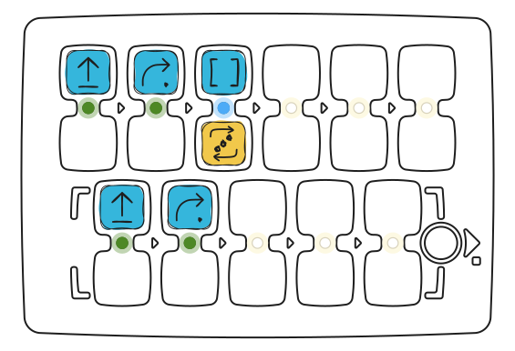

## Caractéristiques techniques et contenu de la boîte

- Robot ludique
- Tableau de contrôle pour robot
- Jetons de commandes, de valeurs et d'opérations arithmétiques, avec lesquels on compose des programmes

> Le contenu et l'apparence peuvent varier légèrement. Veuillez vérifier lors de l'achat.

### Robot ludique

Dimensions : D=120 mm, H=44 mm.

Le robot a un bouton d'alimentation, des LED, un haut-parleur, un bouton de fonction et un port USB-C pour charger la batterie.

Au centre du robot, vous pouvez placer un marqueur d'un diamètre maximal de 10 mm. Le robot dessine alors des formes simples pendant ses déplacements.

L'apparence peut varier légèrement selon la configuration. Les fonctions restent les mêmes.

### Tableau de contrôle

Dimensions : L=317 mm, W=217 mm, H=62 mm.

Le tableau de contrôle a 11 paires de cellules pour les jetons de commandes et de valeurs. Les 6 paires du haut servent au programme principal, les 5 paires du bas au sous-programme.

Le tableau de contrôle a deux boutons. Le bouton de gauche allume le tableau de contrôle. Le bouton de droite, **▶ Démarrer / Arrêter**, lance et arrête le programme.

Placez les jetons de commandes et de valeurs dans les cellules et appuyez sur **▶ Démarrer**. Le robot exécute le programme. Les LED entre les cellules montrent quelle commande s'exécute.

Si un jeton est mal placé, par exemple un jeton de valeur sans commande, la LED de la cellule s'allume en rouge. Le programme continue quand même.

Le tableau de contrôle a un port USB-C pour la recharge et un haut-parleur.

### Jetons

Dimensions : 33 × 33 mm.

L'ensemble comprend des jetons avec lesquels on compose des programmes. Chaque jeton donne une commande au sens précis. L'ordre des jetons détermine ce que fait le robot.

Il y a trois sortes de jetons : **commandes**, **valeurs** et **arithmétique**.

#### Jetons de commandes

Avec ces jetons, on compose le programme :

- **Avancer** : le robot avance (15 cm par défaut).
- **Droite** : le robot tourne de 90° dans le sens horaire.
- **Gauche** : le robot tourne de 90° dans le sens antihoraire.
- **Reculer** : le robot recule (15 cm par défaut).
- **Fonction** : le robot exécute le sous-programme de la rangée du bas du tableau de contrôle.
- **Mouvement aléatoire** : le robot fait un pas en avant ou en arrière, ou tourne de 90° à gauche ou à droite et fait aussitôt un pas en avant. La longueur du pas est celle du pas par défaut. Il n'y a pas de virage sur place sans pas.
- **Pause** : le robot reste immobile N secondes (1–999 s ; sans nombre 1 s).
- **Jetons de répétition (boucles)** : ils portent des points de 2 à 6 ou un pictogramme de répétition avec un nombre à l'intérieur. Le jeton avec un dé donne un nombre aléatoire de répétitions de 1 à 6.

> Les jetons de nombres et d'arithmétique enrichissent le programme. Avec eux, on peut répéter une commande ou modifier l'angle et la distance.

#### Jetons de valeurs

Il existe des jetons d'angles et de distances : 30°, 36°, 45° et leurs multiples (60°, 72°, etc.). Les angles sont en degrés, les distances en millimètres. Par défaut, le robot tourne de 90° et avance de 150 mm (15 cm).

#### Jetons d'opérations arithmétiques

Ils modifient les valeurs des commandes de déplacement :

- Addition (+)
- Soustraction (−)
- Multiplication (*)
- Division (/)
- Racine carrée (√)
- Puissance (^)
- Factorielle (!)

L'arithmétique calcule entre −5000 et 5000. Dans ces cas, la cellule clignote en rouge et le nombre ne change pas :
- le résultat dépasse 5000 ou descend sous −5000 ;
- division par 0 ;
- racine d'un nombre négatif ;
- factorielle d'un nombre supérieur à 6.

La division et la racine sont arrondies à l'entier le plus proche. Par exemple, 150 ÷ 4 donne 37,5, le robot prend 38. 20 ÷ 3 donne 6,67, le robot prend 7. √50 donne 7,07, le robot prend 7. Une moitié exacte s'arrondit en s'éloignant de zéro : 37,5 donne 38, −2,5 donne −3.

## Connexion entre le tableau de contrôle et le robot

Allumez d'abord le robot, puis le tableau de contrôle.

Placez le robot sur une surface plane avant la connexion. Tant qu'il n'y a pas de connexion, le robot et le tableau de contrôle s'allument en bleu clair. Une fois la connexion établie, les LED deviennent blanches.

Vérifiez la connexion : placez le jeton "Avancer" et appuyez sur **▶ Démarrer**.

Si aucune connexion n'est établie, redémarrez les deux appareils ou rechargez-les. Près des sources de champ électromagnétique intense (téléphone mobile, point Wi-Fi), la connexion peut se couper un court moment.

> **Après une mise à jour du firmware**, il faut parfois appairer à nouveau les appareils. Allumez le robot, puis le tableau de contrôle. Appuyez sur **▶ Démarrer** sur le tableau de contrôle et maintenez-le plus de 10 secondes. À la 5ᵉ seconde, un bip court retentit : ne relâchez pas le bouton. L'appairage commence à la 10ᵉ seconde.

### Piloter le robot en inclinant le tableau de contrôle

Dès que le tableau de contrôle est connecté au robot, vous pouvez piloter le robot sans jetons : inclinez simplement le tableau de contrôle. Cela fonctionne tant qu'aucun jeton n'est dans les cellules et que vous n'avez pas encore appuyé sur **▶ Démarrer**.

- Posez d'abord le tableau de contrôle à plat pendant une seconde. Avant cela, le robot ne réagit pas aux inclinaisons.
- Inclinez-le vers l'avant, loin de vous, et le robot avance de 15 cm. Vers vous : il recule de 15 cm.
- Inclinez-le à gauche ou à droite, et le robot tourne de 90° du même côté.
- À chaque pas, le tableau de contrôle émet un bip court.
- Tant que le tableau de contrôle reste incliné, le robot fait un pas après l'autre. Remettez-le à l'horizontale, et le robot termine le pas en cours et s'arrête.
- Inclinez nettement, de plus de 20°. Si la main tremble un peu, le robot ne bouge pas.

Le pilotage par inclinaison se désactive dès que vous placez un jeton dans une cellule ou appuyez sur **▶ Démarrer**. Il se réactive quand le tableau de contrôle se reconnecte au robot, par exemple après avoir éteint et rallumé le robot.

## Comment ça marche

Pour programmer les déplacements, placez des jetons de commandes dans les cellules du tableau de contrôle, par exemple « Avancer », « Gauche », « Fonction ». Aux commandes, vous pouvez ajouter un nombre de répétitions, des angles, des distances et des opérations arithmétiques.

Des « ponts » avec indicateurs relient les cellules par paires. Une cellule de la paire reçoit la commande, l'autre la valeur ou la répétition.

*Ci-dessous, un exemple de programme avec une boucle : elle répète la même partie du programme. Le robot parcourt un carré :*

<Columns cols={2}>
  <Frame>
    
  </Frame>
  <Frame>
    
  </Frame>
</Columns>

[Lancer dans le simulateur](https://simulator.primastem.com/#top=cfor,crig,cfun.r003&fn=cfor,crig&s=l1144402&r=225-525-0&run)

Placez d'abord les commandes dans la rangée du haut du tableau de contrôle (6 paires). Le robot les exécute de gauche à droite. Le robot saute les cellules vides et les erreurs. Une erreur, c'est par exemple deux commandes dans une même paire ou une valeur sans commande.

L'ordre des jetons détermine comment le robot se déplace.

Appuyez sur **▶ Démarrer** pour lancer le programme.

Par défaut :
- « Avancer » parcourt 15 cm.
- « Gauche » et « Droite » tournent de 90°.
- Les boucles (répétitions) répètent la commande plusieurs fois.
- « Fonction » appelle le sous-programme de la rangée du bas du tableau de contrôle (5 paires).
- Vous pouvez appeler le sous-programme plusieurs fois : placez un jeton de répétition dans la paire avec « Fonction » (exemple ci-dessus).

### Fonctions importantes

- **Arrêter** le programme : appuyez à nouveau sur **▶ Démarrer** pendant le déplacement.
- Le tableau de contrôle mémorise la dernière **valeur définie** (distance ou angle) pour chaque commande de déplacement, jusqu'à l'extinction. Par exemple, si « Avancer » a reçu 200, toutes les commandes « Avancer » suivantes parcourent aussi 200 mm.
- Les valeurs après une opération arithmétique sont également conservées.
- Le jeton de service « Pas par défaut » modifie le **pas par défaut**. Il change le pas pour « Avancer » et « Reculer ». Par exemple, pour 12,5 cm, placez-le avec le nombre 125. La valeur est conservée après l'extinction. Les nombres de 1 à 999 sont acceptés. Sans nombre, le jeton ramène le pas à 150 mm. Avec une opération arithmétique ou zéro, la cellule clignote en rouge et le pas ne change pas.
- Le tableau de contrôle et le robot **s'éteignent tout seuls** si rien ne se passe pendant 15 minutes.
- Tant que le robot attend une commande, il cligne des yeux. On voit ainsi qu'il est allumé et prêt.
- **Appuyez brièvement sur le bouton du robot**, et le robot lit le jeton placé sous lui et l'énonce.
- **Tous les sons du robot** se coupent et se rétablissent si vous maintenez le bouton du robot pendant 5 secondes. Attendez le bip court, puis relâchez. Le robot clignote en rouge si le son est coupé, en vert s'il est rétabli.
- Le **son du tableau de contrôle** se coupe et se rétablit si vous maintenez **▶ Démarrer** pendant 5 secondes. Attendez le bip court, puis relâchez. Pendant l'exécution d'un programme, le maintien ne fonctionne pas.
- **Après une mise à jour du firmware**, le robot peut avoir besoin d'un calibrage des déplacements.
- **Réinitialisation des réglages du robot** : maintenez le bouton du robot pendant 10 secondes (détails dans la section « Calibrage du robot »).
- **L'appairage du tableau de contrôle et du robot** peut être nécessaire après une mise à jour du firmware. Maintenez **▶ Démarrer** sur le tableau de contrôle plus de 10 secondes. Le bip à la 5ᵉ seconde signifie qu'il faut continuer à maintenir.

### Calibrage du robot

- Avant le calibrage, mettez à jour le robot et le tableau de contrôle avec le dernier firmware stable sur [update.primastem.com](https://update.primastem.com) ([comment faire](/fr/update)). Avec un ancien firmware, le calibrage peut être imprécis.
- Exécutez d'abord le jeton « Calibration » sans nombre. Le robot vérifie la polarité des moteurs, supprime les jeux et règle le déplacement en ligne droite. Cela prend jusqu'à 2 minutes. Pendant la première demi-minute, le robot doit rester immobile, ne le touchez pas. Le bouton du robot ne fonctionne pas pendant ce temps.
- Calibrez ensuite les angles de rotation. Marquez sur la table l'orientation précise du robot. Il faut 32 rotations de 90° dans le sens horaire : composez le programme « Répéter 8 » et « Droite » et exécutez-le quatre fois. Le robot doit effectuer huit tours complets (90 × 32 = 2880°) et revenir à son orientation initiale.
- Regardez de combien le robot s'écarte de la marque et corrigez avec le jeton « Calibration » et un nombre. Si le robot s'arrête avant la marque, ajoutez « + », par exemple « Calibration » et « +5 ». S'il dépasse la marque, ajoutez « − », par exemple « Calibration » et « −5 ». Appuyez ensuite sur **▶ Démarrer**. Le nombre indique de combien de degrés le robot s'est trompé sur les 32 rotations au total. Le robot accepte les nombres jusqu'à 180. Si le nombre est plus grand ou si le robot ne peut pas enregistrer la correction, la cellule clignote en rouge. Un nombre simple sans « + » ou « − » à côté de « Calibration » ne fonctionne pas : la cellule clignote en rouge.
- Répétez jusqu'à ce que le robot revienne exactement à son orientation initiale.
- Le calibrage est conservé après l'extinction.
- Attention ! Réinitialisation du calibrage : maintenez le bouton du robot pendant 10 secondes, les lumières clignotent en rouge, vert, bleu et blanc. La réinitialisation efface tous les calibrages, le volume et le son coupé. Ensuite, éteignez et rallumez le robot, puis refaites le calibrage depuis le début.

<Accordion icon="rectangle-terminal" title="Calibrage de la première version de l'appareil (MVP) avec robot de 10 cm de diamètre">
Cette méthode ne concerne que la première version (MVP). Avec le nouveau firmware, « Calibration » avec un nombre simple ne fonctionne pas : la cellule clignote en rouge.

1. Pour calibrer le gyroscope, placez le robot sur une surface horizontale, placez le jeton « Calibration » sur le tableau de contrôle et appuyez sur **▶ Démarrer**.
2. Pour calibrer la distance, mesurez la distance que le robot parcourt réellement avec la commande « Avancer ». Placez « Calibration » et le jeton avec la valeur nécessaire, puis appuyez sur **▶ Démarrer**. Vous pouvez écrire la valeur sur n'importe quel jeton NFC avec un téléphone NFC : sous forme de texte nXXX (par exemple, n095 pour 95 mm). Après cela, le robot parcourt la distance exacte.
</Accordion>

### Programmation des jetons NFC

Vous pouvez modifier des jetons ou **créer les vôtres** : commandes, nombres ou opérations arithmétiques. Il faut un téléphone avec NFC et une application de lecture et d'écriture de tags, par exemple "NFC Tools". Écrivez le code sur un tag NFC vierge, en texte simple de 4 caractères.

## Important

Tous les avertissements de sécurité et les informations réglementaires se trouvent sur la page [Manuel d'utilisation](/fr/safety).

> L'ensemble **n'est pas destiné aux enfants de moins de 4 ans**. Il contient de petites pièces, **risque d'étouffement** ! Utilisez-le **uniquement sous la surveillance** d'un adulte !

Les appareils contiennent des batteries Li-ion. **Rechargez-les uniquement sous la surveillance** d'un adulte, avec un chargeur USB 5 V standard et un câble USB-C.

Charger le tableau de contrôle et le robot pendant 1 heure suffit pour 1–2 leçons. Une charge complète (2–3 heures) suffit pour 3 leçons de 30–45 minutes. Avec le temps, la capacité des batteries peut diminuer. Vous pouvez les remplacer par de nouvelles batteries 16340 Li-ion.

Si l'ensemble n'est pas utilisé pendant longtemps, rechargez les batteries **tous les 2–3 mois**. Après une décharge profonde, les batteries peuvent tomber en panne et devoir être remplacées.

**N'ouvrez pas l'appareil** vous-même. En cas de panne ou pour remplacer les batteries, contactez le vendeur ou un atelier de réparation d'électronique.

Stockez, utilisez et rechargez l'ensemble dans un local sec, à une température de +5 à +35 °C. Protégez-le du soleil direct, des liquides, de la poussière et des brusques variations de température ou d'humidité : elles provoquent de la condensation.

Évitez les chocs et les vibrations. Transportez et stockez l'appareil dans son emballage d'origine, à une température de +5 à +35 °C, à l'abri des dommages et de l'humidité.

Pour en savoir plus sur le travail avec PrimaSTEM, lisez le [Guide de l'enseignant](/fr/teachersguide).

