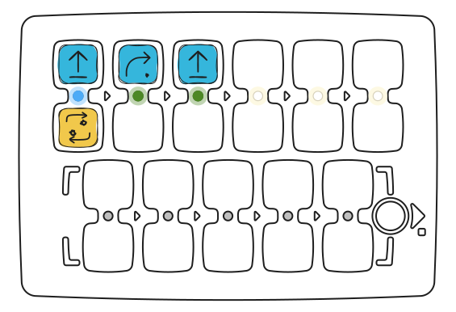
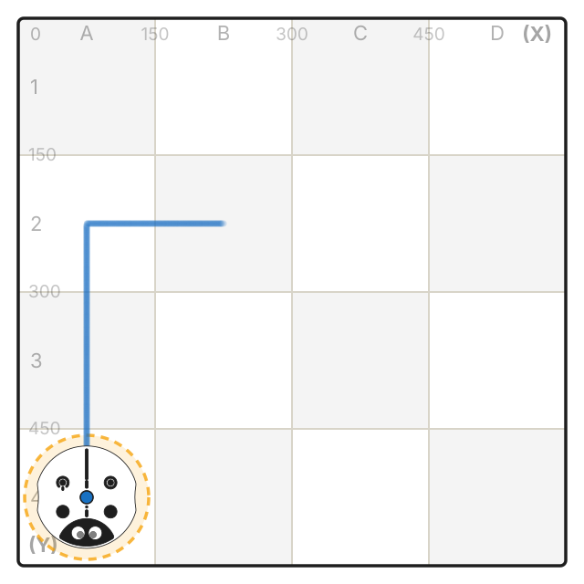

## Introduzione

PrimaSTEM è composto da un robot programmabile, una pulsantiera e un set di tessere di comando. Si può usare per prevenire e correggere i disturbi cognitivi nelle persone anziane.

### A chi è rivolto

- Persone anziane con lievi disturbi cognitivi
- Persone che hanno avuto malattie neurologiche
- Pazienti nelle fasi iniziali di malattie neurodegenerative

### Controindicazioni

- Gravi disturbi visivi
- Disturbi motori significativi delle braccia
- Demenza grave
- Disturbi psichiatrici acuti

## Prima sessione

Dura circa 35 minuti. Prima di iniziare legga le controindicazioni qui sopra. Se non ha ancora il dispositivo, può fare tutti i passaggi nel [simulatore](https://simulator.primastem.com).

<Steps>
  <Step title="Conoscenza, 10 minuti">
    Mostri il robot, la pulsantiera e le tessere «Avanti», «Destra» e «Sinistra». Il partecipante mette una tessera «Avanti» sulla pulsantiera, preme **▶ Start** e guarda il robot muoversi. L'[Avvio rapido](/it/quickstart) spiega come funzionano la pulsantiera e il robot.
  </Step>
  <Step title="Primo percorso, 10 minuti">
    Segni un traguardo a due o tre caselle dal robot. Il partecipante dispone le tessere, avvia il programma e controlla se il robot è arrivato. Nel simulatore c'è il [labirinto facile](https://simulator.primastem.com/#s=l1144402&r=75-525-0&m=2101).
  </Step>
  <Step title="Pausa, 5 minuti">
    Dopo 15–20 minuti di lavoro serve una pausa.
  </Step>
  <Step title="Una figura, 10 minuti">
    Il partecipante prepara un programma con cui il robot percorre un quadrato. Nel simulatore apra l'[esercizio del quadrato](https://simulator.primastem.com/#sh=square): il robot deve seguire il contorno tratteggiato.
  </Step>
</Steps>

Alla fine chieda che cosa è stato facile e che cosa difficile. La risposta dice da dove iniziare la sessione successiva.

## Principi generali

Con l'età e nelle malattie neurodegenerative la memoria può peggiorare. Diventa più difficile pensare in modo astratto, imparare e creare. Le sessioni con PrimaSTEM allenano varie funzioni cognitive in modo ludico e aiutano a rallentare questi processi.

### Come organizzare le sessioni

- Una sessione dura 30–45 minuti.
- Le sessioni si svolgono 2–3 volte a settimana.
- Si lavora da soli o in piccoli gruppi di 2–4 persone.
- Dopo ogni 15–20 minuti di lavoro serve una pausa di 5–10 minuti.

### Come condurre le sessioni

1. Aumenti la difficoltà dei compiti poco alla volta.
2. Tenga conto delle caratteristiche e dei limiti di ogni partecipante.
3. Crei un'atmosfera positiva.
4. Alterni diversi tipi di esercizi.
5. Dica sempre al partecipante che cosa gli è riuscito e lo incoraggi.

## Che cosa allenano le sessioni

### Funzioni cognitive

- Attività intellettuale
- Pensiero spaziale e memoria
- Memoria visiva e uditivo-verbale
- Pensiero logico e calcolo mentale
- Pianificazione e controllo delle proprie azioni
- Visione periferica

### Comunicazione e umore

- Le sessioni sostengono il potenziale personale e l'attività sociale.
- Il partecipante può esprimersi.
- Al partecipante è più facile comunicare con gli altri.
- Le sessioni migliorano l'umore.

## Allenamenti e giochi

### 1. Primi esercizi (periodo di adattamento)

- Conoscere le tessere di comando.
- Far muovere il robot in linea retta.
- Eseguire semplici svolte.
- Creare una breve sequenza di comandi.

**Materiali**

- [Avvio rapido](/it/quickstart)
- [Libro 1](/it/book-1/book-1), attività 2

### 2. Allenamento del pensiero spaziale

#### Percorso

- Trovare il percorso più breve.
- Aggirare gli ostacoli.
- Costruire un percorso con un insieme casuale di tessere di comando.
- Seguire un algoritmo dato.
- Scegliere il percorso corretto tra più opzioni.
- Costruire il percorso inverso.

#### Livelli di difficoltà

1. Trovare il punto finale dato il percorso.
2. Scegliere il percorso corretto da un elenco.
3. Trovare il punto di partenza dal punto finale noto.

#### Ambienti familiari

- Costruire il modello di un ambiente familiare: stanze o corridoi di casa.
- Pianificare un percorso nella stanza.
- Percorrere labirinti.

**Materiali**

- Labirinti nel simulatore: [facile](https://simulator.primastem.com/#s=l1144402&r=75-525-0&m=2101), [medio](https://simulator.primastem.com/#s=l1144502&r=75-675-0&m=400113232131), [difficile](https://simulator.primastem.com/#s=l1144602&r=75-825-0&m=0014243444540212223242). Il robot parte da un angolo, la bandierina segna il traguardo.
- [Allegato 1. Spostamento sulla mappa](/it/book-1/attachment-1)
- [Allegato 2. Schede missione](/it/book-1/attachment-2)
- [Libro 1](/it/book-1/book-1), attività 4: prevedere dove si fermerà il robot.
- [Allegato 3. Disegna il percorso del programma](/it/book-1/attachment-3)

### 3. Allenamento della pianificazione

- Costruire un algoritmo per le azioni di ogni giorno:
    - «Sono al negozio: comprare secondo la lista»
    - «Mi preparo a uscire: che cosa devo fare»
- Lavorare con carte che mostrano oggetti e azioni.

**Materiali**

- [Allegato 2. Schede missione](/it/book-1/attachment-2)
- [Allegato 4. Trova e correggi l'errore nel programma](/it/book-1/attachment-4)

### 4. Allenamento della memoria spaziale

- Memorizzare un percorso e ripeterlo. Si può mostrare o dire a voce.
- Usare tecniche mnemoniche, per esempio il metodo di Cicerone.
- Giocare a «Memo»: cercare e ricordare le carte abbinate.

**Materiali**

- [Scala nel simulatore](https://simulator.primastem.com/#top=cfun.r004&fn=cfor,crig,cfor,clef&s=l1144502&r=75-675-0&run): guardi il robot muoversi, chiuda la finestra e ripeta il percorso a memoria sulla pulsantiera.

### 5. Giochi matematici

- Labirinto matematico: il robot passa sulle caselle con gli esempi.
- Percorso aritmetico: a ogni passo sommare o sottrarre lo stesso numero.

**Materiali**

- [Guida per l'insegnante](/it/teachersguide), sezione «8. Aritmetica».
- [Esempi di disegni](/it/mathdrawings), gruppo «Spirali»: ogni passo cresce dello stesso numero.

### 6. Giochi di parole

- Trovare proverbi sul campo.
- Comporre parole con lettere sparse.
- Costruire un percorso con immagini che hanno suoni dati.

**Materiali**

- [Riferimento ai file audio](/it/sounds_reference): la pulsantiera pronuncia tessere, lettere e nomi di luoghi in 21 lingue.

### 7. Giochi con matita (disegno)

#### Dettati grafici

- Costruire un algoritmo da un disegno.
- Completare la metà simmetrica.
- Trovare e correggere l'errore nell'algoritmo.
- Disegnare il riflesso speculare.
- Ruotare una figura di 90°.
- Disegnare motivi e ornamenti con i loop.

**Materiali**

- Seguire il contorno di una figura nel simulatore: [quadrato](https://simulator.primastem.com/#sh=square), [triangolo](https://simulator.primastem.com/#sh=triangle), [casetta](https://simulator.primastem.com/#sh=house), [stella](https://simulator.primastem.com/#sh=star).
- [Esempi di disegni](/it/mathdrawings): ogni programma è accanto al disegno finito.

### 8. Giochi di comunicazione

#### Gare

- Raccogliere il maggior numero possibile di gettoni bonus.
- Giocare a un gioco in stile «Monopoly» con il robot.
- Giocare a un gioco di parole con ricerca di lettere.
- Giocare a «Labirinto», un gioco da tavolo per due giocatori.

**Materiali**

- I rompicapi per coppie e gruppi sono più sotto, nella sezione «Rompicapi».

## Rompicapi

Compiti da fare al tavolo, in coppia o in piccolo gruppo. Metta il robot su un grande foglio di carta e inserisca un pennarello. Il robot avanza di 15 cm a ogni passo e gira di 90°. La risposta è nascosta sotto ogni compito. Il link al simulatore serve a chi conduce, per provare il compito in anticipo.

### Indovini il disegno

Chi conduce mette un programma sulla pulsantiera senza dire cosa disegnerà. Il robot disegna e i partecipanti cercano di indovinare il disegno per primi. Chi indovina prende un punto. Altri programmi sono in [Esempi di disegni](/it/mathdrawings).

[Avvia nel simulatore](https://simulator.primastem.com/#top=cfor.n300,crig.n120,cfor,crig,cfor,cfun.r003&fn=clef,cfor&s=l1047602&r=338-397-30&run)

<Columns cols={2}>
  <Frame caption="Programma sulla pulsantiera">
    
  </Frame>
</Columns>

<Accordion title="Risposta">
  Casetta.

  <Columns cols={2}>
    <Frame caption="Cosa disegna il robot">
      
    </Frame>
  </Columns>
</Accordion>

### Cambi una tessera

Il robot disegna una scala. Cambi una sola tessera perché disegni un quadrato.

[Avvia nel simulatore](https://simulator.primastem.com/#top=cfun.r004&fn=cfor,crig,cfor,clef&s=l1144502&r=75-675-0&run)

<Columns cols={2}>
  <Frame caption="Programma sulla pulsantiera">
    
  </Frame>
  <Frame caption="Cosa disegna il robot">
    
  </Frame>
</Columns>

<Accordion title="Risposta">
  Nella riga in basso sostituisca «Sinistra» con «Destra». Il robot percorre il quadrato due volte.

  [Avvia nel simulatore](https://simulator.primastem.com/#top=cfun.r004&fn=cfor,crig,cfor,crig&s=l1144502&r=75-675-0&run)

  <Columns cols={2}>
    <Frame caption="Programma sulla pulsantiera">
      
    </Frame>
    <Frame caption="Cosa disegna il robot">
      
    </Frame>
  </Columns>
</Accordion>

### Indovini il programma

Chi conduce prepara un programma senza che i partecipanti vedano la pulsantiera. Il robot parte dal punto in basso a sinistra, rivolto verso l'alto, e disegna una U capovolta. I partecipanti creano un programma che disegni la stessa forma e lo provano sul robot.

<Columns cols={2}>
  <Frame caption="Cosa disegna il robot">
    
  </Frame>
</Columns>

<Accordion title="Risposta">
  «Avanti» ×2, «Destra», «Avanti», «Destra», «Avanti» ×2. Va bene qualsiasi programma che dia lo stesso disegno.

  [Avvia nel simulatore](https://simulator.primastem.com/#top=cfor.r002,crig,cfor,crig,cfor.r002&s=l1144402&r=225-525-0&run)

  <Columns cols={2}>
    <Frame caption="Programma sulla pulsantiera">
      
    </Frame>
  </Columns>
</Accordion>

### Uguale o no

Ecco due programmi. Il robot disegnerà la stessa cosa con entrambi? Prima i partecipanti ne discutono, poi verificano: avviano i due programmi dallo stesso punto.

<Columns cols={2}>
  <Frame caption="Programma 1">
    
  </Frame>
  <Frame caption="Programma 2">
    
  </Frame>
</Columns>

<Accordion title="Risposta">
  Sì. Tre svolte «Destra» orientano il robot come una sola svolta «Sinistra».

  [Avvia nel simulatore: Programma 1](https://simulator.primastem.com/#top=cfor.r002,crig.r003,cfor&s=l1144402&r=375-525-0&run) · [Avvia nel simulatore: Programma 2](https://simulator.primastem.com/#top=cfor.r002,clef,cfor&s=l1144402&r=375-525-0&run)

  <Columns cols={2}>
    <Frame caption="Cosa disegna il robot">
      
    </Frame>
  </Columns>
</Accordion>

### Ritorno a casa

Segni il punto di partenza con una matita. Il robot se n'è allontanato con questo programma. Crei un programma che lo riporti alla partenza.

[Avvia nel simulatore](https://simulator.primastem.com/#top=cfor.r002,crig,cfor&s=l1144402&r=75-525-0&run)

<Columns cols={2}>
  <Frame caption="Programma sulla pulsantiera">
    
  </Frame>
  <Frame caption="Cosa disegna il robot">
    
  </Frame>
</Columns>

<Accordion title="Risposta">
  «Destra» ×2, «Avanti», «Sinistra», «Avanti» ×2. Un'altra soluzione: «Indietro», «Destra», «Avanti» ×2.

  [Avvia nel simulatore](https://simulator.primastem.com/#top=crig.r002,cfor,clef,cfor.r002&s=l1144402&r=225-225-90&m=03&run)

  <Columns cols={2}>
    <Frame caption="Programma sulla pulsantiera">
      
    </Frame>
    <Frame caption="Cosa disegna il robot">
      
    </Frame>
  </Columns>
</Accordion>

## Come valutare il risultato

### Che cosa osservare

- Verifichi regolarmente le funzioni cognitive con dei test.
- Osservi come il partecipante svolge i compiti da una sessione all'altra.
- Chieda ai partecipanti che cosa è piaciuto e che cosa no.
- Tenga un diario delle sessioni.

### Segni di successo

- Il partecipante svolge meglio i compiti.
- Il partecipante affronta esercizi più difficili.
- Il partecipante valuta positivamente le sessioni.
- Il partecipante usa le competenze nella vita quotidiana.

## Come adattare il programma

### Per ogni partecipante

- Tenga conto dei limiti fisici.
- Scelga il ritmo delle sessioni.
- Cambi i compiti in base agli interessi del partecipante.
- Prepari per ogni partecipante un piano personale per aumentare la difficoltà.

### Lavoro di gruppo

- Formi i gruppi in base al livello di abilità.
- Inserisca nelle sessioni elementi di gara.
- Favorisca l'aiuto reciproco.
- Crei un ambiente sociale confortevole.