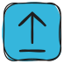
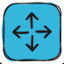
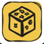

## 🧭 Movimento

| Comando | Tessera | NFC Code |
| --- | --- | --- |
| Avanti |  | `cfor` |
| Sinistra |  | `clef` |
| Destra |  | `crig` |
| Indietro |  | `cbac` |
| Movimento casuale |  | `crnd` |

## 🔁 Ripetizione e Controllo

| Comando | Tessera | NFC Code |
| --- | --- | --- |
| Ripeti 2–999 |  | `r002`–`r999` |
| Ripeti un numero casuale di volte (da 1 a 6) |  | `rrnd` |
| Funzione |  | `cfun` |
| Pausa (1–999 s; senza numero 1 s) |  | `cwat` |

## 🔢 Numeri

| Valore | NFC Code |
| --- | --- |
| Numeri 1–999 | `n001`–`n999` |

## 🧮 Operazioni matematiche

| Operazione | NFC Code |
| --- | --- |
| +1 a +999 | `a001`–`a999` |
| −1 a −999 | `s001`–`s999` |
| ×N | `m002`–`m999` |
| ÷N | `d002`–`d999` |
| X^N | `e002`–`e999` |
| Radice quadrata di X | `sqrt` |
| Fattoriale | `fact` |

L'aritmetica conta fino a 5000 in entrambe le direzioni, la divisione e la radice si arrotondano all'intero più vicino. Se non c'è risposta (oltre 5000, divisione per 0, radice di un numero negativo, fattoriale oltre 6), la cella lampeggia in rosso e il numero resta quello di prima.

## ⚙️ Impostazioni

| Comando | NFC Code |
| --- | --- |
| Calibrazione (senza numero: il robot regola motori e giroscopio, circa 2 minuti, nel primo mezzo minuto non toccarlo; con la tessera `+N` o `−N`: correzione delle rotazioni dopo la prova con 32 rotazioni; con un numero semplice non funziona, la cella diventa rossa) | `ccal` |
| Passo predefinito: lunghezza del passo per Avanti e Indietro, la usa anche Movimento casuale (1–999 mm; senza numero torna a 150 mm) | `clen` |

## 🔧 Avanzato

| Comando | NFC Code |
| --- | --- |
| Campione audio (vedi [File audio](/it/sounds_reference)) | `xNNN` |
| Frase del robot (`csou` + numero N: il robot pronuncia la frase xN dalla [tabella dei suoni](/it/sounds_reference#-frasi-del-robot-reazioni-e-messaggi-di-servizio-x001–x019)) | `csou` |
| Livello volume (pulsantiera e robot: 0–100, oltre 100 = massimo) | `clvl` |

## Come scrivere dati su un tag NFC

Può creare il Suo token: scriva semplicemente un codice testo su un tag NFC. Può usare qualsiasi numero (da 1 a 999), qualsiasi ripetizione e qualsiasi numero per le operazioni aritmetiche.

Per scrivere dati testo su un tag NFC, apra il Google Play Store e installi l'app **RFID NFC Reader** o **NFC Tools** sul Suo telefono.

Le istruzioni per scrivere un tag NFC si trovano qui — [youtu.be/UbKaQxZs8JA](https://youtu.be/UbKaQxZs8JA)

  <iframe
    src="https://www.youtube.com/embed/UbKaQxZs8JA?si=WT8wWYBe_Ql7TovQ"
    style={{
    position: 'absolute',
    top: 0,
    left: 0,
    width: '100%',
    height: '100%',
  }}
    frameBorder="0"
    allow="accelerometer; autoplay; clipboard-write; encrypted-media; gyroscope; picture-in-picture"
    allowFullScreen
  />

