PrimaSTEM è uno strumento educativo per bambini dai 4 ai 12 anni che aiuta a imparare a programmare senza computer, tablet o telefoni. Sviluppa la logica, le capacità di programmazione e la matematica.

Le attività con PrimaSTEM rendono la programmazione semplice e visiva per i bambini. Anche i più piccoli trovano il processo comprensibile e tattile - le basi della programmazione, della logica e della matematica vengono apprese sotto forma di gioco.

Giocare con PrimaSTEM promuove lo sviluppo di competenze chiave: pensiero logico, algoritmica, programmazione, matematica, geometria, nonché lo sviluppo creativo e socio-emotivo. Il kit PrimaSTEM è un passo preparatorio prima di familiarizzare con i linguaggi di programmazione a blocchi come [Scratch](https://en.wikipedia.org/wiki/Scratch_(programming_language)) o [LOGO](https://en.wikipedia.org/wiki/Logo_(programming_language)).

## Conoscere il kit educativo

### Dove si può usare PrimaSTEM?

L'uso è efficace nei seguenti programmi educativi:

- Centri di educazione prescolare
- Asili con metodologia Montessori
- Scuola primaria
- Istruzione domiciliare
- Centri di sviluppo specializzati
- Gruppi di tempo prolungato
- Club di programmazione per principianti
- Camp educativi per bambini

### Cosa bisogna sapere per iniziare?

Prima di lavorare con il kit, consigliamo a insegnanti e genitori di consultare il [manuale utente](usermanual) e questa guida. Non sono richieste competenze speciali di programmazione - i materiali forniscono le basi necessarie per iniziare l'insegnamento.

## Ricerca e valore del kit

PrimaSTEM è ispirato al linguaggio di programmazione [LOGO](https://en.wikipedia.org/wiki/Logo_(programming_language)), creato da [Seymour Papert](https://en.wikipedia.org/wiki/Seymour_Papert), e alla pedagogia Montessori. LOGO e il robot tartaruga hanno reso la programmazione visiva e accessibile ai bambini.

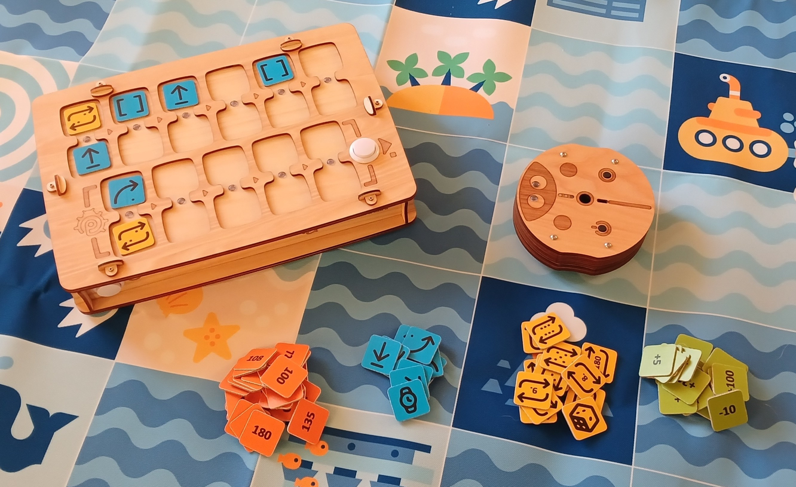

Le tessere-comando PrimaSTEM implementano questo approccio. L'apprendimento diventa intuitivo attraverso un semplice controllo tattile, senza schermi o testo.

Osservando il robot, i bambini imparano a comprendere ogni comando, padroneggiando gli algoritmi nella pratica.

Il robot ha una qualità importante: ha una direzione, il che permette al bambino di identificarsi con esso e comprendere più facilmente la logica di base del funzionamento dei programmi.

Tutti i comandi sono semplici e chiari: indicano in quale direzione esatta il robot deve muoversi. Insegnare al robot ad "agire" o "pensare" fa riflettere i bambini sulle proprie azioni e pensieri, rendendo il processo di apprendimento della programmazione più efficace.

Le tessere PrimaSTEM sono una rappresentazione visiva e semplificata dei linguaggi di programmazione. All'inizio dell'apprendimento, non ci sono testi o numeri - solo comandi di base.

### Perché legno?

🌱 La pulsantiera e il robot sono realizzati in legno. La pratica ha dimostrato che i bambini preferiscono giocare con giocattoli di legno - sono sicuri, durevoli e creano una storia di utilizzo individuale.

## Concetto di programmazione con PrimaSTEM

Le tessere fisiche PrimaSTEM sono analoghe alle istruzioni dei veri linguaggi di programmazione, dimostrando concetti importanti.

### Algoritmi

**Gli algoritmi** sono una sequenza di comandi precisi (tessere) che compongono un programma.

### Coda

I comandi sulla pulsantiera PrimaSTEM vengono eseguiti rigorosamente da sinistra a destra, dimostrando visivamente la coda di esecuzione.

### Correzione errori (debug)

Un errore è facile da correggere: basta sostituire la tessera. Questo approccio sviluppa la capacità di debug indipendente del programma.

### Funzione

Una funzione (sottoprogramma) è un insieme di comandi nella parte inferiore della pulsantiera, chiamato dal programma principale tramite la tessera "**Funzione**".

### Variabile

La pulsantiera ricorda l'ultimo numero di ogni comando. Avanti, Indietro, Sinistra, Destra e Pausa conservano ciascuno il proprio valore. Un comando senza numero usa quello memorizzato. Questa è una variabile: ha un nome (il comando) e un valore (il numero), e il valore si può cambiare.

## Applicazione in altre materie

PrimaSTEM aiuta a padroneggiare altre competenze:

- **Comunicazione**: Il gioco di gruppo promuove la collaborazione.
- **Motricità**: Lavorare con le tessere migliora la coordinazione.
- **Competenze sociali**: I bambini imparano fiducia e risoluzione collaborativa dei problemi.
- **Matematica**: Vengono appresi concetti matematici di base.
- **Logica**: I bambini imparano a costruire sequenze e prevedere risultati.

> Costruendo una catena di tessere, il bambino padroneggia la programmazione in modo tattile, visivo e mentale. Dopo aver premuto il pulsante "Esegui", il robot si muove e il risultato viene confrontato con l'aspettativa del bambino. Questa esperienza completa accelera l'apprendimento.

## Conoscere il robot e la pulsantiera

### Il robot

Dite ai bambini che il robot è il loro amico che possono programmare. Spiegate: non ha pensieri propri ed esegue solo le loro istruzioni - come un elettrodomestico che deve essere acceso.

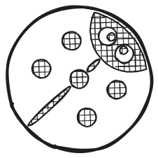

### La pulsantiera

Spiegate che la pulsantiera trasmette comandi al robot. Mostrate come installare le tessere-comando e programmare il robot.

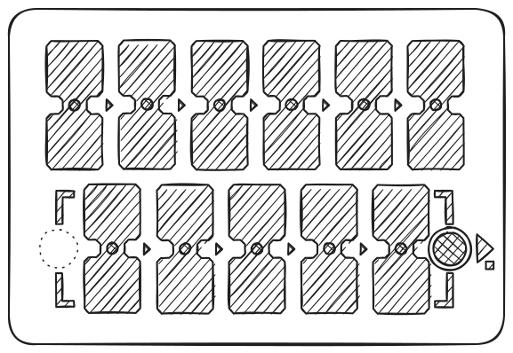

> Il programma principale viene costruito nella riga superiore della pulsantiera (6 celle). La riga inferiore (5 celle) è destinata al sottoprogramma-funzione e viene utilizzata con il comando "**Funzione**".

### Tessere-comando

Le tessere sono comandi per il robot che vengono inseriti nella pulsantiera. Dopo aver premuto "Esegui", il robot esegue la sequenza. Ogni tessera è un comando separato, che insegna ai bambini il pensiero computazionale e la progettazione di programmi. È importante che i bambini capiscano cosa fa il robot quando viene attivato ogni comando. Questo insegna loro la progettazione di programmi e la previsione delle azioni del robot. Spiegate ai bambini: le tessere non devono essere perse o danneggiate, senza di esse il robot non potrà muoversi.

## 1 - Primo programma

### Causa ed effetto

L'obiettivo principale è mostrare ai bambini la connessione tra comando e azione. Lasciate che il bambino inserisca la tessera "Avanti" nella prima cella della pulsantiera e prema "Esegui". Il bambino dovrebbe vedere la corrispondenza tra la tessera e l'azione.

### Istruzioni univoche

Ripetete i passaggi con ogni direzione (**avanti**, girare **sinistra**, girare **destra**) finché il bambino non impara a riconoscere ogni tessera.

### Primo compito

Preparate il tabellone di gioco o create una griglia 15x15 cm con nastro adesivo o un pennarello. Posizionate il robot sulla cella di partenza. Chiedete al bambino di creare un programma per muoversi di una cella in avanti. Se è stata scelta la tessera sbagliata, riportate il robot e suggerite di ragionare su una nuova opzione.

## 2 - Programma e debug

### Coda degli eventi

Posizionate un obiettivo a due celle davanti al robot.

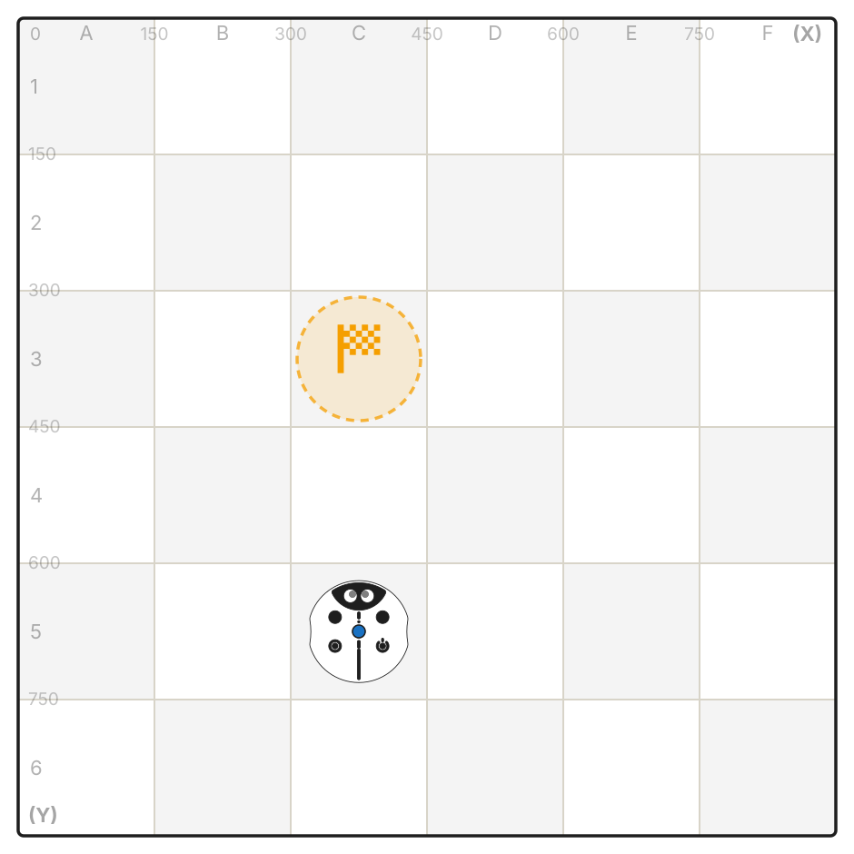

Lasciate che il bambino crei un programma di due tessere per raggiungere l'obiettivo.

### Sequenza di tre tessere

Questa volta, l'obiettivo è una cella avanti e una cella a destra.

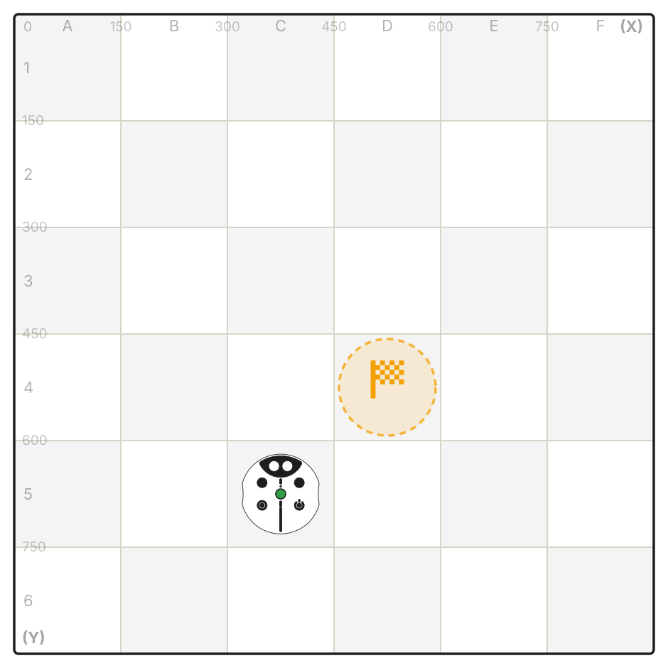

Lasciate che il bambino scelga da solo la sequenza corretta di comandi.

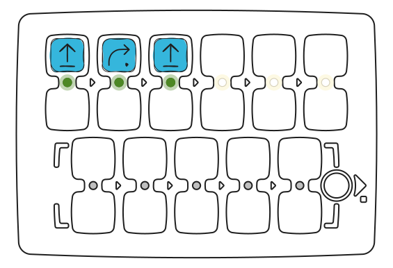

Non preoccupatevi se è stata scelta la tessera sbagliata. Semplicemente riportate il robot alla sua posizione originale e chiedete al bambino di ragionare sulla sua scelta e provare nuove opzioni.

### Debug - trovare l'errore

Posizionate il punto di arrivo a un quadrato davanti al robot e a un quadrato alla sua sinistra.

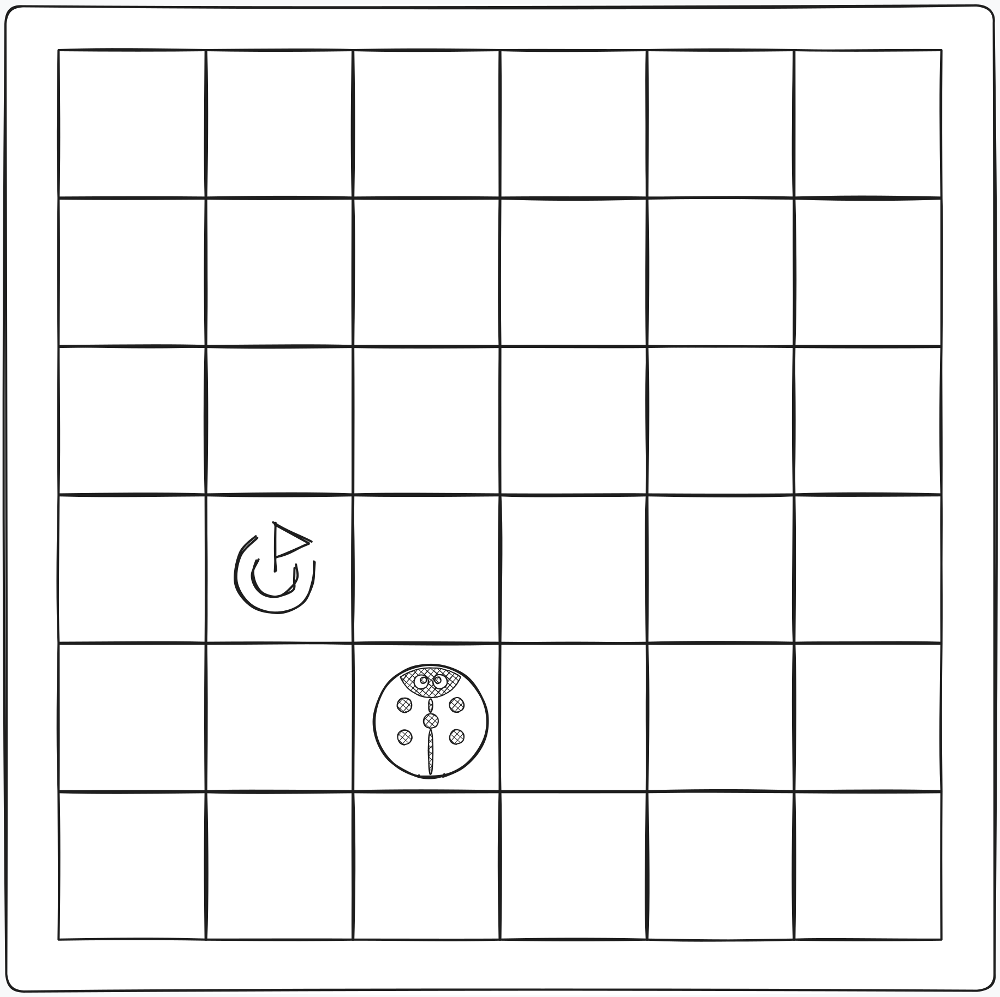

Questa volta, create un programma per risolvere il problema inserendo intenzionalmente una svolta errata nella sequenza.

Chiedete al bambino di prevedere il comando errato nel programma e di prevedere indipendentemente il risultato errato, quindi consentitegli di premere il pulsante "**Esegui**" per confermare la sua ipotesi.

Dopo che il bambino ha confermato che la sequenza presentata era errata, tramite ragionamento o verifica, consentitegli di cambiare il comando errato con quello corretto, eseguendo così il debug del programma.

## 3 - Programma con funzione

### Comando "Funzione"

Quando i comandi di base sono stati padroneggiati, introducete la tessera-comando **Funzione**. Questo è un insieme ripetibile di comandi a cui si può accedere dal programma principale.

> Per spiegare come funziona, potete usare la metafora della torre (sotto la tessera funzione sono impilati altri comandi uno dopo l'altro), spiegando che si possono inserire più istruzioni all'interno di una singola tessera.

Mostrate un esempio: prima posizionate due tessere "Avanti" nelle celle superiori ed eseguite il programma - il robot avanzerà di due celle.

Ora posizionate le stesse due tessere "Avanti" nella funzione (riga inferiore) e usate "Funzione" nel programma principale. Il risultato sarà lo stesso, ma ora parte del programma è nascosta in un sottoprogramma.

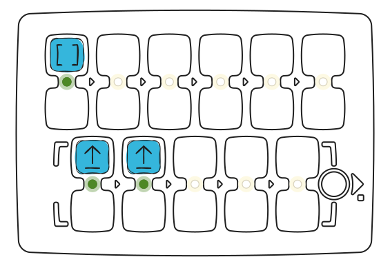

Successivamente, create la sequenza: **Avanti - Avanti - Destra - Avanti - Avanti**.

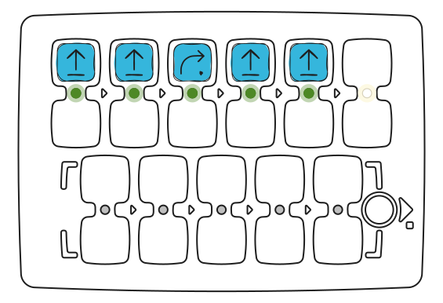

Chiedete ai bambini di trovare le parti ripetitive e "nasconderle" nella funzione. La sequenza finale: nella parte principale - **Funzione - Destra - Funzione**, in basso - **Avanti - Avanti**.

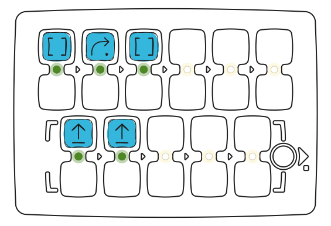

[Avvia nel simulatore](https://simulator.primastem.com/#top=cfun,crig,cfun&fn=cfor,cfor&s=l1144602&r=225-825-0&run)

### Risolvere compiti con funzione

Date al bambino 3 tessere "**Avanti**" e 2 "**Funzione**".

Il compito - avanzare di 5 celle.

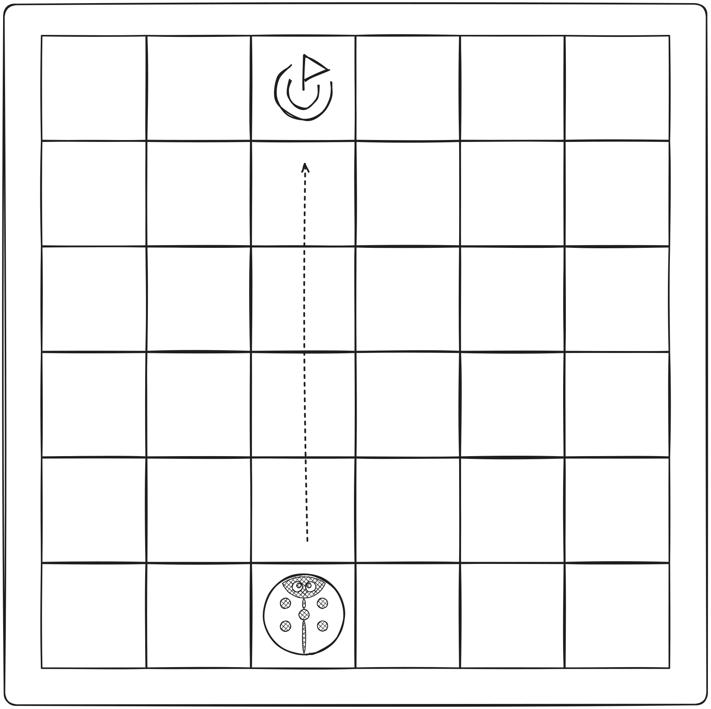

Lasciate che il bambino capisca che deve usare la funzione per un'azione multipla e risolvere questo compito.

Se la sequenza è errata, semplicemente riportate il robot alla sua posizione originale e chiedete al bambino di ragionare sulla soluzione corretta del compito e provare nuove opzioni.

[Avvia nel simulatore](https://simulator.primastem.com/#top=cfun,cfun,cfor&fn=cfor,cfor&s=l1144602&r=225-825-0&run)

## 4 - Casualità

### Comando "Direzione casuale"

Per introdurre il concetto di casualità, prendete 4 tessere di direzione: "**Avanti**", "**Sinistra**", "**Destra**" e "**Indietro**", mettetele in una scatola opaca o sacchetto, mescolatele e chiedete ai bambini di estrarre 1 tessera senza guardare e mostrarla al gruppo, quindi rimetterla. Spiegate ai bambini cos'è la casualità da quattro stati con questo esempio.

Poi mostrate ai bambini la tessera-comando "**Movimento casuale**".

Spiegate che questa tessera fa quasi la stessa cosa che facevano prima estraendo tessere casuali dal sacchetto: seleziona casualmente una direzione in cui andrà il robot e poi lo sposta di 1 passo logico - una cella. Cioè, il robot può muoversi di 1 cella in avanti, a destra, a sinistra o indietro.

Posizionate la tessera "**Movimento casuale**" nella cella superiore ed eseguite il programma più volte - il robot si muoverà in modo diverso ogni volta.

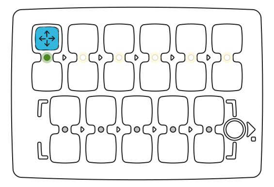

[Avvia nel simulatore](https://simulator.primastem.com/#top=crnd&s=l1144602&r=375-525-0&run)

Giocate con i bambini: fate indovinare loro dove andrà il robot prima di eseguire il comando.

Sottolineate che questa è **casualità** e non si può sempre indovinare correttamente la direzione.

Provate a fare un piccolo gioco usando la tessera "**Movimento casuale**" insieme ai bambini.

## 5 - Cicli (ripetizioni di comandi)

### Conoscere i cicli numerici

Mostrate ai bambini le tessere di valore, chiedete se conoscono i numeri, se hanno visto un dado da gioco per giochi da tavolo, se hanno giocato a tali giochi.

Posizionate due tessere "Avanti" nelle celle superiori ed eseguite - il robot avanzerà di due celle.

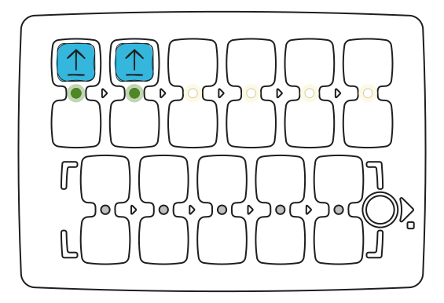

Ora lasciate un solo "Avanti" e posizionate sotto la tessera "ciclo 2". Il risultato sarà lo stesso: l'azione si ripeterà due volte.

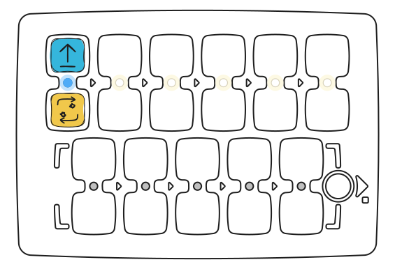

Installate 4 comandi "**Avanti**", osservate il risultato, poi chiedete ai bambini di usare tessere di valore - **cicli** - per ripetere il movimento del robot per 4 celle.

Sono possibili sia soluzioni semplici del compito con l'installazione della tessera "**Avanti**" e il valore di ciclo 4, sia altre opzioni: ad esempio "**Avanti**" con il numero di ciclo 3 e un altro comando "**Avanti**".

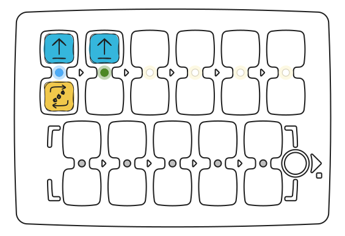

[Avvia nel simulatore](https://simulator.primastem.com/#top=cfor.r003,cfor&s=l1144602&r=225-825-0&run)

### Ciclo di chiamata funzione

Provate con i bambini ad applicare un ciclo con valori al comando "Funzione": ad esempio, facendo camminare il robot a zigzag usando il comando "Funzione" installato con un valore di ciclo di 5 e la sequenza funzionale nella parte inferiore della pulsantiera con i comandi "**Avanti**", "**Destra**", "**Avanti**", "**Sinistra**".

Prima create con la funzione un programma per il movimento "a gradino" - "avanti", "destra", "avanti", "sinistra" ed eseguitelo.

Poi aggiungete alla funzione un ciclo con il numero 5, ripetendo così la funzione più volte, il robot si muoverà a gradini verso destra e verso l'alto.

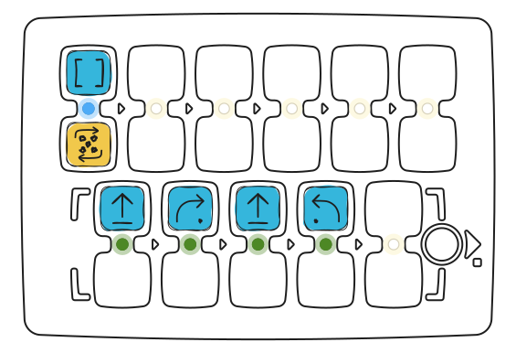

[Avvia nel simulatore](https://simulator.primastem.com/#top=cfun.r005&fn=cfor,crig,cfor,clef&s=l1144602&r=75-825-0&run)

Il robot si muoverà a scala diagonalmente verso destra e verso l'alto, facendo 5 gradini lungo il percorso.

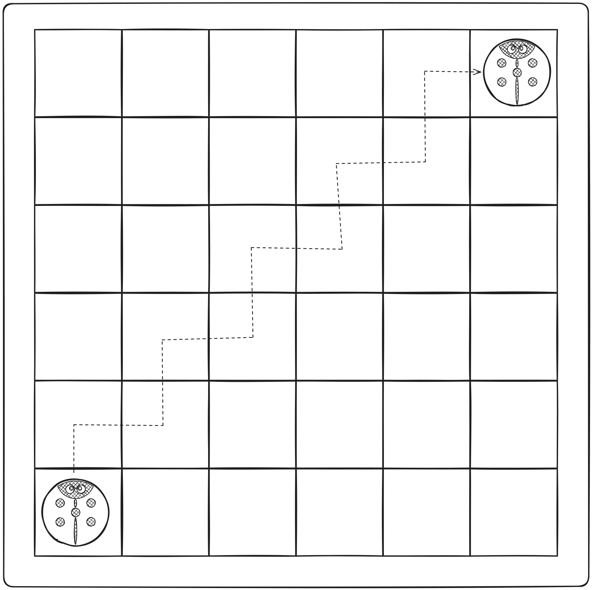

## 6 - Numeri casuali

### Concetto di numero casuale

Tra le tessere c'è "Numero di ciclo casuale" (con l'immagine di un dado). Seleziona un valore casuale da 1 a 6. Giocate a un gioco estraendo tessere di ciclo da un sacchetto.

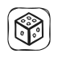

Per introdurre il concetto di numero casuale, prendete 4 tessere di ciclo: "**2**", "**3**", "**4**" e "**5**", mettetele in una scatola opaca o sacchetto, mescolatele e chiedete ai bambini di estrarre 1 tessera senza guardare e mostrarla, nominando i valori, quindi rimetterla. Giocate: chi estrae il valore più alto. Spiegate ai bambini cos'è la casualità da quattro stati con questo esempio.

Poi mostrate ai bambini la tessera-valore "**Numero di ciclo casuale**". Spiegate che questa tessera fa quasi la stessa cosa che facevano prima, estraendo tessere di valore casuali dal sacchetto: seleziona casualmente 1 di 6 numeri (da 1 a 6), come un dado da gioco, per trasmettere al robot e ripetere le azioni.

Posizionate la tessera "**Avanti**" nella cella superiore della pulsantiera e la tessera "**Numero di ciclo casuale**" sotto. Chiedete ai bambini di premere il pulsante "**Esegui**". Riportate il robot al suo posto originale. Ripetete questo compito più volte.

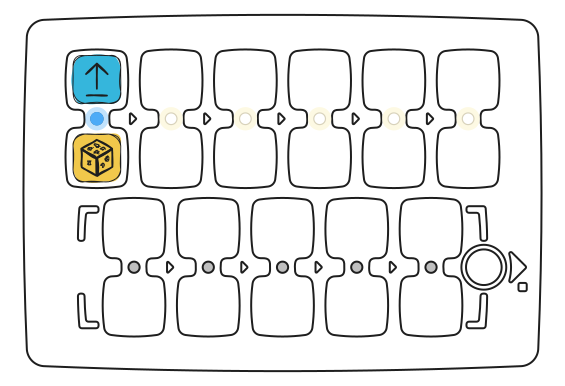

[Avvia nel simulatore](https://simulator.primastem.com/#top=cfor.rrnd&s=l1144702&r=225-975-0&run)

Giocate: il cui robot percorrerà più strada.

Richiamate l'attenzione dei bambini sul fatto che il robot si muove di un numero casuale di celle: da 1 a 6. Sottolineate che questa è casualità e non si può sapere in anticipo quanto lontano percorrerà il robot.

## 7 - Numeri: distanze e angoli

### Conoscere i numeri

Senza installare valori numerici per i comandi (sopra o sotto il comando nella doppia cella), il robot utilizza i parametri di movimento predefiniti: senza parametri, il robot avanza di 15 cm e gira di 90°. Questi valori possono essere modificati utilizzando tessere di valore.

Esempio: Aggiungete il valore **200** al comando "**Avanti**" e osservate quale distanza percorrerà il robot. Aggiungete il valore **180** al comando "**girare**" e valutate le modifiche.

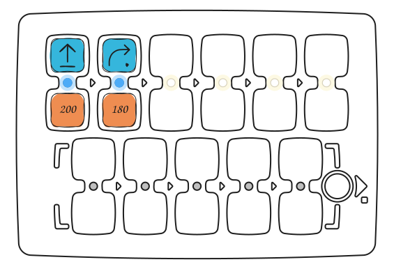

[Avvia nel simulatore](https://simulator.primastem.com/#top=cfor.n200,crig.n180&s=l1047602&r=450-600-0&run)

> **Importante:** La pulsantiera salva l'ultimo valore impostato per i comandi di movimento e rotazione. Se un comando viene utilizzato senza un nuovo valore, l'ultimo valore salvato si applica fino a quando la pulsantiera non viene spenta. Impostare un nuovo valore modifica il valore predefinito. I valori predefiniti (150 mm = 15 cm e 90°) possono essere ripristinati impostandoli esplicitamente o riavviando la pulsantiera.

Modificare i parametri consente di creare traiettorie e scenari di movimento più complessi. Vedere gli esempi nella [pagina dei disegni matematici](mathdrawings).

## 8 – Aritmetica

### Operazioni aritmetiche

Le operazioni aritmetiche con i numeri consentono di modificare dinamicamente i valori nel programma per i comandi di movimento (Avanti, Indietro, Sinistra, Destra), rendendo il controllo del robot più flessibile.

Quando si aggiunge un'operazione aritmetica, la pulsantiera modifica il numero salvato per il comando di movimento e invia il nuovo valore al robot.

Esempio:

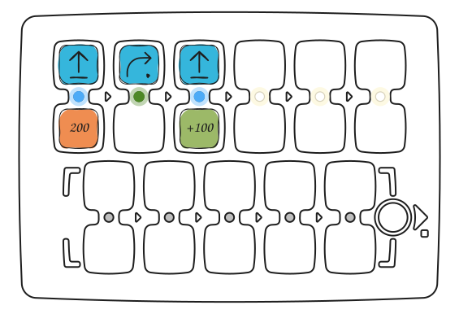

[Avvia nel simulatore](https://simulator.primastem.com/#top=cfor.n200,crig,cfor.a100&s=l1047602&r=300-700-0&run)

"Avanti 200" — il robot si sposta di 20 cm, "Avanti +100" — altri 30 cm. Distanza totale: 50 cm.

### Esercizio: una spirale che cresce

L'aritmetica cambia il numero memorizzato, cioè la variabile. Costruite il programma: nella riga in alto Avanti 30 e Funzione × 20, in quella in basso Destra e Avanti +30. A ogni chiamata della funzione il lato si allunga di 3 cm.

Chiedete prima ai bambini di prevedere: quanto sarà lungo il quinto lato? Poi avviate il programma e verificate. Risposta: 15 cm (3 + 3 + 3 + 3 + 3).

[Avvia nel simulatore](https://simulator.primastem.com/#top=cfor.n030,cfun.r020&fn=crig,cfor.a030&s=l1047602&r=450-465-0&run)

<Columns cols={2}>
  <Frame caption="Programma sulla pulsantiera">
    
  </Frame>
  <Frame caption="Cosa disegna il robot">
    
  </Frame>
</Columns>

Lo stesso programma in LOGO: [PrimaSTEM e LOGO](logo).

L'uso di tali operazioni in un ciclo consente di creare progressioni.

> Se il risultato di un'operazione aritmetica diventa negativo, il robot esegue l'azione inversa: invece di avanzare, indietreggia; invece di girare a sinistra, gira a destra.

Disponibili: addizione (+), sottrazione (−), moltiplicazione (*), divisione (/), radice quadrata (√), elevamento a potenza (^).

Gli esempi di motivi sono mostrati nella [pagina dei disegni matematici](mathdrawings).

---

## Giocate e imparate insieme ai bambini!

Conoscete meglio i vostri studenti. PrimaSTEM è uno strumento universale per l'apprendimento basato sul gioco. Usatelo per insegnare programmazione, logica e altre materie. Tutto dipende dalla vostra immaginazione!

p/s: Grazie per aver usato PrimaSTEM e per l'interesse mostrato! Attendiamo i vostri feedback, [scriveteci](contacts)关于您的经验和印象。

