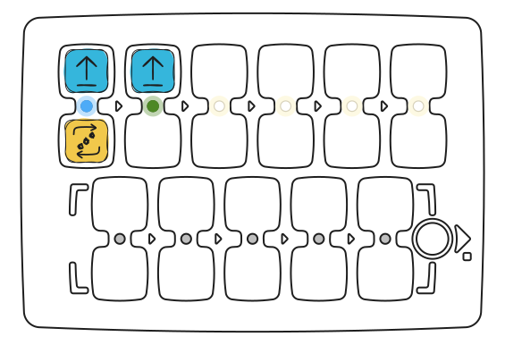
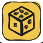

PrimaSTEM insegna ai bambini dai 4 ai 12 anni a programmare senza computer, tablet o telefoni. Il kit sviluppa la logica, le capacità di programmazione e la matematica.

Con PrimaSTEM la programmazione diventa semplice e visiva. Anche i più piccoli capiscono cosa succede: toccano le tessere con le mani e imparano giocando le basi della programmazione, della logica e della matematica.

Giocare con PrimaSTEM sviluppa il pensiero logico, l'algoritmica, la programmazione, la matematica e la geometria. Sviluppa anche la creatività e le competenze socio-emotive. Il kit prepara il bambino ai linguaggi di programmazione a blocchi, per esempio [Scratch](https://en.wikipedia.org/wiki/Scratch_(programming_language)) o [LOGO](https://en.wikipedia.org/wiki/Logo_(programming_language)).

## Conoscere il kit educativo

### Dove si può usare PrimaSTEM

PrimaSTEM è adatto a queste attività:

- Centri di educazione prescolare
- Asili con metodologia Montessori
- Scuola primaria
- Istruzione domiciliare
- Centri di sviluppo specializzati
- Gruppi di tempo prolungato
- Club di programmazione per principianti
- Camp educativi per bambini

### Cosa bisogna sapere per iniziare

Prima di lavorare con il kit, legga la pagina [Dispositivo e configurazione](/it/usermanual) e questa guida. Non servono competenze di programmazione: nei materiali c'è tutto per iniziare.

## Ricerca e valore del kit

PrimaSTEM si ispira al linguaggio di programmazione [LOGO](https://en.wikipedia.org/wiki/Logo_(programming_language)), creato da [Seymour Papert](https://en.wikipedia.org/wiki/Seymour_Papert), e alla pedagogia Montessori. LOGO e il robot tartaruga hanno reso la programmazione visiva e accessibile ai bambini.

Le tessere-comando PrimaSTEM continuano questo approccio. Il bambino guida il robot con le mani, senza schermo né testo, e capisce subito cosa fa.

I bambini guardano il robot, capiscono ogni comando e imparano gli algoritmi nella pratica.

Il robot ha una qualità importante: ha una direzione. Il bambino si immagina facilmente al posto del robot e così capisce più in fretta la logica del programma.

Tutti i comandi sono semplici: dicono in quale direzione deve muoversi il robot. Quando i bambini insegnano al robot ad "agire" e a "pensare", cominciano a riflettere sulle proprie azioni e sui propri pensieri. Per questo la programmazione diventa più facile per loro.

Le tessere PrimaSTEM mostrano in modo visivo e semplice come sono fatti i linguaggi di programmazione. All'inizio non ci sono né testo né numeri, solo i comandi di base.

### Perché il legno

🌱 La pulsantiera e il robot sono fatti di legno (compensato). I bambini preferiscono giocare con giocattoli di legno. Sono sicuri, durano a lungo e ognuno ha la sua storia.

## Programmare con PrimaSTEM

Le tessere PrimaSTEM funzionano come le istruzioni dei veri linguaggi di programmazione. Mostrano concetti importanti della programmazione.

### Algoritmi

Un **algoritmo** è fatto di comandi precisi (tessere) che insieme formano un programma.

### Coda

La pulsantiera esegue i comandi rigorosamente da sinistra a destra. Così i bambini vedono che i comandi vengono eseguiti uno dopo l'altro.

### Correzione errori (debug)

Un errore è facile da correggere: basta sostituire la tessera. Così il bambino impara a trovare e correggere da solo gli errori nel programma.

### Funzione

Una funzione (sottoprogramma) è fatta di comandi nella riga inferiore della pulsantiera. Il programma principale la chiama con la tessera "**Funzione**".

### Variabile

La pulsantiera ricorda l'ultimo numero di ogni comando. Avanti, Indietro, Sinistra, Destra e Pausa conservano ciascuno il proprio valore. Un comando senza numero usa quello memorizzato. Questa è una variabile: ha un nome (il comando) e un valore (il numero), e il valore si può cambiare.

## Applicazione in altre materie

PrimaSTEM aiuta a sviluppare anche altre competenze:

- Comunicazione. Nel gioco di gruppo i bambini imparano a collaborare.
- Motricità. Lavorare con le tessere migliora la coordinazione.
- Competenze sociali. I bambini acquistano fiducia e imparano a risolvere i problemi insieme.
- Matematica. I bambini imparano i concetti matematici di base.
- Logica. I bambini imparano a costruire sequenze e a prevedere il risultato.

> Il bambino mette in fila le tessere e impara la programmazione con le mani, con gli occhi e con la testa. Preme **▶ Start**, il robot si muove e il bambino confronta il risultato con quello che si aspettava. Questa esperienza accelera l'apprendimento.

## Conoscere il robot e la pulsantiera

### Il robot

Dica ai bambini che il robot è il loro amico e che possono programmarlo. Spieghi che non ha pensieri propri. Esegue solo le loro istruzioni, come un elettrodomestico che bisogna accendere.

### La pulsantiera

Spieghi che la pulsantiera trasmette i comandi al robot. Mostri come mettere le tessere-comando e programmare il robot.

> Il programma principale va nella riga superiore della pulsantiera (6 coppie). La riga inferiore (5 coppie) serve per il sottoprogramma: lo chiama la tessera "**Funzione**".

### Tessere-comando

Le tessere danno i comandi al robot e si mettono sulla pulsantiera. Quando si preme **▶ Start**, il robot esegue il programma. Ogni tessera dà un comando. Così i bambini imparano il pensiero computazionale e imparano a comporre programmi. È importante che i bambini capiscano cosa farà il robot con ogni comando. Così potranno pianificare il programma e prevedere le azioni del robot. Spieghi ai bambini che le tessere non vanno perse o danneggiate: senza di esse il robot non può muoversi.

## 1. Primo programma

### Causa ed effetto

L'obiettivo principale: mostrare ai bambini il legame tra comando e azione. Lasci che il bambino metta la tessera "Avanti" nella prima cella della pulsantiera e prema **▶ Start**. Il bambino deve vedere che la tessera e l'azione sono collegate.

### Istruzioni univoche

Ripeta questo con ogni direzione (**avanti**, girare a **sinistra**, girare a **destra**) finché il bambino non impara a riconoscere ogni tessera.

### Primo compito

Prepari il tabellone di gioco o crei una griglia con celle di 15 × 15 cm con nastro adesivo o un pennarello. Posizioni il robot sulla cella di partenza. Chieda al bambino di creare un programma perché il robot avanzi di una cella. Se il bambino ha scelto la tessera sbagliata, riporti indietro il robot e gli proponga di pensare a un'altra soluzione.

## 2. Programma e debug

### Coda degli eventi

Posizioni un obiettivo a due celle davanti al robot.

Lasci che il bambino crei un programma di due tessere perché il robot raggiunga l'obiettivo.

### Sequenza di tre tessere

Ora l'obiettivo è una cella avanti e una cella a destra.

Lasci che il bambino scelga da solo l'ordine corretto dei comandi.

Non si preoccupi se il bambino ha scelto la tessera sbagliata. Riporti il robot alla partenza e chieda al bambino di riflettere sulla sua scelta e di provare altre soluzioni.

### Debug: trovare l'errore

Posizioni l'obiettivo a una cella davanti al robot e a una cella alla sua sinistra.

Questa volta crei Lei il programma e ci metta apposta una svolta sbagliata.

Chieda al bambino di trovare il comando sbagliato e di prevedere dove arriverà il robot. Poi lasci che il bambino prema **▶ Start** e verifichi la sua ipotesi.

Quando il bambino ha capito che il programma è sbagliato, ragionando o provando, lasci che sostituisca il comando sbagliato con quello giusto. Così esegue il debug del programma.

## 3. Programma con funzione

### Comando "Funzione"

Quando i bambini conoscono i comandi di base, mostri la tessera-comando **Funzione**. Questa tessera chiama un gruppo di comandi che il programma principale può ripetere.

> Per spiegare come funziona, paragoni la funzione a una torre: sotto la tessera funzione sono impilati altri comandi, uno dopo l'altro. Così i bambini vedono che in una sola tessera si possono mettere più istruzioni.

Mostri un esempio. Prima metta due tessere "Avanti" nelle celle superiori e avvii il programma. Il robot avanzerà di due celle.

Ora metta le stesse due tessere "Avanti" nella funzione (riga inferiore) e nel programma principale metta "Funzione". Il risultato è lo stesso, ma ora una parte del programma è nascosta in un sottoprogramma.

Poi componga la sequenza: **Avanti, Avanti, Destra, Avanti, Avanti**.

Chieda ai bambini di trovare le parti che si ripetono e di "nasconderle" nella funzione. Deve risultare così: nel programma principale **Funzione, Destra, Funzione**, nella riga inferiore **Avanti, Avanti**.

[Avvia nel simulatore](https://simulator.primastem.com/#top=cfun,crig,cfun&fn=cfor,cfor&s=l1144602&r=225-825-0&run)

### Risolvere compiti con funzione

Dia al bambino 3 tessere "**Avanti**" e 2 tessere "**Funzione**".

Il compito: avanzare di 5 celle.

Lasci che il bambino capisca che per questo compito serve una funzione che ripete l'azione.

Se il programma è sbagliato, riporti il robot alla partenza. Chieda al bambino di pensare a come risolvere il compito e di provare altre soluzioni.

[Avvia nel simulatore](https://simulator.primastem.com/#top=cfun,cfun,cfor&fn=cfor,cfor&s=l1144602&r=225-825-0&run)

## 4. Casualità

### Comando "Movimento casuale"

Per spiegare la casualità, prenda 4 tessere di direzione: "**Avanti**", "**Sinistra**", "**Destra**" e "**Indietro**". Le metta in una scatola opaca o in un sacchetto e le mescoli. A turno i bambini estraggono una tessera senza guardare, la mostrano al gruppo e la rimettono dentro. Con questo esempio spieghi che cos'è una scelta casuale tra quattro possibilità.

Poi mostri ai bambini la tessera-comando "**Movimento casuale**".

Spieghi che questa tessera fa quasi la stessa cosa che i bambini facevano con il sacchetto. Sceglie a caso una direzione e sposta il robot di un passo, cioè di una cella. Il robot può spostarsi di una cella in avanti, a destra, a sinistra o indietro.

Metta la tessera "**Movimento casuale**" nella cella superiore e avvii il programma più volte. Il robot si muoverà ogni volta in modo diverso.

[Avvia nel simulatore](https://simulator.primastem.com/#top=crnd&s=l1144602&r=375-525-0&run)

Giochi con i bambini: prima di ogni avvio, chieda di indovinare dove andrà il robot.

Sottolinei che questa è **casualità** e che non si può indovinare la direzione ogni volta.

Inventi insieme ai bambini un piccolo gioco con la tessera "**Movimento casuale**".

## 5. Cicli (ripetizioni di comandi)

### Conoscere i cicli numerici

Mostri ai bambini le tessere di ripetizione. Chieda se conoscono i numeri, se hanno mai visto un dado e se hanno giocato a giochi da tavolo.

Metta due tessere "Avanti" nelle celle superiori e avvii il programma. Il robot avanzerà di due celle.

Ora lasci una sola "Avanti" e metta sotto la tessera "Ripeti 2". Il risultato è lo stesso: l'azione si ripete due volte.

Metta 4 tessere "**Avanti**" e osservi il risultato. Poi chieda ai bambini di ripetere lo stesso movimento di 4 celle con una tessera di **ripetizione**.

Il compito si può risolvere in modi diversi. Una soluzione semplice: "**Avanti**" e "Ripeti 4". Un'altra soluzione: "**Avanti**" con "Ripeti 3" e ancora una "**Avanti**".

[Avvia nel simulatore](https://simulator.primastem.com/#top=cfor.r003,cfor&s=l1144602&r=225-825-0&run)

### Ripetere la funzione

Provi con i bambini ad aggiungere una ripetizione al comando "Funzione". Per esempio, il robot può andare a zigzag: nella riga superiore "Funzione" con "Ripeti 5", nella riga inferiore "**Avanti**", "**Destra**", "**Avanti**", "**Sinistra**".

Prima componga nella funzione il programma "gradino": "Avanti", "Destra", "Avanti", "Sinistra". Poi lo avvii.

Poi aggiunga alla funzione "Ripeti 5". La funzione si ripete 5 volte e il robot va a gradini verso destra e verso l'alto.

[Avvia nel simulatore](https://simulator.primastem.com/#top=cfun.r005&fn=cfor,crig,cfor,clef&s=l1144602&r=75-825-0&run)

Il robot va a scala in diagonale verso destra e verso l'alto e fa 5 gradini.

## 6. Numeri casuali

### Che cos'è un numero casuale

Tra le tessere c'è "Ripeti un numero casuale di volte" (con un dado). Questa tessera sceglie un numero casuale da 1 a 6. Giochi con i bambini: lasci che estraggano tessere di ripetizione da un sacchetto.

Per spiegare il numero casuale, prenda 4 tessere di ripetizione: "**2**", "**3**", "**4**" e "**5**". Le metta in una scatola opaca o in un sacchetto e le mescoli. A turno i bambini estraggono una tessera senza guardare, la mostrano, dicono il numero e la rimettono dentro. Giochi a chi estrae il numero più alto. Con questo esempio spieghi che cos'è una scelta casuale tra quattro possibilità.

Poi mostri ai bambini la tessera "**Ripeti un numero casuale di volte**". Spieghi che fa quasi la stessa cosa che i bambini facevano con il sacchetto. Come un dado, sceglie a caso un numero da 1 a 6, e il robot ripete l'azione quel numero di volte.

Metta la tessera "**Avanti**" nella cella superiore della pulsantiera e sotto la tessera "**Ripeti un numero casuale di volte**". Chieda ai bambini di premere **▶ Start**. Riporti il robot al suo posto. Ripeta più volte.

[Avvia nel simulatore](https://simulator.primastem.com/#top=cfor.rrnd&s=l1144702&r=225-975-0&run)

Giochi a chi fa andare il robot più lontano.

Faccia notare ai bambini che il robot percorre un numero casuale di celle, da 1 a 6. Sottolinei che questa è casualità e che non si può sapere in anticipo quanto lontano andrà il robot.

## 7. Numeri: distanze e angoli

### Conoscere i numeri

Se nella seconda cella della coppia non c'è un numero, il robot usa i valori predefiniti: avanza di 15 cm e gira di 90°. Le tessere numero cambiano questi valori.

Esempio. Aggiunga il numero **200** al comando "**Avanti**" e osservi quanto lontano va il robot. Aggiunga il numero **180** alla rotazione e osservi cosa cambia.

[Avvia nel simulatore](https://simulator.primastem.com/#top=cfor.n200,crig.n180&s=l1047602&r=450-600-0&run)

> **Importante.** La pulsantiera memorizza l'ultimo numero per i comandi di movimento e rotazione. Se un comando non ha un nuovo numero, usa quello memorizzato finché non spegne la pulsantiera. Un nuovo numero sostituisce quello memorizzato. La lunghezza del passo impostata con la tessera «Passo predefinito» resta in memoria anche dopo il riavvio. Per tornare a 15 cm, usi quella tessera con il numero 150. La rotazione di 90° torna da sola dopo il riavvio.

Con numeri diversi il robot percorre tracciati più complessi. Gli esempi sono nella pagina [Esempi di disegni](/it/mathdrawings).

## 8. Aritmetica

### Operazioni aritmetiche

L'aritmetica cambia i numeri nel programma per i comandi di movimento (Avanti, Indietro, Sinistra, Destra). Così può guidare il robot in modo più flessibile.

Quando nella coppia c'è una tessera aritmetica, la pulsantiera cambia il numero memorizzato del comando e invia il nuovo valore al robot.

Esempio:

[Avvia nel simulatore](https://simulator.primastem.com/#top=cfor.n200,crig,cfor.a100&s=l1047602&r=300-700-0&run)

"Avanti 200": il robot percorre 20 cm. "Avanti +100": il robot percorre altri 30 cm. In totale 50 cm.

### Esercizio: una spirale che cresce

L'aritmetica cambia il numero memorizzato, cioè la variabile. Costruisca il programma: nella riga in alto Avanti 30 e Funzione × 20, in quella in basso Destra e Avanti +30. A ogni chiamata della funzione il lato si allunga di 3 cm.

Chieda prima ai bambini di prevedere: quanto sarà lungo il quinto lato? Poi avvii il programma e verifichi. Risposta: 15 cm (3 + 3 + 3 + 3 + 3).

[Avvia nel simulatore](https://simulator.primastem.com/#top=cfor.n030,cfun.r020&fn=crig,cfor.a030&s=l1047602&r=450-465-0&run)

<Columns cols={2}>
  <Frame caption="Programma sulla pulsantiera">
    
  </Frame>
  <Frame caption="Cosa disegna il robot">
    
  </Frame>
</Columns>

Lo stesso programma in LOGO: [PrimaSTEM e LOGO](/it/logo).

L'aritmetica in un ciclo crea progressioni.

> Se dopo l'aritmetica il numero diventa negativo, il robot fa l'azione inversa: va indietro invece che avanti e gira a destra invece che a sinistra.

Sono disponibili addizione (+), sottrazione (−), moltiplicazione (*), divisione (/), radice quadrata (√) ed elevamento a potenza (^).

Gli esempi di motivi sono nella pagina [Esempi di disegni](/it/mathdrawings).

---

## Giochi e impari insieme ai bambini

Lei conosce i Suoi studenti meglio di chiunque altro. Con PrimaSTEM può insegnare programmazione, logica e altre materie giocando. Tutto dipende dalla Sua immaginazione.

Grazie per aver scelto PrimaSTEM. [Ci scriva](/it/contacts) delle Sue esperienze e impressioni: aspettiamo il Suo feedback.
