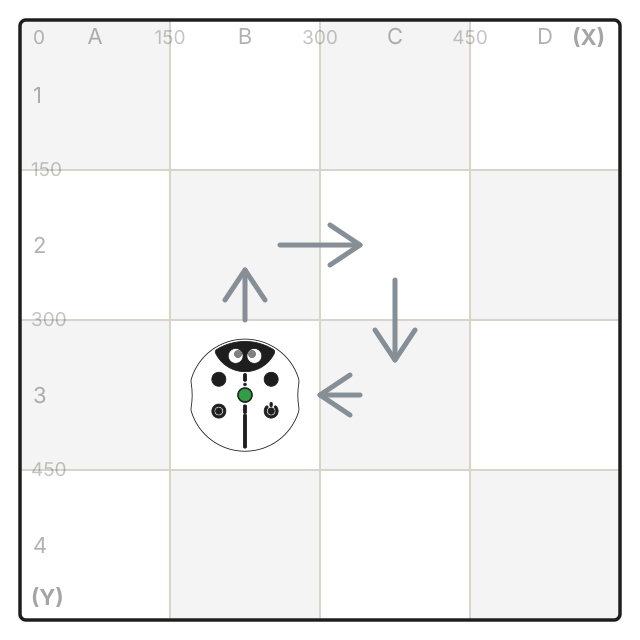
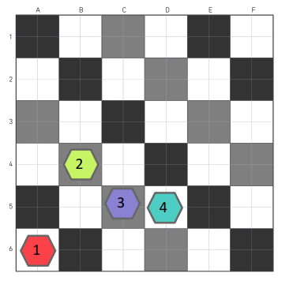
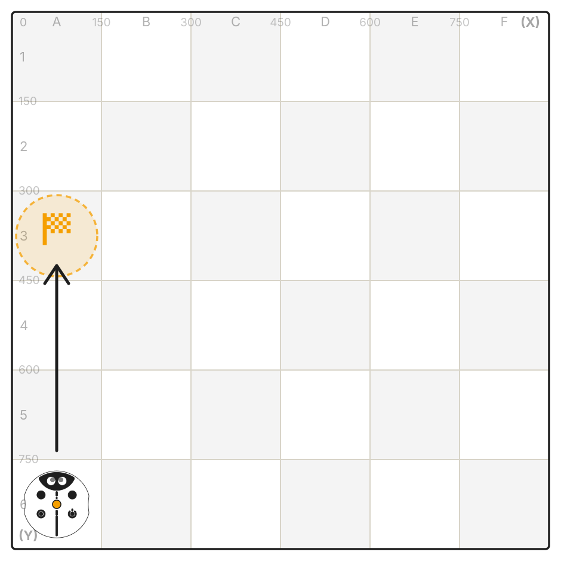
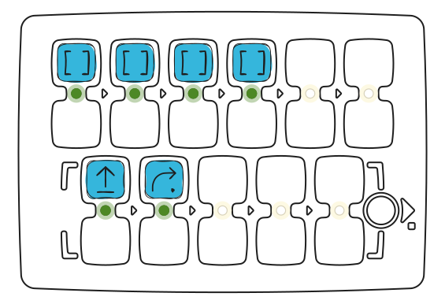
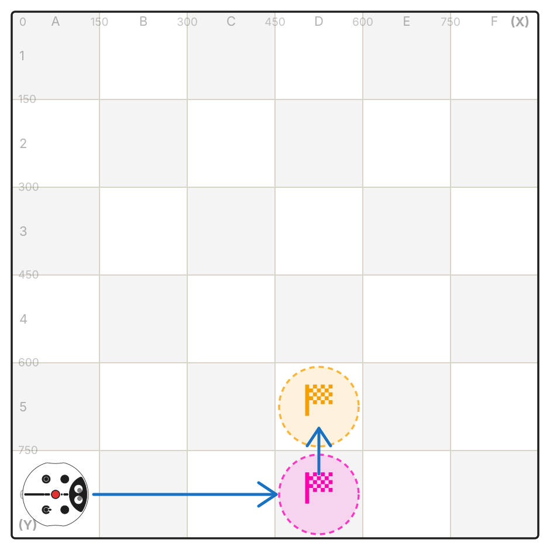

## 4歳からの子どもたちのための指導ガイド

PrimaSTEMは、子どもたちが論理的思考、プログラミング、数学の基礎を、ステップバイステップで身につけるのを助けます。このガイドは、4歳からの子どもたちと授業を行うときに役立ちます。

### 仕組み

子どもたちは、コントローラーにコマンドチップを置いて、小さなてんとう虫ロボットの動きをプログラミングします。

- **「前進」**：ロボットが直進します。
- **「左」**：ロボットが左に曲がります。
- **「右」**：ロボットが右に曲がります。
- **「関数」**（「[ ]」チップ）：一連のコマンドを置き換えます。
- **「リピート」**：コマンドや関数を数回繰り返します。

チップをコントローラーに置いて、ロボットの移動プログラムを作ります。プログラムができたら、ボタンを押します。ロボットが指示どおりに動きます。

### ガイドの内容

- ロボット工学とプログラミングの授業を行う理由
- さまざまな状況での授業の進め方
- 活動と学習目標
- 詳しい使用方法
- 活動の説明
- 付録
- プロジェクトと著者について

### PrimaSTEMで学べること

- 画面を使わず、手でプログラミングする
- 機械がアルゴリズムで動くことを理解する
- 行動を事前に計画する
- 論理的に考える
- コマンドの順序と関数を組み立てる
- 「バグ」（コード内のエラー）を理解し、エラーを見つける
- 数、算数、幾何学を目で見て学ぶ

## PrimaSTEMの構成

### ボックスの内容

- てんとう虫ロボット
- コントローラー
- コマンドチップ *
- 学習ガイド *

(*) 内容はセットによって異なります。

## なぜプログラミングと数学の授業を行うのか

コード、プログラミング、自動化は私たちの日常生活の一部となっています。

近年、人間は、かつては機械にできなかったことをする機械を作れるようになりました。理解する、話す、聞く、見る、答える、書く、といったことです。

自動運転車、高齢者向けの介助ロボット、配送ロボットなど、例はたくさんあります。

### なぜプログラミングとロボット工学なのか

プログラミングを学ぶと、私たちを取り巻く機械を理解できるようになります。小さくて大胆なアイデアを、実際のプロジェクトに変えられます。複雑な課題を単純なステップに分けられます。他の人と協力して、みんなの課題を解決できます。

### デジタル世代

今日、子どもや若者はデジタルエンターテインメントをよく使うので、テクノロジーに詳しく見えるかもしれません。

しかし、これらのツールを使って、自分のものを作り、自分を表現できるでしょうか？ 技術的な問題にぶつかったとき、どうするでしょうか？

## 授業の進め方

学習活動は、さまざまな目的や学習環境に合わせて作られています。ガイドの活動には番号が付いています。
以下に、あなたの環境に合う活動を示します。

### 対象

- 4歳から8歳の子ども。
- 幼稚園の年長・年少組、小学校1年生と2年生。

### 放課後向けの活動

活動1、2、4、5、6、7、8、9、10。

### 学校向けの活動

活動2、3、4、5、6、7、8、9、11、12。

### 放課後の進め方

全員が積極的に参加できるように、グループは12人以下にします。

2〜3人の生徒に1台のデバイスを使うのがおすすめです。子どもたちはチームで学び、コミュニケーションを取れます。

### 学校での進め方

授業では、1人の教師が4〜6人の小グループとPrimaSTEMを使うのが理想的です。
その間、他の生徒は、教育助手と一緒に別の課題に取り組みます。たとえば小学校1〜2年生なら、プログラムに従ってロボットの経路を描く練習ができます。
どちらの場合も、多目的ホールの床の上で活動するのがおすすめです。机や椅子を動かして、場所を空けてもかまいません。

**注意**：コントローラーとロボットのバッテリーを、事前に充電しておいてください。

## 活動と学習目標

| 活動 | アルゴリズムとプログラム | ルートの段階分け | 移動の予測 | 問題解決とデバッグ | チームワーク |
| --- | :---: | :---: | :---: | :---: | :---: |
| 1 |   | X |   | X |   |
| 2 |   |   | X |   | X |
| 3 | X | X |   |   |   |
| 4 | X | X | X |   |   |
| 5 | X | X | X |   | X |
| 6 | X | X | X | X | X |
| 7 | X | X | X | X | X |
| 8 | X |   | X | X |   |
| 9 | X | X | X | X | X |
| 10 | X |   | X | X |   |
| 11 | X | X | X | X | X |
| 12 | X | X | X | X | X |

## 使用説明書

### 説明書の内容

- 教材の紹介
- 関数のプログラミング
- マップ
- 技術的な説明

## 教材の紹介

### ロボット

2つの目を持つ、小さな木製のてんとう虫ロボットです。

2つの車輪と後部のスタンドの3つの支点で、バランスを保ちます。

### 基本コマンド

| コマンド | 図                                  | 説明                                                                                         |
| -------- | ----------------------------------- | -------------------------------------------------------------------------------------------- |
| 前進 |   | ロボットが1マス進みます。1マスは論理的ステップで、デフォルトは15 cmです。                    |
| 左 |      | ロボットが左に90°回転します                                                                  |
| 右 |     | ロボットが右に90°回転します                                                                  |
| 後退 |      | ロボットが後ろに1マス（デフォルトの論理的ステップ）戻ります                                  |
| 関数     |  | ロボットが関数の段にあるコマンドを実行します                                                 |
| リピート N |   | ロボットが、同じペアのコマンドをN回繰り返します                                              |

### コントローラー

コントローラーでは、空いているセル（D）にコマンドチップを置いて、ロボットを操作します。

上段（A）の6つのペアセルが、メインプログラムです。ペアセルは実行ライン（E）でつながっています。プログラムは左のセル（D）から始まり、**▶ スタート** ボタン（B）の手前で終わります。このボタンでロボットにコマンドを送り、プログラムを開始します。

下段（C）の5つのペアセルで、「関数」チップ（「[ ]」）が実行する動きを決めます。各ペアセルにはLED（F）があります。チップを置くと点灯し、ロボットがそのコマンドを実行している間は点滅します。

#### LEDの色

セルにチップが正しく置かれると、LEDが緑色に点灯します。
移動コマンドのペアセルにリピートを置くと、LEDが青色に点灯します。
チップの置き方が間違っていると、赤色のLEDが点灯します。たとえば、1つのペアセルに移動コマンドが2つある場合です。ロボットはそのコマンドをスキップします。

### バッテリーと電源ボタン

ロボットとコントローラーは内蔵バッテリーで動きます。充電はUSB-Cポートから行います。電源ボタン（ON/OFF）は、ロボットの上部とコントローラーの前面左側にあります。

ロボットやコントローラーの電源を入れると、短いビープ音が鳴ります。
コントローラーの電源が入っていると、前面パネルのLEDが緑色に点灯します。ロボットの電源が入っていると、USB-Cコネクタの近くのLEDが緑色に点灯します。

### ワイヤレス通信

ロボットとコントローラーはBluetoothで通信します。通信範囲は約5mです。ロボットをコントローラーに初めて接続したあとは、設定しなくても自動で通信します。

> コントローラーを別のロボットとペアリングできます。
> 1. コントローラーとペアリングされていないロボットの電源を入れます。
> 2. コントローラーの電源を入れます。
> 3. 音と光の信号が出るまで、コントローラーの **▶ スタート** ボタンを10秒間押し続けます。

### プログラムの作り方と実行

プログラム（「移動シーケンス」）は、コントローラーの左側から始まります。刻印された矢印「>」に沿って進みます。これは実行ラインで、水平方向のペアセルをつなぎます。

チップの前に空のセルがあっても、ロボットは空のセルをスキップして、そのチップのコマンドを実行します。

チップの置き方が間違っていると、LEDが赤色に点灯し、ロボットはプログラムのその部分をスキップします。たとえば、コマンドなしの「リピート」がペアセルにある場合や、1つのペアセルに移動チップが2つある場合です。

プログラムができたら、**▶ スタート** ボタンを押します。

ロボットがプログラムを実行している間、コントローラーのLEDが順番に消えていきます。実行中のコマンドのLEDは点滅します。

## 関数のプログラミング

### 関数の作り方

「関数」チップ（「[ ]」）は、一連のコマンドを置き換えます。

関数を使うと、より長いプログラムを作り、より難しい課題を解けます。関数を作るには、コントローラー下段の5つのペアセルに動きを置きます。ロボットは、メインプログラム（上段）で「関数」チップに来るたびに、この段を左から右へ実行します。

下の例では、関数が直進と右回転でできています。メインプログラムは関数を2回呼び出します。そのあと「リピート 2」チップが、関数をさらに2回繰り返します。

[シミュレーターで実行](https://simulator.primastem.com/#top=cfun,cfun,cfun.r002&fn=cfor,crig&s=l1144602&r=225-675-0&run)

実行すると、次のようになります。

## マップ

### 使えるマップ

最初の活動では、子どもたちはアルゴリズム、プログラミング、数を学びます。そのため、ロボットはグリッドのあるマップの上を走ります。15 cmのマス目のマップがおすすめです。ロボットがデフォルトで1歩に進む距離だからです。

マス目のサイズがロボットに合えば、他のロボット用のマップも使えます。

> デフォルトのステップ距離は、15 cmからお持ちのマップのマス目に合わせて変更できます（10 cm、12.5 cm、20 cmなど）。そのためには、特別な設定チップ「デフォルトステップ」に、mm単位の数値を組み合わせます（10 cmは100、12.5 cmは125、20 cmは200）。

マップがない場合は、自分で作ります。平らなテーブルや床にマスキングテープを貼ります。模造紙（または厚手のバナー生地）とマーカーでも作れます。

チェス盤マップや空白のマス目マップは、ある地点から別の地点への移動の練習に使います。色に気を取られません。

カラーマップは、ロボットの旅の短いお話を語るのに向いています。たとえば「てんとう虫は家を出て、森を通って山に行きます」。クラスで新しいマップを作り、てんとう虫の旅の新しいお話を考えてもよいでしょう。

#### マップの例

チェス盤マップ

カラーマップ

## 技術的な説明

### 構造

コントローラーとロボットには、マイコンとリチウムイオンバッテリーが入っています。2つの機器は、標準的な通信プロトコルであるBluetoothで無線接続されます。

ロボットの基板が、ロボットのすべての動作を制御します。基板は2つの5V DCモーターと2つのマルチカラーLEDを制御し、音を再生し、コントローラーと通信します。

コントローラーの基板は、セルに置かれたチップを識別し、音を再生し、11個のマルチカラーLEDを制御します。LEDはペアセルごとに1つです。

各チップにはNFCステッカーが入っていて、コマンドのコードが書かれています。コントローラーは、チップがセルに置かれたときにこのコードを読み取ります。

コントローラーがチップを識別し、あなたがプログラムを開始すると、コントローラーはコマンドを無線でロボットに送ります。

### 独自のコマンドチップ

「空の」NFCステッカー付きチップとNFC対応スマートフォンがあれば、コマンドチップを追加で作れます。たとえば「リピート 12」や、移動チップです。13.56 MHzのほとんどのステッカーが使えます。

ビデオ説明はYouTubeチャンネルにあります：https://www.youtube.com/@primastem

---

## 学習活動

### 各活動の詳しい説明

- **活動1**：チェス盤の上でA地点からB地点へ
- **活動2**：PrimaSTEMの紹介
- **活動3**：ロボット役になって学ぶ向きとアルゴリズム
- **活動4**：プログラムからロボットの経路を予測する
- **活動5**：ランダムなプログラムの指示の順序
- **活動6**：コントローラーでロボットを山へ
- **活動7**：「関数」チップの紹介
- **活動8**：関数で目標までのルートを作る
- **活動9**：エラーのあるプログラムのデバッグ
- **活動10**：紙の上でエラーを見つける
- **活動11と12**：ロボットの動きの予測（活動12は「関数」チップあり）

---

## 活動1. チェス盤の上でA地点からB地点へ

- **個別**
- **15分**
- **紙の上で**
- **印刷用ドキュメント**

### 目標

- マップ上のA地点からB地点へ、マス目に沿った経路を考える。

演習は10分間行い、その後にまとめを行います。

### 印刷用

生徒一人につき1枚、「[付録1. マップ上の移動](/jp/book-1/attachment-1)」を印刷してください。

### 演習

子どもたちは、ネズミがチーズにたどり着く経路をグリッド上に描きます。左側の簡単な演習から始め、右側の演習に進みます。

#### マス目の移動

ネズミはグリッドのマス目の上を移動します。斜めには移動できません。ネズミの経路は段階に分かれていて、一度に1マスずつ進むことを、子どもたちに理解させてください。これをステップバイステップの移動と呼びます。

上の例で正解なのは、青い経路だけです。短い赤い経路は、斜めに進むので間違いです。長い赤い経路は、目的の地点に着かないので間違いです。

### グループディスカッション

上の例では、描かれたすべての経路が正解です。どの経路でも、ネズミはチーズにたどり着けます。

全員が同じ経路を考えるわけではなく、複数の経路が正解になり得ることを子どもたちに示してください。

#### 一部の経路は他よりも長い

ネズミがチーズのあるマスまでに通るマスの数を数えます：
- 緑のルートは3マス
- グレーのルートは3マス
- 青のルートは3マス
- 黄色のルートは13マス

#### 最短経路

これらはすべて正解の経路ですが、ネズミは最短の経路を選びます。

子どもたちに聞きます。「なぜネズミは最短の経路を選んだのでしょうか？」

答えは何通りもあります。ネズミはエネルギーを節約したいのかもしれません。とても疲れていて、できるだけ歩きたくないのです。あるいは、急いでいるのかもしれません。とてもお腹が空いていて、できるだけ早くチーズにたどり着きたいのです。

**指導者へのメモ**：ロボットも同じです。効率がよいので、私たちは常に最短経路を選びます。

#### 複数の経路が可能

演習が終わったら、生徒に自分が描いた経路を見せてもらいます。経路は必ず複数あるので、生徒の答えはそれぞれ違い、どれも正解になるでしょう。

---

## 活動2. PrimaSTEMの紹介

- **15分**
- **グループ**
- **デモンストレーション**
- **実践**

### 目標

- ロボットがどう動けるかを理解する。
- コントローラーがロボットを制御することを知る。
- コマンドチップの働きを理解する。

生徒を小グループに分けます。低いテーブルの周りか床に座ります。グリッドのあるマップ、コントローラー、ロボット、チップを取り出します。すべての生徒に、グループごとに順番にPrimaSTEMを紹介します。

### プレゼンテーション

テーブルの上の物を一つずつ見せて、子どもたちに必要な言葉を伝えます。

まず、**マップ**です。活動1のグリッドと同じものですが、もっと大きいです。

次に、**てんとう虫ロボット**です。走ることができます。

ロボットは**コントローラー**で操作します。ロボットは、コントローラーのセルに置かれたチップのとおりに動きます。

**チップ**はコマンドです。ロボットに、前進する、左に曲がる、右に曲がると伝えます。

### 第1段階：デモンストレーション

用語を説明したら、自分でやってみせます。チップをコントローラーに置いて、何が起こるかを子どもたちに見せます。

| 画像                                               | 説明                                                                     |
| -------------------------------------------------- | ------------------------------------------------------------------------ |
|  | **「前進」** チップは、ロボットを1マス前進させます |

ロボットをマップのどのマスにでも置きます。下の図のように、プログラムの最初のセルにチップを置きます。そのあと、白い **▶ スタート** ボタンを押します。

ロボットが1マス前進します。

### 第2段階：操作を交代する

| 画像                                            | 説明                                                                                                                                                                             |
| ----------------------------------------------- | -------------------------------------------------------------------------------------------------------------------------------------------------------------------------------- |
|  | 中心を軸に弧を描く矢印の付いた **「左」** チップは、ロボットを反時計回りに左回転させます。デフォルトの回転は90度です。 |

コントローラーから「前進」チップを外し、「左」チップを子どもに渡します。子どもが自分でプログラムの最初のセルにチップを置き、白い **▶ スタート** ボタンを押します。ロボットはその場で左に4分の1回転します。

| 画像                                             | 説明                                                       |
| ------------------------------------------------ | ---------------------------------------------------------- |
|  | **「右」** チップは、ロボットを右回転させます。 |

別の子どもに、「左」チップを「右」チップに替えて、白い **▶ スタート** ボタンを押してもらいます。ロボットはその場で右に4分の1回転します。

次に、子どもたちに3つのチップ（**「前進」**、**「左」**、**「右」**）だけを渡し、順番にコントローラーを操作させます。

ロボットが動き終わったら、もう一度 **▶ スタート** ボタンを押すと、同じプログラムを繰り返せます。

チップは、1つのペアセルに2つのコマンドを置く場合を除いて、どのセルにも置けることを確認させます。ロボットは左から右へ、順番に実行します。

> ロボットが動いている間に、もう一度 **▶ スタート / ストップ** ボタンを押すと、プログラムを止められます。

---

## 活動3. ロボット役になって学ぶ向きとアルゴリズム

- **45分**
- **グループ**
- **ゲーム**
- **マップ**

### 目標

- プログラム開始時のロボットの向きを考える。
- プログラムに従ったロボットの動きを予測する。

### 印刷用

生徒一人につき1枚、「[付録2. ミッションカード](/jp/book-1/attachment-2)」を印刷してください。

### ゲームの原理

子どもたちが白黒のフィールド上でロボットになりきる、広い場所でのロールプレイングゲームです。

### ゲームのルール

一人の生徒が、マップの上でロボット役になります。マップの代わりに、正方形の模様のある床、タイル、床に貼ったマスキングテープも使えます。他の生徒は、ミッションカードを使ってロボット役をプログラミングします。

ロボット役の子どもがどの方向を向いているかは、伝えません。
ミッションを遂行するには、ロボットがどの向きであればよいかを、生徒自身が判断します。

1. ロボット役の子どもが赤いマス1に立ちます。緑のマス2まで行きます。
2. ロボット役の子どもが赤いマス1に立ちます。紫のマス3まで行きます。
3. ロボット役の子どもが赤いマス1に立ちます。青いマス4まで行きます。

> マップが長持ちするように、子どもには靴を脱いでもらってください。

### ゲームの終わり

ロボット役の子どもは、移動をプログラミングするときに、ロボットの位置と向きを考えなければならないことを理解します。

ロボットは、自分の向きに応じてコマンドを実行します。直進、左折、右折のどれも、**最初の向きを基準に動きます。**

---

## 活動4. プログラムからロボットの経路を予測する

- **45分**
- **個別**
- **紙の上で**
- **印刷用ドキュメント**

### 目標

- 最初のロボットの向きを考える。
- プログラムのコマンドを理解する。
- プログラムに従ったロボットの動きを予測する。

### 印刷用

生徒一人につき1枚、「[付録3. プログラムに従って経路を描く](/jp/book-1/attachment-3)」を印刷してください。

子どもたちは、数個のコマンドでできたプログラムのシートを受け取ります。ロボットがそのプログラムで進む経路を描きます。

このプログラムでは、ロボットは3回直進します。

<Columns cols={2}>
  <Frame>
    
  </Frame>
  <Frame>
    
  </Frame>
</Columns>

[シミュレーターで実行](https://simulator.primastem.com/#top=cfor,cfor,cfor&s=l1144602&r=75-825-0&m=02&run)

こちらも同じプログラムで、ロボットはやはり3回直進します。
ただし、最初は右を向いています。そのため、右へ3マス進みます。

<Columns cols={2}>
  <Frame>
    
  </Frame>
  <Frame>
    
  </Frame>
</Columns>

[シミュレーターで実行](https://simulator.primastem.com/#top=cfor,cfor,cfor&s=l1144602&r=75-825-90&m=35&run)

このプログラムでは、ロボットが回転します。最初に右に曲がり、それから2マス進みます。

<Columns cols={2}>
  <Frame>
    
  </Frame>
  <Frame>
    
  </Frame>
</Columns>

[シミュレーターで実行](https://simulator.primastem.com/#top=crig,cfor,cfor&s=l1144602&r=75-825-0&m=25&run)

最後の演習は、より難しくなります。ロボットは2回、向きを変えます。1マス直進し、右に曲がって1マス進みます。そのあと左に曲がって、2マス進みます。

<Columns cols={2}>
  <Frame>
    
  </Frame>
  <Frame>
    
  </Frame>
</Columns>

[シミュレーターで実行](https://simulator.primastem.com/#top=cfor,crig,cfor,clef,cfor,cfor&s=l1144602&r=75-825-0&m=12&run)

### 指導者へのメモ

紙の上でのこの演習は、難しい場合があります。
ロボットの回転や動きの順序を理解するのが難しい子どもには、PrimaSTEMのセットを使います。シートのプログラムを、コントローラーの上に並べてもらいます。
触って観察すると、よく理解できます。

---

## 活動5. ランダムなプログラムの指示の順序

- **45分**
- **グループ**
- **ゲーム**

### 目標

- 指示とロボットの動きを結び付ける。
- マップの境界を目で確認する。
- 指示をコントローラーに移せるようになる。

### ゲームの進行

1. ロボットをマップの好きなマスに置きます。端のマスがおすすめです。向きは自由です。
2. サイコロを振ります。ロボットを手で動かし、プログラムを紙かボードに記録します。「前進」コマンドの矢印を描きます。ロボットがマップの外に出る場合は、もう一度サイコロを振ります。

3. これを繰り返して、プログラムを2つ続けて作ります。ロボットがマップの外に出ないように、必要ならサイコロを振り直します。

最終的に、紙の上に「前進」コマンドの2つのプログラムができあがります。続けて実行すると、ロボットはマップの端に向かって必要なマス数だけ進みます。

例：

<Columns cols={2}>
  <Frame>
    
  </Frame>
  <Frame>
    

      
      
    

  </Frame>
</Columns>

**記録したプログラムを、PrimaSTEMで実際に実行してください。**

---

## 活動6. コントローラーでロボットを山へ

- **45分**
- **グループ**
- **実践**

### 目標

- ルートを段階に分ける。
- 特定の目標に向けてプログラムを作る。

この活動では次のものが必要です：
- コントローラー
- 移動チップ：各グループに「前進」4枚、「左」4枚、「右」4枚。残りのチップは脇に置きます。
- マップとロボット

子どもたちを3人または4人のグループに分けます。各グループにコントローラーとチップのセットを渡します。

### 第1段階：考える

てんとう虫ロボットは家にいます。これを山に連れて行きたいと考えます。山に着くためのプログラムを、ボードに書きます。

> 適切なマップがない場合は、必要な場所を紙に描いてください。子どもたちと一緒に描いてもよいでしょう。描いたものをテープでマップに貼ります。

まず、ロボットを山まで進ませるのにどのマスを通るか、子どもたちに尋ねます。ここでも選択肢はたくさんあります。エネルギーと時間を節約するため、最短ルートを選びます。

ルートが決まったら、ロボットが1マスずつ行う動きを、子どもたちと一緒に確認します。

直進するか、左に曲がるか、右に曲がるか？
ロボットを手でマップの上で動かし、各コマンドでロボットがどう動くかを見せます。

### 第2段階：プログラミング

子どもたちに、ロボットの動きを順番にコントローラーの上にチップで並べてもらいます。このプログラムで、ロボットが目標に着かなければなりません。

**期待されるプログラム：**

### 第3段階：チェック

プログラマーなら誰でも、プログラムが動くかを確かめます。子どもたちにプログラムをコントローラーに並べさせ、実行させます。

<Columns cols={2}>
  <Frame>
    
  </Frame>
  <Frame>
    
  </Frame>
</Columns>

[シミュレーターで実行](https://simulator.primastem.com/#top=cfor,cfor,crig,cfor&s=l1144602&r=75-825-0&m=13&run)

ロボットは山に着きましたか？ 着かなかった場合は、なぜでしょうか？ プログラムに間違いがあれば、子どもたちに自分で直させます。

---

## 活動7. 「関数」チップの紹介

- **15分**
- **グループ**
- **デモンストレーション**

### 目標

- 「関数」チップが他のコマンドを置き換えられることを理解する。
- コマンドの順序を繰り返す考え方を知る。

生徒を小グループに分けます。低いテーブルの周りか床に座ります。マップ、コントローラー、ロボット、コマンドチップを取り出します。グループごとに順番に「関数」チップを紹介します。

### 第1段階：デモンストレーション

子どもたちに「関数」チップを見せます。

「関数」チップは、「前進」「左」「右」「後退」の複数の移動コマンドを置き換えます。プログラムの同じ短い部分を、何回も繰り返すのにも使えます。

まず、自分でやってみせます。下の図のようなプログラムを作ります。

ロボットが「関数」チップに来ると、コントローラー下段の [-----] 枠内のコマンドを実行します。「関数」チップの代わりに、それらのコマンドが置かれているのと同じです。
この例では、ロボットは2回直進します。

### 第2段階：クイズ

次に、下の図のように、メインプログラムの最後に「右」チップを置きます。

プログラムを実行する前に、何が起こるか子どもたちに尋ねます。プログラムは、赤い「前進」チップ2つと「右」チップ1つがあるのと同じように動きます。ロボットは2マス進み、右に4分の1回転します。

最後に、**ループ**を見せます。
下の図のように、「関数」チップ4つのプログラムを並べます。

[シミュレーターで実行](https://simulator.primastem.com/#top=cfun,cfun,cfun,cfun&fn=cfor,crig&s=l1144602&r=225-675-0&run)

プログラムを実行する前に、何が起こるか子どもたちに尋ねます。そのあとプログラムを実行して確かめます。

**ロボットはループを実行します**：

**指導者へのメモ**：子どもたちが関数を学び始めるときは、LEDを見るとよく分かります。LEDは、プログラムの実行中に点滅します。実行中のコマンドが分かり、ロボットの動きも同時に見られます。

---

## 活動8. 関数で目標までのルートを作る

- **45分**
- **グループ**
- **実践**

### 目標

- ルートを段階に分ける。
- 特定の目標に向けてプログラムを作る。
- プログラムの中で「関数」チップを使う。

この活動では次のものが必要です：
- チップ、またはコマンドの絵を描いた手作りカード：各グループに「前進」4枚、「左」4枚、「右」4枚、「関数」4枚。
- マップとロボット（コントローラーは使いません）。

子どもが多い場合は、3人または4人のグループに分けます。各グループに、コマンドの絵のカードか、セットのチップを渡します。どちらも各種類ちょうど4枚です。

### 第1段階：考える

> お持ちのマップに別の絵がある場合や、絵がない場合は、課題を変えます。90度の角度で、4マス離れた2つの地点（スタートとゴール）を決めます。

ロボットは旗のところにいます。これを、雲が描かれた「夜」のマスに連れて行きたいと考えます。「関数」チップを使ったプログラムを作ります。テーブルの上に、チップかコマンドの絵を並べます。

まず、山に着くためにどのマスを通るか、子どもたちに尋ねます。山は、ほぼ中間にあります。選択肢はたくさんあります。今回は、「関数」チップを使えるように、コマンドが繰り返されるルートを選びます。

ルートが決まったら、ロボットが1マスずつ行う動きを、子どもたちと一緒に確認します。ロボットを手で動かして、プログラムを確かめます。

### 第2段階：チップが足りない

ロボットの動きを、カードかチップで順番にテーブルの上に並べてもらいます。

各グループのチップの数を守ってください。「前進」4枚、「左」4枚、「右」4枚、「関数」4枚です。

あれ、チップが足りません！ 「前進」が足りません。デジタルパニックです！ :)

「関数」チップを思い出させます。他の複数のチップを置き換えられます。

たとえば、複数の「前進」を置き換えて、ロボットを何回か前進させられます。

下の図のように、「関数」チップを使ったプログラムを作れるように手伝います。

ルートの例とそのプログラム：

### 第3段階：チェック

図のように、子どもたちがプログラムをコントローラーに並べて確かめるのを手伝います：

[シミュレーターで実行](https://simulator.primastem.com/#top=cfun,clef,cfun&fn=cfor,cfor,cfor,cfor&s=l1144602&r=825-825-0&run)

ロボットは「夜」のマスに着きましたか？ 着かなかった場合は、なぜでしょうか？
プログラムに間違いがあれば、子どもたちに自分で直させます。

---

## 活動9. エラーのあるプログラムのデバッグ

- **20分**
- **グループ**
- **実践**

### 目標

- プログラムの実行を観察して、エラーを見つける。
- プログラムのエラーを直す。

生徒を小グループに分けます。低いテーブルの周りか床に座ります。グリッドのあるマップ、コントローラー、ロボット、チップを用意します。
グループごとに順番にプログラムをデバッグします。

ロボットはグレーの経路を通って山に着かなければなりません。

コントローラーの上に、エラーのあるプログラムを子どもたちに見せます。

[シミュレーターで実行](https://simulator.primastem.com/#top=cfor,clef,cfor,cfor,clef,cfor&s=l1144602&r=75-825-90&run)

このプログラムでは、ロボットは森へ行ってしまいます。子どもたちはプログラムを実行し、エラーを見つけて直します。

直したプログラムの例：

[シミュレーターで実行](https://simulator.primastem.com/#top=cfor,clef,cfor,cfor,crig,cfor&s=l1144602&r=75-825-90&run)

---

## 活動10. 紙の上でエラーを見つける

- **20分**
- **個別**
- **紙の上で**
- **印刷用ドキュメント**

### 目標

- ロボットの動きを予測して、プログラムのエラーを見つける。
- プログラムのエラーの直し方を理解する。

子どもたちは、ロボットをA地点からB地点へ移動させるはずのプログラムのシートを受け取ります。プログラムにはエラーがあります。子どもたちはエラーを探して、直してみます。

### 印刷用

生徒一人につき1枚、「[付録4. プログラム内のエラーを見つけて修正する](/jp/book-1/attachment-4)」を印刷してください。

### 第1段階：プログラムを読む

まず、このプログラムでロボットがどう動くかを、子どもたちに描いてもらいます。グリッドには、ロボットが通るはずの経路が青色で描かれています。到着してほしい地点も示されています。

### 第2段階：エラーを見つける

経路を描き終えると、ロボットがゴール（黒い旗）に着かないことが分かります。赤い旗に着いてしまいます。
ロボットがどこで間違えたか、子どもたちに尋ねます。エラーのあるマスを見つけます。解答の図では、そのマスが赤で囲まれています。

エラーには3つのタイプがあります：
- コマンドを間違えた
- コマンドを忘れた
- 余分なコマンドを追加した

### 第3段階：エラーを直す

最後に、子どもたちにエラーを直してもらいます。ロボットを黒い旗まで進めるプログラムを書きます。

**注**：紙の上でのこの演習は、難しい場合があります。エラーを見つけるのが難しい子どもには、PrimaSTEMを使います。シートのプログラムをコントローラーに並べて、実行させます。たとえば、ロボットが道を間違えたときに「あーっ、ダメだ！」と言わせます。そうすると、間違いに気づきやすくなります。

#### 例1
この例では、最後の指示を間違えました。

<Columns cols={2}>
  <Frame>
    
  </Frame>
  <Frame>
    

      
      
    

  </Frame>
</Columns>

#### 例2
この例では、最初に余分な指示を追加しました。

<Columns cols={2}>
  <Frame>
    
  </Frame>
  <Frame>
    

      
      
    

  </Frame>
</Columns>

#### 例3
この例では、最初に指示を忘れました。

<Columns cols={2}>
  <Frame>
    
  </Frame>
  <Frame>
    

      
      
    

  </Frame>
</Columns>

---

## 活動11. ロボットの動きを予測する

- **45分**
- **グループ**
- **実践**

### 目標

- 「関数」を使わないプログラムを見て、ロボットの動きを予測する。

「関数」チップを抜いたPrimaSTEMのセットを使います。すべての子どもが同時にゲームに参加しますが、コントローラーを操作するのは一度に一人だけです。

### 1. 静かにプログラミング

子どもたちが順番にロボットをマップの隅に置き、コントローラーに最大5つのコマンドのプログラムを並べます。

プログラムができたら、ボタンを押さずに待つよう、その子どもに伝えます。

### 2. 賭けをする

他の子どもたちに、ロボットがマップの外に出るかどうかを当ててもらいます。

### 3. 確認する

全員が賭けたら、プログラムを実行して何が起こるか見ます。
そのあと、ロボットをもう一度隅に置き、次の子どもがプログラムを作ります。

---

## 活動12. 関数を使ってロボットの動きを予測する

### 目標

- 「関数」を使ったプログラムを見て、ロボットの動きを予測する。

活動11をもう一度行います。今回はセットに「関数」チップを加えます。

子どもたちは、関数のプログラミングもします。すべての子どもが同時にゲームに参加しますが、コントローラーを操作するのは一度に一人だけです。

---

## プロジェクトと著者について

### 私たちについて

PrimaSTEM社は、同名のデバイスを考案し、製造しています。このデバイスを使うと、4歳からの子どもたちが、画面を使わずにプログラミングと数学を学べます。私たちはフランス南部に拠点を置いています。

私たちの教材はオープンです。子どもたちと、一緒に取り組む大人たちの創造性を育てます。

PrimaSTEMデバイスの詳細は、13言語のドキュメントサイトにあります：https://docs.primastem.com

### お問い合わせ

お気軽にお問い合わせください：info@primastem.com

情報とソーシャルメディアへのリンクがある当社のウェブサイト：https://primastem.com

### 著者

**翻案、テキスト、イラスト**：Andrei Chanov、2026年。

**コンセプトの著者**：Julie Borgeot / Dorie Bruyas（Fréquence écoles）

#### このガイドのライセンス

この著作物は CC BY-SA 4.0 の下でライセンスされています。このライセンスのコピーを確認するには、https://creativecommons.org/licenses/by-sa/4.0/ をご覧ください。

**クリエイティブ・コモンズ 表示 - 継承 4.0 国際**

このライセンスでは、再利用者が作者にクレジットを表示することを求めています。再利用者は、商業目的であっても、いかなる媒体や形式においても、素材を配布、リミックス、翻案、およびその素材をベースに作成することを許可されます。他者がこの素材をリミックス、翻案、またはベースに作成した場合、変更された素材を同一の条件でライセンスしなければなりません。

---

## 付録

- [付録1. マップ上の移動](/jp/book-1/attachment-1)
- [付録2. ミッションカード](/jp/book-1/attachment-2)
- [付録3. プログラムに従って経路を描く](/jp/book-1/attachment-3)
- [付録4. プログラム内のエラーを見つけて修正する](/jp/book-1/attachment-4)
